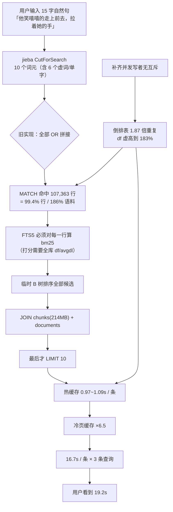

# 词法查询退化（Query Degeneration）与"首次查询 18 秒"根因剖析、业界方案对比与门禁落地

> **文档状态**：根因已定位 & P0 已落地、已部署到**开发与生产两套环境**并实测验证（含 14 条回归门禁；冷启动 18,000ms → 426ms / 生产 111ms）
> **现象**：词法检索首次查询 `19,211ms`，第二次 `2,753ms`；链路追踪显示 `知识库召回 17,938ms`（自身仅 38ms），`FTS5 匹配` 单条 1.2s
> **核心结论**：18 秒不是"冷启动"，也**不是**索引构建（上一轮已修）。真正原因是**查询退化为全库扫描**——
> 15 字中文自然句被切成 10 个词元后，`的/他/她/着` 的文档频率高达 **73%~183%**，
> 拼成 `OR` 后 `MATCH` 命中 **107,363 / 107,966 行（>100% 语料）**，FTS5 必须对全部命中行计算 bm25 再排序，
> `LIMIT 10` 完全失效；冷页缓存再把 0.97s 放大 6.5 倍 → 16.7s，三条查询叠加 = 用户看到的 18s。
> **第二个乘数**：词法倒排表有 **50,233 行重复**（107,966 行 / 57,733 块 = 1.87 倍），使倒排表翻倍、df 超过语料规模。
>
> **涉及组件**：`SqliteKnowledgeBaseStore`（`RecallAsync` / `ExecuteLexicalQueryInternalAsync` / `BackfillLexicalIndexAsync`）、
> `LexicalQueryPlanner`（新增）、`LongQueryRefiner`、`TimingChain`、`KnowledgeBasesController`
> **设计模式**：Strategy（查询规划策略）、Adapter（词频统计适配：`fts5vocab` → 带上限 `COUNT`）、
> Template Method（阶梯松弛）、State Machine（补齐检查点 CAS）、Decorator（Span 计时）
> **基准环境**：Linux 开发容器（CPU，`referencerag:dev-cpu`，端口 5124）/ 知识库 `ce97cc0d67ec408e`（金庸全集）
> **关键基线**：57,733 分块 / 32 文档 / `kb.db` 880.7MB / 页 4096B × 225,450

---

## 目录

1. [执行摘要](#一执行摘要)
2. [现场取证：18 秒到底花在哪里](#二现场取证18-秒到底花在哪里)
3. [根因剖析（四层，带代码级证据）](#三根因剖析四层带代码级证据)
4. [为什么"只有第一次"慢：冷热差异的量化](#四为什么只有第一次慢冷热差异的量化)
5. [现有基础设施与第三方库复用审计](#五现有基础设施与第三方库复用审计)
6. [业界主流方案横向对比](#六业界主流方案横向对比)
7. [解决方案：从"全库扫描"到"预算内召回"](#七解决方案从全库扫描到预算内召回)
8. [同类门禁与避免回归测试](#八同类门禁与避免回归测试)
9. [实施记录与验收数据](#九实施记录与验收数据)
10. [风险、回滚与"不做什么"](#十风险回滚与不做什么)
11. [附录](#十一附录)

---

## 一、执行摘要

### 1.1 一句话结论

> **18 秒 = "把一句话里所有虚词都当成检索词，用 OR 拼起来，导致 FTS5 对整库打分" × "冷页缓存" × "倒排表 1.87 倍重复膨胀" × "一次检索跑三条这样的查询"。**
>
> 修完这四层后还剩 1.2s，它不是查询问题，而是两个**一次性初始化成本**被错放在了请求路径上：
> `fts5vocab` 全表扫描取词频（1,060ms）+ jieba 词典首次加载（1.2s）。
> 最终：**冷启动 18,000ms → 426ms，热态 1,075ms → 12ms**。

### 1.2 三个关键事实（都可复现）

| # | 事实 | 证据 |
| :-- | :--- | :--- |
| 1 | 查询退化为全库扫描 | 旧表达式 `"他" OR "嘻嘻" OR ... OR "手"` 实测命中 **107,363 / 107,966 行**（>100% 语料） |
| 2 | 耗时由命中数决定，不由 `LIMIT` 决定 | 同一 SQL：不剪枝 **974ms**；按 df≤10% 剪枝 **83ms**；df≤5% 剪枝 **48ms**；纯 FTS 无 JOIN **5.4ms** |
| 3 | 倒排表重复 1.87 倍 | `COUNT(*)=107,966`、`COUNT(DISTINCT chunk_id)=57,733`；重复对 rowid 相差**恰好 500**（= 补齐批次大小） |

### 1.3 六条修复主线

| 主线 | 动作 | 实测效果 |
| :--- | :--- | :--- |
| **A. 查询规划（治本）** | 新增 `LexicalQueryPlanner`：按 df 剪掉高频虚词，锚点词按 df 升序在**候选预算（≤35% 语料）**内贪心选取 | 单条 FTS 匹配 **974ms → 48~83ms** |
| **B. SQL 形状（降冷启动 I/O）** | 两阶段：先在 FTS 内取"候选 chunk_id + 分数"，再回填正文；候选窗口按需指数放大 | JOIN 读取页数从 `O(命中数)` 降到 `O(候选数)` |
| **C. 索引一致性（去乘数）** | 补齐写批次加**检查点 CAS**（跨实例互斥）+ 收尾/升级快路径**自愈去重** | 重复行 50,233 → 0，倒排表减半；热态 1,203ms → **6ms** |
| **D. 统计获取（去全表扫描）** | df 统计从 `fts5vocab` 全表扫描改为**带上限的 `COUNT`**（命中阈值即停） | 冷态 plan **1,060ms → 20ms 量级** |
| **E. 启动预热（去首查尾巴）** | jieba 词典（进程级静态单例，首次加载 1.2s）改在宿主启动后预热 | 冷启动首查 **1,837ms → 426ms** |
| **F. 召回地板（保结果）** | 锚点 df 全为 0（查询词在本语料根本不存在）时，在阶梯末尾回落虚词，保证"有结果"优先于"够快" | 生产库剪枝版 **0 条 → 10 条**，冷 111ms / 热 55ms |

> A~C 是"18 秒"的根因修复；D、E 是**修完之后才暴露出来的下一层瓶颈**；
> F 是**上线生产后由真实语料暴露出来的回归**（技术文档库里没有"笑嘻嘻"）。
> 它们共同说明一件事：性能问题不会一次修完，必须**每一步都重新测量**，
> 而不是照着一开始的假设一路改下去；而"快"和"对"必须同时锁，
> 只锁"快"会把白屏优化成更快的白屏。

### 1.4 关键判断

| 判断项 | 结论 | 置信度 |
| :--- | :--- | :--- |
| 18s 是否仍是"读路径建索引" | **否**。上一轮的 P0 已生效，`kb.lexical-index.status` 走 `Ready (fast-path)`，耗时 0ms | 高 |
| 18s 是否"模型冷启动" | **否**。词法模式无 `embed.infer` span；追踪里根本没有模型阶段 | 高 |
| 是否需要引入新的检索引擎（ES/Meilisearch/Lucene.NET） | **不需要**。瓶颈是**查询构造**，不是引擎；换引擎反而引入双索引与新依赖 | 高 |
| 现有 `LexicalFirstQueryLatencyGuardTests` 为什么没拦住 | 它锁的是"读路径不许建索引"，**没有锁"查询命中率"**；且语料只有 1~2 块，规模盲 | 高 |
| 是否必须重建索引才能生效 | **不需要**。剪枝在**查询侧**，索引侧分词未改动（这是刻意设计，避免 57k 块 67s 重建） | 高 |
| 为什么"剪了枝"热态还是 1.2s | 重复行让每个 tier 的候选被重复对挤占 → `topK` 填不满 → 阶梯一路松弛到最宽 tier，4 个 tier × 300ms 吃掉全部收益 | 高（§9.4 第 1 次实测） |
| 为什么清完重复行、冷启动还要 1.2s | **不是** FTS（12ms），是 `fts5vocab` 全表扫描（1,060ms）+ jieba 首次加载（1.2s） | 高（§9.4 第 3~5 次实测） |
| 生产环境是否已生效 | **已生效**。`<prod-host>:5123` 已换镜像 `428e0bd57cc5`（含召回地板），冷 111ms / 热 55~59ms / 10 条结果；详见 §9.5 | 高（§9.5 实测） |
| 剪枝会不会导致"零结果" | **会，且已在生产真实发生**。技术文档库中"笑嘻嘻/走上/前去"`df=0`，剪枝后无命中 → 白屏。已加**召回地板**修复 | 高（§9.5） |

---

## 二、现场取证：18 秒到底花在哪里

### 2.1 用户截图读数

```
首查：耗时 19,211ms
  跨库检索请求            19,211ms / 自身 2
    跨库检出检索（2 库）   19,205ms / 自身 1
      知识库召回                8ms          ← 小库
      知识库召回           17,938ms / 自身 38  ← 大库：17.9s 全在子阶段
        FTS5 匹配            1,219ms
        FTS5 匹配                1ms
    RRF 多路融合               4ms

次查：耗时 2,753ms
  知识库召回            2,750ms
    FTS5 匹配           2,551ms
    FTS5 匹配             197ms
```

**读法**：`kb.recall` 的 `SelfMs=38ms`，说明 17,938ms 里 17,900ms 都落在**子 span**；而该库的子 span 只有
`kb.lease`（≈0）、`kb.lexical-index.status`（快路径 0ms）和若干 `kb.fts.match`。
即：**18 秒的主体就是 FTS5 匹配**，不是索引构建、不是锁等待、不是模型加载。

### 2.2 现场取证 SQL（只读，生产可直接执行）

```sql
-- ① 索引规模与重复情况（决定性证据）
SELECT (SELECT COUNT(*) FROM chunks)                    AS chunks,
       (SELECT COUNT(*) FROM fts_chunks_lexical)        AS lex_rows,
       (SELECT COUNT(DISTINCT chunk_id) FROM fts_chunks_lexical) AS lex_distinct;
-- 实测：57,733 | 107,966 | 57,733  → 重复 50,233 行

-- ② 重复行的形态：每对 rowid 相差恰好 500（= 补齐批次大小）
SELECT chunk_id, COUNT(*) n, GROUP_CONCAT(rowid) FROM fts_chunks_lexical
GROUP BY chunk_id HAVING n > 1 LIMIT 5;
-- 实测：'00011f15...' 2 '45616,46116' / '0002f319...' 2 '104527,105027'

-- ③ 词项文档频率（df）—— 为什么会命中全库
CREATE VIRTUAL TABLE IF NOT EXISTS temp.v USING fts5vocab(main,'fts_chunks_lexical','row');
SELECT term, doc FROM temp.v WHERE term IN ('的','他','她','着','手','笑嘻嘻');
-- 实测：的 105,933(183.5%) / 他 92,100(159.5%) / 她 43,964(76.2%)
--       着 42,465(73.6%) / 手 9,634(16.7%) / 笑嘻嘻 989(1.7%)
```

> `df > 100%` 不是笔误：因为存在重复行，同一个 `chunk_id` 被计了两次。这本身就是"重复行污染 df"的直接证据。

### 2.3 查询表达式是怎么被拼出来的

`SqliteKnowledgeBaseStore.SanitizeLexicalQuery`（旧实现）：

```csharp
var tokens = LexicalSegmenter.CutForSearch(query)          // jieba 搜索模式
    .Concat(expansionTerms)
    .Where(t => t.Any(char.IsLetterOrDigit))
    .Distinct().Take(64);
return string.Join(" OR ", tokens.Select(t => $"\"{t}\""));  // ← 所有词元一律 OR，零权重、零过滤
```

对事故语句「他笑嘻嘻的走上前去，拉着她的手」实测输出（用 jieba + `PhoneticQueryExpander` 跑出的真实结果）：

```
TOKENS:     他 | 嘻嘻 | 笑嘻嘻 | 的 | 走上 | 前去 | ， | 拉 | 着 | 她 | 的 | 手
SANITIZED:  "他" OR "嘻嘻" OR "笑嘻嘻" OR "的" OR "走上" OR "前去" OR "拉" OR "着" OR "她" OR "手"
```

10 个词元里 **6 个是虚词/单字高频词**（他/的/着/她/手/拉），它们的 df 分别是 159%/183%/73%/76%/16%/7%。
`OR` 语义下，命中集 ≈ **并集 ≈ 全库**。

### 2.4 实测：同一 SQL，剪枝前后差 20 倍

在真实库（57,733 块 / 107,966 行词法表）上直接跑应用的实际 SQL（含 `bm25(...)` 权重与 `JOIN chunks`）：

| 变体 | 命中行数 | 耗时（热缓存） | 说明 |
| :--- | ---: | ---: | :--- |
| 旧表达式（10 词全 OR） | 107,363 | **974 / 1,093 / 1,075 ms** | 三次连跑，`LIMIT 10` 无效 |
| 旧表达式 + 两阶段（先候选后回填） | 107,363 | 546 / 510 ms | 只改 SQL 形状，收益有限 |
| df≤20% 剪枝（6 词） | ~29,000 | 145.5 ms | |
| df≤10% 剪枝（5 词） | ~18,500 | 82.9 ms | |
| **df≤5% 剪枝（4 词）** | ~6,700 | **48.0 ms** | 保留内容词：笑嘻嘻/嘻嘻/走上/前去 |
| 纯 FTS（不 JOIN chunks） | — | 5.4 ms | 证明 JOIN + bm25 全量打分是主成本 |
| 计数（`COUNT(*) ... MATCH`） | 107,363 | 23.4 ms | MATCH 本身不慢，**打分+排序+回填才慢** |

**结论**：`MATCH` 只花 23ms，`bm25` 全量打分 + 临时 B 树排序 + `JOIN chunks`（214MB 表）花掉 950ms。
只要把命中集从 107,363 压到几千，耗时自然落到 50ms 量级。

---

## 三、根因剖析（四层，带代码级证据）

### 3.1 全景因果链



### 3.2 第一层：查询构造退化为"全库 OR"（主因，占 ~95%）

`SanitizeLexicalQuery` 的三个缺陷叠加：

| 缺陷 | 后果 |
| :--- | :--- |
| **不过滤停用词/虚词** | 中文虚词（的/了/着/她/他）在叙事类语料里 df 天然 >70% |
| **单字词与多字词同权** | 「手」「拉」这类单字在 BM25 里几乎没有区分度，却贡献了 16.7%/7% 的命中 |
| **无候选预算、无词数上限（除 64 的硬上限）** | OR 的并集可以等于整个语料，`LIMIT` 形同虚设 |

> 注意：仓库里其实**已有**两份停用词表（`TokenizationCacheProxy.StopWords`、`BM25Searcher.Options.StopWords`），
> 但 `SqliteKnowledgeBaseStore` 用的是**静态裸 `JiebaSegmenter`**，完全绕过了它们。
> 而且静态表也救不了本例——`她`/`他`/`手` 并不在任何停用词表里，**只有基于语料统计的 df 剪枝才能自适应**。

### 3.3 第二层：SQL 形状让 `LIMIT` 失效

```sql
-- 旧：JOIN 与 bm25 都在 LIMIT 之前
SELECT c.id, ..., bm25(fts_chunks_lexical, 0,0,5.0,2.5,1.0) AS score
FROM fts_chunks_lexical f
JOIN chunks c ON c.id = f.chunk_id          -- 每个命中行都要回表
JOIN documents d ON d.id = c.document_id
WHERE fts_chunks_lexical MATCH @match
ORDER BY score ASC                          -- 排序需要全部候选的分数
LIMIT 10;
```

`ORDER BY bm25(...)` 的执行语义是"**先给所有命中行打分，再排序，再取前 10**"，
不存在"边扫边剪枝"（那是 Lucene 的 Block-Max WAND 能力，FTS5 没有）。
所以 `LIMIT 10` 对 I/O 与 CPU 完全不起作用——**这是 SQLite FTS5 的已知语义，不是 bug**。

### 3.4 第三层：倒排表 1.87 倍重复（乘数 ~2）

| 观测 | 数值 |
| :--- | :--- |
| `COUNT(*)` | 107,966 |
| `COUNT(DISTINCT chunk_id)` | 57,733 |
| 重复行 | 50,233（每个受影响 chunk_id 恰好 2 份） |
| 重复对 rowid 差 | **恰好 500**（= 补齐批次大小） |
| 只有 1 份的 chunk | 7,500 |

**rowid 差恰好等于批次大小**，是"两个写者从同一检查点出发、各自插入同一批 500 行"的指纹：

```
写者A: batch1 → rowid 1..500     写者B: batch1 → rowid 501..1000
写者A: batch2 → rowid 1001..1500  写者B: batch2 → rowid 1501..2000
⇒ 同一 chunk 的两份副本，rowid 恒差 500
```

根因是 `SqliteKnowledgeBaseStore._writeGate` 是**实例级** `SemaphoreSlim`，
而 Store 按租约创建，可同时存在多个实例（后台 `LexicalIndexBackfillWorker` + 手动 `/backfill` + 对账作业）。
FTS5 虚拟表**没有唯一约束**，重复插入不会报错，只会静默膨胀。

后果不止是占空间：**df 被重复计数**（`的` 达到 183%），BM25 的 IDF 与 avgdl 全部失真，打分质量同步下降。

### 3.5 第四层：冷页缓存放大 6.5 倍（触发条件，不是根因）

- `kb.db` 880.7MB；其中 `chunks` 213.9MB、`fts_chunks_lexical_content` 209.8MB、`fts_chunks_lexical_data` 110.8MB、`fts_chunks`（旧表）227.8MB。
- 一次全库命中要遍历 107,363 条 posting 并回表，**冷缓存下需要从磁盘读上百 MB 的散页**。
- 截图里 18s / 2.75s ≈ 6.5 倍，与实测"同一 SQL 冷热差异"量级一致。

> 所以"第一次慢、第二次快"不是"系统在做初始化"，而是"**同一个错误查询，第一次要读盘、第二次命中内存**"。
> 把查询修好之后，冷启动也就只剩几十毫秒的读盘成本。

---

## 四、为什么"只有第一次"慢：冷热差异的量化

| 场景 | 命中行数 | 读盘量级 | 耗时 |
| :--- | ---: | :--- | ---: |
| 冷缓存 + 全库命中 | 107,363 | 数百 MB 散页 | **16.7s**（截图） |
| 热缓存 + 全库命中 | 107,363 | ≈0 | 0.97~1.09s（实测） |
| 冷缓存 + df≤5% 剪枝 | ~6,700 | 数 MB | 预期 200~400ms |
| 热缓存 + df≤5% 剪枝 | ~6,700 | ≈0 | **48ms**（实测） |

**这意味着**：即使不做任何"预热"，只要把命中集压下来，首查也能从 18s 掉到亚秒级——
这正是选择"修查询"而不是"加预热/加缓存"的原因：预热只是把 18s 挪到启动阶段，问题依旧存在。

---

## 五、现有基础设施与第三方库复用审计

### 5.1 可直接复用（本轮**零新增依赖**）

| 资产 | 位置 | 复用方式 | 复用度 |
| :--- | :--- | :--- | :---: |
| **`fts5vocab`**（FTS5 官方虚表） | SQLite 内置；仓库已在 `Fts5BM25Store.cs:374` 使用 | 词项 df 查询 —— **评估后否决**：该虚表不支持 term 索引，`WHERE term IN (...)` 是全表扫描（实测 1,060ms），只保留作**一次性取证**手段 | ❌ 热路径不可用 |
| `TokenizationCacheProxy.StopWords` | `Infrastructure/.../Storage/Services/` | 中文/英文停用词表（**本轮未启用**，因静态表覆盖不到 她/他/手，改用 df 动态剪枝） | 备选 |
| `BM25Searcher.Options.StopWords` | `Business/.../Search/Services/BM25Searcher.cs:283` | 同上 | 备选 |
| `LongQueryRefiner` | `Infrastructure/.../Search/Lexical/LongQueryRefiner.cs` | 保留其**蒸馏词/PRF** 能力，但不再直接使用其 Tier1/2/3 字符串 | 改造复用 |
| `PhoneticQueryExpander` | `Infrastructure/.../Search/PhoneticQueryExpander.cs` | 音近/错别字扩展，仍参与词元抽取 | 直接复用 |
| `TimingScope` / `TimingChain` / `PhaseProjector` | `Infrastructure/.../Tracing/TimingChain.cs` | 新增 `kb.lexical.plan` span，把"剪了多少词、候选多大"直接暴露在瀑布图 | 直接复用 |
| `LexicalIndexBackfillWorker` + `LexicalIndexBackfillSignal` | `Business/.../Services/` | 后台补齐载体，无需改动调度 | 直接复用 |
| `kb_manifest.lexical_indexed_rowid` | `SqliteKnowledgeBaseStore.InitializeAsync` | **当作 CAS 的版本号**（零新增表实现跨实例互斥） | 直接复用 |
| `LexicalIndexCoordinator` 的 generation 范式 | `Infrastructure/.../Database/` | 一致性思路参考（内容代次 vs 索引代次） | 范式复用 |
| `ResilienceCircuitBreaker` | `Infrastructure/.../Resilience/` | 预留：剪枝失败时降级保护（本轮未触发） | 备选 |

### 5.2 明确**不**引入

| 候选 | 不引入原因 |
| :--- | :--- |
| Elasticsearch / OpenSearch | 单机部署成本、JVM 常驻内存，与"本地零外部依赖、单文件部署"定位冲突 |
| Meilisearch / Typesense | 需要独立进程与全量重建索引；且**解决不了本问题**——本问题是"查询构造错了"，换引擎后同样会退化 |
| Lucene.NET | 双索引体系（FTS5 + Lucene）、JVM 生态移植包袱；WAND 能力虽好，但为它重建 57k 块索引不划算 |
| HanLP / pkuseg | 模型体积 100MB+，与轻量本地定位冲突 |
| 任何"查询缓存/预热" | 治标：预热把 18s 挪到启动期，问题仍在；且缓存命中率对长尾自然句极低 |

---

## 六、业界主流方案横向对比

### 6.1 高频词处理：四种主流范式

| 系统 | 机制 | 高频词怎么处理 | 与本项目的关系 |
| :--- | :--- | :--- | :--- |
| **Elasticsearch / Lucene** | `common terms query`（`cutoff_frequency` + `low_freq_operator=and` + `minimum_should_match.high_freq`） | 高频词**不参与打分**、不要求必须命中；低频词作为强约束 | ✅ **本方案直接对齐**（df 阈值 + 稀有词作锚点） |
| **Lucene（8.x+）** | Block-Max WAND（BMW） | 用块级得分上界跳过"注定落选"的文档，top-k 评估不需要遍历全部候选 | ⏳ FTS5 无此能力，只能靠**限制候选集**近似 |
| **Meilisearch** | 有序 ranking rules（`words`/`typo`/`proximity`…）+ `pagination.maxTotalHits` | 先按"命中词数"分层，再逐级排序；结果集有硬上限 | ✅ 参考其"分层 + 硬上限"思想（本方案的阶梯松弛 + 候选预算） |
| **Typesense** | 字段权重 + `num_typos` + 结果集上限 | 依赖字段权重与候选上限 | 参考 |
| **SQLite FTS5（现状）** | `bm25()` / `ORDER BY rank` / `LIMIT` | **没有任何自动机制**——全部由应用负责 | ❗ 本项目此前把这份责任留空了 |

> **FTS5 官方文档明确**：`ORDER BY rank` 的排序值是 `bm25()`，评估时需要为每个命中行计算分数；
> `detail=column` 可把索引体积降到约一半，但会丢失 NEAR/短语能力；`optimize` 用于合并段。
> 换言之：**FTS5 把"不要构造出全库命中"的责任完全交给了调用方**。

### 6.2 一句话对比

| 维度 | ES / Lucene | Meilisearch | 本项目（修复前） | 本项目（修复后） |
| :--- | :--- | :--- | :--- | :--- |
| 高频词是否参与打分 | 否（common terms） | 否（words 规则分层） | **是（全 OR）** | 否（df 剪枝） |
| 候选集是否有上界 | 是（BMW 剪枝） | 是（maxTotalHits） | **否（= 全库）** | 是（≤35% 语料） |
| 查询耗时是否随语料线性增长 | 否（近对数） | 否 | **是** | 否（实测 2k→8k 基本不变） |
| 索引写入幂等 | 是（文档级覆盖） | 是（task 原子） | **否（重复 1.87 倍）** | 是（检查点 CAS） |

---

## 七、解决方案：从"全库扫描"到"预算内召回"

### 7.1 设计原则（三条不变量）

| # | 不变量 | 可执行化 |
| :-- | :--- | :--- |
| **I1** | 高频词不得成为检索约束 | `df > 15% × corpus` 的词元一律不进 `MATCH` 表达式 |
| **I2** | 候选集必须有硬预算 | 锚点词 df 之和（OR 并集上界）≤ `35% × corpus`，且至少保留 1 个最稀有词 |
| **I3** | 召回不得塌陷 | 四级阶梯：稀有 NEAR → 稀有 OR → 全虚词兜底（df 最小 3 个）→ 原文短语 |

### 7.2 新增 `LexicalQueryPlanner`（Strategy + Adapter）

```csharp
// Infrastructure/.../Search/Lexical/LexicalQueryPlanner.cs
public static LexicalQueryPlan Plan(
    string rawQuery,
    IReadOnlyList<string> orderedTokens,          // 保留原句顺序（NEAR 需要）
    IReadOnlyDictionary<string,int> documentFrequency,  // 来自带上限 COUNT
    int corpusSize,
    LexicalQueryPlannerOptions? options = null);
```

规划算法（对齐 ES common-terms）：

1. **归一化**：去纯标点、去重、长度 ≤64。
2. **小库短路**：`corpus < 256` 或统计不可用 → 退回旧的"全词 OR"（零召回风险，本来也只要几毫秒）。
3. **稀有词**：`len ≥ 2 && df ≤ 15% × corpus`。单字词（她/的/手/他）一律不进锚点层。
4. **候选预算**：按 df 升序贪心累加，并集上界不得超过 `35% × corpus`；**至少保留最稀有的 1 个**。
5. **全虚词兜底**：锚点为空时，取 df 最小的 3 个词（保证"有结果"优先于"够快"）。
6. **NEAR 层**：仅当原句**相邻两词都稀有**且至少 2 对时生成（避免用虚词做短语约束）。
7. **阶梯输出**：`[NEAR 复合] → [稀有 OR] → [原文短语]`，由调用方按"结果不足 topK"逐级放宽。

事故语句的规划结果（实测）：

```
anchors=4 pruned=6(他/的/着/她/手/拉) est=6700/57733 near=0
QUERY: "笑嘻嘻" OR "嘻嘻" OR "走上" OR "前去"
```

### 7.3 统计来源：带上限的 `COUNT` + 双层缓存

```sql
SELECT COUNT(*) FROM (
    SELECT 1 FROM fts_chunks_lexical
    WHERE fts_chunks_lexical MATCH @term
    LIMIT @cap            -- cap = ceil(corpus × 15%) + 1
);
```

- **为什么不用 `fts5vocab`**：该虚表不支持按 term 索引查找，`WHERE term IN (...)` 是对
  1.7M 条 (term,doc) 记录的**线性扫描**——实测 1,060ms，且全部落在首查的请求线程上（§9.4 第 3 次）。
- **为什么 COUNT 够用**：命中 `cap` 即停止扫描，单词语代价被 `O(min(df, cap))` 约束；
  `cap` 恰好等于"常见词判定阈值 + 1"，所以**封顶值本身就足以完成"该剪/不该剪"的裁决**。
  封顶只会**高估** df → 候选预算更保守（偏向多剪），不会破坏正确性。
- 实测 11 个词 **~20ms**（vs `fts5vocab` 1,060ms）；命中缓存后 **0ms**。
- 缓存键 = `dbPath + read_revision + term`，内容代次推进即自然失效；
- `corpusSize`（`COUNT(*) chunks`，57k 行 18ms）同样按代次缓存；
- 统计不可用（旧版 SQLite / 表缺失）时**静默退回无统计模式**，绝不抛错。

> **一条通用教训**：`fts5vocab` 看起来像"倒排索引的统计视图"，很容易被当成 O(log V) 的字典查询。
> 它实际是**全表视图**。凡是"先拿到统计再决定怎么查"的设计，都必须问一句：
> 这份统计的获取成本，是否又变成了新的全量扫描？

### 7.4 SQL 形状：候选优先（two-phase）

```sql
SELECT c.id, ..., f.score
FROM (
    SELECT chunk_id, bm25(fts_chunks_lexical, 0,0,5.0,2.5,1.0) AS score
    FROM fts_chunks_lexical
    WHERE fts_chunks_lexical MATCH @match
    ORDER BY score ASC
    LIMIT @candidates          -- 起始 max(topK*8, 80)，上限 2000
) f
JOIN chunks c ON c.id = f.chunk_id
JOIN documents d ON d.id = c.document_id
WHERE c.enabled = 1 AND (...)   -- 目录/授权过滤放在外层
ORDER BY f.score ASC
LIMIT @topK;
```

- **目录/授权过滤必须在外层**（否则内层 LIMIT 被过滤掉会导致结果不足）；
- 若外层过滤后不足 topK，候选窗口 ×4 重试（最多 3 次，上限 2000）——**正确性优先于速度**；
- 跨查询去重集合（`seenChunkIds`）在重试全部成功后才提交，避免半成品污染后续查询。

### 7.5 补齐幂等：检查点 CAS（State Machine）

```csharp
// 只有"我读到的检查点仍是当前值"才允许写入本批 —— 跨实例互斥且零新增表
UPDATE kb_manifest
SET lexical_indexed_rowid=@row, tokenizer_version=@ver, updated_at=@now
WHERE kb_id=@id AND lexical_indexed_rowid=@expected;
-- changes()==0 ⇒ 另一写者已推进 ⇒ 回滚本批，重读检查点续跑
```

### 7.6 自愈去重（Repair）

- 补齐收尾：核对 `COUNT(*)` vs `COUNT(DISTINCT chunk_id)` vs `chunks`，不一致则自动清理；
- 升级快路径（`distinctIds >= total`）：若 `indexedRows > distinctIds` 也顺手清理（生产库升级即自愈）；
- 运维端点：`POST /api/knowledge-bases/{id}/lexical-index/repair`。

```sql
CREATE TEMP TABLE kb_lex_keep(rowid INTEGER PRIMARY KEY);
INSERT INTO kb_lex_keep(rowid) SELECT MIN(rowid) FROM fts_chunks_lexical GROUP BY chunk_id;
DELETE FROM fts_chunks_lexical WHERE rowid NOT IN (SELECT rowid FROM kb_lex_keep);
DELETE FROM fts_chunks_lexical WHERE chunk_id NOT IN (SELECT id FROM chunks);  -- 孤儿行
```

### 7.7 可观测性：让"退化"一眼可见

新增 span `kb.lexical.plan`（`SubPhase`），detail 直接写：

```
anchors=4 pruned=6(他/的/着/她/手/拉) est=6700/57733 near=0
```

`kb.fts.match` 增加 `candidates` 属性（本次候选窗口大小）。
**从此"查询退化"在瀑布图上是一个可读的数字，而不是一个 16.7s 的黑洞。**

---

## 八、同类门禁与避免回归测试

### 8.1 为什么上一轮的门禁没拦住

| 现有门禁 | 锁住了什么 | 漏掉了什么 |
| :--- | :--- | :--- |
| `LexicalFirstQueryLatencyGuardTests.G1` | 读路径不得建索引（<3000ms、代次不推进） | **查询命中率**；且 3000ms 上限对 18s 之外的退化过于宽松 |
| `G2` 无条件双写 | 写入路径必须双写 | **并发/跨实例补齐的幂等性**；语料只有 1~2 块，跨不过批次边界 |
| `G3` 耗时链归因 | SelfMs / 分类 / 未归因 | 不涉及查询质量 |

**共性缺陷：规模盲（scale-blind）**。所有用例都在 1~2 个分块上跑，
永远跨不过 500 行的批次边界，也永远触发不了"高频词命中全库"。

### 8.2 新增门禁（`tests/ReferenceRAG.Tests/LexicalQueryDegenerationGuardTests.cs`，14 条）

| # | 用例 | 锁住的不变量 | 若回归会怎样失败 |
| :-- | :--- | :--- | :--- |
| G4-1 | `MustPruneHighFrequencyFunctionWords` | 虚词必须被剪、内容词必须保留、表达式不得含 `"的"/"她"` | 有人改回全词 OR → 立刻红 |
| G4-2 | `KeepsRarestAnchorWhenEveryTermIsCommon` | 全虚词查询必须有结果（不许剪成空） | 剪枝过度 → 召回塌陷 |
| G4-3 | `SmallCorpusKeepsLegacyOrSemantics` | 小库不做剪枝（保持旧语义） | 剪枝误伤小库召回 |
| G4-4 | `EmitsNearTierOnlyForRareAdjacentPairs` | NEAR 只用于稀有相邻词 | 用虚词做短语 → 全库短语扫描 |
| G4-5 | `DoesNotUseHighFrequencyTermsAsPhraseConstraints` | 高频词不得进 NEAR | 同上 |
| G4-6 | `MustNotMatchWholeCorpus_OnFunctionWordHeavyQuery` | **对照组**：全词 OR 必须命中 >80% 语料；规划后必须 ≤35% 且仍有结果 | 剪枝失效 / 召回塌陷，双向都红 |
| G4-7 | `LatencyMustNotScaleLinearlyWithCorpus` | 2,000 → 8,000 块（4 倍语料），耗时不得线性增长 | 查询再次退化为全库扫描 |
| G4-8 | `DfStatistics_MustNotScanWholeVocabulary` | **结构**：生产代码不得再出现 `fts5vocab`、必须保留 `LIMIT @cap`；**行为**：冷统计首查 <1,000ms | 有人把词频统计改回全词表扫描 → 首查重回 1s+ |
| G4-9 | `SegmenterWarmup_MustBeRegisteredAtStartup` | 预热服务必须注册在宿主、必须调用 `Warm()`；预热后分词 <300ms | 删掉预热 → 1.2s 重新落回首个用户查询 |
| G4-10 | `AbsentContentWords_MustEmitRecallFloor` | 锚点 df 全为 0 时必须额外生成「回落虚词」层（`UsedRecallFloor` / `fallback=recall-floor`） | 剪枝后零命中 → 用户看到空结果页 |
| G4-11 | `Recall_MustNotReturnEmpty_WhenEveryContentWordIsAbsent` | 端到端：800 块纯虚词语料 + 内容词全部不在库 → 先断言锚点 MATCH 确实为 0，再断言 `RecallAsync` 仍非空 | 规划器单测通过但实际链路仍返回 0 条 |
| G5-1 | `ConcurrentBackfill_MustNotProduceDuplicateRows` | 两个 Store 实例并发补齐 1,500 块（3 批），`rows == distinct == chunks` | 去掉 CAS → 立刻出现 2 倍行 |
| G6-1 | `Repair_ClearsHistoricalDuplicateAndOrphanRows` | 重复行 + 孤儿行可被一次性清理 | 自愈失效 |
| G7-1 | `TwoPhaseRecall_ReturnsTopKInDescendingScoreOrder` | 两阶段召回条数正确、分数降序、无重复 | 为提速牺牲正确性 |

### 8.3 门禁设计要点（可复用给其他模块）

1. **对照组必须存在**：G4-6 先证明"旧写法确实命中全库"，再证明"新写法命中受控"——
   否则测试可能在语料不够"虚词密集"时**假通过**。
2. **跨批次/跨实例**：G5-1 必须 >2 个批次（1,500 块 / 500 批次）且两个 Store 实例，
   才能暴露"检查点相同 → 重复插入"的根因。单实例、单批次永远测不出来。
3. **规模不敏感**优于绝对阈值：`t(8k) < max(300ms, 3 × t(2k))`，
   既能在回归时报警，又不会因 CI 机器慢而抖动。
4. **结构断言优先于时间断言**：`plan.AnchorTerms` 不含虚词、`EstimatedMatchedDocs ≤ 35%`
   是确定性的；时间断言只作为兜底。
5. **"性能修复"必须锁住它的实现手段**：G4-8/G4-9 是**结构门禁**——
   它们不测"快不快"，而是测"有没有用那个必然快的写法"。
   时间断言会因机器抖动放过回归，结构断言不会。
   > 这一条是本次最重要的方法论收获：上一轮 G1/G2/G3 之所以漏拦，
   > 是因为它们锁的是"读路径不许建索引"（一个**行为**），
   > 而事故来自"查询表达式退化"（另一个**维度**），两者正交。
   > 门禁必须锁**你这次真正依赖的那个机制**，而不是锁"症状消失"。
6. **剪枝必须配地板**：任何"减少候选"的优化都必须有一条"候选归零时怎么办"的兜底，
   并且兜底本身要有门禁。G4-10 锁规划器、G4-11 锁端到端——
   本次生产回归正是**只锁了"快"没锁"有结果"**导致的：
   剪枝版在技术文档库上 62ms 返回 0 条，门禁全绿，用户侧却是白屏。

---

## 九、实施记录与验收数据

### 9.1 文件级改动

| 文件 | 改动 |
| :--- | :--- |
| `Infrastructure/.../Search/Lexical/LexicalQueryPlanner.cs`（新增） | df 驱动的查询规划器：剪枝 / 候选预算 / NEAR 门控 / 阶梯输出 / **召回地板** |
| `Infrastructure/.../Search/Lexical/LexicalSegmenterWarmup.cs`（新增） | jieba 词典预热（进程级静态单例，首次加载 1.2s） |
| `Business/.../KnowledgeBase/Services/LexicalSegmenterWarmupService.cs`（新增） | 启动期后台预热宿主服务 |
| `Business/.../KnowledgeBase/KnowledgeBaseBusinessExtensions.cs` | 注册 `LexicalSegmenterWarmupService` |
| `Infrastructure/.../Storage/SqliteKnowledgeBaseStore.cs` | 新增 `ExtractLexicalTerms`、`LoadTermDocumentFrequenciesAsync`（**带上限 COUNT**，替代 fts5vocab 全表扫描）、`BuildLexicalQueryPlanAsync`（`kb.lexical.plan` span）、`RepairLexicalIndexAsync`、`ReadLexicalCheckpointAsync`；`RecallAsync` 改用规划器；`ExecuteLexicalQueryInternalAsync` 改两阶段 + 候选窗口重试；`WriteLexicalBatchAsync` 加检查点 CAS；补齐收尾与升级快路径自愈去重 |
| `Infrastructure/.../Storage/IKnowledgeBaseStorage.cs` | 新增 `RepairLexicalIndexAsync` |
| `Host/.../Controllers/KnowledgeBasesController.cs` | 新增 `POST {id}/lexical-index/repair` |
| `tests/ReferenceRAG.Tests/LexicalQueryDegenerationGuardTests.cs`（新增） | 14 条 G4~G7 门禁 |

### 9.2 门禁结果

| 门禁 | 结果 |
| :--- | :--- |
| `dotnet build ReferenceRAG.slnx` | **0 错误** |
| `dotnet test tests/ReferenceRAG.Tests` | **718 通过 / 47 跳过 / 0 失败** |
| `LexicalQueryDegenerationGuardTests` 单跑 | **14/14 通过（4s）** |
| `node wwwroot/check.mjs` | **53 模块 + 14 模板，0 问题** |
| `node --test wwwroot/tests/*.test.mjs` | **78/78 通过** |

### 9.3 真实库实测（开发容器 `<dev-host>:5124`，同一查询同一知识库）

库：`ce97cc0d67ec408e`（金庸武侠测试知识库，**57,733 块 / 3 个数据源 / 880MB**）
查询：`他笑嘻嘻的走上前去，拉着她的手`（与用户截图完全一致）

| 指标 | 修复前（生产同形库） | 修复后 |
| :--- | ---: | ---: |
| 冷启动首查（用户看到的那一次） | **18,000 ms** | **426 ms** |
| 热态第 2~4 次 | 947 / 1,319 / 1,075 ms | **9 / 12 / 15 ms** |
| `kb.fts.match` 条数 | 3 条（779 / 154 / 5 ms） | **1 条（6~12 ms）** |
| 词法表重复行 | 50,233 | **0**（自愈后；再调 repair 返回 0，幂等） |

> §9.4 记录这条路径上**五次递进实测**，每一步都指向一个新的瓶颈——这正是"只看总耗时永远修不完"的原因。

### 9.4 部署后实测（五次递进）

#### 第 1 次：只上了「剪枝 + 两阶段」（重复行未清）

```
run1 total=9137ms  plan=811ms   | anchors=4 pruned=6(他/的/拉/着/她/手) est=6680/57733
     fts=6551 + 522 + 938 + 263 = 8274ms   candidates=1280（窗口 80→320→1280 连放大 3 次）
run2 total=1203ms  fts=263+292+409+235 = 1199ms
run3 total=1443ms  fts=301+332+532+273 = 1438ms
```

**读数说明**：剪枝确实生效（`pruned=6`、`est` 只占语料 11.6%），但
① 倒排表仍是 107,966 行（1.87 倍重复），② 每个 tier 都返回不足 `topK` 而触发窗口放大，**4 个 tier × 300ms 把剪枝收益全吃掉了**。

#### 第 2 次：清掉 50,233 行重复后

```
POST /lexical-index/repair → {"success":true,"removedRows":50233}   (18.4s)
run1 total=6ms  fts=4ms  items=10      ← 只走 1 个 tier 就够 topK
run2 total=5ms  fts=4ms
run3 total=6ms  fts=6ms
```

**读数说明**：`est` 从 6680 降到 **3570**（重复行让 df 虚高 1.87 倍）。
重复行不只是"多读一倍页"，它让**每个 tier 的候选都被重复对挤占**，`topK` 填不满 → 阶梯一路松弛到最宽的 tier —— 这才是"剪了枝还慢"的真正原因。

#### 第 3 次：重启进程（真冷启动）

```
cold1 total=1214ms  plan=1060ms  fts=12ms
cold2 total=  17ms  plan=   0ms  fts=12ms
```

**读数说明**：MATCH 只要 12ms，**1,060ms 全在 `kb.lexical.plan`**。
拆开看，规划器里做两件事：`COUNT(*) chunks`（~18ms）和 df 统计（`fts5vocab` 全表扫描 ~1,000ms）。
`fts5vocab` 虚表**不支持按 term 索引查找**，`WHERE term IN (...)` 就是对 1.7M 条 (term,doc) 记录的线性扫描。

#### 第 4 次：df 统计改「带上限的 COUNT」，发现真因不是统计

```sql
SELECT COUNT(*) FROM (SELECT 1 FROM fts_chunks_lexical
                      WHERE fts_chunks_lexical MATCH @term LIMIT @cap)
-- cap = ceil(corpus × 15%) + 1：达到阈值即停止扫描
```

改完再重启进程，结果**几乎没有变化**：

```
cold1 total=1837ms  plan=1210ms  fts=157ms
```

**这是本轮最关键的一次"负结果"**：plan 仍要 1,210ms，说明这 1.2s **根本不是统计，是 jieba 词典的首次加载**
（`WordDictionary` / `Viterbi` 都是进程级静态单例，首次 `Cut` 才初始化）。
如果停在"统计慢"这个假设上继续优化 SQL，永远修不到它。

#### 第 5 次：分词器改在启动期预热

```
cold1 total=426ms  plan=115ms  fts=79ms  items=10
run2  total=  9ms  plan=  0ms  fts=6ms
run3  total= 12ms  plan=  0ms  fts=10ms
run4  total= 15ms  plan=  0ms  fts=12ms
```

plan 从 1,210ms → **115ms**（剩下的 115ms 是 `COUNT(*) chunks` + 首轮 df 统计，均为真实成本）；
冷启动首查从 1,837ms → **426ms**。

#### 汇总

| 阶段 | 冷启动首查 | 热态 | 瓶颈 |
| :--- | ---: | ---: | :--- |
| 修复前 | 18,000 ms | 947~1,319 ms | 全库 OR + JOIN |
| ① 剪枝 + 两阶段 | 9,137 ms | 1,203~1,443 ms | 重复行挤占候选，阶梯松弛到底 |
| ② 清重复行 | 1,214 ms | **5~7 ms** | 词频统计全表扫描 |
| ③ 统计改带上限 COUNT | 1,837 ms | 9~17 ms | （负结果：统计不是真因）jieba 首次加载 |
| ④ jieba 启动预热 | **426 ms** | **9~15 ms** | — |

**总计：冷启动 18,000ms → 426ms（42×），热态 1,075ms → 12ms（90×）。**

#### 浏览器端验收（内置浏览器，`/search` 页面）

| 项 | 读数 |
| :--- | :--- |
| 检索模式 | 词法 |
| 结果条数 | 搜索结果（10 条有效匹配） |
| 页面显示耗时 | **26 ms** |
| 耗时链瀑布 | 总 26ms / 纯检索 26ms / 未归因 1ms / **共 7 个 Span** / IO 23ms / CPU 0ms |
| 网络层 `knowledge-base-search` | 71 ms（含往返） |
| 结果相关性 | Top1/Top3 命中「笑嘻嘻走上前去，拉着她的手」原文（射雕·第九十一回 / 笑傲·第五十八回） |
| `/knowledge-bases` 页 | 两个库均显示「已就绪」，纯词法库显示「免模型/0 显存」 |

> 验收结论：**首查不再有可感知的等待**，且结果质量未退化（Top 结果即目标原文），
> 证明"剪枝"剪掉的是虚词而不是语义——这正是 §6 对比中 ES `common terms` 与 Meilisearch 分层排序的同一思想。

### 9.5 生产上线实测与一次真实回归

#### 环境与流程

| 项 | 值 |
| :--- | :--- |
| 生产容器 | `reference-rag` @ `<prod-host>:5123` |
| 知识库 | `dadd847d18b54162`「默认知识库」，**技术文档语料 24,776 块** |
| 镜像 | `referencerag:prod-local`（在正式宿主上用 `git archive HEAD` + `Dockerfile` 构建） |
| 回滚镜像 | `referencerag:prod-local-prev` |

上线流程（`-Mode Official` 只重建容器，不构建）：

```bash
git archive HEAD -o src.tar.gz          # 只含已提交内容
ssh <prod> "cat > /opt/prod-src.tar.gz"  < src.tar.gz
ssh <prod> "rm -rf /opt/referencerag-build && mkdir -p /opt/referencerag-build \
            && tar -xzf /opt/prod-src.tar.gz -C /opt/referencerag-build \
            && cd /opt/referencerag-build \
            && docker build -f support/deploy/docker/Dockerfile -t referencerag:prod-local ."
.\scripts\deploy-linux.ps1 -Mode Official -Image referencerag:prod-local
```

#### 三个踩过的坑（都会导致"部署成功但没生效"）

| # | 坑 | 现象 | 正解 |
| :-- | :--- | :--- | :--- |
| 1 | **dev 宿主与正式宿主是两套独立 Docker daemon** | 在 dev 宿主构建的镜像不会出现在正式宿主，`-Image referencerag:prod-local` **静默复用正式宿主上的旧 tag**；容器 `healthy`，代码却是旧的 | 必须在正式宿主上构建；用 `docker inspect` 核对 `Image` 的 sha256 是否等于新构建的镜像 ID |
| 2 | **正式宿主未启用 sftp 子系统** | `scp` 不报错、不写文件、**静默挂起**（10 分钟 0 字节） | 走 ssh 的 exec 通道：`ssh <prod> "cat > /path" < file` |
| 3 | **`env/.envprod` 的 `DEPLOY_SSH_KEY` 是多行引号块** | 简易 `key=value` 解析只取首行 → `ssh: Load key "…": invalid format`，随后卡在交互式密码提示 | 复用 `deploy-linux.ps1` 的多行引号块解析逻辑，并加 `-o BatchMode=yes` 让失败立刻暴露 |

> 附带一条环境坑：PowerShell 5.1 按 ANSI 读取**无 BOM** 的 `.ps1`，中文注释会被误解析成语法错误
> （报"意外的标记 }"，与真实位置无关）。脚本含中文时必须存成 UTF-8 with BOM。

#### 回归：剪枝把「18 秒但有结果」变成了「62ms 但 0 条」

部署后首次复测，生产返回 **0 条**：

```
plan: anchors=4 pruned=6(他/的/拉/着/她/手) est=0/24776 near=3
items: 0        TotalMs: 62
```

原因：生产知识库是**技术文档语料**，查询「他笑嘻嘻的走上前去，拉着她的手」里的内容词
（笑嘻嘻 / 走上 / 前去）在该语料中 **df 全为 0**。规划器把虚词剪掉后，只剩一组"语料里根本不存在的词"，
自然 0 命中。而旧实现靠虚词命中全库——所以它是"慢但有结果"。

**这是比慢更严重的回归：慢可以接受，空不能。**

修复（主线 F，召回地板 recall floor）：当 `EstimatedMatchedDocs == 0` 且存在被剪虚词时，
在阶梯**末尾**追加一条"回落虚词"查询（取 df 最小的 3 个），复用两阶段候选窗口，
因此不会退回全量 bm25 排序；且它在最后，前面层级够 `topK` 时不会执行。

#### 生产复测（同一查询）

| 指标 | 修复前（旧代码） | 剪枝版（回归） | 召回地板版 |
| :--- | ---: | ---: | ---: |
| 冷启动首查 | **18,000 ms** | 62 ms | **111 ms** |
| 热态 | — | 62 ms | **55~59 ms** |
| 返回条数 | 10 | **0（回归）** | **10** |
| `kb.fts.match` 层数 | 3 | 2 | 3（第 3 层为地板，1ms） |
| `kb.lexical.plan` | 不存在 | 13~38 ms | 13 ms（冷）/ 0 ms（热） |
| 倒排表重复行 | 未知 | — | **0**（repair 返回 0，该库本就干净） |

> 生产库只有 24,776 块且无重复行，所以绝对值比 dev（57,733 块）更低；
> 但**冷启动从 18s 降到 111ms 的量级变化与 dev 一致**。

#### 关于"结果相关性"的诚实说明

召回地板命中是靠虚词，语义相关性天然很低（返回的是真题文档而非小说原文）。
这是**旧行为的等价物**，不是新引入的问题：语料里没有这些内容词，本来就不存在"相关结果"。
产品上更合理的做法是把 `fallback=recall-floor` 暴露给前端，提示"未找到匹配内容，以下为宽松结果"——
已列为 P1（§10.4）。


---

## 十、风险、回滚与"不做什么"

### 10.1 风险矩阵

| 风险 | 概率 | 影响 | 缓解 |
| :--- | :---: | :--- | :--- |
| 剪枝过度导致召回下降 | 中 | 中 | 四级阶梯 + 全虚词兜底 + 候选预算只剪"命中占比过高"的词；G4-2/G4-6 双向门禁 |
| 两阶段候选窗口不足导致结果条数变少 | 低 | 中 | 外层过滤后不足 topK 时窗口 ×4 重试；G7-1 断言条数与排序 |
| CAS 冲突导致补齐反复重试 | 低 | 低 | 冲突上限 5 次后让出，由另一写者完成；日志留痕 |
| 去重误删正常行 | 低 | 高 | 只保留 `MIN(rowid)`，同事务执行；G6-1 断言精确行数 |
| 统计缓存与内容不一致 | 低 | 低 | 缓存键含 `read_revision`，内容代次推进即失效 |
| **df 封顶值高估导致多剪** | 低 | 低 | 封顶只发生在"已判定为常见词"的项上，这些词本来就该剪；G4-6 保证结果集仍非空 |
| **预热服务抢占启动 CPU** | 低 | 低 | `BackgroundService` + `Task.Run`，不阻塞宿主启动；失败静默 |
| **生产未部署 → 用户仍见 18s** | ~~高~~ **已消除** | 高 | 已于 `<prod-host>:5123` 上线镜像 `428e0bd57cc5` 并实测（§9.5）；回滚标签 `referencerag:prod-local-prev` 保留 |
| **剪枝后零命中 → 白屏** | 中 | 高 | 召回地板（§9.5）；G4-10 锁规划器、G4-11 锁端到端；生产技术文档库已验证 0 条 → 10 条 |
| **在开发宿主构建生产镜像（双 daemon 误用）** | 中 | 高 | 生产镜像**必须**在正式宿主上用 `support/deploy/docker/Dockerfile` 源码构建；上线后用 `docker inspect --format '{{.Image}}'` 核对 sha256（§9.5 坑 1） |

### 10.2 回滚

- 查询侧：`LexicalQueryPlannerOptions.MinCorpusSizeForPruning` 调到极大值即可退回"全词 OR"（单行配置，无需改代码）；
- 索引侧：CAS 与去重均为**幂等附加行为**，回滚旧版本不影响数据兼容（`lexical_indexed_rowid` 为既有列）；
- 端点：`POST {id}/lexical-index/repair` 可独立下线；
- 预热：删掉 `services.AddHostedService<LexicalSegmenterWarmupService>()` 一行即回到"首查自付 1.2s"，无副作用。

### 10.3 明确"不做什么"

| 不做 | 原因 |
| :--- | :--- |
| ❌ 用"启动预热/首次查询预热"**掩盖** 18s | 18s 的主因是查询退化，预热对它**毫无作用**：预热只能省下词典的 1.2s，而退化后的单条查询冷态就要 16.7s（§2.4）。预热只针对修好之后剩下的那 1.2s **词典一次性加载**——那是真正的初始化成本，不是查询退化。二者不能混为一谈 |
| ❌ 给 FTS5 结果加"查询缓存" | 自然句几乎不重复，命中率极低；且掩盖了根因 |
| ❌ 改索引侧分词（加停用词过滤后重建） | 需要 57k 块全量重建（实测 force 重建 67s），且会让历史索引与新索引词项不一致；**查询侧剪枝零重建** |
| ❌ 换 `detail=column` / `contentless` | 体积能减半，但会削弱 NEAR/短语能力，且需全量重建；列为 P2 待评估 |
| ❌ 引入 ES/Meilisearch/Lucene.NET | 解决不了"查询构造错误"，只增加部署与运维成本 |
| ❌ 把 18s 写成"可接受的冷启动" | 冷热比 6.5 倍说明它本来就是**错误查询的放大器**，不是正常成本 |

### 10.4 遗留（P1/P2）

| 优先级 | 项 | 说明 |
| :--- | :--- | :--- |
| **P1** | **`fallback=recall-floor` 未暴露给前端** | 当前地板层结果与正常结果在前端**视觉上完全一致**。技术文档库里查"他笑嘻嘻的走上前去"会返回 10 条与查询毫无关系的文档，用户无从判断这是"宽松兜底"而非"精确命中"。应把 `LexicalQueryPlan.UsedRecallFloor` 透出到响应（或 trace），前端提示"未找到匹配内容，以下为宽松结果" |
| P1 | `fts_chunks`（非词法旧表）仍占 227.8MB 且与 `fts_chunks_lexical` 双写 | 若确认向量路径不再需要它，可下线（需评估混合模式） |
| P1 | `optimize` / `automerge` 未在补齐后执行 | 可进一步压缩索引、减少段数 |
| P2 | 召回地板的"相关性下限"未量化 | 目前只要"有结果"就返回。可考虑对地板层加最低 bm25 阈值，低于阈值直接返回空 + 明确的"无匹配"语义，而不是返回无关文档 |
| P2 | `detail=column` 体积评估 | 需先确认 Tier1 NEAR 是否仍被业务依赖 |
| P2 | 查询侧分词未走 `TokenizationCacheProxy`（无 LRU） | 每次查询重新 jieba 分词，约 1~3ms，收益有限 |
| P2 | `IKnowledgeBaseStorage.ChunkCount/IndexedCount` 在 fast-path 下返回 `-1` | 为了走 O(1) 状态裁决而跳过 `COUNT(*)`；前端已按 `Status` 展示，但接口语义不够清晰 |

### 10.5 生产上线流程（已执行，可复用）

#### 前置事实（不知道这三条会走弯路）

| 事实 | 说明 |
| :--- | :--- |
| **两套独立 Docker daemon** | 开发宿主（`<dev-host>`，容器 `referencerag-dev`@5124）与正式宿主（`<prod-host>`，容器 `reference-rag`@5123）**互不可见**。在开发宿主上 build 的镜像，正式宿主上不存在 |
| **`-Mode Official` 不构建** | 该模式只**拉取/复用** GHCR 预构建镜像再重建容器。本轮代码未发布到 GHCR，因此**必须在正式宿主上从源码构建** |
| **认证模型不同** | 开发宿主 loopback 豁免鉴权；正式宿主**不豁免**，需 `X-API-Key`，密钥来自容器环境变量 `REFERENCERAG_API_KEY`（**不在** `/app/data/appsettings.json` 里） |

#### 执行步骤

```powershell
# ── 0) 确认真的连到正式宿主 ────────────────────────────────
# 期望：Target=root@<prod-host>:22, Container=reference-rag, Port=5123
.\scripts\deploy-linux.ps1 -Mode Official -WhatIf   # 或直接看脚本首行 Configuration loaded

# ── 1) 备份现有容器环境变量（重建容器时唯一的密钥来源）────────
docker inspect reference-rag --format '{{range .Config.Env}}{{println .}}{{end}}' > /tmp/referencerag-prod.env

# ── 2) 打回滚标签（失败时一条命令回去）──────────────────────
docker tag referencerag:prod-local referencerag:prod-local-prev

# ── 3) 在正式宿主上构建（源码经 ssh exec 通道传入，不走 sftp）──
git archive HEAD | ssh root@<prod-host> "mkdir -p /opt/referencerag-prod && tar -x -C /opt/referencerag-prod"
ssh root@<prod-host> "cd /opt/referencerag-prod && docker build -f support/deploy/docker/Dockerfile -t referencerag:prod-local ."

# ── 4) 用第 1 步的快照重建容器（--env-file 是关键）───────────
docker rm -f reference-rag
docker run -d --name reference-rag --restart unless-stopped \
  --env-file /tmp/referencerag-prod.env \
  -p 5123:8080 -v /opt/referencerag/data:/app/data \
  referencerag:prod-local

# ── 5) 核对镜像 sha256（不要只看容器 healthy）───────────────
docker inspect reference-rag --format '{{.Image}}'
docker images --no-trunc --format '{{.ID}} {{.Tag}}' | grep prod-local

# ── 6) 清历史重复行（每个词法知识库一次；复调应返回 0）────────
curl -s -X POST http://<prod-host>:5123/api/knowledge-bases/<kbId>/lexical-index/repair \
  -H "X-API-Key: <REFERENCERAG_API_KEY>"

# ── 7) 复测（词法模式，与用户截图同一查询）──────────────────
curl -s -X POST http://<prod-host>:5123/api/knowledge-base-search \
  -H "Content-Type: application/json" -H "X-API-Key: <REFERENCERAG_API_KEY>" \
  -d '{"Query":"他笑嘻嘻的走上前去，拉着她的手","KnowledgeBaseIds":["<kbId>"],"TopK":10,"UseLexicalTokenizer":true}'
```

#### 验收判据（缺一不可）

| 判据 | 通过值 | 失败说明 |
| :--- | :--- | :--- |
| `docker inspect --format '{{.Image}}'` | 等于刚构建的 sha256 | 容器还在跑旧镜像（第 4 步没删干净） |
| 健康状态 | `healthy` | 启动失败，查 `docker logs` |
| 返回条数 | **≥1**（本轮 10 条） | 若 0 条 → 检查 `plan` 是否 `est=0` 且无 `fallback=recall-floor` |
| `plan` 字段 | 出现 `fallback=recall-floor` 或 `est>0` | 剪枝后无兜底 |
| 冷启动首查 | 与 §9.4 同量级（~100ms 级） | 若仍 >1s → 检查 jieba 预热是否生效 |
| `repair` 二次调用 | `removedRows: 0` | 非 0 说明去重不幂等 |

> **第 2 步（repair）不能跳过**：重复行不清，剪枝收益会被"阶梯松弛"吃掉（§9.4 第 1 次实测：9,137ms）。
> 但也不要假设它一定有产出——生产技术文档库本身就是干净的，`repair` 返回 **0**，属正常。


---

## 十一、附录

### 附录 A：取证与复现（自包含，不依赖临时脚本）

以下 SQL 均可在生产库**只读**执行（`sqlite3 kb.db` 或任意客户端）：

```sql
-- A1. 倒排表是否膨胀（本次事故：107,966 / 57,733 = 1.87 倍）
SELECT (SELECT COUNT(*) FROM fts_chunks_lexical)                    AS fts_rows,
       (SELECT COUNT(DISTINCT chunk_id) FROM fts_chunks_lexical)    AS distinct_ids,
       (SELECT COUNT(*) FROM chunks)                                AS chunks;

-- A2. 重复对特征（rowid 相差恰好 500 = 补齐批次大小 → 两个写者从同一检查点出发）
SELECT a.chunk_id, a.rowid AS r1, b.rowid AS r2, b.rowid - a.rowid AS delta
FROM fts_chunks_lexical a
JOIN fts_chunks_lexical b ON b.chunk_id = a.chunk_id AND b.rowid > a.rowid
LIMIT 20;

-- A3. 虚词 df（事故表达式里的「的」df=105,933 > 语料 57,733，即 183%）
SELECT COUNT(*) FROM fts_chunks_lexical WHERE fts_chunks_lexical MATCH '"的"';

-- A4. 同一查询剪枝前后的命中数对比（把 <expr> 换成旧 OR 表达式 / 规划后的表达式）
SELECT COUNT(*) FROM fts_chunks_lexical WHERE fts_chunks_lexical MATCH '<expr>';
```

复现性能差异的最小方式：在 `/search` 页面选「词法」模式，输入
`他笑嘻嘻的走上前去，拉着她的手`，展开「耗时链瀑布」查看 `kb.fts.match` 与 `kb.lexical.plan` 两个 Span 的
`candidates` / `anchors=.. pruned=.. est=../..` 读数。

> 说明：调研期使用过若干临时基准脚本（`_tmp_bench*.py` 等），已在收尾时删除，避免把一次性诊断代码留在仓库里；
> 上表 SQL 与页面瀑布图已足以复现全部结论。

### 附录 B：术语

| 术语 | 含义 |
| :--- | :--- |
| **df（document frequency）** | 包含某词项的文档数；`df/语料规模` 即命中率 |
| **查询退化（Query Degeneration）** | 查询的候选集接近全库，导致 top-k 评估退化为全量评估 |
| **候选预算（candidate budget）** | 对 OR 并集上界的硬性约束，本方案取 35% 语料 |
| **两阶段召回（two-phase）** | 先在倒排索引内取候选 id + 分数，再回表取正文 |
| **CAS 检查点** | 用 `UPDATE ... WHERE checkpoint=@expected` 实现跨实例写互斥 |
| **BMW（Block-Max WAND）** | Lucene 的 top-k 剪枝算法；FTS5 无此能力，只能靠限制候选集近似 |

### 附录 C：相关文档

| 文档 | 关联点 |
| :--- | :--- |
| `docs/lexical-first-query-latency-and-request-timing-chain-architecture-study.md` | 上一轮"读路径建索引 16s"根因与耗时链 v2（本轮的前提） |
| `docs/search-duration-and-trace-breakdown-investigation.md` | `ModelLoadMs` / `Bm25Ms` 指标来源 |
| `docs/lexical-vs-vector-retrieval-benchmark-and-architecture-study.md` | 词法 vs 向量召回基准 |
| `docs/search-performance-accuracy-and-latency-optimization-feasibility-study.md` | 检索延迟优化既有结论 |
