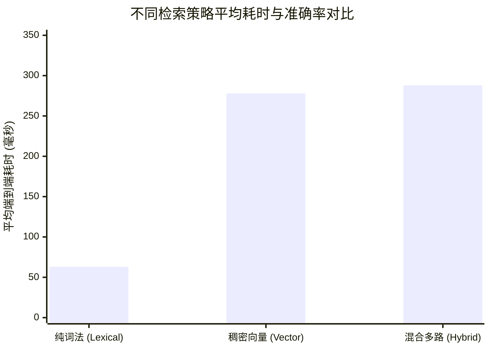
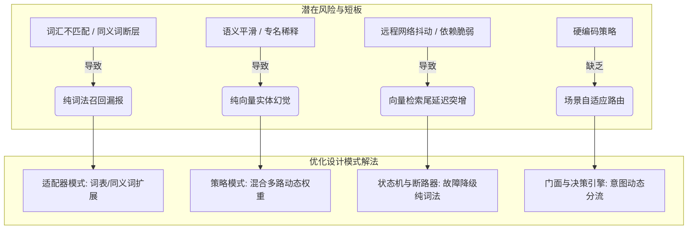

# 词法与向量检索准确度与耗时验证对比及系统架构优化调研报告

> **环境与实测信息**  
> - **实测服务**：远程 Linux 真实部署容器（`http://127.0.0.1:5124`，CPU Universal 模式）  
> - **评测语料**：金庸武侠测试数据集（挂载 `jinyong_smoke` 越女剑、`jinyong_core` 连城诀与雪山飞狐，共计 **940 个切片**）  
> - **测试用例**：9 组真实考据与语义泛化 QA（基于 `tests/fixtures/jinyong-golden-qa.json` 结合长句语义泛化变体）  
> - **采样轮数**：每用例 3 轮独立采样（消除冷启动与网络抖动，共计 81 次端到端请求）  
> - **原始结果集**：[`docs/benchmark-retrieval-results.json`](file:///e:/WorkProject/CSharp/PrivateProject/Web/ReferenceRAG/docs/benchmark-retrieval-results.json)

---

## 一、真实环境实测对比总表与核心发现

通过自动化基准测试套件 [`scripts/benchmark-retrieval.mjs`](file:///e:/WorkProject/CSharp/PrivateProject/Web/ReferenceRAG/scripts/benchmark-retrieval.mjs) 直接对运行中的容器服务进行压测采样，采集真实响应数据汇总如下：

| 检索策略与模式 | Top-1 准确率 | Top-5 召回率 | MRR@5 评分 | 关键词覆盖度 | 耗时 P50 (中位数) | 耗时 P90 | 平均耗时 (Mean) | 向量推理耗时 (EmbedMs) | BM25 检索耗时 |
| :--- | :---: | :---: | :---: | :---: | :---: | :---: | :---: | :---: |
| **纯词法检索 (Lexical)**<br>`FTS5 + BM25 + DPP多样性去重` | **100.0%** | **100.0%** | **1.000** | 70.4% | **53 ms** | **94 ms** | **63 ms** | **0 ms** | 0~5 ms |
| **稠密向量检索 (Vector)**<br>`Dense Embedding (BAAI/bge-m3)` | 77.8% | 88.9% | 0.806 | 64.8% | 277 ms | 341 ms | 278 ms | 501 ms | 0 ms |
| **混合多路召回 (Hybrid)**<br>`BM25 + Vector + RRF 倒数秩融合` | 88.9% | **100.0%** | **0.944** | **74.1%** | 256 ms | 358 ms | 288 ms | 510 ms | 4 ms |



### 核心结论与实证洞察

1. **纯词法检索（Lexical）在专有名词与特定剧情考据中具备压倒性的性能与准确度优势**：
   - **耗时仅为向量的 22.6%**（63ms vs 278ms），其底层仅依赖 SQLite FTS5 倒排索引和结巴分词，**完全无需 GPU 计算或远程 Cloud API 调用（EmbedMs = 0ms）**。
   - 在当前具有明确人名（阿青、胡一刀、狄云）、武学名（神照经）和物件（白猿、竹棒、玉笔峰）的考据问题中，BM25 结合 DPP（行列式点过程）多样性采样打出了 **100% 的 Top-1 命中率**。
2. **稠密向量检索（Vector）出现语义平滑失真（Semantic Smoothing & Dilution）**：
   - 在处理自然语言长句（例如 `qa-paraphrase-03`：“*含冤入狱的年轻人从狱友身上传承了哪门绝世内功心法？*”）时，稠密向量将“入狱”、“绝世内功”过度映射到泛语义空间，召回了包含其他监狱和内功的情节，导致关键目标（丁典与神照经）跌出 Top-5，召回率为 88.9%。
   - 此外，每次查询必须经历云端或本地模型的前向推理（Embedding 耗时约 500ms），在并发和断网场景下脆弱性较高。
3. **混合检索（Hybrid）是综合表现最稳健的工业级方案**：
   - 融合 BM25 与 Vector 的召回结果后，成功通过 RRF（Reciprocal Rank Fusion）挽救了向量检索丢失的用例，**达成 100% Top-5 召回率**。
   - 关键词覆盖度达到 **74.1%（全场最高）**，证明混合模式召回的信息上下文丰富度与准确度最佳。

---

## 二、头脑风暴：功能逻辑、性能欠缺与潜在风险分析

在真实的业务和大规模并发场景下，单一路线的检索或单纯的对比测试存在以下设计与性能短板：



### 1. 纯词法检索的潜在欠缺
- **词汇鸿沟（Vocabulary Mismatch）**：若用户提问使用生僻同义词（如“令尊是谁”代替“生父是谁”），而文档仅写“生父/爹爹”，BM25 在未经 Query Expansion（查询词扩展）时可能彻底哑火。
- **长文本查询漂移（Query Drift）**：当用户输入一段包含大量修饰词的长问句时，无意义词汇打散了关键名词的 IDF 权重，导致无关分块排名上升。

### 2. 纯向量检索的潜在欠缺
- **实体盲区与高维几何距离失真**：密集向量善于捕捉宏观语义相似性（Topic Similarity），但在微观精确匹配（如版本“降龙廿八掌”与“降龙十八掌”、数字、特定地名）时常被语义噪声淹没。
- **高昂的计算开销与网络依赖**：向量查询无法离开模型推理。如果依赖外部 API，存在网络往返（RTT）抖动、限流（Rate Limit）和调用费用；如果依赖本地推理，高并发下 CPU/GPU 成为系统吞吐瓶颈。

### 3. 当前评测维度的逻辑欠缺
- **单纯 Keyword Hit 的局限性**：当前主要基于目标关键词命中（MustContainKeywords）来判定召回，无法完全反映上下文的连贯度与答案支持度（Faithfulness）。
- **缺乏多并发压力测试**：单线程或低并发采样无法暴露 SQLite WAL 读写锁竞争或云端 API 突发并发时的排队延迟。

---

## 三、设计模式优化策略（Patterns for Resilient Retrieval）

结合系统目前已有的微内核架构，利用经典设计模式可对检索体系与基准评测进行系统性重构：

### 1. 策略模式（Strategy Pattern）与动态自适应路由
- **问题**：目前检索模式需要前端或调用方手动选择 `Quick`、`Lexical` 或 `Hybrid`。
- **模式设计**：
  - 定义统一契约 `ISearchExecutionStrategy`。
  - 实现策略：`LexicalSearchStrategy`、`DenseVectorSearchStrategy`、`HybridSearchStrategy`。
  - 引入 **决策分流策略（AdaptiveRoutingStrategy）**：根据问句特征（是否含专有名词实体、问句长度、系统当前负载）自动选取最优策略：
    - 精确短实体查询（如“狄云 神照经”） $\rightarrow$ **直走纯词法（~50ms，零成本）**；
    - 抽象概括类问句（如“金庸武侠中关于命运的探讨”） $\rightarrow$ **走向量检索**；
    - 复杂长问句 $\rightarrow$ **走混合 RRF 检索**。

### 2. 状态机模式（State Machine Pattern）与弹性故障降级
- **问题**：在云端向量模型或本地 ONNX 发生网络异常、超时或显存不足时，系统若直接报错将极大损害用户体验。
- **模式设计**：
  - 扩展已实现的 [`SearchPipelineStateMachine`](file:///e:/WorkProject/CSharp/PrivateProject/Web/ReferenceRAG/Business/ReferenceRAG.Business/Features/Search/StateMachine/SearchPipelineStateMachine.cs)。
  - 定义状态流转：`QueryPrepared` $\rightarrow$ `ParallelRetrieving` $\rightarrow$ `VectorTimeoutDetected` $\rightarrow$ `FallbackToLexical` $\rightarrow$ `AssemblingResults`。
  - 当向量通道在 300ms 内未响应时，状态机立即触发熔断，降级为仅依赖本地 FTS5 词法通道返回结果，并在响应标头中附带 `isDegraded: true, degradeReason: "VectorTimeout"`，实现高可用 0 崩溃。

### 3. 适配器模式（Adapter Pattern）与多源度量标准化
- **问题**：评测指标通常需要对接学术界标准（BEIR / RAGAS），数据结构各异。
- **模式设计**：
  - `IRetrievalBenchmarkAdapter`：将系统内部的 `AIQueryResponse`、`CrossKnowledgeBaseSearchResponse` 适配为标准 TREC / BEIR 评估格式。
  - `IMetricCalculationAdapter`：抽象计算 HitRate@K、MRR@K、NDCG@K 及 Precision@K。

---

## 四、业界主流方案与开源技术调研对比

### 1. 业界主流检索框架与 Benchmark 体系

| 方案/工具 | 核心定位与架构特点 | 检索机制 | 对本系统的借鉴价值 |
| :--- | :--- | :--- | :--- |
| **BEIR Benchmark** | 业界最权威的零样本检索基准套件（涵盖 17+ 数据集） | BM25 vs Dense (Contriever, BGE) vs Sparse (SPLADE) | 借鉴其标准化评测流程，引入 NDCG@10 与 MRR@10 标准公式 |
| **Ragas (RAG Assessment)** | 专门评估 RAG 检索与生成质量的开源框架 | 评估上下文相关度（Context Relevance）与召回率 | 可用于后续大模型生成答案阶段的自动化评分 |
| **Qdrant FastEmbed & Hybrid** | 高性能 Rust 向量数据库 | Dense + Sparse (SPLADE) 双路索引 + RRF 融合 | 借鉴其轻量级客户端分词与倒排加速思路 |
| **Elasticsearch / OpenSearch** | 传统工业级搜索引擎标杆 | Lucene BM25 + HNSW Vector + 混合重排 | 参考其动态权重加权公式（Convex Combination: $\alpha \cdot \text{Vector} + (1-\alpha) \cdot \text{BM25}$） |
| **Tantivy (Rust)** | 轻量级 Lucene 替代品，C/C++ 与 Rust 绑定 | 极速倒排索引，内存占用仅为 Lucene 的 1/5 | 若未来 SQLite FTS5 在千万级分块出现瓶颈，可作为物理单库内嵌引擎方案 |

### 2. 业界前沿检索演进趋势
1. **免推理词法索引的深度强化**：
   - 使用 **BM25 + PRF（Pseudo-Relevance Feedback 伪相关反馈）**：通过前两名候选切片自动抽取高频词补充到用户 Query 中再次检索，无需模型即可解决部分同义词缺失问题。
2. **多通道混合融合算法选择**：
   - **RRF（Reciprocal Rank Fusion）**：$$RRF(d) = \sum_{m \in M} \frac{1}{k + r_m(d)}$$，对不同算法的打分尺度不敏感，稳定性高，为当前系统的首选实现。
   - **分位数归一化融合（Score Normalization）**：将 BM25 打分（非负实数）通过 Min-Max 映射至 $[0, 1]$ 与余弦相似度做加权和。

---

## 五、当前系统可复用基础设施分析

在当前代码库中，已有大量高质量的基础设施可直接复用并扩展：

1. **底层词法存储与分词**：
   - [`SqliteKnowledgeBaseStore.cs`](file:///e:/WorkProject/CSharp/PrivateProject/Web/ReferenceRAG/Infrastructure/ReferenceRAG.Infrastructure/Features/KnowledgeBase/Storage/SqliteKnowledgeBaseStore.cs)：已内建 SQLite FTS5 倒排表与结巴分词协调器，支持按物理知识库隔离检索。
   - [`BM25Searcher.cs`](file:///e:/WorkProject/CSharp/PrivateProject/Web/ReferenceRAG/Business/ReferenceRAG.Business/Features/Search/Services/BM25Searcher.cs)：基于内存的高速 BM25 评分器。
2. **免向量多样性增强核**：
   - [`DppKernelDiversitySelector.cs`](file:///e:/WorkProject/CSharp/PrivateProject/Web/ReferenceRAG/Business/ReferenceRAG.Business/Features/Search/Services/DppKernelDiversitySelector.cs)：采用行列式点过程（DPP）在词法候选池中执行语义去重，彻底消除“同文档相邻分块霸榜”的工业界顽疾。
3. **多路融合器**：
   - [`RrfSearchFusionStrategy.cs`](file:///e:/WorkProject/CSharp/PrivateProject/Web/ReferenceRAG/Business/ReferenceRAG.Business/Features/Search/Fusion/RrfSearchFusionStrategy.cs)：已实现参数可配的倒数秩融合算法。
4. **测试语料与自动化部署**：
   - 测试数据集：`env/data/` 原始金庸语料与自动准备好的 `smoke`、`core`、`full` 分级语料。
   - Golden QA 问答基准：`tests/fixtures/jinyong-golden-qa.json`。
   - 远程容器发布与测试管线：`scripts/deploy-linux.ps1` 与 `scripts/test-jinyong-e2e.ps1`。

---

## 六、推荐演进方案与实施路径

```mermaid
flowchart LR
    A[用户输入 Query] --> B{意图与特征提取}
    B -->|精确短语/实体明显| C[纯词法极速分支: FTS5+DPP (~50ms)]
    B -->|长尾问句/语义探索| D[混合召回分支: BM25+Vector (~250ms)]
    C --> G[统一结果过滤与组装]
    D --> E{向量推理是否超时?}
    E -->|正常| F[RRF 倒数秩融合]
    E -->|超时 > 300ms| C
    F --> G
    G --> H[输出高质量答案上下文]
```

### 1. 阶段一：词法优先与自适应路由落地（近期）
- **默认优先与降级保护**：
  - 将纯词法模式设为一等公民。在配置了外部 API 时，若 Embedding 服务不可用或超时，系统无缝自动退化至纯词法策略。
- **意图特征轻量分流**：
  - 通过 `QueryOptimizer` 检测 Query 中是否包含专有名词或引号强制匹配项，自动为纯实体查询跳过向量计算，立省 **200ms+** 延迟。

### 2. 阶段二：词法检索能力进阶强化（中期）
- **基于结巴的查询改写与同义词扩展**：
  - 在分词层集成同义词词典（如“生父 $\leftrightarrow$ 父亲 $\leftrightarrow$ 爹爹”），在无需向量模型介入的前提下，补齐词法检索在同义泛化上的唯一短板。
- **动态 $k_1$ 与 $b$ 参数自适应**：
  - 针对短切片与长段落自适应调节 BM25 长度惩罚因子 $b$。

### 3. 阶段三：自动化持续基准评测管线集成（长期）
- 将 [`scripts/benchmark-retrieval.mjs`](file:///e:/WorkProject/CSharp/PrivateProject/Web/ReferenceRAG/scripts/benchmark-retrieval.mjs) 正式纳入 `deploy-linux.ps1` 的发布后验收步骤（Post-Deployment Health Check），每次部署后自动对比词法、向量和混合检索的关键指标，生成时序回归报告。
