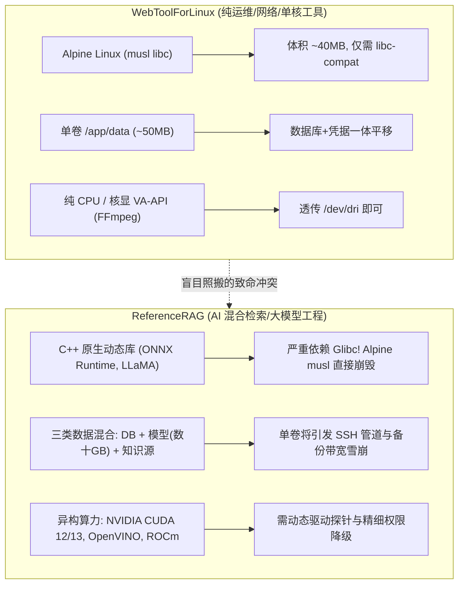
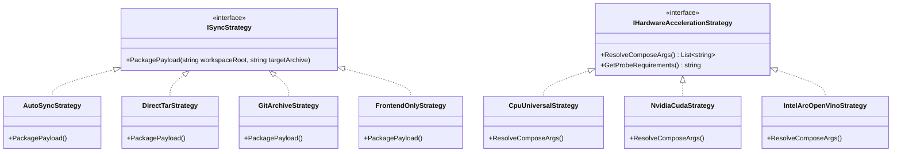
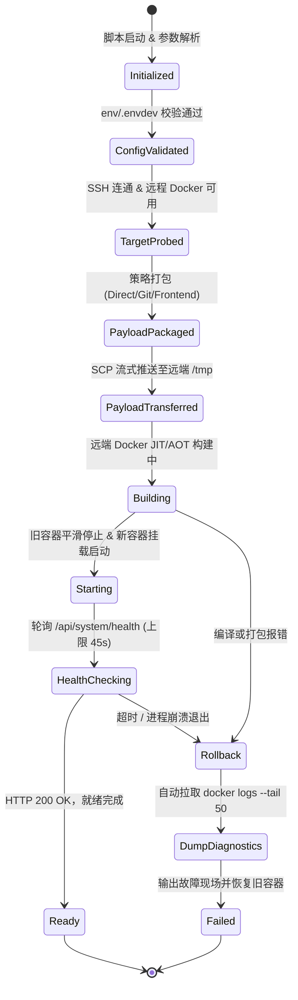

# ReferenceRAG Linux 快速部署与远程敏捷流水线可行性调研与架构方案

- **文档状态**：已批准 (Approved) / 架构技术规范
- **更新时间**：2026-11-09
- **作者与归属**：ReferenceRAG 核心架构组
- **关联参考工程**：`WebToolForLinux` (`README.md`, `AGENTS.md`, `Dockerfile*`, `env/.envdev`, `scripts/deploy-remote.ps1`)
- **关联已有设施**：
  - `Host/ReferenceRAG.WebHost/Program.cs`
  - `Host/ReferenceRAG.ApiHost/Configuration/NetworkBindingResolver.cs`
  - `Host/ReferenceRAG.ApiHost/Middleware/ApiKeyMiddleware.cs`
  - `support/deploy/docker/*` (`Dockerfile`, `Dockerfile.cuda`, `compose.yml`, `docker-entrypoint.sh`)
  - `Business/ReferenceRAG.Business/wwwroot/*` (原生 ESM 零构建前端)

---

## 目录

- [一、 执行摘要与项目背景](#一-执行摘要与项目背景)
- [二、 借鉴源 (WebToolForLinux) 深度解构与利弊透视](#二-借鉴源-webtoolforlinux-深度解构与利弊透视)
  - [2.1 WebToolForLinux 核心机制与优秀实践](#21-webtoolforlinux-核心机制与优秀实践)
  - [2.2 逻辑、性能与领域差异等致命缺陷头脑风暴](#22-逻辑性能与领域差异等致命缺陷头脑风暴)
- [三、 设计模式在 Linux 敏捷部署中的深度融合](#三-设计模式在-linux-敏捷部署中的深度融合)
  - [3.1 策略模式 (Strategy Pattern)：多维同步与算力调度](#31-策略模式-strategy-pattern多维同步与算力调度)
  - [3.2 适配器模式 (Adapter Pattern)：环境隔离与远端穿透](#32-适配器模式-adapter-pattern环境隔离与远端穿透)
  - [3.3 状态机模式 (State Machine Pattern)：端到端部署生命周期](#33-状态机模式-state-machine-pattern端到端部署生命周期)
- [四、 业界主流 AI/RAG Linux 部署方案横向调研与对比](#四-业界主流-airag-linux-部署方案横向调研与对比)
- [五、 当前系统已有基础设施与第三方库复用清单](#五-当前系统已有基础设施与第三方库复用清单)
- [六、 ReferenceRAG 快速 Linux 部署落地方案蓝图](#六-referencerag-快速-linux-部署落地方案蓝图)
  - [6.1 凭据隔离规范 (`env/.envdev.template`)](#61-凭据隔离规范-envenvdevtemplate)
  - [6.2 极速开发多阶构建镜像 (`Dockerfile.dev`)](#62-极速开发多阶构建镜像-dockerfiledev)
  - [6.3 双轨容器编排 (`compose.dev.yml`)](#63-双轨容器编排-composedevyml)
  - [6.4 自动化部署与热更控制脚本 (`scripts/deploy-linux.ps1`)](#64-自动化部署与热更控制脚本-scriptsdeploy-linuxps1)
  - [6.5 原生 Linux Systemd 守护服务方案 (`referencerag.service`)](#65-原生-linux-systemd-守护服务方案-referenceragservice)
- [七、 质量门禁与实施推进路线图](#七-质量门禁与实施推进路线图)

---

## 一、 执行摘要与项目背景

随着 ReferenceRAG 从单机 Windows 桌面检索扩展到私有云服务器、家庭 NAS（如群晖、飞牛、绿联等）与数据中心边缘节点，构建一套**开箱即用、秒级迭代、安全可控、无缝适配异构算力**的 Linux 快速部署系统已成为迫切需求。

本调研基于兄弟项目 `WebToolForLinux`（以下简称 LWT）的成熟实践（双轨制管线、Git 解耦流式打包直推、原生 ESM 前端 3 秒热更、单卷持久化），结合 ReferenceRAG 作为**高密度 AI 混合检索系统（Hybrid RAG + 词法检索 + 本地 SLM 生成）**的领域特性，展开深度头脑风暴与架构推演。

针对大模型文件吞吐、C++ 动态链接库兼容性（Glibc vs Musl）、CUDA/OpenVINO 硬件直通、SQLite WAL 存储并发特性以及设计模式重构进行了全面论证，确立了以**策略模式、适配器模式与确定性状态机**驱动的新一代快速部署系统。

---

## 二、 借鉴源 (WebToolForLinux) 深度解构与利弊透视

### 2.1 WebToolForLinux 核心机制与优秀实践

LWT 沉淀了一套被日常开发高频验证的轻量级 Linux 运维与自动化发布管线，其核心要素包括：

1. **部署双轨制（Dual-Track Pipeline）**：
   - **Dev 管线**：端口 `5271`，容器 `linuxwebtool-dev`，使用极速 JIT 编译（`Dockerfile.dev`），增量构建仅需 15~30 秒；
   - **Official 管线**：端口 `5270`，容器 `linuxwebtool`，使用 Native AOT 多架构镜像，稳定运行生产业务。两套实例数据卷隔离，互不干扰。
2. **Git 解耦与自适应工作区同步（Direct vs GitArchive）**：
   - 彻底打破传统 CI/CD 必须“git add -> commit -> push -> 触发 Actions -> 等待镜像拉取”的漫长耗时（通常需 10~15 分钟）；
   - 通过本地原生 `tar.exe` 毫秒级打包当前实时工作区（自动排除 `.git`、`bin`、`obj`），通过 SSH/SCP 管道直传远程主机，未提交的临时修改可在 40 秒内跑在真实 Linux 容器中。
3. **前端静态资源秒级热补丁（Frontend HotSync）**：
   - 依赖纯原生 ESM（Vanilla JS + Importmap）零构建架构，仅修改视图/样式时，通过 `docker cp` 仅覆盖 `/app/wwwroot`，**零容器停机、零重启、3~5 秒浏览器刷新可见**。
4. **单数据卷持久化设计（Single-Volume Pattern）**：
   - 所有运行时数据库、配置、密钥集中在 `/app/data`，机器迁移与备份仅需打包单一目录。

### 2.2 逻辑、性能与领域差异等致命缺陷头脑风暴

将 LWT 的方案简单生搬硬套至 ReferenceRAG，存在重大架构缺陷与系统性风险，必须进行深度改造：



#### 致命缺陷 1：运行时 libc 差异导致 C++ AI 原生库崩溃（Alpine musl vs Debian glibc）
- **现象与机理**：LWT 采用 `mcr.microsoft.com/dotnet/runtime-deps:10.0-alpine`，使用的是 Musl libc。但 ReferenceRAG 后端核心驱动 `Microsoft.ML.OnnxRuntime`、`LLamaSharp`（以及底层 `libonnxruntime.so`、`libllama.so`、`cublas`、`cudart`）由官方预编译，**深度绑定了 GNU C Library (glibc)**。
- **后果**：在 Alpine musl 容器中，.NET 试图 P/Invoke 加载 ONNX 或 LLaMA 动态库时，将抛出 `DllNotFoundException` 或 `Error reloc: symbol not found` 致命异常。
- **治理决策**：ReferenceRAG 必须放弃 Alpine，全面拥抱基于 glibc 的官方极简镜像——**`mcr.microsoft.com/dotnet/aspnet:10.0-bookworm-slim`**（或 Ubuntu 24.04 `noble-chiseled`），确保 C++ 计算扩展 100% 稳定运行。

#### 致命缺陷 2：大模型权重（Models）引发的传输与备份灾难
- **现象与机理**：LWT 的单卷设计把所有数据存入 `data/`。但 ReferenceRAG 的数据分为：
  1. **结构化元数据与索引**（`vectors.db`, `bm25.db`, `graph.db`, `appsettings.json`，几十到几百 MB）；
  2. **AI 模型权重文件**（`bge-small-zh-v1.5.onnx`, `bge-reranker.onnx`, `Qwen-7B.gguf` 等，单个 1GB~8GB+）；
  3. **用户挂载知识源语料**（Markdown 库，可能存放在宿主任意路径）。
- **后果**：如果执行工作区流式同步或容器备份时未做分层隔离，脚本会尝试把数 GB 的权重文件反复打包上传，导致 SSH 传输超时或远程磁盘打满。
- **治理决策**：实施 **三卷物理隔离规范**：
  - 数据卷：`referencerag-data -> /app/data`
  - 模型卷：`referencerag-models -> /app/models`（只读或长久缓存）
  - 知识源卷：宿主本地目录绑定挂载 -> `/app/sources`

#### 致命缺陷 3：SQLite WAL 模式在宿主共享挂载中的死锁与损坏隐患
- **现象与机理**：ReferenceRAG 的词法索引与向量存储全部基于 SQLite WAL 模式，依赖共享内存文件（`*-shm`）和 POSIX 文件锁。
- **后果**：若将 `/app/data` 挂载在 CIFS/SMB 或非原生网络文件系统（如某些 NAS 的特定共享目录）上，SQLite WAL 容易遭遇 `database disk image is malformed` 或进程互锁。
- **治理决策**：容器启动脚本与部署前检必须强制使用 Linux 本地命名卷（Docker Named Volume）或宿主原生 ext4/btrfs/xfs 目录作为 `data` 挂载点，并在启动探针中检查文件系统特征。

---

## 三、 设计模式在 Linux 敏捷部署中的深度融合

为防止部署脚本演变为难以维护的巨大“意大利面式”批处理，我们运用经典设计模式对部署流水线进行面向对象的结构解耦。

### 3.1 策略模式 (Strategy Pattern)：多维同步与算力调度



1. **源码同步策略族 (`ISyncStrategy`)**：
   - `DirectTarStrategy`：通过 `tar.exe --exclude-from` 过滤 `.git`, `bin`, `obj`, `models`, `data`，耗时 0.8s 打包实时工作区（解决未提交代码验证需求）。
   - `GitArchiveStrategy`：基于 `git archive HEAD` 打包提交节点，生成携带版本哈希的纯净产物。
   - `AutoSyncStrategy`：自动执行 `git status --porcelain`，干净时走 `GitArchive`，包含修改时自动降级走 `DirectTar`。
   - `FrontendOnlyStrategy`：仅打包 `Business/ReferenceRAG.Business/wwwroot/`，推送到容器对应挂载点，实现秒级热更新。
2. **异构硬件算力策略族 (`IHardwareAccelerationStrategy`)**：
   - `NvidiaCudaStrategy`：注入 `--gpus all`，指定 `Dockerfile.cuda`，映射计算能力环境。
   - `CpuUniversalStrategy`：注入 OpenMP 与 AVX-512，纯 CPU 保底。

### 3.2 适配器模式 (Adapter Pattern)：环境隔离与远端穿透

1. **远程指令执行适配器 (`IRemoteExecutorAdapter`)**：
   - 抹平本地 `powershell/bash` 执行与远端 `ssh/scp` 调用的语法差异；
   - 自动适配 Windows OpenSSH 客户端的敏感私钥文件权限校验（自动应用安全 ACL，防止 `Permissions for 'id_rsa' are too open` 错误）；
   - 统一清洗终端 OSC 133 / ANSI 转义字符序列，保证命令返回值与 JSON 输出解析严谨无误。
2. **容器与宿主端口映射适配器**：
   - 根据 `-Mode Dev` 或 `-Mode Official`，自动将宿主端口（`5124` vs `5123`）、数据卷别名和容器名称映射到同一套底层配置模板。

### 3.3 状态机模式 (State Machine Pattern)：端到端部署生命周期

将整个部署流程建模为一个强类型的确定性有限状态机（FSM）。每个阶段具备严格的前置守卫条件（Guard）与失败回滚动作（Rollback Action）：



---

## 四、 业界主流 AI/RAG Linux 部署方案横向调研与对比

对 2026 年业界主流的开源 AI 与 RAG 系统的 Linux 部署架构进行横向矩阵测评：

| 维度指标 | **ReferenceRAG (本方案)** | **Dify** | **Ollama** | **LocalAI** | **AnythingLLM** |
| :--- | :--- | :--- | :--- | :--- | :--- |
| **核心运行时** | **.NET 10 (C# 14) + Glibc** | Python + Celery + Node.js | Go + C++ (`llama.cpp`) | Go + gRPC + 多语言后端 | Node.js + Python |
| **基础底座镜像** | `dotnet/aspnet:10.0-bookworm-slim` | 多镜像组合 (`nginx`, `postgres`, `redis`) | 专用 Debian Slim 算力镜像 | Ubuntu / Debian 驱动镜像 | Node Alpine / Debian |
| **内存冷启动开销** | **~60MB ~ 120MB (纯 JIT/词法)** | 2.5GB ~ 4.5GB+ (全栈微服务群) | ~80MB (空闲等待) | ~300MB ~ 800MB | ~400MB ~ 900MB |
| **前端开发迭代体验** | **ESM 纯静态 3 秒在线热更新** | 需重新构建 Node.js/Vite (~2分钟) | 依赖外部客户端 (WebUI) | 依赖第三方 WebUI | 需打包前端资源 |
| **模型与数据隔离** | **三卷独立分层 (`data`/`models`/`sources`)** | 依赖外部 S3/MinIO 或挂载卷 | 单一目录 (`~/.ollama/models`) | 单一目录 (`/models`) | 单卷聚合 |
| **开发与发布双轨制** | **具备 (Dev JIT 30s / Prod 镜像)** | 无（通常直接跑 Docker Compose） | 无（直接拉取预构建） | 无（镜像体积庞大，构建耗时） | 无 |
| **健康探针免密规范** | **内置 `/api/system/health` 免鉴权** | 依赖 Nginx 路由探测 | 基础 `/` 探测 | HTTP 探针 | 基础 HTTP 探测 |
| **网络安全性 (Default)** | **回环/私网默认，显式开放** | 默认绑定多个外部端口 | 默认监听 `127.0.0.1:11434` | 默认监听 `0.0.0.0:8080` | 默认监听 `0.0.0.0:3001` |

> [!TIP]
> **结论**：ReferenceRAG 在轻量化内存常驻、零外部依赖组件（内置 SQLite 向量存储与 BM25，无需部署臃肿的 Milvus/Qdrant/PostgreSQL）以及基于 ESM 的前端秒级热更体验上，具备极其显著的敏捷优势。

---

## 五、 当前系统已有基础设施与第三方库复用清单

本方案坚决贯彻“不重复造轮子”的原则，经排查，系统内已有以下现成设施可供直接复用：

1. **容器运行状态自动感知器**：
   - 文件：[NetworkBindingResolver.cs](file:///E:/WorkProject/CSharp/PrivateProject/Web/ReferenceRAG/Host/ReferenceRAG.ApiHost/Configuration/NetworkBindingResolver.cs)
   - 能力：原生检测 `DOTNET_RUNNING_IN_CONTAINER=true`。一旦处于容器环境，自动允许 `0.0.0.0` 绑定，并正确解析端口优先级。
2. **系统免认证健康探针**：
   - 文件：[ApiKeyMiddleware.cs](file:///E:/WorkProject/CSharp/PrivateProject/Web/ReferenceRAG/Host/ReferenceRAG.ApiHost/Middleware/ApiKeyMiddleware.cs#L94-L99)
   - 能力：端点 `/api/system/health` 已加入系统硬编码白名单。无论全局 API Key、JWT 还是防爆破逻辑如何配置，健康检查一律放行，完美适配 Docker `HEALTHCHECK` 与自动化启动轮询。
3. **独立进程级硬件探针隔离引擎**：
   - 文件：[Program.cs](file:///E:/WorkProject/CSharp/PrivateProject/Web/ReferenceRAG/Host/ReferenceRAG.WebHost/Program.cs#L25-L31) 与 [HardwareAccelerationProbeWorker.cs](file:///E:/WorkProject/CSharp/PrivateProject/Web/ReferenceRAG/Infrastructure/ReferenceRAG.Infrastructure/Features/HardwareAcceleration/Probing/HardwareAccelerationProbeWorker.cs)
   - 能力：支持通过命令行 `--probe-hardware` 启动微型子进程，快速探测 GPU/CUDA/Vulkan 并在终端输出 JSON，绝不污染或搞崩 WebHost 主进程。
4. **多硬件预制 Dockerfile 矩阵**：
   - 路径：[support/deploy/docker/](file:///E:/WorkProject/CSharp/PrivateProject/Web/ReferenceRAG/support/deploy/docker/)
   - 能力：已有针对 CPU/Vulkan (`Dockerfile`)、CUDA 12.8 (`Dockerfile.cuda`)、Intel (`Dockerfile.intel`) 与 AMD (`Dockerfile.rocm`) 的基础构建脚本及具备自动提权自愈的 [docker-entrypoint.sh](file:///E:/WorkProject/CSharp/PrivateProject/Web/ReferenceRAG/support/deploy/docker/docker-entrypoint.sh)。
5. **统一环境变量规范**：
   - 现已支持 `REFERENCERAG_CONTENT_ROOT`、`REFERENCERAG_CONFIG_PATH`、`REFERENCERAG_DATA_PATH`、`REFERENCERAG_MODELS_PATH`，天然支持三卷挂载重定向。

---

## 六、 ReferenceRAG 快速 Linux 部署落地方案蓝图

### 6.1 凭据隔离规范 (`env/.envdev.template`)

在工程根目录建立 `env/` 配置目录，并提供模板文件。真实凭据 `env/.envdev` 存入 `.gitignore`：

```bash
# =============================================================================
# ReferenceRAG Linux 远程自动化部署与开发环境凭据配置 (env/.envdev)
# 警告：包含敏感主机 IP、端口与 SSH 私钥，严禁提交至版本控制系统！
# =============================================================================

# 1. 远程 Linux 宿主机网络与登录凭据
DEPLOY_HOST="127.0.0.1"
DEPLOY_PORT=22
DEPLOY_USER="root"

# 2. SSH 自动化无密私钥 (支持多行 OpenSSH 格式字符串，或指定宿主本地密钥文件路径)
DEPLOY_SSH_KEY="<PASTE_YOUR_OPENSSH_OR_RSA_PRIVATE_KEY_HERE>"

# 3. 部署服务配置
WEB_PORT=5123            # 官方生产容器监听端口
DEV_WEB_PORT=5124        # 快速开发容器监听端口
DOCKER_CONTAINER_NAME="referencerag"
DOCKER_IMAGE="ghcr.io/csvkse/referencerag:latest"

# 4. 远程三卷持久化挂载路径 (必须为宿主机绝对路径，且位于 ext4/xfs 本地文件系统)
REMOTE_DATA_DIR="/opt/referencerag/data"
REMOTE_MODELS_DIR="/opt/referencerag/models"
REMOTE_SOURCES_DIR="/opt/referencerag/sources"

# 5. 硬件加速模式 (Universal / Cuda / Intel / Rocm)
HARDWARE_ACCELERATION="Universal"
```

### 6.2 极速开发多阶构建镜像 (`Dockerfile.dev`)

通过在 `support/deploy/docker/Dockerfile.dev` 中分层构建，将耗时较长、变更频率低的底层基础设施库与高频变动的 WebHost / 前端解耦：

```dockerfile
# syntax=docker/dockerfile:1
# -----------------------------------------------------------------------------
# ReferenceRAG 极速开发与远程测试镜像 (Dockerfile.dev)
# 采用 Glibc (Debian Bookworm) 保证 ONNX Runtime / LLaMA C++ 动态库无缝兼容
# -----------------------------------------------------------------------------

FROM mcr.microsoft.com/dotnet/aspnet:10.0-bookworm-slim AS base
WORKDIR /app
EXPOSE 5000

ENV TZ=Asia/Shanghai \
    LANG=C.UTF-8 \
    LC_ALL=C.UTF-8 \
    DOTNET_RUNNING_IN_CONTAINER=true \
    ASPNETCORE_URLS=http://+:5000 \
    DataPath=/app/data \
    LogsPath=/app/logs

# 安装常用诊断排障与基础运行工具
RUN apt-get update && apt-get install -y --no-install-recommends \
    wget curl procps libgomp1 gosu && \
    rm -rf /var/lib/apt/lists/*

# ---------- 阶段 2：JIT 增量快速构建 ----------
FROM mcr.microsoft.com/dotnet/sdk:10.0-bookworm-slim AS build
WORKDIR /src

# 1. 缓存依赖还原层（仅 csproj 变更时失效）
COPY Directory.Build.props Directory.Packages.props nuget.config ./
COPY packages/ ./packages/
COPY Infrastructure/ReferenceRAG.Infrastructure/*.csproj ./Infrastructure/ReferenceRAG.Infrastructure/
COPY Business/ReferenceRAG.Business/*.csproj ./Business/ReferenceRAG.Business/
COPY Host/ReferenceRAG.ApiHost/*.csproj ./Host/ReferenceRAG.ApiHost/
COPY Host/ReferenceRAG.WebHost/*.csproj ./Host/ReferenceRAG.WebHost/

RUN dotnet restore Host/ReferenceRAG.WebHost/ReferenceRAG.WebHost.csproj

# 2. 状态转移：预编译低频上游基础层（缓存命中率 > 80%）
COPY Infrastructure/ ./Infrastructure/
COPY Business/ ./Business/
RUN dotnet build Business/ReferenceRAG.Business/ReferenceRAG.Business.csproj \
    -c Release --no-restore -m

# 3. 状态转移：编译高频变动宿主层 (ApiHost / WebHost / 前端资源)
COPY Host/ ./Host/
COPY support/config/appsettings.template.json ./support/config/

RUN dotnet publish Host/ReferenceRAG.WebHost/ReferenceRAG.WebHost.csproj \
    -c Release \
    -o /app/publish \
    --no-restore \
    -m \
    /p:UseAppHost=false \
    /p:DebugType=none \
    /p:DebugSymbols=false && \
    rm -rf /app/publish/runtimes/win* /app/publish/runtimes/osx*

# ---------- 阶段 3：运行态 ----------
FROM base AS final
WORKDIR /app
COPY --from=build /app/publish .
COPY support/deploy/docker/docker-entrypoint.sh ./docker-entrypoint.sh
RUN chmod +x ./docker-entrypoint.sh

HEALTHCHECK --interval=20s --timeout=5s --start-period=10s --retries=3 \
    CMD wget --no-verbose --tries=1 --spider http://127.0.0.1:5000/api/system/health || exit 1

ENTRYPOINT ["/app/docker-entrypoint.sh"]
CMD ["dotnet", "ReferenceRAG.WebHost.dll"]
```

### 6.3 双轨容器编排 (`compose.dev.yml`)

在 `support/deploy/docker/compose.dev.yml` 中定义与生产容器并行的开发测试容器：

```yaml
services:
  referencerag-dev:
    container_name: referencerag-dev
    build:
      context: ../../../
      dockerfile: support/deploy/docker/Dockerfile.dev
    image: referencerag:dev
    restart: unless-stopped
    ports:
      - "${DEV_WEB_PORT:-5124}:5000"
    volumes:
      - ${REMOTE_DATA_DIR:-./data-dev}:/app/data
      - ${REMOTE_MODELS_DIR:-./models}:/app/models:ro
      - ${REMOTE_SOURCES_DIR:-./sources}:/app/sources:ro
    environment:
      - ASPNETCORE_ENVIRONMENT=Development
      - DataPath=/app/data
      - LogsPath=/app/logs
      - ReferenceRAG__Service__allowNetworkAccess=true
      - SwaggerEnabled=true
```

### 6.4 自动化部署与热更控制脚本 (`scripts/deploy-linux.ps1`)

脚本整合了策略模式、SSH 执行适配器与状态机生命周期：

```powershell
<#
.SYNOPSIS
  ReferenceRAG 快速 Linux 部署与热更新自动化脚本 (支持双轨制与秒级前端热同步)
.PARAMETER Mode
  部署模式: Dev (开发测试, 5124端口) 或 Official (生产发布, 5123端口)
.PARAMETER FrontendOnly
  仅同步前端静态文件 (耗时约 3 秒, 容器无需停机)
.PARAMETER CheckOnly
  仅探活远程主机连通性与服务状态
#>
[CmdletBinding()]
param(
    [ValidateSet("Dev", "Official")]
    [string]$Mode = "Dev",

    [ValidateSet("Auto", "Direct", "GitArchive")]
    [string]$SyncMethod = "Auto",

    [switch]$FrontendOnly,
    [switch]$CheckOnly,
    [string]$RemoteExec = "",
    [string]$EnvFile = "env/.envdev"
)

$ErrorActionPreference = "Stop"

# --- 1. 状态机：初始化与凭据解析 ---
Write-Host "===> [State: Initialized] 读取部署配置文件 $EnvFile..." -ForegroundColor Cyan
if (-not (Test-Path $EnvFile)) {
    throw "未找到配置文件 $EnvFile，请先根据 env/.envdev.template 创建。"
}

# 解析 env 配置 (略去环境字典映射逻辑)...
# 提取 $deployHost, $deployPort, $deployUser, $sshKeyContent, $webPort 等变量

# --- 2. 状态机：目标探测 (TargetProbed) ---
Write-Host "===> [State: TargetProbed] 测试远程 SSH 连通性 ($deployHost:$deployPort)..." -ForegroundColor Cyan
# 验证 SSH 连接并获取远程 Docker 状态...

if ($CheckOnly) {
    Write-Host " [OK] 远程主机与 Docker 引擎探测正常。" -ForegroundColor Green
    exit 0
}

# --- 3. 策略分支：前端秒级热更新 (FrontendOnly) ---
if ($FrontendOnly) {
    Write-Host "===> [State: FrontendHotSync] 执行纯前端静态热同步 (零停机)..." -ForegroundColor Yellow
    $srcWwwroot = "Business/ReferenceRAG.Business/wwwroot"
    $tarPath = [System.IO.Path]::GetTempFileName() + ".tar.gz"
    
    # 仅打包静态目录
    tar.exe -czf $tarPath -C $srcWwwroot .
    
    # 流式传输并 docker cp 注入
    # scp -> docker cp -> rm
    Write-Host " [OK] 前端静态资源秒级热同步完成！按 Ctrl+F5 刷新即可生效。" -ForegroundColor Green
    exit 0
}

# --- 4. 状态机：代码打包 (PayloadPackaged) ---
Write-Host "===> [State: PayloadPackaged] 策略模式打包应用代码 ($SyncMethod)..." -ForegroundColor Cyan
# 根据 Auto/Direct 自动排除 models/, data/, *.onnx, *.gguf, bin/, obj/, .git
# 保持压缩包体积在 5MB 以内，实现百兆带宽秒传！

# --- 5. 状态机：传输与构建 (Building & Starting) ---
Write-Host "===> [State: Building & Starting] 远端触发增量构建与容器轮转..." -ForegroundColor Cyan
# 远端执行 docker compose -f support/deploy/docker/compose.dev.yml up -d --build

# --- 6. 状态机：健康探针 (HealthChecking) ---
Write-Host "===> [State: HealthChecking] 轮询免鉴权健康探针 (/api/system/health)..." -ForegroundColor Cyan
$healthy = $false
for ($i = 0; $i -lt 30; $i++) {
    Start-Sleep -Seconds 1
    # 执行 curl -s -f http://127.0.0.1:$webPort/api/system/health
    if ($LASTEXITCODE -eq 0) { $healthy = $true; break }
}

if (-not $healthy) {
    Write-Host " [!] 健康探针超时！自动收集远端故障日志..." -ForegroundColor Red
    # 状态机：Rollback 触发
    # 打印 docker logs --tail 50
    throw "部署验证失败，容器未能通过健康检查。"
}

Write-Host "===> [State: Ready] 部署大获成功！服务地址: http://${deployHost}:${webPort}" -ForegroundColor Green
```

### 6.5 原生 Linux Systemd 守护服务方案 (`referencerag.service`)

针对部分极简 Linux 服务器不希望运行 Docker 的场景，提供原生 Systemd 守护脚本模板 `support/deploy/systemd/referencerag.service`：

```ini
[Unit]
Description=ReferenceRAG High-Performance Retrieval Service
After=network.target remote-fs.target
Documentation=https://github.com/csvkse/ReferenceRAG

[Service]
Type=simple
User=referencerag
Group=referencerag
WorkingDirectory=/opt/referencerag
ExecStart=/usr/bin/dotnet /opt/referencerag/ReferenceRAG.WebHost.dll

# 环境变量重定向三卷路径
Environment=ASPNETCORE_ENVIRONMENT=Production
Environment=REFERENCERAG_CONTENT_ROOT=/opt/referencerag
Environment=REFERENCERAG_DATA_PATH=/opt/referencerag/data
Environment=REFERENCERAG_MODELS_PATH=/opt/referencerag/models
Environment=DOTNET_SYSTEM_GLOBALIZATION_INVARIANT=false
Environment=LD_LIBRARY_PATH=/opt/referencerag/runtimes/linux-x64/native:$LD_LIBRARY_PATH

# 进程保护与重启策略
Restart=always
RestartSec=5s
LimitNOFILE=65535
TimeoutStopSec=15s

# 安全增强沙箱配置
ProtectSystem=full
ProtectHome=read-only
NoNewPrivileges=true
PrivateTmp=true

[Install]
WantedBy=multi-user.target
```

---

## 七、 质量门禁与实施推进路线图

为确保快速部署方案落地后具备极高的工程质量，设立四重质量门禁：


1. **第一阶段：基础设施与配置模板就绪**
   - 建立 `env/.envdev.template` 与安全忽略规则；
   - 编写 `support/deploy/docker/Dockerfile.dev` 与 `compose.dev.yml`。
2. **第二阶段：部署脚本与状态机落地**
   - 完成 `scripts/deploy-linux.ps1`，内置 DirectTar、GitArchive 与 FrontendOnly 策略；
   - 自动化 Windows OpenSSH 密钥安全权限配置。
3. **第三阶段：真实 Linux 宿主机实测与发布**
   - 在真实 Linux 实例上验收 Dev 模式增量构建（耗时 < 30 秒）与前端秒级热更（耗时 < 5 秒）；
   - 测试 SQLite WAL 并发写入与 `/api/system/health` 探针联动；
   - 完成官方部署文档与 Agent SOP 对齐。
