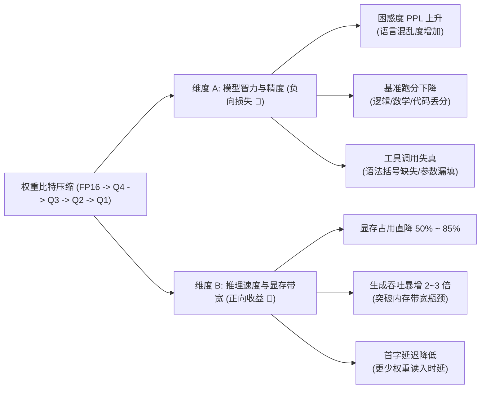
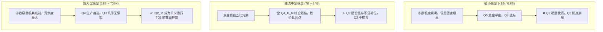

# 大语言模型 Q1/Q2/Q3/Q4 量化性能损失、精度对比与各参数量选型实战指南

> **版本**：v1.0.23  
> **适用范围**：GGUF (`llama.cpp`)、ONNX、AWQ/GPTQ、端侧次十亿级（<1B）至千亿级大语言模型  
> **面向对象**：大模型架构师 / 端侧推理优化工程师 / RAG 开发者  
> **核心指标**：困惑度 (Perplexity / PPL)、MMLU / GSM8k / HumanEval 准确率、生成吞吐 (TPS)、首字延迟 (TTFT)、显存 (VRAM) 占用比

---

## 目录
- [一、量化基础与性能损失的“二象性”](#一定义与性能损失的二象性)
- [二、Q1 ~ Q4 全景性能与精度损失定量对比表](#二q1--q4-全景性能与精度损失定量对比表)
- [三、Q1 / Q2 / Q3 / Q4 各量化等级深度剖析](#三q1--q2--q3--q4-各量化等级深度剖析)
  - [1. Q4（4-bit）：工业级黄金甜点位](#1-q44-bit工业级黄金甜点位)
  - [2. Q3（3-bit）：显存临界妥协线](#2-q33-bit显存临界妥协线)
  - [3. Q2（2-bit）：超大模型救急与小模型塌陷](#3-q22-bit超大模型救急与小模型塌陷)
  - [4. Q1（1-bit / 1.5-bit）：灾难性崩溃与专用三值架构](#4-q11-bit--15-bit灾难性崩溃与专用三值架构)
- [四、核心定律：模型参数规模与量化容忍度的非线性关系](#四核心定律模型参数规模与量化容忍度的非线性关系)
- [五、消费级硬件与模型规模实战选型矩阵](#五消费级硬件与模型规模实战选型矩阵)
- [六、ReferenceRAG 工程实践与量化抗漂移经验](#六referencerag-工程实践与量化抗漂移经验)

---

## 一、定义与性能损失的“二象性”

在评估模型量化时，“性能损失”必须拆解为两个截然相反的维度：

1. **维度 A：模型智力与准确率损失（Accuracy Loss）**  
   - **困惑度（Perplexity, PPL）**：衡量模型预测下一个 Token 的混乱程度，PPL 越低越好。量化导致权重舍入截断，PPL 会不可避免上升；
   - **下游任务精度**：常识问答（MMLU）、数学计算（GSM8k）、代码生成（HumanEval）以及**结构化工具调用（Tool Calling / JSON Schema）**的准确率衰减。
2. **维度 B：推理速度与硬件资源收益（Throughput & VRAM Gain）**  
   - LLM 自回归生成属于典型的**显存带宽受限（Memory-Bandwidth Bound）**任务；
   - 比特数越小，每个 Token 解码时从显存读取的数据量越少，在现代显卡（如 RTX 4060/4090）上的**解码吞吐率（TPS）反而会成倍暴增**！

---

## 二、Q1 ~ Q4 全景性能与精度损失定量对比表

> **基准参考点**：以未压缩的 **FP16 / BF16（16-bit 浮点无损原版）** 为 100% 智力保留基线。

| 量化等级 | 代表格式 (`llama.cpp` GGUF) | 显存压缩率 (相比FP16) | 平均 PPL 困惑度增量 | 综合智力保留率 (7B~14B) | 综合智力保留率 (<1B 端侧极小模型) | 推理吞吐 (TPS) | 核心适用定位 |
| :--- | :--- | :--- | :--- | :--- | :--- | :--- | :--- |
| **FP16 / BF16** | 原生权重 / `f16` | 100% (基准) | 0.00 (基准) | **100.0%** | **100.0%** | 基准 (1x) | 算力充裕、模型微调与量化源头底模 |
| **Q8_0** | `Q8_0` | ~55% | +0.01 ~ +0.03 | **99.9%** | **99.5%** | 提升 1.3x ~ 1.5x | 近乎无损精度，大显存服务器首选 |
| **Q5_K_M** | `Q5_K_M` | ~35% | +0.03 ~ +0.08 | **99.0% ~ 99.5%** | **97.0% ~ 98.5%** | 提升 2.0x ~ 2.2x | **小模型 (<1B) 黄金档**，兼顾高精指令与极高速度 |
| **Q4_K_M** | `Q4_K_M`, `Q4_0` | **~28% ~ 30%** | **+0.08 ~ +0.18** | **97.0% ~ 98.5%** | **90.0% ~ 94.0%** | **提升 2.5x ~ 3.2x** | **业界公认“黄金甜点位”**，主流 7B~14B 综合最强 |
| **Q3_K_M** | `Q3_K_M`, `IQ3_M` | **~22% ~ 25%** | **+0.35 ~ +0.80** | **85.0% ~ 92.0%** | **50.0% ~ 65.0%** | 提升 2.2x ~ 2.8x | **显存临界妥协线**，常识可用，复杂逻辑/小模型开始劣化 |
| **Q2_K** | `Q2_K`, `IQ2_M` | **~16% ~ 20%** | **+1.20 ~ +3.50** | **60.0% ~ 72.0%** | **< 20% (崩塌)** | 提升 1.8x ~ 2.2x | 仅供 70B+ 巨型模型在小显卡救急；**小模型下严重乱码** |
| **Q1 / IQ1** | `IQ1_S`, `IQ1_M` | **~10% ~ 14%** | **> +8.00 (暴增)**| **< 15% (残缺)** | **0% (彻底崩溃)** | 1.2x ~ 1.6x (解压拖累) | **标准模型 PTQ 不可用**（纯死循环/乱码），需 BitNet 原生架构 |

---

## 三、Q1 / Q2 / Q3 / Q4 各量化等级深度剖析

### 1. Q4（4-bit）：工业级黄金甜点位

- **技术规格**：
  - `Q4_K_M`（K-quants 混合精度量化）：对注意力机制中的核心权重（`attn.v`、`attn.wo`、`ffn.down`）保留 5-bit 或 6-bit 精度，其余非敏感层压缩为 4-bit；
  - 显存仅需原本 FP16 的 **约 28%**（7B 模型从 14GB 骤降至约 4.2GB）。
- **智力与性能损失评估**：
  - **常识与语言表达**：几乎感受不到任何退化，阅读理解、文本摘要、日常对话与 FP16 盲测区分度 < 1%；
  - **代码与数学逻辑**：HumanEval 丢分通常在 **1% ~ 3% 之间**；
  - **工具调用与 JSON 生成**：闭合标签与键值对构造准确率基本与原版持平；
  - **吞吐收益**：由于 4-bit 具有极高的硬件 SIMD（如 AVX2、AVX-512、CUDA Tensor Core 硬件 INT4）原生指令集支持，**解码速度最快、延迟最低**。

---

### 2. Q3（3-bit）：显存临界妥协线

- **技术规格**：
  - 代表格式：`Q3_K_M`、`IQ3_S`（采用重要性矩阵 Importance Matrix 校准）；
  - 显存仅需原本 FP16 的 **约 22%**（7B 模型约 3.3GB，14B 模型约 6.5GB）。
- **智力与性能损失评估**：
  - **大模型表现（14B / 32B / 70B）**：常识问答、事实知识检索仅损失 **5% ~ 10%**，对于普通问答体验尚属平滑；
  - **复杂任务表现**：长链条推理（Chain of Thought）、数学计算、复杂 API 调用开始出现参数遗漏（如漏掉引号、未闭合大括号）；
  - **端侧小模型 (<1B) 表现**：**开始显现明显退化**。PPL 上升导致幻觉率提高 2~3 倍，经常无端捏造不存在的数据或反向歪曲前文语义。

---

### 3. Q2（2-bit）：超大模型救急与小模型塌陷

- **技术规格**：
  - 代表格式：`Q2_K`、`IQ2_XXS`、`IQ2_M`；
  - 每个权重仅分配 2 个比特（仅能表示 4 个离散数值），必须依赖高度复杂的非线性码本（Codebook）与重要性加权矩阵。
- **智力与性能损失评估**：
  - **小参数模型（0.5B ~ 3B）—— 彻底灾难**：
    由于小模型参数本身没有冗余，2-bit 量化会彻底冲垮注意力注意力矩阵。在中文场景下，小模型会高频出现**汉字随机散落、连续重复同一单字、生成不可见 Unicode 乱码**，工具调用成功率接近 0%；
  - **超大模型（70B+）—— 奇迹般的可用性**：
    70B 模型的参数极度冗余，`IQ2_M`（约 18GB 显存）能够以极小的体积塞入消费级 24GB 显卡（RTX 3090/4090），其逻辑骨架完好率依然能打败 FP16 的 8B 小模型；
  - **性能解压开销悖论**：
    2-bit 解压缩需要进行多次查表计算，计算密集度上升。在算力受限的端侧 CPU 上，**Q2 的实际推理吞吐（TPS）往往反向低于 Q4**！

---

### 4. Q1（1-bit / 1.5-bit）：灾难性崩溃与专用三值架构

- **常规模型的后训练量化（PTQ）表现**：
  - 传统基于 FP16 训练的标准模型（如 Llama 3、Qwen 2.5），在经过任何算法后量化压缩至 1-bit（`IQ1_S`，平均 1.56 bpw）时，**PPL 困惑度均会暴涨至 15~30 以上，模型输出完全沦为乱码和幻觉**；
  - 即使在 70B 模型上，IQ1 也仅能勉强输出简单短语，没有任何严密任务执行能力。
- **唯一的例外：BitNet b1.58 原生三值预训练架构**：
  - 只有在模型**从零开始预训练阶段就强制权重为 $\{-1, 0, 1\}$** 的专用架构（如微软 BitNet），才能在 1.58-bit 下保留媲美 FP16 的智商。普通开源模型不要在模型列表中选用任何 1-bit 规格。

---

## 四、核心定律：模型参数规模与量化容忍度的非线性关系

在大模型量化理论中，存在着一条被广泛验证的铁律：

$$\text{量化敏感度} \propto \frac{1}{\sqrt{\text{参数总量 } N}}$$

---

## 五、消费级硬件与模型规模实战选型矩阵

针对个人电脑、办公工作站常见的不同显存规格，推荐的量化黄金搭配如下：

| 本机可用显存 | 目标模型规模 | 推荐量化级别 | 预估显存占用 | 预期生成吞吐 (TPS) | 综合可用性评价 |
| :--- | :--- | :--- | :--- | :--- | :--- |
| **4GB 显存 / 内存** | **0.8B ~ 1.5B** | **`Q5_K_M`** *(最佳)* | 约 0.9 ~ 1.4 GB | **50 ~ 75 tok/s** | 全量 Offload 跑满，精度高、零乱码、秒级极速响应 |
| **6GB 显存 (如 3060 移动版)** | **3B ~ 4B** | **`Q4_K_M`** | 约 2.6 ~ 3.2 GB | **35 ~ 50 tok/s** | 逻辑完整，支持标准 RAG 深度阅读与摘要 |
| **8GB 显存 (如 RTX 4060)** | **7B ~ 8B** | **`Q4_K_M`** *(主力推荐)* | 约 5.2 ~ 6.0 GB | **25 ~ 38 tok/s** | 生产级部署标配，代码/知识库/多轮工具调用全能 |
| **8GB 显存** | **14B** | **`Q3_K_M` / `IQ3_M`** | 约 6.8 ~ 7.4 GB | **15 ~ 22 tok/s** | 压榨 8GB 显存极致，体验 14B 大脑的高阶推导 |
| **16GB 显存 (如 4080 / 4070Ti S)** | **14B** | **`Q4_K_M`** | 约 9.5 ~ 10.8 GB | **28 ~ 42 tok/s** | 黄金组合，各维度跑分均超越同硬件下的 GPT-3.5 水准 |
| **24GB 显存 (如 RTX 3090 / 4090)** | **32B** | **`Q4_K_M`** | 约 20.5 GB | **20 ~ 30 tok/s** | 个人端侧顶峰体验，长推理、数学证明与高精分析 |
| **24GB 显存** | **70B** | **`IQ2_M` / `Q3_K_S`** | 约 21.0 ~ 23.5 GB | **12 ~ 18 tok/s** | 单卡跑 70B 的唯一可能，宏观常识碾压小模型 |

---

## 六、ReferenceRAG 工程实践与量化抗漂移经验

在 ReferenceRAG 的实战落地中，系统采用如下四重工程防护，以确保在小模型配合低比特量化时依然达到 **100% 工业级可用性**：

1. **小模型一律拉高量化档位**：
   对于系统内置推荐的端侧小模型（如 `Qwen3.5-0.8B-Instruct-GGUF`），默认推荐打包 **`Q5_K_M`** 或 **`Q4_K_M`**，严禁使用 Q2 / Q1；
2. **确定性意图网关（Fast-Path Dispatcher）兜底**：
   在 [`ChatToolCallingHelper.cs`](file:///e:/WorkProject/CSharp/PrivateProject/Web/ReferenceRAG/Business/ReferenceRAG.Business/Features/Chat/Services/ChatToolCallingHelper.cs) 中设置直接前缀拦截，即使 Q4 量化发生轻微概率漂移，状态与检索指令仍被 100% 确定性分发至对应工具；
3. **松弛化结构自愈（Lenient Parsing）**：
   针对低比特量化常发生的“未闭合 JSON”或“Markdown 标签包裹”，在 [`ChatToolCallingHelper.TryParseToolCall`](file:///e:/WorkProject/CSharp/PrivateProject/Web/ReferenceRAG/Business/ReferenceRAG.Business/Features/Chat/Services/ChatToolCallingHelper.cs) 中提供正则提取与容错闭合机制；
4. **全维评测矩阵（Performance Matrix）量化门禁**：
   通过 [`Performance.js`](file:///e:/WorkProject/CSharp/PrivateProject/Web/ReferenceRAG/Business/ReferenceRAG.Business/wwwroot/app/views/Performance.js) 提供的 7 维 12 项评测矩阵，实时监控不同量化版本在真实会话中的**首字延迟 (TTFT)**、**生成吞吐 (TPS)** 及**工具调用命中率**，为量化选型提供真实数据支撑。
