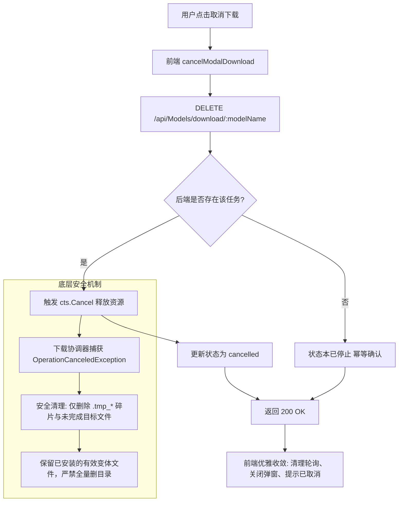

# 模型下载取消失败问题调研与解决方案

## 一、 问题背景与现象分析

### 1. 现象描述
在模型管理界面中，当用户对已有模型（如已下载其他量化变体的 `Qwen3-Embedding-0.6B`，页面显示「当前」「使用中」）点击「+ 下载新变体」后：
1. 弹出下载模态框，完成「探测源」和「选格式」步骤，点击「开始下载」；
2. 弹窗直接卡在「步骤 3: 下载中」，进度条恒定为 `0%`，当前阶段显示 `-`，传输速率显示 `-`，预估剩余时间显示 `-`，已下载大小显示 `0 B`，下载状态显示为兜底的「处理中」；
3. 用户等待无响应后点击弹窗右下角的【取消下载】按钮；
4. 页面顶部弹出红色错误提示：**「取消下载失败」**，弹窗状态依旧被强行恢复为「下载中」，无法取消亦无法正常退出。

---

## 二、 根因定位与全链路穿透

经过对前端视图（`Models.js`）、API 传输层（`index.js`）、后端控制器（`ModelsController.cs`）以及模型下载管理器（`ModelManager.cs`）的全链路分析，定位到以下相互交织的根因：

### 1. 核心诱因：控制器阻止了已下载模型的增量变体下载
在 `ModelsController.cs` 中的 `DownloadModel`（第 379 行）与 `DownloadRerankModel`（第 897 行）：
```csharp
if (model.IsDownloaded)
{
    return Ok(new { message = "模型已下载", model });
}
```
- **问题分析**：
  此处的判断过于粗暴，仅依据 `model.IsDownloaded` 即认定整个模型已就绪，直接返回 HTTP 200 OK；
  它完全忽略了用户请求体 `DownloadModelRequest` 中携带的 `OnnxFilePath`（具体变体文件名，如 `Qwen3-Embedding-0.6B-Q8_0.gguf`）；
  而在底层 `ModelManager.DownloadModelAsync` 中已经支持了增量变体识别（检查具体变体文件是否存在）。
- **连锁反应**：
  控制器直接短路返回，**根本没有实例化 `CancellationTokenSource`，也根本没有向全局任务表 `_downloadProgress` 写入任何记录，更没有启动后台下载 Task**！

### 2. 前端误判：以为下载已启动并进入幽灵轮询
在 `Models.js` 的 `confirmModalDownload` 中：
```javascript
downloadProgress.value.set(progressKey, { ... status: 'downloading', progress: 0 ... });
startProgressPolling();
await modelsApi.download(modelName, selectedFile.value, ...);
```
- 控制器返回的 HTTP 200 被前端视为下载启动成功；
- 前端启动 2 秒周期的轮询 `GET /api/Models/download/{modelName}/progress`；
- 后端由于没有该模型的活跃任务，在 `GetDownloadProgress` 中返回：
  ```csharp
  return Ok(new DownloadProgress { ModelName = modelName, Status = "idle" });
  ```
- 前端轮询逻辑仅处理 `completed`、`failed`、`downloading`，对 `idle` 毫无处理；
- 于是弹窗一直停留在初始占位数据（0%，无速度，无大小）。

### 3. 取消报错：`CancelDownload` 违背 RESTful 幂等性返回 404
当用户见无反应点击「取消下载」时：
- 前端发起 `DELETE /api/Models/download/Qwen3-Embedding-0.6B`；
- 后端 `CancelDownload` 逻辑：
  ```csharp
  if (_downloadProgress.TryGetValue(key, out var progress))
  {
      ...
      return Ok(new { message = "已取消下载" });
  }
  return NotFound(new { error = "没有正在进行的下载任务" });
  ```
- 因为后端从未将该模型加入 `_downloadProgress`，此处直接返回 **HTTP 404 Not Found**！
- Axios 拦截器将 404 当作异常抛出，前端进入 `catch (error)` 分支；
- 前端触发 `message.error('取消下载失败')`，**并将状态重新重置为 `downloadState.value = 'downloading'`**，导致弹窗继续卡死。

### 4. 衍生隐患：取消异常被泛型捕获导致误删已有变体
在 `ModelManager.cs` 的 `DownloadModelAsync` 中：
```csharp
catch (Exception ex)
{
    Console.WriteLine($"[ModelManager] 模型下载失败: {ex.Message}");
    try
    {
        if (Directory.Exists(modelDir))
        {
            Directory.Delete(modelDir, true); // 致命隐患！
        }
    }
    catch { }
    return (false, ex.Message);
}
```
- 若正在下载真实变体时用户取消，底层抛出 `OperationCanceledException`，被此处统揽的 `catch (Exception ex)` 捕获；
- `Directory.Delete(modelDir, true)` 会**把整个模型目录完全删除**，直接破坏用户此前已经下载并正常运行的旧变体！
- 且由于返回了 `(false, ex.Message)`，上层控制器将其标记为 `Failed` 而非 `Cancelled`。

### 5. 并发安全：`_downloadProgress` 字典未做线程同步
`ModelsController._downloadProgress` 为静态普通字典 `Dictionary<string, DownloadProgress>`，在多线程下载进度报告、轮询读取、LINQ 活跃任务过滤（`Where`）与并发取消之间存在竞态风险。

---

## 三、 解决方案设计



### 1. 后端控制器重构 (`ModelsController.cs`)
1. **字典线程安全化**：
   - 将 `_downloadProgress` 改为 `ConcurrentDictionary<string, DownloadProgress>`。
2. **支持变体增量下载**：
   - 在 `DownloadModel` 与 `DownloadRerankModel` 中，判断用户请求是否指定了变体 `request?.OnnxFilePath`；
   - 若指定了变体，仅当 `model.InstalledVariants` 确实已经包含该变体时，才跳过并返回 `isAlreadyDownloaded = true`；否则正常启动下载任务。
3. **取消接口幂等化**：
   - 取消操作符合 HTTP DELETE 幂等原则：若后端存在正在执行的 CTS 则 Cancel；无论任务是否存在，统一返回 200 OK，通知前端当前状态已确认重置，绝不抛出 404 错误阻碍前端重置。

### 2. 底层管理器重构 (`ModelManager.cs`)
1. **安全异常分流**：
   - 显式捕获 `OperationCanceledException`，记录用户取消日志并重新 `throw`，让上层控制器走入 `pgCancel.Status = "cancelled"` 分支；
2. **细粒度文件清理 (`CleanupIncompleteDownload`)**：
   - 严禁盲目调用 `Directory.Delete(modelDir, true)`；
   - 优先扫描并删除 `*.tmp_*` 临时下载文件；
   - 若指定了目标变体，仅删除该变体文件；
   - 只有在整个目录没有任何有效模型（`.gguf` / `.onnx`）时才清理空目录。

### 3. 前端容错重构 (`Models.js`)
1. **双向防御性取消**：
   - 在 `cancelModalDownload` 与 `handleCancelDownload` 中，即使后端响应非 200（如极端网络问题或历史 404），前端也必须清退本地轮询，移除幽灵进度，恢复 `downloadState = 'idle'` 并安全关闭模态框；
   - 绝不在取消失败时把状态设回 `downloading`。
2. **变体快速完成分支**：
   - 当调用下载 API 时若返回 `isAlreadyDownloaded = true`，前端直接标记 `downloadState = 'completed'` 并提示「所选模型变体已就绪」，不再进入无意义的轮询。
3. **轮询状态同步修正**：
   - 在进度轮询中，若后端返回 `status: 'cancelled'`，前端同步置为 `cancelled` 并收尾；若持续返回 `status: 'idle'` 超过阈值，提示并自动复位。

---

## 四、 实施步骤计划
1. 修改 `ModelManager.cs`：增加 `CleanupIncompleteDownload` 安全清理方法，分流处理 `OperationCanceledException`。
2. 修改 `ModelsController.cs`：将进度字典升级为并发字典，放行变体增量下载，重构 `CancelDownload` 为幂等返回。
3. 修改 `Models.js`：增强前端取消逻辑的幂等性和容错恢复，避免死循环。
4. 运行后端 xUnit 单元测试与前端 AST/逻辑单测验证。
