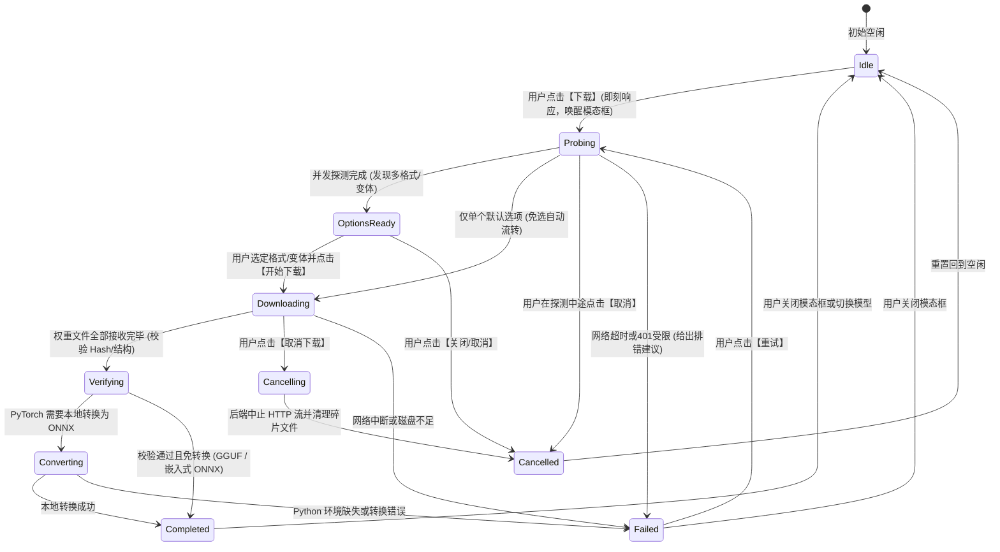

# 模型下载无响应问题剖析、下载状态机与可取消模态框架构设计

## 一、背景与现状痛点分析

在 ReferenceRAG 的 Web 客户端模型管理页面（包括嵌入模型与重排模型列表），用户在点击表格行的【下载】按钮时，经常出现**“界面完全没有反应”、“无响应”、“疑似假死”**的问题。随后，下载往往又莫名其妙地在页面底部静默开始，或者最终因超时/401 失败而让用户产生困惑。

结合系统代码（`Models.js`、`ModelsController.cs`、`ModelDownloadCoordinator.cs`）以及现场运行状态，定位到根本原因如下：

### 1.1 核心根本原因剖析

1. **前置探测（GetDownloadOptions）串行高延迟阻塞**：
   - 现行架构在触发下载前，必须先获取下载选项（`modelsApi.getDownloadOptions`）。
   - 在 `ModelDownloadCoordinator.GetDownloadOptionsAsync` 中，当目标模型未提供现成 ONNX 或 GGUF 时，系统会尝试向社区镜像库（如 `onnx-community/{repo}`、`second-state/{repo}-GGUF`、`bartowski/{repo}-GGUF` 等 6 个候选源）逐一探测清单。
   - 这 6 个网络请求是**串行执行（Serial Loop）**的。在国内外网络抖动或 HuggingFace API 延迟时，单次探测耗时 3~6 秒，6 次串行探测累计耗时 **18 ~ 36 秒**！
2. **操作触发零视觉反馈（Zero Action Feedback）**：
   - 表格行中的【下载】按钮未绑定行级 loading 状态（`:loading="rowLoading[row.name]"` 为缺失状态）。
   - 用户点击后，浏览器在后台静默发起 API 请求，界面没有任何 Loading 遮罩、Spin 指示器或轻提示。
   - 用户肉眼可见的界面毫无变化，误以为点击未生效，进而重复猛点或误以为系统卡死。
3. **交互弹窗与任务进度在视觉上割裂**：
   - 原先的流程设计为：`选项确认弹窗` -> 点击确定 -> `弹窗立即关闭` -> 进度丢给页面底部的 `activeDownloads` 列表卡片。
   - 当页面包含多款模型（如 BGE、Qwen、GTE 等重排与嵌入模型）时，列表高度很长。用户在页面中上部点击下载后，根本看不到屏幕底部的进度条，产生“点击后消失了”的严重断层感。
4. **不可取消与资源泄露风险**：
   - 在前置探测阶段（18~36 秒），前端没有绑定 `AbortController`，后端 `ModelsController` 亦未接入 `CancellationToken`，用户无法取消探测；
   - 在下载进行时，用户很难在当前视野直接取消下载，取消逻辑分散在页面底部的微小按钮中。
5. **异常静默吞没（Silent Exception Swallowing）**：
   - 前端 `try-catch` 仅打印 `console.error`，未对用户提示 `message.error`，导致探测超时后弹出一个没有任何选项的空白对话框。

---

## 二、下载状态机架构（Download State Machine）设计

为了彻底解决“点击后无响应”和“状态失控”问题，我们引入**前端 + 后端双层联动的下载生命周期状态机**。

### 2.1 状态流转模型

### 2.2 状态定义表

| 状态 (State) | 触发时机 | 界面展示与动作 | 允许的操作 |
| :--- | :--- | :--- | :--- |
| **`Idle`** | 初始状态或上一任务结束 | 表格中显示普通的【下载】按钮 | 点击进入 `Probing` |
| **`Probing`** | 用户点击【下载】的一瞬间（0毫秒） | 居中弹出模态框，行按钮显示 loading，模态框展示“正在并发探测官方及社区镜像（GGUF / ONNX）...” | **一键取消**（中断探测） |
| **`OptionsReady`** | 探测到多个选项（如 GGUF 与 ONNX 并存） | 模态框展示单选格式过滤标签与变体列表（推荐项高亮、免转标签、体积大小） | 选择具体项、**取消**、**确认开始下载** |
| **`Downloading`** | 后端下载数据流已连接 | 模态框展示当前步骤条、动态百分比、下载速度（MB/s）、已下载/总字节数、预计剩余时间、当前文件分片 | **取消下载**、**后台运行**（收起到页面底部卡片） |
| **`Verifying`** | 文件传输完成 100% | 进度条显示 100% 脉冲动画，提示“正在验证文件完整性与结构合法性...” | 等待中（只读） |
| **`Converting`** | PyTorch 权重转换 ONNX | 步骤条切至“格式转换”，展示转换进度 | 后台执行 / 取消 |
| **`Completed`** | 下载并写入配置成功 | 成功图标高亮，展示文件最终路径，提供【立即切换使用】与【完成】按钮 | 一键切换、关闭 |
| **`Failed`** | 任何阶段出现错误（如 401 授权失败、网络超时） | 错误提示框，展示结构化错误码、排查指引（如配置 `HF_TOKEN`）、【重试】按钮 | **一键重试**、关闭 |
| **`Cancelling` / `Cancelled`** | 用户主动终止下载 | 提示“正在取消并清理未完成的临时文件...”，安全终止 | 关闭 |

---

## 三、可行性与技术欠缺头脑风暴（Feasibility & Gaps）

### 3.1 核心可行性依据
1. **组件库高度完备**：本项目前端采用 Naive UI，原生支持 `NModal`（弹窗）、`NSteps` / `NStep`（步骤条）、`NProgress`（进度指示器）、`NSpin`（加载骨架）以及 `NButton` 的 `:loading` 属性，能以极高标准还原专业级下载管理器。
2. **后端取消通道已就绪**：后端已具备 `_downloadCts[modelName]` 字典，且提供了 `DELETE /api/models/download/{modelName}` 与 `DELETE /api/models/rerank/download/{modelName}`，具备中止流式下载的坚实底座。
3. **断点恢复与多任务感知**：后端已有 `_downloadProgress` 内存单例，前端刷新页面或重新打开模态框时，可根据 `getActiveDownloads` 瞬间拉齐状态机。

### 3.2 潜在技术欠缺与解决方案设计

| 潜在欠缺 / 风险点 | 严重程度 | 传统做法的缺陷 | 本方案的改进与兜底机制 |
| :--- | :---: | :--- | :--- |
| **探测阶段卡死无法取消** | 高 | 以前使用串行 `foreach` 探测，若用户中途关闭，后端仍然卡在 HttpClient 中占用连接池 | 1. 后端改用 `Task.WhenAll` 受限并发探测； 2. 每个候选设置单次 3.5 秒严格超时； 3. 前端使用 `AbortController` 绑定请求，后端 Controller 绑定 `HttpContext.RequestAborted`。 |
| **取消下载后的磁盘碎片残留** | 中 | 用户在下载到 80% 时点击取消，下载目录可能残留巨大无用的 `.tmp` 或未完成文件 | 后端在捕获 `OperationCanceledException` 时，调用 `FileCleanupHelper` 自动扫描删除目标目录中未完成的文件碎片。 |
| **模态框独占导致无法浏览其他页面** | 中 | 如果模态框强制全屏遮罩且无法最小化，用户想在下载 8GB 大模型时继续看其他文档会受阻 | 模态框提供【后台下载】（收起）按钮：点击后模态框关闭，转为页面底部卡片；而在模型列表中该行显示【查看进度】按钮，点击随时重新拉起全功能模态框！ |
| **心跳丢失导致状态机僵死** | 低 | 若后端网络瞬断或轮询失败，前端可能永久显示“下载中 45%” | 前端状态机引入 **15 秒心跳看门狗（Watchdog）**：若连续 3 次轮询失败或进度停滞且无心跳，自动将状态机切至 `Failed` 状态并允许一键重试。 |

---

## 四、落地实施方案

### 4.1 后端性能与并发升级
1. **[`ModelDownloadCoordinator.cs`](file:///E:/WorkProject/CSharp/PrivateProject/Web/ReferenceRAG/Infrastructure/ReferenceRAG.Infrastructure/Features/ModelManagement/Download/Coordinator/ModelDownloadCoordinator.cs)**：
   - 将社区候选源探测重构为受控并发：并发度限制为 3，单个探测超时设置为 3.5 秒；
   - 只要同时探测到 GGUF 与 ONNX 即刻提前短路返回，探测总耗时从 ~30 秒缩减至 **1~2 秒**；
   - 贯通 `CancellationToken`，响应前端中止请求。
2. **[`ModelsController.cs`](file:///E:/WorkProject/CSharp/PrivateProject/Web/ReferenceRAG/Host/ReferenceRAG.ApiHost/Controllers/ModelsController.cs)**：
   - 在 `GetDownloadOptions` 与 `GetRerankDownloadOptions` 接口方法签名中注入 `CancellationToken cancellationToken`；
   - 保证用户取消或网络断开时快速释放后端任务。
3. **[`ModelManager.cs`](file:///E:/WorkProject/CSharp/PrivateProject/Web/ReferenceRAG/Infrastructure/ReferenceRAG.Infrastructure/Features/ModelManagement/Services/ModelManager.cs)**：
   - 在下载取消与异常处理逻辑中，加入目标临时目录/碎片文件的清理逻辑。

### 4.2 前端状态机与可取消模态框实现
1. **行级即时响应（Row Loading）**：
   - 建立 `rowLoadingMap` 响应式对象，用户点击某行的瞬间立即激活按钮 `:loading="true"`，杜绝“无响应”现象。
2. **全功能下载过程模态框（Download Process Modal）**：
   - 模态框宽度设为 640px，居中弹出；
   - 包含步骤条：`1. 探测格式` -> `2. 确认版本` -> `3. 下载传输` -> `4. 校验与就绪`；
   - 实时呈现：大号进度条、当前阶段说明、下载速率、剩余时间预估；
   - 底部操作栏：【取消下载】（危险红色，立即取消）、【后台下载】（收起弹窗）、【重试】、【完成/切换】。
3. **已在下载中的模型交互**：
   - 表格行对正在下载的模型，显示【查看进度】按钮（黄色/蓝色），点击随时唤醒下载模态框；
   - 底部保留轻量级任务卡片，与模态框双向响应同步。

---

## 五、验证与测试规划
1. **并发探测测试**：测试多个候选镜像存在与不存在时的并发探测速度与短路机制；
2. **下载取消与清理测试**：启动大模型下载，中途调用取消 API，验证状态机迅速迁移至 Cancelled 并确认未留下脏数据；
3. **自动化测试套件回归**：全量执行 `ReferenceRAG.Tests`，确保 385+ 测试用例 100% 保持绿色通过。
