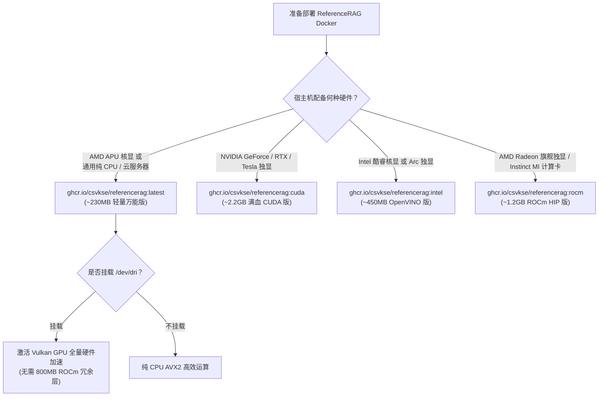

# 模型格式硬件支持矩阵与 Docker 镜像选型指南 (ONNX vs GGUF)

> **版本适用**: ReferenceRAG v1.0.44+  
> **文档定位**: 硬件加速拓扑规划、模型格式选型对比与容器化生产部署标准指南

---

## 1. 架构背景与设计初衷

在端侧与私有化 RAG（检索增强生成）系统中，底层硬件环境极为碎片化：
* **显卡厂商与架构**：涵盖 NVIDIA（GeForce/RTX/Tesla）、AMD（Radeon 独显/Ryzen APU 核显）、Intel（Arc 独显/Core 酷睿核显）以及各类云服务器多核 CPU；
* **内存架构**：从独立 PCIe 高速显存（VRAM）到统一系统共享内存（UMA）；
* **模型任务流**：涵盖文本向量化嵌入（Embedding）、相关性文档重排（Reranker）以及多轮流式对话大模型（Chat）。

为了在碎片化硬件上达到极致性能与轻量部署的平衡，ReferenceRAG 确立了 **“GGUF 与 ONNX 双轨制运行时”** 架构。

---

## 2. ONNX vs GGUF 核心引擎与生态特性对比

| 核心特性 | ONNX Runtime (微软生态) | GGUF / llama.cpp (开源轻量生态) |
| :--- | :--- | :--- |
| **主要定位** | 传统深度学习模型、跨框架标准中间表示 | 大语言模型（LLM）与轻量 Embedding/Rerank 高效量化 |
| **底层驱动引擎** | `Microsoft.ML.OnnxRuntime` 系列原生库 | `LLamaSharp` / `libllama.so` 原生 C++ 动态库 |
| **量化精度支持** | FP32、FP16、INT8 (QDQ)、UINT8 | Q4_K_M、Q5_K_M、Q8_0、BF16、FP16 等深度量化 |
| **Windows 加速能力** | ⭐️⭐️⭐️⭐️⭐️ **极佳**：通过 DirectML 原生吃满任意 DirectX 12 显卡 | ⭐️⭐️⭐️⭐️⭐️ **极佳**：支持 DirectML、Vulkan、CUDA |
| **Linux Vulkan 支持** | ❌ **官方无主线 Vulkan EP**（缺乏通用跨厂商跨核显 GPU 后端） | ⭐️⭐️⭐️⭐️⭐️ **满血原生**：内置 `ggml-vulkan.cpp`，跨架构开箱即用 |
| **Linux UMA 核显表现** | ⚠️ **受限**：无 DirectML，ROCm 不支持 APU，常被迫回退 CPU | ⭐️⭐️⭐️⭐️⭐️ **极佳**：自动分配系统共享内存，全量 GPU 卸载 |
| **适用任务场景** | 传统轻量 Embedding (bge-small/base) ONNX 版 | 聊天模型 (Qwen/DeepSeek)、现代大 Embedding (bge-m3)、Reranker |

---

## 3. 全平台全硬件加速支持矩阵 (Hardware Support Matrix)

下表详细定义了不同硬件平台与操作系统下，ONNX 与 GGUF 模型所能达到的实际硬件加速级别：

```
状态图示：
🟢 满血硬件加速（全量 GPU Offload / Tensor Core / Compute Pipeline）
🟡 部分或平台受限加速（需特定驱动配置或通过 DirectML 转换）
🔴 无法启用 GPU 加速（回退到宿主机多核 CPU AVX2/AVX-512 计算）
```

### 3.1 Linux 环境（容器部署与原生 Linux 服务器）

| 物理硬件设备 | ONNX 格式模型 (`.onnx`) | GGUF 格式模型 (`.gguf`) | 推荐加速后端与说明 |
| :--- | :---: | :---: | :--- |
| **AMD Ryzen APU 核显**<br>*(Radeon 680M/780M/Vega 等 UMA)* | 🔴 仅 CPU<br>*(无 Vulkan EP，ROCm 官方不支持 APU)* | 🟢 **Vulkan 满血**<br>*(全量卸载至 Mesa RADV)* | **强推 GGUF 格式**。GGUF 走 Vulkan 管道可全量卸载，生成速度提升 5~12 倍。 |
| **AMD Radeon RX 独显**<br>*(RX 6000/7000/8000 系列)* | 🟡 ROCm HIP<br>*(仅限官方支持的特定旗舰卡)* | 🟢 **Vulkan 满血**<br>*(免去 ROCm 严苛兼容性挑剔)* | **首选 GGUF (Vulkan)**；ROCm 对中端卡兼容复杂，Vulkan 免配置通杀。 |
| **Intel 酷睿核显**<br>*(Iris Xe / UHD / Core Ultra)* | 🟢 **OpenVINO 满血**<br>*(Level Zero GPU 驱动)* | 🟢 **Vulkan 满血**<br>*(Mesa ANV 驱动)* | ONNX 选 OpenVINO 模式，GGUF 选 Vulkan 模式，均能满血跑满核显。 |
| **Intel Arc 独显**<br>*(Arc A380/A750/A770/B580)* | 🟢 **OpenVINO 满血**<br>*(原生 XMX 矩阵加速)* | 🟢 **Vulkan 满血**<br>*(Vulkan Compute)* | 双格式均可吃满独显；深度学习推荐 OpenVINO (ONNX) 或 Vulkan (GGUF)。 |
| **NVIDIA 独显**<br>*(RTX 20/30/40/50, Tesla)* | 🟢 **CUDA 12 / TensorRT**<br>*(cuBLAS / cuDNN)* | 🟢 **CUDA 12 原生**<br>*(CuBlas / FlashAttention)* | 统一走 CUDA，全量卸载，性能最强。 |
| **云服务器 / 纯 CPU 环境**<br>*(Intel Xeon / AMD EPYC)* | 🟢 CPU (AVX-512 / AVX2) | 🟢 CPU (AVX2 / OpenMP) | 无显卡时两类格式均支持多核并行 CPU 软解。 |

### 3.2 Windows 环境（桌面端与 Windows Server）

| 物理硬件设备 | ONNX 格式模型 (`.onnx`) | GGUF 格式模型 (`.gguf`) | 推荐加速后端与说明 |
| :--- | :---: | :---: | :--- |
| **AMD APU 核显 / 独显** | 🟢 **DirectML 满血** | 🟢 **DirectML / Vulkan** | 微软 DirectML 原生驱动，任意 DX12 显卡直接拉满。 |
| **Intel 核显 / Arc 独显** | 🟢 **DirectML 满血** | 🟢 **DirectML / Vulkan** | 开箱即用，系统自动调度共享显存。 |
| **NVIDIA 全系列独显** | 🟢 **CUDA / DirectML** | 🟢 **CUDA 12 满血** | 首选 CUDA 12 原生驱动，延迟与吞吐最优。 |

---

## 4. ReferenceRAG 官方 4 套 Docker 镜像深度剖析

根据不同的硬件计算依赖，官方提供了 4 套分工明确的 Docker 镜像变体：



### 4.1 镜像变体技术规格对比表

| 镜像标签 (Tag) | 基础镜像 (Base) | 关键内置驱动与运行时 | 压缩下载大小 | 解压运行体积 | 适用硬件推荐 |
| :--- | :--- | :--- | :--- | :--- | :--- |
| **`latest`**<br>*(或 `cpu`)* | `aspnet:10.0` (Ubuntu 24.04) | **`libvulkan1`**<br>**`mesa-vulkan-drivers`**<br>`LLamaSharp.Backend.Vulkan.Linux`<br>`LLamaSharp.Backend.Cpu` | **~230 MB**<br>*(精简轻快)* | ~550 MB | 🟢 **AMD APU 核显 (Vulkan)**<br>🟢 **AMD 独显 (Vulkan)**<br>🟢 **云服务器 / 纯 CPU** |
| **`cuda`**<br>*(或 `nvidia`)* | `nvidia/cuda:12.8.0-cudnn` | **CUDA 12.8 Runtime**<br>**cuDNN 9**<br>`LLamaSharp.Backend.Cuda12.Linux`<br>`Microsoft.ML.OnnxRuntime.Gpu` | **~2.2 GB**<br>*(含重型算子)* | ~5.2 GB | 🟢 **NVIDIA RTX 20/30/40/50**<br>🟢 **NVIDIA Tesla/Quadro** |
| **`intel`**<br>*(或 `openvino`)* | `ubuntu:24.04` | **Intel Compute Runtime**<br>(Level Zero / OpenCL)<br>**`onnxruntime-openvino`**<br>`mesa-vulkan-drivers` | **~450 MB**<br>*(中等精简)* | ~1.1 GB | 🟢 **Intel Core Ultra 核显**<br>🟢 **Intel 11~14 代 Iris Xe**<br>🟢 **Intel Arc 独显** |
| **`rocm`**<br>*(或 `amd`)* | `ubuntu:24.04` | **`hip-runtime-amd`**<br>**`rocblas`** (853.6MB 大层)<br>`mesa-vulkan-drivers`<br>`LLamaSharp.Backend.Vulkan.Linux` | **~1.2 GB**<br>*(含 ROCm 算子)* | ~3.8 GB | 🟢 **AMD RX 7900/6900 独显**<br>🟢 **AMD Instinct MI 系列**<br>*(APU 核显无需拉取此镜像)* |

---

## 5. 常见痛点根因与解决方案 (SOP)

### 痛点 1：拉取镜像时卡在 `853.6MB` 的层 (`rocblas`)
* **根因**：使用了 `rocm` 标签，该层为 AMD 官方打包的数十种 GPU 微架构汇编算子库（`rocblas`）。
* **解法**：如果你使用的是 **AMD APU 核显（如 Ryzen 7840HS/8845HS/5700G 等）**，底层实际走的是 Vulkan 驱动，**直接切换为 `latest` 镜像**，体积立减 850MB，拉取秒级完成且 Vulkan 算力丝毫未损！

### 痛点 2：Linux 下跑 ONNX 模型为什么吃不到 GPU？
* **根因**：ONNX Runtime 官方在 Linux 上没有 Vulkan 提供者，且微软 DirectML 仅能在 Windows 运行。
* **解法**：将模型格式转换为 **GGUF 格式**（例如使用 `bge-m3-Q4_K_M.gguf` 替代 `bge-m3.onnx`），系统底层将全自动交由 `libllama.so` 的 Vulkan 管道卸载至 GPU。

### 痛点 3：容器挂载了 `/dev/dri` 仍然报权限不足（Permission Denied）退回 CPU？
* **根因**：宿主机的 `/dev/dri/renderD*` 设备通常归属于 `render`（GID 107）或 `video`（GID 44）用户组。如果容器以普通用户运行且未加入对应组，将无权访问 GPU 字符设备。
* **解法**：运行命令追加 `--group-add video --group-add render`（在 Docker Compose 中配置 `group_add: [video, render]`）。官方新版镜像已内置该用户组绑定。

---

## 6. 容器化生产部署实操命令

### 方案 A：AMD APU 核显 / 纯 CPU 环境（推荐默认，极致轻量）
```bash
docker run -d \
  --name reference-rag \
  -p 5123:5000 \
  --device /dev/dri:/dev/dri \
  --group-add video \
  --group-add render \
  -v ./data:/app/data \
  -v ./models:/app/models \
  -v ./logs:/app/logs \
  -e ASPNETCORE_ENVIRONMENT=Production \
  ghcr.io/csvkse/referencerag:latest
```

### 方案 B：NVIDIA 独显环境（满血 CUDA）
```bash
docker run -d \
  --name reference-rag-cuda \
  -p 5123:5000 \
  --gpus all \
  -v ./data:/app/data \
  -v ./models:/app/models \
  -v ./logs:/app/logs \
  -e ASPNETCORE_ENVIRONMENT=Production \
  ghcr.io/csvkse/referencerag:cuda
```

### 方案 C：Intel 核显 / Arc 独显环境（OpenVINO 加速）
```bash
docker run -d \
  --name reference-rag-intel \
  -p 5123:5000 \
  --device /dev/dri:/dev/dri \
  --group-add video \
  --group-add render \
  -v ./data:/app/data \
  -v ./models:/app/models \
  -v ./logs:/app/logs \
  -e ASPNETCORE_ENVIRONMENT=Production \
  ghcr.io/csvkse/referencerag:intel
```

---

## 7. 运行时硬件执行状态校验端点

部署启动后，可通过内置 API 探测模型运行实际设备与卸载情况：

* **请求端点**：`GET http://<host>:5123/api/Models/runtime-status`
* **响应验证样本（AMD APU Vulkan 满血就绪）**：
```json
{
  "chatStatus": {
    "modelName": "Qwen3.5-0.8B-Instruct-GGUF",
    "executionDevice": "AMD Vulkan GPU (AMD Radeon GPU / APU)",
    "isGpuMode": true,
    "offloadDescription": "全量卸载到 GPU"
  },
  "embeddingStatus": {
    "modelName": "bge-m3",
    "executionDevice": "AMD Vulkan GPU (AMD Radeon GPU / APU)",
    "isGpuMode": true,
    "offloadDescription": "全量卸载到 GPU (24/24 层)"
  },
  "rerankStatus": {
    "modelName": "bce-reranker-base_v1",
    "executionDevice": "AMD Vulkan GPU (AMD Radeon GPU / APU)",
    "isGpuMode": true,
    "offloadDescription": "全量卸载到 GPU (12/12 层)"
  }
}
```
若三者均回显为 `AMD Vulkan GPU` 且 `isGpuMode: true`，说明硬件 Vulkan 算力已完美接通。
