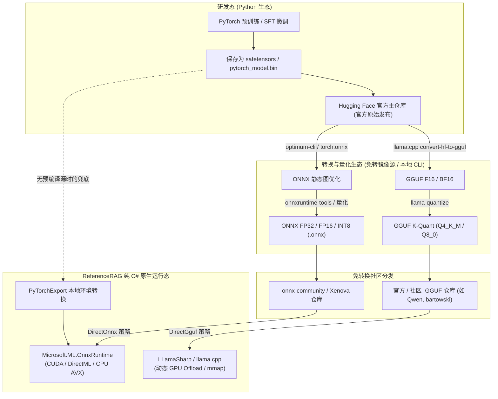
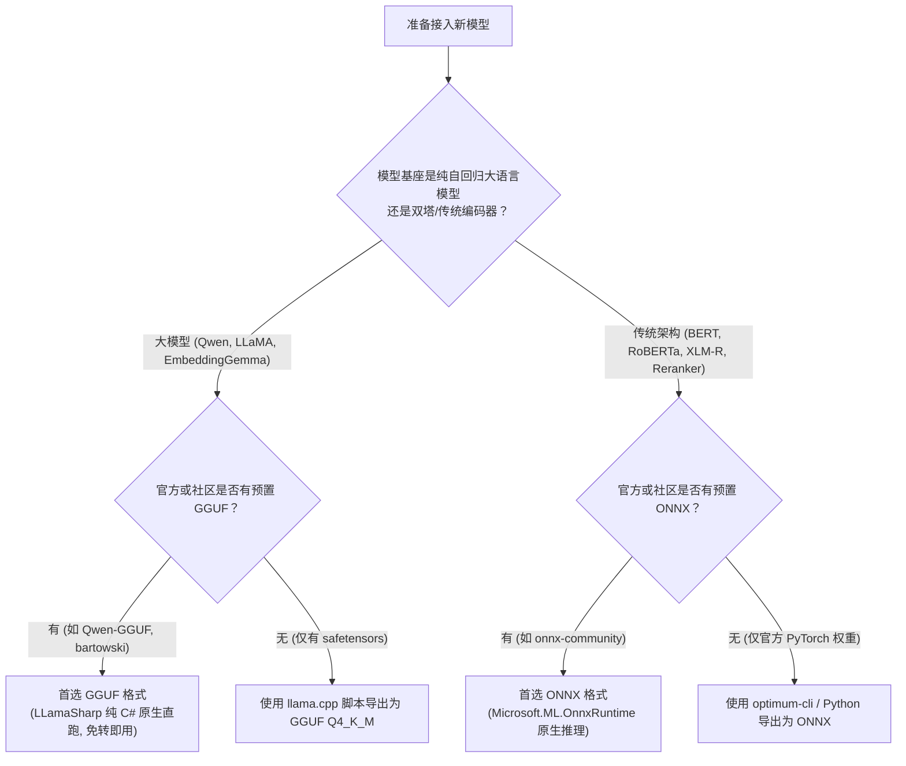

# 深度技术指南：模型格式演进（PyTorch / ONNX / GGUF）、Hugging Face 规范与常用模型体系

> 本文档详细阐述现代深度学习模型主流存储与推理格式（PyTorch / ONNX / GGUF）的技术演进与内在关系，解析 Hugging Face 仓库文件规范，并系统梳理向量嵌入（Embedding）、交叉重排（Reranker）与因果生成（Causal LM）等常用模型类型的架构特征与工程落地准则。

---

## 目录

- [一、模型格式全景与演进关系](#一模型格式全景与演进关系)
  - [1.1 核心格式横向对比速查表](#11-核心格式横向对比速查表)
  - [1.2 模型生命周期与转换流转图](#12-模型生命周期与转换流转图)
  - [1.3 为什么工业部署需要从 PyTorch 转向 ONNX / GGUF？](#13-为什么工业部署需要从-pytorch-转向-onnx--gguf)
- [二、三大模型格式深度剖析](#二三大模型格式深度剖析)
  - [2.1 PyTorch 原生格式（.bin / .safetensors）](#21-pytorch-原生格式bin--safetensors)
  - [2.2 ONNX 开放神经网络交换格式（.onnx / .onnx_data）](#22-onnx-开放神经网络交换格式onnx--onnx_data)
  - [2.3 GGUF 统一量化文件格式（.gguf）](#23-gguf-统一量化文件格式gguf)
  - [2.4 生产场景选型与架构映射决策矩阵](#24-生产场景选型与架构映射决策矩阵)
- [三、其它主流格式与量化生态扩展](#三其它主流格式与量化生态扩展)
  - [3.1 专用硬件加速编译引擎格式（TensorRT / OpenVINO / CoreML / TFLite）](#31-专用硬件加速编译引擎格式tensorrt--openvino--coreml--tflite)
  - [3.2 服务端大模型高并发量化格式（AWQ / GPTQ / EXL2 / BitsAndBytes）](#32-服务端大模型高并发量化格式awq--gptq--exl2--bitsandbytes)
  - [3.3 历史演进与已淘汰格式图谱](#33-历史演进与已淘汰格式图谱)
- [四、Hugging Face 仓库文件体系与规范](#四hugging-face-仓库文件体系与规范)
  - [4.1 模型权重文件体系](#41-模型权重文件体系)
  - [4.2 结构超参与生成配置](#42-结构超参与生成配置)
  - [4.3 分词系统（Tokenizer）组件规范](#43-分词系统tokenizer组件规范)
  - [4.4 任务衍生配置（Pooling / Modules）](#44-任务衍生配置pooling--modules)
  - [4.5 仓库访问控制状态（Public / Gated / Private）](#45-仓库访问控制状态public--gated--private)
- [五、常用模型类型与架构区分规范](#五常用模型类型与架构区分规范)
  - [5.1 双塔文本向量模型（Bi-Encoder / Embedding）](#51-双塔文本向量模型bi-encoder--embedding)
  - [5.2 交叉编码重排模型（Cross-Encoder / Reranker）](#52-交叉编码重排模型cross-encoder--reranker)
  - [5.3 自回归因果语言模型（Causal LM / Generative LLM）](#53-自回归因果语言模型causal-lm--generative-llm)
  - [5.4 稀疏检索与混合模型（Sparse / Multi-Vector）](#54-稀疏检索与混合模型sparse--multi-vector)
- [六、在 ReferenceRAG 工程中的落地实践](#六在-referencerag-工程中的落地实践)
  - [6.1 双引擎自适应加载流程](#61-双引擎自适应加载流程)
  - [6.2 硬件环境自动感知与分层卸载策略](#62-硬件环境自动感知与分层卸载策略)
  - [6.3 常见排查与诊断速查清单](#63-常见排查与诊断速查清单)

---

## 一、模型格式全景与演进关系

### 1.1 核心格式横向对比速查表

| 特性维度 | PyTorch 原生 (`.safetensors` / `.bin`) | ONNX 格式 (`.onnx`) | GGUF 格式 (`.gguf`) |
| :--- | :--- | :--- | :--- |
| **提出方 / 生态** | Meta AI / Hugging Face Transformers | Linux Foundation / 微软 / 开源联盟 | Georgi Gerganov (`llama.cpp`) 社区 |
| **主要定位** | 模型研发、训练微调、学术研究 | 跨平台跨硬件通用静态推理引擎 | 边缘端 / 个人计算设备 / 高效量化大模型推理 |
| **计算图支持** | 动态计算图（Eager Execution） | 静态计算图（显式描述 Tensor 算子流） | 算子硬编码于 Runtime，文件仅保留权重与元数据 |
| **Python 依赖** | **强依赖** Python 运行时及 PyTorch/CUDA 轮子 | **完全无 Python 依赖**，C#/C++/Go/Rust 原生支持 | **完全无 Python 依赖**，纯 C/C++ 静态构建 |
| **内存/显存机制** | 需 Python 垃圾回收，显存占用大且有碎片 | 显存池化管理，支持多 Execution Provider | `mmap` 零拷贝极速载入，支持逐层显存 Offload |
| **量化支持** | PTQ / QAT（需复杂框架支持） | INT8 / FP16 / UINT8（ORT 工具链） | 原生丰富 K-Quant 体系（Q4_K_M, Q5_K_M, Q8_0 等） |
| **典型适用场景** | 模型预训练、代码微调、模型权重存储源头 | 经典小模型（BERT, RoBERTa, Reranker, CV 骨干） | 现代大模型（LLM, Qwen3-Embedding, LLaMA） |
| **ReferenceRAG 后端** | 需本地调用 Python 导出脚本 | `Microsoft.ML.OnnxRuntime` 原生驱动 | `LLamaSharp` / `llama.cpp` 原生驱动 |

---

### 1.2 模型生命周期与转换流转图



---

### 1.3 为什么工业部署需要从 PyTorch 转向 ONNX / GGUF？

1. **摆脱沉重的 Python 运行环境与依赖地狱**：
   - PyTorch 生产运行需要 Python 解释器、`torch.dll`（单文件 2GB+）、`transformers`、`accelerate` 等数十个第三方 pip 包，对宿主操作系统的动态链接库（CUDA、cuDNN、GLIBC、VC++ Redistributable）要求极度严苛。
   - ONNX Runtime 与 LLamaSharp 均采用**现代化 C++ 静态/动态链接核心**，可在纯 `.NET` 或二进制环境下直接启动，无需用户配置任何 Python 环境。
2. **静态计算图与硬件极致优化**：
   - PyTorch 采用动态图追踪，每次前向传播均伴随 Python 对象封装和调度损耗。
   - ONNX 拥有确定的计算图，Runtime 会在加载阶段自动执行**算子融合（Operator Fusion）**（例如将 `MatMul + Add + LayerNorm` 融合成一个单一 Kernel），并利用 DirectML 或 TensorRT 发挥显卡极限算力。
3. **超大参数量显存优化与量化效率**：
   - GGUF 格式通过针对 Transformer 权重的块级非均匀量化（如 `Q4_K_M`，关键注意力层保留更高精度，全连接层量化），将原本需要 8GB+ 显存的模型压缩至 1.5GB~2GB，且速度比 PyTorch 原生 FP16 更快。

---

## 二、三大模型格式深度剖析

### 2.1 PyTorch 原生格式（.bin / .safetensors）

#### 演进历程
1. **旧式 Pickle 格式 (`pytorch_model.bin` / `model.pt`)**：
   - 基于 Python 的 `pickle` 协议序列化。
   - **重大安全漏洞**：`pickle` 支持在反序列化时执行任意 Python 字节码，加载不受信任的 `.bin` 文件可能导致远程代码执行（RCE 木马攻击）。
   - **内存拷贝浪费**：加载时必须由 Python 逐对象反序列化并在堆上重新分配内存，启动极慢。
2. **现代安全格式 (`model.safetensors`)**：
   - 由 Hugging Face 于 2022 年主导推出的开源权重格式，现已成为学术界与开源社区的**绝对统治标准**。
   - **零拷贝内存映射（Zero-copy Memory Mapping）**：文件头部为标准 JSON 描述各 Tensor 的 offset 与 shape，数据区为连续字节数组。操作系统可以直接通过 `mmap` 将磁盘页面挂载入内存/显存，加载速度提升 5~10 倍。
   - **安全透明**：格式完全不可执行，只存纯粹的数据张量，杜绝安全风险。

#### 局限性
`safetensors` 虽然解决了“存储和安全性”，但它**只包含张量权重，不包含计算图（代码）**。要让权重跑起来，依然必须配合具体的 Python 代码（如 `modeling_bert.py`）来定义前向传播逻辑。因此，它无法在不引入 Python 的 C# 项目中直接执行。

---

### 2.2 ONNX 开放神经网络交换格式（.onnx / .onnx_data）

#### 结构规范
ONNX（Open Neural Network Exchange）是由微软、Facebook（Meta）、亚马逊联合打造的跨框架中间件表示协议，其底层采用 **Protocol Buffers (Protobuf)** 描述：
- **ModelProto**：顶层模型信息，包含元数据、生产者标识。
- **GraphProto**：计算图核心，包含输入、输出、算子节点（NodeProto）以及模型初始权重（TensorProto）。
- **Operator Set (Opset)**：算子版本号（如 Opset 14, 17, 19），确保新老运行时版本的兼容性。

#### 嵌入式 vs 外部数据格式
- **单文件嵌入式格式（Embedded ONNX）**：
  - 所有的权重张量数据均直接内嵌在单个 `.onnx` protobuf 结构内。
  - **关键约束**：Protobuf 内部数据包硬编码限制为 **2GB**。因此，超过 2GB 的模型（如 BGE-Large、Qwen、多语言大模型）无法打包为单个内嵌 `.onnx` 文件。
- **外部数据格式（External Data ONNX）**：
  - `.onnx` 主文件只保存计算图网络结构与节点拓扑（大小通常仅数十 KB 到几 MB）。
  - 权重张量剥离存储在伴随的 `model.onnx.data` 或 `model.onnx_data` 二进制文件中。
  - **优势**：完美突破 2GB 限制，支持几十 GB 的大参数量模型。
  - **注意事项**：加载时 `.onnx` 与 `.data` 文件必须位于同一相对路径下，否则 Runtime 抛出文件缺失错误。

#### 在 RAG 系统中的定位
ONNX 是目前**文本嵌入模型（BERT / RoBERTa / BGE-M3）与交叉重排模型（Reranker）** 在 C# 生产环境中最理想的格式。ONNX Runtime 提供极致优化的 CPU AVX2/AVX512 指令集加速，同时在有独立显卡时可自动无缝切换到 CUDA 或 DirectML。

---

### 2.3 GGUF 统一量化文件格式（.gguf）

#### 诞生背景与架构跃迁
GGUF（GPT-Generated Unified Format）由开源项目 `llama.cpp` 的创始人 Georgi Gerganov 设计，作为废弃格式 GGML 与 GGJT 的继承者：
- **自描述与向后兼容**：文件头采用二进制 Key-Value 键值对存储架构超参（如 `llama.embedding_length`、`llama.block_count`、分词规则、上下文窗口等）。即使未来添加新参数，旧版运行时仍可平滑忽略未识别字段，彻底终结了“格式一更新旧模型全废”的历史问题。
- **单文件全要素打包**：单个 `.gguf` 文件内部已经打包了**模型超参数、分词词表（Tokenizer Vocab）、所有量化后的权重张量**。用户只需要下载一个 `.gguf` 文件即可完整运行，杜绝了“模型跑不起来因为丢了 tokenizer.json”的窘境。

#### 常见量化级别速查

| 量化等级 | 压缩比（相对 FP16） | 精度保留率 | 显存/内存需求 | 推荐场景 |
| :--- | :--- | :--- | :--- | :--- |
| **Q4_K_M** | ~28% (4-bit) | 99.2% | 极低（0.5B 模型仅 ~450MB） | **生产首选推荐**：兼顾速度、体积与极高语义保真度 |
| **Q4_0 / Q4_1** | ~26% (4-bit) | 98.5% | 极低 | 老旧设备或对推理速度极度敏感的场景 |
| **Q5_K_M** | ~35% (5-bit) | 99.7% | 较低 | 对长上下文复杂语义精度要求极高的场景 |
| **Q8_0** | ~55% (8-bit) | 99.9% | 中等 | 近乎无损精度，显存充裕时的保真首选 |
| **F16 / BF16** | 100% (16-bit) | 100% | 原生占用 | 导出原始基座，通常用于二次量化 |

#### GGUF 的杀手级特性：层级动态 Offload
GGUF 模型在加载时，LLamaSharp / llama.cpp 支持传入参数 `n_gpu_layers`：
- 若显存足够，将所有层全塞入 GPU 显存，实现全 GPU 极速推理；
- 若显存不足（例如 4GB 显存显卡运行 4B 模型），可将前 20 层卸载至 GPU，剩余层留在 CPU 内存中混合计算，绝不因显存不足（OOM）而崩溃。

---

### 2.4 生产场景选型与架构映射决策矩阵



---

## 三、其它主流格式与量化生态扩展

除了 PyTorch、ONNX 和 GGUF 三大支柱格式外，在深度学习工业部署和大模型服务化领域，还存在针对特定芯片厂商、服务端高并发场景以及端侧设备的专业格式与量化标准：

### 3.1 专用硬件加速编译引擎格式

#### 1. NVIDIA TensorRT 编译引擎 (`.engine` / `.plan`)
- **研发机构**：NVIDIA
- **核心定位**：NVIDIA GPU（从消费级 GeForce RTX 到数据中心 A100/H100/B200）上的极限算力释放引擎。
- **技术原理**：
  - TensorRT 不直接读 PyTorch 代码，而是将 ONNX 作为中间格式输入。
  - **硬件特化与 Kernel Auto-Tuning**：在目标显卡上就地执行基准调优，自动测试上百种 GEMM（通用矩阵乘法）卷积/自注意力实现，挑选在当前显存带宽和 SM 流处理器下延迟最低的 Kernel。
  - **极致层融合（Layer Fusion）**：将 `Conv + Bias + ReLU` 或 `QKV GEMM + Softmax` 融合为单一硬件指令级 Kernel，避免多余显存读写往返。
- **局限性**：
  - **跨设备不可移植**：在 RTX 4090 上编译生成的 `.engine` 无法在 RTX 3080 或 A100 上运行，甚至驱动或 TensorRT 版本微调后都需要重新编译生成。
  - **编译耗时较长**：首次针对大模型编译可能耗费数分钟至数十分钟。
- **在 ReferenceRAG 中的集成**：ONNX Runtime 原生内置 `TensorrtExecutionProvider`，若系统已安装 TensorRT 环境，Runtime 可自动在后台将 ONNX 静态子图无缝编译为 TensorRT 引擎加速。

#### 2. Intel OpenVINO 内部表示格式 (`.xml` + `.bin`)
- **研发机构**：Intel
- **核心定位**：针对 Intel 架构（Intel Core/Xeon CPU、Iris Xe/Arc 独立显卡、Intel NPU）的专属极致加速。
- **文件规范**：
  - `.xml`：XML 格式描述计算图模型拓扑与各层连接关系；
  - `.bin`：纯二进制紧凑存储所有权重与偏置数据。
- **技术亮点**：
  - 深度利用 Intel AVX-512 VNNI 与 AMX（高级矩阵扩展）指令集进行 INT8/BF16 推理；
  - 在无独立显卡的轻薄本或工控机核显上，OpenVINO 的推理速度往往优于通用 ONNX CPU 后端。
- **在 ReferenceRAG 中的集成**：ONNX Runtime 同样支持 `OpenVINOExecutionProvider`，在 Intel 平台可自动接管计算。

#### 3. Apple CoreML 专用格式 (`.mlpackage` / `.mlmodel`)
- **研发机构**：Apple
- **核心定位**：macOS、iOS、iPadOS 等 Apple Silicon 芯片（M1/M2/M3/M4 系列）的设备端原生格式。
- **技术亮点**：
  - 深度调用 Apple 芯片上的 **ANE (Apple Neural Engine，神经引擎)**，在能耗比极高的专用协处理器上运行推理，几乎不占用 CPU 和 GPU 算力。
  - 现代化 `.mlpackage` 采用目录包格式，结构透明且支持即时编译。

#### 4. TensorFlow Lite 移动与边缘格式 (`.tflite`)
- **研发机构**：Google
- **核心定位**：Android 手机、树莓派（Raspberry Pi）、微控制器（MCU）等算力受限的嵌入式边缘设备。
- **技术规范**：基于 Google FlatBuffers 序列化，无需解包即可直接从磁盘映射内存，内存开销极低。

---

### 3.2 服务端大模型高并发量化格式

在数据中心和云端服务器运行 Qwen、LLaMA 等生成式大模型时，个人 PC 适用的 GGUF 并不适合支持数千并发的大吞吐场景。业界演进出了基于 GPU Tensor Core 原生硬件矩阵加速的服务端量化格式体系：

| 量化技术 / 格式 | 代表工具与推理框架 | 核心工作原理 | 显存/速度权衡 | 最佳适用场景 |
| :--- | :--- | :--- | :--- | :--- |
| **AWQ**<br>(Activation-aware Weight) | vLLM, TGI, AutoAWQ, TensorRT-LLM | 保护仅 1% 的显著激活权重为高精度，其余做 4-bit 量化；**W4A16 矩阵乘无需反量化** | 吞吐最高、延迟极低、显存压缩 70% | **企业级云端大并发推理服务首选**（vLLM 官方首推） |
| **GPTQ**<br>(Accurate Post-Training) | AutoGPTQ, ExLlama, vLLM | 基于二阶泰勒展开（Hessian 矩阵）逐层贪心误差补偿量化 | 显存压缩 75%，但大并发吞吐略逊于 AWQ | 单卡 GPU 部署大参数量模型（显存受限场景） |
| **EXL2**<br>(ExLlamaV2) | ExLlamaV2 | 创新支持**连续可变混合位宽**（如 2.2-bit ~ 8.0-bit 任意浮动），不同层动态赋权 | 单并发/低并发下 NVIDIA GPU 吐字吞吐天花板 | 本地单机高端显卡（RTX 3090/4090）极速生成 |
| **BitsAndBytes (NF4)** | Hugging Face PEFT, Accelerate | NormalFloat4（符合正态分布的4位浮点），前向传播时动态反量化为 FP16 | 显存极省，但动态反量化存在吞吐性能折损 | **QLoRA 低显存模型微调与原型验证** |

#### GGUF 与 AWQ/GPTQ 的本质分工差异：
- **GGUF** 专为 **端侧设备、单人交互、CPU+GPU 混合内存切分** 而生；
- **AWQ / GPTQ** 专为 **纯 NVIDIA GPU 环境、连续批处理（Continuous Batching）、PagedAttention 高吞吐服务端** 而生。

---

### 3.3 历史演进与已淘汰格式图谱

了解格式的淘汰历史有助于避免在老旧开源项目中踩坑：

1. **Pickle (`.bin`) $\rightarrow$ Safetensors (`.safetensors`)**：
   - 传统 PyTorch `.bin` 具有代码注入任意执行的重大安全隐患，现已被不可执行、零拷贝的 `.safetensors` 完全取代。
2. **TorchScript (`.pt` / JIT Traced Model) $\rightarrow$ ONNX**：
   - PyTorch 官方早期推行通过 `torch.jit.trace` 导出 TorchScript C++ 格式，但因强绑定庞大的 `libtorch` C++ SDK、动态算子支持脆弱，目前工业界跨语言导出已事实统一为 **ONNX**。
3. **GGML / GGJT / GGV3 $\rightarrow$ GGUF**：
   - llama.cpp 早期使用的二进制格式，缺乏统一元数据头，每次架构升级都会导致旧模型无法加载，已于 2023 年底被 GGUF 完全取代。
4. **Caffe (`.caffemodel` + `.prototxt`)**：
   - 早期以伯克利 Caffe 为代表的双文件计算图体系，现已基本退出历史舞台。

---

## 四、Hugging Face 仓库文件体系与规范

Hugging Face Hub 是目前全球开源 AI 模型的事实标准存储中心。一个典型的 Hugging Face 模型仓库由以下几类文件组成：

```
📦 HuggingFace 模型仓库根目录
 ┣ 📜 config.json                       <- [核心] 神经网络架构与结构超参
 ┣ 📜 model.safetensors                 <- [权重] 现代安全张量权重文件
 ┣ 📜 pytorch_model.bin                 <- [权重] (可选) 传统 Pickle 权重
 ┣ 📜 tokenizer.json                    <- [分词] Fast Tokenizer 完整有限状态机
 ┣ 📜 tokenizer_config.json             <- [分词] 分词器包装器与前/后缀处理配置
 ┣ 📜 vocab.txt / vocab.json            <- [词表] 基础单词/子词索引映射
 ┣ 📜 special_tokens_map.json           <- [分词] 特殊标记映射 ([CLS], [SEP], <|im_end|>)
 ┣ 📜 modules.json                      <- [管道] Sentence-Transformers 模块流
 ┣ 📂 1_Pooling                         <- [特征] 向量池化层定义
 ┃ ┗ 📜 config.json                     <- [特征] 池化方式 (mean, cls, max)
 ┣ 📂 onnx                              <- [免转] (可选) 社区/官方导出的 ONNX 文件
 ┃ ┣ 📜 model.onnx
 ┃ ┗ 📜 model.onnx_data
 ┗ 📜 README.md                         <- [元数据] Model Card 描述与标签
```

### 4.1 模型权重文件体系

1. **`model.safetensors`**：
   - 官方单文件权重。若模型参数超过 5GB，通常会被自动分片为 `model-00001-of-00003.safetensors`，并伴随一个 `model.safetensors.index.json` 索引清单，记录每个权重张量落在哪个切片中。
2. **`model.onnx` 与 `model.onnx.data`**：
   - 现今部分先进机构（如 `onnx-community`、`Xenova`、阿里达摩院）会在官方或社区仓库中直接预置 ONNX，免去开发者手动转换。
3. **`*.gguf`**：
   - GGUF 文件通常存放在专门的 `-GGUF` 后缀独立仓库（如 `Qwen/Qwen3-Embedding-0.6B-GGUF`），一个仓库内包含针对不同量化位宽的单文件（如 `q4_k_m.gguf`、`q8_0.gguf`）。

### 4.2 结构超参与生成配置

1. **`config.json`**：
   - 描述模型的静态蓝图。关键字段包括：
     - `architectures`: 模型类名（如 `["BertModel"]`、`["Qwen2ForCausalLM"]`）。
     - `hidden_size`: 隐藏层维度（即输出的 Embedding 维度，如 768、1024、2560）。
     - `num_hidden_layers`: 编码器/解码器层数（如 12、24、32）。
     - `max_position_embeddings`: 模型支持的最大上下文 token 上限（如 512、8192、32768）。
     - `vocab_size`: 词表大小（如 30522、151936）。
2. **`generation_config.json`**：
   - 仅在因果生成模型（LLM）中存在，定义推理时的默认采样参数（`temperature`, `top_p`, `repetition_penalty`, `eos_token_id`）。

### 4.3 分词系统（Tokenizer）组件规范

现代分词系统（基于 Rust `tokenizers` 库）包含以下关键规范文件：
- **`tokenizer.json`**：**最核心文件**。包含分词管道的完整定义：
  1. `normalizer`：文本归一化规则（如 Unicode NFKC 规范化、转小写、繁简转换）；
  2. `pre_tokenizer`：粗切分规则（如按空格、标点切分，BPE 字符拆分）；
  3. `model`：子词合并模型核心（WordPiece、BPE 或 Unigram）及对应带分数的词表；
  4. `post_processor`：后处理模板（自动拼接 `[CLS]` 句首与 `[SEP]` 句尾）；
  5. `decoder`：将 token id 序列复原为可读文本的解码器。
- **`tokenizer_config.json`**：
  - 记录分词器高级行为：`chat_template`（Jinja 对话模板）、`padding_side`（左填充还是右填充）、`truncation_side`。
- **`special_tokens_map.json`**：
  - 显式声明保留标记：`bos_token`, `eos_token`, `unk_token`, `sep_token`, `pad_token`, `cls_token`。

### 4.4 任务衍生配置（Pooling / Modules）

在句向量表征模型（Sentence Transformers）中，模型主干输出的是形状为 `[BatchSize, SeqLength, HiddenSize]` 的每个 Token 的表征，必须通过**池化层（Pooling）**才能聚合为单个一维句向量 `[BatchSize, HiddenSize]`：
- **`1_Pooling/config.json`**：
  - `pooling_mode_mean_tokens`: **均值池化（Mean Pooling）**。根据 Attention Mask 对所有有效非填充 Token 取均值（BGE、GTE、E5 主流）。
  - `pooling_mode_cls_token`: **CLS 池化**。直接提取第一位 `[CLS]` 标记的嵌入（早期 BERT 常用）。
  - `pooling_mode_lasttoken`: **尾部 Token 池化**。通常用于因果解码器架构（Causal Decoder）的大模型向量提取。

### 4.5 仓库访问控制状态（Public / Gated / Private）

| 状态类别 | 访问权限 | HTTP API 表现 | 典型模型代表 | 处理准则 |
| :--- | :--- | :--- | :--- | :--- |
| **Public（公开）** | 匿名任意访问 | 返回 `200 OK`，畅通无阻 | BGE 系列、BERT、大部分开源模型 | 无需任何 Token，直接并发下载 |
| **Gated（受限授权）** | 需用户签署协议 | 匿名返回 **`401 Unauthorized`** 或 **`403 Forbidden`** | `xVITA-Embed`、LLaMA-3、Gemma-2 | 必须在 Hugging Face 申请权限，并在系统传入 `HF_TOKEN` |
| **Private（私有）** | 仅仓库所有者可见 | 匿名返回 `404 Not Found` 或 `401` | 企业内部自研微调模型 | 必须配置具备读权限的 Personal Access Token |

---

## 五、常用模型类型与架构区分规范

在检索增强生成（RAG）工作流中，不同模型承担着完全不同的职责，其架构规范与输入输出格式存在本质差异。

```mermaid
graph LR
    subgraph 用户输入
        Q["用户查询 Query"]
        D["候选文档集合 Documents"]
    end

    subgraph 第一阶段：粗排检索召回
        Q --> E1["Embedding 向量模型 (双塔 Bi-Encoder)"]
        D --> E2["Embedding 向量模型 (双塔 Bi-Encoder)"]
        E1 --> VQ["Query 稠密向量"]
        E2 --> VD["Doc 稠密向量库"]
        VQ & VD --> ANN["ANN 向量数据库\n(Top-100 粗筛)"]
    end

    subgraph 第二阶段：精细交叉重排
        ANN --> Cands["Top-50 粗排候选片段"]
        Q & Cands --> Rerank["Reranker 重排模型 (Cross-Encoder)"]
        Rerank --> Ranked["Top-5 高置信度精华上下文"]
    end

    subgraph 第三阶段：因果生成推理
        Q & Ranked --> LLM["Causal LM (因果解码大语言模型)"]
        LLM --> Answer["生成最终回答"]
    end
```

### 5.1 双塔文本向量模型（Bi-Encoder / Embedding）

#### 核心原理与规范
- **架构特点**：基于双塔架构（Siamese / Dual-Encoder），Query 与 Document 分别独立通过编码器前向传播，输出维度完全一致的连续向量空间表征。
- **相似度度量**：利用点积（Dot Product）或余弦相似度（Cosine Similarity）：
  $$\text{Similarity}(q, d) = \frac{\vec{v}_q \cdot \vec{v}_d}{\|\vec{v}_q\| \|\vec{v}_d\|}$$
- **工程优势**：文档库可以在建库阶段**一次性离线编码**并存入向量索引（如 SQLite-Vec、Faiss、Milvus），查询时只需单次编码 Query 并执行高维矩阵点乘，毫秒级召回成千上万条候选。

#### 关键前沿规范
1. **非对称检索指令（Asymmetric Instruction）**：
   - 为避免短 Query 与长 Document 语义失衡，现代前沿模型（如 BGE-zh-v1.5, Qwen3-Embedding, xVITA）要求在 Query 前添加引导指令：
     ```text
     Query:    "Instruct: 为该搜索查询寻找语义匹配的文章\nQuery: 什么是向量数据库？"
     Document: "向量数据库是一种专门用于存储、管理与快速检索高维向量数据的系统..." (不加前缀)
     ```
2. **MRL 弹性维度表征（Matryoshka Representation Learning）**：
   - 俄罗斯套娃表征学习技术允许模型直接对输出向量进行前置截断（如 1024 维直接截取前 512 维或 256 维），而相似度精度损失小于 1%，显著节省存储与显存。

---

### 5.2 交叉编码重排模型（Cross-Encoder / Reranker）

#### 核心原理与规范
- **架构特点**：基于单塔全自注意力交叉架构（Cross-Encoder）。Query 与 Document **不分开编码**，而是合并为一个单序列送入模型：
  $$\text{Input} = [\text{CLS}] + \text{Query} + [\text{SEP}] + \text{Document} + [\text{SEP}]$$
- **注意力全交互**：网络中的每一层 Transformer 注意力头都允许 Query 的每个词与 Document 的每个词进行充分的双向交叉比对（Cross-Attention），输出一个单一标量分数（Logits / Sigmoid 相关度得分）。
- **工程权衡**：
  - **精度极高**：相比双塔 Embedding，重排模型能捕获极精细的否定词、代词指代、数量逻辑关系；
  - **计算极重**：无法提前离线建库缓存，$N$ 个文档需要执行 $N$ 次端到端前向推理，因此仅适合对双塔召回的前 20~50 个候选进行精细过滤。

---

### 5.3 自回归因果语言模型（Causal LM / Generative LLM）

#### 核心原理与规范
- **架构特点**：Decoder-Only 架构（如 LLaMA、Qwen、DeepSeek）。采用下三角因果注意力掩码（Causal Mask），严格禁止当前位置看到未来的 Token。
- **自回归生成**：每个时间步预测下一个 Token 的概率分布并采样输出，反复循环，直至遇到 `<|im_end|>` 或 `</s>` 结束标记。
- **KV Cache 机制**：为了避免每生成一个词都重新对前面所有上下文重复计算 Attention，将前面 Token 计算出的 Key 和 Value 张量缓存在显存中。
- **主要格式**：首选 **GGUF** 格式，能够利用 4-bit 量化最大化节约显存，并通过纯 C++ 获得极限吞吐。

---

### 5.4 稀疏检索与混合模型（Sparse / Multi-Vector）

- **稀疏向量（Sparse Lexical Embedding，如 BGE-M3 Sparse）**：
  - 输出与全量词表等长的稀疏向量，每一维对应一个词的显式重要度权重（类似神经增强版 BM25/SPLADE）。
- **混合检索（Hybrid Search）**：
  - 将稠密向量相似度（Dense Score）与稀疏向量词频匹配（Sparse/BM25 Score）通过倒数排名融合（RRF）算法结合，既拥有深度语义泛化能力，又具备精准关键词匹配能力。

---

## 六、在 ReferenceRAG 工程中的落地实践

ReferenceRAG 系统内部深度整合了上述模型格式规范与工程优化体系，以下为架构运行层面的核心机制。

### 6.1 双引擎自适应加载流程

在 `ReferenceRAG.Infrastructure` 中，系统采用**协调器与策略模式**驱动模型加载与推理：

```csharp
// 自动解析物理模型目录，无缝匹配双引擎
var modelFile = ModelManager.ResolveModelFilePath(modelDirectory);

if (modelFile.EndsWith(".gguf", StringComparison.OrdinalIgnoreCase))
{
    // 命中 GGUF: 调度 LLamaSharp 原生加载，支持动态 GPU Offloading
    return new LlamaEmbeddingBackend(modelFile, gpuLayerCalculator.Calculate(modelFile));
}
else if (modelFile.EndsWith(".onnx", StringComparison.OrdinalIgnoreCase))
{
    // 命中 ONNX: 调度 Microsoft.ML.OnnxRuntime 原生加载，支持 DirectML / CUDA
    return new OnnxEmbeddingService(modelFile, onnxOptionsFactory.Create());
}
```

### 6.2 硬件环境自动感知与分层卸载策略

针对不同用户的硬件配置，系统实现了硬件自动感知分级：

1. **高端独立显卡（NVIDIA RTX 30/40 系列，VRAM >= 8GB）**：
   - ONNX Runtime 自动启用 CUDA Execution Provider；
   - LLamaSharp 将 `n_gpu_layers` 设为 `99`（全显存卸载），吞吐达到峰值。
2. **主流/入门级独立显卡（GTX 1650/RTX 3050，VRAM 4GB~6GB）**：
   - ONNX 模型执行 FP16 或优先使用嵌入式格式；
   - LLamaSharp 启用显存动态计算器，根据当前模型大小与剩余显存，将 20~28 层卸载至 GPU，剩余层留置系统内存。
3. **无独立显卡 / 核显环境（Intel Iris Xe / AMD Radeon）**：
   - ONNX Runtime 启用 CPU AVX2/AVX512 向量优化；
   - Windows 平台启用 DirectML 后端加速核显计算；
   - GGUF 采用全 CPU 线程池（Thread Pool）并行加速。

### 6.3 常见排查与诊断速查清单

| 故障现象 | 根因定位 | 推荐解决方案 |
| :--- | :--- | :--- |
| **下载提示“受限授权模型 (Gated)”并报 401** | 类似 `xVITA-Embed-300M` 的仓库需 HF 许可 | 在 Hugging Face 网页端点同意协议，并在系统配置中填入 `HF_TOKEN` |
| **下载提示“官方仅提供 PyTorch 权重，需要转换”** | 该模型作者未发布预编译 ONNX 或 GGUF | 优先在上方输入对应的社区 `-GGUF` 仓库免转运行；或本地配置 Python 导出 |
| **ONNX 模型加载报 `File incomplete / missing data`** | 大于 2GB 模型缺失 `.onnx.data` 文件 | 检查是否仅下载了 `.onnx` 拓扑文件，确保伴随的数据文件已完整下载 |
| **GGUF 模型加载速度慢或内存占用过高** | 未正确启用内存映射或量化等级过高 | 确保使用 `Q4_K_M` 推荐量化版本，检查磁盘是否处于机械硬盘而非 SSD |
| **模型切换后检索结果异常** | 切换了不同维度的模型，旧向量库未清理 | 切换模型时勾选【删除旧向量数据】，并在切换后重新生成文档知识库索引 |

---
*文档版本: 2.1.0*  
*编制模块: ReferenceRAG 架构工程组*  
*最后更新: 2026-10-18*
