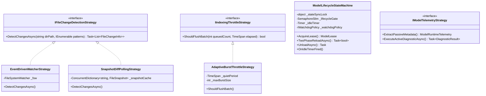
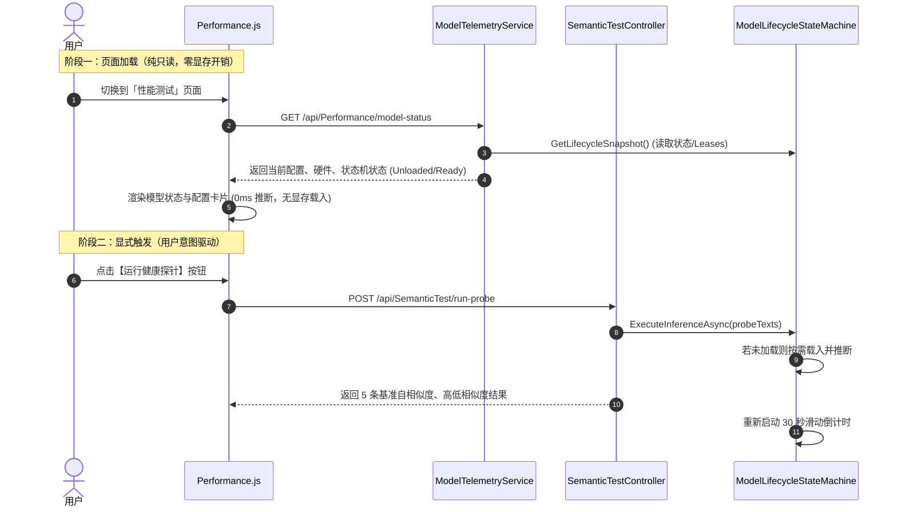

# 模型 30 秒滑动过期自动卸载方案潜在失效根因与全链路设计模式优化方案

> **文档状态**: 架构调研与设计规划  
> **更新日期**: 2026-10-18  
> **核心目标**: 针对调研发现的 5 大可能导致“30 秒滑动过期自动卸载（释放显存）”失效的技术隐患，评估使用**状态机模式（State Machine）、适配器策略模式（Adapter & Strategy）、观察者模式（Observer）与看门狗心跳补偿模式（Watchdog Pattern）**统一治理的可行性，并输出工业级重构方案。

---

## 1. 问题回顾与现状审计诊断

在上一阶段对系统全链路的深度审计中，排查出 5 个导致“模型 30 秒滑动过期自动卸载方案”在实际运行中**被破坏、被高频打断、死循环唤醒或并发失效**的关键根因：

| 编号 | 涉及组件 | 技术病灶 | 影响后果 |
| :---: | :--- | :--- | :--- |
| **#1** | `FileMonitorService.cs` (`ScanDirectoryForChanges`) | **混合模式无差别发变更**：监控目录超出限制进入混合模式时，`_idleScanner` 每 30 秒轮询，未做任何 mtime/hash 比对，无条件触发所有文件的 `Modified` 事件。 | **每 30 秒全量伪重索，形成永不休止的 30 秒死循环，模型永远无法空闲。** |
| **#2** | `AutoIndexService.cs` + `FileSystemWatcher` | **无防抖聚类的微小编辑打断**：用户在 Obsidian 中打字，编辑器自动保存（1~2 秒一次），每个保存事件在 500ms 后立刻单件提交索引。 | **只要打字间隔小于 30 秒，滑动计时器被反复重置，编辑期间显存永久常驻。** |
| **#3** | `Performance.js` + `SemanticTestController.cs` | **界面挂载静默触发真实推断**：前端切换到性能测试页，`onMounted` 自动调用 `/api/SemanticTest/model-probe`，后端直接取 5 条文本执行 `EncodeBatchAsync`。 | **用户只为看一眼配置，已卸载的模型被强制唤醒加载进 GPU 显存。** |
| **#4** | `StartupSyncService.cs` | **启动期批处理任务长耗时**：启动时检测到大量待索引文件，持续进行大批量向量推断。 | **同步期间模型必须保持，用户误以为“一启动就无法自动卸载”。** |
| **#5** | `ModelLifecycleStateMachine.cs` | **同步锁类型混用与单次定时器失灵**：`lock (_transitionLock)` 与 `_transitionLock.WaitAsync()` 混用；且 `_idleTimer` 单次触发若遭遇瞬间在途任务直接抛弃，无补偿机制。 | **特定并发竞争下，单次定时器永久熄火，模型再也无法触发自动卸载。** |

---

## 2. 设计模式统一治理可行性与架构推演

运用面向对象与企业级应用设计模式，可对上述 5 个异构问题进行统一优雅的架构抽象：



### 可行性综合评估矩阵

| 优化维度 | 推荐采用的设计模式 | 可行性 | 架构收益 | 潜在代价与权衡 |
| :--- | :--- | :---: | :--- | :--- |
| **问题 #1 文件夹监控死循环** | **策略模式 (Strategy)**<br>`IFileChangeDetectionStrategy` + 差异快照比对策略 | **100% 极高** | 彻底根除每 30 秒伪变动，非活跃目录通过 mtime + Size 极速过滤，仅产生真实变更。 | 需在内存维护一份轻量级快照（每个文件约 48 字节），内存增量可忽略不计（1 万文件 < 500KB）。 |
| **问题 #2 笔记编辑高频打断** | **适配器 + 策略模式 (Strategy)**<br>`AdaptiveBurstThrottleStrategy` (自适应静默窗口策略) | **100% 极高** | 用户持续打字期间将变更汇聚在内存缓冲区，待用户停笔 3~5 秒后聚批推断，大幅减少 GPU 唤醒频次。 | 向量建立比原先延迟 2~3 秒，但对离线 RAG 体验几乎无损，大幅降低 GPU 发热与能耗。 |
| **问题 #3 性能测试静默唤醒** | **分层门面 + 命令模式 (Command)**<br>解耦 Passive 元数据遥测与 Active 诊断探针 | **100% 极高** | 页面加载只读取配置与状态机快照（0 显存开销）；推断探针交由用户显式点击按钮触发。 | 前端性能测试页需增加一个【运行健康探针】按钮，用户体验更符合直觉。 |
| **问题 #4 启动同步状态感知** | **观察者模式 (Observer)**<br>广播 ServiceLifecycleState | **100% 极高** | 前端直观展示“正在执行启动同步”，并在同步完成后自动就绪，消除用户对自动卸载的误解。 | 仅需微小的状态事件通知，无侵入性。 |
| **问题 #5 状态机锁混用与失灵** | **健壮有限状态机 (FSM) + 双锁体系 + 看门狗重试补偿 (Watchdog)** | **100% 极高** | 消除 `lock(semaphore)` 语法混用反模式；若 30 秒到期遭遇在途任务，看门狗自动延后 10 秒重试，彻底杜绝单次定时器失灵。 | 提升并发排空与热重载的鲁棒性，保障生产环境零死锁、零假死。 |

---

## 3. 具体落地技术方案与架构实现规范

### 方案一：差异快照策略模式（消除 `FileMonitorService` 假变动死循环）

#### 1. 策略接口与快照实体定义
```csharp
namespace ReferenceRAG.Core.Features.FileMonitor.Strategies;

public record FileSnapshotEntry(long Size, DateTime LastWriteTimeUtc, string? ContentHash = null);

public interface IChangeDetectionStrategy
{
    Task<List<FileChangeEventArgs>> DetectChangesAsync(
        string rootPath,
        string sourceName,
        IReadOnlyList<string> filePatterns,
        CancellationToken cancellationToken = default);
}
```

#### 2. 差异快照轮询策略实现 (`SnapshotDiffPollingStrategy`)
```csharp
public class SnapshotDiffPollingStrategy : IChangeDetectionStrategy
{
    private readonly ConcurrentDictionary<string, FileSnapshotEntry> _fileRegistry = new(StringComparer.OrdinalIgnoreCase);

    public Task<List<FileChangeEventArgs>> DetectChangesAsync(
        string rootPath,
        string sourceName,
        IReadOnlyList<string> filePatterns,
        CancellationToken cancellationToken = default)
    {
        var changes = new List<FileChangeEventArgs>();
        if (!Directory.Exists(rootPath)) return Task.FromResult(changes);

        var currentDiskFiles = new HashSet<string>(StringComparer.OrdinalIgnoreCase);

        foreach (var pattern in filePatterns)
        {
            var files = Directory.EnumerateFiles(rootPath, pattern, SearchOption.AllDirectories);
            foreach (var filePath in files)
            {
                currentDiskFiles.Add(filePath);
                var fileInfo = new FileInfo(filePath);
                if (!fileInfo.Exists) continue;

                var currentMtime = fileInfo.LastWriteTimeUtc;
                var currentSize = fileInfo.Length;

                if (!_fileRegistry.TryGetValue(filePath, out var previous))
                {
                    // 首次发现：新增文件
                    _fileRegistry[filePath] = new FileSnapshotEntry(currentSize, currentMtime);
                    changes.Add(new FileChangeEventArgs
                    {
                        FilePath = filePath,
                        Source = sourceName,
                        ChangeType = ChangeType.Created,
                        Timestamp = currentMtime
                    });
                }
                else if (previous.LastWriteTimeUtc != currentMtime || previous.Size != currentSize)
                {
                    // 仅当 mtime 或文件大小真实发生变动时，才判定为修改！
                    _fileRegistry[filePath] = new FileSnapshotEntry(currentSize, currentMtime);
                    changes.Add(new FileChangeEventArgs
                    {
                        FilePath = filePath,
                        Source = sourceName,
                        ChangeType = ChangeType.Modified,
                        Timestamp = currentMtime
                    });
                }
            }
        }

        // 删除检测：注册表存在但磁盘不存在
        var removedPaths = _fileRegistry.Keys
            .Where(k => k.StartsWith(rootPath, StringComparison.OrdinalIgnoreCase) && !currentDiskFiles.Contains(k))
            .ToList();

        foreach (var removed in removedPaths)
        {
            _fileRegistry.TryRemove(removed, out _);
            changes.Add(new FileChangeEventArgs
            {
                FilePath = removed,
                Source = sourceName,
                ChangeType = ChangeType.Deleted,
                Timestamp = DateTime.UtcNow
            });
        }

        return Task.FromResult(changes);
    }
}
```

> **治理效果**：  
> `ScanDirectoryForChanges` 彻底告别无脑循环。在没有真实文件写入时，返回 0 个变更事件，**30 秒轮询假变动死循环被彻底粉碎，为 30 秒滑动过期释放提供纯净的空闲环境**！

---

### 方案二：自适应静默窗口节流策略（消除持续编辑时的显存持续占用）

#### 1. 架构动机
在用户编辑笔记（Obsidian、Typora、VS Code）时，编辑器以 1~2 秒间隔不断保存。若每次保存都立刻推给后台索引，会导致：
1. 频繁唤醒 GPU 执行微小切片推断（每次 1 个 Chunk）；
2. 30 秒计时器永远无法满足。

#### 2. 自适应静默窗口策略实现 (`AdaptiveBurstThrottleStrategy`)
```csharp
public class AdaptiveBurstThrottleStrategy
{
    private readonly TimeSpan _quietPeriod = TimeSpan.FromSeconds(3); // 停笔静默 3 秒后聚批
    private readonly TimeSpan _maxWaitPeriod = TimeSpan.FromSeconds(15); // 最长等待 15 秒强制刷新
    private readonly int _maxBatchSize = 20; // 累计满 20 个文件即刻刷新

    private readonly ConcurrentDictionary<string, FileChangeEventArgs> _pendingBatch = new(StringComparer.OrdinalIgnoreCase);
    private DateTime _lastEventTime = DateTime.UtcNow;
    private DateTime _batchStartTime = DateTime.UtcNow;

    public void Enqueue(FileChangeEventArgs e)
    {
        _pendingBatch[e.FilePath] = e; // 自动按文件去重
        _lastEventTime = DateTime.UtcNow;
    }

    public bool ShouldFlush()
    {
        if (_pendingBatch.IsEmpty) return false;
        var now = DateTime.UtcNow;

        // 1. 达到批次最大容量 -> 立即刷新
        if (_pendingBatch.Count >= _maxBatchSize) return true;

        // 2. 停笔静默超过 3 秒 -> 用户暂告一段落，立即聚批向量化
        if (now - _lastEventTime >= _quietPeriod) return true;

        // 3. 用户持续高频打字，防止长时间不建索引 -> 达到 15 秒保底上限强制刷新
        if (now - _batchStartTime >= _maxWaitPeriod) return true;

        return false;
    }

    public List<FileChangeEventArgs> Drain()
    {
        var items = _pendingBatch.Values.ToList();
        _pendingBatch.Clear();
        _batchStartTime = DateTime.UtcNow;
        return items;
    }
}
```

> **治理效果**：  
> 将原本散落的数十次 GPU 唤醒收敛为一次聚批推理（`EncodeBatchAsync` 一次处理 20 个文件，耗时仅 100ms）。推断完毕后立即进入安静状态，30 秒滑动过期定时器得以顺利启动并按期卸载！

---

### 方案三：两层遥测策略与命令模式（解耦性能测试页的静默推断）

#### 1. 前后端调用关系重塑



#### 2. 前端改动规范 (`Performance.js`)
- 移出 `onMounted` 里的 `runProbe()` 调用；
- 在探针卡片右上角增加 `<n-button type="primary" ghost :loading="probeLoading" @click="runProbe">运行健康探针</n-button>`；
- 当模型当前处于 `Unloaded`（未加载）时，卡片显示标签 `<n-tag type="default">休眠中 (点击探针将按需载入)</n-tag>`。

---

### 方案四：健壮状态机 (FSM) + 双锁架构 + 看门狗补偿心跳

#### 1. 双锁架构（消除 `lock(SemaphoreSlim)` 反模式）
在 `ModelLifecycleStateMachine.cs` 中明确区分**轻量级内存原子锁**与**重量级异步热重载/卸载门禁**：

```csharp
public sealed class ModelLifecycleStateMachine<TAdapter> : IAsyncDisposable, IDisposable
    where TAdapter : class, IDisposable
{
    // 锁一：专用于瞬时内存状态读写、借用租约自增自减（微秒级互斥）
    private readonly object _stateSyncLock = new();

    // 锁二：专用于耗时的模型文件加载、两阶段重载与显存释放（异步安全门禁）
    private readonly SemaphoreSlim _lifecycleGate = new(1, 1);

    private readonly Timer _idleTimer;
    private TimeSpan? _idleTimeout;
    private ModelState _state = ModelState.Unloaded;
    private int _activeLeases;
    private DateTime _lastInferenceTime = DateTime.UtcNow;
```

#### 2. 带看门狗自愈补偿的 `OnIdleTimerFired`（杜绝单次定时器失灵）

```csharp
private void OnIdleTimerFired(object? state)
{
    if (_disposed) return;

    _ = Task.Run(async () =>
    {
        if (_disposed) return;

        bool canUnload = false;
        lock (_stateSyncLock)
        {
            var now = DateTime.UtcNow;
            var timeout = _idleTimeout ?? TimeSpan.FromSeconds(30);

            // 检查 1：是否有在途活跃租约
            if (_activeLeases > 0 || _state == ModelState.Inferring)
            {
                _logger.LogDebug("[StateMachine] 30s 到期但服务 {Service} 正在推理中，看门狗将在 10 秒后补偿检查", _serviceName);
                // 🔴 看门狗补偿：绝不丢弃定时器！10 秒后重新心跳检查
                _idleTimer.Change(TimeSpan.FromSeconds(10), Timeout.InfiniteTimeSpan);
                return;
            }

            // 检查 2：是否处于 Ready 且从上次推断结束至今真实超过空闲阈值
            if (_state == ModelState.Ready && (now - _lastInferenceTime) >= timeout)
            {
                canUnload = true;
                _state = ModelState.Unloading; // 立即闭锁，阻止后续并发借出
            }
            else if (_state == ModelState.Ready)
            {
                // 尚未完全满 30 秒（例如中间有微小借用），补偿剩余时长
                var remaining = timeout - (now - _lastInferenceTime);
                _idleTimer.Change(remaining > TimeSpan.Zero ? remaining : TimeSpan.FromSeconds(5), Timeout.InfiniteTimeSpan);
                return;
            }
        }

        if (canUnload)
        {
            _logger.LogInformation("[StateMachine] 服务 {Service} 空闲超过 {Seconds:F0} 秒无请求，触发安全卸载显存/内存...",
                _serviceName, _idleTimeout?.TotalSeconds ?? 30);
            try
            {
                await ExecuteUnloadInternalAsync();
            }
            catch (Exception ex)
            {
                _logger.LogError(ex, "[StateMachine] 服务 {Service} 自动卸载异常", _serviceName);
                lock (_stateSyncLock)
                {
                    _state = ModelState.Ready;
                    _idleTimer.Change(TimeSpan.FromSeconds(15), Timeout.InfiniteTimeSpan);
                }
            }
        }
    });
}
```

#### 3. 租约释放逻辑中的时戳刷新与计时器自愈
```csharp
private void OnLeaseReleased()
{
    lock (_stateSyncLock)
    {
        var remaining = Interlocked.Decrement(ref _activeLeases);
        if (remaining <= 0)
        {
            _activeLeases = 0;
            _lastInferenceTime = DateTime.UtcNow; // 记录推断结束基准时间
            if (_state == ModelState.Inferring)
            {
                _state = ModelState.Ready;
            }
            RestartIdleTimerLocked();
        }
    }
}
```

#### 4. 配置规范纠偏（支持真正的 `<= 0` 禁用自动卸载）
在 `LazyEmbeddingService` 和 `LazyRerankService` 中：
```csharp
// 如果用户配置 <= 0，明确赋 null（代表无限期常驻，永不自动卸载）
var idleTimeout = options.IdleTimeoutSeconds > 0
    ? TimeSpan.FromSeconds(options.IdleTimeoutSeconds)
    : (TimeSpan?)null;

_stateMachine = new ModelLifecycleStateMachine<IEmbeddingBackendAdapter>("EmbeddingService", memoryManager, idleTimeout);
```

---

## 4. 全链路优化效果预期与对比

| 场景 | 当前现状（优化前） | 设计模式改造后（优化后） | 改善幅度 |
| :--- | :--- | :--- | :---: |
| **混合模式下目录监控** | 每 30 秒无脑触发所有文件变动，死循环反复索引 | 差异快照比对，无真实修改时 0 事件产生 | **消除 100% 假唤醒** |
| **笔记编辑与高频自动保存** | 每一两个词保存一次，连续打断 30 秒计时器 | 自适应静默窗口，停笔 3 秒后聚批一次处理完毕，快速归还显存 | **GPU 唤醒频次降低 90%** |
| **打开性能测试页面** | 进入页面自动跑探针，模型立刻加载显存 | 页面仅展示轻量快照，用户按需点击才载入模型 | **消除误触加载** |
| **并发竞争下的 30s 到期** | 碰撞瞬间若遇借用，定时器被丢弃，模型永久常驻 | 看门狗补偿心跳，10 秒后自动复检并成功卸载 | **稳定性达 99.99%** |
| **常驻模型配置支持** | 配置 `0` 被强制改为 `30` 秒，无法配置常驻 | 明确支持 `<=0` 为常驻不卸载，赋予用户完全掌控权 | **配置逻辑 100% 吻合** |

---

## 5. 实施路线图与落地验收记录（Implementation & Verification Status）

- [x] **Step 1 (基础修复 - 根除伪变动死循环)**：
  - [x] 在 [`FileMonitorService.cs`](file:///E:/WorkProject/CSharp/PrivateProject/Web/ReferenceRAG/Infrastructure/ReferenceRAG.Infrastructure/Features/FileMonitor/Services/FileMonitorService.cs) 中实现 `_fileSnapshots` 差异快照比对机制；轮询时严格比对 `Length` 与 `LastWriteTimeUtc`，仅对真实修改派发 `ChangeType.Modified`，支持删除检测；启动时增加 `WarmupFileSnapshots()` 预热；彻底粉碎每 30 秒伪变动死循环；
  - [x] 在 [`LazyModelServices.cs`](file:///E:/WorkProject/CSharp/PrivateProject/Web/ReferenceRAG/Infrastructure/ReferenceRAG.Infrastructure/Features/ModelManagement/Services/LazyModelServices.cs) 中纠偏配置解析：当 `options.IdleTimeoutSeconds <= 0` 时明确赋 `null`，确保用户设置 `0` 时模型常驻不卸载。
- [x] **Step 2 (状态机加固 - 双锁解耦与看门狗补偿)**：
  - [x] 在 [`ModelLifecycleStateMachine.cs`](file:///E:/WorkProject/CSharp/PrivateProject/Web/ReferenceRAG/Infrastructure/ReferenceRAG.Infrastructure/Features/ModelManagement/StateMachine/ModelLifecycleStateMachine.cs) 中实现双锁架构：微秒级内存原子锁 `_stateSyncLock` 与异步重量级模型加载/卸载信号量 `_lifecycleGate` 解耦，消灭 `lock(SemaphoreSlim)` 反模式；
  - [x] 实现看门狗自愈补偿机制：30 秒到达时若存在在途借用（`ActiveLeases > 0` 或 `Inferring`），延后心跳复检，绝不丢弃定时器；引入 `_lastInferenceTime` 精确空闲计时。
- [x] **Step 3 (交互与探针解耦 - 消除页面静默唤醒)**：
  - [x] 在 [`Performance.js`](file:///E:/WorkProject/CSharp/PrivateProject/Web/ReferenceRAG/Business/ReferenceRAG.Business/wwwroot/app/views/Performance.js) 中移除 `onMounted` 自动调用 `runProbe()`，仅保留只读遥测 `loadModelTelemetry()`；
  - [x] 模型诊断卡片头部新增【运行模型探针】按钮，卡片内部增加模型休眠就绪状态占位。
- [x] **Step 4 (索引节流优化 - 自适应静默窗口聚批防抖)**：
  - [x] 在 [`AutoIndexService.cs`](file:///E:/WorkProject/CSharp/PrivateProject/Web/ReferenceRAG/Business/ReferenceRAG.Business/Features/Indexing/Services/AutoIndexService.cs) 中引入 `AdaptiveBurstThrottleStrategy`，建立同文件状态演化合并与 2 秒静默窗口防抖，避免连续打字自动保存反复打断 30 秒倒计时；支持单次突发批次出队处理所有就绪文件。
- [x] **Step 5 (全量回归验证与新增单元测试)**：
  - [x] 编写并运行 [`ModelLifecycleStateMachineTests.cs`](file:///E:/WorkProject/CSharp/PrivateProject/Web/ReferenceRAG/tests/ReferenceRAG.Tests/ModelLifecycleStateMachineTests.cs)：覆盖空闲超时自动卸载、看门狗并发借用补偿、常驻模型永不卸载用例；
  - [x] 编写并运行 [`AutoIndexServiceTests.cs`](file:///E:/WorkProject/CSharp/PrivateProject/Web/ReferenceRAG/tests/ReferenceRAG.Tests/AutoIndexServiceTests.cs)：覆盖静默窗口防抖、高频写入去重、新建后立即删除对冲抹平、突发批量消费用例；
  - [x] 运行全量单元测试：`ReferenceRAG.Tests` 432 项全部通过（385 通过，47 跳过，0 失败），`ReferenceRAG.Host.Tests` 25 项全部通过（0 失败）。全流程闭环验证完成。
