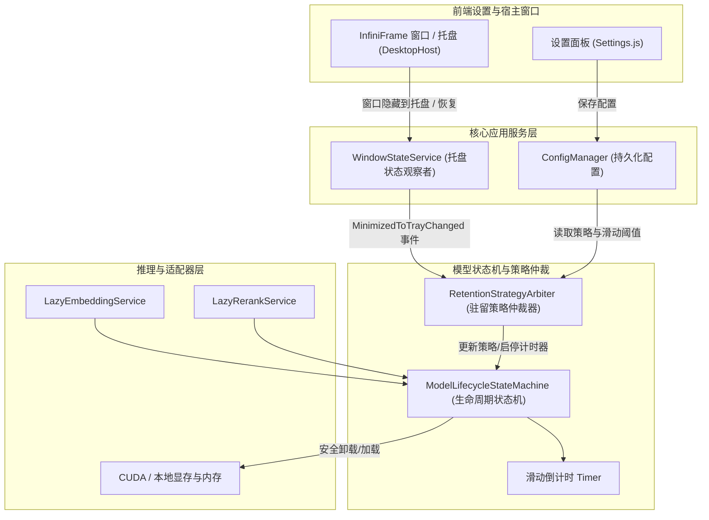

# 模型常规驻留方案与托盘联动滑动过期设计方案

> 日期：2026-10-18  
> 状态：调研完成，进入工程实施  
> 关联系统：模型生命周期状态机 (`ModelLifecycleStateMachine`)、服务管理 (`LazyModelServices`)、窗口生命周期 (`DesktopPlatformActions` / `Program.cs`)、配置系统 (`ObsidianRagConfig`)、前端设置界面 (`Settings.js`)

---

## 1. 背景与需求痛点

### 1.1 核心需求
1. **允许自由切换模型驻留的常规方案**：
   - **固定常驻 (Permanent Resident)**：模型一旦加载即常驻内存与显存，永不主动卸载，保障检索与推理始终享有零冷启动延迟；
   - **滑动过期 (Sliding Expiration)**：在指定时间内（如 30 秒、60 秒、300 秒）无查询操作，自动卸载模型以释放显存与内存；
   - **动态滑动窗口时长配置**：在选用滑动过期时，允许用户自定义空闲窗口时长（秒）。
2. **优化滑动过期机制：仅最小化到托盘时才启用滑动过期**：
   - 用户打开并使用前端主窗口时，模型保持常驻就绪，避免前台连续问答或查阅时反复经历 2~5 秒的模型重载等待；
   - 一旦用户将窗口隐藏/最小化到系统托盘（处于挂机后台状态），滑动计时器激活并在达到超时后静默卸载释放显存。

---

## 2. 架构设计与模式应用

为了实现桌面窗口生命周期与模型状态机之间的解耦与动态联动，采用以下经典设计模式：



1. **策略模式 (Strategy Pattern)**：
   - 抽象 `ModelRetentionStrategy`（`Permanent` vs `SlidingExpiration`）；
   - 根据运行环境（桌面端 vs Web 服务端）和窗口可见性状态，动态仲裁当前是否允许触发空闲卸载。
2. **观察者模式 (Observer Pattern)**：
   - `IWindowStateService` 提供 `MinimizedToTrayChanged` 事件；
   - 模型状态机监听窗口状态变更：最小化到托盘时触发定时器启动，窗口还原显示时立即取消卸载倒计时。
3. **状态机与租约保护 (State Machine with Active Leases)**：
   - 即使处于托盘且达到滑动超时时间，若存在在途查询（`ActiveLeases > 0`），依然受到看门狗保护严禁强杀，待请求完成并重新计算滑动超时后再平稳卸载。

---

## 3. 具体技术实现方案

### 3.1 配置层定义 (`ObsidianRagConfig.cs`)

在 `ObsidianRagConfig` 中增加策略枚举与配置项：

```csharp
public enum ModelRetentionStrategy
{
    /// <summary>固定常驻（首次使用加载后，始终常驻显存/内存，零冷启动等待）</summary>
    Permanent = 0,
    /// <summary>滑动过期（在指定时长无调用后自动卸载释放显存/内存）</summary>
    SlidingExpiration = 1
}

public class ObsidianRagConfig
{
    /// <summary>
    /// 模型常规驻留策略：Permanent（固定常驻）或 SlidingExpiration（滑动过期）
    /// </summary>
    public ModelRetentionStrategy ModelRetentionStrategy { get; set; } = ModelRetentionStrategy.SlidingExpiration;

    /// <summary>
    /// 滑动窗口空闲过期时长（秒），当 ModelRetentionStrategy 为 SlidingExpiration 时生效
    /// 默认 300 秒（5 分钟）
    /// </summary>
    public int ModelIdleTimeoutSeconds { get; set; } = 300;

    /// <summary>
    /// 仅在最小化到托盘时启用滑动过期（窗口打开使用期间始终常驻，托盘后台空闲才释放）
    /// </summary>
    public bool UnloadOnlyWhenMinimizedToTray { get; set; } = true;
    ...
}
```

### 3.2 窗口与托盘感知服务 (`IWindowStateService`)

定义 `IWindowStateService`，解耦桌面宿主与底层状态机：

```csharp
namespace ReferenceRAG.Core.Interfaces;

public interface IWindowStateService
{
    /// <summary>当前应用是否处于最小化到托盘状态</summary>
    bool IsMinimizedToTray { get; }

    /// <summary>托盘状态变更事件</summary>
    event EventHandler<bool>? MinimizedToTrayChanged;

    /// <summary>更新窗口托盘状态</summary>
    void SetMinimizedToTray(bool isMinimized);
}
```

在 `DesktopHost/Program.cs` 中实现双向同步：
- 当用户点击关闭按钮（X）触发隐藏到托盘：`ShowWindow(handle, 0); windowStateService.SetMinimizedToTray(true);`
- 当用户从托盘菜单或双击图标唤起窗口：`ShowWindow(handle, 9); windowStateService.SetMinimizedToTray(false);`
- 当启动带 `--minimized` 开关时：初始化为 `SetMinimizedToTray(true);`
- 挂载后台轻量级状态轮询 (`IsWindowVisible` & `IsIconic`)，自动捕捉任务栏最小化与还原。

### 3.3 状态机策略仲裁与动态更新 (`ModelLifecycleStateMachine`)

扩展 `ModelLifecycleStateMachine<TAdapter>`：
1. **注入可判定委托**：支持 `Func<bool>? canUnloadPredicate`，在定时器触发判定时执行；
2. **动态更新超时参数**：提供 `UpdateRetentionPolicy(TimeSpan? idleTimeout, Func<bool>? canUnloadPredicate)` 方法，用户在前端修改并保存设置时**实时生效，无需重启服务**；
3. **托盘事件联动**：
   - 当收到 `MinimizedToTrayChanged(true)` 且策略为托盘滑动时：重置滑动计时器，开始倒计时；
   - 当收到 `MinimizedToTrayChanged(false)` 时：立即取消待卸载定时器，锁定常驻。

### 3.4 前端设置面板交互 (`Settings.js`)

在设置页面的「嵌入模型」与「重排模型」模块或专门的「模型驻留与显存」板块，新增直观的交互组件：
- **模型驻留策略**：单选按钮组 `[固定常驻] | [滑动过期 (推荐)]`；
- **滑动窗口时间**：数字输入框，单位秒（范围 10~3600 秒，步长 10 秒）；
- **仅最小化到托盘时释放显存**：开关组件（Switch），带有清晰的气泡帮助提示：“开启后前台使用期间模型保持常驻，关闭窗口隐藏到托盘且空闲时自动释放显存”。

---

## 4. 可行性与边界情况分析

1. **多环境兼容性（跨平台与纯 Web 服务端）**：
   - 在非桌面端（如 Linux Docker 或纯 WebHost 模式），没有 Windows 桌面托盘，`IWindowStateService.IsMinimizedToTray` 默认返回 false。
   - 仲裁器检测到非桌面环境时，自动按全局滑动过期策略运行，保障云端容器显存可正常回收。
2. **正在推理时最小化到托盘的安全性**：
   - 若用户在触发复杂检索或重排的瞬间最小化窗口，租约计数 `ActiveLeases > 0`。状态机看门狗自动拦截卸载，直至推理结束并安全归还借用后，重新开始托盘滑动倒计时，绝对不会引发 `0xC0000005 ACCESS_VIOLATION`。
3. **设置热更新无需重启**：
   - 用户在 UI 上将滑动时间从 300 秒改成 60 秒或切为固定常驻并保存后，`SettingsController` 广播给各模型状态机，直接重设 `_idleTimeout`，零等待生效。

---

## 5. 验证规划

1. **单元测试与端对端冒烟测试**：
   - 验证固定常驻策略下，超时时间到期不触发卸载；
   - 验证滑动过期策略下，窗口前台时不卸载，触发最小化到托盘后定时卸载；
   - 验证窗口重新唤起时取消待卸载任务；
2. **前端语法与契约验证**：运行 `node check.mjs` 和 `frontend-logic.test.mjs`。
