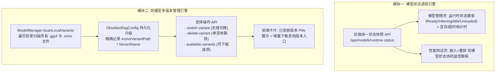

# 模型状态可视化与同模型多版本下载切换架构设计与调研
(Model Runtime Status Visibility & Multi-Version Variant Management Architecture)

---

## 1. 需求背景与头脑风暴 (Brainstorming & Gap Analysis)

### 1.1 需求提出
用户提出两个核心诉求：
1. **模型管理页面与性能测试页面是否能显示嵌入式/重排模型的实时运行状态？**
2. **模型管理页面中的嵌入模型和重排模型，能否支持同一个模型的“多版本”下载、共存与自由切换？**

### 1.2 现状剖析与逻辑缺陷头脑风暴 (Critical Analysis)

#### 维度一：模型运行状态（Lifecycle Status）现存缺陷
- **模型管理页面 (`Models.js`)**：
  - 顶部“当前模型”卡片目前仅显示静态元数据（名称、维度、最大长度、ONNX格式、静态的“已下载/未下载”）；
  - **严重缺陷**：用户无法得知该模型**当前是否真正加载到显存/内存中**（是处于 `Ready` 常驻就绪、`Inferring` 推理中，还是已被滑动过期卸载为 `Unloaded` 休眠？当前显存占用了多少？剩余多少秒后自动释放？）；
- **性能测试页面 (`Performance.js`)**：
  - 页面虽有部分嵌入模型的遥测数据，但缺乏**驻留策略（常驻 vs 滑动窗口）**与**托盘联动状态**的明确可视化，且**完全没有展示重排模型的运行状态**。

#### 维度二：同一个模型多版本（Multi-Version / Variants）现存缺陷与逻辑陷阱
在本地 LLM / RAG 生态中，所谓的“同一个模型多版本”，90% 以上指的是**不同的量化等级与格式变体（如 Q4_K_M, Q8_0, FP16, ONNX, ONNX-INT8）**，以及少量的分支/快照版本。

对现有系统进行逆向排查，发现以下**重大逻辑陷阱**：
1. **目录文件覆盖与盲选冲突（致命盲区）**：
   - 当前模型存放路径为 `models/Embedding/{modelName}/`；
   - 当用户先后下载了 `Q4_0.gguf` 和 `Q8_0.gguf`，底层 `ResolveGgufFile` 仅执行 `Directory.GetFiles("*.gguf")[0]`，**永远盲目加载按文件名排序的第一条**！用户即便下载了更高精度的 Q8_0，也根本无法选用它；
2. **下载完成后缺少多版本共存入口**：
   - 一旦模型下载完成，前端卡片按钮就变成了“切换模型”，无法再次唤起下载弹窗去增量下载该模型的其他变体（如想从 Q4 升到 Q8）；
3. **嵌入模型 vs 重排模型的兼容性差异（核心考量）**：
   - **重排模型（Reranker）**：完全无状态（Stateless），在内存中动态对搜索结果打分，不向数据库持久化任何向量。因此**多版本（Q4/Q8/ONNX）之间可以随意秒切，0 风险、0 迁移成本**；
   - **嵌入模型（Embedding）**：向 SQLite 向量表持久化了大量向量索引：
     - 若切换同模型的不同量化版本（如 Q4 切 Q8），维度一致（如 1024），但向量存在微小浮点漂移（余弦相似度 ~0.99），虽可直接使用，但系统应提供友好提示；
     - 若切换不同格式导致维度变化，必须强制拦截并告警。
4. **删除粒度过粗**：
   - 目前删除模型会直接递归删除整个文件夹，用户无法仅删除 1.5GB 的 FP16 变体而保留 450MB 的 Q4 变体。

---

## 2. 总体解决方案与架构设计



---

## 3. 详细设计与数据结构

### 3.1 变体元数据模型：`ModelVariantInfo`

为 `ModelInfo` 增加子级变体列表：

```csharp
public class ModelVariantInfo
{
    public string VariantId { get; set; } = "";        // 如 "Q4_K_M", "Q8_0", "onnx-embedded"
    public string DisplayName { get; set; } = "";     // 如 "GGUF Q4_K_M (推荐)", "ONNX 嵌入式"
    public string FileName { get; set; } = "";        // 如 "Qwen3-Embedding-0.6B-Q4_K_M.gguf"
    public string FullPath { get; set; } = "";        // 绝对路径
    public string Format { get; set; } = "";          // "gguf", "onnx"
    public string? Quantization { get; set; }         // "Q4_K_M", "Q8_0", "INT8", "FP16"
    public long FileSizeBytes { get; set; }           // 文件字节数
    public bool IsDownloaded { get; set; }            // 本地是否已存在
    public bool IsActive { get; set; }                // 当前是否正被选用
}
```

并在 `ModelInfo` 中扩展：
```csharp
public List<ModelVariantInfo> InstalledVariants { get; set; } = new();
public string? ActiveVariantFileName { get; set; }
```

### 3.2 变体扫描与解析引擎 (`ModelManager.cs`)

在 `ScanLocalModels` 中，当定位到模型子目录后：
1. 搜索全部 `*.gguf` 文件；
2. 搜索全部 `*.onnx` 文件；
3. 为每个文件解析其量化标签（从文件名正则表达式匹配 `Q[0-9]_[A-Z0-9_]+` 或 `int8/fp16`）；
4. 与当前配置文件 `config.Embedding.ModelPath` / `config.Rerank.ModelPath` 匹配：
   - 若 `ModelPath` 命中了具体的文件路径，则标记该变体为 `IsActive = true`；
   - 若 `ModelPath` 仅指向文件夹，则默认激活第一个变体并自动回写持久化。

### 3.3 运行时状态查询 API (`/api/models/runtime-status`)

聚合嵌入模型与重排模型的实时状态：
```json
{
  "embedding": {
    "modelName": "Qwen3-Embedding-0.6B",
    "activeVariant": "Qwen3-Embedding-0.6B-Q4_0.gguf",
    "state": 2,
    "stateName": "Ready",
    "stateDescription": "就绪 (常驻内存)",
    "activeLeases": 0,
    "retentionStrategy": 0,
    "isGpuMode": true,
    "executionDevice": "NVIDIA GeForce RTX 4060",
    "vramUsageMb": 512
  },
  "rerank": {
    "modelName": "bge-reranker-base",
    "activeVariant": "model.onnx",
    "state": 2,
    "stateName": "Ready",
    "stateDescription": "就绪 (常驻内存)",
    "activeLeases": 0,
    "isGpuMode": true,
    "executionDevice": "NVIDIA GeForce RTX 4060 (CUDA 12)"
  }
}
```

---

## 4. 实施计划 (Execution Steps)

1. **Step 1: 后端运行时状态与多变体数据模型增强**
   - 在 `Infrastructure` 中定义 `ModelVariantInfo` 与 `ModelRuntimeStatusDto`；
   - 在 `ModelManager` 中实现本地多变体扫描与匹配。
2. **Step 2: 后端控制器 API 暴露**
   - 在 `ModelsController` 中提供：
     - `GET /api/models/runtime-status`（获取嵌入+重排运行状态）
     - `POST /api/models/switch-variant`（精确切换同一模型的指定版本变体）
     - `DELETE /api/models/variant`（删除同模型的某个特定版本文件）
3. **Step 3: 前端页面集成**
   - **`Models.js`**：
     - 在“当前模型”与“当前重排模型”卡片中呈现【实时状态胶囊】（状态、GPU、活跃借用、驻留策略）；
     - 模型列表卡片下方展示【已安装版本 Tags】（高亮当前激活版本，点击其他版本可即刻切换）；
     - 模型卡片支持随时点击【下载更多版本】，唤醒版本选择模态框。
   - **`Performance.js`**：
     - 增加重排模型的实时运行状态与硬件加速监控。
4. **Step 4: 测试与验证**
   - 编写单元测试验证变体扫描、切换与状态机联动；
   - 运行冒烟测试确保全系统无回归。
