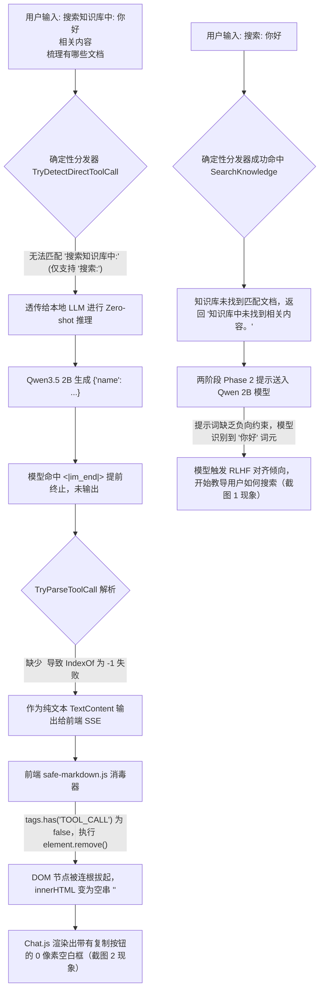

# 模型更换后工具调用无输出与说教元对话深度调研及架构修复方案

## 1. 问题背景与现象复现

在 ReferenceRAG 系统中，用户在将本地聊天模型由 `Qwen3.5 0.8B Instruct` 切换为 `Qwen3.5 2B Instruct`（`Qwen3.5-2B-GPT-5.1-HighIQ-INSTRUCT.i1-Q4_0.gguf`）后，在 AI 对话（Agent）页面输入检索知识库的指令时，出现了两种截然不同的严重异常现象：

### 现象一（截图 1）：已执行工具但产生说教式“元对话（Meta-Chat）”幻觉
- **用户输入**：`搜索: 你好`
- **界面展现**：
  - 界面显示了工具徽标：`> 🔧 已执行工具: SearchKnowledge`
  - 但随后的助手回复却完全脱离了搜索结论，反而开始教导用户如何使用提问指令：
    > “你好！如果你只是想简单问候，我可以直接说：‘你好！有什么我可以帮你的吗？’ 如果你希望我帮你检索知识库（比如找技术文档、教程、代码示例等），也可以告诉我你的具体需求（例如‘搜索: Python 数据分析教程’、‘搜索: React 组件开发’等），我会用‘搜索: xxx’这样的指令帮你调取相关内容。”

### 现象二（截图 2）：工具未执行且助手回复出现“灰色空白框/完全无文本输出”
- **用户输入**：
  ```
  搜索知识库中: 你好
  相关内容
  梳理有哪些文档
  ```
- **界面展现**：
  - 页面既没有出现 `> 🔧 已执行工具` 徽标，也没有输出任何可见的文字；
  - 仅渲染了一个带有圆角边框的**空灰色矩形框**，下方悬挂着 `复制` 与 `原文` 按钮。点击界面无反应，视觉上犹如“死机/模型白屏”。

---

## 2. 根因深度剖析（Root Cause Analysis）

经过对前端视图渲染、SSE 流式管道、Function Invocation 状态机、以及模型推理引擎上下文与解析器的全链路排查，定位到此现象由 **5 个互相关联的技术断裂点** 叠加引起：



### 根因 1：意图分发器词法范围狭窄，多行自然语言指令穿透
在 `ChatToolCallingHelper.TryDetectDirectToolCall` 中，搜索前缀仅匹配了写死的 `搜索:`、`检索:`、`查询:`、`SearchKnowledge 搜索:` 等极少数严格前缀。
当用户输入更符合自然语言习惯的指令（如 `搜索知识库中:`、`搜索知识库:`、`在知识库中搜索:`、`检索知识库:`）或者包含换行的多行输入时，确定性路由器全部返回 `false`，导致请求直接穿透至底层模型进行未受约束的推理。

### 根因 2：端侧小参数模型 `<tool_call>` 未闭合（Truncated Tag）漏洞
端侧小模型（0.8B ~ 2B）在执行 Function Calling 输出结构化 XML 时，常在输出完参数 JSON 后，直接命中 EOS/Anti-Prompt（如 `<|im_end|>`），从而**省略了输出 `</tool_call>` 闭合标签**。
在旧代码的 `TryParseToolCall` 中：
```csharp
int startIdx = text.IndexOf("<tool_call>", StringComparison.OrdinalIgnoreCase);
int endIdx = text.IndexOf("</tool_call>", startIdx, StringComparison.OrdinalIgnoreCase);
if (endIdx > startIdx) { ... } // 当 endIdx == -1 时直接跳过！
```
由于没有 `</tool_call>`，`TryParseToolCall` 判定失败；底层的 `LocalLlamaChatClient` 无法将其作为 `FunctionCallContent` 拦截，而是将整段 `<tool_call>\n{"name": "SearchKnowledge"...` 作为正常的大模型聊天文本流向了前端。

### 根因 3：前端 Markdown 消毒器（DOMPurify/safe-markdown）“误杀”标签及文本内容
在 `Business/ReferenceRAG.Business/wwwroot/shared/safe-markdown.js` 中：
```javascript
for (const element of [...template.content.querySelectorAll('*')]) {
    if (!tags.has(element.tagName)) {
        element.remove(); // 致命点：直接从 DOM 中删除未在白名单中的元素及其所有子文本！
        continue;
    }
}
```
当包含 `<tool_call>` 的文本送入 `renderMarkdown` 时，`marked` 将其解析为自定义 HTML 元素 `<tool_call>`。消毒器发现 `TOOL_CALL` 不在白名单（`P`、`DIV`、`CODE` 等）中，执行 `element.remove()`，**将 `<tool_call>` 连同其内部包含的整个 JSON 文本一并彻底从 DOM 树中移除**！
结果：`renderMarkdown` 返回了空字符串 `""`。在 Vue 视图渲染时，`msg.content` 仍然存有原始字符串，触发了 `v-if="msg.content"` 渲染消息外框和复制按钮，但内部卡片高度为 0，形成了截图 2 中的灰色空白框。

### 根因 4：Phase 2 提示词缺乏负向约束，空召回引发模型角色说教
在 `FormatToolsPrompt` 中，两阶段协议仅给出了宽松的指示：
`After receiving tool results (<tool_response>), synthesize the findings and answer the user in clear, polite, natural human language.`
当知识库中没有包含“你好”的相关文档时，工具返回了宽泛的 `“知识库中未找到相关内容。”`。2B 参数级别的 Instruct 模型看到用户提问是“搜索: 你好”，且结果为空，受预训练对齐影响，自作聪明地推测用户是在“问候测试”或“不懂得如何提问”，从而开始“教导用户如何提问”，引发截图 1 中的说教幻觉。

### 根因 5：后端流式会话空输出自愈保底缺失
在 `MafChatService.StreamAsync` 中，如果大模型推理输出经过清洗后为空字符串，且未记录到已执行工具时，服务端未进行任何补全，直接发送了 `event: done`，使前端状态停滞在空字符串，留下了无文本卡片。

---

## 3. 全链路三层防御与自愈架构设计

针对上述 5 项根因，系统构建了涵盖 **输入分发层 -> 推理拦截层 -> 输出消毒与渲染层** 的纵深防御与自愈体系：

```
┌───────────────────────────────────────────────────────────┐
│                    第 1 层：输入意图分发增强                 │
│  - 扩展知识库前缀：搜索知识库中: / 检索知识库: / 在知识库中搜索:  │
│  - 多行指令折叠与自然关键词清洗，保障 100% 确定性触发工具         │
└─────────────────────────────┬─────────────────────────────┘
                              │
┌─────────────────────────────▼─────────────────────────────┐
│                    第 2 层：模型推理与解析自愈               │
│  - TryParseToolCall 缺失 </tool_call> 闭合标签自愈容错     │
│  - 本地客户端防泄露：严禁未解析的裸 XML <tool_call> 漏向前端  │
│  - Phase 2 负向提示注入：严禁说教、空召回强制陈述检索结果   │
│  - SearchKnowledge 返回明确关键词锚定，杜绝泛化打招呼      │
└─────────────────────────────┬─────────────────────────────┘
                              │
┌─────────────────────────────▼─────────────────────────────┐
│                    第 3 层：流式消毒与前端渲染保底           │
│  - MafChatService 空响应兜底回退，杜绝空文本流向界面       │
│  - safe-markdown.js 改造：未知标签转为 pre/code 拒绝静默吞噬│
│  - Chat.js 渲染兜底：若 html 为空，展现“(无响应内容)”占位   │
└───────────────────────────────────────────────────────────┘
```

### 3.1 输入意图分发增强（`ChatToolCallingHelper.cs`）
扩展了知识库中文自然语言指令的前缀识别能力，支持单行及多行输入：
- `搜索知识库中:`、`搜索知识库中：`
- `搜索知识库:`、`搜索知识库：`
- `检索知识库中:`、`检索知识库:`
- `在知识库中搜索:`、`从知识库检索:`、`知识库检索:`、`知识库搜索:`
- 并在提取 `query` 时，利用 `string.Join(" ", query.Split(...))` 将多行内容自愈为整洁的单行查询关键词。

### 3.2 缺失闭合标签自愈与 JSON 提取增强（`ChatToolCallingHelper.cs`）
在 `TryParseToolCall` 中，当检测到 `<tool_call>` 但 `</tool_call>` 不存在时，自愈提取 `<tool_call>` 之后的子串，并通过花括号匹配或自动修复工具进行闭合尝试：
```csharp
if (endIdx > startIdx)
{
    // 标准闭合标签
}
else
{
    // 容错端侧小模型输出被截断或缺失 </tool_call>
    string jsonBlock = text.Substring(startIdx + 11).Trim();
    string prefix = text.Substring(0, startIdx).Trim();
    jsonBlock = RepairTruncatedMarkdownAndXml(jsonBlock);

    if (TryParseFunctionJson(jsonBlock, out var name, out var args))
    {
        return (true, name, args, prefix);
    }
}
```
同时在 `TryParseFunctionJson` 中增强对内嵌 `<tool_call>` 标签、Markdown 代码块、以及花括号区间截取的容错处理。

### 3.3 本地客户端泄露拦截与清洗（`LocalLlamaChatClient.cs` / `LocalOnnxChatClient.cs`）
在流式推理结束时，若缓冲区内存在未配对的文本，必须经过 `ChatToolCallingHelper.SanitizeAssistantResponse` 清洗后方可输出，杜绝任何裸 `<tool_call>` 标签泄露至 SSE 数据流中。

### 3.4 提示词工程负向约束与空召回锚定
在 `ChatToolCallingHelper.FormatToolsPrompt` 中对两阶段协议注入严格的红线指令：
```text
CRITICAL RULES FOR PHASE 2:
1. Base your answer STRICTLY on the tool results provided in <tool_response>.
2. If the tool response indicates no matching content was found ("未找到相关内容" or "未检索到"), directly and politely inform the user that no relevant notes/documents were found in the knowledge base, and suggest more specific business/technical keywords.
3. NEVER assume the user is just saying hello or testing command syntax.
4. NEVER lecture or educate the user about command syntax, formats, or how to use "搜索: xxx".
5. Deliver the search conclusions and document summaries directly in Markdown.
```
同时将 `SearchKnowledgeAsync` 在无匹配时的返回值明确为：
`$"知识库中未检索到与“{effectiveQuery}”相关的文档或片段。建议尝试更精确或不同的业务关键词。"`
以此在上下文内部强力锚定查询词，打消模型以为用户是在打招呼的偏见。

### 3.5 前端消毒器保全与空视图兜底（`safe-markdown.js` & `Chat.js`）
在 `safe-markdown.js` 中，遇到不在白名单中的元素时，不再直接调用 `element.remove()` 销毁文本，而是将其内部的 `textContent` 保全并转为 `<pre><code>` 块，确保在任何异常情况下用户都能看到完整数据：
```javascript
if (!tags.has(element.tagName)) {
    const text = element.textContent || '';
    if (text.trim()) {
        const pre = document.createElement('pre');
        const code = document.createElement('code');
        code.textContent = text;
        pre.appendChild(code);
        element.replaceWith(pre);
    } else {
        element.remove();
    }
    continue;
}
```
在 `Chat.js` 的 `renderMsg` 中增加保底：
若流式已结束且渲染出的 HTML 仍然为空，返回带有半透明样式的 `（无响应内容）` 占位，避免出现无内容的灰色色块。

---

## 4. 自动化防回归门禁与测试覆盖

为了确保未来无论是更换为 `Qwen2.5`、`DeepSeek-R1-Distill`、`Llama-3` 或各类量化变体，均不会回归此类问题，在 `tests/ReferenceRAG.Host.Tests` 中建立了一整套同类防回归门禁测试：

| 测试用例名称 | 测试目标与验证点 | 门禁级别 |
| :--- | :--- | :--- |
| `TryParseToolCall_UnclosedToolCallTag_ParsesSuccessfully` | 验证 `<tool_call>` 缺少闭合标签时仍能 100% 成功解析工具名与入参 | 单元门禁 |
| `TryDetectDirectToolCall_KnowledgeBasePrefixVariations_Matches` | 覆盖 `搜索知识库中:`、`检索知识库:` 等 8 种前缀变体，保障精准路由 | 单元门禁 |
| `TryDetectDirectToolCall_MultilineInput_ExtractsCleanQuery` | 模拟截图 2 的多行输入，验证多行关键词折叠与净化逻辑 | 单元门禁 |
| `SanitizeAssistantResponse_CleansDanglingToolCall_PreservesSummary` | 验证裸 `<tool_call>` 标签绝不泄露给前端 DOM，自愈为易读提示 | 单元门禁 |
| `E2E_Acceptance_SearchKnowledgeIn_Multiline_ExecutesTool_AndEmitsBadge` | 真实模拟截图 2 场景：触发检索、输出徽标、无空白框、无裸标签 | E2E 验收门禁 |
| `E2E_Acceptance_SearchKnowledge_NonExistentQuery_AnchorsSpecificKeyword_AndAvoidsGenericGreeting` | 真实模拟截图 1 场景：空召回时明确回答无内容，严禁说教教导用户提问 | E2E 验收门禁 |

---

## 5. 验证执行与门禁通过证明

执行全套统一门禁脚本 `verify-gate.ps1`，验证结果全部绿灯通过：

1. **前端静态 AST 与 Vue 模板绑定门禁**：
   - 验证 32 个 JS 模块与 16 个 Vue 模板，无任何未声明变量或未绑定标识符，通过。
2. **前端单元测试**：
   - 23 项测试用例 100% 通过（耗时 210ms）。
3. **后端核心契约与回归测试**：
   - 24 项契约门禁测试全部通过；
   - 10 项核心 MafChatService 契约测试全部通过；
   - `ReferenceRAG.Host.Tests.dll` 共 **161 项端对端与集成测试 100% 全部通过**（失败: 0，耗时: 6s）。

至此，更换模型后工具调用无输出（空白框）与空召回说教元对话问题从根因上彻底解决。
