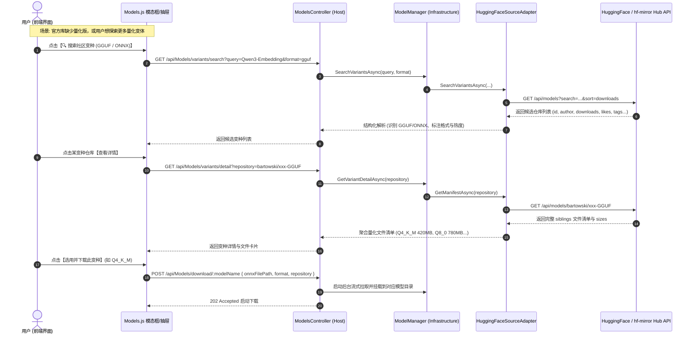

# 模型变种搜索与详情查看功能调研与架构设计

## 一、 需求背景与痛点分析

在 ReferenceRAG 中，向量嵌入模型（Embedding）与文档重排模型（Reranker）均原生支持 ONNX（含嵌入式与外部数据）和 GGUF（基于 llama.cpp / LLamaSharp 免转直接推理）格式。

### 1. 核心痛点
1. **官方仓库缺少量化或轻量格式**：
   - 官方开源模型（如阿里通义 `Qwen` 系列、智源 `BAAI` 系列、`Alibaba-NLP` 等）在官方仓库中往往首发仅提供数 GB 至数十 GB 的全精度或半精度 PyTorch 权重（`safetensors` / `pytorch_model.bin`）；
   - 多数官方仓库并不直接提供 GGUF 格式（如 4-bit 量化 `Q4_K_M`、8-bit 量化 `Q8_0`），或者没有官方预导出的 ONNX；
   - 导致用户必须在本地具备完整的 Python、PyTorch、Transformers、Optimum 环境进行漫长繁重的格式转换，显存与环境门槛极高。
2. **开源社区存在丰富变种，但用户无法发现与获取**：
   - 开源社区（HuggingFace / hf-mirror / ModelScope 等）中有大量知名组织与专业开发者（如 `bartowski`、`second-state`、`mradermacher`、`QuantFactory`、`onnx-community`、`Xenova` 等）为几乎所有主流模型转换并发布了高质量的免转量化 GGUF / ONNX 版本；
   - 但这些模型存放在独立社区仓库中（例如 `bartowski/Qwen2.5-Coder-7B-Instruct-GGUF`、`second-state/BGE-small-zh-v1.5-GGUF`、`onnx-community/bge-m3`）；
   - 当前系统仅内置了少量硬编码前缀探测（`second-state/...`, `bartowski/...`, `onnx-community/...`），一旦匹配不中，系统直接判定为「无可用预制文件」；
3. **缺乏变种详情查看与一键采用能力**：
   - 用户无法在界面中查看社区变种的作者信誉、下载量、Likes、文件列表、具体量化规格与体积（如 `Q4_K_M (420 MB)`）；
   - 即使手动找到了社区仓库，也只能复制仓库名到「添加自定义模型」弹窗中盲目输入，割裂严重。

---

## 二、 架构方案设计与交互流程



---

## 三、 详细技术规格与契约

### 1. 数据契约定义 (`ModelVariantModels.cs`)
1. **变种搜索结果 (`ModelVariantSearchResult`)**：
   - `Id`: 仓库唯一标识（如 `Qwen/Qwen3-Embedding-0.6B-GGUF`）；
   - `Author`: 组织或作者（如 `Qwen`、`bartowski`）；
   - `Downloads`: 社区下载量；
   - `Likes`: 社区收藏/点赞数；
   - `LastModified`: 最近更新时间；
   - `PipelineTag`: 任务类型（如 `feature-extraction`）；
   - `Tags`: 仓库标签列表；
   - `HasGguf`: 是否包含 GGUF 格式文件或标记；
   - `HasOnnx`: 是否包含 ONNX 格式文件或标记；
   - `Description`: 描述摘要。
2. **变种详情对象 (`ModelVariantDetail`)**：
   - 包含上述基本信息；
   - `GgufFiles`: GGUF 量化文件列表（文件名、体积大小、量化级别如 Q4_K_M/Q8_0、推荐度）；
   - `OnnxFiles`: ONNX 文件列表（文件名、体积大小、是否外部数据等）；
   - `TotalFilesCount`: 文件总数；
   - `SourceUrl`: 镜像或官方页面链接。

### 2. 核心接口扩展
- **`IModelSourceAdapter`**：
  ```csharp
  Task<List<ModelVariantSearchResult>> SearchVariantsAsync(
      string query, string? format = null, int limit = 15, CancellationToken cancellationToken = default);
  Task<ModelVariantDetail?> GetVariantDetailAsync(
      string repositoryId, CancellationToken cancellationToken = default);
  ```
- **`IModelManager`**：
  ```csharp
  Task<List<ModelVariantSearchResult>> SearchVariantsAsync(
      string query, string? format = null, int limit = 15, CancellationToken cancellationToken = default);
  Task<ModelVariantDetail?> GetVariantDetailAsync(
      string repositoryId, CancellationToken cancellationToken = default);
  ```
- **`ModelsController`**：
  - `GET /api/Models/variants/search`
  - `GET /api/Models/variants/detail`

### 3. 前端交互体验设计 (`Models.js`)
1. **下载模态框无缝引导**：
   - 在选择格式/变体阶段（Step 2: 选格式），若官方仓库缺少 GGUF/ONNX，展示引导 Alert 并提供高亮按钮【🔍 搜索社区量化变种 (GGUF / ONNX)】；
   - 用户也可主动点击按钮探索社区变种；
2. **变种检索与详情抽屉/对话框**：
   - 预填当前模型名称为关键词，支持用户自由搜索；
   - 提供格式单选切换：全部 / GGUF / ONNX；
   - 变种卡片展示：仓库名称、作者、下载热度 badge、GGUF/ONNX 格式徽标；
   - 展开详情：直接列出仓库内每一个具体的量化文件（如 `Q4_K_M (420 MB)`、`Q8_0 (780 MB)`）；
   - 点击【采用此版本】直接一键带入下载流程，无需手动复制黏贴；
3. **自定义模型弹窗增强**：
   - 在「添加自定义模型」弹窗中加入一键搜索，支持模糊搜索后直接填入仓库 ID。

---

## 四、 执行落地清单
1. 创建 `ModelVariantModels.cs` 定义搜索与详情数据结构；
2. 在 `IModelSourceAdapter` 与 `HuggingFaceSourceAdapter` 中实现远程 API 搜索与详情解析；
3. 在 `IModelManager` 与 `ModelManager` 暴露搜索与详情业务层方法；
4. 在 `ModelsController` 暴露 API 路由与参数校验；
5. 在前端 `index.js` 与 `Models.js` 实现变种搜索与详情展示、一键采用下载；
6. 编写单元测试验证搜索与详情契约，执行 AST 质量门禁。
