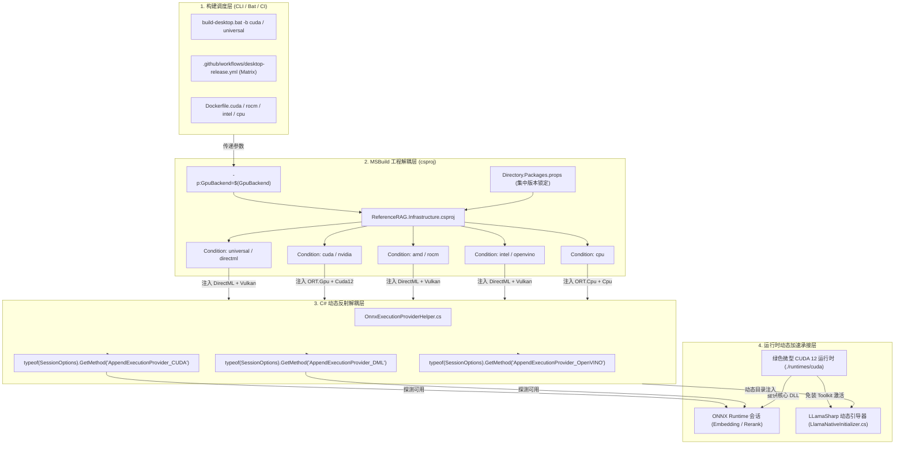

# ReferenceRAG 多硬件加速目标分包解耦与 CI 自动发布架构设计

- **文档状态**：已归档（核心技术架构设计与实现）
- **更新时间**：2026-10-20
- **归档位置**：`docs/multi-target-gpu-package-decoupling-and-ci-release-architecture.md`
- **关联工程**：`Infrastructure/ReferenceRAG.Infrastructure/ReferenceRAG.Infrastructure.csproj`
- **关联代码**：`Infrastructure/ReferenceRAG.Infrastructure/Features/HardwareAcceleration/OnnxExecutionProviderHelper.cs`、`LlamaNativeInitializer.cs`、`PortableCudaManager.cs`
- **关联脚本**：`support/tools/scripts/build-desktop.bat`、`download-cuda-minimal.ps1`
- **关联 CI 流**：`.github/workflows/desktop-release.yml`、`.github/workflows/docker-build.yml`

---

## 一、 背景与架构痛点

在现代混合检索与本地大模型应用中，模型推理主要依赖两大底层 C++ 引擎：
1. **向量嵌入与交叉重排**：依赖微软 **ONNX Runtime (ORT)**；
2. **文本生成与长上下文推理**：依赖 llama.cpp 的 C# 绑定 **LLamaSharp**。

针对不同 GPU（NVIDIA GeForce、AMD Radeon、Intel Arc/核显、高通骁龙、Apple Silicon），各大厂商提供了高度异构的专用硬件算力 SDK：
- NVIDIA: CUDA 12 / TensorRT / cuDNN；
- 全显卡通用（Windows）: 微软 DirectX 12 DirectML + Khronos Vulkan；
- Linux 跨平台: ROCm / HIP (AMD)、oneAPI / OpenVINO (Intel)。

### 致命冲突点
1. **底层符号碰撞（Native Symbol Collisions）**：
   在 .NET 中，不能把 `Microsoft.ML.OnnxRuntime.Gpu`（包含 CUDA/TensorRT 引擎）和 `Microsoft.ML.OnnxRuntime.DirectML` 同时作为 NuGet 包引入同一个项目。两者都包含同名的 `onnxruntime.dll` 原生二进制，打包时会导致文件覆盖冲突或运行时崩溃；
2. **C# 强类型扩展方法缺失（Compilation Breakage）**：
   如果代码中直接硬编码调用 `options.AppendExecutionProvider_CUDA(0)`，那么当为 AMD、Intel 或纯 CPU 构建时，由于移除了 CUDA NuGet 包，C# 编译器将报出严重错误 `CS1061: SessionOptions 不包含 AppendExecutionProvider_CUDA 的定义`，导致无法统一维护同一套业务代码；
3. **体积爆炸与依赖门槛（Deployment Bloat & Friction）**：
   若强行要求全平台装 CUDA，普通小白用户会因缺少 3GB+ 的 CUDA Toolkit 而无法启动；若纯用 CPU，则浪费高端独显算力。

为此，ReferenceRAG 实现了**多目标硬件加速分包解耦体系**，做到**一套 C# 业务源码，在编译期按需分包，在运行期动态自适应，在 CI/CD 中矩阵并行发布**。

---

## 二、 整体分层架构设计



---

## 三、 第一层：MSBuild 属性条件引用 (csproj)

在 `Infrastructure/ReferenceRAG.Infrastructure/ReferenceRAG.Infrastructure.csproj` 中，通过声明 `<GpuBackend>` 属性，按条件拉取不同的 NuGet 包组合：

```xml
<Project Sdk="Microsoft.NET.Sdk">
  <PropertyGroup>
    <RootNamespace>ReferenceRAG.Core</RootNamespace>
    <!-- 默认兜底为通用版 (全显卡兼备) -->
    <GpuBackend Condition="'$(GpuBackend)' == ''">universal</GpuBackend>
  </PropertyGroup>

  <!-- 1. 通用版 (DirectML + Vulkan): 支持 AMD / Intel / NVIDIA / 高通骁龙 / 各类核显 -->
  <ItemGroup Condition="'$(GpuBackend)' == 'universal' or '$(GpuBackend)' == 'directml'">
    <PackageReference Include="Microsoft.ML.OnnxRuntime.DirectML" />
    <PackageReference Include="LLamaSharp.Backend.Vulkan.Windows" />
    <PackageReference Include="LLamaSharp.Backend.Cpu" />
  </ItemGroup>

  <!-- 2. NVIDIA 专属满血版 (CUDA 12 + TensorRT): 针对 GeForce RTX / GTX 独显优化 -->
  <ItemGroup Condition="'$(GpuBackend)' == 'cuda' or '$(GpuBackend)' == 'nvidia'">
    <PackageReference Include="Microsoft.ML.OnnxRuntime.Gpu" />
    <PackageReference Include="LLamaSharp.Backend.Cuda12.Windows" />
    <PackageReference Include="LLamaSharp.Backend.Cpu" />
  </ItemGroup>

  <!-- 3. AMD 专属优化版 -->
  <ItemGroup Condition="'$(GpuBackend)' == 'amd' or '$(GpuBackend)' == 'rocm' or '$(GpuBackend)' == 'radeon'">
    <PackageReference Include="Microsoft.ML.OnnxRuntime.DirectML" />
    <PackageReference Include="LLamaSharp.Backend.Vulkan.Windows" />
    <PackageReference Include="LLamaSharp.Backend.Cpu" />
  </ItemGroup>

  <!-- 4. Intel 专属优化版 -->
  <ItemGroup Condition="'$(GpuBackend)' == 'intel' or '$(GpuBackend)' == 'openvino' or '$(GpuBackend)' == 'arc'">
    <PackageReference Include="Microsoft.ML.OnnxRuntime.DirectML" />
    <PackageReference Include="LLamaSharp.Backend.Vulkan.Windows" />
    <PackageReference Include="LLamaSharp.Backend.Cpu" />
  </ItemGroup>

  <!-- 5. 纯 CPU 兼容版: 针对无独显轻量级环境 -->
  <ItemGroup Condition="'$(GpuBackend)' == 'cpu'">
    <PackageReference Include="Microsoft.ML.OnnxRuntime" />
    <PackageReference Include="LLamaSharp.Backend.Cpu" />
  </ItemGroup>
</Project>
```

**实现效果**：
- 当传入 `-p:GpuBackend=cuda` 时，包还原与编译仅下载 CUDA 相关组件；
- 当传入 `-p:GpuBackend=universal` 时，仅下载 DirectML 与 Vulkan，两者物理隔离，从根源避免原生文件冲突。

---

## 四、 第二层：C# 动态反射解耦适配器 (OnnxExecutionProviderHelper)

为了让 C# 业务代码在“任何包存在或不存在”的情况下都能通过编译并动态运行，在 `Infrastructure/ReferenceRAG.Infrastructure/Features/HardwareAcceleration/OnnxExecutionProviderHelper.cs` 中实现了解耦适配器：

```csharp
public static class OnnxExecutionProviderHelper
{
    // 利用反射探测当前运行环境中是否装载了对应的执行提供者静态方法
    private static readonly MethodInfo? CudaMethod =
        typeof(SessionOptions).GetMethod("AppendExecutionProvider_CUDA", new[] { typeof(int) });

    private static readonly MethodInfo? DmlMethod =
        typeof(SessionOptions).GetMethod("AppendExecutionProvider_DML", new[] { typeof(int) });

    private static readonly MethodInfo? OpenVinoMethod =
        typeof(SessionOptions).GetMethod("AppendExecutionProvider_OpenVINO", new[] { typeof(string) });

    public static bool HasCuda => CudaMethod != null;
    public static bool HasDirectMl => DmlMethod != null;
    public static bool HasOpenVino => OpenVinoMethod != null;

    public static bool TryAppendCuda(SessionOptions options, int deviceId = 0)
    {
        if (CudaMethod == null) return false;
        try { CudaMethod.Invoke(options, new object[] { deviceId }); return true; }
        catch { return false; }
    }

    public static bool TryAppendDirectMl(SessionOptions options, int deviceId = 0)
    {
        if (DmlMethod == null) return false;
        try { DmlMethod.Invoke(options, new object[] { deviceId }); return true; }
        catch { return false; }
    }

    public static void ConfigureHardwareAcceleration(
        SessionOptions sessionOptions,
        bool preferGpu,
        int deviceId,
        ILogger? logger = null)
    {
        sessionOptions.EnableMemoryPattern = false;

        if (preferGpu)
        {
            // 策略优先级 1: 优先尝试挂载 CUDA (若当前构建包含且系统有支持的显卡驱动)
            if (TryAppendCuda(sessionOptions, deviceId))
            {
                logger?.LogInformation("[ONNX] 已成功启用原生 CUDA 12 硬件加速 (Device {DeviceId})", deviceId);
                sessionOptions.AppendExecutionProvider_CPU();
                return;
            }

            // 策略优先级 2: 回退并尝试 DirectML (AMD/Intel/通用版/NVIDIA非CUDA环境)
            if (TryAppendDirectMl(sessionOptions, deviceId))
            {
                logger?.LogInformation("[ONNX] 已成功启用 DirectML (DirectX 12) 硬件加速 (Device {DeviceId})", deviceId);
                sessionOptions.AppendExecutionProvider_CPU();
                return;
            }
        }

        // 兜底回退: 纯 CPU 多线程
        logger?.LogInformation("[ONNX] 未启用 GPU 加速提供者，使用 CPU 执行");
        sessionOptions.AppendExecutionProvider_CPU();
    }
}
```

**收益**：
1. **0 编译破坏**：无论构建哪个变体，不需要 `#if CUDA` 条件宏，业务代码完全通用；
2. **平滑降级（Graceful Degradation）**：即使用户拿的是 NVIDIA 专属版但运行在未装 CUDA 的电脑上，适配器能捕捉异常并平滑降级到 CPU，绝不闪退。

---

## 五、 第三层：大模型 GGUF 后端动态引导 (LlamaNativeInitializer)

在 `LlamaNativeInitializer.cs` 中，负责在 llama.cpp 底层原生 C++ 动态库锁定前完成环境准备：
1. **优先探测 CUDA 12 运行时**：
   通过 `CudaEnvironmentScanner` 扫描 `./runtimes/cuda`、系统路径或常见 AI 环境（PyTorch/ComfyUI/Ollama）。若检测到 `cublas64_12.dll` 与 `cublasLt64_12.dll`，自动通过 Win32 API `AddDllDirectory` 将其加入 Windows 动态库查找链；
2. **动态回退至 Vulkan 原生路径**：
   若当前构建不包含 CUDA 或未扫描到相关 DLL，引导器探查包内的 `runtimes/win-x64/native/vulkan/llama.dll`，自动切换至 Vulkan GPU 渲染计算模式，实现对 AMD、Intel 显卡的原生驱动直连。

---

## 六、 第四层：微型绿色 CUDA 12 运行库与严格幂等下载体系

为了解决纯净 Windows 系统运行 NVIDIA 专属版需额外下载 3GB+ CUDA Toolkit 的痛点，ReferenceRAG 设计了**极简绿色便携包（Minimal Portable CUDA）**与**严格幂等自动化工具**：

### 1. 核心运行库精简
仅需 3 个动态链接库，即可满足 ONNX Runtime 与 LLamaSharp 的全部矩阵运算需求：
- `cublas64_12.dll` (~100MB)
- `cublasLt64_12.dll` (~507MB)
- `cudart64_12.dll` (~556KB)

### 2. 幂等下载脚本 (`download-cuda-minimal.bat` / `.ps1`)
- **多镜像故障转移**：清华源 Tuna（首选，国内秒级拉取） $\rightarrow$ 阿里云镜像 $\rightarrow$ 官方 PyPI $\rightarrow$ NVIDIA 开发者中心；
- **严格幂等防重下**：
  在拉取前校验目标目录（`./runtimes/cuda`）中的文件完整性（`cublas64_12.dll` 与 `cublasLt64_12.dll` 存在且体积 `>10MB`）。若已满足，**耗时 0.05 秒立即退出，网络请求为 0**；
- **原子解压与清理**：下载至临时文件，采用 flat 模式提取匹配 DLL，完成后自动清理中间缓存文件。

---

## 七、 第五层：本地与云端自动化分包打包全流程

### 1. 本地打包脚本 (`build-desktop.bat`)
交互式构建提供 4 大硬件方案菜单（直接回车默认 [1] 通用版），并支持命令行直接调用：
```bat
REM 构建通用版 (全显卡兼容，零依赖首选)
build-desktop.bat --universal --batch

REM 构建 NVIDIA 专属满血版，并自动检测/内嵌微型 CUDA 12 便携库
build-desktop.bat --cuda --bundle-cuda --batch
```
- **增量打包幂等**：发布目录 `%OUTPUT%\runtimes\cuda` 已存在完整核心库时，自动跳过复制；源码目录已存在时通过增量更新机制拷贝，绝无冗余操作。

### 2. 云端 CI 自动化发布 (`.github/workflows/desktop-release.yml`)
在推送 Tag（`v*`）时，GitHub Actions 触发并行构建：
- **Matrix 矩阵**：4 个 Windows 构建机同时并发编译 `universal`、`cuda`、`amd`、`intel`；
- **产物命名规范**：
  - `ReferenceRAG-win-x64-universal.zip` + `ReferenceRAG-win-x64.zip`（作为默认无后缀的直下包）；
  - `ReferenceRAG-win-x64-cuda.zip`（内嵌绿色库）；
  - `ReferenceRAG-win-x64-amd.zip`；
  - `ReferenceRAG-win-x64-intel.zip`；
- **安全校验**：自动生成 `.sha256` 签名校验和并随包发布至 GitHub Releases；
- **Release 页面导购指南**：自动在发布正文渲染硬件选型表格，终端用户根据自己显卡一目了然对号入座。

### 3. Docker 容器构建 (`support/deploy/docker/*`)
Docker 构建流同步注入对应标记：
- `Dockerfile` (CPU) $\rightarrow$ `/p:GpuBackend=cpu`
- `Dockerfile.cuda` (NVIDIA) $\rightarrow$ `/p:GpuBackend=cuda`
- `Dockerfile.rocm` (AMD) $\rightarrow$ `/p:GpuBackend=amd`
- `Dockerfile.intel` (Intel) $\rightarrow$ `/p:GpuBackend=intel`

---

## 八、 总结与最佳实践

| 维度 | 实现方式 | 收益 |
| :--- | :--- | :--- |
| **编译期** | MSBuild `Condition` + `GpuBackend` | 彻底消灭 ONNX Runtime 多包 C++ 符号冲突 |
| **代码期** | `OnnxExecutionProviderHelper` 反射解耦 | 消除 C# 强类型方法依赖，一次编写全版本通用编译 |
| **分发期** | 微型 CUDA 便携包 + 严格幂等下载 | NVIDIA 用户免装 3GB+ SDK，开箱即用满血加速 |
| **用户期** | 通用版 DirectML + Vulkan 默认策略 | 95% 普通用户无需关心环境，显卡驱动原生直连 |
| **发布期** | GitHub Actions 矩阵并行编译与分包 | 全自动化生产与分发，带校验和与选型指南 |
