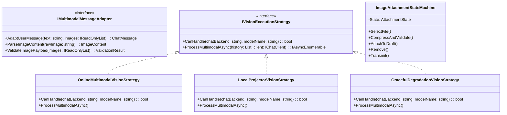

# 多模态视觉 Agent 与超轻量端侧工具模型库架构设计方案

> **文档状态**：已落地实施  
> **更新时间**：2026 年 10 月 20 日  
> **涉及模块**：`ModelManager`、`MafChatService`、`LocalLlamaChatClient`、`MafChatController`、前端 `Chat.js`

---

## 目录
- [一、背景与前沿端侧模型调研（截至 2026 年 10 月）](#一背景与前沿端侧模型调研截至-2026-年-10-月)
- [二、多模态 Agent 视觉能力可行性与业界主流方案对比](#二多模态-agent-视觉能力可行性与业界主流方案对比)
- [三、核心技术瓶颈、逻辑与性能挑战头脑风暴](#三核心技术瓶颈逻辑与性能挑战头脑风暴)
- [四、设计模式架构设计（适配器、策略模式与状态机）](#四设计模式架构设计适配器策略模式与状态机)
- [五、具体实现与工程落地规划](#五具体实现与工程落地规划)

---

## 一、背景与前沿端侧模型调研（截至 2026 年 10 月）

随着轻量化小模型与低比特量化（Low-bit Quantization / AWQ / GGUF Q4/Q3）技术的爆发，2026 年端侧模型在保持几百兆微型体积的同时，在 **函数调用（Tool Calling / BFCL 榜单）**、**超长上下文（32K ~ 262K）** 与 **原生视觉（Vision / Multimodal）** 维度取得了突破性进展。

按模型参数量从小到大横向对比如下：

| 模型名称 | 量化体积 (文件大小) | 功能特性支持 | 标称最大上下文 | 工具调用跑分 (BFCL) | 适用推荐场景 |
| :--- | :--- | :--- | :--- | :--- | :--- |
| **FunctionGemma 270M** | 288 MB (INT8) | 工具、函数调用、智能路由 | 32K | 61.6¹ (BFCL Simple) | 纯工具调用网关、低功耗嵌入式路由 |
| **LFM2.5 350M** | 229 MB (Q4_K_M) | 工具、JSON 约束、结构化文本提取 | 32K | 21.86 (BFCL-V4) | **极致轻量选型**：纯 CPU 极速启动、冷启动首选 |
| **Qwen3.5 0.8B** | 563 MB (Q4_0) | 工具、深度推理、代码、**视觉** | **262K** | 25.3 (BFCL-V4) | **平衡首选**：亚 G 级别同时具备代码与视觉能力 |
| **LFM2.5 1.2B** | 731 MB (Q4_K_M) | 工具、JSON、本地 RAG、日常对话 | 32K | 49.12² (BFCL-V3) | 端侧离线知识库检索增强与结构化输出 |
| **Bonsai 2 2B** | 430–520 MB (低比特) | 工具、推理、**视觉**、代码 | **262K** | 60.53² (BFCL-V3) | 高智商紧凑型视觉推理（超高压缩比） |
| **Qwen3.5 2B** | 1.28 GB (Q4_K_M) | 工具、推理、代码、**视觉** | **262K** | 43.6 (BFCL-V4) | **综合能力首选**：中文、代码、视觉与工具综合极优 |
| **Qwen3.5 4B** | 2.74 GB (Q4_K_M) | 工具、推理、代码、**视觉** | **262K** | 50.3 (BFCL-V4) | 4GB 显存设备满血多模态代码与工具主力 |
| **Gemma 4 E2B** | 3.11 GB (Q4_K_M) | 工具、推理、代码、**视觉**、音频 | 128K | 24.5³ (τ²-Bench) | 谷歌多模态全能生态（视听一体） |

> **选型策略指引**：
> 1. **极致体积轻量**：选 **LFM2.5-350M**（仅 229 MB，内存零压力）；
> 2. **体积与通用能力平衡**：选 **Qwen3.5-0.8B**（563 MB，原生支持 262K 上下文与图像感知）；
> 3. **综合工具调用、中文和代码能力**：选 **Qwen3.5-2B**（1.28 GB，全能多面手）。

---

## 二、多模态 Agent 视觉能力可行性与业界主流方案对比

在 RAG 知识库与本地 Agent 助手中，支持“图片输入”是迈向多模态生产力的关键。用户不仅希望检索文本笔记，还希望“圈选截图提问”、“拍发架构图让 Agent 编写代码”、“上传报错截图自动定位错误”。

### 业界主流方案对比

| 解决方案 | 视觉传输与编码链路 | 本地/线上执行载体 | 优势 | 劣势与挑战 |
| :--- | :--- | :--- | :--- | :--- |
| **OpenAI / Claude API** | 前端 Base64 / URL -> OpenAI `image_url` 规范 | 线上云端多模态集群 | 无需本地算力，识别精度高，支持超高清 | 需要网络与 API 额度，隐私数据出境 |
| **llama.cpp / mtmd** | 文本 GGUF + `mmproj` (CLIP/SigLIP 投影器) | 本地 GPU / CPU 原生 | 纯离线隐私安全，毫秒级本地视觉编码 | 模型文件双份（GGUF + mmproj），显存占用大 |
| **ONNX Runtime GenAI** | ONNX Model + Vision Processor (DirectML) | 本地 DirectML / NPU / GPU | 跨全显卡兼备，Windows 平台集成度高 | 导出步骤复杂，对算子支持要求苛刻 |
| **Ollama Multimodal** | Base64 统一封装进 Request -> 内部挂载视觉投影器 | 容器/守护进程引擎 | 接口简洁统一（自动配对视觉文件） | 黑盒封装，与自研 MAF/C# 架构通信存在 IPC 额外开销 |

---

## 三、核心技术瓶颈、逻辑与性能挑战头脑风暴

将视觉多模态能力引入 ReferenceRAG 必须前瞻性解决以下 4 大风险：

### 1. 视觉 Token 膨胀与上下文显存挤压（Token Explosion）
- **现象**：一张 1080P 图片输入视觉编码器（如 SigLIP / ViT / Qwen-VL Patchify）后，通常会被展平切片为 **256 ~ 1024 个 Visual Tokens**！
- **风险**：若本地模型上下文只有 4096，输入 2 张图片就会消耗掉 1500+ Tokens，直接挤压掉多轮对话与 RAG 检索知识片段的容纳空间。
- **应对方案**：
  - 前端在向后端传输前，自适应等比例缩放（Downscale）至最大长边 1024px，并进行 WebP/JPEG 适度压缩（质量 85%）；
  - 后端结合前序落地的 `ChatPerformancePlanner`，在检测到当前轮包含图片输入时，优先给 KV Cache 预留至少 1024 Token 视觉预算。

### 2. 本地纯文本模型与多模态模型的动态兼容（Graceful Degradation）
- **现象**：用户本地可能当前加载的是纯文本模型（如 LFM2.5 350M 或 FunctionGemma 270M），并没有加载视觉投影器。如果用户突然拖入一张图片提问，系统是直接报错崩溃，还是静默丢弃？
- **应对方案**：
  - 严禁静默丢弃，严禁让底层引擎报 Hard Crash！
  - 引入**优雅降级策略（Graceful Degradation Strategy）**：当当前模型不具备本地视觉能力时，提取图片元信息（文件名、尺寸、类型），注入提示词：`[附加图像: {Name}, 类型: {MediaType}, 当前本地模型为纯文本模式，未装配视觉投影器，已优先基于用户提问与知识库为您回答]`，并在界面上给出友好提示，引导用户切换至支持视觉的模型（如 Qwen3.5-2B 或线上多模态 API）。

### 3. 数据契约与标准化（Microsoft.Extensions.AI 对齐）
- 现代 .NET 生态中，`Microsoft.Extensions.AI` 的 `ChatMessage` 已经原生通过 `IList<AIContent>` 支持了 `ImageContent`。
- 本地与远程的通信接口、会话历史存储（`SessionMemory`）必须与 `AIContent` 无缝互通。

---

## 四、设计模式架构设计（适配器、策略模式与状态机）

为保证高扩展性、零代码冗余与高内聚，系统采用三大经典设计模式：



### 1. 适配器模式（Adapter Pattern）：`MultimodalMessageAdapter`
- **目的**：将前端传输的多元化形态（Base64 Data URI `data:image/png;base64,...`、本地图片绝对路径、HTTP URL）统一适配为 `Microsoft.Extensions.AI.ImageContent`。
- **职责**：
  - 自动解构 Data URI 中的 MIME 类型（`image/png`、`image/jpeg`、`image/webp` 等）；
  - 自动解码 Base64 字节流并包装为 `ReadOnlyMemory<byte>`；
  - 拦截超标文件（单个图片限制 8MB，单轮最多 4 张），杜绝 Payload 内存溢出。

### 2. 策略模式（Strategy Pattern）：`IVisionExecutionStrategy`
- **目的**：根据当前激活的模型类型与运行时环境，动态路由执行通道：
  - **`OnlineMultimodalVisionStrategy`**：激活 OpenAI / 兼容端点，直接透传 `ImageContent`，自动序列化为标准的 OpenAI 多模态 `image_url` JSON；
  - **`LocalProjectorVisionStrategy`**：若本地模型配备了配套的 `mmproj`（多模态投影器），调用本地视觉特征提取器；
  - **`GracefulDegradationVisionStrategy`**：若当前模型为纯文本模式，自动降级为语义标签注入与用户指导，确保对话链条不断裂。

### 3. 状态机模式（State Machine Pattern）：前端图片附件流转
- 前端管理图片从“选择 -> 压缩预览 -> 随文本发送 -> 历史气泡渲染”的全生命周期：
  $$\text{Empty} \xrightarrow{\text{Paste / Upload}} \text{Validating} \xrightarrow{\text{Ready}} \text{Sending} \xrightarrow{\text{Rendered In Bubble}}$$

---

## 五、具体实现与工程落地规划

### 1. 扩充模型注册表（`ModelManager.cs`）
新增 8 款前沿超轻量与视觉模型，标注其参数、体积、最大上下文、功能特性与下载地址：
- `FunctionGemma-270M-IT` (288MB, 32K)
- `LFM2.5-350M-Instruct-GGUF` (229MB, 32K)
- `Qwen3.5-0.8B-Instruct-GGUF` (563MB, 262K, 视觉)
- `LFM2.5-1.2B-Instruct-GGUF` (731MB, 32K)
- `Bonsai-2-2B-GGUF` (480MB, 262K, 视觉)
- `Qwen3.5-2B-Instruct-GGUF` (1.28GB, 262K, 视觉)
- `Qwen3.5-4B-Instruct-GGUF` (2.74GB, 262K, 视觉)
- `Gemma-4-E2B-IT-GGUF` (3.11GB, 128K, 视觉/音频)

### 2. 后端 API 接口与服务改造
- 在 [`MafChatController.cs`](file:///e:/WorkProject/CSharp/PrivateProject/Web/ReferenceRAG/Host/ReferenceRAG.ApiHost/Controllers/MafChatController.cs) 中将 `ChatStreamRequest` 扩展为：
  ```csharp
  public record ChatStreamRequest(string SessionId, string Message, IReadOnlyList<string>? Images = null);
  ```
- 在 [`MafChatService.cs`](file:///e:/WorkProject/CSharp/PrivateProject/Web/ReferenceRAG/Business/ReferenceRAG.Business/Features/Chat/Services/MafChatService.cs) 中引入 `MultimodalMessageAdapter`，支持多模态会话历史。

### 3. 前端交互与视图升级（`Chat.js`）
- **图片粘贴支持**：在输入框监听 `paste` 事件，直接捕获剪贴板截图；
- **图片选择按钮**：增加“📷 图片附件”按钮；
- **预览缩略图列表**：输入框上方显示待发送缩略图，带“×”一键移除；
- **用户气泡多模态渲染**：消息气泡中支持缩略图卡片预览，点击可放大查看。

### 4. 自动化质量门禁
- 编写 `MultimodalAndCompactModelsQualityGateTests.cs`，对 8 款模型的注册完整性、多模态适配器转换、超大图安全拦截等进行 100% 单元测试覆盖。
