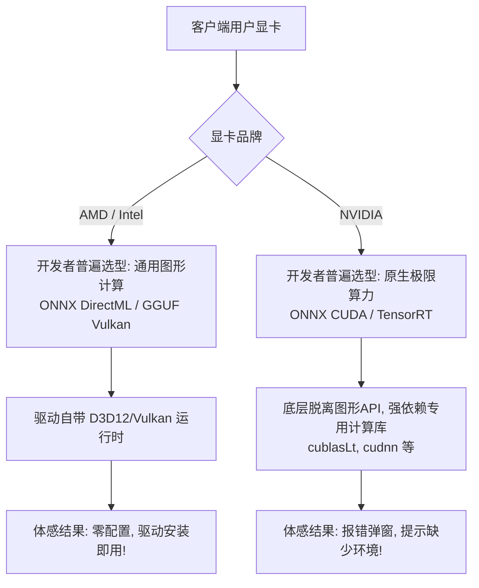
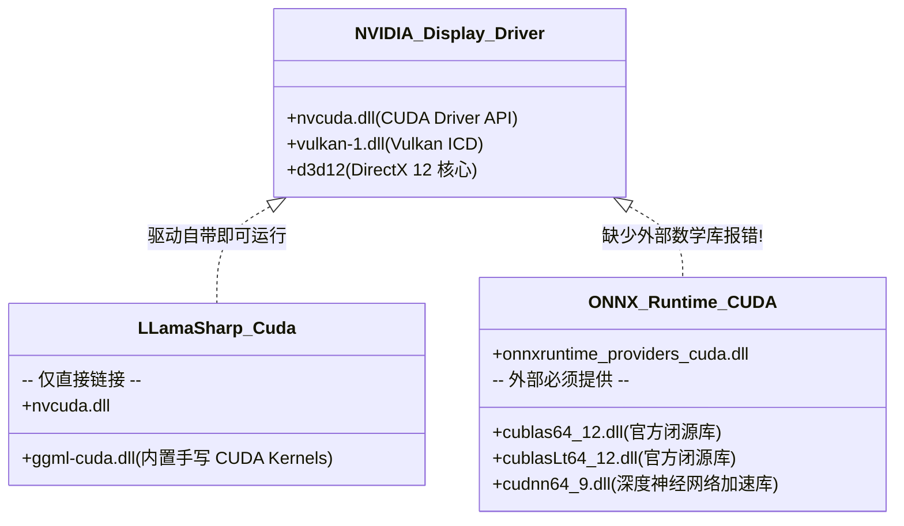

# ONNX 与 GGUF 双引擎全平台运行方案与显卡驱动/运行时依赖深度解析

- **文档状态**：已归档（技术架构调研与知识沉淀）
- **更新时间**：2026-10-20
- **归档位置**：`docs/onnx-and-gguf-cross-platform-runtimes-and-driver-dependencies.md`
- **适用范围**：ReferenceRAG 硬件加速模块（`HardwareAcceleration`）、模型运行时适配器、桌面端免配置分发

---

## 目录
- [一、 执行摘要与三大核心结论](#一-执行摘要与三大核心结论)
- [二、 ONNX Runtime 在 Windows 与 Linux 下的运行方案全景](#二-onnx-runtime-在-windows-与-linux-下的运行方案全景)
  - [2.1 Windows 平台方案：DirectML vs 厂商原生 EP](#21-windows-平台方案directml-vs-厂商原生-ep)
  - [2.2 Linux 平台方案：服务器生态与硬件支持边界](#22-linux-平台方案服务器生态与硬件支持边界)
- [三、 GGUF (llama.cpp / LLamaSharp) 在 Windows 与 Linux 下的运行方案全景](#三-gguf-llamacpp--llamasharp-在-windows-与-linux-下的运行方案全景)
  - [3.1 Windows 平台方案：Vulkan 通用方案 vs 芯片原生后端](#31-windows-平台方案vulkan-通用方案-vs-芯片原生后端)
  - [3.2 Linux 平台方案：Vulkan 与高算力芯片原生生态](#32-linux-平台方案vulkan-与高算力芯片原生生态)
- [四、 深度辨析：“只有 NV 需要驱动外的额外环境”是真是假？](#四-深度辨析只有-nv-需要驱动外的额外环境是真是假)
  - [4.1 为什么日常会有“只有 NV 需要额外环境”的体感错觉？](#41-为什么日常会有只有-nv-需要额外环境的体感错觉)
  - [4.2 底层真相：原生计算栈（Native Compute SDK）的真实依赖](#42-底层真相原生计算栈native-compute-sdk的真实依赖)
  - [4.3 为什么同走 CUDA，ONNX 报错缺环境而 GGUF 常能直接运行？](#43-为什么同走-cudaonnx-报错缺环境而-gguf-常能直接运行)
- [五、 平台 × 模型 × 运行环境：三维关系与生态本质剖析](#五-平台--模型--运行环境三维关系与生态本质剖析)
  - [5.1 全景映射关系总表（Win/Linux × ONNX/GGUF × DirectML/Vulkan/驱动原生）](#51-全景映射关系总表winlinux--onnxgguf--directmlvulkan驱动原生)
  - [5.2 为什么在 Windows 端：“原生计算”事实只有 NV？](#52-为什么在-windows-端原生计算事实只有-nv)
  - [5.3 为什么在 Linux 端：“原生计算”三家并存（NV + Intel + AMD）？](#53-为什么在-linux-端原生计算三家并存nv--intel--amd)
  - [5.4 一句话决策口诀与全平台硬件方案详细对照表](#54-一句话决策口诀与全平台硬件方案详细对照表)
- [六、 ReferenceRAG 工程落地选型与分发策略](#六-referencerag-工程落地选型与分发策略)

---

## 一、 执行摘要与三大核心结论

| 核心问题 | 核心结论 | 技术关键要点 |
| :--- | :--- | :--- |
| **Q1: ONNX 在 Win/Linux 怎么跑？** | **Win 靠 DirectML / Linux 靠原生 EP** | Windows 下 **DirectML** 通吃四大家（NV/AMD/Intel/高通），另有 CUDA/TensorRT/OpenVINO/QNN 原生 EP；Linux 无原生 DirectML，主要靠 CUDA、ROCm 与 OpenVINO 原生 EP。 |
| **Q2: GGUF 在 Win/Linux 怎么跑？** | **双端均首选 Vulkan 跨卡通用，高性能走 CUDA/HIP/SYCL** | `llama.cpp` 原生集成 **Vulkan 后端**，两端均可免配 SDK 全卡通用；极致性能则走 NVIDIA CUDA、AMD ROCm (HIP)、Intel SYCL。 |
| **Q3: 只有 NV 需要驱动外的额外环境？** | ❌ **严重认知偏差（工程落地的体感错觉）** | • **通用图形栈（DirectML/Vulkan）**：所有显卡（包括 NV）均**只要驱动，零额外环境**。<br>• **原生计算栈（CUDA/ROCm/SYCL）**：所有厂商都需要额外运行时；**AMD ROCm 和 Intel SYCL 的环境门槛与碎片化程度远超 NVIDIA CUDA**。<br>• 之所以觉得“只有 NV 要装环境”，是因为针对 AMD/Intel 开发者直接选了免配的 DirectML/Vulkan，而对 NV 为了压榨 Tensor Core 选了原生 CUDA。 |

---

## 二、 ONNX Runtime 在 Windows 与 Linux 下的运行方案全景

ONNX Runtime (ORT) 采用 **Execution Provider (EP)** 插件架构。不同的硬件加速均被封装为对应的 EP 动态库。

### 2.1 Windows 平台方案：DirectML vs 厂商原生 EP

在 Windows 桌面端，ONNX Runtime 主要有两大流派：

1. **跨硬件通用方案：DirectML (`DmlExecutionProvider`)**
   - **底层依赖**：微软 Windows 10/11 内置的 **DirectX 12 (D3D12)** 子系统。
   - **芯片支持**：通吃 **NVIDIA、AMD Radeon、Intel Arc/核显、高通骁龙（Snapdragon X Elite）**。
   - **驱动要求**：用户只需安装厂商的常规显示驱动（WDDM 2.4+），操作系统自带 D3D12 调度器，`Microsoft.ML.OnnxRuntime.DirectML` 内置 `DirectML.dll`，**零外部环境依赖**。
   - **性能水位**：算子吞吐约为原生 CUDA 的 80%～90%，是消费级跨平台软件的“黄金兼容底线”。

2. **厂商原生高性能方案（专卡专用 EP）**
   - **NVIDIA 专属**：`CUDAExecutionProvider`（通用算子加速）与 `TensorRTExecutionProvider`（极致静态图融合加速）。
   - **Intel 专属**：`OpenVINOExecutionProvider`（针对 Intel Core 核显、Arc 独显及 NPU 的深度优化）。
   - **高通专属**：`QNNExecutionProvider`（高通骁龙芯片专用的 NPU 加速引擎）。
   - *(注：AMD 官方在 Windows 下未维护成熟的 ROCm EP，AMD 官方与微软一致推荐在 Windows 下统一走 DirectML)*。

### 2.2 Linux 平台方案：服务器生态与硬件支持边界

原生 Linux（物理机与容器集群）内核中**没有 DirectX 12 驱动体系**，DirectML 无法在原生 Linux 上运行（WSL2 通过 `/dev/dxg` 虚拟驱动属于特例）。因此 Linux 必须依赖原生计算栈：

1. **NVIDIA 方案**：
   - `Microsoft.ML.OnnxRuntime.Gpu`：依赖系统安装的 NVIDIA 驱动、CUDA Toolkit 及 cuDNN 共享库。
2. **AMD 方案**：
   - `Microsoft.ML.OnnxRuntime.ROCm` / `MIGraphX`：针对 Linux 数据中心卡（Instinct MI 系列）及部分专业卡，依赖完整的 ROCm 软件栈。
3. **Intel 方案**：
   - `OpenVINO` / `oneAPI (oneDNN)`：针对至强 Xeon CPU（AMX 加速）或 Intel 数据中心 GPU。

---

## 三、 GGUF (llama.cpp / LLamaSharp) 在 Windows 与 Linux 下的运行方案全景

与 ONNX Runtime 依赖庞大外部第三方框架不同，`llama.cpp` 的核心理念是**单文件、极低依赖、自研高效算子内核（GGML）**。

### 3.1 Windows 平台方案：Vulkan 通用方案 vs 芯片原生后端

1. **跨厂商通用支柱：Vulkan 后端 (`ggml-vulkan`)**
   - **运行机制**：使用标准 Vulkan Compute Shader 实现张量反量化与矩阵乘。
   - **环境要求**：用户电脑只需安装日常显卡驱动，驱动会自动向系统注册 `vulkan-1.dll`。无需下载任何 SDK。
   - **兼容范围**：全系支持 AMD（核显/独显）、Intel（Iris/Arc）、NVIDIA（GeForce）、Qualcomm Adreno。
2. **NVIDIA 原生后端：CUDA (`ggml-cuda`)**
   - 使用手写 CUDA C++ 内核编译为 `ggml-cuda.dll`，完全发挥 NV GPU 的 Tensor Core 硬件吞吐，性能达到 100% 满血基准。
3. **Intel 原生后端：SYCL / oneAPI (`ggml-sycl`)**
   - 官方专门支持，可直接调用 Intel Arc 独显专属的 **XMX (Xe Matrix Extensions)** 硬件矩阵单元。
4. **AMD 原生后端：ROCm/HIP (`ggml-hip`)**
   - 在 Windows 上仅官方验证了极个别旗舰卡（如 RX 7900 系列搭载特定 HIP SDK），大众消费级分发几乎不使用。

### 3.2 Linux 平台方案：Vulkan 与高算力芯片原生生态

1. **通用通道**：`Vulkan`（只要系统安装有 Mesa 或厂商私有驱动的 `libvulkan.so`）。
2. **NVIDIA 通道**：`CUDA`（官方标准，预编译 `libggml-cuda.so` 配合驱动即可）。
3. **AMD 通道**：`ROCm / HIP`（在 Linux 上生态成熟，HIPBLAS 性能媲美 CUDA）。
4. **Intel 通道**：`SYCL / oneAPI` 或纯 CPU 顶级指令集（AVX-512、AMX）。

---

## 四、 深度辨析：“只有 NV 需要驱动外的额外环境”是真是假？

### 4.1 为什么日常会有“只有 NV 需要额外环境”的体感错觉？

很多开发者或用户经常遇到：
> “我的 AMD / Intel 显卡只要装好显卡驱动，开箱就能跑；为什么换成 NVIDIA 显卡，动不动就报错 `DllNotFoundException: 找不到 cublasLt64_12.dll` 或提示要安装 CUDA Toolkit？”

产生这个错觉的根本原因在于：**开发者针对不同品牌显卡所选择的技术路线并不在同一个层次上**。



* **对 AMD / Intel**：由于它们各自的原生生态在 Windows 桌面端支持困难（ROCm 极度挑显卡和系统，oneAPI 包体积数 GB），开发团队直接放弃了它们的原生 SDK，直接给它们分配了 **DirectML** 或 **Vulkan**。
* **对 NVIDIA**：为了释放 Tensor Core 比 DirectML/Vulkan 高出 15%~30% 的绝对算力优势，开发者默认给 NVIDIA 配置了 **原生 CUDA**。

### 4.2 底层真相：原生计算栈（Native Compute SDK）的真实依赖

如果将所有显卡拉到同一个维度进行横向对比：

| 显卡品牌 | 通用图形方案（DirectML / Vulkan）环境依赖 | 原生计算方案（CUDA / ROCm / SYCL）环境依赖 |
| :--- | :--- | :--- |
| **NVIDIA** | **仅需日常显卡驱动**（无任何额外环境） | 需要 **CUDA 运行时动态库**（`cublasLt64_*.dll` 等）及 **cuDNN**（仅 ONNX 强制需要）。 |
| **AMD** | **仅需日常显卡驱动**（无任何额外环境） | **环境比 NV 苛刻数倍**：<br>• 基础驱动（Adrenalin）完全不带 ROCm 用户态库；<br>• Linux 下需装数 GB 的 `rocm-hip-sdk`，且对内核版本、显卡架构（GFX ID）有严苛限制；<br>• Windows 下 HIP SDK 体积数 GB，且仅限个别型号。 |
| **Intel** | **仅需日常显卡驱动**（无任何额外环境） | 需要安装 **Intel oneAPI Base Toolkit**（包括 DPC++、oneMKL 运行时，依赖 `sycl.dll` 等一整套库）。 |

> **关键事实**：
> 如果让 NVIDIA 显卡也走 **DirectML**（ONNX）或 **Vulkan**（GGUF），NVIDIA **同样完全不需要任何额外环境，仅需普通驱动即可运行**！

### 4.3 为什么同走 CUDA，ONNX 报错缺环境而 GGUF 常能直接运行？

同样是 NVIDIA 原生 CUDA 加速，ONNX 和 GGUF 内部的设计架构截然不同：



1. **ONNX Runtime (CUDA EP)**：
   - 依赖 NVIDIA 官方高度封装的底层数学库：**cuBLAS** (`cublas64_*.dll`, `cublasLt64_*.dll`) 与 **cuDNN** (`cudnn64_*.dll`)。
   - NVIDIA 在安装显卡驱动时，出于体积控制，**绝不会把这几个重型开发库打入普通驱动包**（驱动只自带 `nvcuda.dll`）。因此只要应用自身未分发这些 DLL，必然触发缺失报错。
2. **GGUF (llama.cpp / LLamaSharp)**：
   - 走极简轻量路线，其算子是官方直接手写 CUDA C++ 并编译内嵌进 `ggml-cuda.dll` 的。
   - 它底层直接调用显卡驱动内置的 `nvcuda.dll`（CUDA Driver API），**不强制依赖外部的 cuDNN 和完整 CUDA Toolkit**。
   - 只要显卡驱动版本满足 CUDA 12 的最低驱动版本号，用户即便从来没听过 CUDA Toolkit，GGUF 也能直接点火运行。

### 4.4 DirectML 与 Vulkan “只要驱动正常即可直接运行” 的底层机制与边界条件

针对“DirectML 与 Vulkan 是否只要显卡驱动正常就能直接跑”的论断，从底层驱动体系、调用链拓扑与工程约束进行深度验证：

#### 4.4.1 DirectML 的底层调用链与零配置原理
* **操作系统原生内置**：Windows 10（1903 及以上版本）与 Windows 11 原生深度集成了 **DirectX 12（D3D12）** 计算与图形子系统。
* **显卡驱动标准交付**：主流 GPU 厂商（NVIDIA、AMD、Intel、高通）在日常向用户发布的常规显示驱动中，均通过了微软的 **WDDM（Windows Display Driver Model）** 认证，并完整实现了 D3D12 Compute Shader 规范。
* **应用自闭环**：C# 引入的 `Microsoft.ML.OnnxRuntime.DirectML` 包已内置由微软官方发布的 `DirectML.dll`，无需系统注册，随主进程直接启动。
* **物理调用拓扑**：
  $$\text{应用程序 (ReferenceRAG)} \longrightarrow \text{DirectML.dll} \longrightarrow \text{Windows 系统 D3D12 调度器} \longrightarrow \text{厂商显示驱动} \longrightarrow \text{GPU 硬件}$$
  👉 **结论**：整个链路无需外部安装任何 DirectX SDK、CUDA Toolkit 或调整系统环境变量。

#### 4.4.2 Vulkan 的底层调用链与零配置原理
* **ICD（Installable Client Driver）机制**：Khronos Group 规范规定，显卡厂商在安装基础显示驱动时，会自动将标准动态库 **`vulkan-1.dll`** 写入系统核心目录（`C:\Windows\System32`），并在注册表 `HKLM\SOFTWARE\Khronos\Vulkan\Drivers` 下注册本卡驱动的 JSON 清单。
* **应用自带预编译算子**：`LLamaSharp.Backend.Vulkan.Windows` 内置预编译的 `ggml-vulkan.dll`，动态链接 `vulkan-1.dll`。
* **物理调用拓扑**：
  $$\text{应用程序 (LLamaSharp)} \longrightarrow \text{ggml-vulkan.dll} \longrightarrow \text{System32\vulkan-1.dll (加载器)} \longrightarrow \text{显卡驱动 ICD} \longrightarrow \text{GPU 硬件}$$
  👉 **结论**：用户电脑不需要安装 Vulkan SDK，亦无需配置任何 C++ 编译链。

#### 4.4.3 “直接跑”的物理底线与三大边界条件
虽然不需要额外配环境，但在工程落地上，要达到“100% 直接点火运行”，必须满足以下三项物理底线：
1. **显卡硬件与驱动标准支持**：
   * **DirectML**：显卡必须支持 **DirectX 12（Feature Level 11_0 及以上）**。
   * **Vulkan**：显卡必须支持 **Vulkan 1.2 及以上**。
   * *实际覆盖率*：近 8~10 年内发布的显卡（如 NVIDIA GTX 900/10 系及以上、AMD RX 400 系及以上、Intel 第 7 代酷睿核显及以上）均已原生满足。
2. **操作系统平台约束**：
   * **DirectML**：仅支持 **Windows**（Windows 10/11）或 WSL2 虚拟环境；原生 Linux 物理机与常规 Docker 容器无法使用。
   * **Vulkan**：跨 Windows 与 Linux 双平台；但在 **Linux 极简最小化发行版（Barebone/Headless）或极简 Docker 镜像** 中，操作系统可能精简掉了基础 Vulkan Loader，此时只需通过包管理器补充一行即可：
     ```bash
     apt update && apt install -y libvulkan1
     ```
3. **驱动安装有效性判定**：
   * 设备不能处于刚重装操作系统后、未连网更新驱动的“Microsoft 基本显示适配器（纯 CPU 软件模拟渲染）”状态，必须已安装硬件厂商的正规驱动。

---

## 五、 平台 × 模型 × 运行环境：三维关系与生态本质剖析

### 5.1 全景映射关系总表（Win/Linux × ONNX/GGUF × DirectML/Vulkan/驱动原生）

将 **平台（Windows \ Linux）**、**模型格式与引擎（ONNX \ GGUF）**、**运行环境（DirectML \ Vulkan \ 驱动原生）** 展开，其对应关系如下：

| 操作系统 (OS) | 模型/引擎格式 | 跨卡通用图形方案（DirectML / Vulkan） | 厂商驱动原生计算方案（Native Compute） | 核心工程结论 |
| :--- | :--- | :--- | :--- | :--- |
| **Windows**<br>*(桌面端生态)* | **ONNX**<br>*(ONNX Runtime)* | ✅ **DirectML**<br>*(微软主推，通吃 NV/AMD/Intel/高通)* | • **NVIDIA**: CUDA / TensorRT<br>• *(AMD 无成熟 Win 原生 EP)*<br>• *(Intel 有 OpenVINO，但多走 DirectML)* | ONNX 在 Win 端是 **DirectML（全卡通用）** 与 **NVIDIA CUDA（满血独占）** 的对决。 |
| | **GGUF**<br>*(llama.cpp)* | ✅ **Vulkan**<br>*(国际标准，通吃 NV/AMD/Intel/高通)* | • **NVIDIA**: CUDA (`ggml-cuda`)<br>• *(AMD HIP on Win 几乎不可用)*<br>• *(Intel SYCL 依赖数GB oneAPI，极少用于Win分发)* | GGUF 在 Win 端是 **Vulkan（全卡通用）** 与 **NVIDIA CUDA（满血独占）** 的对决。 |
| **Linux**<br>*(服务器/生产端)* | **ONNX**<br>*(ONNX Runtime)* | ❌ **无通用方案**<br>*(DirectML 无法在原生 Linux 运行；无成熟 Vulkan EP)* | • **NVIDIA**: CUDA / TensorRT EP<br>• **AMD**: ROCm / MIGraphX EP<br>• **Intel**: OpenVINO / oneAPI EP | **DirectML 彻底退场**。ONNX 在 Linux 下必须使用各厂商的**原生计算栈**。 |
| | **GGUF**<br>*(llama.cpp)* | ✅ **Vulkan**<br>*(系统安装 `libvulkan.so` 即可全卡通用)* | • **NVIDIA**: CUDA (`ggml-cuda`)<br>• **AMD**: ROCm / HIP (`ggml-hip`)<br>• **Intel**: SYCL / oneAPI (`ggml-sycl`) | GGUF 依然可以用 **Vulkan 保底**，高性能场景各家走各自的原生计算栈。 |

---

### 5.2 为什么在 Windows 端：“原生计算”事实只有 NV？

在 Windows 桌面端，真正有商业化落地价值和通用分发可行性的“驱动原生方案”，**几乎只有 NVIDIA CUDA**。原因在于各厂商的生态定位差异：

1. **AMD 的策略选择（摆烂原生，全面拥抱通用图形）**：
   - AMD 的原生计算栈是 **ROCm / HIP**。
   - 但 AMD 在 Windows 上的 HIP SDK 极度残缺，仅在极少数旗舰卡（如 RX 7900）或工作站专业卡（Radeon Pro W7000）上提供，普通消费级游戏卡（RX 6000/7000）与广阔的 Ryzen/APU 核显根本没有 Windows ROCm 驱动。
   - AMD 官方与微软深度结盟，在 Windows 上一律建议走 **DirectML** 与 **Vulkan**。因此在 Windows 下跑 AMD 显卡，业界从未有人使用原生 ROCm。
2. **Intel 的生态现状（SDK 过于重型，避而远之）**：
   - Intel 的原生计算栈是 **oneAPI / SYCL** 与 **OpenVINO**。
   - 要激活 Intel Arc 独显的 XMX 矩阵加速跑 SYCL，用户电脑必须安装体积高达数 GB 的 Intel oneAPI Base Toolkit。客户端软件打包分发绝不可能强求终端用户部署此环境，因此 Windows 上 Intel 同样以 DirectML 和 Vulkan 为绝对主力。
3. **NVIDIA 的绝对霸权**：
   - 只有 NVIDIA 的 CUDA 在 Windows 上同时具备“庞大的消费级独显装机基数”与“无可替代的 Tensor Core 极限性能”，促使开发者即便需要处理 DLL 扫描与分发，也要在 Windows 下为 NVIDIA 提供原生 CUDA 加速。

---

### 5.3 为什么在 Linux 端：“原生计算”三家并存（NV + Intel + AMD）？

进入 Linux（服务器与生产环境），规则发生根本转变：

1. **DirectML 根基彻底丧失**：
   - DirectML 严格绑定于 Windows 的 DirectX 12 驱动体系。原生 Linux 操作系统内核完全没有 D3D12 支持，因此在 Linux 物理服务器与云端 Docker 中，DirectML 完全失效。
2. **服务器算力竞赛，全拼原生硬实力**：
   - 没有了微软 DirectML 的“托底”，Linux 成为各大芯片厂商比拼底层算力栈的主战场：
     - **NVIDIA**：使用 **CUDA / TensorRT**（统治数据中心主流）。
     - **AMD**：在 Linux 上全心投入 **ROCm / HIP**（Instinct MI300/MI200 计算卡以及 Linux 下的 Radeon GPU 具备原生算子支持，性能媲美 CUDA）。
     - **Intel**：在 Linux 服务器上主推 **oneAPI (oneDNN) / OpenVINO**，激活数据中心 Xeon CPU 的 AMX 矩阵加速与 Intel Max/Flex GPU。

---

### 5.4 一句话决策口诀与全平台硬件方案详细对照表

#### 决策口诀：
1. **ONNX**：
   - 在 **Windows** 看 **DirectML**（全卡一键通吃）；
   - 在 **Linux** 看 **厂商原生**（DirectML 不存在，各找各家原生驱动）。
2. **GGUF (llama.cpp)**：
   - 在 **哪都能跑 Vulkan**（跨 Win/Linux，跨 NV/AMD/Intel，零配置通用）；
   - 想要 **极限算力才上原生**（Win 上只有 NV CUDA 值得折腾；Linux 上 NV/AMD/Intel 各有成熟原生）。

#### 全平台多引擎硬件方案与依赖矩阵详细对照表：

| 引擎格式 | 操作系统 | 显卡品牌 | 推荐方案 | 核心依赖二进制文件 | 是否需额外安装环境？ |
| :--- | :--- | :--- | :--- | :--- | :--- |
| **ONNX** | **Windows** | **全通用 (AMD/Intel/NV/高通)** | **DirectML** | `d3d12.dll` (Win自带), `DirectML.dll` (包自带) | ❌ **免安装**（驱动自带） |
| | | **NVIDIA (满血)** | **CUDA 12** | `nvcuda.dll` (驱动), `cublasLt64_12.dll`, `cudnn64_9.dll` | ⚠️ **需提供**（Toolkit / 便携包） |
| | | **Intel (优化)** | **OpenVINO** | `openvino.dll`, Intel Compute Runtime (驱动自带) | ❌ **免安装**（NuGet已封装运行时） |
| | **Linux** | **NVIDIA** | **CUDA 12** | `libcuda.so`, `libcublasLt.so.12`, `libcudnn.so.9` | ⚠️ **需安装**（CUDA/cuDNN驱动库） |
| | | **AMD** | **ROCm** | `libamdhip64.so`, `librocblas.so` | ⚠️ **需安装**（ROCm环境栈） |
| | | **Intel / 通用** | **OpenVINO / CPU** | `libopenvino.so` | ❌ **免安装** |
| **GGUF** | **Windows** | **全通用 (AMD/Intel/NV/高通)** | **Vulkan** | `vulkan-1.dll` (驱动自带), `ggml-vulkan.dll` (包自带) | ❌ **免安装**（驱动自带） |
| | | **NVIDIA (满血)** | **CUDA 12** | `nvcuda.dll` (驱动自带), `ggml-cuda.dll` (包自带) | ❌ **免安装**（只要驱动支持CUDA 12） |
| | | **Intel (XMX)** | **SYCL** | `sycl7.dll`, `mkl_sycl.dll` | ⚠️ **需安装**（oneAPI Base Toolkit） |
| | **Linux** | **全通用 (AMD/Intel/NV)** | **Vulkan** | `libvulkan.so` (系统驱动自带), `libggml-vulkan.so` | ❌ **免安装**（系统有驱动即可） |
| | | **NVIDIA** | **CUDA 12** | `libcuda.so` (驱动自带), `libggml-cuda.so` | ❌ **免安装**（只要驱动支持） |
| | | **AMD** | **ROCm/HIP** | `libamdhip64.so`, `libhipblas.so` | ⚠️ **需安装**（Linux ROCm 环境） |

---

## 六、 ReferenceRAG 工程落地选型与分发策略

### 6.1 核心结论：构建方案与外部环境依赖判定

> **核心结论**：
> - **使用【[1] 通用版】（默认）时，用户什么额外 SDK 都不需要装！** 只要电脑正常安装了显卡官方基础驱动就能直接运行。
> - **只有构建或选择了【[2] NVIDIA 专属满血版】时**，才需要本地具备 CUDA 12 的底层动态链接库。

---

### 6.2 桌面版四大构建方案（GPU Backend Variant）依赖对比

下表直观对照了 `build-desktop.bat` 提供的四大构建方案及交付要求：

| 构建方案 | 需要装 CUDA / ROCm / oneAPI 吗？ | 用户电脑需要满足什么条件？ | 运行体验与推荐场景 |
| :--- | :--- | :--- | :--- |
| **[1] 通用版**<br>*(DirectML + Vulkan)*<br>**【默认 - 强烈推荐】** | **完全不需要！**<br>❌ 免装 CUDA<br>❌ 免装 AMD ROCm<br>❌ 免装 Intel oneAPI | **只需正常安装了显卡驱动即可**。<br>Windows 10/11 系统的 DirectX 12 与显卡驱动自带的 Vulkan 会自动承接算力。 | **真正的开箱即用**。<br>发给任何有独显或核显的用户，双击直接 GPU 加速。团队分发与商用交付首选。 |
| **[2] NVIDIA 专属满血版**<br>*(CUDA 12 + TensorRT)* | **需要 CUDA 12 运行时** | **需要电脑中有 CUDA 12 核心依赖**（`cublasLt64_12.dll` 等）：<br>• 若电脑已装过 Ollama、ComfyUI、SD-WebUI 或 PyTorch，程序会自动借用，免装；<br>• 若为全新纯净系统，需放置便携包（`PortableCudaManager` 下载 ~80MB 核心 DLL）或安装 CUDA。 | **极限压榨 RTX 独显算力**，吞吐最高，但对纯小白用户存在环境门槛。 |
| **[3] AMD 专属优化版**<br>*(DirectML + Vulkan)* | **完全不需要！**<br>❌ 免装 AMD ROCm / HIP SDK | **只需装了 AMD 官方 Adrenalin 显卡驱动**。<br>DirectX 12 驱动层会直接调用 RDNA 架构硬件算力。 | **AMD 独显与 Ryzen/APU 核显直接加速**。<br>底层依赖与通用版同构。 |
| **[4] Intel 专属优化版**<br>*(DirectML + Vulkan)* | **完全不需要！**<br>❌ 免装 Intel oneAPI Toolkit | **只需装了 Intel 官方 Arc / 酷睿显卡驱动**。<br>DirectX 12 会自动调用 Xe 核心与核显算力。 | **Intel Arc 独显与酷睿 Ultra 核显直接加速**。<br>底层依赖与通用版同构。 |

---

### 6.3 为什么【通用版】能做到“零额外依赖”？

根本原因在于 Windows 平台的底层架构设计与显卡驱动规范：

1. **向量与重排（ONNX Runtime）**：
   - 走的是微软官方与 DirectX 12 紧密集成的 **DirectML**。
   - DirectX 12 是 Windows 系统底层的原生图形/计算 API，AMD、Intel、NVIDIA 在发布显卡驱动时就已经将 DX12 硬件驱动打包进去了，应用随包携带 `DirectML.dll` 即可直接调度 GPU。
2. **大模型对话与嵌入（llama.cpp / LLamaSharp）**：
   - 走的是国际跨平台标准的 **Vulkan**。
   - 任何支持 3D 渲染的现代显卡驱动均原生在 `System32` 内置了 `vulkan-1.dll`，程序自带预编译 `ggml-vulkan.dll` 即可直接点火，无需安装 Vulkan 开发包（SDK）。

---

### 6.4 交付与打包总结建议

* **外部交付与通用分发**：
  - 如果是日常个人分发、团队协作或交付给客户，在 `build-desktop.bat` 中**直接按回车选择 [1] 通用版**。对方无需折腾任何复杂的 AI 环境即可直接享受到 GPU 硬件加速，彻底消灭售后兼容性故障。
* **开发机与极限性能压测**：
  - 如果开发者本机配备 NVIDIA GeForce RTX 30/40/50 系列独显，且希望获得极致吞吐，选择 **[2] NVIDIA 专属满血版**，配合项目内置的 `CudaEnvironmentScanner` 自动借用现存 AI 环境。
* **长期技术演进**：
  - 持续推进模型生态向 **GGUF 格式** 收敛，逐步统一至 `ggml-cuda` + `ggml-vulkan`，终极实现“全模型全硬件零外部配置”。

