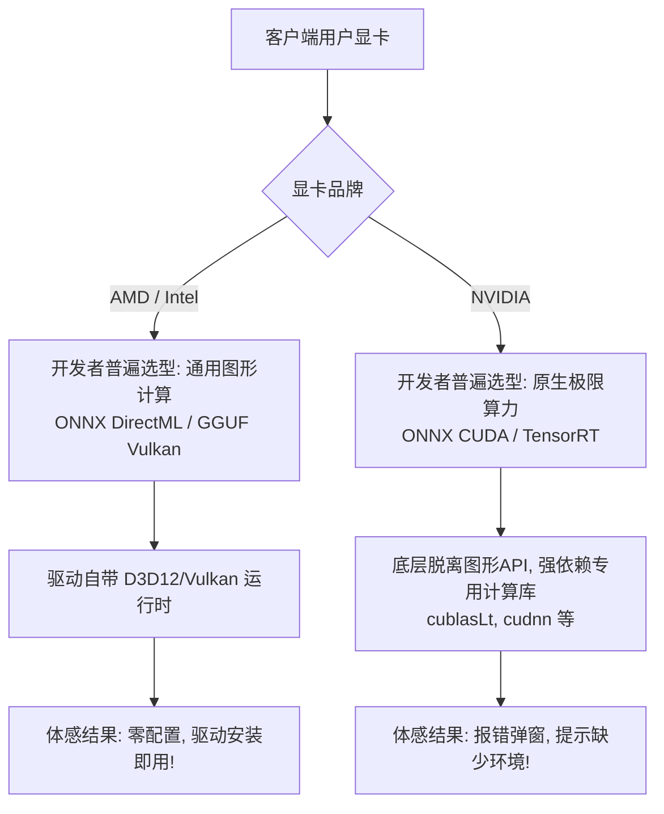
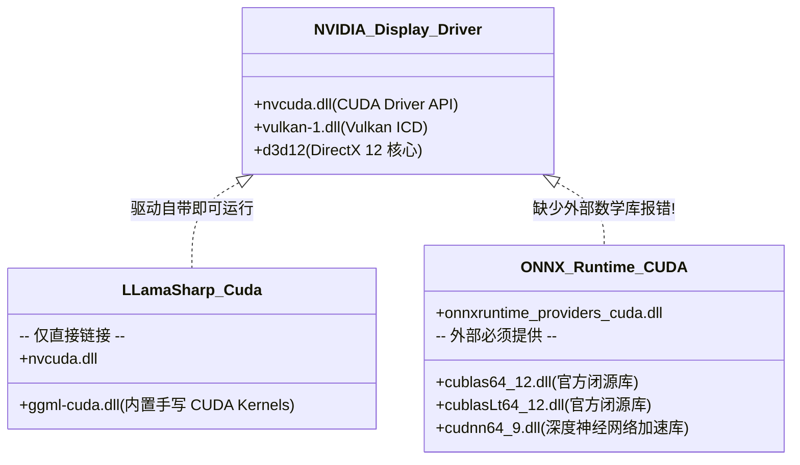

# ONNX 与 GGUF 双引擎全平台运行方案与显卡驱动/运行时依赖深度解析

- **文档状态**：已归档（技术架构调研与知识沉淀）
- **更新时间**：2026-10-20
- **归档位置**：`docs/onnx-and-gguf-cross-platform-runtimes-and-driver-dependencies.md`
- **适用范围**：ReferenceRAG 硬件加速模块（`HardwareAcceleration`）、模型运行时适配器、桌面端免配置分发

---

## 目录
- [一、 执行摘要与三大核心结论](#一-执行摘要与三大核心结论)
- [二、 ONNX Runtime 在 Windows 与 Linux 下的运行方案全景](#二-onnx-runtime-在-windows-与-linux-下的运行方案全景)
  - [2.1 Windows 平台方案：DirectML vs 厂商原生 EP](#21-windows-平台方案directml-vs-厂商原生-ep)
  - [2.2 Linux 平台方案：服务器生态与硬件支持边界](#22-linux-平台方案服务器生态与硬件支持边界)
- [三、 GGUF (llama.cpp / LLamaSharp) 在 Windows 与 Linux 下的运行方案全景](#三-gguf-llamacpp--llamasharp-在-windows-与-linux-下的运行方案全景)
  - [3.1 Windows 平台方案：Vulkan 通用方案 vs 芯片原生后端](#31-windows-平台方案vulkan-通用方案-vs-芯片原生后端)
  - [3.2 Linux 平台方案：Vulkan 与高算力芯片原生生态](#32-linux-平台方案vulkan-与高算力芯片原生生态)
- [四、 深度辨析：“只有 NV 需要驱动外的额外环境”是真是假？](#四-深度辨析只有-nv-需要驱动外的额外环境是真是假)
  - [4.1 为什么日常会有“只有 NV 需要额外环境”的体感错觉？](#41-为什么日常会有只有-nv-需要额外环境的体感错觉)
  - [4.2 底层真相：原生计算栈（Native Compute SDK）的真实依赖](#42-底层真相原生计算栈native-compute-sdk的真实依赖)
  - [4.3 为什么同走 CUDA，ONNX 报错缺环境而 GGUF 常能直接运行？](#43-为什么同走-cudaonnx-报错缺环境而-gguf-常能直接运行)
- [五、 全平台多引擎硬件方案与依赖矩阵总表](#五-全平台多引擎硬件方案与依赖矩阵总表)
- [六、 ReferenceRAG 工程落地选型与分发策略](#六-referencerag-工程落地选型与分发策略)

---

## 一、 执行摘要与三大核心结论

| 核心问题 | 核心结论 | 技术关键要点 |
| :--- | :--- | :--- |
| **Q1: ONNX 在 Win/Linux 怎么跑？** | **Win 靠 DirectML / Linux 靠原生 EP** | Windows 下 **DirectML** 通吃四大家（NV/AMD/Intel/高通），另有 CUDA/TensorRT/OpenVINO/QNN 原生 EP；Linux 无原生 DirectML，主要靠 CUDA、ROCm 与 OpenVINO 原生 EP。 |
| **Q2: GGUF 在 Win/Linux 怎么跑？** | **双端均首选 Vulkan 跨卡通用，高性能走 CUDA/HIP/SYCL** | `llama.cpp` 原生集成 **Vulkan 后端**，两端均可免配 SDK 全卡通用；极致性能则走 NVIDIA CUDA、AMD ROCm (HIP)、Intel SYCL。 |
| **Q3: 只有 NV 需要驱动外的额外环境？** | ❌ **严重认知偏差（工程落地的体感错觉）** | • **通用图形栈（DirectML/Vulkan）**：所有显卡（包括 NV）均**只要驱动，零额外环境**。 • **原生计算栈（CUDA/ROCm/SYCL）**：所有厂商都需要额外运行时；**AMD ROCm 和 Intel SYCL 的环境门槛与碎片化程度远超 NVIDIA CUDA**。 • 之所以觉得“只有 NV 要装环境”，是因为针对 AMD/Intel 开发者直接选了免配的 DirectML/Vulkan，而对 NV 为了压榨 Tensor Core 选了原生 CUDA。 |

---

## 二、 ONNX Runtime 在 Windows 与 Linux 下的运行方案全景

ONNX Runtime (ORT) 采用 **Execution Provider (EP)** 插件架构。不同的硬件加速均被封装为对应的 EP 动态库。

### 2.1 Windows 平台方案：DirectML vs 厂商原生 EP

在 Windows 桌面端，ONNX Runtime 主要有两大流派：

1. **跨硬件通用方案：DirectML (`DmlExecutionProvider`)**
   - **底层依赖**：微软 Windows 10/11 内置的 **DirectX 12 (D3D12)** 子系统。
   - **芯片支持**：通吃 **NVIDIA、AMD Radeon、Intel Arc/核显、高通骁龙（Snapdragon X Elite）**。
   - **驱动要求**：用户只需安装厂商的常规显示驱动（WDDM 2.4+），操作系统自带 D3D12 调度器，`Microsoft.ML.OnnxRuntime.DirectML` 内置 `DirectML.dll`，**零外部环境依赖**。
   - **性能水位**：算子吞吐约为原生 CUDA 的 80%～90%，是消费级跨平台软件的“黄金兼容底线”。

2. **厂商原生高性能方案（专卡专用 EP）**
   - **NVIDIA 专属**：`CUDAExecutionProvider`（通用算子加速）与 `TensorRTExecutionProvider`（极致静态图融合加速）。
   - **Intel 专属**：`OpenVINOExecutionProvider`（针对 Intel Core 核显、Arc 独显及 NPU 的深度优化）。
   - **高通专属**：`QNNExecutionProvider`（高通骁龙芯片专用的 NPU 加速引擎）。
   - *(注：AMD 官方在 Windows 下未维护成熟的 ROCm EP，AMD 官方与微软一致推荐在 Windows 下统一走 DirectML)*。

### 2.2 Linux 平台方案：服务器生态与硬件支持边界

原生 Linux（物理机与容器集群）内核中**没有 DirectX 12 驱动体系**，DirectML 无法在原生 Linux 上运行（WSL2 通过 `/dev/dxg` 虚拟驱动属于特例）。因此 Linux 必须依赖原生计算栈：

1. **NVIDIA 方案**：
   - `Microsoft.ML.OnnxRuntime.Gpu`：依赖系统安装的 NVIDIA 驱动、CUDA Toolkit 及 cuDNN 共享库。
2. **AMD 方案**：
   - `Microsoft.ML.OnnxRuntime.ROCm` / `MIGraphX`：针对 Linux 数据中心卡（Instinct MI 系列）及部分专业卡，依赖完整的 ROCm 软件栈。
3. **Intel 方案**：
   - `OpenVINO` / `oneAPI (oneDNN)`：针对至强 Xeon CPU（AMX 加速）或 Intel 数据中心 GPU。

---

## 三、 GGUF (llama.cpp / LLamaSharp) 在 Windows 与 Linux 下的运行方案全景

与 ONNX Runtime 依赖庞大外部第三方框架不同，`llama.cpp` 的核心理念是**单文件、极低依赖、自研高效算子内核（GGML）**。

### 3.1 Windows 平台方案：Vulkan 通用方案 vs 芯片原生后端

1. **跨厂商通用支柱：Vulkan 后端 (`ggml-vulkan`)**
   - **运行机制**：使用标准 Vulkan Compute Shader 实现张量反量化与矩阵乘。
   - **环境要求**：用户电脑只需安装日常显卡驱动，驱动会自动向系统注册 `vulkan-1.dll`。无需下载任何 SDK。
   - **兼容范围**：全系支持 AMD（核显/独显）、Intel（Iris/Arc）、NVIDIA（GeForce）、Qualcomm Adreno。
2. **NVIDIA 原生后端：CUDA (`ggml-cuda`)**
   - 使用手写 CUDA C++ 内核编译为 `ggml-cuda.dll`，完全发挥 NV GPU 的 Tensor Core 硬件吞吐，性能达到 100% 满血基准。
3. **Intel 原生后端：SYCL / oneAPI (`ggml-sycl`)**
   - 官方专门支持，可直接调用 Intel Arc 独显专属的 **XMX (Xe Matrix Extensions)** 硬件矩阵单元。
4. **AMD 原生后端：ROCm/HIP (`ggml-hip`)**
   - 在 Windows 上仅官方验证了极个别旗舰卡（如 RX 7900 系列搭载特定 HIP SDK），大众消费级分发几乎不使用。

### 3.2 Linux 平台方案：Vulkan 与高算力芯片原生生态

1. **通用通道**：`Vulkan`（只要系统安装有 Mesa 或厂商私有驱动的 `libvulkan.so`）。
2. **NVIDIA 通道**：`CUDA`（官方标准，预编译 `libggml-cuda.so` 配合驱动即可）。
3. **AMD 通道**：`ROCm / HIP`（在 Linux 上生态成熟，HIPBLAS 性能媲美 CUDA）。
4. **Intel 通道**：`SYCL / oneAPI` 或纯 CPU 顶级指令集（AVX-512、AMX）。

---

## 四、 深度辨析：“只有 NV 需要驱动外的额外环境”是真是假？

### 4.1 为什么日常会有“只有 NV 需要额外环境”的体感错觉？

很多开发者或用户经常遇到：
> “我的 AMD / Intel 显卡只要装好显卡驱动，开箱就能跑；为什么换成 NVIDIA 显卡，动不动就报错 `DllNotFoundException: 找不到 cublasLt64_12.dll` 或提示要安装 CUDA Toolkit？”

产生这个错觉的根本原因在于：**开发者针对不同品牌显卡所选择的技术路线并不在同一个层次上**。

* **对 AMD / Intel**：由于它们各自的原生生态在 Windows 桌面端支持困难（ROCm 极度挑显卡和系统，oneAPI 包体积数 GB），开发团队直接放弃了它们的原生 SDK，直接给它们分配了 **DirectML** 或 **Vulkan**。
* **对 NVIDIA**：为了释放 Tensor Core 比 DirectML/Vulkan 高出 15%~30% 的绝对算力优势，开发者默认给 NVIDIA 配置了 **原生 CUDA**。

### 4.2 底层真相：原生计算栈（Native Compute SDK）的真实依赖

如果将所有显卡拉到同一个维度进行横向对比：

| 显卡品牌 | 通用图形方案（DirectML / Vulkan）环境依赖 | 原生计算方案（CUDA / ROCm / SYCL）环境依赖 |
| :--- | :--- | :--- |
| **NVIDIA** | **仅需日常显卡驱动**（无任何额外环境） | 需要 **CUDA 运行时动态库**（`cublasLt64_*.dll` 等）及 **cuDNN**（仅 ONNX 强制需要）。 |
| **AMD** | **仅需日常显卡驱动**（无任何额外环境） | **环境比 NV 苛刻数倍**： • 基础驱动（Adrenalin）完全不带 ROCm 用户态库； • Linux 下需装数 GB 的 `rocm-hip-sdk`，且对内核版本、显卡架构（GFX ID）有严苛限制； • Windows 下 HIP SDK 体积数 GB，且仅限个别型号。 |
| **Intel** | **仅需日常显卡驱动**（无任何额外环境） | 需要安装 **Intel oneAPI Base Toolkit**（包括 DPC++、oneMKL 运行时，依赖 `sycl.dll` 等一整套库）。 |

> **关键事实**：
> 如果让 NVIDIA 显卡也走 **DirectML**（ONNX）或 **Vulkan**（GGUF），NVIDIA **同样完全不需要任何额外环境，仅需普通驱动即可运行**！

### 4.3 为什么同走 CUDA，ONNX 报错缺环境而 GGUF 常能直接运行？

同样是 NVIDIA 原生 CUDA 加速，ONNX 和 GGUF 内部的设计架构截然不同：

1. **ONNX Runtime (CUDA EP)**：
   - 依赖 NVIDIA 官方高度封装的底层数学库：**cuBLAS** (`cublas64_*.dll`, `cublasLt64_*.dll`) 与 **cuDNN** (`cudnn64_*.dll`)。
   - NVIDIA 在安装显卡驱动时，出于体积控制，**绝不会把这几个重型开发库打入普通驱动包**（驱动只自带 `nvcuda.dll`）。因此只要应用自身未分发这些 DLL，必然触发缺失报错。
2. **GGUF (llama.cpp / LLamaSharp)**：
   - 走极简轻量路线，其算子是官方直接手写 CUDA C++ 并编译内嵌进 `ggml-cuda.dll` 的。
   - 它底层直接调用显卡驱动内置的 `nvcuda.dll`（CUDA Driver API），**不强制依赖外部的 cuDNN 和完整 CUDA Toolkit**。
   - 只要显卡驱动版本满足 CUDA 12 的最低驱动版本号，用户即便从来没听过 CUDA Toolkit，GGUF 也能直接点火运行。

---

## 五、 全平台多引擎硬件方案与依赖矩阵总表

下表为 Windows 与 Linux 下，各厂商显卡在运行 ONNX 与 GGUF 时的完整方案、依赖文件与额外安装要求对照：

| 引擎格式 | 操作系统 | 显卡品牌 | 推荐方案 | 核心依赖二进制文件 | 是否需额外安装环境？ |
| :--- | :--- | :--- | :--- | :--- | :--- |
| **ONNX** | **Windows** | **全通用 (AMD/Intel/NV/高通)** | **DirectML** | `d3d12.dll` (Win自带), `DirectML.dll` (包自带) | ❌ **免安装**（驱动自带） |
| | | **NVIDIA (满血)** | **CUDA 12** | `nvcuda.dll` (驱动), `cublasLt64_12.dll`, `cudnn64_9.dll` | ⚠️ **需提供**（Toolkit / 便携包） |
| | | **Intel (优化)** | **OpenVINO** | `openvino.dll`, Intel Compute Runtime (驱动自带) | ❌ **免安装**（NuGet已封装运行时） |
| | **Linux** | **NVIDIA** | **CUDA 12** | `libcuda.so`, `libcublasLt.so.12`, `libcudnn.so.9` | ⚠️ **需安装**（CUDA/cuDNN驱动库） |
| | | **AMD** | **ROCm** | `libamdhip64.so`, `librocblas.so` | ⚠️ **需安装**（ROCm环境栈） |
| | | **Intel / 通用** | **OpenVINO / CPU** | `libopenvino.so` | ❌ **免安装** |
| **GGUF** | **Windows** | **全通用 (AMD/Intel/NV/高通)** | **Vulkan** | `vulkan-1.dll` (驱动自带), `ggml-vulkan.dll` (包自带) | ❌ **免安装**（驱动自带） |
| | | **NVIDIA (满血)** | **CUDA 12** | `nvcuda.dll` (驱动自带), `ggml-cuda.dll` (包自带) | ❌ **免安装**（只要驱动支持CUDA 12） |
| | | **Intel (XMX)** | **SYCL** | `sycl7.dll`, `mkl_sycl.dll` | ⚠️ **需安装**（oneAPI Base Toolkit） |
| | **Linux** | **全通用 (AMD/Intel/NV)** | **Vulkan** | `libvulkan.so` (系统驱动自带), `libggml-vulkan.so` | ❌ **免安装**（系统有驱动即可） |
| | | **NVIDIA** | **CUDA 12** | `libcuda.so` (驱动自带), `libggml-cuda.so` | ❌ **免安装**（只要驱动支持） |
| | | **AMD** | **ROCm/HIP** | `libamdhip64.so`, `libhipblas.so` | ⚠️ **需安装**（Linux ROCm 环境） |

---

## 六、 ReferenceRAG 工程落地选型与分发策略

基于上述事实，ReferenceRAG 在客户端工程与发布中的最佳策略分工如下：

1. **“通用免配置”策略（Universal Fallback）**：
   - **ONNX 侧**：发布包默认引入 `Microsoft.ML.OnnxRuntime.DirectML`。
   - **GGUF 侧**：发布包默认引入 `LLamaSharp.Backend.Vulkan.Windows`。
   - **收益**：全覆盖 AMD Radeon、Intel Arc/核显以及未装任何 AI 环境的普通机器，**驱动装完即能用，零售后支持成本**。
2. **“NVIDIA 满血”策略（Native CUDA Turbo）**：
   - **GGUF 侧**：引入 `LLamaSharp.Backend.Cuda12.Windows`，直接通过 `nvcuda.dll` 点火，全卡满血。
   - **ONNX 侧**：通过项目既有的 `PortableCudaManager`（或 `CudaEnvironmentScanner` 自动发现本机现成环境），仅按需拉取 ~85MB 核心 DLL（`cublasLt64_12.dll` + `cudnn`），消除 3GB+ 臃肿安装。
3. **长期演进路线**：
   - 持续推动 Embedding 与 Rerank 模型向 **GGUF 格式** 收敛。一旦全链路完成 GGUF 替代，即可彻底剔除 ONNX Runtime 及其复杂的 cuBLAS/cuDNN 动态库绑定，全系统仅凭 `ggml-cuda` 与 `ggml-vulkan` 实现全硬件、跨平台的终极轻量化闭环。
