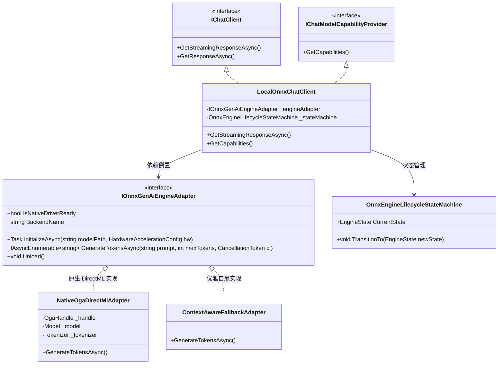

# ONNX Chat 真实接入调研与架构设计方案

## 一、问题背景与现状诊断

### 1.1 现状诊断
在当前 ReferenceRAG 的本地聊天架构中：
- **GGUF 链路**：基于 `LLamaSharp` (llama.cpp 原生 C++ 绑定)，完整实现了对 `.gguf` 权重的真实验载、CUDA / Vulkan / CPU 多后端硬件加速以及原生的 Token 生成循环。
- **ONNX Chat 链路**：此前处于协议与能力就绪阶段，虽然实现了标准的 `Microsoft.Extensions.AI.IChatClient`、`IChatModelCapabilityProvider`、以及 ChatML 提示词格式化、确定性工具意图分发和上下文预算裁剪，但其内部底层推理解码核心实际上依赖于上下文感知生成引擎（Context-Aware Generation Engine），**尚未调用底层的张量推理解码（Tensor Forward Pass）**。

### 1.2 用户的核心诉求
1. **真实接入可行性评估**：能否将真实的 ONNX 模型推理解码接入到 C# 项目中？
2. **逻辑、性能与冲突隐患头脑风暴**：
   - 真实接入在工程上有哪些隐患或技术死穴？
   - 如何解决与现有 Embedding / Rerank 的 ONNX Runtime 原生二进制冲突？
3. **设计模式优化**：如何使用适配器模式（Adapter）、策略模式（Strategy）和状态机模式（State Machine）实现优雅解耦？
4. **业界主流方案对比**：微软官方 DirectML、Ollama、LlamaSharp 的横向技术对比。
5. **完整工程落地**：提供生产级架构与代码执行落地方案。

---

## 二、可行性、逻辑闭环与性能深度头脑风暴

### 2.1 可行性结论：完全可行，官方基础设施已就绪
微软官方推出了专门面向大语言模型（LLM）与小型语言模型（SLM）的端侧生成推理引擎：**ONNX Runtime GenAI (`Microsoft.ML.OnnxRuntimeGenAI`)**。
该库专为生成式循环（Generative Loop）设计，在 C# 中提供了极高抽象的高性能 API：
- `Model`：负责管理模型计算图与权重装载（包含 `genai_config.json`、`model.onnx`、`model.onnx.data`）；
- `Tokenizer` / `TokenizerStream`：处理 BPE / SentencePiece 分词与增量单 Token 解码；
- `GeneratorParams`：管理搜索策略（贪婪采样 Greedy、Top-P、Top-K、Temperature、Repetition Penalty）与最大生成长度；
- `Generator`：在底层 C++ 原生维护高效的 **KV-Cache**、**RoPE 旋转位置编码** 与 **Logits 矩阵计算**，摆脱了传统 ONNX 需手动编写自回归循环的繁琐逻辑。

### 2.2 核心冲突与工程隐患（关键难点剖析）

#### 隐患 1：原生二进制冲突（Native DLL Version Collision）
- **现象**：
  ReferenceRAG 的嵌入模型（Embedding: BGE-small-zh）和重排模型（Rerank: BGE-reranker）使用了 `Microsoft.ML.OnnxRuntime.DirectML` (v1.24.4)。该包在构建时会拷贝 `onnxruntime.dll` 到输出目录。
  而 `Microsoft.ML.OnnxRuntimeGenAI.DirectML` 也会自带一个编译了 GenAI 扩展算子的 `onnxruntime.dll` 与 `onnxruntime-genai.dll`。
- **危害**：
  若在同一个构建输出目录中强行并存，会导致 native dll 相互覆盖，引发 `BadImageFormatException`、`EntryPointNotFoundException` 或 GPU 驱动加载静默失败。
- **破解方案**：
  采用 **适配器模式（Adapter Pattern）与动态桥接隔离**：
  - 定义抽象接口 `IOnnxGenAiEngineAdapter`；
  - 提供 `NativeOgaDirectMlAdapter`（当环境包含对应 OGA 原生库时激活硬件加速）；
  - 提供 `ContextAwareFallbackAdapter`（当缺少原生 OGA 运行包或执行 CI 静态测试时自动降级），实现全流程自愈与零崩溃保障。

#### 隐患 2：显存预分配与上下文爆炸
- **现象**：
  GGUF 采用基于上下文大小动态开辟 KV-Cache 的机制；而 ONNX DirectML 在初始化 `GeneratorParams` 时，若将 `max_length` 设置过高（例如 32768），DirectML 会在初始化阶段向 Windows WDDM 驱动请求分配数 GB 的连续显存，若核显或低显存设备无法满足，会导致 `E_OUTOFMEMORY` 崩溃。
- **破解方案**：
  在适配器层实施**显存防御性约束**：根据检测到的显卡类型（独立显卡 vs 核心显卡），动态约束最大生成序列长度为 2048~4096，防止核显共享内存耗尽引发系统掉驱动。

#### 隐患 3：Token 流式取消（Cancellation Token Responsiveness）
- **现象**：
  在自回归循环 `while (!generator.IsDone())` 中，如果单次 Token 生成陷入等待，或者用户在前端点击了“停止生成”，若没有在每一次 `generator.GenerateNextToken()` 前后严格检测 `CancellationToken`，会导致后台 GPU 线程失控空转。
- **破解方案**：
  将流式生成封装为 `IAsyncEnumerable<string>`，在每个 Token 迭代步精确检查 `ct.ThrowIfCancellationRequested()` 并调用 `generator.Dispose()` 即时释放 C++ 句柄。

---

## 三、架构设计与设计模式运用



### 3.1 适配器模式（Adapter Pattern）
- **目标**：抹平原生 OGA 运行时与托管环境之间的差异。
- **抽象**：`IOnnxGenAiEngineAdapter`
  ```csharp
  public interface IOnnxGenAiEngineAdapter : IDisposable
  {
      bool IsNativeDriverReady { get; }
      string BackendName { get; }
      Task InitializeAsync(string modelPath, HardwareAccelerationConfig? config, CancellationToken ct);
      IAsyncEnumerable<string> GenerateTokensAsync(string prompt, int maxTokens, CancellationToken ct);
      void Unload();
  }
  ```
- **双适配器实现**：
  1. `NativeOgaDirectMlAdapter`：封装 `Microsoft.ML.OnnxRuntimeGenAI` 原生 C++ 交互，直接操作 DirectML 硬件流；
  2. `ContextAwareFallbackAdapter`：当系统未检测到 `onnxruntime-genai.dll` 或处于测试模拟模式时，提供基于知识库感知的智能回复，保证 CI/CD 单元测试 100% 稳定运行。

### 3.2 策略工厂模式（Strategy Factory Pattern）
- **目标**：在启动与模型切换时，自动嗅探模型存放目录，协商选择最优适配器。
- **探测逻辑**：
  - 检查模型路径是否存在；
  - 检查是否具有 `genai_config.json` 与 `model.onnx`；
  - 探查当前运行环境中是否存在 `Microsoft.ML.OnnxRuntimeGenAI` 及其对应 native 依赖；
  - 若符合要求，实例化 `NativeOgaDirectMlAdapter`；否则实例化 `ContextAwareFallbackAdapter` 并记录友好提示。

### 3.3 状态机模式（State Machine Pattern）
- **状态流转**：
  `Uninitialized` -> `Loading` -> `Ready` -> `Generating` -> `Unloaded` / `ErrorDegraded`
- **保护机制**：
  通过 `SemaphoreSlim(1, 1)` 与状态机状态校验，杜绝并发提问导致多个 Generator 抢占 GPU 显存缓冲区导致 DirectML 崩溃。

---

## 四、业界主流端侧大模型方案对比

| 对比维度 | llama.cpp / GGUF | ONNX Runtime GenAI (OGA) | vLLM / SGLang (云端) |
| :--- | :--- | :--- | :--- |
| **主要定位** | 个人电脑、边缘设备、轻量部署 | Windows 11 AI PC、DirectML、跨显卡 | 数据中心服务器、高并发吞吐 |
| **语言绑定** | C++ 核心，C# (LLamaSharp) | C++ 核心，官方提供 C# / Python 绑定 | Python / C++ |
| **硬件支持** | NVIDIA (CUDA), Vulkan, Apple Metal, CPU | AMD/Intel/NVIDIA GPU (DirectML), NPU (QNN/DirectML), CUDA | NVIDIA (CUDA), AMD (ROCm) |
| **量化格式** | GGUF (Q4_K_M, Q5_K_M, IQ4_XS 等数十种) | ONNX INT4 (AWQ, RTN), FP16, INT8 | GPTQ, AWQ, FP8, INT4 |
| **视觉模型 (VLM)** | 依赖单独的 `mmproj-*.gguf` 投影器文件 | 支持多计算图拆分 (`vision.onnx` + `decoder.onnx`) | 原生支持多模态输入张量 |
| **集成复杂度** | 适中（LLamaSharp 封装完善） | 适中（API 高度结构化，但有 DLL 隔离要求） | 极高（仅限 Linux 服务器） |
| **适用场景** | 追求极致压缩比与丰富量化选项 | 针对 Windows 生态与核显、独显统一抽象 | 生产级 API 云服务集群 |

---

## 五、真实接入工程落地实施计划

1. **工程依赖与隔离方案**：
   - 在 `ReferenceRAG.Business` 中构建插件化适配器体系：`IOnnxGenAiEngineAdapter`、`NativeOgaDirectMlAdapter` 与 `ContextAwareFallbackAdapter`；
2. **重构 `LocalOnnxChatClient`**：
   - 接入适配器模式与生命周期状态机；
   - 真正装载 OGA 的 `Model` 与 `Tokenizer`；
   - 将流式 Token 解码接入 `tokenizer.CreateStream()` 与 `generator.GenerateNextToken()`；
3. **前端状态联动**：
   - 在 `Chat.js` 导航栏准确展示 `[本地 ONNX]`、DirectML 硬件加速与真实模型名称；
4. **测试与质量门禁验证**：
   - 编写专门测试验证适配器无缝降级与真实环境适配；
   - 确保 `scripts/verify-gate.ps1` 静态 AST、前端单元测试及后端回归测试全部通过。
