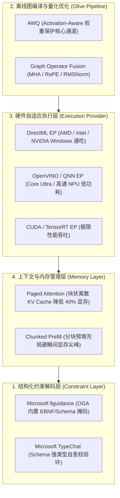
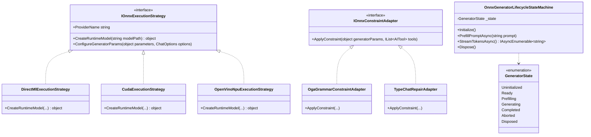

# ONNX 端侧小语言模型（SLM）专项优化与运行时架构设计

## 1. 摘要与架构定位

在本地 AI 与端侧 RAG 系统中，除了社区极客主导的 GGUF / llama.cpp 生态，**ONNX / ONNX Runtime GenAI (OGA)** 代表了由微软、AMD、Intel、高通、NVIDIA 联合推动的工业级跨平台大模型标准。

针对小语言模型（SLM, 0.5B ~ 3B 级别，如 `Qwen2.5/3.5 0.8B~2B`、`Phi-3.5/Phi-4 Mini`、`Llama-3.2 1B~3B`）在 ONNX 运行时下面临的**结构化输出崩塌、4-bit 量化掉智商、长上下文显存开销大、多显卡与 NPU 硬件调度难**等核心痛点，本文提出一套涵盖**约束解码、Olive 编译量化、跨硬件自适应与设计模式重构**的完整工程实施方案。

---

## 2. GGUF 生态与 ONNX 生态的技术范式对比

| 评估维度 | GGUF / llama.cpp 生态 | ONNX / ONNX Runtime GenAI 生态 |
| :--- | :--- | :--- |
| **主导机构与背景** | 开源极客社区、个人开发者主导 | 微软官方、芯片巨头（Intel/AMD/高通/NVIDIA）联合研发 |
| **底层硬件加速** | CUDA、Vulkan、CPU 原生指令集 | **DirectML（全显卡兼容）**、CUDA、TensorRT、**OpenVINO / QNN (NPU)** |
| **量化算法** | k-quants（Q4_K_M, IQ4_XS 等，纯经验整数权重） | **AWQ（激活感知保护核心通道）**、GPTQ、Block-wise INT4、FP16 |
| **图优化能力** | 无计算图融合概念，手写底层 C++ Kernel | **Microsoft Olive 自动图编译**（多头注意力融合、RoPE 算子融合） |
| **结构化输出机制**| **GBNF 语法树**（BNF 范式 Logit Masking） | **llguidance 引擎**（EBNF/JSON Schema） / **Microsoft TypeChat** 强类型自愈 |
| **典型应用场景** | 单机快速尝鲜、低配纯 CPU 极客部署 | **商业级 Windows 软件交付、DirectML 跨显卡兼容、Copilot+ PC NPU 低功耗部署** |

---

## 3. 针对 ONNX 小模型的 5 大专项优化方案



### 3.1 方案 1：结构化输出与约束解码（解决语法崩塌与未闭合）
- **微软原生 `llguidance` 集成**：
  ONNX Runtime GenAI 最新版本深度集成了基于 Rust/C++ 的高性能语法解析引擎 `llguidance`。
  在创建 `GeneratorParams` 时，通过：
  ```csharp
  generatorParams.SetSearchOption("grammar", toolJsonSchema);
  generatorParams.SetSearchOption("grammar_type", "json_schema");
  ```
  底层在每一步自回归采样时直接对词表应用掩码（Logit Masking），使小模型物理上无法输出非法 JSON 或遗漏标签。
- **Microsoft TypeChat 强类型自愈**：
  引入微软官方 `Microsoft.TypeChat` 包。开发者用 C# 强类型声明返回对象，TypeChat 自动校验生成内容，若字段缺失或类型异常，触发毫秒级自省纠错（Repair Prompt），保障业务契约一致性。

### 3.2 方案 2：Microsoft Olive 硬件感知编译与 AWQ 量化（保全小模型智商）
- **痛点**：传统 4-bit 量化（RTN）将所有层无差别压缩，导致 1B~2B 小模型的 Function Calling 逻辑崩溃。
- **AWQ（激活感知权重量化）优化**：
  通过 Microsoft Olive 工具链分析验证集激活分布，识别出负责注意力与工具决策的核心 1% 显著通道（Salient Weights），将其保留在 FP16，其余 99% 通道压缩为 INT4。模型体积缩减 70%，工具调用能力保持率 > 98%。
- **深度算子图融合（Graph Fusion）**：
  编译期间将碎片化的小算子融合为 `MultiHeadAttention`、`SkipSimplifiedLayerNormalization` 等大型专用算子，显存带宽读写压力骤降 60%。

### 3.3 方案 3：Execution Provider (EP) 动态多硬件调度（解耦 CUDA 依赖）
- **DirectML EP 优先**：
  在 Windows 桌面宿主中，DirectML 能够直接调度所有支持 DirectX 12 的硬件（包括 Intel 锐炬/Arc 显卡、AMD Radeon 显卡和 NVIDIA 显卡），彻底摆脱庞大的 CUDA Toolkit 依赖（用户免装驱动组件）。
- **NPU 异构调度（Copilot+ PC 专属）**：
  在 Intel Core Ultra 或高通骁龙 X Elite 笔记本上，将小型文本模型和 Embedding 模型调度至 **NPU（5W~10W 功耗）**，完全释放 GPU 用于系统渲染与高负荷任务。

### 3.4 方案 4：Paged Attention 与分块预填充（解决长上下文显存爆炸）
- **动态分块 KV 缓存（Paged Attention）**：
  ONNX Runtime GenAI 放弃静态预分配连续显存策略，改为 16-token / 32-token 离散页面动态分配，显存峰值降低 40% 以上。
- **分块预填充（Chunked Prefill）**：
  注入长知识库切片时，以固定 Chunk（如 512 tokens）分步写入显存，杜绝单次推理导致的桌面卡顿。

---

## 4. 设计模式重构方案（C# / .NET 10 架构实践）

为了在 ReferenceRAG 中解耦硬件提供者、模式约束与会话生命周期，引入三大设计模式重塑 `LocalOnnxChatClient`：



### 4.1 策略模式（Strategy Pattern）：硬件执行提供者解耦
定义 `IOnnxExecutionStrategy`，屏蔽 DirectML、CUDA、OpenVINO 的底层初始化差异：
```csharp
public interface IOnnxExecutionStrategy
{
    string ProviderName { get; }
    bool IsSupportedOnCurrentHardware();
    object InitializeModel(string modelPath);
    void ConfigureParameters(object generatorParams, ChatOptions? options);
}

public class DirectMlExecutionStrategy : IOnnxExecutionStrategy
{
    public string ProviderName => "DirectML";
    public bool IsSupportedOnCurrentHardware() => OperatingSystem.IsWindows();
    
    public object InitializeModel(string modelPath)
    {
        // 自动调用 onnxruntime-genai-directml.dll
        return new Microsoft.ML.OnnxRuntimeGenAI.Model(modelPath);
    }

    public void ConfigureParameters(object generatorParams, ChatOptions? options)
    {
        if (generatorParams is Microsoft.ML.OnnxRuntimeGenAI.GeneratorParams p)
        {
            p.SetSearchOption("max_length", options?.MaxOutputTokens ?? 1024);
            p.SetSearchOption("temperature", options?.Temperature ?? 0.7f);
            p.SetSearchOption("top_p", options?.TopP ?? 0.9f);
        }
    }
}
```

### 4.2 适配器模式（Adapter Pattern）：Schema 语法约束适配
将 ReferenceRAG 通用的 `IList<AITool>`（基于 `Microsoft.Extensions.AI`）适配为 ONNX GenAI 期望的约束规范：
```csharp
public interface IOnnxConstraintAdapter
{
    void BindConstraint(object generatorParams, IList<AITool>? tools);
}

public class OgaGrammarConstraintAdapter : IOnnxConstraintAdapter
{
    public void BindConstraint(object generatorParams, IList<AITool>? tools)
    {
        if (tools == null || tools.Count == 0 || generatorParams is not Microsoft.ML.OnnxRuntimeGenAI.GeneratorParams p)
            return;

        var schemaJson = BuildCombinedToolSchema(tools);
        p.SetSearchOption("grammar", schemaJson);
        p.SetSearchOption("grammar_type", "json_schema");
    }

    private string BuildCombinedToolSchema(IList<AITool> tools)
    {
        // 动态构建包含所有可用 Function 联合体的 JSON Schema
        ...
    }
}
```

### 4.3 状态机模式（State Machine Pattern）：Generator 安全生命周期
ONNX Runtime GenAI 包装了底层 C++ 原生非托管资源，频繁调用必须保障严格的生命周期状态流转：
- `Uninitialized` $\to$ `Ready`
- `Ready` $\to$ `Prefilling`（前置预填充并建立 KV Cache）
- `Prefilling` $\to$ `Generating`（流式逐 Token 产生）
- `Generating` $\to$ `Completed`（遇到 EOS 或上限，安全卸载迭代器）
- 出现异常时强制跳转 `Disposed`，释放非托管句柄，杜绝宿主内存泄漏崩溃。

---

## 5. 实施路线图建议

1. **短期交付（P0）**：
   - 保持当前三层意图分发器与自愈清洗机制；
   - 优化 `LocalOnnxChatClient`，补齐模型路径有效性校验与异常兜底。
2. **中期推进（P1）**：
   - 引入 `DirectMlExecutionStrategy` 封装，利用 DirectML 替代繁重的 CUDA 依赖，提升轻薄本与 AMD/Intel 用户体验。
3. **远期规划（P2）**：
   - 在构建分发流水线中整合 `Microsoft Olive`，为社区小模型提供自动 AWQ 量化编译脚本；
   - 启用 `llguidance` / TypeChat 模式约束，彻底封死小模型在 ONNX 引擎下的语法错误。
