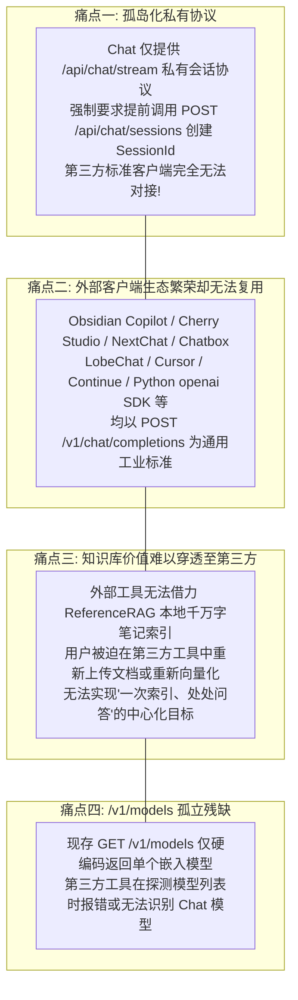
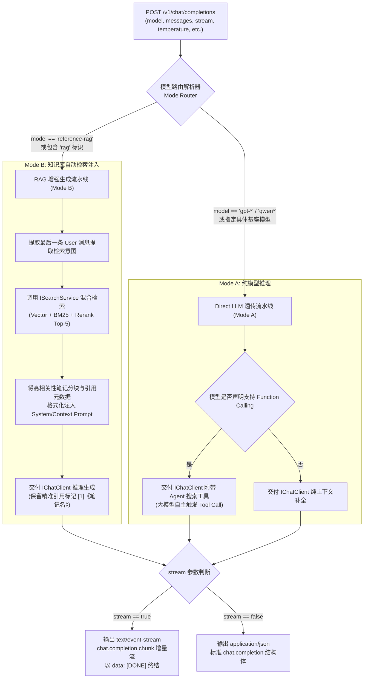
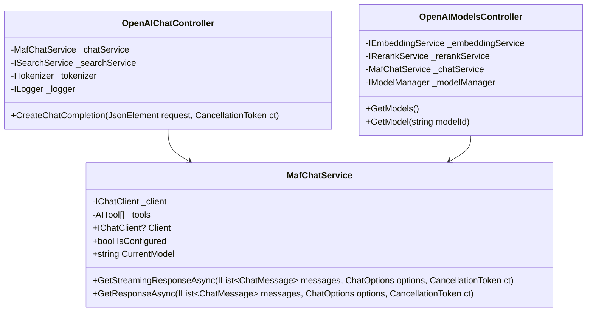

# OpenAI 兼容 Chat Completions API 与全生态外部调用架构设计方案
(OpenAI-Compatible Chat Completions API & External Integration Architecture Design)

---

## 1. 架构演进背景与外部集成需求剖析

ReferenceRAG 经过多轮演进，已经具备了业界领先的本地 RAG 检索与推理能力。在服务对外开放与生态集成方面，系统已针对以下环节提供了 OpenAI 兼容协议：
1. **向量嵌入 (Embeddings)**：`POST /v1/embeddings`（[`OpenAIEmbeddingsController.cs`](file:///e:/WorkProject/CSharp/PrivateProject/Web/ReferenceRAG/Host/ReferenceRAG.ApiHost/Controllers/OpenAIEmbeddingsController.cs)），可供各类外部知识库管理工具与 Obsidian 插件直接调用；
2. **重排精选 (Rerank)**：`POST /v1/rerank`（[`OpenAIRerankController.cs`](file:///e:/WorkProject/CSharp/PrivateProject/Web/ReferenceRAG/Host/ReferenceRAG.ApiHost/Controllers/OpenAIRerankController.cs)），遵循 Cohere/Jina 兼容标准，为第三方 RAG 流水线提供精准打分。

然而，作为 RAG 最核心的产出终端——**聊天对话 (Chat Completions)**，此前仅内置于系统自带的 Vue SPA 页面（通过内部私有 SSE 协议 `/api/chat/stream` 通信）。

### 1.1 外部应用接入痛点全景



> [!IMPORTANT]
> **用户核心诉求**：
> “能否和本地嵌入与重排模型一样，提供一个给外部使用的 OpenAI 兼容接口？”
> 
> **技术结论**：
> **完全可行且高度一致**。通过实现符合 RFC 与 OpenAI API 规范的 `POST /v1/chat/completions` 和统一模型服务 `GET /v1/models`，外部任意支持自定义 OpenAI 接口的应用，只需填入：
> - **API Base URL**: `http://localhost:5000/v1`
> - **API Key**: 任意字符（或系统配置的 `Service:ApiKey`）
> - **Model**: `reference-rag`（知识库增强助手）或具体模型名称（如 `gpt-4o-mini`、`qwen2.5` 等）
> 
> 即可无缝调用 ReferenceRAG 进行智能问答与对话生成！

---

## 2. 可行性与协议兼容性全面调研

### 2.1 依赖项与基础设施可行性评估

| 评估维度 | 当前现状 | 适配改造方案 | 可行性结论 |
| :--- | :--- | :--- | :---: |
| **底层推理契约** | `ReferenceRAG.Business` 已引入 `Microsoft.Extensions.AI` (MEAI)，内置 `IChatClient` | 直接通过 MEAI 提供的统一方法 `GetResponseAsync` 与 `GetStreamingResponseAsync` 驱动底层推理 | **100% 可行** |
| **流式传输 (SSE)** | `MafChatController` 已实现 `text/event-stream` 推送与 `Response.Body.FlushAsync()` | 改造为 OpenAI 标准 `data: {"id":...,"choices":[{"delta":{"content":"..."}}]}\n\n` 格式与 `data: [DONE]\n\n` 结尾 | **100% 可行** |
| **多轮对话格式** | OpenAI 协议要求请求体中包含全量 `messages: [{role, content}]`（无状态） | 编写适配映射器将 `role` 转换为 `Microsoft.Extensions.AI.ChatRole`，天然支持无状态调用 | **100% 可行** |
| **Token 计数** | 系统已注册统一分词器 `ITokenizer`（支持中文与 HuggingFace BPE） | 在响应的 `usage` 字段中精准计算 `prompt_tokens`、`completion_tokens` 和 `total_tokens` | **100% 可行** |
| **全局服务鉴权** | 系统已具备 `UseApiKeyAuthentication()` 中间件与 `Service.ApiKey` 配置 | 外部客户端传递 `Authorization: Bearer <key>` 自动继承安全防护与鉴权拦截 | **100% 可行** |

### 2.2 双模式自适应架构设计 (Dual-Mode Intelligence)

外部客户端使用 ReferenceRAG 的场景主要分为两类：
1. **纯 LLM 透传代理 (Direct LLM Pass-through)**：客户端自带提示词与编排逻辑，仅需 ReferenceRAG 作为模型执行端；
2. **RAG 本地知识库增强生成 (RAG-Augmented Generation)**：客户端（如 Obsidian Copilot、Chatbox 等）希望直接得到**参考了本地笔记知识库的带引用出处的回答**。

为此，系统设计了**基于 Model ID 与元数据的自适应双轨模式**：



---

## 3. 标准协议契约与数据结构规范

### 3.1 请求体契约 (`POST /v1/chat/completions`)

```json
{
  "model": "reference-rag",
  "messages": [
    { "role": "system", "content": "You are a helpful assistant." },
    { "role": "user", "content": "Obsidian 笔记库中的向量检索是如何实现的？" }
  ],
  "stream": true,
  "temperature": 0.7,
  "top_p": 1.0,
  "max_tokens": 2048
}
```

### 3.2 非流式响应契约 (`stream: false`)

```json
{
  "id": "chatcmpl-a1b2c3d4e5",
  "object": "chat.completion",
  "created": 1745123456,
  "model": "reference-rag",
  "choices": [
    {
      "index": 0,
      "message": {
        "role": "assistant",
        "content": "根据您的笔记《架构设计》，向量检索采用 BGE-M3 配合 SQLite-Vec 实现..."
      },
      "finish_reason": "stop"
    }
  ],
  "usage": {
    "prompt_tokens": 85,
    "completion_tokens": 142,
    "total_tokens": 227
  }
}
```

### 3.3 流式响应事件格式 (`stream: true`)

首个 Chunk（声明角色）：
```text
data: {"id":"chatcmpl-a1b2c3d4e5","object":"chat.completion.chunk","created":1745123456,"model":"reference-rag","choices":[{"index":0,"delta":{"role":"assistant","content":""},"finish_reason":null}]}

```

内容增量 Chunk：
```text
data: {"id":"chatcmpl-a1b2c3d4e5","object":"chat.completion.chunk","created":1745123456,"model":"reference-rag","choices":[{"index":0,"delta":{"content":"根据"},"finish_reason":null}]}

```

结束 Chunk 与终止信号：
```text
data: {"id":"chatcmpl-a1b2c3d4e5","object":"chat.completion.chunk","created":1745123456,"model":"reference-rag","choices":[{"index":0,"delta":{},"finish_reason":"stop"}],"usage":{"prompt_tokens":85,"completion_tokens":142,"total_tokens":227}}

data: [DONE]

```

### 3.4 统一模型清单列表 (`GET /v1/models`)

```json
{
  "object": "list",
  "data": [
    {
      "id": "reference-rag",
      "object": "model",
      "created": 1745123456,
      "owned_by": "reference-rag",
      "permission": []
    },
    {
      "id": "gpt-4o-mini",
      "object": "model",
      "created": 1745123456,
      "owned_by": "openai"
    },
    {
      "id": "bge-small-zh-v1.5",
      "object": "model",
      "created": 1745123456,
      "owned_by": "reference-rag-embedding"
    },
    {
      "id": "bge-reranker-base",
      "object": "model",
      "created": 1745123456,
      "owned_by": "reference-rag-rerank"
    }
  ]
}
```

---

## 4. 架构实现组件分工



1. **`OpenAIChatController.cs`**（位于 `Host/ReferenceRAG.ApiHost/Controllers`）：
   - 监听 `POST /v1/chat/completions`；
   - 严格遵循 `camelCase` 序列化；
   - 支持客户端 `CancellationToken` 实时中止流式生成；
   - 支持 `model == "reference-rag"` 知识库即时混合检索注入。
2. **`OpenAIModelsController.cs`**（位于 `Host/ReferenceRAG.ApiHost/Controllers`）：
   - 监听 `GET /v1/models` 与 `GET /v1/models/{id}`；
   - 统一收拢模型聚合逻辑，同时移除 `OpenAIEmbeddingsController.cs` 中的同名路由避免重复路由异常。
3. **`MafChatService.cs`**（位于 `Business/ReferenceRAG.Business`）：
   - 暴露只读 `Client` 实例、`IsConfigured` 状态与统一补全方法，打通内部会话与外部无状态 API。
4. **单元与集成测试**（位于 `tests/ReferenceRAG.Tests`）：
   - 覆盖非流式生成、流式 SSE 协议格式、`reference-rag` 检索注入逻辑、模型发现列表校验。

---

## 5. 质量门禁与实施步骤

1. **第 1 步：扩展 `MafChatService`**，暴露底层 `IChatClient` 及状态属性；
2. **第 2 步：重构统一模型列表**，剥离 `OpenAIEmbeddingsController` 中的单体 `v1/models`，新建 `OpenAIModelsController`；
3. **第 3 步：实现 `OpenAIChatController`**，提供完整标准的 `/v1/chat/completions` 处理（流式与非流式、RAG 注入与纯生成）；
4. **第 4 步：后端单元测试验证**，编写 `OpenAIChatControllerTests` 验证模型列表、Chat 响应与 SSE 格式；
5. **第 5 步：运行全栈质量门禁**，运行 `dotnet test` 与 `node check.mjs` 确保全绿通过。
