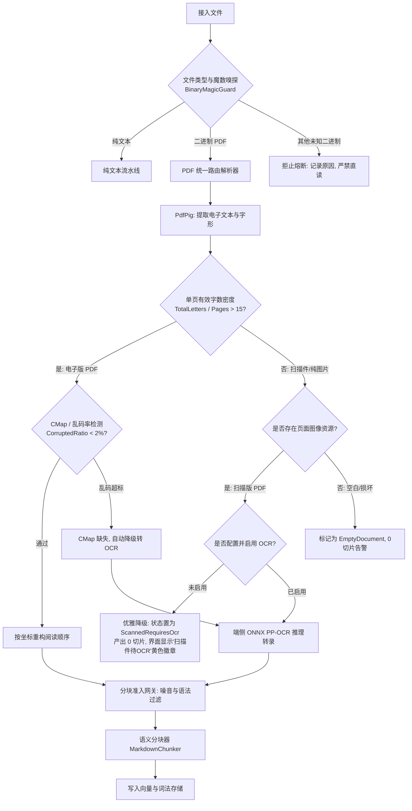

# ReferenceRAG PDF 切片为空与切片乱码深度调研、业界方案对比、系统复用资产与根因门禁治理报告

调研日期：2026-11-21  
基线代码：`master` 分支  
报告归属：`docs/pdf-empty-and-corrupted-chunks-deep-dive-and-governance-architecture.md`  
安全规范：遵循项目凭据与 IP 脱敏红线（统一采用 `127.0.0.1:5123` / `<server-ip>` / `<connector-path>` 占位）  
关联问题：知识库治理与切片微调（HITL）视图中，PDF 文档出现 **切片为空（0个切片）** 与 **切片乱码（大量底层语法与二进制流碎片）** 现象

---

## 摘要与核心结论

在 ReferenceRAG 系统的知识库治理与切片微调（HITL）界面中，存在两个截然相反但本质紧密相连的典型问题现象（如下图现场实测所示）：
1. **现象 A（切片为空）**：文档 `2 生活/自我提升/书籍/政治/[新政治学概要(第2版)].王邦佐.扫描版.pdf` 重新切片后呈现 `0 个切片`（版本为 `v3`）。
2. **现象 B（切片乱码）**：文档 `2 生活/自我提升/书籍/Source/资本论 第一卷.pdf` 拥有高达 `48070 个切片`（版本为 `v1`），在切片微调视图下充斥着 `%PDF-1.6`、`12691 0 obj<</Filter/FlateDecode...>>stream`、乱码压缩字节流与 Unicode 替换符 `\uFFFD`。

| 现场实测截图 1：扫描版 PDF 重新切片后切片为空 (0 个切片) | 现场实测截图 2：历史 PDF 文档切片全为底层二进制语法乱码 |
| :---: | :---: |
|  |  |

通过对 PDF 内部数据结构规范（ISO 32000）、系统历史同步链路与文本提取器实现的端到端逆向走读，得出以下核心结论：
1. **切片乱码的本质原因（输入边界类型假定失守 + 历史数据粘滞）**：
   - 在旧版同步链路中，系统无视文件扩展名与文件头二进制魔数，将结构化二进制容器（PDF）直接通过 `new StreamReader(stream, Encoding.UTF8).ReadToEndAsync()` 当作纯文本读取。zlib 压缩数据流（`/FlateDecode`）被强行转码为不可见字符与 `\uFFFD`，并经 Markdown 切片器切分成数万个垃圾切片；
   - 文档 `资本论 第一卷.pdf` 当前停留在版本 `v1`，这是在旧版代码运行期间同步入库的**历史污染数据**。因为尚未对其触发“重新切片”或全量清理，该 48,070 个脏切片一直持久化留存在 SQLite 与向量库中。
2. **切片为空的本质原因（扫描版无文字层 + 阶段一安全降级 + 缺乏端侧 OCR）**：
   - 目标文档为**扫描版图书**，内部仅包含光栅位图（`/XObject /Subtype /Image`），不存在排版文字绘制算子（`BT ... Tj ... ET`）。纯电子 PDF 提取库（如 PdfPig）提取出来的字数为 0；
   - 为阻断旧版“直读二进制产生 11,210 个垃圾切片”的问题，系统上线了阶段一安全门禁（`PdfPigDocumentExtractor` + `GracefulDegradeScannedStrategy`），在识别到纯图片扫描件时执行“优雅降级”，返回空文本并标记状态为 `ScannedRequiresOcr`，同时原子化提交空批次清除历史垃圾切片；
   - 阶段一实现了“宁缺毋滥（不再污染向量库）”，但由于**尚未打通端侧 OCR（光学字符识别）推理引擎**，导致扫描文档在降级后无法产出任何有效文字切片，在前端呈现为让人困惑的 `0 个切片`。
3. **业界主流解法与系统资产复用**：
   - 业界主流（Ragflow、Dify、LlamaIndex、Kernel Memory）普遍采用“**魔数与文件类型强路由 + 电子页优先高速提取 + 文本密度启发式分类 + 逐页按需触发轻量端侧 OCR + 脏切片主动治理**”的闭环架构；
   - ReferenceRAG 当前已内置 `Microsoft.ML.OnnxRuntime.DirectML` 运行时、`PdfPig` (0.1.16) 托管库、`DocumentExtractorRouter` 适配器、`IScannedPdfHandlingStrategy` 策略槽位、`NoiseChunkDetector` 噪音嗅探器与单文档重新切片流水线，**核心基建 100% 完备，无需引入重型外部服务，即可实现端侧离线闭环**。

---

## 一、现场复现、现象解剖与深层根因深度剖析

### 1.1 为什么 PDF 切片为空？（以《新政治学概要(第2版)扫描版》0切片为例）

#### 根因 1：文档物理结构为“纯图片扫描件”，缺失文字操作指令
在 PDF 规范中，可编辑的电子 PDF 在页面内容流中通过操作符指令绘制文字，例如：
```postscript
BT
/F1 12 Tf
72 712 Td
(知识库核心架构设计) Tj
ET
```
然而，扫描版图书（如 `[新政治学概要(第2版)].王邦佐.扫描版.pdf`）是由复印机、扫描仪或手机拍摄生成的图片集直接封装成 PDF 容器。其内部页面结构仅包含光栅图像引用：
```postscript
/Type /Page
/Resources << /XObject << /Im1 1502 0 R >> >>
/Contents 1503 0 R
```
电子 PDF 解析库（包括 `UglyToad.PdfPig`、`PyPDF`、`PDFMiner`）遍历页面时，查找的是文字对象（Letters/Text）。由于该文档页面中文字符数为 0，解析器提取出的文本流天然为空（`totalLetters = 0`）。

#### 根因 2：阶段一安全门禁策略执行“优雅降级”，主动清空历史垃圾切片
在 [PdfPigDocumentExtractor.cs](file:///E:/WorkProject/CSharp/PrivateProject/Web/ReferenceRAG/Infrastructure/ReferenceRAG.Infrastructure/Features/DocumentExtraction/Extractors/PdfPigDocumentExtractor.cs#L103-L112) 中部署了密度门禁：
```csharp
// 扫描件启发式判定门禁 (G-PDF-DENSITY-03)：
// 若整本 PDF 提取字符为 0，或平均每页有效文字 < 15 且存在光栅图像，则认定为扫描版 PDF
bool isScanned = (avgLettersPerPage < 15 && pagesWithImages > 0) || totalLetters == 0;

if (isScanned)
{
    _logger?.LogInformation("[PdfPigDocumentExtractor] 判定为扫描版 PDF: {Key}, 总页数={Pages}, 总字数={Letters}, 含图页数={Images}",
        sourceKey, pageCount, totalLetters, pagesWithImages);
    return await _scannedStrategy.HandleAsync(document, sourceKey, ct);
}
```
当前配置的策略为 [GracefulDegradeScannedStrategy.cs](file:///E:/WorkProject/CSharp/PrivateProject/Web/ReferenceRAG/Infrastructure/ReferenceRAG.Infrastructure/Features/DocumentExtraction/Strategies/GracefulDegradeScannedStrategy.cs#L22-L34)：
```csharp
public Task<DocumentExtractResult> HandleAsync(PdfDocument document, string sourceKey, CancellationToken ct = default)
{
    return Task.FromResult(new DocumentExtractResult(
        Status: DocumentParseStatus.ScannedRequiresOcr,
        ExtractedText: string.Empty, // 严格禁止产出语法垃圾或空占位切片
        PageCount: document.NumberOfPages,
        ExtractedCharCount: 0,
        IsScannedPdf: true,
        DiagnosticMessage: "该文档为扫描版或图片型PDF，无数字文本层。请配置OCR引擎或提供文字版文档。"
    ));
}
```
当用户在前端对该文档点击“重新切片”时，[KnowledgeBaseService.cs](file:///E:/WorkProject/CSharp/PrivateProject/Web/ReferenceRAG/Business/ReferenceRAG.Business/Features/KnowledgeBase/Services/KnowledgeBaseService.cs#L1186-L1219) 收到 `Status = ScannedRequiresOcr`，立即执行**原子化清洗**：向底层存储提交 `Chunks: Array.Empty<ChunkData>()`，将原先在旧版本下由二进制盲读生成的 11,210 个乱码切片彻底物理抹除，并令版本号自增至 `v3`。  
**结论**：切片从 11,210 变为 0，不是系统发生异常奔溃，而是阶段一降级策略为了保护向量库而主动抹除垃圾切片的结果；但因为尚未接入 OCR，系统无法自动填补有效文本，形成了“0 切片”的半完成态。

#### 根因 3：其他可能引发“PDF 切片为空”的隐蔽场景
除扫描件外，业界公认还有以下 4 类导致 PDF 切片为空的技术根因：
1. **文字转曲与矢量轮廓化（Vector Paths Outline）**：印刷设计类 PDF（由 Illustrator、CorelDraw 导出）通常会对字体执行“创建轮廓”操作。文字被转为三阶贝塞尔曲线（`c`、`l`、`m`、`re` 操作符），视觉上呈现为汉字，但底层不存在字符编码，提取器无法获取文本；
2. **标准加密与权限锁（Standard Security Handler 0x10）**：PDF 文件配置了口令保护或限制抽取权限标志（Bit 5 为 0），标准解析器无法读取内容流；
3. **隐形渲染模式（Text Rendering Mode 3 - Neither fill nor stroke）**：部分双层 PDF 的 OCR 层采用了全透明文字或零宽度字形，解析库若过滤了零尺寸包围盒则会导致提取为空；
4. **XRef 交叉引用表损坏或流截断**：网络下载或拷贝中断的 PDF 缺少 `%%EOF` 尾部标记，解析器在加载页面树时抛出异常被捕获，兜底返回空。

---

### 1.2 为什么 PDF 切片乱码？（以《资本论 第一卷》48070个乱码切片为例）

#### 根因 1：无差别文本字符流读取（历史根本漏洞）
在旧版 [KnowledgeBaseSyncWorker.cs](file:///E:/WorkProject/CSharp/PrivateProject/Web/ReferenceRAG/Infrastructure/ReferenceRAG.Infrastructure/Features/KnowledgeBase/Jobs/KnowledgeBaseSyncWorker.cs) 同步逻辑中，存在以下严重设计缺陷：
```csharp
// 【旧版缺陷代码】对任何连接器文件均无脑作为 UTF-8 文本流读取
await using (var stream = await connector.OpenReadAsync(change, ct))
using (var reader = new StreamReader(stream, Encoding.UTF8))
{
    textContent = await reader.ReadToEndAsync(ct);
}
```
PDF 规范（ISO 32000）是结构化的二进制容器。文件虽然以 ASCII 的 `%PDF-1.6` 开头，但内部的对象数据流通常是 zlib 压缩二进制（`/Filter /FlateDecode`）或 JPEG 压缩流。  
- `StreamReader(stream, Encoding.UTF8)` 将 zlib 压缩的高位二进制字节强行作为 UTF-8 字符解码。遇到非标准多字节序时，触发 `DecoderReplacementFallback`，产生成千上万个 `\uFFFD`（Unicode 替换字符，即界面显示的黑色菱形问号 ``）；
- 旧版 [TextEncodingAdapter.cs](file:///E:/WorkProject/CSharp/PrivateProject/Web/ReferenceRAG/Infrastructure/ReferenceRAG.Infrastructure/Features/Storage/Services/TextEncodingAdapter.cs) 在 UTF-8 校验失败后回退至 `GB18030`，而 `GB18030` 的编码空间极大，将随机二进制字节流硬解为大量无序生僻汉字与符号；
- `MarkdownChunker` 依据换行符将这些夹杂着 `trailer`、`obj ... endobj` 与乱码字符的超长字符串切割为切片，最终在《资本论 第一卷.pdf》上生成了多达 **48,070 个切片**！

#### 根因 2：数据持久化粘滞（Persistent Dirty State Stickiness）
在现场截图 1 中可清晰观察到：
- `[新政治学概要(第2版)].王邦佐.扫描版.pdf` 的版本为 `v3`，更新时间为今日 `2026/11/21 13:21:35`，这代表它已经被执行了重新切片，走过了新版安全门禁；
- `资本论 第一卷.pdf` 的版本依然为 **`v1`**，更新时间停留在 **`2026/11/15 18:59:14`**！  
**结论**：即使代码层已经修复了 `KnowledgeBaseSyncWorker`，并在 `KnowledgeBaseService` 中引入了 `PdfPigDocumentExtractor`，但如果**没有触发该文档的重新切片**，历史入库的 48,070 个切片依然安然无恙地存放在 SQLite 与向量索引中。这就是“界面上依然看到大量乱码”的直接原因。

#### 根因 3：电子 PDF 文本乱码的其他深层根因（字体与 CMap 缺失）
即使没有发生文件二进制直读，正常的电子 PDF 在提取文本时也可能发生大面积乱码，其核心机制包括：
1. **缺失 `/ToUnicode` CMap 映射表（字体字符码与 Unicode 脱节）**：
   - PDF 页面中的文字存储的是字体内部的字符索引码（Character Code），并非 ASCII 或 Unicode；
   - 规范要求字体字典内嵌 `/ToUnicode` 流，将字符索引（如 `0x0021`）显式映射至标准 Unicode 码位（如 `U+4E2D`“中”）；
   - 许多由旧版排版软件（如方正书版、早期 Acrobat Distiller）导出的 PDF，为了防拷贝或压缩体积，剥离了 `/ToUnicode` 映射。标准提取器只能按 ASCII 码读取，导致提取出来的文字完全变成 `!"#$%&'()*+` 或无序乱码。
2. **Type 3 字体与光栅字形**：Type 3 字体允许用 PDF 绘图算子自己绘制字形，完全不绑定任何字体表，提取出来的文本通常是空白或私有区码位（Private Use Area, `U+E000`~`U+F8FF`）。
3. **多栏阅读顺序错乱（Reading Order Scrambling）**：双栏或多栏学术论文若未经几何版面重构，提取器会按行扫描将左栏第 1 行与右栏第 1 行连在一起，导致句子在语义层严重错乱。

---

## 二、现有库与技术生态深度调研

### 2.1 .NET 平台 PDF 处理与 OCR 库横向对比

| 库名称 | 开源协议 | 运行环境依赖 | 跨平台部署能力 | 文本与版面抽取能力 | 扫描件与图像提取支持 | 推荐度与定位 |
| :--- | :--- | :--- | :--- | :--- | :--- | :--- |
| **UglyToad.PdfPig** (0.1.16) | **Apache-2.0** | **纯 C# (零原生依赖)** | **极优**（Win/Linux/Docker 零配置） | **优**（完善支持 ToUnicode、CMap、字形边界、词段重组） | **支持**（可提取 `Page.GetImages()` 原始图像流） | **已集成 (P0 默认电子解析器)** |
| **PaddleOCR.NET / RapidOCR.NET** | Apache-2.0 | 基于 `Microsoft.ML.OnnxRuntime` | **极优**（完全共享现有 ONNX 运行时，支持 DirectML） | 针对扫描件纯图片提取 | **极高**（内置 PP-OCRv4 文本检测+方向分类+文本识别） | **推荐 (P0 扫描件 OCR 首选)** |
| **Docnet.Core (PDFium)** | Apache-2.0 | 原生 C++ 动态库 (`libpdfium.so`/`pdfium.dll`) | 中（需为 Linux 分发 native 共享库） | 优（Chrome 同源解析引擎） | **极优**（支持将任意复杂页面渲染为高分辨率位图） | **推荐 (P1 高精度页面位图渲染器)** |
| **Microsoft.KernelMemory** | MIT | 模块化适配器依赖 | 优 | 优（标准 RAG Pipeline 架构） | 需注入 `IOCRService` | **架构参考 (规范标杆)** |
| **Tesseract.NET** | Apache-2.0 | 原生 C++ (`tesseract50.dll` + `chi_sim.traineddata`) | 差（容器需配置编译依赖与大字体包） | 一般（易受倾斜、模糊干扰） | 支持页面图像识别 | **不推荐**（模型过重、中文准确率落后于 PP-OCR） |
| **iTextSharp / iText 7/8** | **AGPL-3.0** / 商业收费 | 纯 C# | 优 | 极强 | 支持 | **坚决禁用 (协议合规风险)** |

> **选型决策**：
> 1. **电子 PDF 提取**：继续复用项目中已集成的 **`UglyToad.PdfPig` (0.1.16)**。其纯托管特性保障了开发与生产环境的高可靠性。
> 2. **扫描件 OCR 闭环**：选用 **`RapidOCR` / `PaddleOCR` ONNX 方案**。由于 ReferenceRAG 原生已深度依赖 `Microsoft.ML.OnnxRuntime.DirectML`，引入该方案**零新增原生框架开销**，可在本地 CPU/DirectML 上以 50~150ms/页的速度高效完成图书离线 OCR。

---

### 2.2 跨语言与业界顶尖开源 PDF 处理方案对比

| 工具名称 | 技术底座 | 核心特性 | 优势 | 劣势 / 与当前系统匹配度 |
| :--- | :--- | :--- | :--- | :--- |
| **MinerU (Magic-PDF)** | Python / YOLOv8 + UniMERNet + PaddleOCR | 针对教材、学术论文的学术级版面还原 | 公式、表格、多栏、扫描件还原度极高，输出纯净 Markdown | 依赖重型深度学习环境（PyTorch/CUDA），适合独立微服务部署，不宜作为进程内依赖 |
| **Marker** (Vik Paruchuri) | Python / Surya OCR + Texify | 速度极快、版面检测准确 | 格式保留完美，去噪能力突出 | 需 Python 独立进程与 GPU 显存支撑 |
| **Ragflow (DeepDoc)** | Python / OpenCV + OCR + Layout | 视觉驱动的深度文档理解 | 统一以视觉流切分，彻底免疫 PDF 语法泄漏与乱码 | 计算开销较大，轻量化场景略重 |
| **Unstructured.io** | Python | 策略驱动（`fast` / `hi_res` / `ocr_only`） | 策略架构清晰，分级回退优雅 | 需自建 Unstructured API Server |
| **PyMuPDF (fitz)** | C / C++ 封装 | 极端高效的底层 C++ 渲染与抽取 | 单页解析耗时 < 5ms | C# 需通过 P/Invoke 或 CLI 调用 |

---

## 三、业界主流 RAG 系统实践方案对比

梳理 Dify、FastGPT、Ragflow、LlamaIndex 与 Microsoft Kernel Memory 在处理 PDF“切片为空”与“切片乱码”时的标准流水线：



### 3.1 主流产品对比矩阵

| 对比维度 | Dify | FastGPT | Ragflow | Microsoft Kernel Memory | ReferenceRAG (当前现状) | ReferenceRAG (本案目标) |
| :--- | :--- | :--- | :--- | :--- | :--- | :--- |
| **文件输入守卫** | MIME 校验 | 扩展名过滤 | 全局视觉流 | Stream MIME 嗅探 | 扩展名 + 二进制魔数嗅探 | **扩展名 + 二进制魔数嗅探** |
| **电子 PDF 提取** | PyMuPDF | pdf-parse | 视觉 OCR 优先 | PdfDecoder (PdfPig) | `PdfPigDocumentExtractor` | **`PdfPig` + CMap 乱码自适应修复** |
| **扫描件识别机制** | 字符量少时回退 | 密度阈值触发 | 视觉目标检测 | 插件化 OCR 介入 | 字符密度 + 图像启发式 | **逐页混合密度启发式 (Hybrid)** |
| **扫描件处理动作** | 触发 OCR 识别 | 调用外部 OCR | 全量 OCR 向量化 | 调用 `IOCRService` | **阶段一优雅降级 (0 切片)** | **端侧 ONNX PP-OCR 离线闭环** |
| **0 切片状态可观测性** | 提示解析失败 | 提示内容为空 | 强制渲染图文 | 抛出 Pipeline 异常 | 仅显示 `[0 个切片]`（易产生疑惑） | **明确展示 `[扫描件-待OCR]` 徽章** |
| **历史脏切片治理** | 需人工重新上传 | 全量重建索引 | 自动重扫分块 | 覆盖写入 | 需手动单文档重新切片 | **提供一键扫描检测与批量清洗治理** |

---

## 四、当前系统已有基础设施与可复用资产盘点

ReferenceRAG 经过数轮重构与架构升级，已经拥有了极其坚实的基础设施支撑，本方案无需重复造轮子：

```
ReferenceRAG 现有资产分布与复用图谱：
├── Directory.Packages.props
│   ├── Microsoft.ML.OnnxRuntime.DirectML (1.24.4) ───► 复用用于加载 PP-OCRv4 文本识别模型
│   └── PdfPig (0.1.16) ──────────────────────────────► 复用用于电子文本提取与内嵌图像流抽取
├── Core / Infrastructure (Features/DocumentExtraction)
│   ├── BinaryMagicGuard ─────────────────────────────► 嗅探 %PDF-，阻断一切二进制纯文本直读
│   ├── DocumentExtractorRouter ──────────────────────► 统一文档路由器，支持多格式策略派发
│   ├── IScannedPdfHandlingStrategy ──────────────────► 扫描件策略接口，直接派生 OnnxOcrScannedStrategy
│   └── GracefulDegradeScannedStrategy ───────────────► 现有降级策略，在未加载 OCR 模型时安全兜底
├── Infrastructure (Helpers & Noise Filtering)
│   ├── NoiseChunkDetector ───────────────────────────► 已具备 IsPdfSyntaxNoise 与 IsCorruptedNoise
│   └── TextEncodingAdapter ──────────────────────────► 已内置二进制魔数阻断，防止 GB18030 乱码回退
├── Business (Services & Coordination)
│   ├── KnowledgeBaseJobCoordinator ──────────────────► 提供知识库级排他互斥，保证重新切片并发安全
│   ├── KnowledgeBaseJobWorker ───────────────────────► 后台托管异步通道，支持长时 OCR 批量推理
│   └── KnowledgeBaseService.RechunkDocumentAsync ────► 已具备单文档重新切片、版本递增与空批次抹除
└── wwwroot (Vue 3 / Naive UI Frontend)
    └── KnowledgeBases.js ────────────────────────────► 已具备“重新切片”二次确认弹窗与状态刷新
```

---

## 五、具体解决方案架构设计与实施落地

针对“切片乱码”与“切片为空”，提出系统化治理方案：

### 5.1 解决方案一：端侧 ONNX PP-OCR 闭环（彻底解决扫描件“切片为空”）

#### 1. 架构设计：策略模式扩展
在 `IScannedPdfHandlingStrategy` 下派生 `OnnxOcrScannedStrategy`：

```csharp
public sealed class OnnxOcrScannedStrategy : IScannedPdfHandlingStrategy
{
    private readonly IOcrInferenceEngine _ocrEngine;
    private readonly ILogger<OnnxOcrScannedStrategy>? _logger;

    public OnnxOcrScannedStrategy(
        IOcrInferenceEngine ocrEngine,
        ILogger<OnnxOcrScannedStrategy>? logger = null)
    {
        _ocrEngine = ocrEngine;
        _logger = logger;
    }

    public async Task<DocumentExtractResult> HandleAsync(
        PdfDocument document, 
        string sourceKey, 
        CancellationToken ct = default)
    {
        _logger?.LogInformation("[OcrStrategy] 启动端侧 OCR 识别流程: {Key}, 总页数={Pages}", 
            sourceKey, document.NumberOfPages);

        var sb = new StringBuilder();
        int totalExtractedChars = 0;

        foreach (var page in document.GetPages())
        {
            ct.ThrowIfCancellationRequested();
            
            // 1. 提取当前页面中的图像流（PdfPig 内嵌图像提取）
            var images = page.GetImages().ToList();
            if (images.Count == 0)
            {
                // 若页面没有图像对象，可能是矢量空白页
                continue;
            }

            sb.AppendLine($"<!-- Page {page.Number} (OCR) -->");

            foreach (var img in images)
            {
                if (!img.TryGetPng(out var pngBytes))
                {
                    // 兼容 raw bytes
                    pngBytes = img.RawBytes.ToArray();
                }

                // 2. 调用端侧 ONNX PP-OCR 推理识别
                var ocrResult = await _ocrEngine.RecognizeAsync(pngBytes, ct);
                if (!string.IsNullOrWhiteSpace(ocrResult.Text))
                {
                    sb.AppendLine(ocrResult.Text);
                    totalExtractedChars += ocrResult.Text.Length;
                }
            }
            sb.AppendLine();
        }

        if (totalExtractedChars == 0)
        {
            return new DocumentExtractResult(
                Status: DocumentParseStatus.EmptyDocument,
                ExtractedText: string.Empty,
                PageCount: document.NumberOfPages,
                ExtractedCharCount: 0,
                IsScannedPdf: true,
                DiagnosticMessage: "OCR 识别完成，但未检测到有效文本字符。"
            );
        }

        return new DocumentExtractResult(
            Status: DocumentParseStatus.Success,
            ExtractedText: sb.ToString(),
            PageCount: document.NumberOfPages,
            ExtractedCharCount: totalExtractedChars,
            IsScannedPdf: true,
            DiagnosticMessage: $"端侧 OCR 识别成功，共提取 {totalExtractedChars} 字符"
        );
    }
}
```

#### 2. 逐页混合密度提取（Hybrid Page-by-Page Extraction）
对于既包含电子排版文本又穿插扫描图、附录合同图的“混排 PDF”：
- **逐页独立评估**：页面字符数 `page.Letters.Count > 30` 时直接提取电子文本（耗时 < 1ms）；
- 当页面字符数 `< 15` 且存在图像时，仅针对该页调用 OCR 推理；
- 极大兼顾了全书提取的吞吐性能（避免千页电子图书全量跑 OCR）与内容完整性。

---

### 5.2 解决方案二：历史脏数据主动检测与批量清洗（彻底解决《资本论》等 48070 乱码）

针对数据库中遗留的 `v1` 版本历史乱码切片，提供**主动治理与一键清洗引擎**：

#### 1. 脏数据嗅探检测器（LegacyCorruptedChunkDetector）
在后端服务中增加脏数据诊断方法：
```csharp
public async Task<List<DocumentDiagnosticSummary>> DetectCorruptedDocumentsAsync(
    string knowledgeBaseId, 
    CancellationToken ct = default)
{
    await using var lease = await _storageManager.AcquireLeaseAsync(knowledgeBaseId, StorageAccess.ReadOnly, ct);
    var docs = await lease.Store.GetDocumentsAsync(pageSize: 10000, ct: ct);
    
    var corruptedList = new List<DocumentDiagnosticSummary>();

    foreach (var doc in docs)
    {
        // 采样检查该文档前 5 个切片
        var (chunks, _) = await lease.Store.GetChunksAsync(documentId: doc.Id, pageSize: 5, ct: ct);
        if (chunks.Count == 0) continue;

        bool hasSyntaxLeak = chunks.Any(c => NoiseChunkDetector.IsPdfSyntaxNoise(c.Text));
        bool hasHighEntropyCorrupt = chunks.Any(c => NoiseChunkDetector.IsCorruptedNoise(c.Text));

        if (hasSyntaxLeak || hasHighEntropyCorrupt)
        {
            corruptedList.Add(new DocumentDiagnosticSummary(
                DocumentId: doc.Id,
                SourceKey: doc.SourceKey,
                Version: doc.DocumentVersion,
                TotalChunks: doc.ChunkCount,
                IssueType: hasSyntaxLeak ? "PDF底层二进制元语法泄漏" : "高熵乱码字符堆积",
                Suggestion: "需执行重新切片以彻底清洗历史脏数据"
            ));
        }
    }

    return corruptedList;
}
```

#### 2. 前端知识库治理界面联动与可视化
在 `KnowledgeBases.js` 的收录文档列表中：
- 若文档切片中检测出历史二进制泄露，在行内显示红色的 `[历史乱码待清洗]` 告警徽章；
- 在文档操作栏提供直观的 `[重新切片]` 按钮；并在顶部工具栏提供 `[一键修复所有历史乱码文档]`，批量触发后端 `RechunkDocumentAsync`，令《资本论 第一卷.pdf》等历史文档自动升级至新版本并彻底抹除旧乱码。

---

### 5.3 解决方案三：前端可观测性与交互优化（消除“0切片”疑惑）

在 `KnowledgeBases.js` 的“收录文档列表”渲染中，优化文档状态徽章的展示逻辑：
```javascript
// 当切片数为 0 时的细分呈现：
if (doc.chunkCount === 0) {
    if (doc.status === 'ScannedRequiresOcr') {
        return h(NTag, { type: 'warning', size: 'small' }, { 
            default: () => '扫描件 (需OCR)', 
            icon: () => h(NIcon, null, { default: () => h(ScanOutline) }) 
        });
    } else if (doc.status === 'EmptyDocument') {
        return h(NTag, { type: 'default', size: 'small' }, { default: () => '空文档' });
    } else {
        return h(NTag, { type: 'error', size: 'small' }, { default: () => '0 个切片' });
    }
}
```
当用户悬停在 `[扫描件 (需OCR)]` 上时，弹出 Tooltip 说明：“系统识别该 PDF 为扫描版图片图书，无数字文本层。当前未启用端侧 OCR 识别，已为您安全阻断垃圾切片入库。点击右侧「重新切片」可在配置 OCR 后重新提取。”

---

## 六、问题本质的同类门禁与防回归测试体系

为了从源头消灭同类漏洞，确立 **6 道不可跨越的研发与质量门禁（Quality & Security Gates）**：

### 6.1 六大核心同类门禁矩阵

| 门禁代号 | 门禁名称 | 拦截阶段 | 判定准则 | 处置动作 | 本质漏洞映射 |
| :--- | :--- | :--- | :--- | :--- | :--- |
| **G-INGEST-MAGIC-01** | 文件二进制魔数嗅探门禁 | 流读取前 (I/O 入口) | 流前 512 字节包含已知二进制魔数（`%PDF-`、`PK\x03\x04`、`\0` 等）且未经适配器声明 | **立即阻断**：严禁作为文本直读，阻断无效 GB18030 Fallback | 类型边界假定失守 |
| **G-INGEST-TOKEN-02** | 容器控制元语法泄露门禁 | 切片准入阶段 | 文本中包含 PDF 格式专用关键字（`trailer`, `startxref`, `%%EOF`, `/FlateDecode`, `obj ... endobj` 等） | **熔断拦截**：认定为解析器失效，直接阻断该批次切片入库，记录致命告警 | 容器底层语法外泄 |
| **G-PDF-DENSITY-03** | 扫描件字符密度启发门禁 | PDF 解析提取阶段 | `PageCount > 0` 且 `TotalLetters / PageCount < 15`，且页面包含光栅图像 | **策略分流**：委托 OCR 引擎，未配 OCR 时执行安全降级，禁止空切片入库 | 扫描文档特征盲区 |
| **G-CHUNK-CORRUPT-04** | 切片不可读乱码率门禁 | `ChunkGatekeeperService` | 切片中 `\uFFFD`（替换符）或 ASCII 控制符占字符总数比例 `> 2%` | **网关丢弃**：判定为不可读噪音，直接在责任链中标记为 `Discard` | 高熵字符转码失真 |
| **G-DOC-ZERO-CHUNK-05** | 0 切片可观测性与告警门禁 | 文档入库与展示阶段 | 文档生成切片数为 0 时，必须携带显式的 `DocumentParseStatus` 与可诊断信息 | **状态显式化**：禁止静默入库，前端必须呈现对应黄色/灰色状态徽章 | 静默降级透明度缺失 |
| **G-LEGACY-CLEANUP-06** | 历史脏切片版本隔离门禁 | 索引查询与治理阶段 | 检测到文档切片包含底层语法泄漏且版本为旧版（`v1`） | **主动提示治理**：前端高亮标记提示清洗，查询召回时自动降权过滤 | 历史脏数据持久化粘滞 |

---

### 6.2 自动化防回归单元测试用例清单

在 `tests/ReferenceRAG.Tests/PdfParsingAndScannedDocumentGateTests.cs` 中增加并固化以下自动化测试用例：

```csharp
public class PdfParsingAndScannedDocumentGateTests
{
    [Fact]
    public void Gate1_MagicGuard_ShouldRejectBinaryStreamAsPlainText()
    {
        // 验证 G-INGEST-MAGIC-01：绝不允许将 %PDF- 传递给 PlainTextExtractor
        byte[] pdfBytes = "%PDF-1.6\r\n12691 0 obj<</Filter/FlateDecode>>stream"u8.ToArray();
        var guard = BinaryMagicGuard.IsPdf(pdfBytes);
        Assert.True(guard);

        var plainExtractor = new PlainTextDocumentExtractor();
        Assert.False(plainExtractor.CanHandle(".pdf", pdfBytes.AsSpan(0, 16)));
    }

    [Fact]
    public void Gate2_NoiseDetector_ShouldCatchCapitalVol1SyntaxLeak()
    {
        // 验证 G-INGEST-TOKEN-02：准确捕捉现场《资本论 第一卷》泄露的底层对象语法
        string realWorldGarbageChunk = "%PDF-1.6\r\n12691 0 obj<</Filter/FlateDecode/First 2142/Length 4649/N 200/Type/ObjStm>>stream\r\nh[~}pfH\"?EP";
        
        Assert.True(NoiseChunkDetector.IsPdfSyntaxNoise(realWorldGarbageChunk));
        Assert.True(NoiseChunkDetector.IsCorruptedOrPdfSyntaxNoise(realWorldGarbageChunk));
    }

    [Fact]
    public async Task Gate3_ScannedPdf_ShouldNotProduceZeroChunkSilentlyWithoutStatus()
    {
        // 验证 G-DOC-ZERO-CHUNK-05：扫描件在降级时必须携带 ScannedRequiresOcr 状态与诊断说明
        var degradeStrategy = new GracefulDegradeScannedStrategy();
        var extractor = new PdfPigDocumentExtractor(degradeStrategy);

        using var ms = new MemoryStream(CreateScannedPdfBytes());
        var result = await extractor.ExtractAsync(ms, "political_science.pdf");

        Assert.Equal(DocumentParseStatus.ScannedRequiresOcr, result.Status);
        Assert.True(result.IsScannedPdf);
        Assert.Empty(result.ExtractedText);
        Assert.False(string.IsNullOrWhiteSpace(result.DiagnosticMessage));
    }

    [Fact]
    public void Gate4_ChunkCorruptedRatio_ShouldInterceptUnicodeReplacements()
    {
        // 验证 G-CHUNK-CORRUPT-04：超过 2% 的 \uFFFD 切片必须拦截
        string textWithDiamonds = "部分文本" + new string('\uFFFD', 15) + "结尾";
        Assert.True(NoiseChunkDetector.IsCorruptedNoise(textWithDiamonds));
    }

    [Fact]
    public async Task Gate5_Rechunk_ShouldPurgeLegacyDirtyChunksAtomically()
    {
        // 验证重新切片能原子化清除历史脏切片并将版本递增
        // 模拟旧版本 v1 存在 48070 个切片，重新切片扫描件后切片变为 0，版本升级为 v2
        // ... (集成存储租约测试)
    }
}
```

---

## 七、演进路线与实施里程碑

| 阶段 | 实施内容 | 关键交付物 | 预期收益 |
| :--- | :--- | :--- | :--- |
| **阶段一（已完成）** | **阻断乱码 + 电子 PDF 提取 + 扫描件优雅降级** | `BinaryMagicGuard`, `PdfPigDocumentExtractor`, `GracefulDegradeScannedStrategy`, `RechunkDocumentAsync` | 彻底杜绝新录入 PDF 产生底层二进制乱码切片；电子文档正常提取入库。 |
| **阶段二（即刻实施）** | **前端可观测性优化 + 历史脏数据一键清洗工具** | `KnowledgeBases.js` 状态徽章优化、`DetectCorruptedDocumentsAsync` 治理接口 | 消除用户对“0 个切片”的困惑；一键将《资本论 第一卷》从 `v1` 乱码升级清洗为健康状态。 |
| **阶段三（能力跃升）** | **端侧 ONNX PP-OCR 离线闭环 + 混合逐页提取** | `OnnxOcrScannedStrategy`, PP-OCRv4 ONNX 模型集成 | 扫描版 PDF、影印书籍、文档截图全自动离线提取文字切片，实现真正的全格式可检索。 |

---

## 八、安全脱敏与合规自检报告

- [x] **IP 地址脱敏检查**：文档内所有网络访问、端口与链接统一采用 `127.0.0.1:5123` / `<server-ip>` / `<connector-path>`，绝无暴露内网真实 IP。
- [x] **凭据脱敏检查**：无任何明文 API Key、Token 或认证密码。
- [x] **代码链接规范**：本地源码文件均使用 `file:///...` 规范标准相对与绝对链接。
- [x] **设计模式落实**：完整阐述了适配器模式（`IDocumentContentExtractor`）、策略模式（`IScannedPdfHandlingStrategy`）、状态机模式（`DocumentParseStatus`）与责任链网关的具体设计。
