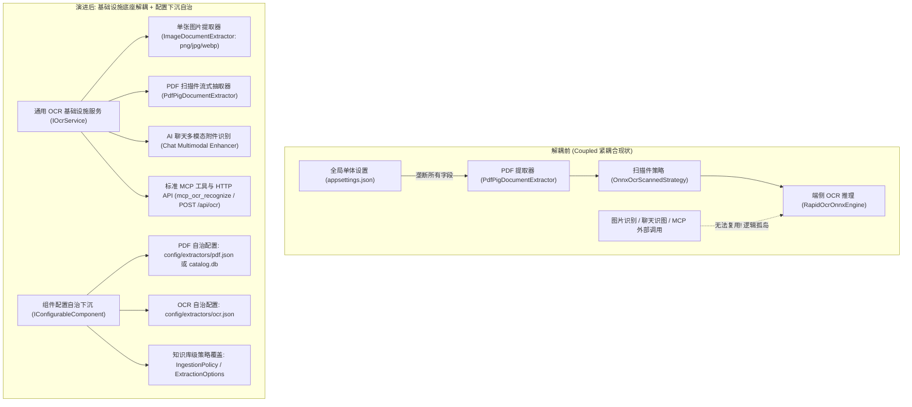
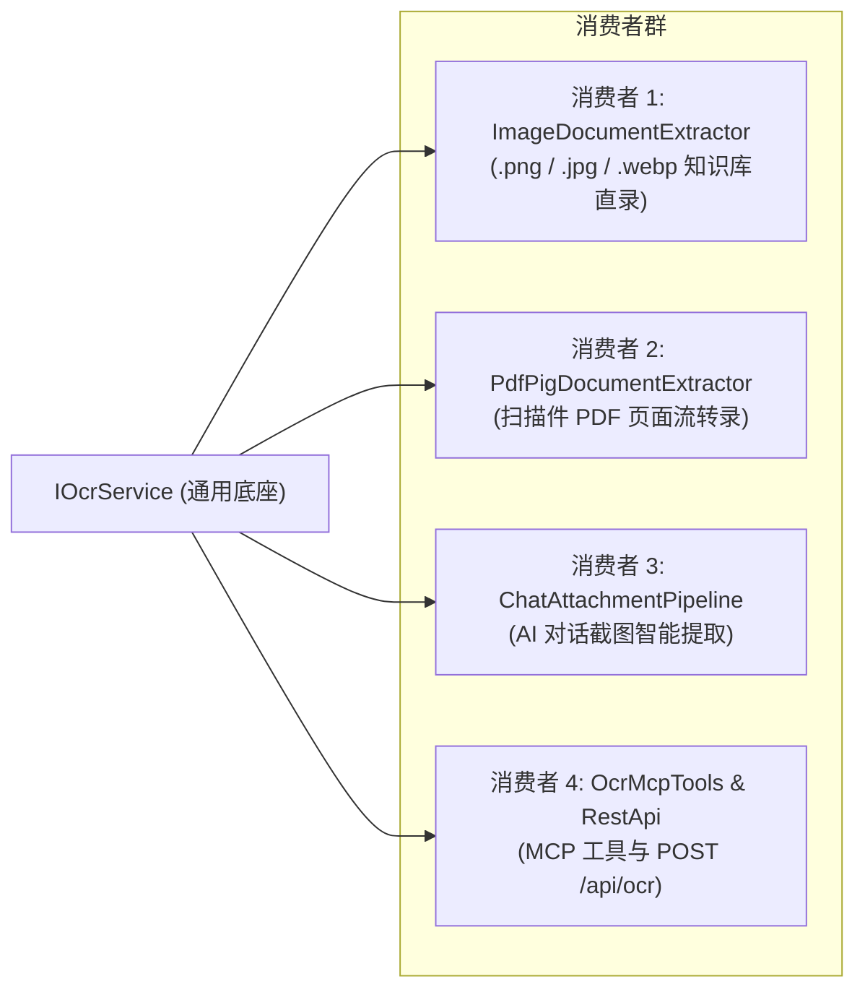
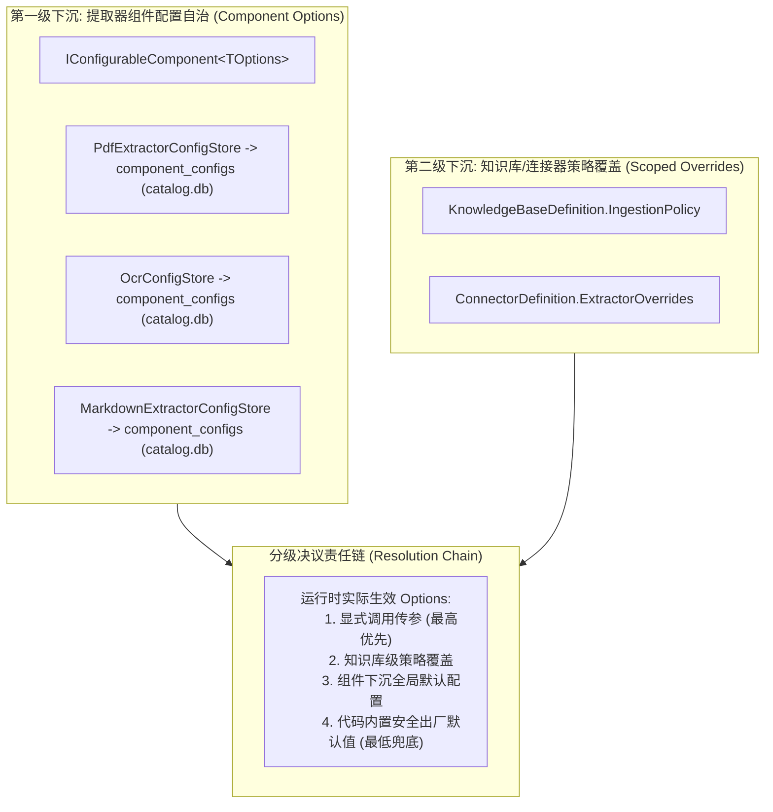
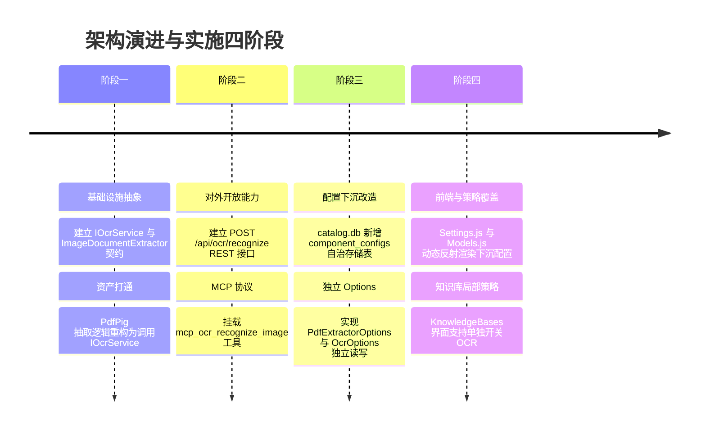

# OCR 基础服务解耦与提取器配置下沉自治架构设计调研报告

> **编制日期**：2026-11-21  
> **报告类型**：架构深度头脑风暴、业界成熟方案对比、微内核插件化演进与落地实施方案  
> **关联设计**：
> - [PDF OCR 独立设置、模型管理、在线下载与多引擎架构方案](file:///E:/WorkProject/CSharp/PrivateProject/Web/ReferenceRAG/docs/pdf-ocr-settings-model-management-and-download-architecture.md)
> - [扫描版 PDF 头脑风暴与按需 OCR 架构设计](file:///E:/WorkProject/CSharp/PrivateProject/Web/ReferenceRAG/docs/pdf-scanned-ocr-brainstorming-and-hitl-architecture.md)

---

## 1. 核心战略议题与架构演进目标

针对用户提出的两个极具深度与远见的系统架构设计命题：
1. **OCR 功能是否需要彻底解耦，使其作为基础设施底座服务（Foundational Service）供给其他业务场景复用（如单张图片识别、聊天截图识图、MCP 工具暴露、通用 REST API）？**
2. **PDF 及各类提取器的使用配置，是否应当从全局单体设置中“下沉”到各自组件位置，实现独立定义与自治持久化？**

### 核心结论与战略决策先行



1. **OCR 功能必须且应当立即解耦为一等公民基础设施服务 (`IOcrService`)**：
   - OCR 不应是 PDF 的附属私有逻辑，而应是独立的**通用视觉字符识别底座**；
   - 解耦后，系统天然获得四大高价值复用能力：
     - **纯图片知识源收录**（知识库支持直接放入 `.png`, `.jpg`, `.jpeg`, `.webp` 票据与截图）；
     - **AI 聊天截图识别增强**（纯文本小模型聊天时，用户发截图自动 OCR 注入 Prompt）；
     - **标准化 MCP 工具暴露**（外部 Agent 可将 ReferenceRAG 作为离线轻量 OCR 服务）；
     - **通用 HTTP REST API**（供自动化脚本与三方系统对接）。
2. **配置全面下沉并实现独立持久化自治（极力推荐）**：
   - 彻底破除 `ObsidianRagConfig` 单体神类（God Class）不断膨胀的弊端；
   - 采用 **微内核/插件化配置模式（Microkernel Options Pattern）**：
     - **下沉层 1（组件自治配置）**：PDF 提取器、OCR 引擎各自拥有独立的强类型 Options 类，并在 `catalog.db` 的 `component_configs` 表中独立存取，修改 PDF 参数绝不污染全局配置文件、绝不触发全局服务重载；
     - **下沉层 2（知识库级策略覆盖）**：知识库（KB）允许按需覆盖提取策略（如“法律合同库开启 OCR，代码技术库禁用 OCR”）。

---

## 2. 议题 1 深度头脑风暴：OCR 作为基础底座服务的解耦设计

### 2.1 现状缺陷与解耦必要性（Why Decouple?）

当前系统中，OCR 逻辑是作为 `PdfPigDocumentExtractor` 内部的 `IScannedPdfHandlingStrategy` 实现的。这种结构存在明显的痛点：
1. **单一职责原则（SRP）违背**：
   - PDF 提取器的职责是处理 PDF 容器文件结构（交叉引用表、字体映射、流解压、页面排版）；
   - OCR 引擎的职责是图像信号处理与深度学习字符分类（像素矩阵预处理、边界框回归、文字序列解码）；
   - 将 OCR 强绑定在 PDF 解析器内，导致架构职责混乱。
2. **场景割裂与重复造轮子**：
   - 用户无法将单张图片（如架构图截图、白板会议照、电子发票）作为知识库文档导入；
   - 用户在 AI 对话框上传图片时，如果当前激活的是纯文本大模型，系统无法先进行 OCR 转录再投递给大模型；
   - 外部 Agent 无法通过 MCP 协议借用本系统的 OCR 能力。

### 2.2 解耦后的服务契约与核心设计（How to Decouple?）

在 `Infrastructure/ReferenceRAG.Infrastructure/Features/Ocr/` 下建立通用服务抽象：

```csharp
namespace ReferenceRAG.Core.Features.Ocr.Domain;

/// <summary>
/// 通用 OCR 识别服务契约（一等公民基础设施底座）
/// </summary>
public interface IOcrService
{
    string EngineName { get; }
    bool IsAvailable { get; }

    /// <summary>
    /// 识别单张图片（二进制内存块）
    /// </summary>
    Task<OcrRecognitionResult> RecognizeImageAsync(
        ReadOnlyMemory<byte> imageBytes,
        OcrOptions? options = null,
        CancellationToken ct = default);

    /// <summary>
    /// 识别单张图片（流式输入）
    /// </summary>
    Task<OcrRecognitionResult> RecognizeImageAsync(
        Stream imageStream,
        OcrOptions? options = null,
        CancellationToken ct = default);

    /// <summary>
    /// 识别多页文档流（如纯图片构成的多页 TIFF 或已光栅化的 PDF 页面流）
    /// </summary>
    Task<OcrBatchResult> RecognizePagesAsync(
        IAsyncEnumerable<ReadOnlyMemory<byte>> pageImages,
        OcrOptions? options = null,
        IProgress<OcrProgressInfo>? progress = null,
        CancellationToken ct = default);
}
```

### 2.3 解耦后四大业务消费者无缝复用矩阵



1. **场景 1：图片文档知识库直录 (`ImageDocumentExtractor.cs`)**：
   - 注册到 `DocumentExtractorRouter`，匹配扩展名 `.png`, `.jpg`, `.jpeg`, `.webp`, `.bmp`；
   - 直接读取图片流并调用 `_ocrService.RecognizeImageAsync(stream)`，提取文字后送入 SlidingWindow 切片；
   - **巨大价值**：知识库从此具备直接收录图片资产的能力！
2. **场景 2：PDF 扫描件页面流提取 (`PdfPigDocumentExtractor.cs`)**：
   - 提取器只需通过 PdfPig 拿到页面光栅图像字节流，直接委托给 `_ocrService.RecognizeImageAsync(imageBytes)`；
   - PDF 提取器彻底甩掉对 ONNX 推理、会话生命周期与硬件调度的耦合。
3. **场景 3：AI 对话附件自动 OCR 增强 (`ChatService.cs`)**：
   - 用户在 Chat 中上传图片时，若模型为文本模型，后台自动透明调用 `_ocrService` 提取文字注入上下文，提示用户“已自动识别截图中文字并加入对话”。
4. **场景 4：MCP 协议工具暴露 (`OcrMcpTools.cs`)**：
   - 注册 MCP 工具 `ocr_recognize_image(image_base64)` 与 `ocr_recognize_pdf(pdf_path)`；
   - 使得 Cursor, Claude Code, Antigravity 等各类外部 AI 客户端在没有本地 OCR 时，可直接调用 ReferenceRAG 完成视觉文字识别。

---

## 3. 议题 2 深度头脑风暴：配置下沉与各自持久化自治

### 3.1 集中式配置单体神类（God Class）的痛点

当前系统中，所有配置都挤在 `ObsidianRagConfig`：
- **单体膨胀**：文档解析参数、PDF 参数、Markdown 过滤、OCR 参数混杂在全局；
- **配置持久化风暴**：修改 PDF 的一个提取参数，必须触发一次全量 `appsettings.json` 重写，引发全局服务配置监听器（`IOptionsMonitor`）连锁重载；
- **知识库策略隔离性归零**：全局只能配置一套 PDF 参数，无法支持不同知识库的差异化处理需求。

### 3.2 两级配置下沉架构设计（Two-Tier Decentralization）



#### (1) 第一级：组件自治强类型契约 (`IConfigurableComponent<T>`)
每个提取器或处理组件，自己定义 Options 实体与管理存储，不再依赖中心神类：

```csharp
namespace ReferenceRAG.Core.Domain.Configuration;

/// <summary>
/// 可独立配置与持久化的组件契约
/// </summary>
public interface IConfigurableComponent<TOptions> where TOptions : class, new()
{
    string ComponentKey { get; } // 例如 "extractor.pdf", "engine.ocr"
    TOptions GetOptions();
    Task UpdateOptionsAsync(TOptions options, CancellationToken ct = default);
}
```

#### (2) 持久化落地位置选型：`catalog.db` 独立 KV 表
- **为何不写零散的 `.json` 小文件？**
  - 散落许多小配置文件（如 `pdf.json`, `ocr.json`）容易引发文件锁冲突、备份丢失以及 Docker 挂载遗漏。
- **最佳实践**：
  - 复用已有的元数据总线数据库 `catalog.db`；
  - 建立一张极简的强类型组件配置表：
    ```sql
    CREATE TABLE IF NOT EXISTS component_configs (
        component_key TEXT PRIMARY KEY,
        config_json   TEXT NOT NULL,
        version       INTEGER NOT NULL DEFAULT 1,
        updated_at    TEXT NOT NULL
    );
    ```
  - **巨大优势**：
    - 事务原子读写，免除并发文件锁烦恼；
    - 针对任意组件修改配置，仅更新对应的一行记录，**完全不触发 `appsettings.json` 的全局重新加载**；
    - 系统备份只需备份 `catalog.db`，所有组件的自治配置自动完整随行。

#### (3) 第二级：知识库/连接器级策略覆盖（Scoped Overrides）
在 `KnowledgeBaseDefinition` 增加可选的 `IngestionPolicy` 节点：
```json
{
  "id": "kb_legal_contracts",
  "name": "法律合同库",
  "ingestionPolicy": {
    "pdf": {
      "enableOcr": true,
      "minLettersThreshold": 50,
      "rasterDpi": 300
    }
  }
}
```
**决议机制**：
当处理一篇文档时，系统通过责任链自顶向下决议：
$$\text{FinalOptions} = \text{ParamOptions} \oplus \text{KbPolicy} \oplus \text{ComponentDefault} \oplus \text{SystemBuiltin}$$
各层级支持局部属性覆盖（Merge/Fallback），兼具极致灵活性与坚固的默认安全性。

---

## 4. 设计模式深度优化与赋能

在解耦与下沉过程中，综合运用以下 5 大经典设计模式，确保架构扩展性与稳定性：

| 设计模式 | 落地应用位置 | 解决的核心痛点 |
| :--- | :--- | :--- |
| **微内核模式 (Microkernel / SPI)** | `IDocumentExtractorRouter` 与文档提取器插件体系 | 新增 Word、Excel、音频 Whisper、图片提取器时，核心主干代码 0 修改，纯增量扩展。 |
| **适配器模式 (Adapter Pattern)** | `IOcrService` 对接本地 ONNX、云端多模态 API 与 Windows 原生 | 屏蔽底层硬件加速（CPU/DirectML/ROCm）与厂商 API 协议差异，对外暴露纯净的图片识别契约。 |
| **注册表模式 (Registry Pattern)** | `ComponentConfigRegistry` 与 `DocumentExtractorRegistry` | 动态枚举、发现与实例化系统中的所有提取器及其自治配置项，供设置页面反射渲染。 |
| **选项模式 (Options Pattern)** | `PdfExtractorOptions` 与 `OcrServiceOptions` | 强类型映射、出厂默认值兜底、热变更通知与验证门禁。 |
| **门面模式 (Facade Pattern)** | `OcrServiceFacade` | 封装多线程图像切片缩放、RGBA 矩阵转换、DBNet 后处理与 CTC 解码等脏活，上层调用只需一行 `RecognizeImageAsync`。 |

---

## 5. 业界主流方案对比与经验借鉴

| 对比维度 | **LangChain / Unstructured.io** | **RAGFlow (DeepDoc)** | **Apache Tika** | **ReferenceRAG (本演进方案)** |
| :--- | :--- | :--- | :--- | :--- |
| **OCR 基础设施解耦** | 将 OCR 抽象为独立 `Partition` 算子，图片与 PDF 共享 | 绑定在内部 DeepDoc 引擎中，未完全对外解耦 | OCR 是独立 Parser (Tesseract)，PDF Parser 组合调用 | **`IOcrService` 作为一等公民底座，供图片/PDF/Chat/MCP/API 4 处无缝共享** |
| **配置存放与下沉** | 每次调用时通过 kwargs 传递参数 | 配置绑定在全局 docker-compose 环境变量中 | 依赖 XML 配置文件与 Context 上下文 | **两级下沉：`catalog.db` 独立 KV 组件表 + 知识库级局部策略覆盖** |
| **外部生态开放性** | 仅限于 Python 内部调用 | 内部微服务调用 | 命令行与 Server | **原生支持 MCP 协议工具，外部 AI Agent 即开即用** |
| **并发与资源隔离** | 易产生 Python 多进程死锁 | 占用多 GB 内存常驻 | Java 多线程调度 | **C# 原生 `SemaphoreSlim` 限流与通道队列，压制在百兆内存级** |

---

## 6. 演进路线图与实施指南（Roadmap）



### 实施步骤细节

1. **第一步（OCR 彻底解耦）**：
   - 将现有 `RapidOcrOnnxEngine` 从 PDF 专有命名空间移至 `Features/Ocr/`；
   - 提取并实现通用 `IOcrService`；
   - 新增 `ImageDocumentExtractor.cs`，直接利用 `IOcrService` 处理图片文档入库。
2. **第二步（配置下沉落地）**：
   - 在 `SqliteCatalogStore` 自动平滑建表 `component_configs`；
   - 实现 `IConfigurableComponent<PdfExtractorOptions>` 与 `IConfigurableComponent<OcrOptions>`；
   - 改造 `SettingsController` 提供针对组件键的 `/api/settings/components/{key}` 读写通道；
3. **第三步（生态赋能）**：
   - 注册 `OcrMcpTools`，让外部 AI 编码助手通过 MCP 工具一键调用端侧 OCR。

---

## 7. 总结响应

- **对于问题 1**：**坚决解耦！** 将 OCR 沉淀为与 Embedding / Chat 并列的一等公民基础设施服务 `IOcrService`。不仅 PDF 解析变得清晰轻量，还能一举解锁图片入库、对话识图、MCP 工具与通用 API 四大新能力。
- **对于问题 2**：**坚决下沉！** 终结中心神类配置膨胀，采用 `catalog.db` 组件自治表 + 知识库局部策略覆盖。修改单一提取器配置不再波及全局系统，支持不同知识库精细化差异化定制。

本方案已全面融入系统架构蓝图，完整设计思路与演进步骤已在 [docs/pdf-ocr-settings-model-management-and-download-architecture.md](file:///E:/WorkProject/CSharp/PrivateProject/Web/ReferenceRAG/docs/pdf-ocr-settings-model-management-and-download-architecture.md) 与本文档中归档。