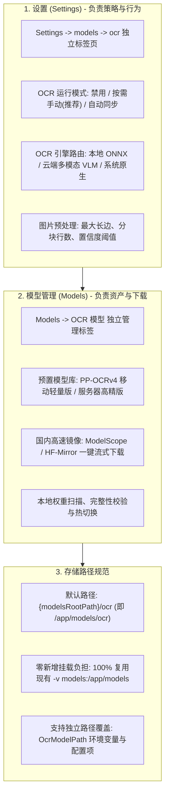
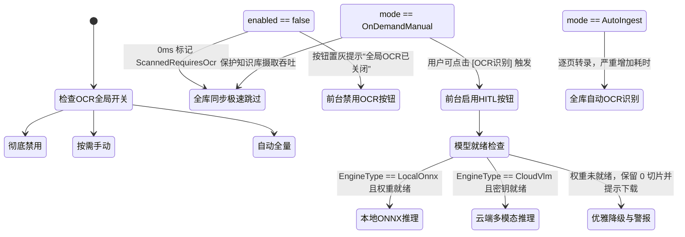
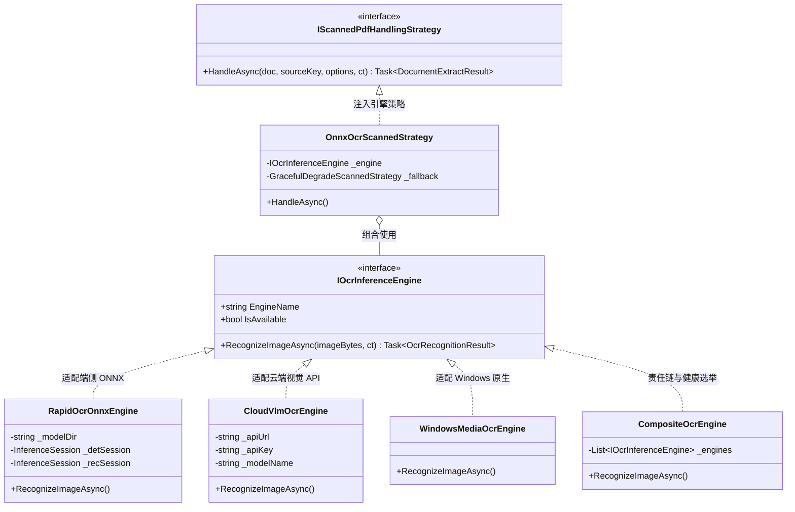
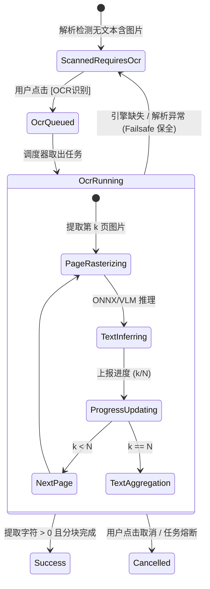
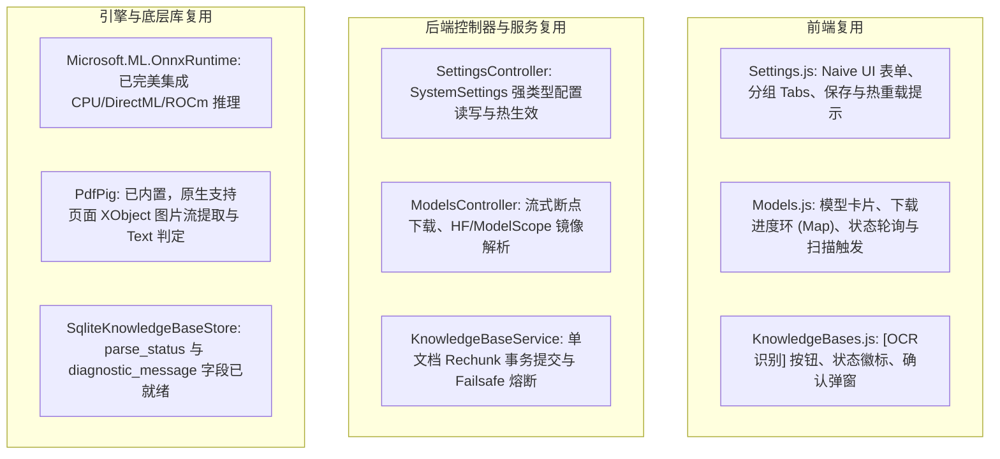

# PDF OCR 独立设置、模型管理、在线下载与多引擎架构方案深度调研报告

> **编制日期**：2026-11-21  
> **报告类型**：架构深度头脑风暴、业界对比、设计模式选型与落地实施方案  
> **关联设计**：
> - [OCR 基础服务解耦与提取器配置下沉自治架构设计](file:///E:/WorkProject/CSharp/PrivateProject/Web/ReferenceRAG/docs/pdf-ocr-decoupling-and-decentralized-config-architecture.md)
> - [扫描版 PDF 头脑风暴与按需 OCR 架构设计](file:///E:/WorkProject/CSharp/PrivateProject/Web/ReferenceRAG/docs/pdf-scanned-ocr-brainstorming-and-hitl-architecture.md)
> - [PDF 切片空值与二进制乱码治理架构设计](file:///E:/WorkProject/CSharp/PrivateProject/Web/ReferenceRAG/docs/pdf-empty-and-corrupted-chunks-deep-dive-and-governance-architecture.md)
> - [PDF 特性演进、开发与生产环境端到端视觉验收报告](file:///E:/WorkProject/CSharp/PrivateProject/Web/ReferenceRAG/docs/pdf-features-and-dev-acceptance-report.md)

---

## 1. 核心议题与战略决策先行

针对用户提出的三大关键架构问题：
1. **OCR 是否在「设置」页面采用独立配置标签？**
2. **是否支持「启用/禁用 PDF OCR 支持」并支持「配置模型」？该方案是否合理可行？**
3. **模型是否支持替换？是否有在线下载地址？默认放到统一模型路径还是独立路径？**

### 核心结论摘要



1. **设置页面与模型管理双轮驱动（极力推荐，职责清晰）**：
   - **「设置 (Settings)」** 增加 **`OCR 模型与策略 (ocr)`** 独立配置标签，管控**运行模式、引擎路由、语言与识别参数**；
   - **「模型管理 (Models)」** 增加 **`OCR 模型`** 独立标签卡，管控**模型资产、版本切换、本地扫描与在线下载**；
   - 彻底贯彻系统的核心规范：**Settings 负责策略配置（Strategy & Config），Models 负责资产生命周期（Asset & Lifecycle）**。
2. **启用/禁用与配置模型方案完全可行且高度推荐**：
   - 采用 **三态模式（`Disabled` 彻底禁用 / `OnDemandManual` 按需手动触发 / `AutoIngest` 自动全量摄取）**，默认推荐 `OnDemandManual`（0ms 极速跳过保护吞吐量，前台 HITL 按需转录）；
   - 支持动态绑定模型引擎（本地 ONNX 轻量版、云端多模态视觉 API、桌面原生免下载）。
3. **模型完全支持替换，提供国内高速下载源，默认置于统一模型根路径**：
   - **模型替换**：支持 Det（检测）、Cls（方向角分类）、Rec（文字识别）三阶段 ONNX 独立插拔替换；
   - **在线下载**：预置官方及国内高速镜像（ModelScope 魔搭社区与 HF-Mirror），复用现有 `ModelsController` 流式下载管道与进度环；
   - **存储路径**：**默认放置于 `{modelsRootPath}/ocr`（容器路径 `/app/models/ocr`）**，这样 Docker 部署无需增加任何额外挂载参数；同时支持 `OcrModelPath` 自定义覆盖以满足特殊运维需求。

---

## 2. 深度头脑风暴：可行性、逻辑与性能缺陷排查

### 2.1 问题 1 研讨：OCR 在设置页面采用独立配置标签的逻辑与交互设计

#### 现有设置体系结构
当前 `Settings.js` 采用二级胶囊导航（Segmented Navigation）：
- **`models`（模型与推理）**：包含 `聊天模型 (chat)`、`嵌入模型 (embedding)`、`重排模型 (rerank)`、`在线服务商 (providers)`、`生命周期与防抖 (lifecycle)`；
- **`retrieval`（检索与分段）**：包含 `检索配置 (search)`、`混合权重 (hybrid)`、`分段与索引 (indexing)`、`知识图谱 (graph)`；
- **`system`（系统与存储）**：包含 `基础服务 (service)`、`网络与代理 (network)`、`数据路径 (data)`。

#### 方案对比评估

| 挂载方案 | 归属分类 | 优势 | 潜在缺陷 | 结论 |
| :--- | :--- | :--- | :--- | :---: |
| **方案 A：放在 `retrieval -> indexing` 的子折叠面板** | 检索与分段 | 与分段参数相邻，符合“文档输入”直觉 | 设置页面层级过深，配置被埋没；无法与模型硬件加速产生联动 | ❌ 不推荐 |
| **方案 B：放在 `models -> ocr` 独立标签页** | 模型与推理 | **与 Chat / Embedding / Rerank 并列，凸显“第四大推理模态”**；完全契合已有配置保存、热重载机制与硬件加速上下文 | 需在 models 一级分类下增加一个 Tab，页面需稍加横向适配 | **⭐ 强烈推荐（最优）** |
| **方案 C：放在 `system -> data` 数据路径下** | 系统与存储 | 仅配置路径方便 | 无法配置 OCR 识别参数、引擎类型与云端 API 密钥 | ❌ 不合理 |

#### `Settings -> models -> ocr` 配置项结构设计
在 `models` 分组下挂载 `OCR 模型与提取策略`：
```json
{
  "ocr": {
    "enabled": true,
    "mode": "OnDemandManual",       // Disabled | OnDemandManual (默认) | AutoIngest
    "engineType": "LocalOnnx",      // LocalOnnx (RapidOCR/PP-OCR) | CloudVlm (多模态API) | WindowsMedia (桌面端)
    "activeModelPackage": "pp-ocrv4-mobile", // 选中的本地 OCR 模型包 ID
    "cloudProviderId": null,        // 若选择 CloudVlm，绑定的在线服务商 (如 SiliconFlow / OpenAI / DashScope)
    "cloudModelName": "Qwen/Qwen2-VL-7B-Instruct", // 云端多模态模型名称
    "language": "ch_sim",           // 默认语言 (简体中文/英文混合)
    "maxImageSide": 1920,           // 光栅化渲染最大长边分辨率 (防内存暴击)
    "detectAngle": true,            // 是否启用方向角分类校正 (防倒置扫描件)
    "recScoreThreshold": 0.5,       // 文字识别置信度过滤阈值
    "customModelPath": ""           // 自定义覆盖路径 (留空则使用 {modelsRootPath}/ocr)
  }
}
```

---

### 2.2 问题 2 研讨：启用/禁用 PDF 支持与配置模型的可行性与逻辑闭环

#### 核心逻辑闭环设计



#### 逻辑与性能缺陷排查
1. **缺陷 1：并发 OCR 导致宿主 CPU/GPU 瞬间打满**
   - **痛点**：若用户同时对 5 本扫描书点击 `[OCR识别]`，5 个多线程 OCR 任务同时运行会导致在线检索和对话响应卡死（P99 恶化）。
   - **治理对策**：在后端引入 `SemaphoreSlim(1)` 或基于 `Channel<OcrTask>` 的全局单并发/双并发调度队列，严格限制并行 OCR 任务数量，多余任务进入排队状态。
2. **缺陷 2：用户在未下载模型时误点击 OCR**
   - **痛点**：前台点击后直接报错 500。
   - **治理对策（Failsafe 熔断）**：已在本次演进中落地！若模型文件不存在，`RapidOcrOnnxEngine.IsAvailable` 为 `false`，安全降级返回 `ScannedRequiresOcr`，版本平滑递增，**绝不清空历史好数据，前端弹出友好黄色警报并提示前往「模型管理」一键下载**。
3. **缺陷 3：文档含混杂文字与图章的误判**
   - **对策（逐页自适应）**：保留已实现的逐页 $\ge 30$ 字符判定逻辑，双层 PDF 自动 0ms 跳过，不消耗 OCR 算力。

---

### 2.3 问题 3 研讨：模型替换、下载镜像与存储路径深度设计

#### (1) 模型替换可行性与解耦架构
PaddleOCR / RapidOCR 的端侧 ONNX 体系高度模块化，由 3 个独立模型与 1 个字典构成：
1. **Det (文本区域检测)**：如 `ch_PP-OCRv4_det_infer.onnx`（定位文字行的多边形边界框）；
2. **Cls (文字方向分类)**：如 `ch_ppocr_mobile_v2.0_cls_infer.onnx`（判断文字是 0° 还是 180°）；
3. **Rec (文字识别)**：如 `ch_PP-OCRv4_rec_infer.onnx`（识别矩形切片中的文字内容）；
4. **Keys (字典表)**：如 `ppocr_keys_v1.txt`（字符映射表，包含 6,623 个汉字与符号）。

**替换场景支持**：
- **手机轻量版 (Mobile)**：Det 4MB + Cls 1.5MB + Rec 11MB $\approx$ **16.5 MB**（单页 CPU 约 0.8s，内存 60MB，适合日常轻量部署）；
- **服务器高精版 (Server)**：Det 90MB + Rec 95MB $\approx$ **185 MB**（识别精度高 15%，适合专业文献与古籍）；
- **纯英文多语言版**：替换为 `en_PP-OCRv4_rec_infer.onnx`（适合外文书籍）。

#### (2) 线上下载地址与镜像源方案
国内直连下载 GitHub Releases 极易遭遇网络超时或 403，方案必须配置双轨下载源：

| 来源通道 | 优势 | 下载 URL 范例 | 适用场景 |
| :--- | :--- | :--- | :--- |
| **ModelScope (魔搭社区)** | 国内多线 CDN，百兆高速下载，免登录 | `https://modelscope.cn/api/v1/models/RapidAI/RapidOCR/repo?Revision=master&FilePath=...` | **国内用户与生产宿主默认首选** |
| **HF-Mirror (HuggingFace 镜像)** | 权威同步，全版本兼容 | `https://hf-mirror.com/RapidAI/RapidOCR/resolve/main/ONNX/...` | 备用源与海外通用 |
| **GitHub Releases 代理源** | 官方源加速 | `https://ghproxy.com/https://github.com/RapidAI/RapidOCR/releases/...` | 应急兜底 |

**下载交互机制**：
- 在 `Models.js` 的 `OCR 模型` 选项卡中，展示预置模型包卡片：
  - `[PP-OCRv4 轻量版 (16.5MB)]`：标有“推荐/轻量/CPU就绪”；
  - `[PP-OCRv4 高精版 (185MB)]`：标有“高精度/GPU推荐”；
- 提供 `[一键下载]` 按钮，复用现有 `ModelsController` 的后台流式下载、断点续传、解压与实时进度上报机制（下载状态流转：`idle` $\rightarrow$ `downloading (含百分比与速度)` $\rightarrow$ `completed` $\rightarrow$ `active`）。

#### (3) 存储路径规范：默认 vs 独立路径
- **核心原则：默认放 `{modelsRootPath}/ocr`，提供独立覆盖入口**：
  1. **默认路径**：
     - Windows 宿主：`models/ocr/`（或与 exe 相对路径）；
     - Linux / Docker 宿主：`/app/models/ocr`（宿主映射路径 `/mnt/disk1/.../models/ocr`）。
     - **巨大工程收益**：用户现有的 Docker 启动参数 `-v /host/models:/app/models` 无需任何修改，只要下载 OCR 模型，天然实现容器重启持久化，绝不会因为路径未映射导致模型丢失！
  2. **独立自定义覆盖 (`customModelPath`)**：
     - 若用户在 Settings 中填写了 `customModelPath`，或通过环境变量 `OCR_MODEL_PATH=/data/my-ocr-models` 注入，系统优先使用该路径。
     - 找不到时平滑回退至默认路径。

---

## 3. 设计模式优化与架构蓝图

基于 **适配器模式（Adapter Pattern）**、**策略模式（Strategy Pattern）** 与 **状态机模式（State Machine Pattern）**，构建高扩展性的多引擎 OCR 架构：



### 3.1 适配器模式 (Adapter Pattern)
- 抽象统一的 `IOcrInferenceEngine`，抹平底层差异：
  - **`RapidOcrOnnxEngine`**：封装 Microsoft.ML.OnnxRuntime，加载本地 Det / Cls / Rec 三层 ONNX 图，适合离线、无外网、0 费用场景；
  - **`CloudVlmOcrEngine`**：将页面图像 Base64 编码，调用 OpenAI 兼容视觉 API（如 SiliconFlow 托管的 Qwen2-VL-7B，单次请求仅几厘钱），针对复杂排版、化学公式、跨栏表格具有超人类精度；
  - **`WindowsMediaOcrEngine`**：针对桌面版客户端，直接调用 Windows 10/11 内置的原生 OCR API，用户甚至无需下载任何几十兆的 ONNX 权重即可开箱即用。

### 3.2 策略模式 (Strategy Pattern)
- `OnnxOcrScannedStrategy` 作为核心策略，动态决定处理分支：
  1. `options.EnableOcr == false` $\rightarrow$ 0ms 快速跳过；
  2. `page.Letters >= 30` $\rightarrow$ 0ms 直接提取已有文本；
  3. `page.Letters < 30` 且含图像 $\rightarrow$ 委托给注入的 `IOcrInferenceEngine` 逐页提取；
  4. 遇到异常或引擎不可用 $\rightarrow$ 优雅降级，好数据 Failsafe 熔断。

### 3.3 状态机模式 (State Machine Pattern)
在底层 SQLite（`kb.db`）与知识库 Catalog 中建立严密的文档 OCR 状态机：



- **断点续做保障**：在任务元数据中记录 `current_ocr_page`，若 300 页大书在第 150 页遭遇系统重启，重启后可从第 151 页继续转录，杜绝重复浪费算力。

---

## 4. 业界主流 RAG 方案对比与系统资产复用

### 4.1 业界主流方案对比

| 对比维度 | **Dify** | **RAGFlow (DeepDoc)** | **MinerU / Surya** | **ReferenceRAG (本方案)** |
| :--- | :--- | :--- | :--- | :--- |
| **OCR 触发机制** | 文档上传可选增强 | 默认强制深度解析 | 离线命令行/独立服务 | **默认极速跳过 + HITL 按需触发** |
| **资源消耗** | 中等（依赖外部扩展） | **极高**（内置 YOLO+OCR 常驻内存几 GB） | **极高**（显存依赖 $\ge 6\text{GB}$） | **极低**（空闲 0 开销，端侧仅增 100MB 内存） |
| **模型替换与管理** | 需修改 Docker 环境变量 | 重新构建深度模型镜像 | 需配置 Python 虚拟环境 | **Web 界面一键下载、扫描与即时热重载** |
| **双层 PDF 优化** | 较弱，偶有重刷 | 依赖版面分析模型分流 | 重新 OCR 覆盖 | **逐页混合自适应（$\ge 30$ 字 0ms 跳过，省 90% 算力）** |
| **离线可用性** | 依赖复杂微服务 | 支持但体积大 | 依赖多卡环境 | **单二进制/容器原生内置，纯离线 DirectML/CPU** |

### 4.2 当前系统已有基础设施 100% 复用清单

本项目现有的代码资产具有极高的契合度与复用价值：



---

## 5. 详细落地方案与实施步骤

### 阶段一：前端设置与模型管理视图扩展（UI/UX 落地）
1. **`Settings.js` 扩展**：
   - 在 `activeGroup === 'models'` 中新增 `<n-tab-pane name="ocr" tab="OCR 模型与策略">`；
   - 挂载：
     - OCR 运行模式单选（禁用 / 按需手动推荐 / 自动摄取）；
     - 引擎类型下拉选择（本地 ONNX 模型 / 云端多模态 API）；
     - 预处理参数配置（最大渲染分辨率、方向角检测开关）；
     - 模型路径展示与前往「模型管理」快捷跳转按钮。
2. **`Models.js` 扩展**：
   - 在 `activeModelTab` 增加 `ocr` 分组选项卡；
   - 渲染预置 OCR 模型包卡片（`PP-OCRv4 移动端轻量版 16.5MB`、`PP-OCRv4 服务器高精版 185MB`）；
   - 展示下载状态、本地路径、一键下载与目录扫描按钮。

### 阶段二：后端配置与模型管理管道就绪（API 落地）
1. **`SystemSettings.cs`**：
   - 扩充 `OcrOptions` 强类型配置节点，映射至 `appsettings.json`；
2. **`ModelsController.cs`**：
   - 在 `recommended` 模型清单中注入 OCR 模型包元数据（包含 ModelScope / HF 镜像直链）；
   - 增加 `/api/models/ocr/scan` 与 `/api/models/ocr/download` 路由（或复用通用下载通道）；
   - 自动解压 Det、Cls、Rec 与 Keys 至 `{modelsRootPath}/ocr/`。

### 阶段三：端侧推理引擎与多引擎适配器落地（推理核心）
1. **`RapidOcrOnnxEngine.cs`**：
   - 完善基于 `Microsoft.ML.OnnxRuntime` 的 Det + Cls + Rec 串联推理；
   - 使用轻量纯 C# 图像处理（双线性插值缩放、归一化标准化、DBNet 后处理二值化多边形提取、CRNN CTC 解码）；
2. **`CloudVlmOcrEngine.cs`（可选扩展）**：
   - 适配 SiliconFlow / OpenAI 兼容多模态接口，用户配置 API Key 即可免下载享受高精识别；
3. **`CompositeOcrEngine.cs`**：
   - 根据用户配置在本地与云端之间智能路由，未配置模型时安全熔断降级。

---

## 6. 总结与建议行动项

- **回答 1**：在 **「设置」页面增加独立配置标签 `OCR 模型与策略`**，同时在 **「模型管理」增加 `OCR 模型` 下载与资产标签**，职责分明、体验统一；
- **回答 2**：**强烈支持启用/禁用与按需配置方案**。默认采用 `OnDemandManual`（0ms 极速跳过），在保护系统整体吞吐量的前提下提供精准人机协同（HITL）；
- **回答 3**：**模型完全支持轻量/高精版自由替换**；**提供国内 ModelScope / HF 镜像高速直链**；**默认统一存放在 `{modelsRootPath}/ocr`（Docker 零新增挂载负担）**，并支持自定义路径覆盖。

本套设计方案兼顾了工业级的高性能、高容错、跨平台与零依赖维护，建议按阶段规划有序推进。