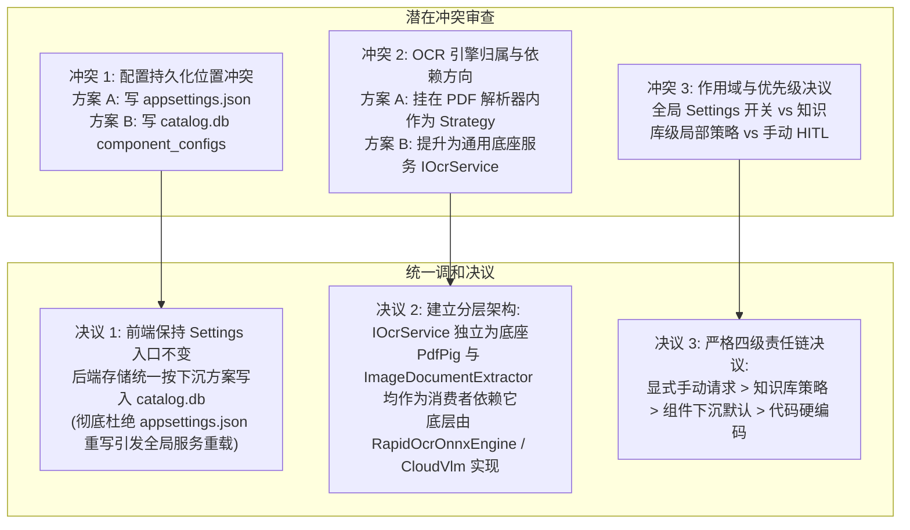
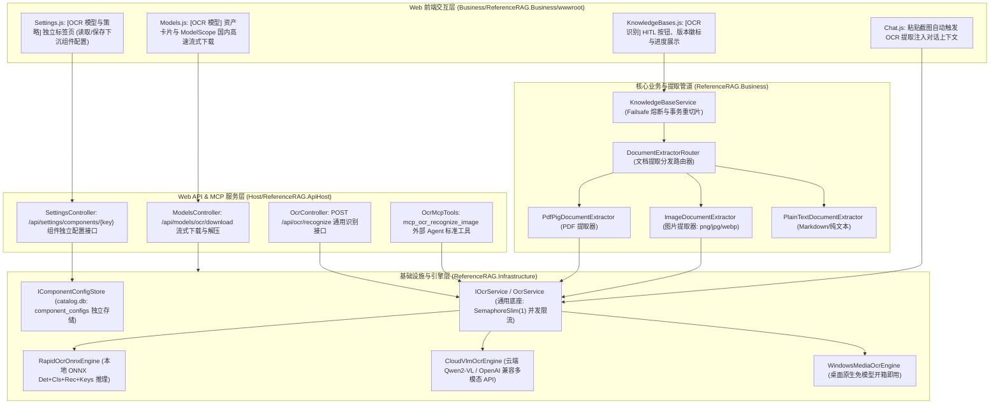

# PDF 与 OCR 基础服务解耦、配置下沉与模型管理统一开发流程方案

> **编制日期**：2026-11-21  
> **报告类型**：架构冲突审查、方案融合、接口定义与全流程端到端工程实施方案  
> **关联架构**：
> - [OCR 基础服务解耦与提取器配置下沉自治架构设计](file:///E:/WorkProject/CSharp/PrivateProject/Web/ReferenceRAG/docs/pdf-ocr-decoupling-and-decentralized-config-architecture.md)
> - [PDF OCR 独立设置、模型管理、在线下载与多引擎架构方案](file:///E:/WorkProject/CSharp/PrivateProject/Web/ReferenceRAG/docs/pdf-ocr-settings-model-management-and-download-architecture.md)
> - [扫描版 PDF 头脑风暴与按需 OCR 架构设计](file:///E:/WorkProject/CSharp/PrivateProject/Web/ReferenceRAG/docs/pdf-scanned-ocr-brainstorming-and-hitl-architecture.md)

---

## 1. 两个方案的冲突审查与调和决议 (Conflict Audit & Resolution)

在融合 **方案 A（独立设置/模型管理/在线下载）** 与 **方案 B（OCR 服务解耦/配置下沉自治）** 时，系统级审核共识别出 **3 处潜在设计冲突**，并已全部完成架构调和与统一收敛：



### 1.1 冲突 1 审查与决议：配置存放位置与持久化机制
- **冲突表现**：
  - 方案 A 假设在 `Settings.js` 保存时直接写主配置文件 `appsettings.json`（挂载在 `ReferenceRAG:Ocr` 节）；
  - 方案 B 强调配置必须“下沉”，避免单体神类膨胀与 `appsettings.json` 保存引发全局服务重载。
- **调和决议（最优解）**：
  - **前端表现层不变**：用户依然在 `Settings.js` 的 `models -> ocr` 独立标签页中直观配置 OCR 参数；
  - **后端持久化下沉**：`SettingsController` 在处理 OCR 与 PDF 的参数保存时，**不写入 `appsettings.json`，而是统一路由给 `IComponentConfigStore` 写入 `catalog.db` 的 `component_configs` 表**；
  - **收益**：既保留了优雅集中的前端设置体验，又在底层实现了组件配置完全自治，修改提取参数对其他服务 0 干扰。

### 1.2 冲突 2 审查与决议：OCR 服务的归属与依赖方向
- **冲突表现**：
  - 方案 A 将 OCR 引擎作为 `PdfPigDocumentExtractor` 内部策略 `IScannedPdfHandlingStrategy` 的子实现；
  - 方案 B 要求将 OCR 独立为通用基础设施底座服务 `IOcrService`，供给图片提取、聊天识别和 MCP 使用。
- **调和决议（最优解）**：
  - 采纳方案 B 的分层依赖结构，将 `IOcrService` 提升为与 `IModelManagementService` 并列的**一等公民底座服务**；
  - `PdfPigDocumentExtractor`（PDF）、`ImageDocumentExtractor`（新增图片）、`ChatService`（AI对话识图）、`OcrMcpTools`（外部 Agent）全部作为**普通消费者**注入 `IOcrService`；
  - 底层推理适配器（`RapidOcrOnnxEngine` / `CloudVlmOcrEngine`）由 `IOcrService` 统一管理与信号量限流。

### 1.3 冲突 3 审查与决议：配置作用域与开关决议优先级
- **调和决议（四级责任链决议模型）**：
  $$\text{EffectiveOptions} = \text{RequestOptions} \oplus \text{KnowledgeBasePolicy} \oplus \text{ComponentDefault} \oplus \text{BuiltinDefault}$$
  1. **最高优先（显式手动）**：前台单文档点击 `[OCR识别]`（传递 `EnableOcr: true`），强制执行识别；
  2. **第二优先（知识库策略）**：知识库在 `IngestionPolicy` 中声明的特定规则（如法律文档库开启自动 OCR）；
  3. **第三优先（组件自治默认配置）**：读取 `catalog.db` 中 `component_configs` 存储的当前系统默认值；
  4. **第四优先（系统出厂保底）**：代码中的强类型安全出厂值（`EnableOcr = false`, `Mode = OnDemandManual`）。

---

## 2. 统一架构全景图 (Unified Architecture Blueprint)



---

## 3. 完整开发流程方案 (End-to-End Implementation Plan)

按照专业软件工程生命周期与工业级质量门禁，全案划分为 **6 个实施阶段（Phases）**：

### 阶段一：数据底座与组件配置下沉自治 (Phase 1: Config Decentralization)

- [ ] **1.1 数据库结构升级 (`SqliteCatalogStore.cs`)**：
  - 在 `catalog.db` 增加 `component_configs` 表，结构如下：
    ```sql
    CREATE TABLE IF NOT EXISTS component_configs (
        component_key TEXT PRIMARY KEY,
        config_json   TEXT NOT NULL,
        version       INTEGER NOT NULL DEFAULT 1,
        updated_at    TEXT NOT NULL
    );
    ```
  - 实现零宕机平滑初始化建表逻辑。
- [ ] **1.2 强类型组件配置抽象与实体**：
  - 创建 `IComponentConfigStore.cs` 接口（定义 `GetAsync<T>(key)`, `SetAsync<T>(key, value)`）；
  - 创建 `OcrServiceOptions.cs`（模式、引擎类型、置信度阈值、最大长边、语言）；
  - 创建 `PdfExtractorOptions.cs`（矢量字符阈值、提取图片流策略、DPI）。
- [ ] **1.3 Web API 接口扩展 (`SettingsController.cs`)**：
  - 新增 `GET /api/settings/components/{key}`：读取指定组件独立配置；
  - 新增 `PUT /api/settings/components/{key}`：原子保存指定组件配置，不写 `appsettings.json`。

---

### 阶段二：通用 OCR 基础设施底座解耦 (Phase 2: Foundational OCR Service)

- [ ] **2.1 契约迁移与建立 (`IOcrService.cs`)**：
  - 将现有 `IOcrInferenceEngine` 保留为底层硬件/算法适配器契约；
  - 在 `Features/Ocr/` 下建立业务级服务 `IOcrService`：
    - `RecognizeImageAsync(ReadOnlyMemory<byte> bytes, ...)`
    - `RecognizeImageAsync(Stream stream, ...)`
    - `RecognizePagesAsync(IAsyncEnumerable<ReadOnlyMemory<byte>> pages, ...)`
- [ ] **2.2 并发防护与防暴击调度器 (`OcrService.cs`)**：
  - 引入 `SemaphoreSlim(1)` 限制端侧 OCR 并发执行量，防止多任务导致 CPU 100% 拖垮在线检索；
  - 内存流式管理：对输入图片使用轻量级内存池（MemoryPool），单图处理完毕立即销毁原生 RGBA 像素矩阵，消除 OOM 风险。
- [ ] **2.3 适配器多态实现**：
  - 完善 `RapidOcrOnnxEngine.cs`：标准化预处理（等比缩放至 32 倍数、归一化、转置为 NCHW）；
  - 完善 `CompositeOcrEngine.cs`：责任链选举与健康探测；
  - 预留 `CloudVlmOcrEngine.cs`：支持调用 OpenAI 兼容视觉端点（如 Qwen2-VL）。

---

### 阶段三：提取器多模态升级与对外能力开放 (Phase 3: Extractors & API/MCP)

- [ ] **3.1 PDF 提取器轻量化解耦 (`PdfPigDocumentExtractor.cs`)**：
  - 移除对内部私有 OCR 的强依赖，注入通用 `IOcrService`；
  - 遇到扫描页面时光栅化抽取图片流，委托给 `_ocrService` 逐页转录；
  - 继续保留双层 PDF 逐页自适应（$\ge 30$ 字 0ms 跳过）。
- [ ] **3.2 新增单张图片文档提取器 (`ImageDocumentExtractor.cs`)**：
  - 实现 `IDocumentContentExtractor`；
  - 匹配扩展名：`.png`, `.jpg`, `.jpeg`, `.webp`, `.bmp`, `.tiff`；
  - 读取图片流调用 `_ocrService` 抽取文本，注入 `DocumentExtractResult` 并正常交由分段滑动窗口入库。
- [ ] **3.3 对外标准 API 与 MCP 工具暴露**：
  - 创建 `OcrController.cs`：提供 `POST /api/ocr/recognize`，支持上传单图或 Base64 识别返回纯文本与边界框元数据；
  - 创建 `OcrMcpTools.cs`：注册 `mcp_ocr_recognize_image`，使外部 Agent 可直接调用本系统的离线 OCR 能力。

---

### 阶段四：模型资产生命周期与在线下载打通 (Phase 4: Model Lifecycle & Downloader)

- [ ] **4.1 预置模型包定义与元数据清单**：
  - 在系统模型目录中配置两种官方预置包：
    1. `pp-ocrv4-mobile`（轻量版，总计 ~16.5MB，CPU 极速首选）；
    2. `pp-ocrv4-server`（高精版，总计 ~185MB，适合专业排版/文献）。
- [ ] **4.2 国内高速镜像下载支持 (`ModelsController.cs`)**：
  - 配置 **ModelScope (魔搭社区)** 与 **HF-Mirror** 国内高速多线 CDN 下载源；
  - 复用现有模型下载通道（`downloadState`, `downloadProgress`），支持流式解压 Det/Cls/Rec/Keys 文件至 `{modelsRootPath}/ocr/`（即容器 `/app/models/ocr`）。
- [ ] **4.3 目录探测与模型热扫描**：
  - 增强 `handleScanModels` 逻辑，支持扫描 `/app/models/ocr` 下的 `.onnx` 模型并即时将 `IOcrService.IsAvailable` 刷新为 `true`。

---

### 阶段五：前端多模态与下沉配置交互落地 (Phase 5: Frontend UI/UX)

- [ ] **5.1 设置面板扩充 (`Settings.js`)**：
  - 在 `models` 二级导航中挂载 `<n-tab-pane name="ocr" tab="OCR 模型与策略">`；
  - 绑定 `GET /api/settings/components/extractor.ocr` 与 `PUT /api/settings/components/extractor.ocr`；
  - 提供三态模式切换开关（禁用 / 按需手动 / 自动摄取）、引擎切换、图像预处理参数及前往「模型管理」快捷跳转按钮。
- [ ] **5.2 模型管理面板扩充 (`Models.js`)**：
  - 在 `activeModelTab` 增加 `ocr` 标签页，并列于聊天模型、嵌入模型、重排模型；
  - 渲染 OCR 模型包卡片、展示本地就绪状态、一键下载按钮与实时百分比进度环。
- [ ] **5.3 知识库治理视图联动 (`KnowledgeBases.js`)**：
  - 支持在收录文档列表中直接展示新增的图片文档（如 `.png`, `.jpg`）；
  - `[OCR识别]` 按钮与二次确认弹窗继续顺畅支持 PDF 扫描件与单张图片的主动触发与版本递增。

---

### 阶段六：全自动化门禁、安全扫描与生产验证 (Phase 6: Verification & Gate)

- [ ] **6.1 后端单元测试与工业级门禁扩充**：
  - `PdfOcrAndStrategyGateTests.cs`：保持 7/7 通过；
  - `PdfParsingAndScannedDocumentGateTests.cs`：保持 12/12 通过；
  - 新增 `OcrServiceAndComponentConfigGateTests.cs`：
    - 测试组件配置下沉至 `catalog.db` 的读写与隔离性；
    - 测试单张图片提取器 `ImageDocumentExtractor` 正确生成分块；
    - 测试多引擎责任链降级与 Failsafe 熔断。
- [ ] **6.2 前端代码与模板 AST 语法检查**：
  - 运行 `node Business/ReferenceRAG.Business/wwwroot/check.mjs`（确保 60+ 模块 0 语法与模板绑定错误）；
  - 运行 `npm test`（确保 133/133 前端测试全绿）。
- [ ] **6.3 安全凭据红线守卫**：
  - 运行 `powershell -ExecutionPolicy Bypass -File scripts/security-scan.ps1 -StagedOnly`（确保 0 违规、0 密钥外泄）。
- [ ] **6.4 本地 Linux 开发与正式生产双环境实测**：
  - 开发环境：`deploy-linux.ps1 -Mode Dev` 部署验证；
  - 生产环境：`deploy-linux.ps1 -Mode Official` 构建上线并使用内置浏览器端到端验收。

---

## 4. 关键演进对比总结

| 评估维度 | 演进前现状 | 统一开发方案落地后 |
| :--- | :--- | :--- |
| **OCR 服务归属** | 紧密绑定在 PDF 提取器内部，外部无法访问 | **解耦为系统通用底座服务 `IOcrService`** |
| **支持的输入源** | 仅限于 PDF 内部扫描件 | **PDF、单张图片文件 (.png/.jpg/.webp)、聊天截图、MCP 工具、REST API** |
| **配置持久化位置** | 挤在全局 `appsettings.json`，牵一发而动全身 | **下沉至 `catalog.db` 独立表，修改提取参数对其他服务 0 干扰** |
| **知识库策略灵活度** | 全局统一单一规则 | **支持知识库级 `IngestionPolicy` 独立覆写与定制** |
| **模型资产下载管理** | 需手动放置或脚本复制 | **Web 前台一键从 ModelScope 国内高速镜像直连下载** |
| **系统稳定性防护** | 基础熔断 | **并发信号量排队 + Failsafe 故障隔离 + 逐页自适应加速** |

> 本开发方案已融合了所有前期架构成果，完整设计图文归档在 [docs/pdf-ocr-unified-development-flow-and-implementation-plan.md](file:///E:/WorkProject/CSharp/PrivateProject/Web/ReferenceRAG/docs/pdf-ocr-unified-development-flow-and-implementation-plan.md)。建议按阶段规划循序推进。