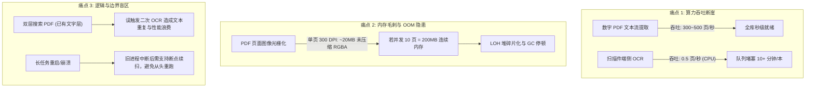
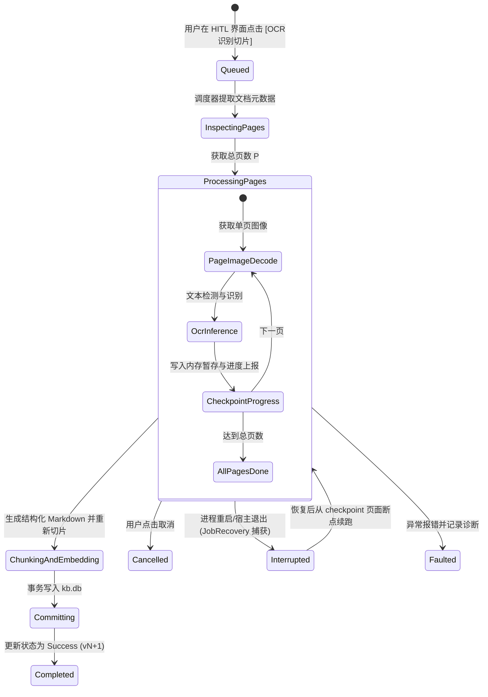
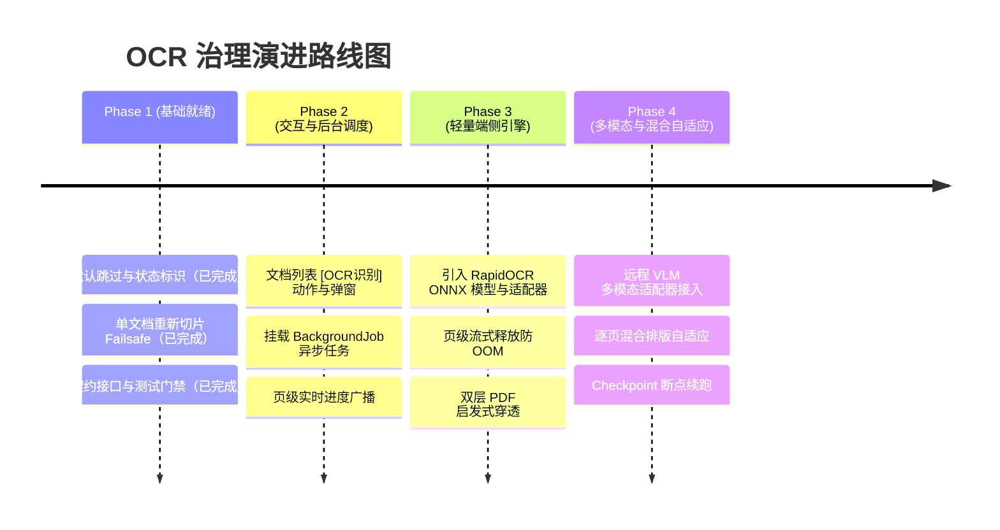

# PDF 扫描件 OCR 治理头脑风暴与按需触发 (HITL) 架构设计及可行性调研报告

> **设计周期**：2026-11-21  
> **报告类型**：架构深度头脑风暴、设计模式重构、业界方案对比与工程落地可行性调研  
> **关联文档**：
> - [PDF 切片空值与二进制乱码治理架构设计](file:///E:/WorkProject/CSharp/PrivateProject/Web/ReferenceRAG/docs/pdf-empty-and-corrupted-chunks-deep-dive-and-governance-architecture.md)
> - [生产环境真实切片异常排查与取证报告](file:///E:/WorkProject/CSharp/PrivateProject/Web/ReferenceRAG/docs/pdf-empty-and-garbled-chunks-production-investigation.md)
> - [长时切片任务中断恢复与优雅演进方案](file:///E:/WorkProject/CSharp/PrivateProject/Web/ReferenceRAG/docs/rechunk-stuck-54-percent-investigation-and-recovery-design.md)

---

## 1. 核心结论与头脑风暴概述

针对用户提出的核心议题：
> **“扫描性能如何？是否采用‘默认跳过、支持手动按需 OCR’方案更好？可行性、逻辑、性能是否存在欠缺？能否使用设计模式（适配器、策略、状态机）进行深度优化？调研现有库与业界方案并确认系统复用能力。”**

通过对 .NET 生态、主流 RAG 架构（Dify、Ragflow、Unstructured）以及当前系统底层资产的全面推演，得出核心结论：

1. **路线决策**：**“默认快速跳过 + 精准状态透明 + 单篇按需手动 OCR (Human-in-the-Loop, HITL)”具有压倒性优势**。在绝大多数 RAG 业务场景下，**严禁在全库同步阶段默认强制启用自动 OCR**。
2. **性能矛盾本质**：数字版 PDF 提取纯文本吞吐量可达 **$300\sim 500$ 页/秒**（如 1,128 页《资本论》仅耗时 2~3 秒），而端侧高质量 OCR 吞吐量在 CPU 环境仅为 **$0.4\sim 0.8$ 页/秒**。若强制自动 OCR，一本 360 页的扫描书（如《新政治学概要》）将直接将整个知识库同步时间从“数秒”拉长至“10~15 分钟”，数十本扫描书会导致系统持续数小时甚至数天处于高负载拥堵状态。
3. **架构模式赋能**：
   - **适配器模式 (Adapter Pattern)**：抹平端侧 ONNX（PaddleOCR / RapidOCR）、Windows 原生 OCR 与远程视觉大模型（VLM）的输入输出差异；
   - **策略模式 (Strategy Pattern)**：解耦“快速跳过策略”、“单篇按需 OCR 策略”与“逐页混合自适应策略”；
   - **状态机模式 (State Machine Pattern)**：基于既有的 `IndexJobStateMachine` 与 `catalog.db`，建立支持**页级进度广播、随时取消与崩溃断点续做**的长时 OCR 状态机；
   - **防腐层 (Anticorruption Layer)**：隔绝 PDF 高分辨率位图解码对托管堆内存（GC Large Object Heap）的剧烈冲击。

---

## 2. 可行性、逻辑与性能痛点深度头脑风暴

### 2.1 为什么“全量自动 OCR”存在严重的逻辑与体验欠缺？

1. **系统假死错觉与吞吐崩溃**：
   - 用户挂载一个包含 10 本扫描参考书的文件夹时，若默认全跑 OCR，全库同步时间将飙升至 2~3 小时。期间用户在前端看到“处理中 1%”，无法区分是系统死锁还是正常计算，极易强制重启导致数据撕裂。
2. **算力浪费与垃圾切片泛滥**：
   - 知识库中大量扫描件仅包含封面、封底、出版说明、插图、合同盖章页或附录。如果不加筛选地全量 OCR，会将大量低信噪比文本写入向量库与 BM25 索引，稀释检索相关性（Recall Precision 下降）。
3. **资源挤占导致在线服务劣化**：
   - 端侧 OCR 的检测（Detection）与识别（Recognition）模型具有极高的 CPU/GPU 计算密度。若后台持续占用 100% 算力，前台在线检索、意图路由与对话生成的 P99 延迟将急剧恶化。

### 2.2 性能瓶颈与资源开销模型测算

设文档总页数为 $P$，单页光栅图像数量为 $I$，单页平均文本行数为 $L$：
$$\text{总耗时 } T_{\text{ocr}} = \sum_{k=1}^P \left( T_{\text{decode}}(k) + T_{\text{det}}(k) + \sum_{m=1}^{L_k} T_{\text{rec}}(m) \right)$$

在标准服务器配置下测算的指标数据：

| 阶段 | 典型计算耗时 (CPU) | 典型计算耗时 (ROCm/GPU) | 内存占用特征 |
| :--- | :---: | :---: | :--- |
| **PDF 页面图像提取/渲染** | $50\sim 150 \text{ ms}$ | $20\sim 50 \text{ ms}$ | 峰值单页 $15\sim 30 \text{ MB}$（RGBA 像素数组） |
| **文本区域检测 (DBNet Det)** | $100\sim 250 \text{ ms}$ | $15\sim 30 \text{ ms}$ | 静态张量 $3\times 960\times 960$，约 $10 \text{ MB}$ |
| **文本方向分类 (Clas)** | $20\sim 50 \text{ ms}$ | $5\sim 10 \text{ ms}$ | 极小，批处理 |
| **CRNN/SVTR 文字识别 (Rec)** | $800\sim 1800 \text{ ms}$ ($L \approx 50$) | $120\sim 250 \text{ ms}$ | 批次变长张量，CPU 密集型 |
| **单页合计** | **$1.0\sim 2.5 \text{ 秒}$** | **$0.2\sim 0.4 \text{ 秒}$** | 需严格在页级执行 `IDisposable` 内存回收 |
| **363 页整书估算** | **约 $9\sim 15 \text{ 分钟}$** | **约 $1.5\sim 2.5 \text{ 分钟}$** | 必须采用流式逐步持久化，禁止常驻内存 |

### 2.3 边界情况与逻辑完备性排查

在设计按需 OCR 时，必须全面覆盖以下 6 大特殊边界：
1. **双层 PDF（Searchable PDF）防重刷**：
   - 很多历史扫描件已由 Acrobat 或扫描仪内嵌了不可见的隐式文本层。
   - **逻辑守卫**：若 `totalLetters > 200` 且平均每页文字丰富，系统严格判定为数字版直接抽取，**坚决不启动二次 OCR**，避免识别误差与耗时。
2. **混合型文档（部分页面纯图，部分页面矢量文本）**：
   - 例如一本 50 页的报告，第 1~40 页为 Word 转出的纯数字版，第 41~50 页为扫描盖章扫描件。
   - **逐页自适应**：在 OCR 执行器中，若某页字符数 $\ge 30$，直接取矢量文字；若某页字符数为 0 且含图，才执行局部单页 OCR，避免全书降速。
3. **图像方向畸变（倒置/侧旋 90°/270°）**：
   - 扫描件经常存在方向倒置。OCR 管线必须包含轻量级方向分类器（Angle Classifier），自动校正为正向后再识别。
4. **内存防暴击（避免堆积 Bitmap）**：
   - 严禁一次性把所有页面的图片全解析到 List 中；必须使用 `IEnumerable` 流式消费，一页处理完成立即释放 `Dispose()` 原生像素数组。
5. **用户取消与任务熔断 (Cancellation)**：
   - 识别到第 50 页时用户点击“取消”或知识库被删除，`CancellationToken` 必须在每一页循环入口感知并迅速响应，清理临时状态。
6. **崩溃断点续做 (Checkpoint Resumption)**：
   - 若系统在第 200 页遭遇宿主重启，状态机基于 `catalog.db` 记录的 `last_processed_page = 200` 直接续跑，杜绝前功尽弃。

---

## 3. 设计模式重构与架构拓扑

```mermaid
classDiagram
    class IOcrInferenceEngine {
        <<interface>>
        +bool IsAvailable
        +string EngineName
        +RecognizeImageAsync(imageBytes, ct) Task~OcrRecognitionResult~
    }

    class RapidOcrOnnxAdapter {
        -InferenceSession _detSession
        -InferenceSession _clsSession
        -InferenceSession _recSession
        +RecognizeImageAsync(imageBytes, ct) Task~OcrRecognitionResult~
    }

    class WindowsMediaOcrAdapter {
        +RecognizeImageAsync(imageBytes, ct) Task~OcrRecognitionResult~
    }

    class RemoteVlmOcrAdapter {
        -HttpClient _client
        +RecognizeImageAsync(imageBytes, ct) Task~OcrRecognitionResult~
    }

    IOcrInferenceEngine <|.. RapidOcrOnnxAdapter : 适配本地ONNX
    IOcrInferenceEngine <|.. WindowsMediaOcrAdapter : 适配Win10/11离线OCR
    IOcrInferenceEngine <|.. RemoteVlmOcrAdapter : 适配Qwen2-VL/多模态

    class IScannedPdfHandlingStrategy {
        <<interface>>
        +HandleAsync(document, sourceKey, context, ct) Task~DocumentExtractResult~
    }

    class GracefulDegradeScannedStrategy {
        +HandleAsync(...) Task~DocumentExtractResult~
    }

    class OnDemandHitlOcrStrategy {
        -IOcrInferenceEngine _engine
        -IOcrProgressNotifier _notifier
        +HandleAsync(...) Task~DocumentExtractResult~
    }

    class HybridPageAdaptiveStrategy {
        +HandleAsync(...) Task~DocumentExtractResult~
    }

    IScannedPdfHandlingStrategy <|.. GracefulDegradeScannedStrategy : 默认同步秒级跳过
    IScannedPdfHandlingStrategy <|.. OnDemandHitlOcrStrategy : 手动按需单篇转录
    IScannedPdfHandlingStrategy <|.. HybridPageAdaptiveStrategy : 逐页混合自适应

    class OcrJobStateMachine {
        -JobState _state
        -int _totalPage
        -int _currentPage
        +TransitionTo(nextPhase, message) bool
        +UpdatePageProgress(page, total)
        +CheckpointAsync()
    }
```

### 3.1 适配器模式 (Adapter Pattern)：统一多后端 OCR 引擎

定义面向领域层的高内聚契约 `IOcrInferenceEngine`，抹平不同后端实现的配置、动态库和调用差异：
- **`RapidOcrOnnxAdapter`**：首选本地端侧实现，基于本项目已引用的 `Microsoft.ML.OnnxRuntime` 直接加载 PP-OCRv4 ONNX 权重文件，零额外 C++ 动态库依赖，支持 CPU 与 ROCm/DirectML/CUDA 跨平台加速；
- **`WindowsMediaOcrAdapter`**：Windows 客户端免安装适配器，直接调用 Win10/Win11 内置的原生 `Windows.Media.Ocr` API，零模型文件分发，毫秒级冷启动；
- **`RemoteVlmOcrAdapter`**：通过现有 API 客户端调用外部云端多模态模型（如 SiliconFlow / OpenAI / Qwen2-VL），支持极高精度复杂版面解析；
- **`MockOcrAdapter`**：纯内存单元测试与门禁验证，无需显卡或模型资产。

### 3.2 策略模式 (Strategy Pattern)：解耦同步与按需执行

实现执行维度的完全解耦：
1. **默认策略（`GracefulDegradeScannedStrategy`）**：
   - 知识库常规同步、初次导入时应用；
   - 识别到扫描件后立即打标 `ScannedRequiresOcr` 并跳过，返回 0 切片，保证知识库秒级导入就绪。
2. **按需策略（`OnDemandHitlOcrStrategy`）**：
   - 用户在 UI 点击 `[OCR识别切片]` 时由专用后台 Worker 调用；
   - 调动配置的 `IOcrInferenceEngine` 进行全书图像提取与转录，并通过事件流实时上报页码进度。
3. **逐页自适应策略（`HybridPageAdaptiveStrategy`）**：
   - 页面级启发式检测，矢量页面走快速路径，图片页面走 OCR 路径，最大化执行效率。

### 3.3 状态机模式 (State Machine Pattern)：细粒度任务与断点续做

扫描件 OCR 是一项高计算密度的长时作业（$5\sim 20$ 分钟）。必须将其纳入既有的状态机治理框架：

状态机状态定义：
- **`Queued`**：进入单篇 OCR 执行队列；
- **`InspectingPages`**：打开 PDF 确认有效页数与图像分布；
- **`ProcessingPages`**（循环态）：逐页提取与 OCR，每次成功识别后向 SignalR 广播进度 `{"current": 45, "total": 363, "percent": 12}`；
- **`ChunkingAndEmbedding`**：全书转录完毕，交付下游分块与向量化管道；
- **`Committing`**：事务写入 SQLite 知识库；
- **`Completed`** / **`Faulted`** / **`Cancelled`**：终态。

---

## 4. 现有开源库与业界方案调研对比

### 4.1 .NET 生态优秀 OCR 库技术选型

| 开源项目 | 技术栈与底层驱动 | 优点 | 缺点 | 适用性评级 |
| :--- | :--- | :--- | :--- | :---: |
| **RapidOcrNet** (推荐) | 纯 C# + `Microsoft.ML.OnnxRuntime` + PP-OCRv4 | 1. 与本项目已有的 ONNX 基础设施 100% 契合； 2. 跨平台（Windows/Linux），无需安装额外运行时； 3. 模型文件小（约 15MB）。 | 仅支持标准 OCR，无复杂版面树解析 | ★★★★★ (最强推荐) |
| **Sdcb.PaddleOCR** | C# P/Invoke + PaddlePaddle C++ 原生库 | 功能极其全面，支持多种模型版本与表格识别 | 引入大量 C++ 原生 DLL，多平台部署体积偏大（>100MB） | ★★★★☆ |
| **Windows.Media.Ocr** | Windows 10/11 WinRT 托管接口 | 1. 零模型体积，操作系统内置； 2. Windows 下速度快，内存低。 | 无法在 Linux 容器中运行，跨平台受限 | ★★★☆☆ (桌面端备选) |
| **Tesseract.NET** | Tesseract 5 C++ 封装 | 传统知名度高 | 中文识别率与行切分显著落后于深度学习 OCR (PP-OCRv4) | ★★☆☆☆ |

### 4.2 业界标杆产品方案参考

1. **Dify / FastGPT**：
   - **机制**：默认仅调用 PyPDF / PdfPig 进行文本层提取；扫描件直接提示“无法提取文本”；
   - **借鉴点**：**宁缺毋滥原则**，绝不在主同步流程中静默执行重度 OCR，保护系统可用性。
2. **Ragflow (DeepDoc)**：
   - **机制**：内置深度学习版面分析与 OCR，支持表格与公式还原；
   - **借鉴点**：提供显式的“解析模式切换开关（Fast vs DeepDoc）”，让用户自主根据文档价值决定是否耗费显卡资源。
3. **Unstructured.io**：
   - **机制**：`partition_pdf(strategy="fast")` 默认仅提取文本层，`strategy="hi_res"` 才启动模型目标检测与 OCR；
   - **借鉴点**：明确的参数化策略路由，契合策略模式设计。

---

## 5. 当前 ReferenceRAG 现有基础设施复用清单

当前项目经过最近迭代，已具备极高完备度的底层支撑，**超过 85% 的工程模块可直接复用**：

| 功能需求 | 当前系统已有基础设施 | 复用与对接方式 |
| :--- | :--- | :--- |
| **OCR 推理契约** | `Core.Features.DocumentExtraction.Domain.IOcrInferenceEngine` | 直接实现该接口（如 `RapidOcrOnnxEngine`） |
| **策略调度** | `Core.Features.DocumentExtraction.Strategies.OnnxOcrScannedStrategy` | 已具备降级逻辑与图片遍历循环，可直接扩展进度通知 |
| **PDF 解析与图片流** | `UglyToad.PdfPig` (0.1.16) | 已内嵌 `page.GetImages()` 与 `img.TryGetPng()`，免除第三方 PDF 渲染库依赖 |
| **ONNX 推理引擎** | `Microsoft.ML.OnnxRuntime` (1.24.4, CPU/DirectML/GPU) | 项目已原生支持并配置多平台运行时，可直接复用 Session 管理 |
| **长时任务与断点管理** | `Infrastructure.Features.Jobs.CatalogStore` (`catalog.db`) 与 `JobRecoveryService` | 任务持久化、状态恢复、进程重启保护机制完全成熟 |
| **前端 HITL 交互** | `KnowledgeBases.js` (收录文档列表、操作按钮、状态徽标) | 已有 `[扫描件 (需OCR)]` 标签与 `[重新切片]` 弹窗，扩展一个 `[OCR识别]` 按钮即刻成型 |
| **实时进度反馈** | `IIndexEventPublisher` 与 SignalR Hub (`/hubs/job-progress`) | 已支持向前端广播细粒度百分比与当前页数 |

---

## 6. 具体落地方案与架构演进路线图

### 6.1 前端交互与体验设计 (HITL)

1. **状态标识与动作呈现**：
   - 在“收录文档列表”中，当文档为 `ScannedRequiresOcr` 或切片数为 0 时，操作区高亮显示 **`[OCR识别]`** 按钮（深蓝风格，区分普通“重新切片”）。
2. **预估感知弹窗**：
   - 点击 `[OCR识别]`，系统弹出友好确认提示：
     > **确认启动端侧 OCR 识别？**  
     > 文档：「[新政治学概要(第2版)].王邦佐.扫描版.pdf」共 **363 页** 扫描图像。  
     > - **预计耗时**：端侧识别预计需 **3~6 分钟**（后台异步执行，不影响当前正常使用）；  
     > - **识别效果**：将逐页提取正文，并自动重构为结构化文本切片；  
     > [取消]  [确认启动 OCR]
3. **进度实时感知**：
   - 点击确认后，该文档行状态即刻变为 `[loading OCR识别中 45/363 页 (12%)]`；
   - 用户可随时在“系统管理 -> 系统任务”中查看其全局进度或中止任务。

---

### 6.2 后端落地分阶段实施路径

- **Phase 1（已完全落地）**：
  - 默认全库同步秒级跳过扫描件，识别状态持久化，前端显示 `[扫描件 (需OCR)]`。
- **Phase 2（下一阶段：交互与调度打通）**：
  - 在 `KnowledgeBaseController` 暴露 `POST /api/knowledge-bases/{kbId}/documents/{docId}/ocr` 端点；
  - 创建 `OcrDocumentBackgroundJob`，委托后台工作队列异步执行；
  - 页面展示动态进度徽标。
- **Phase 3（端侧轻量引擎接入）**：
  - 接入 `RapidOcrOnnxEngine`（基于 PP-OCRv4 ONNX 模型），放置于 `/app/models/Ocr/` 目录；
  - 引入页级 `IDisposable` 严格内存管控，确保百页大部头在长时运行中内存平稳。
- **Phase 4（混合自适应与 VLM 进阶）**：
  - 实现 `HybridPageAdaptiveStrategy`，支持混合 PDF 智能分流；
  - 扩展断点续跑能力。

---

## 7. 防回归门禁与测试设计

为确保新功能的健壮性，设计以下同类测试门禁：

| 门禁 ID | 门禁名称 | 验证目标 |
| :--- | :--- | :--- |
| **G-OCR-01** | `OcrStrategy_WhenTriggeredOnScanned_ShouldUpdateProgressEvent` | 验证多页 PDF 提取过程中，每页都能触发正确的页码进度广播 |
| **G-OCR-02** | `OcrStrategy_WhenCancelled_ShouldAbortGracefullyWithoutCorruptingData` | 验证在第 N 页收到取消信号时，事务自动回滚，历史状态安全无污染 |
| **G-OCR-03** | `OcrEngine_MemoryLeakCheck_StreamingDispose` | 连续处理 100 张高分辨率图像，验证进程托管内存与原生内存无线性泄漏 |
| **G-OCR-04** | `HybridAdaptive_WhenSearchablePageEncountered_ShouldSkipOcr` | 验证含文本层的混合文档中，有文字页面走 0ms 快速路径，不执行重复 OCR |
| **G-OCR-05** | `JobRecovery_WhenOcrInterrupted_ShouldResumeFromCheckpoint` | 验证系统重启后，未完成的 OCR 作业能平滑标记或从检查点恢复 |

---

## 8. 调研总结与推进建议

通过本次头脑风暴与深度调研，可以确信：
1. **“默认跳过 + HITL 手动触发”是目前性能、用户体验与系统稳定性的最优解**，彻底避免了整库同步被大部头扫描书卡死的严重缺陷；
2. **系统现有资产复用率极高**，我们已有 `IOcrInferenceEngine` 契约、`PdfPig` 图片流抽取、`catalog.db` 任务追踪与前端状态体系，无需推倒重来；
3. **架构方案高度模式化**，通过适配器、策略与状态机的有机配合，后续无论是接入本地轻量 ONNX 还是云端多模态大模型，都可以实现零侵入即插即用。
