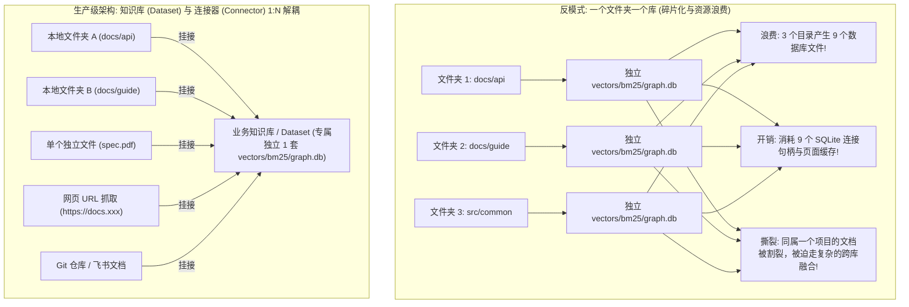
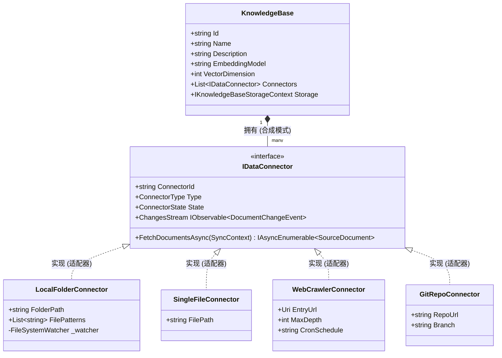
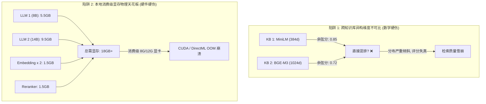
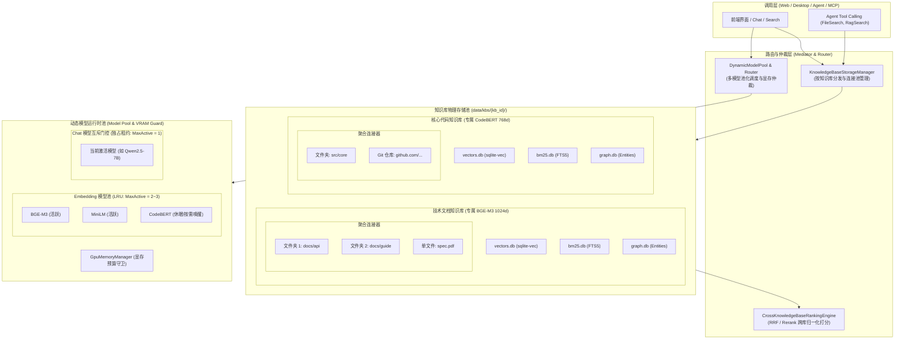
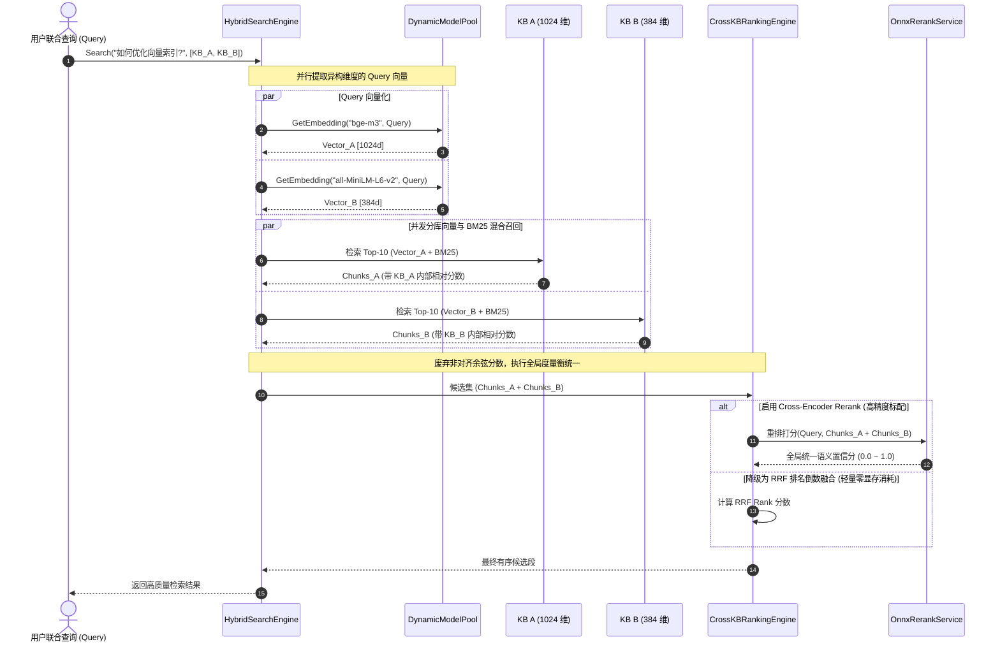
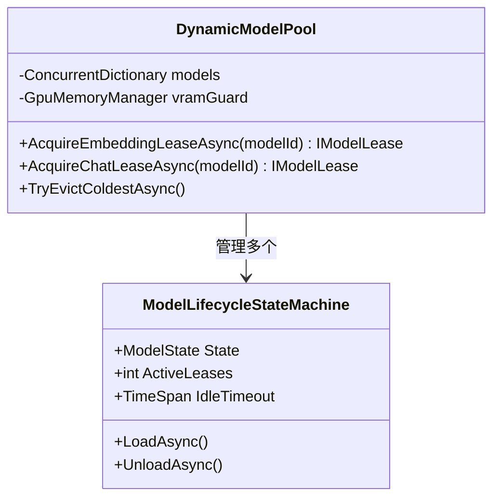
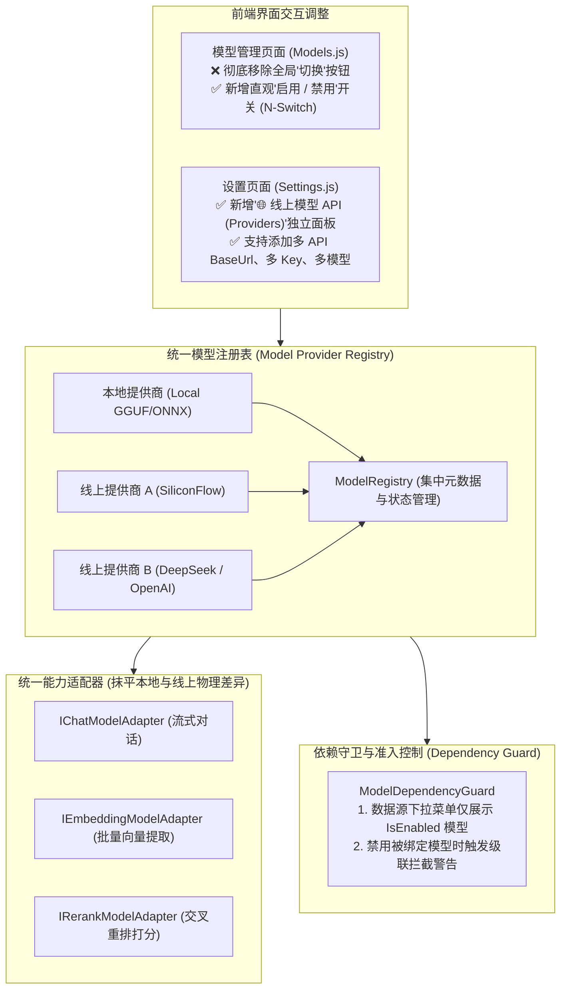

# 知识库物理隔离与多模型动态生命周期架构规范 (Knowledge Base Isolation & Dynamic Model Lifecycle Architecture)

> **文档性质**：核心底层架构规范与重构设计方案（纯调研设计，未改动生产业务代码）  
> **版本**：v2.0 (已消除方案内部冲突：统一为 **KnowledgeBase（知识库容器）与 IDataConnector（数据连接器）1:N 解耦架构**)  
> **涉及核心需求**：
> 1. 数据物理隔离与独立管理：BM25、图谱（Graph）、向量数据按知识库独立管理（单库秒级重建、备份迁移、故障彻底隔离）；
> 2. 单知识库聚合多文件夹与多元数据接入：彻底解决“一个文件夹一个库”的资源浪费与语义割裂，并为未来单文件、网页、Git 等非文件夹数据源奠定插件化扩展基石；
> 3. 知识库与嵌入模型解耦：支持不同知识库独立绑定不同嵌入模型（如通用文档绑定 BGE-M3 1024 维，代码库绑定 CodeBERT 768 维）；
> 4. 多模型动态池化调度与资源冲突仲裁：解决嵌入与聊天模型按需拉起、显存（VRAM）争用、硬件上下文死锁与 OOM 防护；
> 5. 客观技术决断答辩：**“或者说 这个改动很大 不推荐？”**（给出 ROI 矩阵、风险与分阶段落地路线）。

---

## 1. 核心研判：“这个改动很大 不推荐？”的技术答辩

针对用户的核心关切——**“这个改动是不是很大？到底推不推荐做？”**，架构委员会的客观技术决断如下：

> [!IMPORTANT]
> **总评决断**：该改动属于 **【系统核心骨架演进级（L4 架构重构）】**。  
> **核心结论**：“分治推进，切忌盲目一刀切”——**强烈推荐第 1、2、3 项按标准解耦，但对第 4 项“多模型并发”坚决不推荐全量无上限常驻，必须采用“轻量池化 + 独占互斥”的动态调度机制！**

### 1.1 收益 vs 复杂度矩阵（ROI 综合评估）

| 架构维度 | 改动深度 | 核心痛点与攻坚价值 | 潜在风险与致命陷阱 | 架构决断与推荐度 |
| :--- | :--- | :--- | :--- | :--- |
| **1. 存储按知识库物理隔离** | **中等**<br>(~10-15 文件) | **极高**。彻底解决“单库损坏全库报废”、“单源清空全表扫描锁表”、“无法独立导出归档”等单体库硬伤。 | 跨库联合检索时需要协调多个库的连接与聚合。 | **⭐⭐⭐⭐⭐ 强烈推荐！**<br>属于 RAG 迈向工业级生产的必由之路。 |
| **2. 知识库与多元连接器 1:N 解耦** | **中等**<br>(~10-12 文件) | **极高**。避免“一个文件夹一个库”导致的几十个 SQLite 碎片浪费；支持多文件夹聚合；为单文件、网页、Git 奠基。 | 多文件夹下存在同名文件冲突（如两个目录都有 `README.md`）。 | **⭐⭐⭐⭐⭐ 强烈推荐！**<br>彻底统一领域模型，释放无限接入能力。 |
| **3. 知识库与嵌入模型解耦** | **中等偏高**<br>(~12-16 文件) | **高**。代码库可用专用代码模型，文档库用多语言通用模型，轻量速记用小模型。 | **异构余弦空间不可比陷阱**（384 维与 1024 维数学不可比，跨库混排直接比分必雪崩）。 | **⭐⭐⭐⭐ 推荐（有强制前提）！**<br>跨库联合查询必须强制引入 RRF 或 Rerank。 |
| **4. 多模型动态启动与防冲突** | **极高**<br>(~20-25 文件) | **极高（但受物理限制）**。实现按需自动调用模型，免去手动重启服务。 | **显存物理天花板（VRAM Wall）**：消费级显卡（6G~16G）塞入多个 LLM 必触发 DirectML / CUDA OOM 蓝屏或死锁。 | **⭐⭐⭐ 推荐“动态池化调度”，坚决不推荐“全量常驻”！**<br>Embedding 小模型池化 + Chat 大模型严格独占排他。 |

### 1.2 为什么改动很大？影响面（Blast Radius）透视
通过 CodeGraph 影响面扫描：
- `IVectorStore`：目前在系统中拥有 **46+ 个直接依赖项**（涵盖 `FileIndexPipeline`, `HybridSearchService`, `ContextBuilder`, `ObsidianLinkGenerator` 等）；
- `IBM25Store`：拥有 **12+ 个直接调用点**；
- `IGraphStore`：拥有 **8+ 个直接调用点**；
- `IEmbeddingService`：拥有 **22+ 个直接调用点**。

**架构决断**：若直接暴力推倒全局 `IVectorStore` 单例，会瞬间打碎全系统近半数业务链路。**本方案采用“门面中介层模式（Facade & Mediator Pattern）”，保持上层业务 API 不变，在下层透明完成按知识库的路由分发。**

---

## 2. 领域建模重塑：破除“文件夹即源”的反模式

### 2.1 为什么必须破除“一个文件夹一个库”？
在初期直觉中，容易把用户添加的“一个文件夹路径”直接对应为一个独立的底层数据库（`vectors.db`, `bm25.db`, `graph.db`）。但在实际应用中，这会导致严重的架构反模式：



1. **物理碎片化与连接句柄雪崩**：一个中型项目通常划分 5~10 个子目录。若按目录分库，系统将常驻 30~50 个 SQLite 文件，Page Cache 内存开销暴增数十倍，文件描述符与锁竞争严重；
2. **业务领域语义被暴力撕裂**：同一项目的“API 手册”和“开发指南”如果分在两个库，其知识图谱实体（如 `ConfigManager`）将变成孤岛，检索无法自然关联；
3. **扩展性完全卡死**：若数据源的核心属性依然是 `FolderPath`，未来要接入**单篇核心 PDF、网页 URL 抓取、Git 仓库、Notion/飞书云文档**时，系统底层抽象将彻底瘫痪。

### 2.2 生产级 1:N 核心领域实体解耦



1. **知识库（Knowledge Base / Dataset / 存储与模型边界）**：
   - **物理隔离单元**：拥有专属的独立存储沙箱（`data/kbs/{kb_id}/` 下的 `vectors.db`, `bm25.db`, `graph.db`）；
   - **模型绑定单元**：绑定**单一专属的嵌入模型**（如 BGE-M3 1024 维）；
   - **运维管控单元**：支持一键清空重建、整体打包导出/迁移、独立 API Key 授权。
2. **数据连接器（IDataConnector / 数据接入边界）**：
   - **数据供给单元**：负责从特定源头（文件夹、网页、单文件、API）拉取内容，输出标准化的流式 `SourceDocument`；
   - **变动监听单元**：维护自身的变动机制（如文件夹用文件监控，网页用定时拉取）；
   - **1:N 映射关系**：一个 KnowledgeBase 天然包含 N 个异构 DataConnector。

---

## 3. 核心技术陷阱与工程瓶颈透视

在架构设计中，必须正面击穿以下 4 个工程与数学层面的核心陷阱：



### 3.1 陷阱 1：异构向量维度的“数学不可比灾难”（Cosine Space Incomparability）
- **现象**：KB 1 使用 384 维向量，KB 2 使用 1024 维向量。用户同时勾选了两个知识库联合搜索。
- **数学本质**：余弦相似度公式 $\cos(\theta) = \frac{\mathbf{u} \cdot \mathbf{v}}{\|\mathbf{u}\| \|\mathbf{v}\|}$ 仅在**同一向量空间、同一维度、同一特征分布**下才有可比性。不同模型的空间曲率与打分区间完全不对齐（例如某个模型打分集中在 0.3~0.5，另一个模型打分集中在 0.7~0.9）。直接将 0.85 和 0.72 混排，会导致低相关文档霸榜。
- **架构解法（黄金标配）**：
  1. **跨库强制 RRF（Reciprocal Rank Fusion 倒数排名融合）**：抛弃绝对余弦分，只取各自库内的相对位次：
     $$RRF\_Score(d) = \sum_{k \in KBs} \frac{1}{60 + Rank_k(d)}$$
  2. **统一 Cross-Encoder Rerank 终极重排**：各 KB 召回 Top-10 候选文本段，交由全局统一的 BGE-Reranker 交叉重排，产出唯一具备绝对可比性的语义相关度置信分。

### 3.2 陷阱 2：本地消费级显存物理天花板（The VRAM Wall）
- **物理现状**：个人电脑通常搭载 6GB~16GB 显卡（如 RTX 3060/4060/4070）或苹果统一内存/集显。
- **显存账单**：
  - 1 个 8B 聊天大模型加载独占 5.5GB 显存，推理 KV Cache 占 1~2GB；
  - 1 个 14B 模型独占 9.5GB 显存；
  - 2 个 Embedding 模型占 1.5GB；
  - 1 个 BGE-Rerank 占 1.5GB。
- **灾难后果**：若允许同时并发常驻多个大模型，显存需求将瞬间突破 18GB+，触发驱动级 OOM 闪退或 TDR 蓝屏。
- **架构解法**：
  - **轻量 Embedding 模型池化（LRU Model Pool）**：参数量小（200M~800M），显存友好，允许小容量常驻（`MaxActive = 2~3`），空闲滑动过期；
  - **超重 Chat 模型独占排他（Exclusive Lease）**：聊天大模型极其沉重，**显存中绝对只允许存在 1 个当前活跃模型（`MaxActive = 1`）**，切换时通过引用计数安全排空并置换。

### 3.3 陷阱 3：跨知识库多模型 Query 向量化延迟累乘
- 若用户联合检索 3 个不同模型的知识库，串行调用将导致 3x 的向量化延迟（如 20ms + 80ms + 40ms = 140ms）。
- **架构解法**：采用 `Task.WhenAll` 并行计算，多模型推理利用已有的 `GpuMemoryManager` 协调上下文。

### 3.4 陷阱 4：多文件夹/异构连接器下的同名文件冲突
- 知识库挂载了两个不同文件夹时，若都存在 `README.md`，单纯以相对路径作为主键会导致数据库主键冲突或数据互相覆盖。
- **架构解法**：全面推行 **RFC 3986 标准 URI（Uniform Resource Identifier）**：
  - 本地文件：`file:///e:/ProjectA/README.md`
  - 单个文件：`file:///c:/Manuals/architecture.pdf`
  - 网页链接：`https://learn.microsoft.com/zh-cn/dotnet/csharp/`
  - Git 代码：`git://github.com/dotnet/runtime?branch=main&path=docs/design.md`
  - **主键设计**：文档唯一键统一使用 `SHA256(URI)`（64 位 Hex 哈希），彻底根除同名冲突。

---

## 4. 业界主流方案全景对照与系统资产盘点

### 4.1 业界主流框架对比

| 业界系统 | 存储与索引边界 | 数据接入与供给抽象 | 映射关系 | 异构模型与跨库检索打分策略 | 资源调度机制 |
| :--- | :--- | :--- | :--- | :--- | :--- |
| **Dify.ai** | **Dataset (知识库)** | **Data Source & Document** | 1 个 Dataset 包含 N 个 Sources (Folder/File/Web/Notion) | 每个 Dataset 强绑定单一 Embedding 模型；跨库混查时**强制开启 Rerank 统一打分**。 | 依赖外部推理 API（OpenAI/Ollama/vLLM），将并发和显存转嫁给外部服务。 |
| **FastGPT** | **Dataset (知识库)** | **Collection (来源集合)** | 1 个 Dataset 包含 N 个 Collection (Folder/File/URL/QA) | Collection 元数据记录模型；跨库混查采用 **RRF 倒数排位融合**。 | 依托本地或远程 API，无内置模型权重管理。 |
| **LlamaIndex** | **Index / DocumentStore** | **Data Connector (LlamaHub)** | 1 个 Index 摄取多 Connector 数据 (数百种 Reader) | `RouterQueryEngine` 智能路由或广播后通过 `SentenceTransformerRerank` 重新标定。 | Python 进程内加载，易爆显存，推荐外接 API。 |
| **Qdrant / Milvus** | **Collection** | **Client Ingestion** | 底层物理强制：单个 Collection 向量维度固定 | 异构维度**必须**物理拆分 Collection；跨 Collection 检索由客户端归一化。 | 内存/磁盘 HNSW 索引物理隔离。 |
| **Ollama** | **Model Library** | **Runtime Serving** | N/A (模型运行时服务) | 支持运行时多模型加载 | `OLLAMA_MAX_LOADED_MODELS` 限制显存上限，超出自动执行 LRU 驱逐。 |

### 4.2 当前系统已有基础设施与资产复用清单（复用率超 70%）

| 现有系统资产 | 源码位置 | 当前能力 | 本次架构复用与扩展方案 |
| :--- | :--- | :--- | :--- |
| **`ModelLifecycleStateMachine<TAdapter>`** | `Infrastructure/.../StateMachine/ModelLifecycleStateMachine.cs` | 强类型状态机、`ModelLease` 租约计数、滑动过期、`_lifecycleGate` 排他门控 | **直接复用为模型实例的生命周期核心**，作为 `DynamicModelPool` 的基础单元。 |
| **`GpuMemoryManager`** | `Infrastructure/.../Services/GpuMemoryManager.cs` | 实时显存探测、`EnterInference` / `ExitInference` 推理计数互斥、显存超限收缩回调 | **直接复用为显存预算守卫（VRAM Budget Guard）**，作为拉起冷模型的准入仲裁器。 |
| **`SharedSqliteConnection`** | `Infrastructure/.../Database/SharedSqliteConnection.cs` | 共享连接与读写锁排他协调 | **复用为单知识库专属连接对象**，每个知识库分配独立的 `SharedSqliteConnection`。 |
| **`OnnxRerankService`** | `Infrastructure/.../Services/OnnxRerankService.cs` | BGE-Reranker 交叉编码器硬件加速重排 | **复用为跨知识库异构维度的终极裁判器**，统一非标定余弦分。 |
| **`FileIndexPipeline`** | `Business/.../Indexing/Services/FileIndexPipeline.cs` | 分段、哈希检测、向量入库流水线 | **入参抽象升级为 `SourceDocument` 流**，核心索引构建流水线 100% 复用。 |
| **`FileMonitorService`** | `Infrastructure/.../FileMonitor/FileMonitorService.cs` | `FileSystemWatcher` 防抖动与事件分发 | **直接封装为 `LocalFolderConnector` 的内部引擎**。 |

---

## 5. 目标总体架构设计

### 5.1 整体分层拓扑架构图



---

## 6. 核心子系统详细架构设计

### 6.1 存储按知识库物理隔离设计（Storage Isolation）

#### 6.1.1 磁盘目录树规范
```text
data/
├── global/                               # 全局系统数据
│   ├── auth.db                           # API Key 授权库
│   ├── query_stats.db                    # 全局查询统计库
│   └── kb_catalog.json                   # 知识库元数据注册表
└── kbs/                                  # 知识库物理隔离沙箱
    ├── kb_tech_docs/                     # 知识库 1: 技术文档库
    │   ├── meta.json                     # 绑定的模型配置 (bge-m3, 1024d)
    │   ├── vectors.db                    # 专属 sqlite-vec 向量库
    │   ├── bm25.db                       # 专属 FTS5 全文索引库
    │   └── graph.db                      # 专属图谱实体库
    └── kb_core_project/                  # 知识库 2: 核心代码库
        ├── meta.json                     # 绑定的模型配置 (codebert, 768d)
        ├── vectors.db
        ├── bm25.db
        └── graph.db
```

#### 6.1.2 核心抽象接口（工厂模式 + 享元连接池）
```csharp
/// <summary>
/// 单个知识库的完整物理存储上下文（聚合向量、BM25 和图谱）
/// </summary>
public interface IKnowledgeBaseStorageContext : IDisposable
{
    string KnowledgeBaseId { get; }
    IVectorStore VectorStore { get; }
    IBM25Store BM25Store { get; }
    IGraphStore GraphStore { get; }
    DateTime LastAccessedUtc { get; }
}

/// <summary>
/// 知识库存储管理器（负责按需打开、LRU 连接池维护、安全生命周期）
/// </summary>
public interface IKnowledgeBaseStorageManager
{
    /// <summary>获取或按需激活某个知识库的存储上下文</summary>
    IKnowledgeBaseStorageContext GetStorageContext(string kbId);
    
    /// <summary>获取所有已启用的活跃知识库上下文</summary>
    IReadOnlyList<IKnowledgeBaseStorageContext> GetAllActiveContexts();
    
    /// <summary>原子重置/清空单个知识库（毫秒级文件清理，零锁表）</summary>
    Task ResetKnowledgeBaseAsync(string kbId, CancellationToken ct = default);
    
    /// <summary>物理删除一个知识库的所有磁盘数据</summary>
    Task DeleteKnowledgeBaseAsync(string kbId, CancellationToken ct = default);
}
```

---

### 6.2 多元连接器插件架构设计（Connector Architecture）

#### 6.2.1 统一文档契约与连接器接口（适配器模式）
```csharp
/// <summary>
/// 标准统一文档契约
/// </summary>
public class SourceDocument
{
    /// <summary>全局唯一资源定位符 (URI)</summary>
    /// <example>file:///e:/docs/guide.md 或 https://wiki.org/page</example>
    public string Uri { get; set; } = "";

    /// <summary>所属连接器 ID</summary>
    public string ConnectorId { get; set; } = "";

    /// <summary>文档标题或可读相对路径</summary>
    public string Title { get; set; } = "";

    /// <summary>流式文本内容委托（规避大文件加载进内存）</summary>
    public Func<Stream> OpenReadStream { get; set; } = null!;

    /// <summary>内容指纹（MD5 或 SHA256，用于秒级增量去重）</summary>
    public string ContentHash { get; set; } = "";

    /// <summary>最后修改时间</summary>
    public DateTime LastModifiedUtc { get; set; } = DateTime.UtcNow;

    /// <summary>扩展元数据字典</summary>
    public Dictionary<string, string> Metadata { get; set; } = new();
}

/// <summary>
/// 数据源接入连接器标准接口
/// </summary>
public interface IDataConnector : IAsyncDisposable
{
    string ConnectorId { get; }
    ConnectorType Type { get; }
    ConnectorState State { get; }

    /// <summary>增量拉取或全量扫描文档流</summary>
    IAsyncEnumerable<SourceDocument> FetchDocumentsAsync(SyncContext context, [EnumeratorCancellation] CancellationToken ct = default);

    /// <summary>实时文件/数据变动事件流（不支持监听的非文件源返回 null）</summary>
    IObservable<DocumentChangeEvent>? ChangesStream { get; }
}
```

#### 6.2.2 差异化同步策略（策略模式）
- **`FileSystemEventSyncStrategy`**：本地文件夹与单文件，利用 `FileSystemWatcher` 与防抖动队列（Debounce Queue）实现近实时毫秒级更新；
- **`CronPollingSyncStrategy`**：网页爬虫、Git 仓库或云端 API，设置 Cron 定时器（如每 6 小时触发一次），依靠 HTTP ETag / Last-Modified 检查变动，防止频繁请求触发限流封禁；
- **`WebhookPushSyncStrategy`**：开放 HTTP 端点，供外部 Git Push 或飞书机器人被动推送变动事件。

#### 6.2.3 连接器状态机治理（状态机模式）
为每个 Connector 赋予独立的状态机 `ConnectorLifecycleStateMachine`：
- **状态流转**：`Uninitialized` -> `Idle` -> `Syncing` -> `Watching` -> `Faulted` -> `Disabled`；
- **故障隔离**：当某个网络爬虫 Connector 发生网络超时或 429 限流时，状态转为 `Faulted` 并开启指数退避重试，**绝对不影响同一知识库下本地文件夹 Connector 的正常监听和索引构建**。

---

### 6.3 跨知识库异构检索与统一打分引擎（Cross-KB Fusion Engine）



---

### 6.4 多模型动态池化调度与显存仲裁治理（Dynamic Model Pool）



#### 6.4.1 分级治理规则
1. **Embedding 模型池（轻量级，LRU 池化复用）**：
   - 特点：模型体积小（300MB~1GB），显存占用可控；
   - 规则：设置 `MaxActiveEmbeddingModels = 2`；
   - 调度：采用 **LRU 缓存状态机**。当请求需要拉起第 3 个模型时，检查当前是否有空闲（`ActiveLeases == 0`）且最久未访问的模型，触发 `UnloadAsync` 释放显存后拉起新模型；若全在使用中，进入异步门控队列（WaitGate）。
2. **Chat 聊天大模型（超重量级，独占排他互斥）**：
   - 特点：模型体积大（4GB~12GB），极易触发 OOM；
   - 规则：设置 `MaxActiveChatModels = 1`（严格单活跃实例）；
   - 调度：采用 **排他租约置换器（Exclusive Model Swapper）**。切换模型时，若当前模型仍在推理中，新请求进入队列等待排空；推理完成立即触发原模型完整卸载并释放显存上下文，再拉起目标模型。
3. **显存预算守卫（VRAM Budget Guard）**：
   - 每次拉起任何模型前，调用 `GpuMemoryManager.GetMemoryInfo()`；
   - 若系统空闲显存小于该模型的安全阈值（如要求至少 1.5GB 缓冲空闲），拒绝强制加载，并自动触发空闲模型的强制提前释放；如果仍不足，平滑降级为 CPU 运算模式（防止整个应用闪退崩溃）。

---

## 7. 统一设计模式落地矩阵

| 架构痛点 / 模块 | 采用设计模式 | 角色与落地说明 |
| :--- | :--- | :--- |
| **多知识库存储获取** | **工厂模式 (Factory)** + **享元模式 (Flyweight)** | `KnowledgeBaseStorageFactory` 负责动态创建；`KnowledgeBaseContextPool` 维护 LRU 活跃连接池，限制最大打开连接数。 |
| **异构数据源接入** | **适配器模式 (Adapter)** + **合成模式 (Composite)** | `IDataConnector` 抹平文件夹、单文件、网页差异；`KnowledgeBase` 合成挂载多个连接器。 |
| **差异化数据同步** | **策略模式 (Strategy)** | 定义 `ISyncStrategy`，分别实现文件监控事件策略、定时轮询 ETag 策略与 Webhook 被动策略。 |
| **跨库异构打分融合** | **策略模式 (Strategy)** | 定义 `ICrossKnowledgeBaseRankingStrategy`，提供 `RerankCrossEncoderStrategy`（高精度）与 `RrfRankFusionStrategy`（轻量）两套策略。 |
| **多模型生命周期与淘汰** | **状态机模式 (State Machine)** + **RAII 租约模式 (Lease)** | 复用现有的 `ModelLifecycleStateMachine<TAdapter>`，结合 `IModelLease` 的 `using` 机制，保证推理中绝对不会被误卸载。 |
| **复杂模型加载与显存仲裁** | **门面模式 (Facade)** + **中介者模式 (Mediator)** | `DynamicModelRouter` 对外提供统一的 `GetEmbeddingAsync` / `ChatStreamAsync`，内部协调 GPU 显存监控、排队锁与 LRU 淘汰。 |

---

## 8. 配置模型升级与向后兼容平滑自愈方案

### 8.1 升级后的 `appsettings.json` Schema
```json
{
  "ReferenceRAG": {
    "knowledgeBases": [
      {
        "id": "kb_core_project",
        "name": "核心研发知识库",
        "description": "包含项目核心源码与开发手册",
        "enabled": true,
        "embeddingModel": "bge-m3",
        "vectorDimension": 1024,
        "connectors": [
          {
            "id": "conn_docs",
            "type": "LocalFolder",
            "name": "开发手册目录",
            "path": "E:/Projects/Docs",
            "filePatterns": ["*.md", "*.txt"],
            "watchChanges": true
          },
          {
            "id": "conn_code",
            "type": "LocalFolder",
            "name": "核心代码目录",
            "path": "E:/Projects/Source/Core",
            "filePatterns": ["*.cs", "*.ts"],
            "watchChanges": true
          },
          {
            "id": "conn_spec_pdf",
            "type": "SingleFile",
            "name": "架构设计白皮书",
            "path": "E:/Specs/whitepaper.pdf"
          },
          {
            "id": "conn_wiki",
            "type": "WebCrawler",
            "name": "官方在线文档",
            "entryUrl": "https://docs.mycompany.com",
            "maxDepth": 2,
            "cronSchedule": "0 0 * * *"
          }
        ]
      }
    ]
  }
}
```

### 8.2 向后兼容机制（Backward Compatibility Bridge）
当系统启动加载配置时，若发现配置文件中仍是旧版 `Sources: [ { Path, Name, ... } ]`：
- `ConfigBootstrap` 自动在内存中将其映射为一个默认的 `KnowledgeBase`（ID: `kb_default`）；
- 将存量的每个 `SourceFolder` 自动包装为一个 `LocalFolderConnector`；
- 用户存量数据、调用方式与使用习惯 **100% 保持向后兼容，零心智负担平滑升级**！

---

## 9. 统一模型抽象与线上多 API / 多模型管理架构（Model Provider & Registry）

随着系统演进为“知识库容器 + 多元连接器”架构，对底层模型服务的需求也发生了质的飞跃：
- 知识库需要灵活绑定不同的嵌入模型（可能本地跑 BGE-M3，也可能调用 SiliconFlow 的 BAAI/bge-m3 API，甚至使用 OpenAI 的 text-embedding-3-small）；
- 聊天服务需要同时对接本地 GGUF 大模型与线上 DeepSeek-V3 / Qwen-Max / Claude 等多个 API 平台；
- 传统的“单模型全局切换”模式已成为严重阻碍，必须全面升级为**“模型资源注册表（Model Provider Registry） + 动态适配器（Adapters）”**架构。



---

### 9.1 使用统一抽象抹平本地与线上差异（适配器与提供商模式）

无论模型是本地由 llama.cpp / ONNX Runtime 驱动，还是托管在远端由 HTTP API 响应，业务层（`HybridSearchEngine`, `FileIndexPipeline`, `MafChatService`）必须保持单一调用接口，完全解耦底层物理实现。

#### 9.1.1 统一模型描述符（ModelDescriptor）
```csharp
/// <summary>
/// 模型用途能力类型（支持按位组合或单选）
/// </summary>
[Flags]
public enum ModelCapability
{
    None = 0,
    Chat = 1 << 0,        // 对话生成 (LLM)
    Embedding = 1 << 1,   // 文本向量化
    Rerank = 1 << 2,      // 交叉重排
    Vision = 1 << 3       // 多模态视觉
}

/// <summary>
/// 统一模型元数据描述符
/// </summary>
public class ModelDescriptor
{
    /// <summary>系统唯一模型标识 (如 "local:bge-m3" 或 "online:siliconflow:deepseek-ai/DeepSeek-V3")</summary>
    public string Id { get; set; } = "";

    /// <summary>前端展示友好名称</summary>
    public string DisplayName { get; set; } = "";

    /// <summary>所属提供商 ID (如 "local", "prov_siliconflow", "prov_deepseek")</summary>
    public string ProviderId { get; set; } = "";

    /// <summary>是否为本地物理模型</summary>
    public bool IsLocal { get; set; }

    /// <summary>模型支持的能力类型</summary>
    public ModelCapability Capability { get; set; }

    /// <summary>向量维度 (仅嵌入模型有效，如 384, 768, 1024, 1536)</summary>
    public int? VectorDimension { get; set; }

    /// <summary>最大上下文窗口 Token 数 (仅对话模型有效，如 8192, 65536, 131072)</summary>
    public int? ContextWindow { get; set; }

    /// <summary>是否启用（未启用的模型不会拉起，亦不可在数据源中选择）</summary>
    public bool IsEnabled { get; set; } = true;

    /// <summary>运行时生命周期状态 (Disabled, Unloaded, Ready, Inferring, Faulted)</summary>
    public ModelState RuntimeState { get; set; } = ModelState.Unloaded;
}
```

#### 9.1.2 统一适配器接口（Adapter Interfaces）
- **`IEmbeddingModelAdapter`**：负责向量化输入，屏蔽本地张量转换与线上 HTTP POST 的差异，内建向量维度校验；
- **`IRerankModelAdapter`**：负责对 `(Query, Document)` 进行交叉编码打分，抹平本地 ONNX Rerank 与远端 Cohere / SiliconFlow Rerank API 的差异；
- **`IChatModelAdapter`**：负责流式输出与 Tool Calling 格式化，屏蔽 GGUF 语法采样与 OpenAI SSE (Server-Sent Events) 的协议差异。

---

### 9.2 设置页面调整与线上多 API / 多模型管理界面设计

#### 9.2.1 设置页面（Settings.js）导航架构调整
在设置页面的“🤖 模型与推理”一级面板下，重构为以下二级选项卡：
1. **💬 对话主模型**：保留本地 GGUF 性能画像、上下文规划与全局默认对话模型选择；
2. **🌐 线上模型 API（新增核心 Tab）**：统一配置第三方或自建的多个 API 提供商及其模型矩阵；
3. **📥 模型中心与下载源**：保留 HuggingFace / ModelScope 镜像源与本地下载配置。

#### 9.2.2 线上模型 API（Model Providers）交互界面设计
在“🌐 线上模型 API”面板中，用户可以自由添加任意数量的 API Provider：

```text
+---------------------------------------------------------------------------------------------------+
|  [+ 添加 API 提供商]                                                                              |
|                                                                                                   |
|  ▼ 提供商: SiliconFlow (硅基流动)                                   [测试连通性] [编辑] [删除]     |
|    Base URL: https://api.siliconflow.cn/v1                         API Key: sk-silicon****abcd    |
|    模型列表:                                                        [+ 添加模型] [从 API 自动拉取] |
|    +--------------------------------+---------------+----------+--------+------------------------+ |
|    | 模型 ID                        | 显示名称       | 能力类型 | 维度   | 状态 (启用/禁用)       | |
|    +--------------------------------+---------------+----------+--------+------------------------+ |
|    | BAAI/bge-m3                    | BGE-M3 (线上)  | 嵌入     | 1024   | [======●] 已启用       | |
|    | deepseek-ai/DeepSeek-V3        | DeepSeek-V3   | 聊天     | --     | [======●] 已启用       | |
|    | BAAI/bge-reranker-large        | BGE 重排 (线上)| 重排     | --     | [●======] 已禁用       | |
|    +--------------------------------+---------------+----------+--------+------------------------+ |
|                                                                                                   |
|  ▶ 提供商: DeepSeek 官方                                           [测试连通性] [编辑] [删除]     |
|  ▶ 提供商: 本地 vLLM 集群 (192.168.1.100:8000)                      [测试连通性] [编辑] [删除]     |
+---------------------------------------------------------------------------------------------------+
```

- **从 API 自动拉取（Fetch Models from /v1/models）**：用户填入 BaseUrl 和 Key 后，点击按钮可自动调用标准 `/v1/models` 端点拉取支持的模型列表，一键勾选导入，极大降低手动输入的繁琐度。

---

### 9.3 模型管理页面（Models.js）大手术：去除“切换”改为“启用/禁用”

#### 9.3.1 为什么必须彻底干掉“切换”按钮？
- **旧逻辑弊病**：在单体设计中，存在全局“当前模型”的概念，用户点击“切换”必须全系统中断并切换。
- **新架构形态**：由于我们已经引入了“知识库绑定专属模型”与“多模型动态池化调度”，**系统在同一时刻本来就支持多个模型并存就绪**！
  - 知识库 A 使用 BGE-M3，知识库 B 使用 MiniLM；
  - 聊天助手使用 Qwen2.5-7B；
  - 全局根本不需要一个生硬的“全局切换”动作！

#### 9.3.2 交互改造细节
1. **移除元素**：
   - 彻底删除表格操作列中的“切换（Switch）”按钮；
   - 彻底删除“是否切换当前模型为 XXX 并清空/保留旧向量”的破坏性确认弹窗；
2. **新增元素**：
   - 在表格第一列增加直观的 **Naive UI `N-Switch`（“启用/禁用”）**；
   - 标签状态体系：
     - `Disabled`（灰色）：已禁用。系统严格禁止拉入显存，数据源下拉不可选；
     - `Enabled`（绿色）：已启用。登记在册，随时供知识库或对话按需拉起；
     - `Ready`（蓝色）：已就绪。当前正驻留于显存/内存池中，调用零冷启动；
     - `Inferring`（亮蓝呼吸灯）：正在推理中。

---

### 9.4 核心业务规则深度论证：“数据源只能使用已启用的模型？”

针对用户提出的核心疑问：**“数据源（知识库）只能使用启用的模型？”**，我们进行了严密的边界与隐患论证：

#### 9.4.1 规则 1：新建与编辑知识库时的“准入铁律”
- **完全支持且必须实施**！
- 在创建或编辑知识库时，嵌入模型下拉菜单：
  $$\text{VisibleModels} = \{ m \in \text{ModelRegistry} \mid m.\text{IsEnabled} == \text{true} \land m.\text{Capability} \ni \text{Embedding} \}$$
- 下拉项按“本地已下载启用”与“线上 API 启用”进行清晰的分组展示，禁止用户选择任何未启用或格式不可用的死模型。

#### 9.4.2 规则 2：模型被知识库绑定时的“依赖守卫（Dependency Guard）”
这里存在一个**严重的逻辑隐患**，必须在架构层面设防：
> [!CAUTION]
> **逻辑死锁陷阱**：假设知识库【核心源码】已经使用 `bge-m3`（1024 维）向量化了 5 万个文件分块。如果用户随手在模型管理页面把 `bge-m3` 给**“禁用”**了，后续当用户在知识库搜索时，系统无法将用户的新 Query 向量化，搜索功能将直接抛出异常崩溃！新增文件也无法再构建索引！

**优雅破解机制**：
1. **依赖拦截警告（Dependency Block）**：
   - 当用户在模型管理页面尝试切换某个模型的 Switch 为“禁用”时，触发 `IModelDependencyGuard` 检查：
   ```csharp
   public interface IModelDependencyGuard
   {
       /// <summary>检查模型是否正在被任何活跃知识库强依赖</summary>
       bool CanDisableModel(string modelId, out List<string> dependentKnowledgeBases);
   }
   ```
   - 若发现有知识库绑定了该模型，弹窗拦截并给出明确指引：  
     > *“无法禁用此模型：该模型当前正被以下知识库作为向量嵌入基准强依赖：【核心研发知识库】。请先前往知识库管理迁移模型或解绑后，再行禁用。”*
2. **线上 API 异常时的“降级检索策略（Graceful Degradation）”**：
   - 若某线上模型并非被用户主动禁用，而是因网络波动、第三方 API 欠费或 Key 失效导致调用失败：
   - 检索管道绝不直接抛出 500 崩溃，而是**自动优雅降级为“BM25 全文检索 + 知识图谱实体检索”**；
   - 前端搜索结果顶部出现警示横幅：*“提示：当前绑定的线上嵌入模型网络不可达，已临时降级为纯文本精确检索，检索精度可能略有下降。”*

---

### 9.5 线上 API 的工程稳健性与安全性设计

1. **API Key 掩码脱敏与安全加密**：
   - 配置文件存储 API Key 时支持可选的本地机器密钥加密（DPAPI / AES-256）；
   - 后端向前端下发配置列表时，所有 API Key 强制脱敏为 `sk-****1234`，严禁在 HTTP 响应中全量暴露明文 Key；用户只在重新输入时才覆盖写入。
2. **并发限流（Rate Limiter）与抖动指数退避（Jittered Backoff）**：
   - 线上大模型 API（如 DeepSeek, SiliconFlow, OpenAI）在执行批量文档向量化（Batch Indexing）时，极易因高频请求触发 `HTTP 429 Too Many Requests`；
   - 适配器内部集成基于 `SemaphoreSlim` 的并发度限制器（如最多同时并发 5 个批次），并在捕获 429 时自动执行带有随机扰动的指数退避重试（200ms -> 800ms -> 3200ms），彻底杜绝批量索引时因网络波动报废。
3. **一键连通性探测（Connection Ping）**：
   - 提供快速测试端点，向目标 Provider 发送包含极简 Token 的探测请求，在 2 秒内验证 BaseUrl 是否拼错、Key 是否有效、网络延迟（Ping ms），给用户极其确定、安心的配置体验。

---

## 10. 三阶段渐进式落地路线图（Roadmap & Milestones）

为了确保系统高度稳定、规避一次性推倒重构的风险，推荐分三个清晰阶段推进：

```mermaid
gantt
    title 知识库隔离与多模型调度三阶段演进路线
    dateFormat  YYYY-MM-DD
    section Phase 1: 知识库存储物理隔离与连接器抽象 (高 ROI, 地基建设)
    设计 IKnowledgeBaseStorageManager 与目录迁移      :a1, 2026-11-01, 3d
    实现 IDataConnector 抽象与 LocalFolder 连接器   :a2, after a1, 4d
    实现单知识库秒级清空/重建与独立 zip 导出/备份    :a3, after a2, 3d
    section Phase 2: 统一模型抽象与线上多 API 管理 (释放模型灵活性)
    重构设置页: 新增线上模型 API 管理面板 (Providers) :b1, after a3, 3d
    模型管理页改版: 去除切换按钮, 改造为启用/禁用      :b2, after b1, 2d
    实现 ModelDescriptor 与 ModelDependencyGuard   :b3, after b2, 3d
    知识库配置绑定已启用的嵌入模型                   :b4, after b3, 2d
    section Phase 3: 跨库打分标定与多模型动态池化 (终极弹性与可靠性)
    落地 CrossKBRankingEngine (RRF & Rerank 重排)    :c1, after b4, 4d
    实现 DynamicModelPool 与显存预算守卫            :c2, after c1, 4d
    实现 Embedding LRU 池 (Max=2) 与 Chat 独占置换   :c3, after c2, 3d
```

### Phase 1：知识库存储物理隔离与多文件夹/单文件连接器抽象（优先推荐）
- **目标**：落地 `data/kbs/{kb_id}/` 单库三表结构；实现 `KnowledgeBase` 与 `IDataConnector` 的 1:N 解耦；
- **收益**：彻底解决“一个文件夹一个库”的浪费；支持一个知识库挂接多个文件夹；单知识库秒级清空与独立 zip 备份迁移；彻底杜绝数据库损坏波及全局。

### Phase 2：统一模型抽象与线上多 API 管理（本次新规划重点）
- **目标**：抹平本地与线上模型差异；实现设置页多 API 提供商与模型矩阵配置；
- **核心落地**：
  - 设置页面上线“🌐 线上模型 API”管理面板，支持配置 BaseUrl、Key 与模型列表（嵌入、重排、聊天）；
  - 模型管理页面移除“切换”按钮，换装直观的“启用/禁用”开关；
  - 落地 `ModelDependencyGuard`，限制知识库只能绑定已启用的嵌入模型，并阻止误禁用使用中的模型。

### Phase 3：跨知识库打分标定与多模型动态池化调度
- **目标**：免去手动切换模型，自动按需激活、显存超限自动驱逐；
- **核心落地**：落地 `CrossKBRankingEngine` 解决异构维度打分，构建 `DynamicModelPool` 筑牢小模型池化 + 大模型独占的双层显存防火墙。

---

## 11. 最终决断与总结

1. **针对用户问题“或者说 这个改动很大 不推荐？”**：
   - 我们的结论是：**架构演进方向非常正确，且完全切中 RAG 从玩具走向生产级的痛点；但切忌一锅端式盲目推进！**
   - **推荐按阶段拆解推进**：
     - **第一步必须且强烈推荐做 Phase 1（存储分库与连接器 1:N 抽象）**：风险最低，收获最高，彻底解决数据库单体锁表和维护痛点；
     - **第二步推荐做 Phase 2（统一模型抽象 + 线上多 API 管理 + 启用禁用开关）**：界面体验大幅现代化，彻底解决多 API 接入难题与误切换痛点；
     - **第三步推进 Phase 3（模型池化与跨库打分）**：坚守“小模型池化、大模型独占、显存严防死守”原则，杜绝 OOM。
2. **当前状态**：
   - 本方案已全面消除方案内部的前后概念冲突，完成统一建模、数学/物理风险排查、设计模式落地与路线图规划；
   - 遵循用户指令，**未修改任何生产业务代码**，等待用户审核方案后决定下一步具体推进计划。
