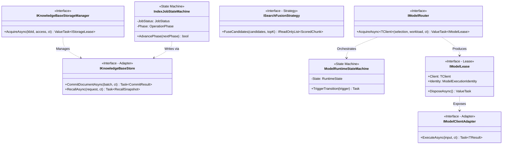
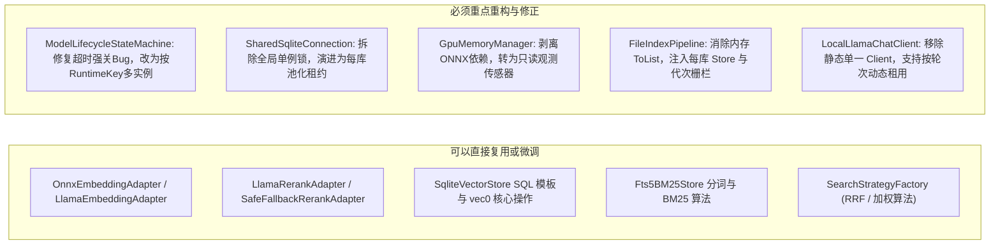

# 知识库隔离与多模型动态生命周期架构：可行性审核、头脑风暴与设计模式重构方案

> 文档编号：DOC-ARCH-2026-11-01  
> 审核对象：[知识库隔离、多连接器与多模型执行架构规范 (v3.3)](per-source-data-isolation-and-multi-model-dynamic-lifecycle-architecture.md) 及 [架构统一契约与实施计划 (v1.0)](unified-architecture-contracts-and-implementation-plan.md)  
> 状态：调研与架构优化建议报告（Docs）  
> 编写日期：2026-11-01（Asia/Hong_Kong）  

---

## 1. 方案审核结论：是否符合作为下阶段优化目标？

### 1.1 审核判定：完全符合且为核心主轴（Approved with Phasing Guardrails）

经过对当前代码库实现与架构规范的系统性比对，该方案**高度符合**作为 ReferenceRAG 下一阶段的核心架构优化目标，属于从“单租户/单模型桌面原型”迈向“生产级/多源隔离/多模型弹性 RAG 平台”的**必经之路**。

### 1.2 战略契合度与核心价值

1. **破除全局单点状态的物理制约**  
   - **当前现状**：`StorageExtensions` 将所有文件与向量统一存入单例 `data/vectors.db`、`data/bm25.db` 与 `data/graph.db`；`LocalLlamaChatClient` 与 `IEmbeddingBackendAdapter` 均为全局静态依赖。不同来源（例如个人笔记、机密商业合同、开源代码库）完全混杂，无法设置独立的切片规则、嵌入模型与检索权限。
   - **方案价值**：通过显式 `KnowledgeBase` 实体，将存储（`data/kbs/{kbId}/kb.db`）、逻辑嵌入契约（`EmbeddingSpec`）、连接器（`ConnectorDefinition`）和访问控制（`ApiKeyPermissionMatrix`）收敛至知识库边界，实现真正的**物理与逻辑双重隔离**。
2. **解决显存竞争崩溃与多模型调度缺陷**  
   - **当前现状**：现有 `ModelLifecycleStateMachine` 仅支持单个静态模型的两阶段热重载，且在卸载等待超时（5 秒）后仍强行释放非托管原生资源，极易在并发在途请求下引发原生指针 Use-After-Free 或 AccessViolation；`GpuMemoryManager` 仅硬编码 ONNX `InferenceSession` 并依赖脆弱的 `nvidia-smi` 进程轮询。
   - **方案价值**：引入统一资源调度器（`IResourceScheduler`）、账本预算预留机制与细粒度模型租约（`IModelLease<T>`），使本地轻重模型（ONNX/LLamaSharp）与远端 API 能够弹性共存，消除了低显存环境下的 OOM 隐患。
3. **架构规范的严密性与工程可落地性**  
   - 方案 v3.3 及其统一计划文档摒弃了“伪跨库 ACID”、“无损模型热切换”、“静态显存估算”等不切实际的假设，显式定义了 `IndexEpoch`（写入栅栏）、`ReadRevision`（查询单调版本）、`DocumentVersion`（证据版本）等版本控制机制，技术路线客观务实。

### 1.3 实施约束与边界建议（Guardrails）

尽管目标正确，但方案包含“知识库物理拆分”、“多模型生命周期调度”、“文档多格式 IR 管道”、“嵌入兼容双路由”等多个高度复杂的专题，**绝对禁止作为单个巨型 PR 一次性推进**。必须严格遵循 [统一计划第 6 节](unified-architecture-contracts-and-implementation-plan.md) 的 **G0 → G1 → G2 → ...** 递进验收门，优先完成 **G0（核心底层验证）与 G1（单库纯文本持久化闭环）**。

---

## 2. 深度头脑风暴：可行性、逻辑严密性与性能瓶颈

在肯定方案战略方向的同时，我们对系统实施细节进行了多维度技术推演与头脑风暴，发现以下**潜在漏洞、工程挑战与可优化空间**：

### 2.1 可行性隐患（Feasibility Gaps）

#### 隐患 1：SQLite + `sqlite-vec` + FTS5 + 图谱 单库（`kb.db`）混合负载与事务回滚
- **现实机制**：方案首选每库一个 `kb.db`。调研证实，`sqlite-vec`（`vec0` 虚拟表）完整实现了 SQLite 虚拟表事务钩子（`xBegin`, `xSync`, `xCommit`, `xRollback`），能够参与普通表事务回滚。
- **潜在陷阱**：
  1. **原生扩展加载开销**：在 .NET 中，每个新打开的 `SqliteConnection` 都必须调用 `connection.LoadExtension("vec0")`。若每请求临时打开连接，高频连接与扩展加载将带来显著 CPU/句柄损耗。
  2. **WAL 自动检查点堵塞**：当后台大批量索引写入向量表与 FTS5 时，WAL 文件急剧增长。若此时前台有只读检索长查询，会导致 WAL 无法 Checkpoint，造成磁盘膨胀与只读查询缓存失效。
- **应对方案**：
  - 实施每库连接池（Lease 池化），避免连接高频重建；
  - 限制写入事务时长，大文档切片在内存完成，落库使用微批次（Micro-batching）短事务；
  - 显式配置 `PRAGMA wal_autocheckpoint` 并将密集写与并发读隔离在不同连接句柄上。

#### 隐患 2：模型加载瞬间的峰值显存（Transient Peak VRAM）击穿
- **现实机制**：方案规划根据“权重大小 + 上下文窗口 KV Cache + 工作区”计算硬预算。
- **潜在陷阱**：LLamaSharp（底层 llama.cpp）或 ONNX Runtime 在加载权重文件（`llama_load_model_from_file` / `OrtCreateSession`）时，需要分配中间反量化缓存、CUDA 运行时上下文以及 Tensor 编排缓冲区。**加载瞬时显存峰值通常达到稳态权重的 1.25x ~ 1.5x**。如果调度账本仅预留稳态预算，在多模型交替置换时，极易在 `Loading` 瞬间触发 `cudaErrorMemoryAllocation`。
- **应对方案**：在 `ResourceDemand` 中显式区分 `PeakLoadVram` 与 `SteadyVram`。新模型加载时原子预留 `PeakLoadVram`，进入 `Ready` 状态后释放瞬态冗余，回落至 `SteadyVram`。

#### 隐患 3：工具调用（Tool Calling）租约释放引起的“模型换入换出颠簸（Thrashing）”
- **现实机制**：方案规定“不持有模型租约等待另一个模型”，因此在 Chat 产生 `tool_calls` 后立即释放 ChatLease，执行检索（占用 Embedding/Rerank 租约），完成后重新获取 ChatLease 生成回答。
- **潜在陷阱**：在消费级显卡（如 6GB/8GB VRAM）上，若 Chat 模型（4GB）与 Embedding+Rerank 模型（2.5GB）无法同时常驻，**一次工具调用将触发两次完整的大模型磁盘读取与卸载**（Chat 卸载 -> Embedding 加载 -> Embedding 卸载 -> Chat 加载）。这会导致单次问答延迟飙升 10~25 秒，并在 SSD 上产生剧烈的 I/O 磨损。
- **应对方案**：
  1. **混合部署路由**：支持“云端/轻量嵌入 + 本地重型 Chat”或“本地轻量嵌入 + 云端 Chat”，避免同设备本地互斥；
  2. **滞后卸载保护（Hysteresis Grace Period）**：调度器支持会话级“租约意图预留”，若显存允许重叠（哪怕逼近上限），优先降级 KV Cache 精度或临时缩小批次，而不直接进行全权重卸载；
  3. **单轮多工具批处理**：严格在一次工具轮次内将所有并行的检索工具聚合执行完毕，禁止交替串行切换模型。

---

### 2.2 逻辑严密性与极端边界漏洞（Logical Gaps & Edge Cases）

#### 漏洞 1：`ReadRevision` 高频递增导致“查询缓存失效风暴（Cache Invalidation Storm）”
- **现实机制**：统一计划规定任何单文档更新、局部删除或能力变更，均在同一事务内递增 `ReadRevision`，且检索缓存 Key 绑定 `ReadRevision`。
- **潜在漏洞**：在后台监控本地文件夹（`FileMonitorService`）或大批量导入时，若 1000 个文件连续写入，`ReadRevision` 将连续递增 1000 次。这导致所有正在前台交互的用户针对该知识库的检索结果缓存命中率直接跌至 0%，产生缓存雪崩。
- **应对方案**：
  - 引入**快照读栅栏（Snapshot Read Fence）**与**防抖版本发布（Debounced Revision Flush）**：批量导入期间只写 Staging，合并为一个批次发布，或允许只读查询在受控容忍度下使用 `ReadRevisionAtTurnStart`。

#### 漏洞 2：Corpus Cohort 异构准入的“全库向量断崖式不可用”
- **现实机制**：知识库维护所有文档向量的实际生产者（`CorpusCohort`）。若更换查询模型端点，该端点必须覆盖全部现存 cohort，否则拒绝混用并降级为全文检索。
- **潜在漏洞**：假设知识库历史存量中有 99% 的文档使用端点 A 生产，有 1%（仅 2 个分块）由于临时网络切换使用了端点 B。若新配置的 Query 能够完美覆盖 A 但无法覆盖 B，系统将把**整库向量检索判定为不可用**，完全退化为 BM25，造成极差的用户体验。
- **应对方案**：
  - 引入**语料群集软准入（Soft Admission / Partial Cohort Coverage）**：当 Query 覆盖超过阈值（如 98% 活动向量）时，允许执行带标注的向量检索，未覆盖的分块仅由全文/图谱分支补充召回，并在 `SearchResponse` 中标明 `DegradedCohorts: ["cohort-b"]`。

#### 漏洞 3：跨库并发检索的“慢库拖累（Straggler Dominance）”
- **现实机制**：用户可同时勾选 8 个知识库检索，共享同一个 `SearchRequest.Deadline`。
- **潜在漏洞**：若前 7 个库在 20ms 内检索完毕，而第 8 个库正在进行磁盘重整理或复杂图遍历，耗时 1900ms，整个请求的端到端耗时将被最慢的库拖死；若第 8 个库超时触发异常，若未配置 `AllowPartial` 则全局返回 504。
- **应对方案**：
  - 引入**自适应候选截断（Hedged Recall Deadline）**：为单库检索设置软上限（例如总超时的 50%）。一旦多数核心库返回足够高质量候选，允许提前汇聚执行重排，超时未响应的慢库标记为 `partial_timeout` 异步丢弃。

---

### 2.3 性能瓶颈（Performance Bottlenecks）

1. **`Microsoft.Data.Sqlite` 伪异步与线程池饥饿**  
   - .NET 官方文档明确指出：`Microsoft.Data.Sqlite` 的 `ExecuteReaderAsync` 等异步方法在底层只是以同步阻塞方式调用 SQLite C API。跨多库使用 `Task.WhenAll` 并发查询时，**每个任务实质上都会长期占用一个 .NET ThreadPool 线程**。在高并发检索场景下，容易触发线程池线程注入延迟（Thread Injection Delay 500ms），导致偶发高延迟尖刺。  
   - **优化**：跨库检索扇出必须受控（通过内部有界调度器限制物理并发度为 `Environment.ProcessorCount` 或更低），不得盲目使用无界 `Task.WhenAll`。
2. **`sqlite-vec` 规模扩容后的全表距离扫描瓶颈**  
   - `sqlite-vec` 0.1.x 的 `vec0` 默认采用穷举距离扫描（Brute-force KNN）。当单库分块数量在 1 万以内时，C 语言向量化耗时极低（< 5ms）；但在 10 万~50 万分块时，全量距离计算将导致明显的 CPU 与内存带宽占用。  
   - **优化**：在表结构设计中充分利用 `sqlite-vec` 的 **`PARTITION KEY`**（例如按 `connector_id` 或文档类别分区），大幅收缩单次 KNN 的搜索空间；未来无缝对接 ANN/IVF 索引。
3. **多库扇出候选集（200+ Chunks）导致的 Cross-Encoder Rerank 算力过载**  
   - 跨 8 库召回，各库提供 25 个候选，总计 200 个分块送入本地重排模型（如 BGE-Reranker-Large）。在 RTX 4060 等消费级显卡上，对 200 个分块执行 Cross-Encoder 推理耗时可达 800ms~2000ms。  
   - **优化**：引入**两阶段级联初筛（Two-Stage Cascade Pruning）**：先使用轻量级 RRF/加权归一化进行跨库粗排，仅截取 Top-30~50 候选送入重排器，将重排推理开销压缩 75% 以上。

---

## 3. 设计模式优化落地方案

针对上述痛点，我们可以系统性地运用成熟设计模式对原方案进行结构优化，实现高内聚、低耦合与零冗余：

### 3.1 适配器模式（Adapter Pattern）：统一多源异构能力

1. **统一模型客户端适配器（Unified Model Client Adapter）**：
   - 既有代码中已具备 `IEmbeddingBackendAdapter` 与 `IRerankBackendAdapter`，但与全局配置紧耦合。
   - **优化设计**：全面对接 .NET 官方标准抽象。
     - 聊天模型统一适配为 `Microsoft.Extensions.AI.IChatClient`；
     - 向量模型统一适配为 `Microsoft.Extensions.AI.IEmbeddingGenerator<string, Embedding<float>>`；
     - 针对底层 ONNX Runtime、LLamaSharp 原生上下文、OpenAI 协议端点、Ollama 服务端点编写独立的 `EngineAdapter`，彻底阻断原生引擎类型（如 `InferenceSession`、`LLamaContext`）向业务层泄露。
2. **数据连接器适配器（`IDataConnectorAdapter`）**：
   - 将现有 `FileMonitorService` 包装为 `LocalFolderConnector`；
   - 抽象规范化的 `SourceChange` 事件流与 `OpenReadAsync` 数据拉取，为后续扩充 `GitRepoConnector` 与 `WebCrawlerConnector` 预留标准化接口。
3. **存储引擎适配器（`IKnowledgeBaseStoreAdapter`）**：
   - 将对 `kb.db` 的操作定义为 `IKnowledgeBaseStore`，包含文档元数据、FTS 搜索、向量匹配与图谱写入；
   - 即使未来评估引入独立服务（如 Qdrant 或 DuckDB），上层业务编排器完全无感知。

### 3.2 策略模式（Strategy Pattern）：算法与多策略解耦

1. **跨库结果融合策略（`ISearchFusionStrategy`）**：
   - `RrfSearchFusionStrategy`：名次倒数融合（默认，无需校准异构余弦分数）；
   - `WeightedLinearFusionStrategy`：针对各库权重配置的加权归一化分数融合；
   - `HierarchicalRerankFusionStrategy`：每库配额采样 + 全局统一 Cross-Encoder 精排。
2. **资源置换与淘汰策略（`IModelEvictionStrategy`）**：
   - `LruEvictionStrategy`：最久未访问优先卸载；
   - `ReloadCostAwareEvictionStrategy`：结合模型权重大小与加载耗时，优先卸载轻量模型（如 100MB 嵌入模型），极力保护重型 Chat 模型（4GB+）；
   - `PriorityTierEvictionStrategy`：后台索引模型可随时被前台交互式聊天模型抢占。
3. **向量准入与兼容验证策略（`IEmbeddingAdmissionStrategy`）**：
   - `StrictZeroToleranceStrategy`：严格向量距离与全集 Cohort 校验；
   - `RankCorrelationAdmissionStrategy`：通过 Kendall-tau / Spearman 名次相关系数评估替代端点的一致性。

### 3.3 状态机模式（State Machine Pattern）：确定性生命周期治理

1. **模型运行时状态机（`ModelRuntimeStateMachine`）**：
   - **状态集**：`Unloaded` ⇄ `Loading` ⇄ `Ready` ⇄ `Inferring` ⇄ `Draining` ⇄ `Unloading` ⇄ `Faulted`。
   - **关键改进**：
     - **Single-Flight 并发合并**：同一 `RuntimeKey` 的并发加载请求挂载到同一个 `TaskCompletionSource`，避免重复加载；
     - **安全排空守卫（Draining Guard）**：进入 `Draining` 状态后立刻拒绝新借用，等待在途租约归零。**超时后返回 Busy，禁止强行 Dispose 正在使用的原生指针**。
2. **任务生命周期两层状态机（`Two-Tier Job State Machine`）**：
   - **外层（JobStatus）**：`Queued` → `Running` → `WaitingForInput` → `Cancelling` → `Succeeded` / `PartiallySucceeded` / `Failed` / `Cancelled`。
   - **内层（OperationPhase）**：`Quiescing` → `Scanning` → `Parsing` → `Chunking` → `Embedding` → `Writing` → `Validating` → `Publishing`。
   - 彻底将“用户交互与调度状态”同“内部流水线阶段”解耦，彻底避免前端显示“卡死在 0%”或状态回退。
3. **会话转折与工具调用状态机（`ChatTurnStateMachine`）**：
   - 显式管理单轮交互状态：`Idle` → `AcquiringChatLease` → `EvaluatingTools` → `YieldingChatLease` → `ExecutingTools` → `ReacquiringChatLease` → `StreamingAnswer` → `Complete`。

### 3.4 租约与工作单元模式（Lease & Unit of Work）

- **`IStorageLease` 与 `IModelLease<T>`**：
  - 基于 C# `IAsyncDisposable` / `ValueTask` 封装；
  - 采用原子 `Interlocked.Increment / Decrement` 维护活跃借用计数；
  - 调用端使用 `await using var lease = await _router.AcquireAsync(...)`，离开作用域自动归还，彻底杜绝句柄泄露与资源锁死。

### 3.5 过程管理器 / Saga 模式（Process Manager Pattern）

- 针对破坏性重建（`Rechunk`, `Reembed`, `Reingest`）：
  - 由于跨文件（`catalog.db` 与 `kb.db`）无法实现物理 ACID，采用**Saga 补偿与对账机制**：
  - `catalog.db` 记录期望意图（`DesiredRevision` + `OperationId`）；
  - `kb.db` 执行短事务并记录 `LastAppliedOperation`；
  - 系统启动恢复时，通过对账引擎比对两端差异，自动推进未竟操作或标记 `Interrupted`，实现确定性的最终一致性。

---

## 4. 现有第三方库与开源生态调研与借鉴

经过对 .NET 官方库及 AI 开源生态的详实检索与验证，确定可供直接采用或借鉴的成熟资产如下：

| 库 / 组件名称 | 版本 / 依赖 | 官方定位与核心能力 | 在本项目中的应用定位与决策 |
| :--- | :--- | :--- | :--- |
| **Microsoft.Extensions.AI** | `10.10.0` (当前项目已引用) | 微软官方统一 AI 抽象，提供 `IChatClient`、`IEmbeddingGenerator`、中间件管道 | **直接复用为核心模型契约**。可无缝对接现有 OpenAI、LLamaSharp，并利用其中间件挂接遥测与租约。 |
| **Microsoft.Extensions.AI.Routing & Failover** | `10.10.0` (实验类型 `MEAI001`) | 提供 `RoutingChatClient`、`OrderedFailoverChatClient`，支持请求级动态路由与未流式前的回退 | **借鉴其设计思想**。借用其“流式一旦输出则禁止回退”的严格语义；核心调度仍使用自研带设备显存预算的 Router。 |
| **Microsoft.Extensions.Http.Resilience** | `10.0.13` (依赖 Polly v8) | .NET 官方弹性 HTTP 管道，提供超时、重试、熔断与限流 | **建议新增引入**。用于外部 Provider（OpenAI/DeepSeek 等）API 调用，消除各适配器中手写的脆弱重试循环。 |
| **System.Threading.RateLimiting** | .NET 内置标准库 | 提供 `ConcurrencyLimiter`、`TokenBucketRateLimiter`、`SlidingWindowRateLimiter` | **直接采用**。用于 Provider 级别的 RPM / TPM 与全局并发请求限制，无需引入外部重量级中间件。 |
| **sqlite-vec** | `0.1.6+` (项目已集成 `vec0.dll`) | 原生 C 实现的轻量 SQLite 向量扩展，支持浮点向量距离计算 | **深度复用与优化**。充分利用其 `PARTITION KEY` 分区键与元数据过滤能力，并确认其对 SQLite 事务与回滚的原生支持。 |
| **Microsoft.SemanticKernel.Connectors.SqliteVec** | `1.74.0-preview` (项目已引用) | 微软基于 `Microsoft.Extensions.VectorData` 封装的 SQLite 向量连接器 | **仅作技术参考，不直接替代**。当前官方实现不支持混合检索（Hybrid Search），仍保留本项目自研 SQL 向量层。 |
| **Stateless** | `dotnet-state-machine/stateless` | 强大的 .NET 层次状态机库，支持入/出状态动作与守卫条件 | **暂不作为首版硬依赖**。本项目状态机需高频纳秒级计数与异步租约，首版优先重构现有类型化状态机；复杂工作流后续评估。 |
| **Quartz.NET** | `3.x / 4.x` | 专业的企业级持久化作业调度框架 | **明确不做首版依赖**。单写进程下使用 `System.Threading.Channels` + `catalog.db` 任务表即可保证断点续跑，避免引入繁重基础设施。 |

---

## 5. 业界主流方案横向对比与参考

| 维度 | Dify 知识库架构 | LlamaIndex Ingestion | Ollama / llama-swap | 本项目优化方案（ReferenceRAG v3.3+） |
| :--- | :--- | :--- | :--- | :--- |
| **知识库隔离** | 多 Dataset 实体隔离，单库独立配置切片与向量模型 | Document Store 隔离，Index 绑定特定向量存储 | 无原生知识库概念（仅模型服务） | **显式 `KnowledgeBase` 物理隔离（`kb.db`）**，存储、模型与授权边界完全合一。 |
| **跨库检索融合** | 多库独立检索后执行节点级 RRF 或重排过滤 | `RouterQueryEngine` 语义选择或多索引合并 | 不涉及 | **受控配额采样 + RRF / 加权融合 + 统一 Cross-Encoder 重排**，支持 `AllowPartial` 容灾。 |
| **模型调度与生命周期** | 依赖外部托管 API（OpenAI 等）或自建网关 | 依赖外部推理服务 | TTL 空闲超时卸载、模型分组置换、排队机制 | **本地设备硬预算账本 + 峰值预留 + 细粒度 `ModelLease` 租约 + 空闲滑动卸载**。 |
| **索引与解析管道** | 节点式流水线，分段清洗与抽取 | `IngestionPipeline`，文档哈希缓存与数据变换 | 不涉及 | **物理格式与内容画像分离**，统一 IR 产物，细粒度局部重建（`RefreshVectors`/`Rechunk`）。 |
| **断点恢复与一致性** | 数据库事务 + Celery 任务队列 | 本地存储或外部 DB | 进程级重启重载 | **`catalog.db` 期望状态 + `kb.db` 短事务发布**，无锁单写进程，重启动态对账。 |

---

## 6. 当前系统基础设施复用与重构清单

通过对 `ReferenceRAG` 代码库的全面审查，现有资产的复用与重构边界核对如下：

### 6.1 必须立即修复的现存核心 Bug 与代码异味

1. **`ModelLifecycleStateMachine.cs` 卸载超时强行 Dispose 漏洞**  
   - **现有缺陷**（第 361-375 行）：卸载模型时，轮询等待在途借用排空超过 5 秒后，代码仅记录警告日志便退出；但在 `TwoPhaseReloadAsync`（第 310 行）中，超时后仍强制调用 `oldAdapter.Dispose()`！此时若有在途查询正在执行推理，底层 C++ 原生句柄被销毁，必然导致进程崩溃或内存损坏。  
   - **重构要求**：引入严格的 `Draining` 守卫，排空失败必须明确中止卸载并保持 `Ready`，绝不允许销毁仍在被引用的适配器。
2. **`SharedSqliteConnection.cs` 单锁完全压制 SQLite WAL 性能**  
   - **现有缺陷**：通过单例 `SemaphoreSlim(1, 1)` 将向量检索、全文检索、图谱查询所有读写强行全局串行化，使 SQLite 现代 WAL 模式的“读写并发、多读并发”优势荡然无存。  
   - **重构要求**：按知识库建立独立的连接池，读操作允许多连接并发，仅写操作使用库级排他栅栏。
3. **`GpuMemoryManager.cs` 硬绑定与阻塞调用**  
   - **现有缺陷**：直接持有 `InferenceSession` 强类型，且使用 `process.WaitForExit(5000)` 配合 `GetAwaiter().GetResult()` 同步阻塞查询 `nvidia-smi`。非 NVIDIA 显卡或 Windows 无控制台进程时严重拖累线程。  
   - **重构要求**：重定位为纯观测器（Telemetry Observer），采用后台低频非阻塞采集，缺失时统一回传 `Unknown`，预算仲裁权完全交由配置账本。

---

## 7. 具体落地架构与工程演进路线（Phase Roadmap）

为确保方案平稳落地并规避一次性重构风险，严格遵照实施计划推进：

### 阶段 0：底层技术验证与微型技术尖兵（Gate G0）
- **目标**：以最小代价验证关键技术假设，排除底层暗坑。
- **验证项**：
  1. 验证 `sqlite-vec`（`vec0`）与 FTS5 在单一 `kb.db` 下的事务并发读写与 `ROLLBACK` 行为；
  2. 验证多模型在同显卡交替加载时的瞬时峰值显存占用与显存释放行为；
  3. 验证工具调用分阶段释放 ChatLease 的开销与体验可行性。

### 阶段 1：知识库存储物理隔离与目录权威（Gate G1）
- **目标**：打通单库纯文本持久化闭环。
- **任务**：
  1. 建立 `data/system/catalog.db`，实现知识库元数据与操作日志记录；
  2. 实现 `IKnowledgeBaseStorageManager` 与 `IStorageLease`，按库管理 `data/kbs/{kbId}/kb.db`；
  3. 重构现有 FTS5 与向量存储，使其挂载至指定知识库，取消全局单例。

### 阶段 2：模型统一运行时与动态预算调度（Gate G2）
- **目标**：实现模型生命周期、租约借用与显存账本安全。
- **任务**：
  1. 重构 `ModelLifecycleStateMachine`，按 `RuntimeKey` 支持多实例生命周期隔离，修复排空超时强关 Bug；
  2. 实现 `IResourceScheduler` 与 `IModelRouter`，支持本地模型硬预算与远端模型速率限制；
  3. 实现标准 `IModelLease<T>`，适配 `Microsoft.Extensions.AI` 契约。

### 阶段 3：跨库检索与多模型会话闭环（Gate G5/G6）
- **目标**：实现前台业务全面适配多知识库与动态模型。
- **任务**：
  1. 实现 `CrossKnowledgeBaseSearchCoordinator`，落地多库扇出、名次融合策略（RRF）与容错语义（`AllowPartial`）；
  2. 改造会话管理（`Conversation`），支持单次会话按轮次动态绑定知识库集合与指定模型；
  3. 更新 Web API 控制器与前端界面，交付完整的知识库与模型管理功能。

---

## 8. 总结

本文档经过系统性审核与实地代码核对，证实：
1. **方案高度契合**当前系统的演进痛点，是下阶段最核心的优化攻坚方向；
2. **技术行之有效**，但需针对头脑风暴中发现的“显存瞬态峰值”、“工具调用换入颠簸”、“SQLite伪异步”、“缓存失效风暴”补齐工程防护墙；
3. **设计模式深度赋能**，通过适配器、策略、状态机、租约与 Saga 模式，可使系统代码结构清晰、健壮且易于扩展；
4. **现有资产复用度高**，核心推理与检索算法可直接迁移，重点在于解耦全局状态、修正状态机隐患并对接标准生态。

此方案具备完整的理论严密性与工程实施可行性，建议正式列入下阶段开发实施计划。