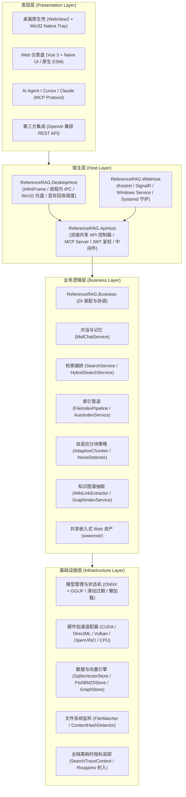
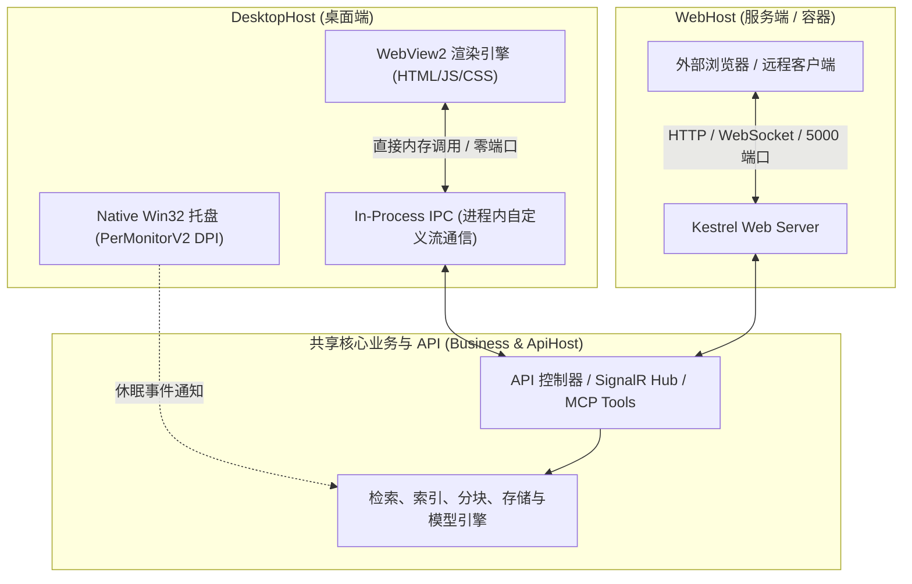
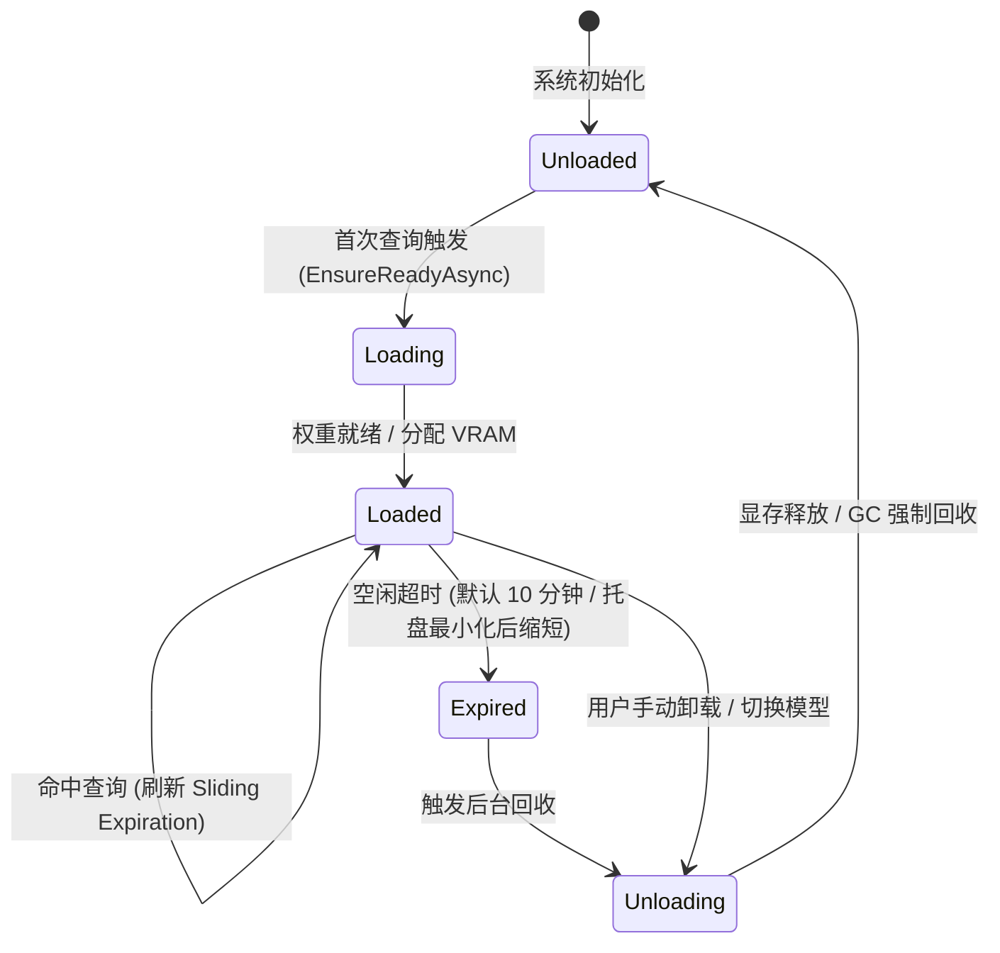
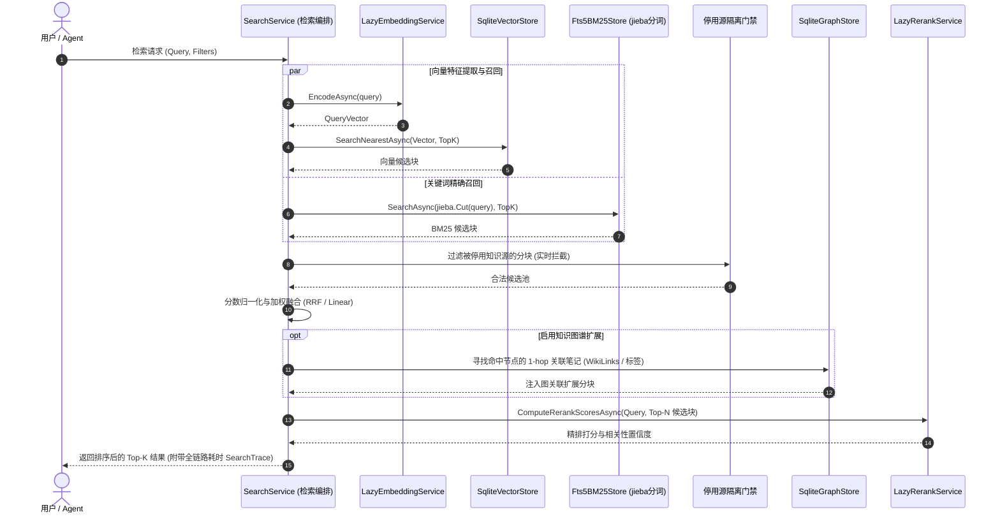
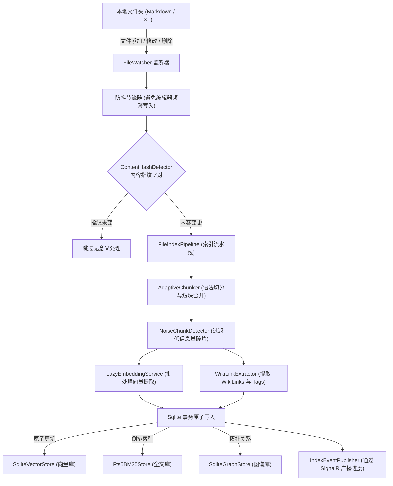
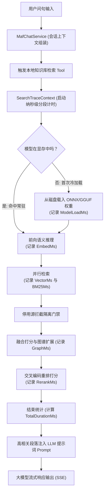

# ReferenceRAG 项目结构与系统架构全景设计指南

- **文档状态**：已归档（核心技术全景规范）
- **更新时间**：2026-10-20
- **归档位置**：`docs/project-structure-and-system-architecture-overview.md`
- **关联组件**：
  - `ReferenceRAG.slnx`
  - `Host/ReferenceRAG.DesktopHost`
  - `Host/ReferenceRAG.WebHost`
  - `Host/ReferenceRAG.ApiHost`
  - `Business/ReferenceRAG.Business`
  - `Infrastructure/ReferenceRAG.Infrastructure`

---

## 目录
- [一、 系统定位与设计哲学](#一-系统定位与设计哲学)
- [二、 总体分层架构 (Clean Architecture)](#二-总体分层架构-clean-architecture)
- [三、 解决方案与代码库工程组织](#三-解决方案与代码库工程组织)
  - [3.1 宿主层 (Host)](#31-宿主层-host)
  - [3.2 业务逻辑层 (Business)](#32-业务逻辑层-business)
  - [3.3 基础设施层 (Infrastructure)](#33-基础设施层-infrastructure)
  - [3.4 测试与支撑工程 (Tests & Support)](#34-测试与支撑工程-tests--support)
- [四、 核心子系统与关键技术机制](#四-核心子系统与关键技术机制)
  - [4.1 双宿主与进程内 IPC 架构](#41-双宿主与进程内-ipc-架构)
  - [4.2 跨平台双引擎异构推理与硬件加速矩阵](#42-跨平台双引擎异构推理与硬件加速矩阵)
  - [4.3 模型生命周期状态机与显存自动回收](#43-模型生命周期状态机与显存自动回收)
  - [4.4 多路召回、图谱扩展与重排精排链路](#44-多路召回图谱扩展与重排精排链路)
  - [4.5 自适应 Markdown 语法分块与原子重分块索引管道](#45-自适应-markdown-语法分块与原子重分块索引管道)
  - [4.6 免编译轻量级原生前端架构](#46-免编译轻量级原生前端架构)
  - [4.7 多协议适配生态 (REST / OpenAI / MCP / SignalR)](#47-多协议适配生态-rest--openai--mcp--signalr)
- [五、 核心数据流转流程](#五-核心数据流转流程)
  - [5.1 知识库文档变更与自动索引数据流](#51-知识库文档变更与自动索引数据流)
  - [5.2 混合检索与 AI 对话全链路时延追踪流](#52-混合检索与-ai-对话全链路时延追踪流)
- [六、 架构专项设计文档索引 (ADR References)](#六-架构专项设计文档索引-adr-references)

---

## 一、 系统定位与设计哲学

**ReferenceRAG** 是一个面向本地知识库（个人笔记、本地 Markdown/TXT 文档网、专业参考资料库）的轻量级、跨平台高精度 RAG（检索增强生成）系统。

### 1.1 核心角色与使用场景
| 角色 | 定位与用途 |
|---|---|
| **终端用户** | 通过桌面端（Native Win32 托盘 + WebView2）或浏览器 Web 端，零门槛进行本地文档快速检索与 AI 智能对话，答案来源精准追溯到具体笔记与分块段落。 |
| **AI Agent** | 深度支持 **Model Context Protocol (MCP)** 与 Skill 接入，让 Claude Code、Cursor、CherryStudio、Chatbox 等智能代理作为外挂工具直接调度本地知识库。 |
| **应用与脚本** | 提供与 OpenAI 规范兼容的标准端点（`/v1/embeddings`、`/v1/rerank`）以及标准 REST API，支持无缝嵌入现有工作流。 |

### 1.2 核心设计哲学
1. **开箱即用，零驱动环境绑架**：默认 Windows 通用版基于 DirectML 与 Vulkan，全系列覆盖 AMD、Intel、NVIDIA 与高通核显，无需安装 3GB+ 的 CUDA Toolkit 即可享受全硬件加速；同时为专业开发机提供 CUDA 12 满血版。
2. **桌面优先，极低资源驻留**：桌面端原生支持 Win32 高分屏（Per-Monitor V2）托盘与进程内 IPC（默认零端口监听冲突）；最小化至托盘时自动缩短模型滑动过期驻留时长，自动卸载模型返还 GPU 显存。
3. **高信噪比与结构感知**：突破传统固定字符硬切块，引入语法感知自适应分块、连续短块合并、噪声块过滤（`NoiseChunkDetector`）以及双链（`[[...]]`）知识图谱联动。

---

## 二、 总体分层架构 (Clean Architecture)

系统基于 **.NET 10** 构建，采用清晰的分层解耦架构，自顶向下分为表现层、宿主层、业务逻辑层与基础设施层：



---

## 三、 解决方案与代码库工程组织

解决方案通过 `ReferenceRAG.slnx` 组织，根目录下各工程分工明晰：

```
ReferenceRAG/
├── Host/
│   ├── ReferenceRAG.DesktopHost/     # Windows 桌面端宿主（WinForms + InfiniFrame + IPC）
│   ├── ReferenceRAG.WebHost/         # 独立 Web / 服务端宿主（Kestrel + SignalR）
│   └── ReferenceRAG.ApiHost/         # 双端共用 API、MCP Server 与传输层基座
├── Business/
│   └── ReferenceRAG.Business/        # 核心业务逻辑、状态机、索引流水线与共享 wwwroot 前端
├── Infrastructure/
│   └── ReferenceRAG.Infrastructure/  # 双引擎推理、硬件加速、SqliteVec 存储与文件监听
├── tests/
│   ├── ReferenceRAG.Tests/           # 单元与集成测试（算法、状态机、分块、硬件探测）
│   ├── ReferenceRAG.Host.Tests/      # 控制器与 API 端点集成测试
│   └── PerfTestRunner/               # 压力测试与端到端性能基准控制台
└── support/                          # 运维脚本、Docker 镜像、评测套件与设计文档
```

### 3.1 宿主层 (Host)

1. **`Host/ReferenceRAG.DesktopHost`**
   - **核心职责**：Windows 本地桌面端独立可执行程序（`WinExe`）。
   - **技术要点**：
     - 基于 `InfiniLore.InfiniFrame` 封装 WebView2 浏览器控件；
     - 采用 `AddInProcessServer` 建立**内存级进程内 IPC 通信**，界面与后端在同一进程内直通，默认无需监听任何 TCP 端口，杜绝端口冲突或防火墙弹窗；
     - 集成 原生 Win32 `Per-Monitor V2` 高分屏 DPI 感知与系统托盘，左键单击唤醒窗口，右键呼出系统菜单；
     - 启动阶段自动执行 `ShortcutGuard`，自愈开始菜单快捷方式与高清任务栏图标；
     - 托盘最小化时与 `ModelLifecycleStateMachine` 联动，主动加速模型显存卸载。

2. **`Host/ReferenceRAG.WebHost`**
   - **核心职责**：独立网络服务与跨平台容器运行宿主。
   - **技术要点**：
     - 基于 ASP.NET Core Kestrel 启动 HTTP / HTTPS 监听；
     - 支持无头（Headless）部署，支持以 Windows Service 或 Linux Systemd 服务形式常驻；
     - 集成 SignalR Hub，为跨网络访问的前端提供双向实时事件通知。

3. **`Host/ReferenceRAG.ApiHost`**
   - **核心职责**：控制器与接入协议中枢，被 `DesktopHost` 和 `WebHost` 同时引用。
   - **技术要点**：
     - 提供 REST API 控制器：`AIQueryController`（对话与问答）、`IndexController`（索引状态与触发）、`ModelsController`（模型下载与管理）、`SettingsController`（系统配置热重载）、`SourcesController`（知识库源增删改查）；
     - 集成 `McpHelper.Core`，注册 SSE/Stdio 传输协议下的 MCP Tools（`RagSearchTools`、`GraphSearchTools`、`IndexStatusTools`、`SourceManagementTools` 等）；
     - 配置 API Key / JWT 鉴权中间件与 Swagger OpenAPI 文档。

### 3.2 业务逻辑层 (Business)

* **`Business/ReferenceRAG.Business`**：
  - **`Features/Search/`**：检索门面 `SearchService`、多路融合 `HybridSearchService`、标题优先搜索 `TryTitleFirstSearchAsync`、停用源阻断门禁。
  - **`Features/Indexing/`**：`FileIndexPipeline`（多线程文档解析入库管道）、`AutoIndexService`（文件变更节流自动索引）、`RechunkService`（单文件原子重分块）、`OrphanCleanupService`（孤儿块定期回收）。
  - **`Features/Chunking/`**：`AdaptiveChunker`（Markdown 自适应切块策略）、`ContinuousElementMerger`（短段落/列表合并）、`NoiseChunkDetector`（低信息量噪声过滤）。
  - **`Features/Chat/`**：`MafChatService`（集成 Microsoft Agentic Framework / Semantic Kernel，管理会话状态，流式生成并调用本地 RAG Tool）。
  - **`Features/Graph/`**：`WikiLinkExtractor`（提取 Obsidian 式 `[[文档名]]` 双链与 `#tag` 标签）、`GraphIndexService`。
  - **`wwwroot/`**：前端静态资产，直接嵌入 DLL（`EmbeddedResource`），在 WebHost 下由静态文件中间件托管，在 DesktopHost 下由虚拟资源映射直接读取。

### 3.3 基础设施层 (Infrastructure)

* **`Infrastructure/ReferenceRAG.Infrastructure`**：
  - **`Features/ModelManagement/`**：
    - `LazyEmbeddingService` / `LazyRerankService`：按需懒就绪包装器；
    - `OnnxEmbeddingAdapter` / `LlamaEmbeddingAdapter`：ONNX 与 GGUF 双后端统一抽象；
    - `ModelLifecycleStateMachine`：模型状态迁移（`Unloaded` ⇄ `Loading` ⇄ `Loaded` ⇄ `Expired` ⇄ `Unloading`）；
    - `HuggingFaceModelDownloader`：多源镜像重试断点续传下载器；
    - `Tokenizers`：整合 HuggingFace Tokenizers 原生库、BERTTokenizers 与 `jieba.NET`。
  - **`Features/HardwareAcceleration/`**：
    - `HardwareAccelerationManager`：算力探测与后端仲裁适配器；
    - `CudaEnvironmentScanner`：扫描系统现存 AI 工具（Pytorch / Ollama / ComfyUI）并动态加载 CUDA 依赖库；
    - `PortableCudaManager`：针对纯净机型按需拉取 ~85MB 极简 CUDA 运行时；
    - `GpuOffloadCalculator`：根据显存容量动态计算 GGUF 模型的最佳 GPU 卸载层数；
    - `GpuTelemetryProvider`：实时读取 GPU 显存占用、利用率与温度指标。
  - **`Features/Database/` 与 `Storage/`**：
    - `SqliteVectorStore`：基于 `sqlite-vec` 扩展的余弦距离向量存储；
    - `Fts5BM25Store`：基于 SQLite FTS5 全文检索引擎；
    - `SqliteGraphStore`：双向知识图谱关系存储表；
    - `ConfigManager`：本地配置热重载与文件租赁锁（`DataDirectoryLease`）。

---

## 四、 核心子系统与关键技术机制

### 4.1 双宿主与进程内 IPC 架构

为了满足“轻量桌面日常使用”与“服务端多端协同”的不同形态，ReferenceRAG 设计了双宿主共享业务的架构：



- **零端口冲突与高安全性**：DesktopHost 默认关闭 HTTP 端口监听，前端 WebView2 发出的所有 API 请求通过 `AddInProcessServer` 拦截并在当前进程内直接分发给 Controller 处理。只有当用户在设置中开启「启用 HTTP 服务」时，才会对外暴露端口。
- **Win32 托盘原生联动**：桌面端最小化到系统托盘后，通知 `ModelLifecycleStateMachine` 缩短模型滑动过期超时，加速将显存返还给操作系统和其他软件。

### 4.2 跨平台双引擎异构推理与硬件加速矩阵

系统摒弃了单一推理引擎方案，深度融合 **ONNX Runtime** 与 **LLamaSharp (GGUF)**：

| 引擎 | 适用场景 | 硬件加速提供者 (EP) | 特性优势 |
|---|---|---|---|
| **ONNX Runtime** | 稠密向量嵌入 (Embedding)、高通量批量计算 | DirectML (Win)、CUDA 12、OpenVINO (Intel)、CPU | 跨硬件适配性极强，DirectML 可在任意现代显卡上免装环境加速 |
| **LLamaSharp (GGUF)** | 量化嵌入模型、因果序列排序模型 (Reranker) | Vulkan (Win/Linux)、CUDA 12、CPU | 显存消耗极低（Q4_K_M/Q8_0），支持超长上下文，可根据显存动态调整 Offload 层数 |

**多构建变体与降级策略**：
1. **Windows 通用版（默认）**：`DirectML` + `Vulkan`，零门槛覆盖所有显卡（N卡/A卡/Intel/核显）；
2. **NVIDIA 专属满血版**：`CUDA 12` 原生编译，优先探查借用本机已有 AI 工具链的 DLL；若环境缺失则自动触发极简 Portable CUDA 下载，保障极限算力同时杜绝环境故障；
3. **自适应降级链路**：CUDA 初始化失败 ➔ 自动回退至 DirectML / Vulkan ➔ 自动回退至多线程 CPU SIMD 指令集。

### 4.3 模型生命周期状态机与显存自动回收

为了彻底根除本地 AI 软件“常驻霸占数 GB 显存”的顽疾，模型管理器抽象为严格的生命周期状态机：



- **懒加载就绪**：系统启动时不加载几百兆的模型权重，待第一条检索请求到达时异步冷启动；
- **滑动过期**：每次推理成功自动刷新最后访问时间戳，连续空闲超时自动触发卸载；
- **托盘感知**：窗口进入系统托盘后，自动进入节能策略，加速释放 GPU VRAM。

### 4.4 多路召回、图谱扩展与重排精排链路

针对本地笔记库术语精确度高、语义分散的特点，系统采用复合检索流水线：



- **停用源全链路门禁**：在向量召回、BM25 检索、图谱遍历等各层均注入活动源过滤器，用户在界面一键停用知识源后，无需重建索引即可立即在检索结果中屏蔽该源，杜绝数据泄露；
- **全链路追踪拆解 (`SearchTraceContext`)**：严格区分并展示 `ModelLoadMs`（权重冷加载）、`EmbedMs`（向量推理）、`BM25Ms`、`VectorMs`、`GraphMs` 与 `RerankMs`，杜绝任何“隐形耗时黑洞”。

### 4.5 自适应 Markdown 语法分块与原子重分块索引管道

1. **语法感知自适应切块 (`AdaptiveChunker`)**：
   - 依据 Markdown 抽象语法树（AST）智能感知 `#` 标题层级、表格块与代码块；
   - **超长段落二次拆分**：超过最大 Token 限制的单个大段落平滑切分并保留重叠语义窗口（Overlap）；
   - **连续短小元素智能合并**：连续的短标题、简短待办列表、引用语句自动聚合为一个完整上下文块，防止切出无意义的碎片；
   - **噪点块拦截 (`NoiseChunkDetector`)**：自动识别并过滤纯元数据 FrontMatter 碎片、空章节、低信息量符号块。
2. **单文件原子重分块 (`RechunkService`)**：
   - 当单篇笔记发生修改时，采用数据库事务执行“删除旧向量 + 插入新向量”的原子替换，保证索引更新过程中并发查询的数据一致性，杜绝产生双倍重复数据或孤儿向量。

### 4.6 免编译轻量级原生前端架构

前端位于 `Business/ReferenceRAG.Business/wwwroot`，采用创新的无编译（Bundle-less）开发模式：
- **技术栈**：Vue 3 + Naive UI + Pinia + Vue Router 原生 ES 模块规范；
- **免 NPM 依赖**：无需安装 Node.js、无需构建打包工具（Vite/Webpack），前端脚本通过浏览器原生 `import` 机制即时解析；
- **跨端嵌入**：所有前端资产直接打包进 `.dll` 程序集中，发布时单 EXE 即可随身携带，既可在桌面端通过 WebView2 加载，也可由 Kestrel 供浏览器远程访问。

### 4.7 多协议适配生态 (REST / OpenAI / MCP / SignalR)

- **Model Context Protocol (MCP)**：原生实现 SSE 与 Stdio 双通道传输，对外暴露标准知识库工具，无缝接入 Claude Desktop、Claude Code、Cursor 等；
- **OpenAI 兼容协议**：原生兼容 `/v1/embeddings` 与 `/v1/rerank`，第三方系统仅需修改 `BaseUrl` 即可把本地 ReferenceRAG 当作在线模型服务使用；
- **SignalR 全双工长连接**：索引进度、文件监听事件、多维评测运行状态实时推送到 UI，保证交互流畅性。

---

## 五、 核心数据流转流程

### 5.1 知识库文档变更与自动索引数据流



### 5.2 混合检索与 AI 对话全链路时延追踪流



---

## 六、 架构专项设计文档索引 (ADR References)

针对各核心子系统的更深层次设计与故障排查规范，请参阅 `docs/` 下的各专题设计文档：

1. **跨平台与硬件加速**
   - [`dual-os-cross-engine-hybrid-deployment-architecture.md`](file:///e:/WorkProject/CSharp/PrivateProject/Web/ReferenceRAG/docs/dual-os-cross-engine-hybrid-deployment-architecture.md)：Windows 与 Linux 双平台双引擎混合部署与优雅降级 ADR；
   - [`hardware-acceleration-adapter-strategy-architecture-design.md`](file:///e:/WorkProject/CSharp/PrivateProject/Web/ReferenceRAG/docs/hardware-acceleration-adapter-strategy-architecture-design.md)：硬件加速适配器模式与策略模式解耦设计；
   - [`gpu-dependency-fusion-architecture-design.md`](file:///e:/WorkProject/CSharp/PrivateProject/Web/ReferenceRAG/docs/gpu-dependency-fusion-architecture-design.md)：GPU 原生驱动与多引擎链接库融合设计；
   - [`desktop-build-variants-and-gpu-dependency-guide.md`](file:///e:/WorkProject/CSharp/PrivateProject/Web/ReferenceRAG/docs/desktop-build-variants-and-gpu-dependency-guide.md)：桌面端 6 大构建变体分发指南。
2. **推理引擎与模型生命周期**
   - [`chat-model-management-and-lifecycle-architecture-design.md`](file:///e:/WorkProject/CSharp/PrivateProject/Web/ReferenceRAG/docs/chat-model-management-and-lifecycle-architecture-design.md)：模型生命周期状态机与显存管理架构设计；
   - [`llama-sharp-backend-architecture-design.md`](file:///e:/WorkProject/CSharp/PrivateProject/Web/ReferenceRAG/docs/llama-sharp-backend-architecture-design.md)：LLamaSharp (GGUF) 接入架构规范；
   - [`rerank-gguf-sliding-expiration-and-cross-platform-architecture.md`](file:///e:/WorkProject/CSharp/PrivateProject/Web/ReferenceRAG/docs/rerank-gguf-sliding-expiration-and-cross-platform-architecture.md)：重排模型滑动过期与显存释放设计。
3. **分块与检索流水线**
   - [`adaptive-chunking-architecture-and-embedding-optimization-design.md`](file:///e:/WorkProject/CSharp/PrivateProject/Web/ReferenceRAG/docs/adaptive-chunking-architecture-and-embedding-optimization-design.md)：自适应分块与存储优化架构；
   - [`disabled-source-search-leak-investigation-and-gatekeeper-design.md`](file:///e:/WorkProject/CSharp/PrivateProject/Web/ReferenceRAG/docs/disabled-source-search-leak-investigation-and-gatekeeper-design.md)：停用源检索防泄露门禁架构；
   - [`search-duration-and-trace-breakdown-investigation.md`](file:///e:/WorkProject/CSharp/PrivateProject/Web/ReferenceRAG/docs/search-duration-and-trace-breakdown-investigation.md)：检索耗时拆解与链路追踪设计；
   - [`embedding-and-rerank-eval-dimensions-and-tag-decontamination-research.md`](file:///e:/WorkProject/CSharp/PrivateProject/Web/ReferenceRAG/docs/embedding-and-rerank-eval-dimensions-and-tag-decontamination-research.md)：12 维检索质量评测基准与防标签污染规范。
