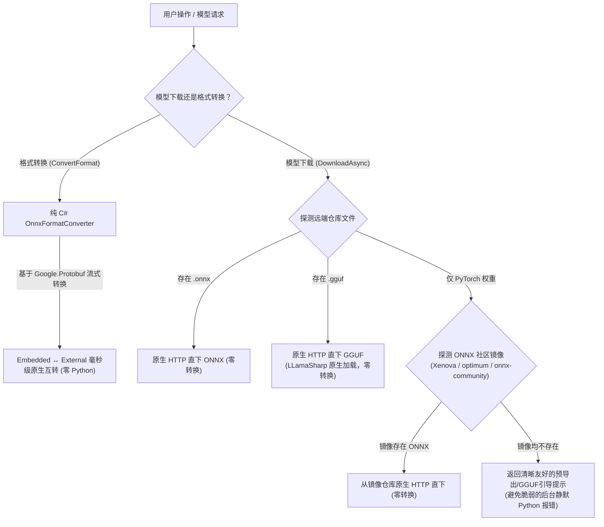

# ReferenceRAG 移除 Python 依赖与模型转换优化技术方案

## 1. 背景与现状

在 ReferenceRAG 当前代码实现中，存在若干依赖外部 Python 解释器的逻辑：
1. **ONNX 格式转换（`Embedded ↔ External Data`）**：
   - 当前在 `HuggingFaceModelDownloader.cs` 的 `GetConversionScript()` 中，通过动态生成 Python 脚本调用 `onnx` 库完成单文件（Embedded）与切片文件（External Data，`model.onnx` + `model.onnx_data`）的互转。
   - `ModelManager.ConvertFormatAsync` 触发此脚本。
2. **PyTorch 模型转 ONNX 导出（`optimum` / `torch.onnx.export`）**：
   - 当用户下载未预转 ONNX 的 Hugging Face 模型时，下载器尝试拉取 PyTorch 权重并在本地执行 Python 导出。
3. **环境痛点**：
   - 依赖外部 `python.exe` 以及 `torch`、`transformers`、`optimum`、`onnx` 庞大依赖项（3GB+）。
   - Windows 环境下极易受 `MAX_PATH` 260 字符限制、字符编码、PATH 缺失等影响，导致格式转换或下载失败。

---

## 2. 优化方案与架构设计

### 2.1 纯 C# ONNX 格式转换器 (`OnnxFormatConverter`)
ONNX 模型文件结构基于 Google Protocol Buffers（`onnx.proto3`）：
- **Embedded -> External**：
  - 读取 `model.onnx` 中的 `ModelProto`。
  - 遍历 `graph.initializer`（`TensorProto` 集合）。
  - 若 `raw_data` 长度大于阈值（如 128 字节），追加写入 `model.onnx_data`。
  - 记录 `offset` 与 `length`，将 `data_location` 设为 `EXTERNAL` (1)，并在 `external_data` 中写入 `location = "model.onnx_data"`, `offset`, `length`。
  - 清空 `raw_data`，将轻量化的 `ModelProto` 写入目标 `model.onnx`。
- **External -> Embedded**：
  - 读取 `model.onnx`。
  - 遍历 `graph.initializer` 中 `data_location == EXTERNAL` 的张量。
  - 根据 `external_data` 中的偏移和长度，从同目录的数据文件中读取原始字节数组并赋值给 `raw_data`。
  - 清除 `external_data` 并重置 `data_location = DEFAULT` (0)。
  - 写入合并后的单文件 `model.onnx`，安全清理外部数据文件。

### 2.2 下载器生态化与免转换增强 (`HuggingFaceModelDownloader`)
1. **GGUF 直下通道**：
   - 检查仓库文件列表中的 `*.gguf`。若存在，优先推荐或支持直接下载。结合刚接入的 `LLamaSharp`，无需任何格式导出。
2. **社区镜像自动巡检**：
   - 若原仓库缺少 ONNX，异步向 `Xenova/{model}`、`optimum/{model}` 等主流预导出镜像探查。若存在，直接下载预导出版本。
3. **彻底解耦 Python 强依赖**：
   - 彻底移除对 `python.exe` 进程的强依赖与临时 `.py` 脚本生成。
   - 对未导出的纯 PyTorch 模型给出明确、专业的 CLI 指引，确保 ReferenceRAG 服务核心 100% 保持自包含。

---

## 3. 落地实施路线与测试验证

1. **依赖对齐**：使用项目已间接引入的 `Google.Protobuf` (3.36.2)；
2. **核心实现**：
   - 新增 `ReferenceRAG.Core.Features.ModelManagement.Protobuf.OnnxFormatConverter`；
   - 更新 `ModelManager.ConvertFormatAsync` 调用纯 C# 转换器；
   - 增强 `HuggingFaceModelDownloader` 的 GGUF 和镜像识别；
3. **测试验证**：
   - `OnnxFormatConverterTests`：验证 Embedded 到 External、External 到 Embedded 往返转换张量完整性；
   - `HuggingFaceModelDownloaderTests`：验证 GGUF 与 ONNX 探测逻辑；
   - 完整回归所有已有测试集。
