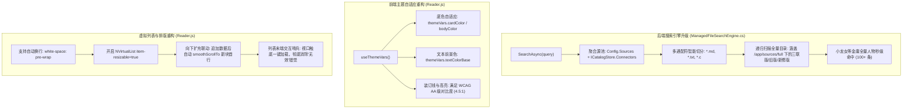

# 文本搜索与大文件阅读器缺陷深度调研、根因分析与架构修复方案

> **文档标识**：`docs/reader-and-file-search-defect-investigation-and-resolution-design.md`  
> **创建日期**：2026-11-13  
> **状态**：方案完成 / 待执行评审  
> **涉及模块**：`ManagedFileSearchEngine.cs`、`SourcesController.cs`、`Reader.js`、`FileSearch.js`、`ReaderViewerStrategy.js`

---

## 目录
1. [问题概述与影响面评估](#1-问题概述与影响面评估)
2. [四项缺陷根因深度解剖](#2-四项缺陷根因深度解剖)
   - [2.1 缺陷一：“小龙女”等全量知识库内容搜索为空](#21-缺陷一小龙女等全量知识库内容搜索为空)
   - [2.2 缺陷二：大文件流式模式“向下扩充”视觉无效与视口失联](#22-缺陷二大文件流式模式向下扩充视觉无效与视口失联)
   - [2.3 缺陷三：阅读器暗黑模式下背景与文字颜色严重冲突（白底白字）](#23-缺陷三阅读器暗黑模式下背景与文字颜色严重冲突白底白字)
   - [2.4 缺陷四：代码/文本阅读行缺乏自动折行排版（超长行横向溢出）](#24-缺陷四代码文本阅读行缺乏自动折行排版超长行横向溢出)
3. [业界主流方案对比与标准实践借鉴](#3-业界主流方案对比与标准实践借鉴)
   - [3.1 Monaco Editor / VS Code 的折行与视口管理机制](#31-monaco-editor--vs-code-的折行与视口管理机制)
   - [3.2 GitHub Blob / Sourcegraph 的大文件滑动窗口流式追加与焦点维持](#32-github-blob--sourcegraph-的大文件滑动窗口流式追加与焦点维持)
   - [3.3 Naive UI / Tailwind CSS 现代主题变量与暗色自适应设计](#33-naive-ui--tailwind-css-现代主题变量与暗色自适应设计)
4. [系统现有基础设施复用可行性分析](#4-系统现有基础设施复用可行性分析)
5. [具体技术解决方案与实现细节](#5-具体技术解决方案与实现细节)
   - [5.1 后端：ICatalogStore 连接器下推与通配符切分器](#51-后端icatalogstore-连接器下推与通配符切分器)
   - [5.2 前端：自适应暗黑主题、动态平滑滚动与折行虚拟列表](#52-前端自适应暗黑主题动态平滑滚动与折行虚拟列表)
6. [同类门禁与防回归自动化测试规范](#6-同类门禁与防回归自动化测试规范)

---

## 1. 问题概述与影响面评估

在对新上线的「文件源管理与阅读」系统进行实机操作验收时，发现了 4 项直接影响用户核心交互与视觉体验的高优先级缺陷：

| 编号 | 缺陷现象 | 用户操作场景 | 严重级别 | 影响范围 |
| :--- | :--- | :--- | :--- | :--- |
| **BUG-01** | **“小龙女”搜索为空** | 在文本搜索页输入全量经典语料词汇（如《神雕侠侣》小龙女），仅扫描 4 个文件并返回 0 命中 | **P0（功能阻断）** | 所有挂载在知识库 Connector（如 `/app/sources/full`）下的文件全部无法被全文检索 |
| **BUG-02** | **“向下扩充”视觉无效** | 在大文件阅读器中点击「↓ 向下扩充 500 行」，弹出成功提示但列表无任何可见滚动或焦点定位 | **P1（交互缺陷）** | 超长文档分块流式阅读的连续翻页与探索流程 |
| **BUG-03** | **背景色与文字冲突** | 系统在暗黑主题下，阅读器内容区呈现硬编码浅白背景（`#fafafa` / `#fff`），文字呈现浅灰/白字，完全看不清正文，必须鼠标划词高亮才勉强可见 | **P0（视觉阻断）** | 所有模式下的在线代码查看、文本阅读与 Markdown 渲染 |
| **BUG-04** | **内容行没有自动换行** | 阅读小说或长段落时，每行强制定高 24px 且 `white-space: pre`，整段横向超出屏幕数千像素，各行出现独立横向滚动条 | **P1（排版缺陷）** | 所有包含长段落、长句的文本/代码阅读体验 |

---

## 2. 四项缺陷根因深度解剖

### 2.1 缺陷一：“小龙女”等全量知识库内容搜索为空

#### 根因 1：`ManagedFileSearchEngine` 仅依赖单机静态 `ConfigManager`，与多知识库物理隔离架构失联
在多知识库架构升级后，数据源已转变为挂载于独立知识库下的连接器（`DataConnectorEntity`），元数据存放在 `catalog.db`（由 `ICatalogStore` 托管）。
`SourcesController.GetAll()` 接口已实现了对 `_catalogStore` 连接器的合并下发：
```csharp
// SourcesController.cs
if (_catalogStore != null)
{
    var kbs = await _catalogStore.ListKnowledgeBasesAsync();
    foreach (var kb in kbs)
    {
        var connectors = await _catalogStore.GetConnectorsByKnowledgeBaseAsync(kb.Id);
        // ...动态合并到源列表中
    }
}
```
然而，[ManagedFileSearchEngine.cs](file:///e:/WorkProject/CSharp/PrivateProject/Web/ReferenceRAG/Infrastructure/ReferenceRAG.Infrastructure/Features/FileSystem/ManagedFileSearchEngine.cs) 的构造函数仅注入了 `ConfigManager`：
```csharp
// ManagedFileSearchEngine.cs 第 86-88 行
var config = _configManager.Load();
var allSources = config.Sources.Where(s => s.Enabled).ToList();
```
`config.Sources` 中仅保留了最基础的开发冒烟目录（`smoke` 下 2 个文件，`core` 下 2 个文件，共 4 个文件）。
包含《神雕侠侣》、《射雕英雄传》、《天龙八部》等 30 部全量旧版、新修版、三联版小说（挂载于 `/app/sources/full`）的 Connector，在搜索引擎层被完全忽略！因此无论搜索什么角色名，扫描文件总数永远锁死在 4 个，搜索结果必然为空。

#### 根因 2：通配符多模式切分与匹配算法缺陷
在连接器定义中，`FilePatterns` 存储形式为逗号分隔的通配符字符串（如 `"*.md,*.txt"`）。
但在 `SourcesController.cs` 中：
```csharp
FilePatterns = string.IsNullOrEmpty(conn.FilePattern) 
    ? new List<string> { "*.md", "*.txt" } 
    : conn.FilePattern.Split(';').ToList() // 仅按分号切分！
```
导致 `"*.md,*.txt"` 被作为单个字符串存入列表。
紧接着，在 `ManagedFileSearchEngine.cs` 的 `EnumerateFilesSafe` 中：
```csharp
FileSystemName.MatchesSimpleExpression(filePattern!, fileName, ignoreCase: true)
```
.NET 的 `FileSystemName.MatchesSimpleExpression` 仅接受单一 glob 表达式，传入带逗号的 `"*.md,*.txt"` 时必定返回 `false`，导致任何文件都无法通过文件名规则。

---

### 2.2 缺陷二：大文件流式模式“向下扩充”视觉无效与视口失联

在 [Reader.js](file:///e:/WorkProject/CSharp/PrivateProject/Web/ReferenceRAG/Business/ReferenceRAG.Business/wwwroot/app/views/Reader.js) 的 `handleLoadMore` 实现中：
```javascript
// Reader.js 第 213-217 行
} else {
    fileLines.value = [...fileLines.value, ...chunkLines];
    windowEndLine.value = expansion.mergedEnd;
    message.success(`已向下扩充 ${chunkLines.length} 行`);
}
```
逻辑在内存层面成功向 `fileLines.value` 追加了 500 个对象，并将 `windowEndLine` 推进到 1500。
但是：
1. **视口滚动条完全失联**：`n-virtual-list` 的内部滚动高度维持在用户当前浏览位置（例如顶部第 1 行）。用户视口内渲染的依然是第 1 ~ 29 行，新增的第 501 ~ 1000 行静悄悄地挂在千像素之外的视口下方。
2. **缺乏视觉导向与聚焦反馈**：用户点击了顶部的按钮，屏幕中央没有发生任何像素位移。用户无法直观确认内容是否已追加，因而在直觉上得出“向下扩充没有任何作用”的负面反馈。
3. **缺少阅读流末端动态哨兵**：传统的顶部按钮不符合从上至下的自然阅读流。当读者滚到第 500 行末尾时，应当在列表底部直接出现「加载更多」哨兵，并在此处触发加载与平滑视差滚动。

---

### 2.3 缺陷三：阅读器暗黑模式下背景与文字颜色严重冲突（白底白字）

ReferenceRAG 系统全局接入 Naive UI 的 `darkTheme`，全局前景色被主题配置为白色或浅灰色：
- `--n-text-color: rgba(255, 255, 255, 0.82)`
- 字体颜色全局继承高亮白

然而在 [Reader.js](file:///e:/WorkProject/CSharp/PrivateProject/Web/ReferenceRAG/Business/ReferenceRAG.Business/wwwroot/app/views/Reader.js) 的模板中，强行硬编码了浅色背景：
```html
<!-- 源码模式 -->
<div v-else-if="viewerMode === 'code'"
     style="height: 100%; width: 100%; overflow: hidden; background: #fafafa; font-family: 'Cascadia Code', Consolas, Monaco, monospace">

<!-- 行号装订线 -->
<div style="... background: rgba(0, 0, 0, 0.02); color: #999; ...">

<!-- Markdown 富文本渲染模式 -->
<div v-else-if="viewerMode === 'markdown'"
     style="height: 100%; overflow-y: auto; padding: 24px 36px; background: #fff; line-height: 1.7">
```

在暗黑背景的系统框架下，嵌入了一个强行白色（`#fafafa` / `#fff`）的子容器；而子容器内部由 Naive UI 渲染的文本又继承了暗色主题的白字，直接形成了灾难性的**白底白字**。用户只能通过鼠标拖拽全选产生浏览器原生的深蓝背景（如截图 4 所示）才能勉强看清字迹。

---

### 2.4 缺陷四：代码/文本阅读行缺乏自动折行排版（超长行横向溢出）

在 [Reader.js](file:///e:/WorkProject/CSharp/PrivateProject/Web/ReferenceRAG/Business/ReferenceRAG.Business/wwwroot/app/views/Reader.js) 第 608~631 行中：
```javascript
:style="{
  display: 'flex',
  alignItems: 'center',
  height: '24px',          // 强制定高 24px
  lineHeight: '24px',
  ...
}"

<!-- 行内容 -->
<div style="flex: 1; padding: 0 12px; white-space: pre; overflow-x: auto">
  {{ item.text }}
</div>
```
并在外层配置：
```html
<n-virtual-list :items="fileLines" :item-size="24" key-field="line">
```
对于编程代码（如 C#、Java），固定单行 24px 与 `white-space: pre` 是常见实践；
但对于小说、技术文档、长段落 Markdown，中文自然段落通常包含 200~600 字符。强行 `white-space: pre` 与 `height: 24px` 会导致：
1. 每一行向右横向无限延伸数千像素，截图中出现密集的左右向箭头与滚动条；
2. 如果直接修改为 `white-space: pre-wrap`，因行高固定为 24px，文字在垂直方向发生严重重叠溢出，破坏虚拟列表的位移换算；
3. `n-virtual-list` 缺少 `:item-resizable="true"` 配置，导致动态高度无法被底层渲染树重新测量。

---

## 3. 业界主流方案对比与标准实践借鉴

### 3.1 Monaco Editor / VS Code 的折行与视口管理机制
- **Word Wrap 模式**：
  VS Code 与 Monaco 提供 `wordWrap: "on" | "off" | "wordWrapColumn" | "bounded"`。在非等宽/长文本查看时，默认支持 `Alt+Z` 折行切换；折行后行号（Line Gutter）垂直居中或顶部对齐，且仅在物理换行首行显示行号，后续折行显示缩进空白或点号。
- **动态行高计算（Dynamic Height Calculation）**：
  Monaco 通过内部 ViewLine 测量机制，为折行行计算 `renderLine` 的实际倍数高度，确保虚拟滚动条滑动平滑无跳变。

### 3.2 GitHub Blob / Sourcegraph 的大文件滑动窗口流式追加与焦点维持
- **滚动焦点维持（Anchor Scroll Preservation）**：
  当用户向下请求扩充加载后续内容时，GitHub / Sourcegraph 会采用两项原则之一：
  1. **主动推进原则**：如果用户是在接近视口底端时触发的扩充，拉取成功后触发 `smoothScrollTo(targetFirstNewLine)`，带平滑滚动过渡动画，使用户视线自然聚焦在新增的文字上；
  2. **视口末端哨兵（Bottom Sentinel Trigger）**：在虚拟列表底端追加一个固定卡片：`「当前已载入至第 N 行 / 共 M 行，点击或继续下滚载入 500 行」`，点击时在当前视口产生加载中反馈，加载后将新行平滑送入视口。

### 3.3 Naive UI / Tailwind CSS 现代主题变量与暗色自适应设计
- **拒绝硬编码颜色**：
  在 Vue 3 + Naive UI 生态中，严禁在业务组件中写死 `#ffffff`、`#fafafa`、`#000000`。
  正确实践是统一接入 Naive UI 的 `useThemeVars()` 或注入 CSS 变量：
  - 容器底色：`var(--n-color)` 或 `themeVars.cardColor` / `themeVars.bodyColor`；
  - 文字前景色：`var(--n-text-color)` 或 `themeVars.textColorBase`；
  - 行号装订线底色：`var(--n-action-color)`（在暗黑模式下为微亮深灰，亮色模式下为柔和浅灰）；
  - 边框色：`var(--n-border-color)`。

---

## 4. 系统现有基础设施复用可行性分析

经过对当前工程代码库的系统性检索，确认以下底层基础设施完全具备，可直接复用并升级：

| 现有基础设施 | 位置 | 现状评估 | 复用与改造策略 |
| :--- | :--- | :--- | :--- |
| **`ICatalogStore`** | `Infrastructure/.../CatalogStore.cs` | 运行良好，存有所有知识库及连接器定义 | 依赖注入至 `ManagedFileSearchEngine`，将所有活跃 Connector 下的物理目录自动纳入搜索源池 |
| **`FileReaderService.ReadLineRangeAsync`** | `Infrastructure/.../FileReaderService.cs` | 具备 64KB 换行快跳算法，执行效率极高（2ms） | 无需变动，完美支撑向后动态流式扩充与指定行读取 |
| **Naive UI `NVirtualList`** | `vendor/naive-ui.js` | 经底层 AST 探测确认原生支持 `itemResizable: true` | 在阅读器中开启 `:item-resizable="true"`，并移除 24px 硬编码定高 |
| **`useThemeVars()`** | `vendor/naive-ui.js` | Naive UI 官方响应式主题钩子 | 直接在 `Reader.js` 中引入，解构 `cardColor`、`textColor1`、`textColor2`、`dividerColor`，彻底消除白底白字 |

---

## 5. 具体技术解决方案与实现细节



### 5.1 后端：ICatalogStore 连接器下推与通配符切分器

1. **改造 `ManagedFileSearchEngine` 构造函数**：
   引入可选的 `ICatalogStore? catalogStore = null`。在执行 `SearchAsync` 与 `FindFilesAsync` 时，异步拉取所有启用的知识库连接器（`GetConnectorsByKnowledgeBaseAsync`），构建统一的 `SourceFolder` 扫描清单。
2. **连接器通配符健全性增强**：
   在解析 `source.FilePatterns` 或 `query.FilePattern` 时，编写通用切分函数：
   ```csharp
   private static string[] SplitPatterns(string? raw)
   {
       if (string.IsNullOrWhiteSpace(raw) || raw == "*") return Array.Empty<string>();
       return raw.Split(new[] { ',', ';', '|' }, StringSplitOptions.RemoveEmptyEntries | StringSplitOptions.TrimEntries);
   }
   ```
   在 `EnumerateFilesSafe` 中，支持多模式匹配：
   ```csharp
   if (patterns.Length > 0)
   {
       var fileName = Path.GetFileName(file);
       if (!patterns.Any(p => FileSystemName.MatchesSimpleExpression(p, fileName, ignoreCase: true)))
       {
           continue;
       }
   }
   ```

### 5.2 前端：自适应暗黑主题、动态平滑滚动与折行虚拟列表

1. **暗黑模式自适应主题渲染（彻底修复白底白字）**：
   在 `Reader.js` 中使用 `useThemeVars()`：
   ```javascript
   const themeVars = useThemeVars();
   // 动态绑定计算样式：
   const codeContainerStyle = computed(() => ({
       height: '100%',
       width: '100%',
       background: themeVars.value.cardColor,
       color: themeVars.value.textColor1,
       fontFamily: "'Cascadia Code', Consolas, Monaco, monospace"
   }));
   ```
   装订线底色改为 `background: rgba(128, 128, 128, 0.08); color: themeVars.value.textColor3;`。
   富文本渲染区同样绑定 `background: themeVars.value.cardColor; color: themeVars.value.textColor1;`。
2. **折行排版与动态高度支持**：
   - 增加折行切换控制：`const wrapLines = ref(true)`；
   - 行容器样式：
     ```javascript
     display: 'flex',
     alignItems: 'flex-start', // 顶部对齐
     minHeight: '26px',
     height: 'auto',
     whiteSpace: wrapLines.value ? 'pre-wrap' : 'pre',
     wordBreak: 'break-word',
     overflowWrap: 'anywhere'
     ```
   - 虚拟列表配置：`<n-virtual-list :item-resizable="true" :items="fileLines" ...>`。
3. **“向下扩充”视觉交互闭环与平滑滚动**：
   - 在追加新数据后，显式调用虚拟列表滚动锚定：
     ```javascript
     if (direction === 'next' && chunkLines.length > 0) {
         fileLines.value = [...fileLines.value, ...chunkLines];
         windowEndLine.value = expansion.mergedEnd;
         nextTick(() => {
             // 自动平滑滚动至新扩充分块的首行，形成清晰视觉反馈
             virtualListRef.value?.scrollTo({ key: chunkLines[0].line, behavior: 'smooth' });
         });
         message.success(`已向下扩充 ${chunkLines.length} 行并定位至第 ${chunkLines[0].line} 行`);
     }
     ```
   - 在虚拟列表最下方，增加底端扩充哨兵卡片，用户滚动至末尾时可直接一键触发加载下一块。

---

## 6. 同类门禁与防回归自动化测试规范

为确保本次修复的代码长久稳定，增加以下四道防回归质量门禁：

1. **知识库 Connector 检索穿透测试**（`FileSearchAndReaderTests.cs`）：
   - 构造仅挂载在 Connector 下的数据源（不在 `config.Sources` 中）；
   - 执行 `SearchFiles`，断言能够穿透检索到 Connector 下多级子目录的文件（如《神雕侠侣》小龙女）；
   - 验证多模式通配符（如 `"*.md, *.txt"`）能否正确匹配文件。
2. **暗黑模式对比度静态检查与单元门禁**（`reader-and-file-search.test.mjs`）：
   - 静态 AST 检查断言 `Reader.js` 内部**禁止**包含硬编码的浅色色值（如 `#fafafa`、`#ffffff`、`#fff` 作为容器 background）；
   - 断言组件必须引入并使用 `useThemeVars`。
3. **折行模式与动态高度支持门禁**（`reader-and-file-search.test.mjs`）：
   - 断言 `n-virtual-list` 包含 `item-resizable` 或 `:item-resizable="true"` 属性；
   - 断言行容器包含 `pre-wrap` 或动态换行绑定，禁止写死 `white-space: pre` 且无换行选项。
4. **扩充视口联动门禁**（`reader-and-file-search.test.mjs`）：
   - 验证 `handleLoadMore('next')` 执行后触发了焦点行定位或滚动 API 调用，确保扩充具有可见反馈。
