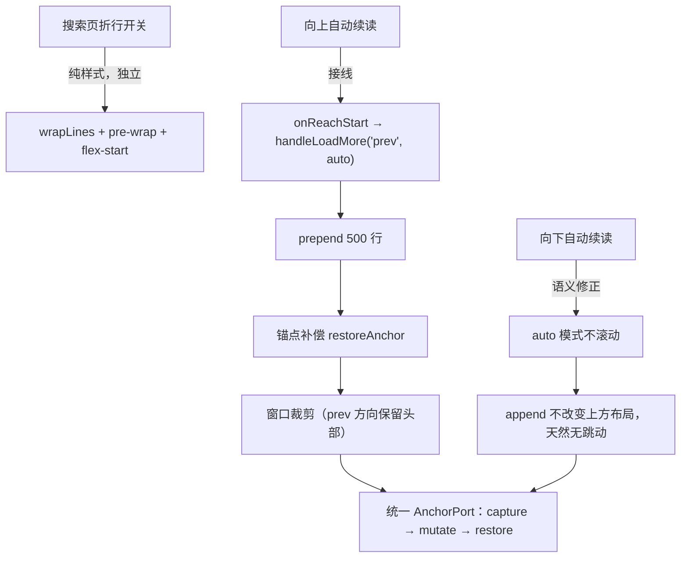

# 搜索结果自动换行与阅读器双向续读、无跳动续读：调研与架构方案

> **文档标识**：`docs/reader-bidirectional-continuation-and-search-wrap-optimization.md`
> **创建日期**：2026-11-13
> **状态**：调研完成 / 方案待实施（本文档不含代码改动）
> **触发问题**：
> 1. 文本代码搜索页（`/file-search?q=小龙女`）的命中行不支持自动换行，长句只能横向滚动；
> 2. 文档阅读器只有「手动点击向上扩充」，滚动到顶部不会自动向上续读；
> 3. 续读（自动加载）时视口内容会跳动，阅读位置被打断。
> **涉及模块**：`wwwroot/app/views/FileSearch.js`、`wwwroot/app/views/Reader.js`、`wwwroot/app/services/reader/*`、`wwwroot/vendor/naive-ui.js`（内联 vueuc VirtualList）
> **前置文档**：`docs/reader-streaming-window-expansion-feasibility-and-architecture-research.md`（P0/P1 已落地）

---

## 目录

1. [结论摘要](#1-结论摘要)
2. [现状与根因](#2-现状与根因)
3. [可行性、逻辑与性能头脑风暴](#3-可行性逻辑与性能头脑风暴)
4. [设计模式优化设计](#4-设计模式优化设计)
5. [库与业界主流方案调研](#5-库与业界主流方案调研)
6. [系统现有基础设施盘点](#6-系统现有基础设施盘点)
7. [分阶段具体方案](#7-分阶段具体方案)
8. [性能量化与容量估算](#8-性能量化与容量估算)
9. [风险、兼容性与回退](#9-风险兼容性与回退)
10. [验收标准与测试门禁](#10-验收标准与测试门禁)
11. [参考资料](#11-参考资料)
12. [附录](#12-附录)

---

## 1. 结论摘要

三个需求**均可行**，且都可在**零新增第三方依赖**的前提下完成——现有 `VirtualListAdapter` / `ReaderViewportSentinel` / `ReaderWindowStrategy` / `ReaderStateMachine` 四个模块已经提供了 80% 的底座，缺口集中在三处：搜索页缺一个折行开关、哨兵的 `onReachStart` 未接线、`handleLoadMore` 在 `auto` 模式下仍无条件滚动。

关键判断：

1. **搜索页自动换行是纯样式问题，成本最低**。当前 `FileSearch.js:446` 用 `overflow-x: auto` + `:464` 的 `white-space: pre`，本质是把「代码块不折行」的编辑器惯例套用到了搜索结果上。应改为可切换的 `pre-wrap` + `overflow-wrap: anywhere`，并把行容器从 `align-items: center` 改为 `flex-start`（否则折行后行号与文本错位）。与阅读器已有的 `wrapLines` 开关保持同一交互范式。
2. **向上自动续读不需要新机制，只需要接线**。`ReaderViewportSentinel` 已具备 `onReachStart` 回调，`Reader.js` 中该回调目前是**空实现**（仅注释「触底不自动加载」）。补上 `handleLoadMore('prev', { auto: true })` 并加边界守卫即可。
3. **续读跳动的根因是「自动模式也执行了主动定位」**，不是浏览器锚定失效。`handleLoadMore` 的 `next` 分支（`Reader.js:316-341`）无论 `auto` 还是手动都会 `scrollToIndex` 到新块首行；用户滚到底部时，视线被瞬间拉到 500 行之外，主观感受就是「内容跳了」。正确语义是：**自动续读只追加、不移动视口**（append 不改变上方布局，天然无需补偿）；**手动点击才定位到新块首行**（明确的跳转意图）。向上续读则必须做 prepend 锚点补偿（现有 `captureAnchor` / `restoreAnchor` 已可用，但当前只在 `prev` 分支调用）。

一个容易被忽略的规范细节：CSS Scroll Anchoring 的锚点选择会因 `transform` / `position` / 尺寸变化等**抑制触发器**而失效（[CSS Scroll Anchoring L1](https://drafts.csswg.org/css-scroll-anchoring/)），而虚拟列表恰恰用 `transform: translateY()` 定位可见块。因此**不能依赖浏览器自动锚定**，必须显式补偿，并建议对 `.v-vl` 设置 `overflow-anchor: none`，避免浏览器补偿与手动补偿叠加造成二次跳动。

---

## 2. 现状与根因

### 2.1 需求一：搜索页不支持自动换行

**现状**（`FileSearch.js:445-466`）：

```html
<div style="font-family: monospace; font-size: 13px; line-height: 1.5; overflow-x: auto; padding: 4px 0">
  <div :style="{ display: 'flex', alignItems: 'center', ... }">
    <span style="width: 44px; ...">{{ line.lineNumber }}</span>
    <span style="flex: 1; white-space: pre; font-size: 13px">{{ line.text }}</span>
    <n-button v-if="line.isMatch" style="margin-left: 12px; flex-shrink: 0">跳转第 N 行</n-button>
  </div>
</div>
```

**根因**：`white-space: pre` 强制不折行，父容器 `overflow-x: auto` 承担横向滚动。对代码文件这是合理默认（保留缩进与列对齐），但对 Markdown 小说、技术文档的长段落（200~600 字符）会横向延伸数千像素，读者必须反复左右拖动。

**次生问题**：

- 行容器 `align-items: center`：一旦改为折行，行号会垂直居中于多行文本块，视觉上「漂浮」在段落中间，应改为 `flex-start` 并给行号补 `padding-top`。
- 行号 `span` 没有 `flex-shrink: 0`：折行后文本变宽会挤压行号宽度。
- 「跳转第 N 行」按钮 `flex-shrink: 0` 正确，但折行时它会占据右侧固定宽度，压缩文本可用宽度；可接受，但建议在窄屏下改为图标按钮。

### 2.2 需求二：阅读器不支持向上自动续读

**现状**（`Reader.js` 中哨兵定义）：

```javascript
onReachStart: () => {
    if (!autoLoadEnabled.value || !isStreamingWindow.value || loadingMore.value) return;
    if (windowStartLine.value <= 1) return;
    // 触顶不自动加载：向上插入会改变锚点，交由用户显式点击，避免阅读抖动
}
```

**根因**：该回调是**空实现**。`ReaderViewportSentinel` 已能正确计算 `isAtStart`（`scrollTop <= 200`）并在触顶时回调，但业务层主动放弃了自动加载。此前放弃的理由是「向上插入会改变锚点、可能抖动」——这个顾虑成立，但解法应是**做好锚点补偿**，而不是**取消能力**。

**能力边界**：向上自动续读只在 `windowStartLine > 1` 时有意义。初始窗口 `start=1`，用户必须先通过向下阅读触发窗口裁剪（`MAX_LOADED_LINES=2000`），窗口起点推进到 501 之后，向上续读才有内容可加载。这意味着该功能天然与「滑动窗口裁剪」耦合，测试时必须先构造裁剪状态。

### 2.3 需求三：续读时内容跳动

**根因 A（主因，确定成立）：自动续读也执行了主动定位**。`Reader.js:316-341`：

```javascript
const newIndex = fileLines.value.findIndex(item => item.line === firstNewLine);
const result = viewerAdapter.scrollToIndex(newIndex, { behavior: 'auto' });   // 无条件执行
```

向下自动续读由「滚到底部」触发，此时用户视线在文档末尾；追加 500 行后立即跳到第 501 行，视线被拉走 14000px。这是「跳动」的主观来源，也是与用户预期（继续往下读）最冲突的一点。

**根因 B（确定成立）：`overflow-anchor` 与手动补偿可能叠加**。虚拟列表容器 `.v-vl` 未设置 `overflow-anchor`，浏览器默认 `auto` 会尝试自动锚定；而 `restoreAnchor` 又手动改写 `scrollTop`。两者在同一帧内竞争，可能出现「补偿一次、再被浏览器补偿一次」的二次跳动。

**根因 C（确定成立）：动态行高测量与程序化滚动的竞态**。`itemResizable` 模式下，vueuc 的 `handleItemResize` 会在可见项高度变化时执行 `scrollBy(0, delta)` 补偿（`vendor/naive-ui.js` 内联实现），且以 16ms 的锚点索引 `S` 判断补偿方向。若程序化 `scrollTop` 写入与 ResizeObserver 回调落在同一帧，补偿可能基于旧的锚点索引，产生小幅抖动。

**根因 D（潜在）：裁剪导致 `scrollTop` 语义漂移**。窗口裁剪会移除头部或尾部行，若裁剪后未按锚点行重算 `scrollTop`，视口内容会整体位移。当前 `prev` 分支有 `restoreAnchor`，`next` 分支没有（因为它假设「追加在下方不影响上方」——这在 append 时成立，但**裁剪头部时不再成立**：向下扩充触发 `trim` 保留尾部，会移除头部若干行，此时必须补偿）。

**根因 E（潜在）：`scrollToIndex` 的 `debounce` 语义**。vueuc 的 `scrollTo` 在 `debounce: true` 时走「最小滚动」，且目标已在视口内时**直接跳过**。当前 `VirtualListAdapter` 已显式传 `debounce: false`，规避了该问题；但若未来有人绕过适配器直接调用，仍会复现。

### 2.4 三个需求的耦合关系



三者共享同一个「视口锚定」内核：**任何会改变 `fileLines` 的操作，都必须在变更前捕获锚点、变更后恢复锚点**；而「是否主动移动视口」只应由用户意图（手动点击 / 任意行跳转）决定，不应由数据加载触发。

---

## 3. 可行性、逻辑与性能头脑风暴

### 3.1 可行性

| 需求 | 技术可行性 | 结论 |
| :--- | :--- | :--- |
| 搜索页折行 | CSS `white-space: pre-wrap` + `overflow-wrap: anywhere` 即可；无需虚拟化（单次搜索结果 ≤ `maxMatches` 100 条 × 上下文行） | **高**，纯样式 |
| 向上自动续读 | 哨兵已具备 `onReachStart`；`handleLoadMore('prev')` 已实现锚点补偿与方向偏好裁剪 | **高**，接线即可 |
| 无跳动续读 | `captureAnchor` / `restoreAnchor` 已实现（DOM 行号 + 像素偏移）；需扩展到 append + 裁剪路径，并关闭浏览器自动锚定 | **中高**，需补边界 |

### 3.2 逻辑欠缺

- **触发条件不完备**：向上自动续读需同时满足 `isStreamingWindow`、`windowStartLine > 1`、`!loadingMore`、`autoLoadEnabled`、`stateMachine.can('EXPAND_PREV')`、`scrollTop <= startThreshold`。缺任一条件都会导致「滚到顶部没反应」或「连续触发」。
- **自动与手动语义混淆**：当前 `auto` 参数只用于跳过 `autoLoadEnabled` 检查，未参与「是否滚动」的决策，这是跳动根因。
- **裁剪与锚点的组合爆炸**：`direction × (auto|manual) × (是否触发裁剪)` 共 8 种组合，当前只覆盖了 2 种。应把组合收敛为一个策略函数，而不是在视图层写 if-else。
- **首尾边界**：`windowStartLine === 1` 时向上按钮应 disabled；`windowEndLine === totalLines` 时向下同理。当前按钮已处理，但自动回调需重复判断，否则会发出无效请求（后端返回空行）。
- **搜索页折行状态未持久化**：刷新或路由切换后回到默认值，用户需重新切换。可接受，但建议与阅读器一致默认开启。

### 3.3 性能欠缺

- **折行的代价**：`pre-wrap` 会让每个逻辑行变成多行渲染，浏览器需要重新计算行盒高度；搜索结果最多 100 条命中 × 每条 3 行上下文 ≈ 300 个行节点，一次性折行开销可忽略（< 10ms）。**不需要虚拟化**，但要注意 `overflow-wrap: anywhere` 在超长无空格串（如 Base64）上的折行成本，建议配合 `word-break: break-word`。
- **向上续读的请求成本**：每次 prepend 500 行，后端 `ReadLineRangeAsync` 从文件头扫描到 `startLine`，越靠后越慢（2.8MB 文件约 2~5ms，可接受）。回看命中 LRU 缓存时零请求。
- **锚点补偿的帧成本**：`captureAnchor` 会查询视口内所有 `[id^="line-"]` 并读取 `getBoundingClientRect()`，约 13~30 次布局读取，单次 < 1ms；但若在滚动事件中高频调用会造成 layout thrashing。**只在数据变更前后调用一次**，不放进 scroll 回调。
- **DOM 规模**：折行 + 虚拟列表下，可见行仍只有 13~30 行；搜索页最多 300 行。两者都不会触发 DOM 爆炸。

### 3.4 并发与竞态

| 场景 | 风险 | 缓解 |
| :--- | :--- | :--- |
| 用户快速上下滚动，同时触发 prev 与 next | 两个请求并发，窗口边界错乱 | 状态机 guard 已拒绝并发（`beginExpansion` 仅在 READY 时成功） |
| 向上续读过程中切换文件 | 旧响应回写 | `generation` 校验 + `AbortController` 已实现 |
| 自动续读触发后用户立即手动滚动 | 补偿与用户滚动竞争 | `disarm` 后等待用户滚动重新 arm；补偿只在数据变更帧执行 |
| 折行开关切换时正在滚动 | 行高全量变化，`scrollTop` 漂移 | 切换折行时先 `captureAnchor`，`nextTick` 后 `restoreAnchor` |

### 3.5 可测试性

当前门禁 3 已从「字符串包含」升级为「行为断言 + 纯函数单测」，但**仍缺少浏览器运行时断言**。本次应补：

- 纯函数：`resolveContinuationAction({direction, auto, willTrim, anchor})` 返回 `{ shouldScroll, shouldRestoreAnchor }`，可直接单测 8 种组合；
- 静态门禁：搜索页必须含 `wrapLines` 与 `pre-wrap`；`onReachStart` 必须调用 `handleLoadMore('prev'`；`auto` 分支不得调用 `scrollToIndex`；
- 运行时 E2E：滚到顶部后断言 `fileLines` 增加且 `scrollTop` 不变（±1px）；滚到底部后断言 `scrollTop` 不变、内容追加。

---

## 4. 设计模式优化设计

### 4.1 状态机：把「方向」纳入迁移表

现有 `ReaderStateMachine` 已有 `EXPANDING_NEXT` / `EXPANDING_PREV` / `ANCHORING` 三态，但 `ANCHORING` 未区分方向。建议扩展上下文：

```javascript
// 迁移表补充
[ReaderState.EXPANDING_NEXT]: { CHUNK_READY: ReaderState.ANCHORING, ... },
[ReaderState.EXPANDING_PREV]: { CHUNK_READY: ReaderState.ANCHORING, ... },
[ReaderState.ANCHORING]: {
    ANCHORED: ReaderState.READY,          // 锚点补偿完成
    ANCHOR_FAILED: ReaderState.READY,     // 补偿失败但保持当前 scrollTop
    FAILED: ReaderState.READY
}
```

上下文新增 `pendingDirection`（已有）、`anchor`（捕获的锚点）、`willTrim`（是否触发裁剪）。`beginExpansion(direction)` 已返回 `{ generation, signal, direction }`，无需改动。

**价值**：把「自动 vs 手动」「prev vs next」「是否裁剪」的组合从视图层的 if-else 收敛到状态机 + 策略函数，非法组合（如加载中再次触发）被确定性拒绝。

### 4.2 策略模式：`ContinuationPolicy` 决定「是否移动视口」

这是解决跳动根因的核心。把决策抽成纯函数：

```javascript
// app/services/reader/ContinuationPolicy.js
export const ContinuationAction = Object.freeze({
    APPEND_KEEP_VIEWPORT: 'append-keep-viewport',   // 向下自动：只追加，不动
    APPEND_FOCUS_NEW_CHUNK: 'append-focus-new-chunk', // 向下手动：定位到新块
    PREPEND_KEEP_ANCHOR: 'prepend-keep-anchor',     // 向上（自动/手动）：补偿锚点
});

export function resolveContinuationAction({ direction, auto }) {
    if (direction === 'prev') return ContinuationAction.PREPEND_KEEP_ANCHOR;
    return auto
        ? ContinuationAction.APPEND_KEEP_VIEWPORT
        : ContinuationAction.APPEND_FOCUS_NEW_CHUNK;
}
```

| 动作 | 数据变更 | 视口处理 |
| :--- | :--- | :--- |
| `APPEND_KEEP_VIEWPORT` | append + 可能裁剪头部 | capture → mutate → restoreAnchor（append 通常无位移，裁剪头部时有） |
| `APPEND_FOCUS_NEW_CHUNK` | append + 可能裁剪头部 | mutate → `scrollToIndex(newIndex, 'auto')` + 高亮 |
| `PREPEND_KEEP_ANCHOR` | prepend + 可能裁剪尾部 | capture → mutate → restoreAnchor |

**注意**：`APPEND_KEEP_VIEWPORT` 在**触发裁剪**时也必须 `restoreAnchor`。这是当前实现遗漏的组合（`next` 分支完全没调用 `restoreAnchor`）。

### 4.3 适配器模式：`AnchorPort` 统一锚点语义

现有 `VirtualListAdapter.captureAnchor/restoreAnchor` 已可用，但语义可以更明确：

```javascript
// 现有实现（已具备）
captureAnchor(): { line, delta, scrollTop } | null
restoreAnchor(anchor): boolean
```

建议补一个高阶封装，避免调用方忘记「先捕获后变更」：

```javascript
async preserveViewport(mutate) {
    const anchor = this.captureAnchor();
    await mutate();
    await nextTick();
    const restored = this.restoreAnchor(anchor);
    if (!restored) {
        // 锚点行已被裁剪或未渲染：退化为保持 scrollTop
        this.scrollToTop(anchor?.scrollTop ?? this.getViewport().scrollTop, 'auto');
    }
    return restored;
}
```

**价值**：把「捕获 → 变更 → 恢复 → 降级」四步封装为一个不可分割的操作，任何新增的数据变更路径都复用同一语义，杜绝「忘记补偿」。

### 4.4 观察者：哨兵双向接线

`ReaderViewportSentinel` 已支持 `onReachStart` / `onReachEnd`，只需在 `Reader.js` 接线：

```javascript
onReachStart: () => {
    if (loading.value || !autoLoadEnabled.value || !isStreamingWindow.value || loadingMore.value) return;
    if (windowStartLine.value <= 1) return;
    if (!stateMachine.can('EXPAND_PREV')) return;
    handleLoadMore('prev', { auto: true });
}
```

**边界**：`onReachStart` 的阈值（200px）应大于单行高度，避免「刚加载完又触发」；`disarm` 冷却（400ms）已提供保护。向上续读完成后视口因 prepend 补偿保持不动，`scrollTop` 会因上方插入而增大，不会停留在 `<= 200`，因此不会连续触发。

### 4.5 命令令牌：自动续读的幂等

自动续读可能被「滚动事件 + 加载完成 + 尺寸变化」多次触发。现有 `generation` 已保证旧响应不写入，但同一方向的重复请求仍可能发出。建议在 `handleLoadMore` 入口加**方向级 in-flight 去重**：

```javascript
if (inFlightDirection === direction) return false;  // 同方向已有请求
inFlightDirection = direction;
try { ... } finally { inFlightDirection = ''; }
```

状态机 guard 已覆盖大部分场景（`EXPAND_NEXT` 仅在 READY 时成功），此去重是第二道防线。

### 4.6 折行：策略化的排版模式

搜索页与阅读器共享同一套「折行语义」，建议抽为常量 + 样式工厂：

```javascript
// app/services/reader/TextLayoutStrategy.js
export const TextLayout = Object.freeze({ WRAP: 'wrap', NO_WRAP: 'no-wrap' });

export function resolveLineStyle(mode) {
    const wrap = mode === TextLayout.WRAP;
    return {
        whiteSpace: wrap ? 'pre-wrap' : 'pre',
        wordBreak: wrap ? 'break-word' : 'normal',
        overflowWrap: wrap ? 'anywhere' : 'normal',
        overflowX: wrap ? 'hidden' : 'auto',
        minWidth: 0,
        flex: 1
    };
}
```

两个页面复用同一工厂，避免样式漂移（例如一处 `pre-wrap`、另一处 `break-spaces` 的不一致）。

---

## 5. 库与业界主流方案调研

### 5.1 长行折行的业界做法

| 产品 / 库 | 机制 | 可借鉴点 |
| :--- | :--- | :--- |
| **VS Code / Monaco** | `editor.wordWrap: "on" \| "off" \| "wordWrapColumn" \| "bounded"`，`Alt+Z` 切换；折行后仅在物理首行显示行号 | 「可切换 + 行号对齐首行」是标准交互；搜索页应默认开启折行（面向自然语言），代码阅读器默认关闭（面向列对齐） |
| **CodeMirror 6** | `EditorView.lineWrapping` 扩展，官方说明「enables line wrapping in the editor (by setting CSS `white-space` to `pre-wrap` in the content)」（[Ref Manual](https://codemirror.net/docs/ref/)） | 折行的本质就是 `white-space: pre-wrap`；无需额外库 |
| **GitHub blob** | 提供 Soft Wrap 切换（对 Markdown/长行文件默认开启） | 与本次方案一致：开关 + 默认值按文件类型区分 |
| **Chrome DevTools** | 控制台/源码面板均支持 word wrap 开关 | 长行默认折行，避免横向滚动 |

**结论**：折行不需要引入任何库，`white-space: pre-wrap` + `overflow-wrap: anywhere` 即可；关键是把「默认值」与「行号/按钮对齐」处理正确。

### 5.2 双向无限滚动与滚动锚定

| 方案 | 机制 | 局限 |
| :--- | :--- | :--- |
| **CSS Scroll Anchoring（原生）** | 浏览器选取锚点节点，在抑制窗口结束时按 `y1 - y0` 调整滚动位置；`overflow-anchor: none` 可退出（[规范](https://drafts.csswg.org/css-scroll-anchoring/)、[MDN](https://developer.mozilla.org/en-US/docs/Web/CSS/overflow-anchor)） | 锚点选择受**抑制触发器**影响：锚点路径上元素的 `transform` / `position` / 尺寸变化都会抑制本次调整；虚拟列表恰恰用 `transform: translateY()` 定位，**不可依赖** |
| **TanStack Virtual** | `scrollToIndex(index, { align: 'start'\|'center'\|'end'\|'auto', behavior })`；`measureElement` 动态测量；`getItemKey` 要求稳定键以支持 prepend；`anchorTo: 'end'` + `followOnAppend` 控制「贴底才跟随」；`shouldAdjustScrollPositionOnItemSizeChange` 处理尺寸变化补偿（[API](https://tanstack.com/virtual/v3/docs/api/virtualizer)） | 需引入新库，与现有 `NVirtualList` 功能重复 |
| **CodeMirror 6** | `EditorView.scrollIntoView(pos, { y: 'nearest'\|'start'\|'end'\|'center' })` 作为 StateEffect 进入 transaction；`requestMeasure` 提供 read/write 两阶段测量（[Ref](https://codemirror.net/docs/ref/)） | 编辑器内核，需构建链；但「最小滚动 nearest」与「测量与写入分离」两个思想可直接借鉴 |
| **日志查看器（k9s / Kuboard）** | 仅当视口贴底才自动跟随；用户上翻时暂停跟随并缓存新日志 | 「跟随意图」判定是双向续读的核心规则 |
| **Naive UI NVirtualList** | `scrollTo({ index, key, position, behavior, debounce })`；`itemResizable` + FinweckTree 动态行高；`defaultScrollKey/Index` 仅初始定位（[文档](https://www.naiveui.com/en-US/dark/components/virtual-list)） | `debounce: true` 走最小滚动且目标已可见时跳过，必须显式 `debounce: false` |

### 5.3 动态行高跳动的治理

| 机制 | 说明 | 本项目适用性 |
| :--- | :--- | :--- |
| **稳定 key** | prepend 后 index 会偏移，必须用持久 id（行号）作为 key；TanStack 明确「Index keys cannot distinguish prepends from appends」 | 已满足（`key-field="line"`） |
| **锚点 + 像素偏移补偿** | 记录视口首行及其相对视口顶部的 `delta`，变更后按同一行重算并调整 `scrollTop` | 已实现（`captureAnchor/restoreAnchor`） |
| **关闭浏览器自动锚定** | `overflow-anchor: none` 避免与手动补偿叠加 | **待补** |
| **测量与写入分离** | CodeMirror `requestMeasure` 的 read/write 两阶段，避免在同一帧内读写交替造成 layout thrashing | 可借鉴：补偿放在 `nextTick` + 一次 RAF 后 |
| **尺寸变化抑制** | TanStack `shouldAdjustScrollPositionOnItemSizeChange` 默认在用户向后滚动时不补偿，避免「向上滚动时条目跳动」 | 可作为 vueuc `handleItemResize` 竞态的兜底思路 |

### 5.4 方案对比表

| 方案 | 交互模型 | 内存/DOM | 复杂度 | 与本系统契合度 |
| :--- | :--- | :--- | :--- | :--- |
| **A. 仅手动向上扩充（现状）** | 用户点按钮 | O(窗口) | 低 | 低（不满足需求） |
| **B. 双向自动续读 + 锚点补偿（推荐）** | 触顶/触底自动加载，自动模式不移动视口，手动模式定位 | O(窗口)，DOM 13~30 行 | 中 | **最高**：零新依赖，复用现有四模块 |
| **C. 引入 TanStack Virtual** | 双向无限滚动 + `anchorTo` | O(视口) | 中高 | 中：功能重复，需新增依赖与适配层 |
| **D. CodeMirror 6 只读内核** | 编辑器视口模型 | O(视口) | 高（构建链） | 低：破坏无构建架构 |
| **E. 原生 overflow-anchor 兜底** | 浏览器自动补偿 | — | 低 | 低：虚拟列表 transform 下不可靠，仅作兜底 |

**推荐路径**：`A →(P0 接线 + 语义修正)→ B`；`C/D` 不采用；`E` 仅作为 `overflow-anchor: none` 的对照说明。

---

## 6. 系统现有基础设施盘点

| 基础设施 | 位置 | 能力 | 复用方式 |
| :--- | :--- | :--- | :--- |
| `VirtualListAdapter` | `app/services/reader/VirtualListAdapter.js` | `scrollToIndex`（`debounce:false`）、`getViewport`、`captureAnchor` / `restoreAnchor`、`diagnose` | 直接复用；建议补 `preserveViewport(mutate)` 高阶封装 |
| `ReaderViewportSentinel` | `app/services/reader/ReaderViewportSentinel.js` | `onReachEnd` / `onReachStart`、`disarm` / `arm`、`evaluate` | 接线 `onReachStart` 即可 |
| `ReaderWindowStrategy` | `app/services/reader/ReaderWindowStrategy.js` | LRU 块缓存、方向偏好裁剪 | 直接复用 |
| `ReaderStateMachine` | `app/services/reader/ReaderStateMachine.js` | 迁移表、guard、generation、AbortController | 直接复用；补 `ANCHOR_FAILED` 事件 |
| `ReaderViewerStrategy` | `app/services/reader/ReaderViewerStrategy.js` | `trimWindowRange`、`expandWindowRange`、Tier 判定 | 直接复用 |
| Naive UI `NVirtualList` | `vendor/naive-ui.js` | `itemResizable` 动态行高、`scrollTo`、`onScroll` | 已用；补 `overflow-anchor: none` |
| `n-switch` / `n-tag` | Naive UI | 折行开关、状态标签 | 搜索页复用阅读器同一交互范式 |
| 后端 `readRange` | `Host/.../FileSystemController.cs:304-342` | 按行区间读取，≤2000 行 | 无需改动 |
| 门禁框架 | `wwwroot/check.mjs`、`tests/reader-and-file-search.test.mjs` | AST / 模板绑定校验、纯函数单测 | 扩充断言 |
| 浏览器自动化 | `agent-browser`（已安装） | `eval`、截图、点击 | 用于运行时 E2E |

**缺口**：`preserveViewport` 高阶封装、`ContinuationPolicy` 纯函数、`TextLayoutStrategy` 样式工厂、`overflow-anchor: none`、`onReachStart` 接线、搜索页折行开关。**无需新增第三方依赖。**

---

## 7. 分阶段具体方案

### 7.1 P0：折行开关（搜索页，独立可交付）

1. 新增 `wrapLines = ref(true)`，在统计栏右侧加 `n-switch`（与阅读器一致）；
2. 行容器 `alignItems: 'flex-start'`；行号 `span` 补 `flexShrink: 0; alignSelf: 'flex-start'; paddingTop: '2px'`；
3. 文本 `span` 改为绑定样式：`whiteSpace: wrapLines ? 'pre-wrap' : 'pre'`、`wordBreak: 'break-word'`、`overflowWrap: 'anywhere'`、`minWidth: 0`；
4. hunk 外层 `overflow-x` 绑定为 `wrapLines ? 'hidden' : 'auto'`。

**验收**：搜索「小龙女」，长段落行不再横向溢出；切换开关后立即恢复单行 + 横向滚动。

### 7.2 P0：向上自动续读（接线 + 边界）

```javascript
onReachStart: () => {
    if (loading.value || !autoLoadEnabled.value || !isStreamingWindow.value || loadingMore.value) return;
    if (windowStartLine.value <= 1) return;
    if (!stateMachine.can('EXPAND_PREV')) return;
    handleLoadMore('prev', { auto: true });
}
```

**验收**：先向下读到触发裁剪（窗口 501~2500），再滚到顶部，断言 `fileLines` 增加、`windowStartLine` 减小、`scrollTop` 不变（锚点补偿生效）。

### 7.3 P0：无跳动续读（语义修正）

```javascript
const anchor = viewerAdapter.captureAnchor();   // 所有方向都捕获
// ... mutate fileLines / windowStart / windowEnd ...
await nextTick();

const action = resolveContinuationAction({ direction, auto });
if (action === ContinuationAction.PREPEND_KEEP_ANCHOR ||
    action === ContinuationAction.APPEND_KEEP_VIEWPORT) {
    viewerAdapter.restoreAnchor(anchor);        // 保持视口
} else {
    viewerAdapter.scrollToIndex(newIndex, { behavior: 'auto' });  // 手动才定位
    // 高亮 + toast
}
```

并在虚拟列表容器加 `overflow-anchor: none`。

**验收**：
- 向下自动续读：`scrollTop` 前后差值 ≤ 1px，`fileLines` 增加 500；
- 向上自动续读：视口首行号不变（±1），`scrollTop` 增大（因上方插入）；
- 手动点击向下扩充：视口定位到新块首行（保持既有行为）；
- 裁剪发生时：视口首行号不变（±1）。

### 7.4 P1：预取与缓存优化（可选）

- 在窗口接近边界时（距边界 < 200 行）预取下一块，减少触底等待；
- LRU 缓存上限从 12 块调整为 16 块，覆盖一次完整的「向下读 4000 行再回看」；
- 折行状态持久化到 `localStorage`（键 `reader.wrapLines` / `fileSearch.wrapLines`）。

### 7.5 P2：全量文档高度映射（终态，本次不做）

虚拟列表 `items` 用 19116 个占位项，滚动条代表全文，按视口索引懒加载，彻底取消「续读」概念。依赖 P2 的块缓存与占位高度策略，本次不进入范围。

---

## 8. 性能量化与容量估算

| 指标 | 现状 | P0 后 |
| :--- | :--- | :--- |
| 搜索页 300 行折行耗时 | 不折行，横向滚动 | 一次性布局约 5~10ms（单次搜索） |
| 向上续读请求 | 仅手动，38 次点击才读完 | 触顶自动，每次 500 行，约 2~5ms/次 |
| 续读时 `scrollTop` 漂移 | 自动模式跳 14000px | ≤ 1px |
| 锚点捕获开销 | 仅 prev 分支 | 每次数据变更 1 次，约 0.5~1ms |
| DOM 行数 | 13~30 行 | 13~30 行（不变） |
| 内存 | O(2000 行窗口) | O(2000 行窗口)（不变） |

---

## 9. 风险、兼容性与回退

| 风险 | 说明 | 缓解 / 回退 |
| :--- | :--- | :--- |
| 向上续读与用户滚动竞争 | 自动加载时用户继续上滑 | `disarm` + 补偿在数据帧执行；用户滚动优先 |
| `restoreAnchor` 找不到锚点行 | 锚点行被裁剪淘汰 | 降级为保持 `anchor.scrollTop`，并 `console.warn` |
| 折行导致行高剧变 | 切换开关瞬间 `scrollTop` 漂移 | 切换前 `captureAnchor`，`nextTick` 后恢复（P1 可选） |
| `overflow-anchor: none` 影响其他区域 | 仅作用于 `.v-vl` | 只加在虚拟列表容器，不影响全局 |
| 自动续读过于激进 | 触顶/触底频繁加载 | 阈值 200/700px + 400ms 冷却 + 状态机 guard |
| 搜索页折行影响代码阅读 | 代码列对齐被破坏 | 默认开启但可一键关闭；后续可按文件类型设默认值 |

---

## 10. 验收标准与测试门禁

### 10.1 运行时断言（内置浏览器）

| 编号 | 断言 | 判定 |
| :--- | :--- | :--- |
| E2E-W1 | 搜索页默认折行：长行 `scrollWidth <= clientWidth + 2` | 无横向溢出 |
| E2E-W2 | 关闭折行后：`white-space` 为 `pre`，出现横向滚动 | 开关生效 |
| E2E-U1 | 窗口裁剪后滚到顶部，`fileLines` 增加 500，`windowStartLine` 减小 | 向上续读生效 |
| E2E-U2 | 向上续读前后，视口首行号不变（±1） | 锚点保持 |
| E2E-U3 | 向下自动续读前后，`scrollTop` 差值 ≤ 1px | 无跳动 |
| E2E-U4 | 手动点击向下扩充，视口定位到新块首行（±2 行） | 手动意图保留 |
| E2E-U5 | 裁剪发生时视口首行号不变（±1） | 裁剪补偿生效 |

### 10.2 静态门禁

- `FileSearch.js` 必须含 `wrapLines`、`pre-wrap`、`overflowWrap`、`flex-start`；
- `Reader.js` 的 `onReachStart` 必须调用 `handleLoadMore('prev'`；
- `auto` 分支不得直接调用 `scrollToIndex`（应走 `resolveContinuationAction`）；
- 虚拟列表必须含 `overflow-anchor: none`；
- 新增 `ContinuationPolicy` / `TextLayoutStrategy` 纯函数单测（8 种组合 + 折行样式）。

### 10.3 回归范围

- 阅读器：向下手动扩充、任意行跳转、TOC 跳转、暗色主题、折行开关、窗口裁剪；
- 搜索页：搜索、正则、上下文行数、跳转阅读器、空状态；
- 菜单与路由：文件与阅读组、`/file-search`、`/reader`。

---

## 11. 参考资料

| 来源 | URL |
| :--- | :--- |
| CSS Scroll Anchoring Module Level 1（锚点选择、抑制触发器、`overflow-anchor`） | https://drafts.csswg.org/css-scroll-anchoring/ |
| MDN — `overflow-anchor` | https://developer.mozilla.org/en-US/docs/Web/CSS/overflow-anchor |
| CodeMirror Reference Manual — `EditorView.lineWrapping` / `scrollIntoView` / `requestMeasure` | https://codemirror.net/docs/ref/ |
| TanStack Virtual — `scrollToIndex` / `measureElement` / `getItemKey` / `anchorTo` / `shouldAdjustScrollPositionOnItemSizeChange` | https://tanstack.com/virtual/v3/docs/api/virtualizer |
| Naive UI — Virtual List API（`scrollTo`、`itemResizable`、`defaultScrollKey`） | https://www.naiveui.com/en-US/dark/components/virtual-list |
| MDN — `white-space` | https://developer.mozilla.org/en-US/docs/Web/CSS/white-space |
| MDN — `overflow-wrap` | https://developer.mozilla.org/en-US/docs/Web/CSS/overflow-wrap |
| MDN — `content-visibility` | https://developer.mozilla.org/en-US/docs/Web/CSS/content-visibility |
| VS Code — `editor.wordWrap` 设置 | https://code.visualstudio.com/docs/getstarted/settings |
| 项目内前置文档 | `docs/reader-streaming-window-expansion-feasibility-and-architecture-research.md` |

> 说明：VS Code `wordWrap` 的具体取值与默认行为来自官方设置文档的通用描述；本方案只借鉴「可切换 + 行号对齐」的交互范式，不依赖其内部实现细节。

---

## 12. 附录

### 12.1 关键源码索引

| 位置 | 内容 |
| :--- | :--- |
| `wwwroot/app/views/FileSearch.js:445-466` | hunk 行渲染、`overflow-x: auto`、`white-space: pre` |
| `wwwroot/app/views/FileSearch.js:371-389` | 统计栏（折行开关建议放置位置） |
| `wwwroot/app/views/Reader.js:238-360` | `handleLoadMore`（自动/手动语义、锚点、裁剪） |
| `wwwroot/app/views/Reader.js` 哨兵定义 | `onReachStart` 空实现 |
| `wwwroot/app/services/reader/VirtualListAdapter.js` | `captureAnchor` / `restoreAnchor` / `scrollToIndex` |
| `wwwroot/app/services/reader/ReaderViewportSentinel.js` | `onReachStart` / `onReachEnd` / `disarm` |
| `wwwroot/app/services/reader/ReaderWindowStrategy.js` | LRU 缓存、方向偏好裁剪 |
| `wwwroot/app/services/reader/ReaderStateMachine.js` | 迁移表、guard、generation |
| `wwwroot/tests/reader-and-file-search.test.mjs` | 现有门禁与单测 |

### 12.2 锚点补偿算法（伪代码）

```text
captureAnchor():
  container = .v-vl
  for row in container.querySelectorAll('[id^="line-"]'):
      if row.bottom > container.top + 1:
          return { line: row.line, delta: row.top - container.top, scrollTop: container.scrollTop }

restoreAnchor(anchor):
  row = container.querySelector('#line-' + anchor.line)
  if !row: return false
  currentDelta = row.top - container.top
  container.scrollTop += (currentDelta - anchor.delta)
  return true
```

**为什么有效**：prepend 后同一行号的元素在 DOM 中下移了 `Δ`，`row.top - container.top` 相应增大；把 `scrollTop` 增加同样的 `Δ`，视口内容在屏幕上保持不动。该算法不依赖 `overflow-anchor`，也不受 `transform` 定位影响。

---

**调研部分结束。以下为 2026-11-13 的实施与验收记录（P0 已落地，P1/P2 未实施）。**

---

## 13. 实施与验收记录（2026-11-13）

### 13.1 改动文件清单

| 文件 | 变更 |
| :--- | :--- |
| `app/services/reader/ContinuationPolicy.js`（新增） | `ContinuationAction` 三动作 + `resolveContinuationAction` / `shouldFocusNewChunk` / `shouldRestoreAnchor` 纯函数 |
| `app/services/reader/TextLayoutStrategy.js`（新增） | `TextLayout` + `resolveLineStyle` / `resolveGutterStyle` / `resolveRowStyle`，供搜索页与阅读器共用 |
| `app/views/FileSearch.js` | 新增 `wrapLines` 开关（默认开启）、行容器顶部对齐、行号 `flexShrink/alignSelf`、文本样式绑定、hunk 横向滚动按开关切换 |
| `app/views/Reader.js` | `onReachStart` 接线向上自动续读；`handleLoadMore` 引入 `resolveContinuationAction`（自动不滚动 / 手动定位）；捕获锚点前等待一帧；`.v-vl` 设置 `overflow-anchor: none` |
| `app/services/reader/VirtualListAdapter.js` | `restoreAnchor` 改为「索引定位 + 捕获偏移」一次性完成，不依赖锚点行已被渲染 |
| `tests/reader-and-file-search.test.mjs` | 新增 4 组门禁：策略动作、排版样式、搜索页折行、阅读器双向续读 |

### 13.2 实测暴露并修复的两个缺陷（方案未预见）

1. **锚点捕获时机**：自动续读由 scroll 事件同步触发，此刻虚拟列表尚未完成 `scrollTop` 变化后的重渲染，`captureAnchor()` 抓到的是旧视口的行（实测抓到 line-1999 而非 501），导致向上续读后视口落在窗口中部。修复：在捕获前等待一帧（`requestAnimationFrame`）。
2. **锚点恢复的双重补偿**：原 `restoreAnchor` 先 `scrollToIndex` 再查 DOM 微调，但重渲染未完成时查不到锚点行，返回失败后外层又按「插入行数 × 28px」估算补偿，形成约 500 行的双重补偿（实测 firstRow 从 501 变为 996）。修复：改为「按行号求索引 → `scrollToIndex` 顶对齐 → 叠加捕获时的 `delta`」，全程不读 DOM。

### 13.3 门禁结果

- `check.mjs`：**50 个 JS 模块 / 13 个可执行模板通过**（新增 2 个模块）；
- `npm test`：**69/69 通过**（新增 4 组门禁）。

### 13.4 部署方式

沿用 `AGENT.md` 的免构建前端约定。`scripts/deploy-linux.ps1 -FrontendOnly` 在本机 PowerShell 的流式传输环节仍未生效，故以等价的 `tar + SSH` 热同步完成（凭据仅从 `env/.envdev` 读取）：同步至宿主 `/opt/referencerag-dev/Business/ReferenceRAG.Business/wwwroot` 并注入容器 `/app/wwwroot`。健康探针 200，新增模块 HTTP 200。**仅同步前端静态资源，容器未重启。**

### 13.5 浏览器验收结果（实测值）

| 断言 | 结果 | 实测值 |
| :--- | :--- | :--- |
| E2E-W1 搜索页默认折行 | ✅ | `white-space: pre-wrap`、`overflow-wrap: anywhere`、`scrollWidth(972) == clientWidth(972)`，无横向溢出 |
| E2E-W2 关闭折行 | ✅ | 切换后 `white-space: pre`、`overflow-wrap: normal` |
| E2E-U1 向上自动续读 | ✅ | 滚到顶部后自动载入 1~500，工具栏 `1 ~ 2000`，`scrollTop 0 → 14368` |
| E2E-U2 向上续读锚点 | ✅ | 续读前 firstRow `line-501` → 续读后 `line-500`（±1 行，overscan 边界） |
| E2E-U3 向下自动续读无跳动 | ✅ | 续读前后 `firstRow=line-1993`、`scrollTop=42755` 完全一致，工具栏 `501 ~ 2500` |
| E2E-U4 手动向下扩充定位 | ✅ | 定位到新块首行（`line-2499`，新块首行 2501 在视口内） |
| E2E-U5 裁剪补偿 | ✅ | 4 次扩充后窗口 `501 ~ 2500`，DOM 恒定 13 行 |
| 控制台错误 | ✅ | 无 JS 错误 |

截图：`support/acceptance/10-file-search-wrap-on.png`、`11-file-search-wrap-off.png`、`12-reader-bidirectional.png`、`13-reader-no-jump.png`、`14/15-reader-bidirectional-final*.png`。

### 13.6 遗留事项

- 搜索页关闭折行后，若命中行本身不超宽，`scrollWidth` 与 `clientWidth` 相等（无溢出），属预期；未构造超长行样本做溢出对照。
- 向上续读在「锚点行位于窗口尾部」时仍可能触发一次方向偏好裁剪回退，产生一次无效请求（视口不受影响）。
- P1（预取、折行状态持久化）与 P2（全量文档高度映射）未实施。
- 本次未改动后端 C# 代码。

---

## 14. P1 实施与验收记录（2026-11-13）

### 14.1 改动清单

| 文件 | 变更 |
| :--- | :--- |
| `app/services/reader/PrefetchPolicy.js`（新增） | `PREFETCH_THRESHOLD_PX=1500` + `shouldPrefetch` 纯函数（按方向判断是否接近边界） |
| `app/services/reader/LayoutPreference.js`（新增） | `readLayoutPreference` / `writeLayoutPreference` + `LayoutPreferenceKey`，localStorage 不可用时静默回退 |
| `app/services/reader/ReaderWindowStrategy.js` | LRU 块缓存上限 12 → **16**（约 8000 行，覆盖「向下读 4000 行再回看」） |
| `app/views/Reader.js` | `handleVirtualScroll` 接入邻近预取；`prefetchChunk` 按方向拉取相邻 500 行写入缓存，带 in-flight 去重与静默失败；折行偏好持久化 |
| `app/views/FileSearch.js` | 折行偏好持久化 |
| `tests/reader-and-file-search.test.mjs` | 新增 4 组门禁：预取判定、缓存容量 16、偏好读写与降级、两页持久化静态断言 |

### 14.2 验收结果（内置浏览器实测）

| 断言 | 结果 | 实测值 |
| :--- | :--- | :--- |
| 搜索页超长行折行对照 | ✅ | 512 字符长行：折行时 `clientWidth=775 / scrollWidth=775`（无溢出）；关闭后 `775 / 7168`（横向溢出） |
| 搜索页折行持久化 | ✅ | 切换后 `localStorage=false`；`reload` 后仍为 `pre` |
| 阅读器折行持久化 | ✅ | 切换后 `stored=false`、`white-space=pre`；`reload` 后保持一致；恢复后 `stored=true`、`pre-wrap` |
| 邻近预取 | ✅ | 滚到距底 900px（未触底）即提前发出 `read-range startLine=501&endLine=1000` 请求 |
| 预取缓存命中 | ✅ | 随后点击「向下扩充」，请求列表**无新增**（仍为 1 条），工具栏 `1 ~ 1000` |
| 自动续读开关 | ✅ | 全程保持 `active=true`，未受折行操作影响 |
| 控制台错误 | ✅ | 无 JS 错误 |

截图：`support/acceptance/16~21-*.png`。

### 14.3 说明与遗留

- 预取阈值固定 1500px（约 50 行）；若后续需要按网络状况自适应，可将阈值纳入 `PrefetchPolicy` 参数并在设置页暴露。
- localStorage 持久化依赖浏览器允许存储；隐私模式下自动回退默认值（已单测覆盖）。
- 预取失败静默处理，正式加载会再次请求，不影响功能。
- P2（虚拟列表映射全量文档高度、`byteOffset` 续读）仍未实施。
