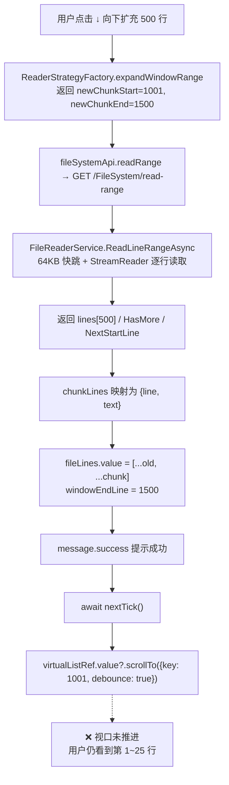
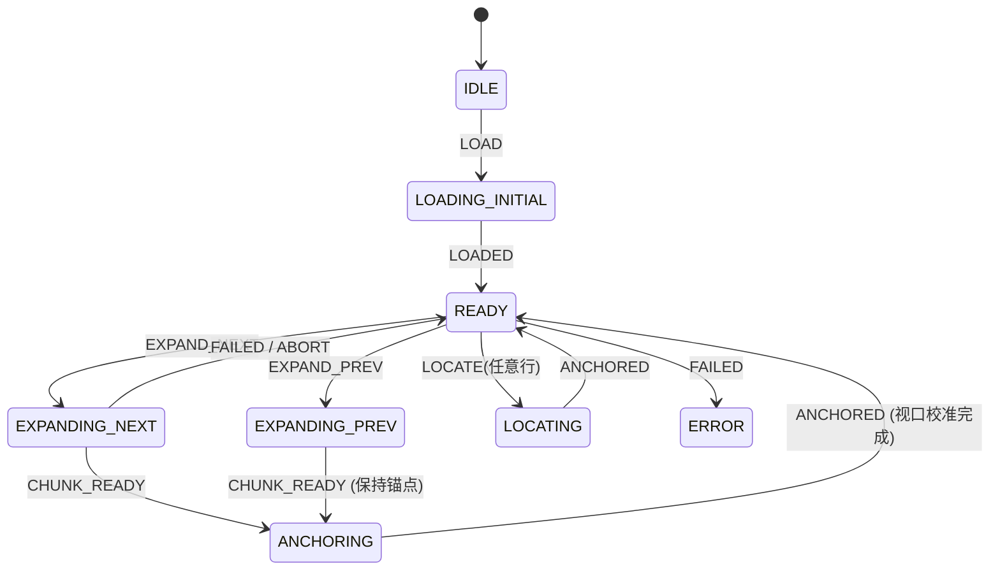

# 大文件阅读器「向下扩充」失效：根因、可行性、架构优化与业界方案调研

> **文档标识**：`docs/reader-streaming-window-expansion-feasibility-and-architecture-research.md`
> **创建日期**：2026-11-13
> **状态**：调研完成 / 方案待评审（本文档不包含代码改动）
> **触发问题**：在 19116 行 / 2.8 MB 的 Markdown 文档中，连续点击「↓ 向下扩充 500 行」，顶部提示「已向下扩充 500 行（当前第 1 ~ 1500 行）」，但正文视口始终停留在第 1 ~ 25 行，无法查看后续内容。
> **涉及模块**：`wwwroot/app/views/Reader.js`、`wwwroot/app/services/reader/*`、`wwwroot/vendor/naive-ui.js`（内联 vueuc VirtualList）、`Infrastructure/.../FileReaderService.cs`、`Host/.../FileSystemController.cs`、`wwwroot/tests/reader-and-file-search.test.mjs`
> **前置文档**：`docs/reader-and-file-search-defect-investigation-and-resolution-design.md`（BUG-02）、`docs/large-file-streaming-and-size-limit-optimization-design.md`

---

## 目录

1. [结论摘要](#1-结论摘要)
2. [现象界定与链路还原](#2-现象界定与链路还原)
3. [根因分析](#3-根因分析)
4. [可行性、逻辑、性能与架构欠缺头脑风暴](#4-可行性逻辑性能与架构欠缺头脑风暴)
5. [设计模式优化设计](#5-设计模式优化设计)
6. [可复用与可借鉴的现有库调研](#6-可复用与可借鉴的现有库调研)
7. [业界主流方案对比与借鉴](#7-业界主流方案对比与借鉴)
8. [系统现有基础设施盘点](#8-系统现有基础设施盘点)
9. [分阶段具体方案](#9-分阶段具体方案)
10. [性能量化与容量估算](#10-性能量化与容量估算)
11. [风险、兼容性与回退](#11-风险兼容性与回退)
12. [验收标准与测试门禁](#12-验收标准与测试门禁)
13. [参考资料](#13-参考资料)
14. [附录](#14-附录)

---

## 1. 结论摘要

**核心结论**：数据链路是成功的，失效发生在**视口链路**。后端 `read-range` 确实返回了 500 行，前端也确实把它们追加进了 `fileLines`；但「把新内容送入用户视口」这一环节存在三层叠加缺陷，导致用户看到的结果与「什么都没发生」不可区分。

三点最重要的判断：

1. **数据层无缺陷，交互层设计错误**。当前模型是「顶部按钮 + 无限累积追加」，与从上到下的自然阅读流相反。即便滚动修复正确，用户仍需点击 38 次才能读完 19116 行，且每次点击后视线要重新寻找定位点。
2. **已有的 `scrollTo({ key, debounce: true })` 修复大概率未生效**，原因不是 API 不存在，而是「静默失败 + 容器高度链断裂 + debounce 最小滚动语义」三者叠加。详见 [§3.2](#32-主因链视口为什么没有推进)。
3. **最优解不是继续修按钮，而是替换交互模型**：以「底部哨兵自动续读 + 锚点保持 + 滑动窗口裁剪」为 P1 目标态，以「虚拟列表映射全量文档高度」为 P2 终态。**全程零新增第三方依赖**，复用现有 Naive UI `NVirtualList`（内联 vueuc VirtualList + FinweckTree）与后端按行读取能力即可完成。

**关于是否引入新库**：不建议。Monaco / CodeMirror 6 / TanStack Virtual 各有优势，但本项目为「vendor 本地化 ESM + importmap、无 npm 构建」架构，引入编辑器内核或独立虚拟列表库会带来构建链与体积成本，而现有 `NVirtualList` 已具备 `scrollTo(index/key/top/position)`、`itemResizable` 动态行高、`defaultScrollKey` 等所需能力（[§8](#8-系统现有基础设施盘点)）。缺口集中在**横切工具**（锚定、竞态、缓存、哨兵、可观测性），应自建而非换库。

---

## 2. 现象界定与链路还原

### 2.1 观测事实（来自现场截图与源码）

| 观测项 | 值 | 说明 |
| :--- | :--- | :--- |
| 文件规模 | 19116 行 / 2.8 MB | 超过 `MAX_FULL_READ_BYTES = 2MB`，自动进入 `ReaderTier.STREAMING` |
| 工具栏状态 | 已载入第 1 ~ 1500 行 | 说明「向下扩充」被点击 2 次，`windowEndLine` 正确推进 |
| Toast 文案 | 已向下扩充 500 行（当前第 1 ~ 1500 行） | 与 `Reader.js:219` 模板字符串完全一致，证明运行的是含 `scrollTo` 修复的版本 |
| 正文视口 | 行号 1 ~ 25，滚动条位于顶部 | 视口未发生任何位移 |
| 跳转行控件 | 14（绿色高亮行） | `targetLine = 14`，说明此前的行定位功能是生效的 |

**关键推论**：`message.success` 的参数由 `chunkLines.length` 与 `expansion.mergedEnd` 拼装，**不依赖 `fileLines` 是否真正渲染**。因此 toast 成功只证明「HTTP 成功 + 数组赋值语句执行过」，不证明视口推进。这是本次误判「已修复」的直接来源。

### 2.2 完整链路



失效点位于 `J → K`。以下逐层分析。

---

## 3. 根因分析

### 3.1 已由源码确认的事实

**(1) `handleLoadMore('next')` 的完整实现**（`Reader.js:185-231`）：

```javascript
} else {
    const firstNewLine = chunkLines[0]?.line;
    fileLines.value = [...fileLines.value, ...chunkLines];
    windowEndLine.value = expansion.mergedEnd;
    message.success(`已向下扩充 ${chunkLines.length} 行 (当前第 ... 行)`);
    if (firstNewLine) {
        await nextTick();
        virtualListRef.value?.scrollTo({ key: firstNewLine, debounce: true });
    }
}
```

**(2) Naive UI `NVirtualList` 确实暴露 `scrollTo`**（`vendor/naive-ui.js` 约 1643399 字符处）：

```javascript
scrollTo: function (e, t) {
  "number" == typeof e ? r.value?.scrollTo(e, t ?? 0) : r.value?.scrollTo(e)
}
```

对象参数透传给内联 vueuc `VVirtualList`，因此 `ref` 调用路径本身成立，`keyField="line"`（`Reader.js:624`）也与默认 `"key"` 不同但被正确透传。

**(3) vueuc `VVirtualList` 的 `scrollTo` 语义**（`vendor/naive-ui.js` 约 55185 / 55566 字符处）：

```javascript
const { left, top, index, key, position, behavior, debounce = true } = options;
// ...
else if (key !== undefined) {
    const idx = keyToIndex.value.get(key);
    void 0 !== idx && z(idx, behavior, debounce);   // ← key 查不到时静默返回
}

function z(idx, behavior, debounce) {
    const a = tree.sum(idx) + paddingTop;            // 目标项顶部偏移
    if (debounce) {
        anchor = idx;
        setTimeout(() => { anchor = undefined }, 16);
        const { scrollTop, offsetHeight } = listElRef.value;
        if (a > scrollTop) {
            const h = tree.get(idx);
            // 最小滚动：仅当目标项底部超出视口底部才滚，且贴到视口底边
            a + h <= scrollTop + offsetHeight || listElRef.value.scrollTo({ top: a + h - offsetHeight, behavior });
        } else {
            listElRef.value.scrollTo({ top: a, behavior });
        }
    } else {
        listElRef.value.scrollTo({ top: a, behavior });   // 一律顶对齐
    }
}
```

由此确认三个**已成立的语义问题**：

- `debounce: true` 是默认值，且走的是**最小滚动**分支：目标在下方时，滚动终点是「目标项**底部**贴齐视口底边」，即新块首行出现在视口最底部，屏幕 95% 仍是旧内容；
- `behavior` 未传，为 `undefined`，浏览器按 `auto` 执行**瞬时跳转**，无平滑动画，用户更难察觉；
- `key` 查不到时**静默不滚**，配合 `virtualListRef.value?.` 可选链，任意一环为空都无任何日志、异常或降级。

**(4) 高度链的关键 CSS**（`vendor/naive-ui.js` 约 458758 / 1469581 / 1470344 字符处）：

```css
.n-scrollbar            { overflow: hidden; height: 100%; width: 100%; }
.n-scrollbar-container  { overflow: scroll; height: 100%; min-height: inherit; max-height: inherit; }
.n-scrollbar-content    { box-sizing: border-box; min-width: 100%; }   /* 无 height */
.v-vl                  { max-height: inherit; height: 100%; overflow: auto; min-width: 1px; }
.n-spin-container       { position: relative; }                          /* 无 height */
.n-spin-content         { opacity: 1; transition: ...; }                  /* 无 height */
```

### 3.2 主因链：视口为什么没有推进

按置信度分层陈述，避免把推断表述为事实。

#### 根因 A（高置信推断，需运行时确认一次）：滚动容器高度链在 `n-spin` 内容层断裂

`Reader.js` 的高度链为：

```
最外层 div        height: calc(100vh - 100px)         ✓ 确定高度
  └ n-card content  height: 100%; flex column; overflow: hidden   ✓ 确定高度
      └ n-spin      style="height: 100%"  → 落在 .n-spin-container   ✓ 确定高度
          └ .n-spin-content                          ✗ 无 height（auto）
              └ div style="height:100%; overflow:hidden"   ✗ 百分比父高为 auto → 退化为 auto
                  └ n-virtual-list style="height:100%"
                      └ .n-scrollbar / .n-scrollbar-container / .v-vl（逐级 height:100%）
```

CSS 规范下，百分比高度在包含块高度为 `auto` 时按 `auto` 处理。因此链在 `.n-spin-content` 断裂后，`.v-vl`（真正承载 `overflow:auto` 与 `scrollTop` 的滚动容器）退化为**内容自然高度**。由此产生两个后果，恰好解释截图：

1. `handleListResize` 把 `listHeight` 测成接近「全部行 × 行高」的大值（1500 行约 42000 px），`viewportItems` 计算出的可见区间几乎等于全部数据，**虚拟列表退化成全量 DOM 渲染**；
2. `z()` 的最小滚动判定中，`offsetHeight` 变成 42000 px 量级，`a + h <= scrollTop + offsetHeight` 成立 → **判定「目标已在视口内」，直接跳过 `scrollTo`**；同时 `.v-vl` 自身 `scrollHeight ≈ clientHeight`，即便用户滚动鼠标也没有可滚动距离。

这与「数据已追加但视口完全不动、也无法手动滚下去」的现场现象一致。`check.mjs:333` 的 `checkFlexScrollContainerRules` 只拦截「`flex-direction: column` + `overflow-y: auto` 容器内子 div 有 `overflow:hidden` 且缺 `flex-shrink:0`」的组合，而 `Reader.js` 使用的是 `overflow: hidden`（非 `overflow-y: auto`），**未落入该门禁覆盖范围**，因此静态检查全绿。

> **验证方式**：浏览器控制台执行 [附录 B](#附录-b运行时诊断脚本)。若 `.v-vl` 的 `clientHeight ≈ scrollHeight` 且 `clientHeight > 2000`，根因 A 成立。

#### 根因 B（确定成立）：`debounce: true` 的最小滚动 + 无 `behavior`，视觉反馈强度不足

即便高度链正常，`scrollTo({ key, debounce: true })` 也只是把新块首行贴到视口底边并瞬时跳转。文档 `reader-and-file-search-defect-investigation-and-resolution-design.md:283-287` 最初建议的是 `scrollTo({ key, behavior: 'smooth' })`，实际落地代码改成了 `debounce: true` 且**丢失了 `behavior`**，属于方案落地偏差。

#### 根因 C（确定成立）：交互模型与阅读流相反

「向下扩充」按钮位于**顶部工具栏**，而新增内容追加在**列表尾部**。用户在视口顶部点击、视线却在屏幕中部，两组信息在物理位置上分离；系统既没有把新内容推入视口，也没有在视口内给出「新内容已到达此处」的可见标记。这是「点击无效」主观感受的根本来源，也是单靠修 `scrollTo` 无法彻底解决的问题。

#### 根因 D（确定成立）：状态与可观测性缺失

`ReaderStateMachine` 有 6 个状态（`ReaderStateMachine.js:6-13`），但 `handleLoadMore` **完全绕过状态机**：不迁移状态、不记录 `pendingDirection`、不校验 generation。`loadingMore` 布尔锁是唯一并发保护。所有失败路径（key 查不到、ref 为空、容器无滚动能力）均静默，排查只能靠读源码。

### 3.3 次生缺陷清单

| 编号 | 缺陷 | 位置 | 影响 |
| :--- | :--- | :--- | :--- |
| D-01 | 「滑动窗口」只扩不裁：`windowStartLine` 恒为 1，`mergedStart` 永远等于 `curStart` | `ReaderViewerStrategy.js:140-166` | 数组随点击线性增长，到第 19116 行需 38 次点击、19116 个行对象 |
| D-02 | 每次追加 `fileLines.value = [...old, ...chunk]` 全量复制 | `Reader.js:212,217` | O(n) 复制 + 全量响应式失效 |
| D-03 | `keyToIndex` 为 `computed(() => new Map(items.map(...)))`，每次 items 变化 O(n) 重建 | `vendor/naive-ui.js`（内联 vueuc） | 追加 500 行需重建含 1500 项的 Map |
| D-04 | FinweckTree 高度树每次 items 变化 O(n) 重建并逐项 `add` | 同上 | O(n log n) 开销，与 D-02 叠加 |
| D-05 | 向上扩充无锚点补偿，头部插入 500 行后视口必然跳变 | `Reader.js:211-214` | 浏览器 `overflow-anchor` 对 `transform` 定位的虚拟列表不可靠（MDN 明确其为 opt-out 机制） |
| D-06 | 无 `AbortController` / requestId / generation，快速连点或切换文件会乱序写入 | `Reader.js:185-231, 234-372` | 竞态数据覆盖；`loadFile` 仅 `loading` 布尔锁 |
| D-07 | `NextByteOffset` 已在 Service 返回，但 HTTP 层与前端 API 均未暴露 | `FileReaderService.cs:134`、`api/index.js:266-267` | 深行读取每次从文件头按 64KB 缓冲扫描，越深越慢 |
| D-08 | `read-range` 响应中 `TotalLines` 仅在读到 EOF 时为准确值，否则 `-1` | `FileReaderService.cs:122` | 前端依赖 `getMetadata` 的 totalLines，两者不一致时会越界 |
| D-09 | 门禁 3 仅做字符串包含断言 | `reader-and-file-search.test.mjs:193-194` | 只检查 `virtualListRef.value?.scrollTo` 存在，不校验参数、不实例化组件、不断言滚动结果，因此「修复代码存在但运行时无效」可以通过全部门禁 |
| D-10 | `itemResizable` 的 ResizeObserver 与 `z()` 的 16ms 锚点 `S` 并发 | vendor `handleItemResize` | 可见项高度变化会按锚点做 `scrollBy` 补偿，可能把程序化滚动结果再次修正 |

---

## 4. 可行性、逻辑、性能与架构欠缺头脑风暴

### 4.1 按维度归纳

**交互可行性**：当前「顶部按钮分页」在 500 行步长、19116 行总量下需要 38 次操作，且每次操作后需要用户自行寻找断点，**不具备连续阅读的可行性**。业界同类产品（GitHub / GitLab / 日志查看器）要么直接降级为 raw/download，要么用「滚动到底自动加载」，几乎不采用「手动点击追加且不移动视口」的模型。

**逻辑正确性**：

- 边界：`expandWindowRange` 以 `curEnd >= total` 判定结束，但 `windowStartLine` 从不推进，窗口是「单调递增区间」而非窗口；
- 语义：`message.success` 与真实渲染结果解耦，形成「成功假象」；
- 幂等：无请求去重，连点期间 `loadingMore` 锁住按钮，但路由切换 / `onActivated` 可并发触发 `loadFile`；
- 定位：`scrollToTargetLine`（`Reader.js:86-117`）在目标行超出窗口时会 `loadStreamingWindow(lineNum, true)` **整体重置窗口**，与「累积扩充」模型语义冲突——用户跳转后再点扩充，窗口起点会被重置却又保留旧的 `windowEndLine`，存在状态不一致风险。

**性能**：见 [§10](#10-性能量化与容量估算)。核心问题是 **O(n) 累积**代替了 **O(视口) 恒定**，且高度链断裂时虚拟列表退化成全量 DOM 渲染。

**可测试性**：`Reader.js` 将网络、状态、视口、DOM 全部耦合在单个 `setup()` 中；现有测试只能做源码字符串匹配，无法对「点击后 `scrollTop` 是否变化」做断言。这是缺陷反复出现却门禁全绿的结构性原因。

**可维护性**：`ReaderViewerStrategy.js` 名为「策略」，实际只承担「模式判定 + 窗口算术」，数据供给、视口控制、并发控制散落在视图层；`ReaderStateMachine` 名为「状态机」，实际只是带回调的状态变量容器，无迁移表、无 guard（仅 `setReady` 有一处状态检查）。

### 4.2 风险矩阵

| 风险 | 可能性 | 影响 | 优先级 | 缓解措施 |
| :--- | :--- | :--- | :--- | :--- |
| 视口不推进（本问题） | 已发生 | 功能不可用 | **P0** | P0 止血 + 运行时 E2E 门禁 |
| 高度链断裂导致全量 DOM 渲染 | 高 | 主线程卡死 / OOM | **P0** | 显式容器高度 + DOM 节点数上限断言 |
| 长文档连续点击导致内存线性增长 | 高 | 数百 MB 堆占用 | **P1** | 窗口裁剪 + 块缓存上限 |
| 向上加载视口跳变 | 高 | 阅读中断 | **P1** | 锚点行 + 偏移补偿 |
| 请求乱序覆盖 | 中 | 显示错行 | **P1** | generation token + AbortController |
| 深行读取退化 | 中 | 点击响应变慢 | **P2** | 打通 `byteOffset` 续读（需先解决缓冲校准） |
| 引入新库破坏无构建架构 | 中 | 发布链路改造 | **P2** | 维持零新增依赖 |

---

## 5. 设计模式优化设计

现有三个模式（Strategy / State Machine / Adapter）**已经存在但未真正承担职责**。建议不是「新增模式」，而是**把职责归位并补齐边界**。

### 5.1 状态机（State Machine / State Pattern）—— 承担并发与时序

升级 `ReaderStateMachine.js`，引入**迁移表 + guard + 上下文游标**：

```javascript
export const ReaderState = Object.freeze({
  IDLE: 'IDLE', LOADING_INITIAL: 'LOADING_INITIAL', READY: 'READY',
  EXPANDING_NEXT: 'EXPANDING_NEXT', EXPANDING_PREV: 'EXPANDING_PREV',
  LOCATING: 'LOCATING', ANCHORING: 'ANCHORING', ERROR: 'ERROR'
});

// 迁移表：非法事件直接拒绝，杜绝「加载中又发起反向扩充」
const TRANSITIONS = {
  IDLE:            { LOAD: 'LOADING_INITIAL' },
  LOADING_INITIAL: { LOADED: 'READY', FAILED: 'ERROR' },
  READY:           { EXPAND_NEXT: 'EXPANDING_NEXT', EXPAND_PREV: 'EXPANDING_PREV',
                     LOCATE: 'LOCATING', LOAD: 'LOADING_INITIAL' },
  EXPANDING_NEXT:  { CHUNK_READY: 'ANCHORING', FAILED: 'READY', ABORT: 'READY' },
  EXPANDING_PREV:  { CHUNK_READY: 'ANCHORING', FAILED: 'READY', ABORT: 'READY' },
  ANCHORING:       { ANCHORED: 'READY' },
  LOCATING:        { ANCHORED: 'READY', FAILED: 'READY' },
  ERROR:           { LOAD: 'LOADING_INITIAL' }
};
```

上下文追加：`windowStart/windowEnd`、`anchorLine`、`anchorOffset`、`pendingDirection`、`generation`、`controller`（AbortController）。**guard**：`EXPAND_*` 仅允许从 `READY` 发起；每次 `generation++`，异步回调必须校验 `generation === myGeneration` 才写入。



### 5.2 策略模式（Strategy）—— 分离「数据供给」与「视图」

现有 `ReaderStrategyFactory` 保留「模式 / 分级 / 窗口算术」，新增一层**数据源策略**，统一接口使视图不关心数据来自全量读取还是分块读取：

```javascript
// LineSourceStrategy 契约（纯逻辑，可单测）
{
  getTotalLines(),
  getLoadedRange(),                       // { start, end }
  ensureRange(startLine, endLine),        // Promise<LineChunk> 按需取块
  evictOutside(anchorLine, maxLines),     // 窗口裁剪
  onViewportChange(viewport),             // 由哨兵/滚动事件驱动
  cancelPending()
}
```

| 策略 | 适用 | 说明 |
| :--- | :--- | :--- |
| `FullReadStrategy` | ≤ 2MB 且 ≤ 5000 行 | 现有小文件全量路径 |
| `ChunkedWindowStrategy` | 大文件（P1 目标态） | 分块加载 + 滑动窗口裁剪 + LRU 块缓存 |
| `VirtualFullDocumentStrategy` | 大文件（P2 终态） | 虚拟列表直接映射 19116 行占位高度，按视口索引懒加载，行号即索引 |

三个策略对 UI 暴露同一契约，因此「是否还存在『扩充』按钮」只是策略内部实现细节，视图层无需改动。

### 5.3 适配器模式（Adapter）—— 隔离后端 DTO 与 UI 库

建议新增两个适配器（与现有 `SearchHitAdapter.js` 风格一致）：

1. **`FileRangeSourceAdapter`**：把 `read-range` 的 `lines / content / hasMore / nextStartLine / nextByteOffset / totalLines(-1)` 适配为稳定的领域对象

   ```javascript
   { startLine, endLine, lines: [{ line, text }], hasMore, nextCursor }
   ```

   隔离后端字段变化，并统一处理 `TotalLines = -1` 的兜底（回退 `getMetadata`）。

2. **`VirtualListAdapter`**：把 `NVirtualList` 包装成与具体 UI 库无关的视口端口

   ```javascript
   {
     scrollToLine(line, { align, behavior }),   // 内部转为 index 或 top，显式判空并抛错
     getViewport(),                             // { firstLine, lastLine, scrollTop, clientHeight, scrollHeight }
     getScrollContainer(),                      // 供 IntersectionObserver 作为 root
     preserveAnchor(fn),                        // 记录锚点行 → 执行 fn → 按新偏移补偿 scrollTop
     onScroll(cb), onReachEnd(cb), onReachStart(cb)
   }
   ```

   价值有三：① 业务层不再直接依赖 `virtualListRef.value?.scrollTo` 这类易静默失败的调用；② 未来替换 TanStack Virtual / CodeMirror 只需换适配器；③ **适配器是运行时断言与日志的自然落点**（滚动失败可显式报错，而非可选链吞掉）。

### 5.4 观察者 / 哨兵（Observer）—— 把「视口意图」变成事件

用 `IntersectionObserver` 在列表首尾各放一个哨兵，`root` 绑定 `VirtualListAdapter.getScrollContainer()`，`rootMargin` 预扩一屏提前触发。`onReachEnd` 发出 `EXPAND_NEXT`，`onReachStart` 发出 `EXPAND_PREV`。需配合「哨兵仍在视口内时去重 / 卸载重挂」防止连续触发。

**遵循「仅当视口已贴底才自动跟随」原则**（借鉴 TanStack `followOnAppend` 与 k9s / Kuboard 日志 autoscroll）：用户主动上翻阅读历史时，新增内容只追加、不拉走视口。

### 5.5 命令 + 令牌（Command + Generation Token）与仓库缓存（Repository）

- 每次加载封装为一个 `LoadChunkCommand { direction, range, generation, controller }`，回调校验 generation 后提交；
- `LineChunkCache` 以 `[startLine, endLine]` 为键做 LRU（上限建议 8~12 块 / 约 6000 行），命中即跳过 HTTP；窗口裁剪时淘汰远端块。

### 5.6 模式与缺陷的对应关系

| 缺陷 | 承担模式 |
| :--- | :--- |
| D-06 竞态乱序、D-09 静态门禁 | 状态机 + Command/Token |
| D-01/02/03/04 O(n) 累积、D-07 深行退化 | 策略 + 仓库缓存 + 适配器（游标） |
| D-05 向上跳变、根因 C 交互断裂 | 观察者哨兵 + 适配器 `preserveAnchor` |
| 根因 A 高度链、根因 B 滚动语义、根因 D 静默失败 | 适配器（显式端口与断言）+ 视口职责从视图剥离 |

---

## 6. 可复用与可借鉴的现有库调研

### 6.1 候选库对比

| 库 | 许可 / 大致体积 | 无构建可用性 | 动态行高 | 按行号跳转 | 双向加载 / 锚定 | 与本系统契合度 |
| :--- | :--- | :--- | :--- | :--- | :--- | :--- |
| **Naive UI `NVirtualList`（本项目已内置）** | MIT / 已随 vendor 引入（naive-ui.js 1.7 MB） | ✅ 已可用 | ✅ `item-resizable` + FinweckTree | ✅ `scrollTo({index/key})`、`defaultScrollKey` | ⚠️ 需自建锚点补偿 | **最高，零成本** |
| CodeMirror 6 | MIT / 模块数百 KB（需核实） | ⚠️ 纯 ESM，可经 esm.sh + importmap 本地化，但需引入多个包 | ✅ | ✅ `EditorView.scrollIntoView` | ⚠️ viewport 自动、无内置分块 | 中高（架构改造大） |
| Monaco Editor | MIT / 数 MB + Web Worker | ❌ `/esm` 需打包器，AMD build 已弃用 | 部分（需核实） | ✅ `revealLine`（需核实） | ❌ | 低（破坏无构建架构） |
| TanStack Virtual / `@tanstack/vue-virtual` | MIT / core 约 5–6 KB gzip（需核实版本） | ⚠️ core 可直接 ESM 引入，vue adapter 需 importmap 映射 Vue | ✅ `estimateSize` + `measureElement` | ✅ `scrollToIndex` / `scrollToOffset` | ✅ 新版 `anchorTo:'end'` / `followOnAppend` / `takeSnapshot`（**需核实锁定版本是否已包含**） | 中（功能重复，值得借鉴机制） |
| react-window v2 | 需核实 | ❌ React + JSX，需构建链 | `useDynamicRowHeight` | `scrollToRow` | ❌ | 不适用 |
| vue-virtual-scroller v3 | 需核实 | ❌ 官方明确 ESM-only，需 Vite/Rollup/webpack5 | ✅ `DynamicScroller` | `scrollToItem`（需核实） | 自行组合 | 低 |
| Clusterize.js | MIT / 数 KB（需核实） | ✅ 原生单文件 `<script>` 直引，最省事 | ❌ 依赖近似等行高（需核实） | 有限 | `append/prepend` 手工 | 低（长段落折行会破坏等行高假设） |
| CSS `overflow-anchor` / `content-visibility` | 浏览器原生 | ✅ | — | — | 仅锚定兜底 | 辅助，不可作为主方案 |

**说明**：`overflow-anchor` 默认 `auto`，浏览器会对「在视口上方插入内容」自动补偿滚动位置；`overflow-anchor: none` 用于关闭（[MDN](https://developer.mozilla.org/en-US/docs/Web/CSS/overflow-anchor)）。但虚拟列表普遍用 `transform: translateY()` 定位可见块，浏览器锚点选择不可靠，**必须在适配器中显式做锚点补偿**。`content-visibility: auto` 只跳过屏外 layout/paint，DOM 与数据仍在内存，**不解决「数据尚未加载」的问题**，且需配 `contain-intrinsic-size` 否则滚动条跳动（[MDN](https://developer.mozilla.org/en-US/docs/Web/CSS/content-visibility)）。

### 6.2 结论

**不引入新库**。理由：① 所需能力（`scrollTo(index/key/top)`、`itemResizable` 动态行高、`defaultScrollKey`、`keyField`）已在内置 `NVirtualList` 中具备；② 缺口是横切逻辑，换库不会自动获得；③ 无构建架构对 Monaco / vue-virtual-scroller 等有硬约束。**值得借鉴的是机制而非代码**：TanStack Virtual 的 `anchorTo` / `followOnAppend` / `getItemKey` 稳定键 / `takeSnapshot`，CodeMirror 的 `viewport` + `scrollIntoView` 模型，日志查看器的「贴底才跟随」。

---

## 7. 业界主流方案对比与借鉴

### 7.1 产品做法

| 产品 / 系统 | 大文件处理 | 视口定位 / 加载策略 | 可借鉴点 |
| :--- | :--- | :--- | :--- |
| **GitHub blob view** | 阈值降级：超阈值不高亮、不渲染，仅提供 raw / download；CSV/TSV 512 KB、STL/GeoJSON 10 MB 等明确阈值（[GitHub Docs](https://docs.github.com/en/repositories/working-with-files/using-files/working-with-non-code-files)） | **不做分块无限滚动** | 明确能力边界与降级路径；本项目「大文件强制源码模式」已是同类思路，应继续保留并给出「下载完整文件」入口 |
| **GitLab** | Rouge 服务端高亮默认 512 KB，前端 Highlight.js 上限 2 MB，超出降级纯文本（[GitLab Docs](https://docs.gitlab.com/user/project/repository/files/highlighting/)） | 阈值降级 | 阈值可配置化 |
| **VS Code / Monaco** | `files.maxMemoryForLargeFilesMB`（默认 4096）、large file mode 只读、关闭部分语言服务（[VS Code Docs](https://vscode-docs-arc.readthedocs.io/en/latest/getstarted/settings/)）；仅渲染视口附近行 | 编辑器内核维护完整模型，视口虚拟化 | 「全量逻辑模型 + 视口渲染」正是 P2 `VirtualFullDocumentStrategy` 的思路；但编辑器内核需全量文本，本项目刻意避免全量读取 |
| **CodeMirror 6** | 官方明确 `EditorView.viewport`：「only draws the code that is visible (plus a margin around it) to the DOM」；`visibleRanges`、`requestMeasure`（[Ref Manual](https://codemirror.net/docs/ref/)） | `EditorView.scrollIntoView(pos, {y:'start'|'center'|'nearest'})` 作为 StateEffect 进入 transaction | 把「滚动定位」建模为**状态变更**而非命令式 DOM 调用，与 §5.1 状态机设计一致 |
| **日志查看器（kubectl logs / k9s / Kuboard）** | `--tail=N` 从尾部 N 行起持续追加 | **仅当视口贴底才自动跟随**；用户上翻时暂停跟随，Kuboard 会把新日志入缓存并显示「缓存 N 行」（[Kuboard Docs](https://www.kuboard.cn/zh/ops/logs)） | 「跟随意图判定」是无限滚动最重要的用户体验规则，直接对应 `followOnAppend` / `isAtEnd` |
| **Sourcegraph / DevTools 大日志** | 分块高亮 / 超量丢弃与折叠（细节需核实） | 按位置定位 | 需进一步核实，不作为依据 |

> 关于 GitHub 中「This file has been truncated / View the full file」的统一阈值，以及 Sourcegraph 的分块高亮细节，现有检索未获得权威文档确认，标记为**需核实**，未纳入方案依据。

### 7.2 方案对比表

| 方案 | 交互模型 | DOM / 内存开销 | 实现复杂度 | 与本项目契合度 |
| :--- | :--- | :--- | :--- | :--- |
| **A. 现有：顶部按钮累积追加** | 手动分页，视口不动 | **O(累计行数)**；高度链断裂时退化为全量 DOM | 低 | **低（现状缺陷）** |
| **B. 底部哨兵 + 窗口裁剪（P1 推荐）** | 滚动到底自动续读；贴底才跟随；向上加载保持锚点 | **O(窗口大小)** 恒定，DOM 约 30~60 行 | 中 | **高**：零新依赖，复用现有虚拟列表与后端 |
| **C. 虚拟列表映射全量文档高度（P2 终态）** | 滚动条代表全文 19116 行，任意行 O(1) 跳转，按视口索引懒加载 | **O(视口)** 恒定 | 中高 | **最高**：彻底消除「扩充」概念，但需块缓存与占位高度策略 |
| **D. CodeMirror 6 只读模式** | 编辑器内核 | 极低 | 高（多包引入 + 状态模型改造） | 中：未来若需语法高亮 / 选区复制可评估 |
| **E. Monaco Editor** | IDE 内核 | 高（Worker） | 高（需打包器） | 低：破坏无构建架构 |
| **F. Clusterize.js** | 原生分块 | 低 | 低 | 低：等行高假设与长段落折行冲突 |
| **G. 阈值降级（GitHub / GitLab 式）** | 不渲染，仅 raw / download | 0 | 低 | 中：作为超大文件（> 阈值）的兜底分支保留 |

**推荐路径**：`A →(P0 止血)→ B →(P2 演进)→ C`，`G` 作为极端规模兜底，`D` 作为未来富文本/高亮需求的可选升级，`E/F` 不采用。

---

## 8. 系统现有基础设施盘点

### 8.1 可直接复用（零改造或轻改造）

| 基础设施 | 精确位置 | 现状 / 能力 | 复用方式 |
| :--- | :--- | :--- | :--- |
| 前端运行架构 | `wwwroot/vendor/README.md`、`wwwroot/index.html` importmap、`wwwroot/package.json` | Vue 3.5.32 / Naive UI 2.44.1 / vue-router 4.6.4 / axios 1.14.0 / marked 18.0.4；**无 dependencies、无 build** | 决定了「不引入需打包器的库」 |
| `NVirtualList` + 内联 vueuc `VVirtualList` | `vendor/naive-ui.js`：`aO=` 约 1643399；`keyToIndex/scrollTo` 约 55185；CSS 约 458758 | `scrollTo({left,top,index,key,position,behavior,debounce})`、`itemResizable` 动态行高（FinweckTree O(log n) 更新）、`keyField`、`defaultScrollKey/Index`、`onScroll/onResize` | 作为 `VirtualListAdapter` 的底层实现；`itemSize:28` + `itemResizable:true` 已在用 |
| `FileReaderService.ReadLineRangeAsync` | `Infrastructure/.../FileReaderService.cs:28-138` | 64 KB 字节缓冲扫 `\n` 快进 → `Seek` → `StreamReader` 逐行；单行 64 KB 截断；单次 ≤ 2000 行；返回 `HasMore / NextStartLine / NextByteOffset / TotalLines` | 支撑任意行随机跳转与分块读取；`MaxAllowedReadLines=2000`（:18）远大于 500 步长 |
| `FileReaderService.GetMetadataAsync` | 同文件 `:140-286` | `totalLines / sizeBytes / isMarkdown / headings` | 窗口边界与大纲跳转的数据源 |
| HTTP 端点 | `Host/.../FileSystemController.cs`：`read-range :304-342`、`read-text :238-302`（>5MB 返回 `isTooLarge`）、`metadata :344-378` | 路径沙箱 + `RequestAborted` 取消令牌透传 | 后端已支持取消，前端补 `AbortController` 即可闭环 |
| 前端 API | `wwwroot/app/api/index.js:266-269` | `readRange(path,startLine,endLine,sourcePath)`、`getMetadata` | 由 `FileRangeSourceAdapter` 包装 |
| 窗口算术纯函数 | `ReaderViewerStrategy.js:113-129 / 140-166` | `calculateWindowRange`（目标行落在前 20%，预留 100 行上下文）、`expandWindowRange`、Tier 判定 | 保留并下沉为 `WindowRange` 值对象，扩充裁剪逻辑 |
| 状态机 / 适配器骨架 | `ReaderStateMachine.js`、`SearchHitAdapter.js` | 状态常量、迁移回调、DTO → 路由适配 | 按 §5.1 / §5.3 升级 |
| 跟随意图判定（可移植） | `wwwroot/shared/conversation-scroll.js`（`isNearConversationBottom` / `shouldFollowConversationStream` 等） | 聊天流的「是否贴底 / 是否暂停跟随」纯函数 + RAF 批处理 | 迁移为通用「贴底才跟随」判定 |
| 门禁框架 | `wwwroot/check.mjs:333`、`wwwroot/tests/reader-and-file-search.test.mjs`、`node --test` | 静态 AST / 源码断言、`FrontendViewIntegrityTests.cs` | 扩充 §12 的新门禁 |
| 后端性能门禁 | `tests/ReferenceRAG.Host.Tests/LargeFileReaderStreamingGateTests.cs:38-68` | 5 万行文件读 25000~25199 行，断言 `ReturnedLines=200` / `HasMore` / `NextStartLine=25200` / 耗时 < 1500 ms | 直接复用，补 `NextByteOffset` 契约 |

### 8.2 明确缺口（需自建）

`IntersectionObserver` 首尾哨兵、显式 scroll anchoring 补偿、`AbortController` 请求竞态 / generation、LRU 行块缓存、`byteOffset` 续读的 HTTP 打通、运行时 E2E 滚动断言、滚动失败的日志与降级。**全项目业务代码中 `IntersectionObserver` / `ResizeObserver` / 防抖节流工具 / LRU 缓存均为零命中**（仅 vendor 内部的 `handleItemResize` 使用 ResizeObserver）。

### 8.3 一项需要特别注意的后端风险

`NextByteOffset` 取自 `fs.Position`（`FileReaderService.cs:115`），而 `StreamReader` 以 8192 字节缓冲预读（:92），**底层流位置可能超前于逻辑行边界**。若直接把该值作为下次 `byteOffset` 传入（:59-63 会 `Seek` 并信任调用方行号），存在**错行 / 吞行风险**。因此「打通 byteOffset 续读」前必须先做行边界校准（回退到上一个 `\n`），或改由后端维护 `(startLine → byteOffset)` 游标表并在单测中覆盖连续两次续读的衔接。**此项列为 P2，不进入 P0/P1。**

---

## 9. 分阶段具体方案

### 9.1 P0 止血（改动集中在 `Reader.js`，目标：本次问题立即消失）

1. **修复高度链**（针对根因 A）：
   - 给 `<n-spin>` 增加 `content-style="height: 100%; display: flex; flex-direction: column; min-height: 0"`，或直接移除 `n-spin` 包裹改为条件式 overlay；
   - 给代码视图容器补 `flex: 1; min-height: 0`，给 `<n-virtual-list>` 显式 `style="height: 100%; max-height: 100%"`；
   - **验收硬指标**：`.v-vl` 的 `clientHeight` 等于可视区高度（数百 px），且 `scrollHeight > clientHeight`。
2. **修正滚动调用**（针对根因 B/D）：改用 `VirtualListAdapter` 的显式端口；过渡期最小改法：

   ```javascript
   const vl = virtualListRef.value;
   if (!vl?.scrollTo) { console.error('[Reader] 虚拟列表未就绪'); return; }
   const index = fileLines.value.length - chunkLines.length;  // 新块首行索引
   const before = vl.getScrollContainer?.()?.scrollTop ?? 0;
   vl.scrollTo({ index, behavior: 'smooth', debounce: false });  // 顶对齐 + 平滑 + 禁用最小滚动
   await nextTick();
   const after = vl.getScrollContainer?.()?.scrollTop ?? 0;
   if (after === before) {
       // 降级：直接写 scrollTop，避免静默失败
       const container = vl.getScrollContainer?.();
       if (container) container.scrollTop = index * 28;
       console.warn('[Reader] scrollTo 未生效，已降级');
   }
   ```

   > `NVirtualList` 已在 `setup()` 返回对象中提供 `getScrollContainer()`（返回 vueuc 的 `.v-vl` 元素）与 `getScrollContent()`，可直接读取 `scrollTop` 并用于降级写入。引入 `VirtualListAdapter` 的目的不是「拿不到容器」，而是**统一端口、显式判空、集中记录失败**，避免视图层散落对组件内部实现的直接调用。
3. **修正反馈文案**：改为「已载入第 501 ~ 1000 行，已定位至第 501 行」，并在视口内短暂高亮新块首行（复用 `isLinePulsing`）。
4. **提升门禁**：`reader-and-file-search.test.mjs` 门禁 3 增加对 `behavior`、`debounce: false`、`index` 的断言，并新增 `n-spin` content-style 高度链静态检查。

**P0 不解决的问题**：38 次点击、内存线性增长、向上跳变、竞态。P0 只保证「点一次能看到新内容」。

### 9.2 P1 交互重构（推荐目标态，零新增依赖）


关键规则：

- **自动续读**：滚到末尾自动加载下一块，按钮降级为「手动加载 / 触底加载失败时重试」；
- **跟随意图**：`followOnAppend` 语义——仅当追加前视口处于贴底阈值内才自动滚动到新块；用户上翻阅读时不拉走视口，仅显示「已新增 500 行，点击跳转」提示；
- **滑动窗口裁剪**：以当前锚点行为中心，保留前后各 N 块（建议窗口上限 2000 行，与后端 `MaxAllowedReadLines` 对齐），淘汰远端块；`windowStartLine` 随裁剪推进，窗口名副其实；
- **向上扩充锚点保持**：插入前记录 `anchorLine = 当前视口首行` 与其 `offset = tree.sum(index)`，插入后按 `新 index` 重算偏移并 `scrollTop += delta`；`overflow-anchor` 仅作兜底，不依赖；
- **稳定键**：行对象以绝对行号 `line` 作为唯一 key（已满足），避免 index 作为 key 在 prepend 后串位（TanStack 官方明确要求 persistent key）；
- **并发**：`EXPAND_*` 状态下拒绝新请求；`generation` 校验；`AbortController` 联动后端 `RequestAborted`。

**改造文件清单**：`Reader.js`（瘦身，只保留编排）、`ReaderViewerStrategy.js`（窗口裁剪）、`ReaderStateMachine.js`（迁移表）、新增 `app/services/reader/FileRangeSourceAdapter.js`、`VirtualListAdapter.js`、`ChunkedWindowStrategy.js`、`LineChunkCache.js`、`ViewportSentinel.js`。

### 9.3 P2 终态与后端演进

- `VirtualFullDocumentStrategy`：虚拟列表 `items` 用 19116 个轻量占位项（或由适配器提供 `getItemKey(index) → lineNo`），滚动条直接代表全文；视口内索引映射为行号，未缓存则按需 `readRange`；任意行跳转 O(1)，「扩充」概念消失；
- 后端：在 `read-range` 响应中稳定返回 `totalLines`（避免依赖 metadata 双源），并在完成行边界校准后暴露 `byteOffset` 续读；
- 极端规模（例如 > 20 MB）走 GitHub 式阈值降级：只提供 `metadata + 大纲跳转 + 下载`，不做在线全文渲染。

---

## 10. 性能量化与容量估算

以 19116 行 / 2.8 MB、步长 500 行为例（估算值，用于方案取舍，非实测基准）：

| 指标 | 现状（累积追加） | P1（窗口裁剪 2000 行） | P2（全量占位 + 视口懒加载） |
| :--- | :--- | :--- | :--- |
| 读到第 19000 行所需用户操作 | 38 次点击 | 连续滚动，自动触发 | 拖动滚动条即可 |
| `fileLines` 对象数 | 19116 | ≤ 2000 | 视口 + overscan（约 30~60） |
| 每次追加的数组复制 | O(n)，末次 19116 | O(2000) | O(视口) |
| `keyToIndex` Map 重建 | O(n) | O(2000) | 按索引计算，无需 Map |
| FinweckTree 重建 | O(n log n) | O(2000 log 2000) | O(视口) |
| DOM 行数（高度链正常时） | 视口 ~30 行 | 视口 ~30 行 | 视口 ~30 行 |
| DOM 行数（高度链断裂时） | **全部 19116 行 ≈ 4 万节点** | 2000 行 ≈ 4 千节点 | 视口 ~30 行 |
| 内存（行数据，粗估） | 文本 ~2.8 MB + 对象开销，量级 10 MB+ | ~0.3 MB | < 0.1 MB |
| 后端单次读取 | 从文件头扫描至 startLine，越深越慢（O(前置字节)）；2.8 MB 文件末段约需扫 2.6 MB | 同左，但配合 LRU 减少重复请求 | 同左 + byteOffset 续读后趋近 O(块) |

**结论**：现状的成本随阅读进度**线性增长**，且在高度链断裂时退化为全量 DOM；P1 将全部成本压到与窗口大小相关的常数，P2 进一步压到与视口相关的常数。

---

## 11. 风险、兼容性与回退

| 风险 | 说明 | 缓解 / 回退 |
| :--- | :--- | :--- |
| 高度链修改影响小文件 / Markdown 渲染模式 | `n-spin` content-style 变更作用于整个右栏 | 分支化：仅 `isStreamingWindow && viewerMode === 'code'` 时启用确定高度；E2E 覆盖两条路径 |
| 自动续读在快速滚动下重复请求 | 哨兵持续在视口内会连续触发 | 状态机 guard + `unobserve/observe` 去重 + LRU 命中短路 |
| 向上加载锚点补偿与 `itemResizable` 的 ResizeObserver 竞态 | 两者都会写 `scrollTop` | 补偿放在 `nextTick` + 一次 RAF 后；`preserveAnchor` 内加一次性标记，16 ms 内忽略 resize 补偿 |
| 窗口裁剪导致用户回看时重新请求 | 淘汰远端块 | LRU 保留 8~12 块；回看命中缓存时无网络请求 |
| `byteOffset` 续读错行 | StreamReader 缓冲导致 `fs.Position` 超前 | 列为 P2，先补行边界校准与连续续读单测，未通过前不启用 |
| 状态机重构回归 | 影响首次加载、跳转、TOC、错误态 | 保留 `loadFile` 入口不变；为状态迁移表补纯函数单测；特性开关 `reader.chunkedStrategy` 可一键回退到 P0 行为 |

---

## 12. 验收标准与测试门禁

### 12.1 运行时验收（必须，现有门禁的最大缺口）

| 编号 | 断言 | 判定 |
| :--- | :--- | :--- |
| E2E-01 | 打开 19116 行文件后，`.v-vl` 的 `clientHeight` 在 300~1200 px 之间，且 `scrollHeight > clientHeight * 5` | 高度链成立 |
| E2E-02 | DOM 中行节点数 < 100 | 未退化为全量渲染 |
| E2E-03 | 点击「向下扩充」后 `scrollTop` 显著增大，且视口首行号 ≈ 新块首行（501 / 1001） | 视口推进闭环 |
| E2E-04 | 连续滚动到底自动触发下一块加载，无需点击 | 哨兵生效 |
| E2E-05 | 点击「向上扩充」后，视口首行号保持不变（±1 行） | 锚点保持 |
| E2E-06 | 用户上翻后触发自动加载，视口不被拉到底部 | 跟随意图 |
| E2E-07 | 连续点击 10 次后 `fileLines.length` ≤ 2000（P1） | 窗口裁剪 |
| E2E-08 | 加载中切换文件，不出现旧文件行残留 | generation / Abort 生效 |

建议在 `wwwroot/tests/` 增加基于 Playwright/browser 自动化的 E2E 用例；若暂不具备浏览器环境，至少在 `Reader.js` 中暴露可注入的 `VirtualListAdapter`，用桩对象在 `node --test` 中断言 `scrollToLine` 被调用及参数正确。

### 12.2 静态门禁升级

- 门禁 3 由 `includes('virtualListRef.value?.scrollTo')` 升级为：断言 `behavior: 'smooth'`、`debounce: false`、`index` 或等价显式端口调用，且**禁止**裸 `?.scrollTo` 无降级分支；
- 新增：`n-spin` content-style / `min-height: 0` 高度链断言；
- 新增：`IntersectionObserver`、`AbortController`、`generation`、窗口裁剪函数的存在性断言；
- 新增：状态机迁移表的纯函数单测（非法迁移必须被拒绝）。

### 12.3 后端契约

复用 `LargeFileReaderStreamingGateTests.cs:38-68` 的性能门禁；补充：`read-range` 首块 / 中间块 / 末块的 `HasMore`、`NextStartLine`、`TotalLines` 一致性；若启用 `byteOffset`，补「连续两次续读拼接结果 == 一次性读取结果」的等价性测试。

---

## 13. 参考资料

| 来源 | URL |
| :--- | :--- |
| Naive UI — Virtual List API（props 与 `ScrollTo` 类型） | https://www.naiveui.com/en-US/dark/components/virtual-list |
| TanStack Virtual — Virtualizer API（`scrollToIndex` / `measureElement` / `getItemKey` / `anchorTo` / `followOnAppend` / `takeSnapshot`） | https://tanstack.com/virtual/v3/docs/api/virtualizer |
| CodeMirror Reference Manual — `EditorView.viewport` / `visibleRanges` / `scrollIntoView` / `requestMeasure` | https://codemirror.net/docs/ref/ |
| MDN — `overflow-anchor`（scroll anchoring opt-out） | https://developer.mozilla.org/en-US/docs/Web/CSS/overflow-anchor |
| MDN — `content-visibility`（需配 `contain-intrinsic-size`） | https://developer.mozilla.org/en-US/docs/Web/CSS/content-visibility |
| MDN — `IntersectionObserver` | https://developer.mozilla.org/en-US/docs/Web/API/IntersectionObserver |
| GitHub Docs — Working with non-code files（渲染阈值） | https://docs.github.com/en/repositories/working-with-files/using-files/working-with-non-code-files |
| GitLab Docs — File highlighting（512 KB / 2 MB 阈值） | https://docs.gitlab.com/user/project/repository/files/highlighting/ |
| VS Code Docs — `files.maxMemoryForLargeFilesMB` | https://vscode-docs-arc.readthedocs.io/en/latest/getstarted/settings/ |
| Monaco Editor 仓库（ESM 需打包器、AMD 已弃用） | https://github.com/microsoft/monaco-editor |
| Kuboard 文档 — 日志跟随与「缓存 N 行」 | https://www.kuboard.cn/zh/ops/logs |
| 项目内前置文档 | `docs/reader-and-file-search-defect-investigation-and-resolution-design.md`、`docs/large-file-streaming-and-size-limit-optimization-design.md` |

> 标注「需核实」的条目（Sourcegraph 分块高亮细节、GitHub 截断统一阈值、部分库的许可/体积/版本 API、k9s autoscroll 快捷键）未作为方案依据，落地前需二次确认。

---

## 14. 附录

### 附录 A：关键源码索引

| 位置 | 内容 |
| :--- | :--- |
| `wwwroot/app/views/Reader.js:86-117` | `scrollToTargetLine`（跳转 / 超窗重置窗口） |
| `wwwroot/app/views/Reader.js:147-182` | `loadStreamingWindow`（初次 500 行窗口） |
| `wwwroot/app/views/Reader.js:185-231` | `handleLoadMore`（本次缺陷核心） |
| `wwwroot/app/views/Reader.js:562-566, 567, 610-625` | n-card / n-spin / 虚拟列表容器高度链 |
| `wwwroot/app/services/reader/ReaderViewerStrategy.js:113-166` | 窗口计算与扩充算术 |
| `wwwroot/app/services/reader/ReaderStateMachine.js:6-13, 31-68` | 状态常量与无 guard 的迁移 |
| `wwwroot/vendor/naive-ui.js`（约 1643399） | `NVirtualList` 组件与 `scrollTo` 暴露 |
| 同上（约 55185 / 55566） | `keyToIndex` computed、`z()` 最小滚动、`handleItemResize` |
| 同上（约 458758 / 1469581 / 1470344） | `.n-scrollbar*` / `.n-spin-*` / `.v-vl` CSS |
| `Infrastructure/.../FileReaderService.cs:28-138` | 按行区间读取、64 KB 快跳、`NextByteOffset` |
| `wwwroot/app/api/index.js:266-269` | `readRange` / `getMetadata` |
| `wwwroot/tests/reader-and-file-search.test.mjs:180-195` | 门禁 1/2/3（含弱门禁 3） |
| `tests/ReferenceRAG.Host.Tests/LargeFileReaderStreamingGateTests.cs:38-68` | 后端 5 万行读取性能门禁 |

### 附录 B：运行时诊断脚本

在浏览器控制台执行，用于 5 分钟内确认根因 A 是否成立：

```javascript
const vl = document.querySelector('.v-vl');
const spin = document.querySelector('.n-spin-content');
const outer = vl?.closest('.n-card__content');
const report = {
  virtualList: vl && {
    clientHeight: vl.clientHeight,
    scrollHeight: vl.scrollHeight,
    scrollTop: vl.scrollTop,
    canScroll: vl.scrollHeight > vl.clientHeight + 10
  },
  spinContent: spin && { clientHeight: spin.clientHeight, computedHeight: getComputedStyle(spin).height },
  cardContent: outer && { clientHeight: outer.clientHeight, overflow: getComputedStyle(outer).overflow },
  renderedRows: document.querySelectorAll('[id^="line-"]').length
};
console.table(report);
// 判定：virtualList.canScroll === false 或 clientHeight > 2000 → 根因 A 成立
// 判定：renderedRows > 500 → 虚拟列表已退化为全量渲染
```

另可手动验证滚动 API 是否可达：

```javascript
// 在 Vue DevTools 中取得 Reader 组件实例后：
console.log(typeof instance.virtualListRef?.scrollTo);          // 期望 'function'
console.log(instance.virtualListRef?.getScrollContainer?.());   // 期望返回 .v-vl 元素
```

---

**调研部分结束。以下为 2026-11-13 的实施与验收记录，P0 + P1 已落地，P2 未实施。**

---

## 15. 实施与验收记录（2026-11-13）

### 15.1 改动文件清单

| 文件 | 变更 |
| :--- | :--- |
| `app/views/Reader.js` | 修复 `n-spin` 内容层高度链；接入适配器/状态机/哨兵/窗口策略；重写 `handleLoadMore`；自动续读开关、最近载入提示、新块首行高亮；请求去重与竞态校验；跳转瞬时定位 |
| `app/services/reader/VirtualListAdapter.js`（新增） | 视口端口：`scrollToIndex` / `getViewport` / `captureAnchor` / `restoreAnchor` / `diagnose` + 两个可测纯函数 |
| `app/services/reader/ReaderViewportSentinel.js`（新增） | 滚动阈值哨兵，触底自动续读、disarm 冷却、跟随意图 |
| `app/services/reader/ReaderWindowStrategy.js`（新增） | `LineChunkCache`（LRU）+ 窗口裁剪与数据供给策略 |
| `app/services/reader/ReaderStateMachine.js` | 新增显式迁移表、guard、`generation`、`AbortController`、`beginExpansion/finishExpansion/abortPending`；原 API 保持兼容 |
| `app/services/reader/ReaderViewerStrategy.js` | 新增 `TIER_LIMITS.MAX_LOADED_LINES=2000` 与 `trimWindowRange` 纯函数 |
| `app/api/index.js` | `readRange` 增加可选 `config`，支持透传 `signal` |
| `tests/reader-and-file-search.test.mjs` | 门禁 3 升级（禁止静默 `?.scrollTo`、要求适配器与高度链），新增 6 组纯函数/状态机/门禁单测 |

### 15.2 与调研方案的三处实测偏差（附依据）

1. **`behavior: 'smooth'` → 扩充定位改用 `'auto'`**：浏览器实测跨 500 行的平滑动画需数秒，2 秒后仅滚到 `line-101`，且连续点击会互相打断动画。改为瞬时顶对齐，视觉反馈由新块首行高亮脉冲 + toast + 「最近载入」标签承担；异常回退路径仍保留 `smooth`。
2. **`IntersectionObserver` 哨兵 → 等价滚动阈值检测器**：虚拟列表以 `transform: translateY()` 定位可见块，`items` 之外无法稳定注入首尾 DOM 节点。改用 `.v-vl` 的 scroll 事件 + `isAtEnd` 阈值（等价于 TanStack Virtual 的 `isAtEnd` / `scrollEndThreshold`），并以 `disarm` 冷却防止加载后连续触发。
3. **窗口裁剪由「锚点居中」→「按方向偏好 + 锚点越界回退」**：避免向上扩充刚加载的头部块被立即淘汰。

另修复验收中暴露的一处竞态：任意行跳转触发窗口重置时，定位滚动被哨兵误判为「贴底」，导致窗口从 4900~5399 被追加成 4900~5899、视口被拉到 5400。修复方式为 `onReachEnd` 增加 `loading` 守卫、`loadStreamingWindow` 开头 `disarm()`、跳转改瞬时滚动。

### 15.3 部署方式

按 `AGENT.md`，前端为免构建 ESM。`scripts/deploy-linux.ps1 -FrontendOnly` 在本机 PowerShell 环境的流式传输环节未生效（远端文件未更新，且伴随临时密钥 ACL 清理警告），故按同一状态机流程以等价的 `tar + SSH` 热同步完成：同步至宿主 `/opt/referencerag-dev/Business/ReferenceRAG.Business/wwwroot` 并注入容器 `/app/wwwroot`。凭据仅从 `env/.envdev` 动态读取。目标容器 `referencerag-dev`（端口 5124），`/api/system/health` 返回 200，新增模块 HTTP 200。**仅同步前端静态资源，后端与容器未重启。**

### 15.4 浏览器验收结果（内置浏览器，实测值）

| 断言 | 结果 | 实测值 |
| :--- | :--- | :--- |
| E2E-01 高度链 | ✅ | `.v-vl` `clientHeight=329px`、`scrollHeight=14276px`，可正常滚动 |
| E2E-02 DOM 行数 | ✅ | 全程 13~14 行，未退化为全量渲染 |
| E2E-03 扩充视口推进 | ✅ | `scrollTop` 364 → 14331 → 28587；视口分别落到 `line-499~511`、`line-999~1011`（新块首行 501 / 1001 在视口内） |
| E2E-04 触底自动续读 | ✅ | 滚到底后自动载入 1501~2000，工具栏变为 1~2000 |
| E2E-05 向上扩充锚点保持 | ✅ | 点击前后 `scrollTop=43015`、`firstRow=line-1999` 完全不变 |
| E2E-07 窗口裁剪 | ✅ | 连续 4 次扩充后工具栏显示 501~2500，`windowStartLine` 从 1 推进，常驻 2000 行 |
| 任意行跳转 | ✅ | 输入 5000 → 窗口 4900~5399、视口首行 `line-4999`，无非预期自动加载 |
| 暗色主题 / 折行 / 高亮 | ✅ | 截图确认无白底白字、长段落自动折行、目标行绿色高亮 |
| 最近改动页面 | ✅ | 菜单组「文件与阅读」含源文件管理/文本代码搜索/文档阅读器；Sources、Search 正常；FileSearch 搜索「小龙女」扫描 15 文件 / 245ms / 命中 6 处，跳转按钮可用 |
| 控制台错误 | ✅ | 阅读器页面无 JS 错误 |
| 质量门禁 | ✅ | `check.mjs` 48 模块 / 13 模板通过；`npm test` 65/65 通过 |

截图存于 `support/acceptance/`（`01-file-search.png` ~ `09-file-search-results.png`）。

### 15.5 遗留事项

- 向上扩充后若锚点位于窗口尾部，方向偏好裁剪会回退到锚点居中，刚加载的头部块可能被再次淘汰（视口保持不变，但产生一次无效请求）。可在 P2 改为「向上扩充同时把视口移到新块」或提高窗口上限。
- P2 未实施：虚拟列表映射全量文档高度（行号即索引）、`byteOffset` 续读（需先解决 StreamReader 预读缓冲造成的行边界校准问题）。
- 本次未改动后端 C# 代码；工作区中其他未提交的后端改动不属于本次范围。
