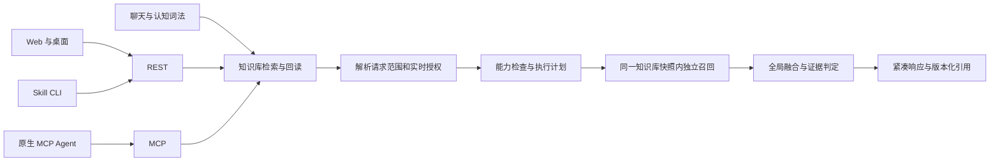

# ReferenceRAG 知识库单轨检索与证据链实施方案

2026-11-19 · 源码基线 `0a71937` · 实施提案

本方案基于 [服务端契约与 Skill 体验调研](referencerag-server-contract-and-skill-experience-feasibility-study.md)，以尚未正式发布为前提，取代上一份文档的双版本兼容和旧契约回退建议。目标是把**知识库及其发布快照**作为产品检索的唯一数据入口，让网页、Skill、CLI、普通问答和检索诊断共享同一套授权、查询计划和证据语义。

## 1. 总体设计与可行性



| 调整 | 可行性 | 主要代价与验证 |
| --- | --- | --- |
| 统一契约并一次切换调用方 | 高。跨库服务、工具注册、权限矩阵和输出 schema 已具备 | 服务端、Web、Skill、授权目录与文档在同一交付批次切换。删除别名依赖前先完成消费者清单 |
| 真正区分词法、向量和混合 | 高。存储已有两条召回路径，但共用分支并在库内做融合 | 拆分候选生成和融合，验证向量模型一致性、纯词法冷启动及直接向量回召 |
| 授权下推与召回提速 | 中。现有实现已检查最具体的根目录和文档权限 | 先保留精确判定与原有 TopK 行为，再用索引缩小候选，逐步去掉全表枚举；用相同权限样本证明等价 |
| 可验证证据、问答与状态 | 高。已有切片版本、行位置、目录及作业状态 | 防止重切片导致引用漂移、部分检索误报无结果、作业状态泄漏及显式范围被问答回退扩大 |
| 直接更换检索数据库 | 技术上可行，当前收益待测 | 此轮使用已有 SQLite/FTS、向量扫描和发布机制。只有目标负载下定位到存储瓶颈，才用上一份调研的外部引擎选项做同数据对照 |

**改造范围决策。** 一次切换产品契约，测试阶段可分批开发。产品层使用现有 `IKnowledgeBaseSearchService` 作为收敛点，以本方案给出的签名为目标。复用索引写入、快照发布、模型后端、文件沙箱和监控实现。旧的底层搜索组件是否删除，以生产调用方与作业依赖清零为准。受影响的既有 Web、桌面和 OpenAI 客户端作为同一交付的功能消费者验证。

### 1.1 数据与发布边界

- **事实数据**包括原始文件、库内手工创建的文档、连接器配置、模型绑定、授权配置及人工维护的图谱数据。库内文档内容可能只存在于数据库，首先用独立夹具验证能否导出并重建。正式切换使用新开发数据目录或新库，按已确认清单重新导入事实数据。库内手工数据若缺少可验证的导出路径，必须在切换前补齐提取与核对步骤。
- **衍生数据**包括可从事实数据再生的 FTS、向量、自动图谱和临时缓存。新库从首个确定的 schema 创建；确有需要时直接改建表与索引，按新定义重建衍生数据。目标目录由操作员明确提供并检查，已有数据目录保留为隔离副本。执行部署时先核对原文数量、文档内容校验值、连接器数量与授权配置，再切换目录。
- **发布**以同一版本的 Host/Web/Skill 及同一数据根为单位。失败时切回旧构建和旧目录，保留诊断数据；为避免回切丢失切换期写入，正式验收窗口暂停写入或先导出该窗口的新写入。回退是一项部署动作，新代码无需为旧数据实现运行时双读、双写或迁移链。

## 2. 契约与行为

保留当前较清楚的 REST 路径 `POST /api/knowledge-base-search` 和 MCP 工具名 `knowledge_search`，直接替换它们的参数和响应。CLI 统一走产品 REST，原生 MCP 通过同一应用用例提供等价字段。通用 `/v1/chat/completions` 按 OpenAI 兼容协议运行，ReferenceRAG 模型的检索由同一个知识库用例提供；需要结构化引文时使用知识库问答接口。

| 能力 | REST | MCP / 应用入口 |
| --- | --- | --- |
| 检索 | `POST /api/knowledge-base-search` | `knowledge_search` |
| 批量回读 | `POST /api/knowledge-evidence/read` | `read_evidence` |
| 受权知识库状态 | `GET /api/knowledge-base-search/status` | 在现有索引状态工具投影同一用例结果 |
| 有据问答 | `POST /api/knowledge-answers` | CLI `ask` 和应用聊天适配器。原生 Agent 可自行检索和回读 |

### 2.1 请求、授权和失败分流

搜索请求示例：

```json
{
  "query": "为什么索引发布时需要读快照？",
  "mode": "auto",
  "knowledgeBaseIds": ["kb_docs"],
  "connectorId": "conn_notes",
  "pathPrefix": "design/",
  "topK": 5,
  "allowDegrade": false
}
```

- `knowledgeBaseIds` 缺省时查当前有权且启用的库，显式空数组返回 400。显式请求采用**全部目标可用才执行**的约定，混合授权列表返回通用 403，无权限或不可见库使用同一外部错误。调用者可先获取可见库清单再缩小范围。缺省范围没有可用库时返回 `scope_empty`，已有授权范围但完整执行后确无候选才返回 `no_match`。含 `connectorId` 或 `pathPrefix` 时要求恰好一个显式库，前缀只能是规范化的库内相对路径或相对路径段，文件类型连接器按确切文件键约束。
- 从 Host 的可信认证上下文构造调用者，计算产品通道/工具权限、知识库、连接器和源的交集。控制器、工具和内部聊天都传递该范围；内部托管任务的运行身份明确构造。模型推理前拒绝无权或无效范围。SQL 和 SIMD 都必须在候选进入 TopK 前执行同一授权约束。输出与回读按当前权限再检查，撤权后终止对应结果。
- `outcome` 取 `matched`、`no_match`、`insufficient_evidence`。有可用证据时为 `matched`，完整执行且没有候选时为 `no_match`，候选质量不足或部分执行且无可用证据时为 `insufficient_evidence`。独立的 `completeness` 取 `complete`、`partial`，表示要求的库与通道是否完成。允许降级时返回有用的部分证据及原因；全部通道失败按请求级错误处理。严格请求遇到必需通道失败时返回错误，调用者可明确选择可用模式重试。声明未支持且用户显式指定的模式返回 422 与 `mode_unavailable`，已计划通道暂不可用用 503，服务执行期限耗尽用 504。对超出服务端库数限制返回 400 和可接受上限，禁止静默取前几个库。大规模并发限流使用 429 与 `Retry-After`。
- `hits` 返回受权可用证据，`candidates` 仅在显式诊断投影中提供并标明原因。普通输出包含 `requestedMode`、`executions`、`traceId`、`elapsedMs`、`warnings`、`truncated`。每个 `executions` 项记录库、计划通道、实际完成通道与稳定原因码。每条命中有 `citationRef`、可见标题、相对路径、位置与紧凑摘录。分数携带阶段与算法标识，用户接口用结果判定引导下一步。

### 2.2 召回计划、排序与证据判定

| 模式 | 成功时实际执行 | 失败、降级和证据规则 |
| --- | --- | --- |
| `lexical` | FTS/BM25，按查询子型选择精确标识或一般文本。查询不加载 embedding | 索引未就绪时仅在允许降级且有受控等价词法后备时执行，并公开原因。精确证据要求正文或显式目标字段中实际命中标识符，剔除召回地板 |
| `semantic` | 只生成规格匹配的查询向量并搜索向量候选 | 缺模型或覆盖不足按契约明示。概念证据由经语料评测的语义判定产生，不要求字面共享；评测前的弱证据返回 `insufficient_evidence` |
| `hybrid` | 每库独立生成词法和向量候选，按一次全局融合排序 | 显式混合默认要求两个通道完成。某库是纯词法时，允许降级的请求才接受这部分词法能力并公开缺失通道 |
| `auto` | 统一服务端计划。纯代码符号、错误码、明确引用优先词法；概念问题在具备双通道的库使用混合；纯词法库按能力规划为词法 | 自动模式在计划前已知库能力时按能力选路，完成所选计划仍可标记 `complete`；运行时通道失败才是部分执行。混合自然语言与标识符保留标识锚点，以双语/长查询评测验证 |

每库的词法、向量在同一读快照下读取一致的权限候选集，并产生独立的列表及通道报告。第一版采用 E2E 可解释的单级 RRF：以每个「库 × 通道」的候选排名为输入，按 `(kbId, chunkId)` 合并。初始 `k=60`，相同得分按命中通道数、最佳通道名次、库 ID 与切片 ID 固定排序。不同库的原始 BM25/向量分只做诊断，跨库融合质量用偏斜语料验证。现有库内融合、early-prune 和召回地板按通道语义逐项复用，纯向量不能误触词法早停，混合请求不能因为一条词法命中跳过必需向量通道。后续根据分库命中分布调整配额或重排。

语义阈值使用每个模型和语料的带标签样本校准，RRF 只用于排序。问答可在同一证据列表上检查问题中的必需实体能否被覆盖。需要重排时复用现有重排预算与后端，首轮在基准中测量提升后再决定默认启用。输出裁剪在序列化前发生，`topK` 是结果数，候选窗口和字节限制由服务器定义。

### 2.3 引文与问答

- `citationRef` 第一版是结构化对象，包含 `knowledgeBaseId`、`documentId`、`chunkId`、`documentVersion` 与摘要校验值。摘要覆盖切片 ID、正文及实际引用位置；直接利用已有文档版本并补充切片内容校验。一个库的其他文档被更新时，当前未变条目的引用仍可读取。单个文档重切片而版本未变时也能识别引用失效。
- 回读只返回已索引证据；从同一个读快照查到版本、正文或相邻切片，先验证版本、所属库/文档和可见性，再返回。权限被撤销或者资源不可见时每项返回 404 类错误，有权且引用指向旧版本时返回 `stale_reference`。批量端使用每项结果，系统性异常使用请求级错误。源文件实时浏览走现有受权文件入口，索引行号若漂移由 UI 指示同步或重新检索。
- 问答调用同一检索请求，仅把可用证据聚合到 Token 预算内。返回 `status=answered|insufficient_evidence`、`answer`、`citations[]`、`completeness`、`usage`、`traceId`。没有证据时直接返回状态，省掉生成调用。模型用请求内短 ID 引用证据，服务端过滤未知 ID、验证所有引用确实来自本请求并映射为可回读对象；生成引用错误时标记证据不足，避免把引用格式检查当作事实验证。兼容端的普通对话可以照常生成，ReferenceRAG 模型的库范围在整次调用与所有工具步骤中保持一致。

## 3. 代码落点与实施顺序

下面的接口名称是实现目标，现有调用方在阶段 5 同批接入。应用命令与匿名协议 payload 分开维护，应用服务无需引用 ASP.NET、MCP SDK 或 UI。

| 层 | 修改位置 | 责任 |
| --- | --- | --- |
| 应用 | [KnowledgeBaseSearchService.cs](../Business/ReferenceRAG.Business/Features/KnowledgeBase/Services/KnowledgeBaseSearchService.cs)、[IKnowledgeBaseService.cs](../Business/ReferenceRAG.Business/Features/KnowledgeBase/Services/IKnowledgeBaseService.cs)、[KnowledgeBaseFileAuthorization.cs](../Business/ReferenceRAG.Business/Features/KnowledgeBase/Services/KnowledgeBaseFileAuthorization.cs) | 用 `SearchAsync(SearchCommand, SearchCaller, CancellationToken)` 执行一次查询，新增 `ReadEvidenceAsync(EvidenceReadCommand, SearchCaller, CancellationToken)`，必要时把接口契约拆为相邻的独立文件 |
| 存储与模型 | [KnowledgeBaseModels.cs](../Infrastructure/ReferenceRAG.Infrastructure/Features/KnowledgeBase/Domain/KnowledgeBaseModels.cs)、[SqliteKnowledgeBaseStore.cs](../Infrastructure/ReferenceRAG.Infrastructure/Features/KnowledgeBase/Storage/SqliteKnowledgeBaseStore.cs)、[SpecEmbeddingAdapterResolver.cs](../Infrastructure/ReferenceRAG.Infrastructure/Features/ModelManagement/Services/SpecEmbeddingAdapterResolver.cs) | `RecallAsync` 接收内部计划，返回真实通道报告和专属候选列表。按已发布规格解析查询适配器，管理模型租约 |
| Host | [KnowledgeBasesController.cs](../Host/ReferenceRAG.ApiHost/Controllers/KnowledgeBasesController.cs)、[RagSearchTools.cs](../Host/ReferenceRAG.ApiHost/McpTools/RagSearchTools.cs)、[KnowledgeBaseMcpTools.cs](../Host/ReferenceRAG.ApiHost/McpTools/KnowledgeBaseMcpTools.cs)、[McpCatalogRegistry.cs](../Infrastructure/ReferenceRAG.Infrastructure/Features/Security/McpCatalogRegistry.cs)、[ApiKeyMiddleware.cs](../Host/ReferenceRAG.ApiHost/Middleware/ApiKeyMiddleware.cs) | 规范化输入、生成可信身份、统一 REST 错误和 MCP 工具结果。以实际 JSON 输出验证 schema 和权限模块 |
| 应用内消费者 | [MafChatService.cs](../Business/ReferenceRAG.Business/Features/Chat/Services/MafChatService.cs)、[OpenAIChatController.cs](../Host/ReferenceRAG.ApiHost/Controllers/OpenAIChatController.cs)、[SearchService.cs](../Business/ReferenceRAG.Business/Features/Search/Services/SearchService.cs)、[CognitiveEnhancedLexicalStrategy.cs](../Business/ReferenceRAG.Business/Features/Search/Strategies/CognitiveEnhancedLexicalStrategy.cs) | 接入共享检索，保留聊天 UI、上下文格式化、认知重排与诊断能力所需的上层组织 |
| 客户端 | [Web API](../Business/ReferenceRAG.Business/wwwroot/app/api/index.js)、[Search](../Business/ReferenceRAG.Business/wwwroot/app/views/Search.js)、[BM25Index](../Business/ReferenceRAG.Business/wwwroot/app/views/BM25Index.js)、[Guide](../Business/ReferenceRAG.Business/wwwroot/app/views/Guide.js)、[ReferenceRAG Skill](../support/skill/ReferenceRAG/SKILL.md)、[CLI](../support/skill/ReferenceRAG/scripts/rag_cli.py)、[NoteClaude](../support/skill/NoteClaude/CLAUDE.md) | 一次切换请求、展示、可见错误、下钻及文档，清除旧参数回退和客户端猜测 |

### 阶段 0　冻结行为、数据边界和基准

- [ ] 扫描 `CrossKnowledgeBaseSearchRequest`、`UseLexicalTokenizer`、`ISearchService`、旧 MCP 别名及 `/api/ai/query` 的调用点。标注所有编译期与动态消费者，包含 Guide 内嵌示例、MCP 白名单、宿主启动初始化、NoteClaude 与 PerfTestRunner。
- [ ] 建立一个纯词法库和两个不同向量规格的混合库作为可重复夹具，其中一个包含授权根下的未授权子目录。另将其中一个规格复用于新增的混合库，验证同规格共享推理。数据包含同义改写、中英错误码、重复标题、手工文档、禁用嵌套源、改名和重切片样本。记录发布代际与 embedding 配置，固定相关切片标签。
- [ ] 跑现有基线并保存各阶段数据。旧的 PerfTestRunner 默认打 `/api/ai/query`，增加知识库路径和读引用场景后再做同工作量对照。另做一次事实数据导出与临时目录重建演练，报告可重建性及需要从旧目录提取的事实数据。

### 阶段 1　范围、契约、错误

- [ ] 先在 [LexicalAuthorizationTests.cs](../tests/ReferenceRAG.Host.Tests/LexicalAuthorizationTests.cs) 增加缺省/空列表、混合授权、无权限请求零推理、范围不能被聊天扩大、目录边界与禁用嵌套源测试。更新确实被新产品契约取代的旧交集行为断言。
- [ ] 定义共享 DTO、模式、结果与错误码。旧验证散落在控制器和工具中的逻辑移到应用边界。中间件继续验证通道及模块权限，业务层只接收可信范围。样例策略用字典/纯函数表达，无需为每个模式新增一个抽象类。
- [ ] 从入口建立请求截止时间，统一传递至授权、适配器加载、模型推理、队列、存储与输出。REST JSON 和 MCP 真实调用在同一夹具上比较结构化结果与错误码。使用现有 `OutputSchemaType` 先核实数组入参和取消令牌不会出现在模型可编辑字段中。

### 阶段 2　拆开存储通道与模型规格，建立性能边界

- [ ] 先在 [KnowledgeBaseArchitectureGateTests.cs](../tests/ReferenceRAG.Tests/KnowledgeBaseArchitectureGateTests.cs) 和 [KnowledgeBaseModelLifecycleGateTests.cs](../tests/ReferenceRAG.Tests/KnowledgeBaseModelLifecycleGateTests.cs) 增加通道实际调用次数、纯词法零推理、向量不访问 FTS、两种规格各一次编码、同规格仅一次、全部失败与部分失败的测试。补充跨请求的容量门禁，用服务级有界队列和按模型资源限制约束峰值，每请求并发数只控制该请求的扇出。
- [ ] 把现有 `RecallAsync` 的词法和向量候选代码拆为明确入口，在共享的短读事务内顺序执行库内两路。多库并行由业务层的有界调度控制，SQLite 连接与事务禁止跨并发命令使用。模型/远程推理放在读事务外。读取前校验已发布的 index epoch 和 embedding 身份仍与计划一致，变化时在预算内重计划一次或返回索引已更新提示。
- [ ] 以现有 `IEmbeddingAdapterResolver` 的适配器创建、规格校验和资产解析为基础，实现查询侧解析。它当前主要按写入规格选后端，查询侧应显式区分 Query 前缀与已发布文档向量身份。共享条件包含模型资产身份/版本、维度、查询前缀与归一化参数；相同维度不足以共享。适配器使用现有模型生命周期能力或专用短租约管理，失败隔离到规格，单个请求断开不会取消其他请求共享的加载任务。
- [ ] 分两步去掉逐查询的文档全量临时授权表。第一步按可见连接器和相对路径范围做 SQL 参数化的必要条件过滤，缩小进入精确判定的集合。第二步在真实计划证明有效后，将规范化的相对路径键纳入 `(connector_id, source_key)` 范围扫描。前缀必须以路径段为边界，Windows 大小写行为与 Linux 分开测试。只有能证明连接器整个范围授权且无更具体拒绝规则时才能走直通。其余候选需在进入 TopK 前执行精确规则，随后再以当前权限复核。候选预算不足以填满结果时报告覆盖限制。
- [ ] 第一版继续使用现有向量内存池/扫描能力。检查回退路径是否为每条向量创建完整对象后全量排序；若是，在相同授权语义下改为固定容量 TopK 堆，并将正文读取延至候选归并后。记录向量访问数、授权判定数、分配量与数据库读事务时长。数据库取消由有界入口、可取消批次和实测兜底。

SQLite 查询计划提供扫描、索引、排序和临时结构的信息。Microsoft.Data.Sqlite 的异步 ADO.NET 调用仍同步执行，因此端到端期限需用压力测试确认，不能仅依赖 `await`。用 `EXPLAIN QUERY PLAN` 及请求分段数据检验范围下推。读事务避免包含模型推理、重排、网络等待与响应序列化，以控制 WAL 检查点受长读影响。 [SQLite 查询计划](https://www.sqlite.org/eqp.html) · [SQLite WAL](https://www.sqlite.org/wal.html) · [Microsoft.Data.Sqlite 异步限制](https://learn.microsoft.com/en-us/dotnet/standard/data/sqlite/async)

### 阶段 3　融合、回读与有据问答

- [ ] 加精确假命中、概念同义假拒绝、跨库分数偏斜和索引降级夹具。用现有融合策略接口实现单级融合，以标注集校准语义证据。把文件命中、文本证据、执行完成度分别处理。
- [ ] 在知识库读事务内验证引用身份和文本摘要，批量请求按库分组并保留输入顺序。覆盖同 ID 不同库、同库其他文档修改、来源重绑、撤权、删除、版本升级和重切片。需要邻接上下文时按文档序号读取，按总字节上限提前结束，在有界结果中提供续读位置。
- [ ] 将 `KnowledgeBaseChatService`、OpenAI 兼容 RAG 和 MafChat 中会检索资料的路径接入共享用例。禁止检索失败后回到旧全局资料路径；受权范围无证据时验证聊天模型调用为零。测试方法需断言工具链和生成阶段都只收到本次受权证据，不能只匹配提示词。

### 阶段 4　状态、实体文件、观测

- [ ] 用 `KnowledgeBaseJobCoordinator` 和现有作业状态机投影词法、向量与同步状态。状态用例仅返回可见连接器和库的摘要，状态与管理操作权限分离。数据库端限制摘要记录数量，按时间和 ID 稳定排序。现有作业的 `Queued → Running → Succeeded / PartiallySucceeded / Failed / Cancelled` 统一终态判断；取消与最终发布竞争只允许一个结果生效。
- [ ] 为 `grep/tree/read` 继续复用现有托管文件接口、文件沙箱和 Reader。返回扫描覆盖、截断理由、继续位置及物理源与索引证据的区别。图谱查询保留显式关系扩展场景，校验同一知识库权限。普通 Skill 探索由检索、回读、状态覆盖，避免为了浏览状态需要管理员 Key。
- [ ] 扩展现有 TimingChain，把队列、权限候选、embedding、租约、FTS、向量扫描、融合、重排、引用回读和序列化的计时关联到 `traceId`。公开状态仅给聚合与稳定错误码，排障数据留在授权范围内的诊断界面。

### 阶段 5　Web、Skill、授权目录同批切换并删除重复入口

- [ ] 更新 Web 搜索、BM25 测试、聊天来源展示和使用指南，移除前端识别大小写字段与猜测模式的逻辑。用 Web 和 Desktop Host 各跑一次真实搜索、回读与无证据问答。
- [ ] CLI 使用正式 REST DTO，删掉重复的本地检索路由、质量阈值及历史字段猜解。 `search` 默认 `auto`，`read` 支持批量引文，`status` 使用受权摘要，`ask` 接受显式库范围。保留编码、输出格式与明确退出码能力，禁止自动重放生成请求。Skill 以原生 MCP 为首选，以 CLI 为可移植入口，两边使用同一条「检索 → 批量回读 → 总结」路径。
- [ ] 移除 `lexical_search`、`semantic_search`、`hybrid_search`、`knowledge_base_search` 重复搜索工具，并用 `read_evidence` 收敛 `knowledge_base_drill_down` 的引用展开职责。同步删除授权目录里的旧工具项、旧 DTO、旧说明与旧 smoke 断言。将 `/api/ai/query` 的所有产品调用迁完后删除该产品路由；如诊断还需底层服务，内部化服务及专门的管理入口，不能被产品检索回退调用。
- [ ] 用编译结果、源码查找、真实的 `tools/list`、OpenAPI 路由清单及代表性低权限 Key 验证退出的路径已经断开。校验安装版 Skill 与仓库同一版本同步。最终通过全量验收后发布到干净数据目录。

## 4. 性能目标与验收

初始实验配置使用 `topK=5`、上限 50，候选每库每通道默认 `min(80, max(20, 3×topK))`，单次最多 8 库，每请求初始并发 4。热态普通检索的执行预算先以 2 秒验证，慢模型另设受服务端上限控制的放宽预算。默认摘要对单条和整包设上限，建议从 JSON 载荷 24 KiB、批量回读总载荷 64 KiB 开始。以上是可校准的设计初值，默认值写在一个服务端配置处。模型冷启动、远程超时与排队分开计量。

| 验收项 | 方法和通过标准 |
| --- | --- |
| 逻辑与权限 | 无授权泄切片、目录、提示或引用。Web、REST、原生 MCP、CLI 在相同数据与权限下给出相同模式、证据与范围结论。拒绝请求无 embedding 或召回调用 |
| 检索质量 | 固定查询集按精确、概念、混合、无证据分组；记录 Recall@5、MRR@10、nDCG@10、误拒/假命中、引文有效率。相同语料的标注精确样本与原基线逐条比较。基准测完后确定统计阈值，再合入自动门禁 |
| Skill 交互 | 已有权限且命中后需要回读的典型任务至多 2 次业务调用，能力发现单独计数。测回合数、响应字节和模型实际输入 Token，并验证无可用证据时结束语义正确 |
| 负载与时间 | 同索引、同模型按 1/4/8 库、全量/受限权限、冷/热设备、1/8/32 并发分层，记录 P50/P95/P99、超时和拒绝比例、CPU/内存、SQLite 查询计划与读事务时长。热态词法不得劣化；受限库的授权成本需相对基线可测下降；向量预算按后端设置 |
| 取消与恢复 | 验证超时后 in-flight 指标回到基线，并记录真实退出时间。并发撤权后禁止输出新证据；截止时间用尽后不启动下一阶段；模拟重启时未发布索引与作业状态可对账 |

**建议执行的验证命令。** 先运行阶段聚焦测试，最终运行后端两个测试项目并验证 Web。MCP 与 CLI smoke 对临时 Host 和测试夹具执行，明确提供目标与测试身份。PerfTestRunner 待迁到知识库入口后再跑负载。

```powershell
dotnet test tests/ReferenceRAG.Tests/ReferenceRAG.Tests.csproj
dotnet test tests/ReferenceRAG.Host.Tests/ReferenceRAG.Host.Tests.csproj
node Business/ReferenceRAG.Business/wwwroot/check.mjs
node --test Business/ReferenceRAG.Business/wwwroot/tests/*.test.mjs
```

本次交付只定义调整方案。上一轮的 45 项 Host 测试通过可用作现状参考；本方案中的目标契约、性能参数和数据重建均需按上述阶段实施后验收。
