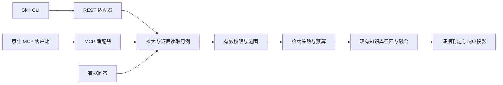

# ReferenceRAG 服务端契约与 Skill 体验优化调研

调研日期为 2026-11-19，源码基线为 `0a71937`。本文承接 [11 月 18 日 Skill 优化调研](../support/skill/ReferenceRAG/docs/2026-11-18-reference-rag-optimization-research.md) 和 [早期 MCP / REST 改版方案](referencerag-skill-revamp-and-interface-optimization-feasibility-study.md)，面向下一轮服务端设计决策。

## 建议先统一服务端如何解释请求与结果

**可以从服务端实质改善 Skill 体验。** 上轮交付已提供跨平台 CLI、错误处理、格式化，以及 `tree`、`grep`、`doc-info`、`graph`、`status`、`ask`。下一阶段最有价值的是让 MCP、REST 和 CLI 对同一个检索问题返回一致的事实。调用方需要知道查询实际检索了什么、哪些证据可用、空结果是否可信，以及如何回读引用。客户端因此可以少猜模式、少改写查询和少做路径拼接。已有知识库存储、授权、融合、文件读取和后台作业足以支撑首轮改造。

建议优先解决 **作用域与模式 → 可回读引文 → 有界执行与状态 → 有据问答**。作用域明确后即可单独修正旧问答入口的扩大回退行为。方案的优先级依据源码与本地回归，实际延迟和调用次数收益仍需测量。

## 一、关键发现与体验影响

| 优先级 | 代码事实 | 对 Skill 的影响与建议 |
| --- | --- | --- |
| P0 | MCP 将 `semantic` 和 `hybrid` 都映射为 `UseLexicalTokenizer=false`，REST 的跨库请求也只提供这个布尔值。MCP 回显原始 `mode`，服务层 `kbChannels` 在召回前按计划生成，存储层仍可能提早退出或只完成部分通道。CLI 和 MCP 的 `auto` 使用不同启发式。 | 用户无法仅凭回显确认是否使用向量。统一请求模式，分别给出请求模式、执行计划和真实召回通道。迁移期如尚未打通纯向量，应声明能力缺失；不能把现有混合路径标成纯向量。见 [MCP 检索](../Host/ReferenceRAG.ApiHost/McpTools/RagSearchTools.cs#L243)、[内部请求](../Business/ReferenceRAG.Business/Features/KnowledgeBase/Services/IKnowledgeBaseService.cs#L214)、[跨库通道](../Business/ReferenceRAG.Business/Features/KnowledgeBase/Services/KnowledgeBaseSearchService.cs#L181)、[存储早停与向量](../Infrastructure/ReferenceRAG.Infrastructure/Features/KnowledgeBase/Storage/SqliteKnowledgeBaseStore.cs#L2060)、[CLI 路由](../support/skill/ReferenceRAG/scripts/rag_cli.py#L431)。 |
| P0 | 显式目标全部被权限过滤时，MCP 返回 `forbidden`，REST 返回 HTTP 200 与 `NoMatch=true`。部分授权时现有入口取交集。服务层把空目标列表解释为自动发现启用库，并另有空数据源权限的保护分支。 | 统一区分鉴权失败、范围为空和确实无命中。显式范围经交集后为空应提前终止，保留现有混合请求的交集语义，结果只透露授权范围。见 [REST 作用域](../Host/ReferenceRAG.ApiHost/Controllers/KnowledgeBasesController.cs#L1011)、[MCP 作用域](../Host/ReferenceRAG.ApiHost/McpTools/RagSearchTools.cs#L215)、[跨库默认范围](../Business/ReferenceRAG.Business/Features/KnowledgeBase/Services/KnowledgeBaseSearchService.cs#L126)。 |
| P0 | CLI `ask` 默认只发送模型名、消息和温度，未提供知识库选择；兼容接口在显式库检索未得到上下文时会走另一条全局检索路径；全局路径仍读取数据源权限。局部检索依据 `Items.Count` 注入上下文，未消费 `NoMatch`，非流式回复没有结构化引用。 | 即使全局路径遵守数据源约束，回退也可能超出用户指定的库。优先验证有权限的查询范围是否始终一致，显式目标未命中或失败时沿用原范围。提供可验证引文与证据不足状态。这里确认的是代码分支，具体部署的权限拦截结果需要集成验证。见 [CLI ask](../support/skill/ReferenceRAG/scripts/rag_cli.py#L842)、[兼容问答回退](../Host/ReferenceRAG.ApiHost/Controllers/OpenAIChatController.cs#L131)、[回复结构](../Host/ReferenceRAG.ApiHost/Controllers/OpenAIChatController.cs#L343)、[全局数据源范围](../Business/ReferenceRAG.Business/Features/Chat/Services/MafChatService.cs#L1865)。 |
| P1 | `QueryMatchSignals` 在结果拼接后的正文、路径和标题中检查词面重合。服务端允许 `NoMatch=true` 同时返回候选，CLI 还会按覆盖率和兜底标记过滤。 | 同义改写可能被错拒，路径碰巧匹配可能被当成正文证据。精确查询按目标标识符逐条校验，概念查询以标注集校准证据信号。给宽松候选明确标志，Agent 只引用通过判定的条目。见 [匹配判定](../Business/ReferenceRAG.Business/Features/KnowledgeBase/Services/QueryMatchSignals.cs#L32)、[CLI 二次过滤](../support/skill/ReferenceRAG/scripts/rag_cli.py#L496)。 |
| P1 | 检索返回库、文档、切片 ID 和行号，但基础下钻的描述提到 `ordinal`，签名没有该参数，文档分支固定取第一页。MCP 检索截预览，`OkBounded` 先序列化再按字符数拒绝，且该下钻使用 `Ok` 返回正文。 | 一条命中应能直接回读相邻上下文。支持按引用或切片分页，显式标注截断、续读和快照；在投影阶段控制载荷。见 [命中投影](../Host/ReferenceRAG.ApiHost/McpTools/RagSearchTools.cs#L281)、[切片下钻](../Host/ReferenceRAG.ApiHost/McpTools/RagSearchTools.cs#L70)、[结果预算](../Host/ReferenceRAG.ApiHost/McpTools/McpResult.cs#L74)。 |
| P1 | 跨库检索在向量推理之后才开始内部超时；最多取前 8 库，MCP 回显待检索目标，调用服务未传取消令牌。受限源召回逐库枚举文档并写临时授权表，召回后再校验。CLI 请求层也可能重复提交已超时的 POST。 | 大范围或受限查询容易增加等待，空结果可能只覆盖部分目标。先做授权和计划，再用统一截止时间覆盖推理、排队、存储和投影。分别报告范围裁剪、超时和真实空结果。见 [推理及超时](../Business/ReferenceRAG.Business/Features/KnowledgeBase/Services/KnowledgeBaseSearchService.cs#L85)、[跨库上限](../Business/ReferenceRAG.Business/Features/KnowledgeBase/Services/KnowledgeBaseSearchService.cs#L148)、[授权临时表](../Infrastructure/ReferenceRAG.Infrastructure/Features/KnowledgeBase/Storage/SqliteKnowledgeBaseStore.cs#L1929)、[CLI 请求重试](../support/skill/ReferenceRAG/scripts/rag_cli.py#L149)。 |
| P2 | `status` 顺序查询管理型 `/api/jobs` 与 `/api/sources`，收到任务列表后才在 CLI 应用 `--limit`；作业 API 带管理范围限制。文本扫描已有文件数、文件大小和单行上限，读文件接口已有 `HasMore`。 | 普通检索 Key 需要可见范围内的就绪信息。状态摘要应在服务端限量，显式区分未挂载、未同步、词法索引补齐、部分完成和没有可见作业。搜索文件时返回范围及截断原因，避免把扫描上限误解成内容不存在。见 [CLI status](../support/skill/ReferenceRAG/scripts/rag_cli.py#L811)、[作业列表](../Host/ReferenceRAG.ApiHost/Controllers/KnowledgeBasesController.cs#L938)、[文件扫描](../Infrastructure/ReferenceRAG.Infrastructure/Features/FileSystem/ManagedFileSearchEngine.cs#L187)、[行范围回读](../Infrastructure/ReferenceRAG.Infrastructure/Features/FileSystem/FileReaderService.cs#L132)。 |

### 路线取舍

| 路线 | 收益 | 成本与适用条件 |
| --- | --- | --- |
| 继续增强 CLI | 交付快，可改善重试、打印和命令兼容 | 语义仍分散，MCP 原生客户端和 REST 调用方继续各自补偿 |
| **统一业务契约并沿用现有后端** | 所有入口共享范围、模式、证据与状态，兼容迁移可分段交付 | 需调整 Host 映射、业务协调及部分存储入口，适合当前阶段 |
| 外接检索引擎或采购托管检索 | 可获得独立扩容、专用检索能力或托管运维 | 需处理重新同步、数据边界、原子发布与授权等迁移成本。仅在本地基准显示存储确为瓶颈，且改造现有存储仍达不到约定服务目标时评估 |

## 二、服务端设计与可落地接口

### 共享业务用例和薄适配器

- **Adapter** 负责输入与输出的协议映射，应用服务拥有统一的语义。建议公共入口使用显式 DTO，将调用者可信权限与用户输入分开，内部向量、存储超时对象和完整 TimingChain 留在服务内部。REST 可用 Problem Details，MCP 映射为工具错误与 `structuredContent`，旧客户端按协商版本保留必要文本内容。能力通过工具 schema 与产品契约公开，实际可调用工具继续遵循现有注册和 Key 权限规则。
- **Strategy** 先使用一个模式枚举、纯函数决策与现有融合实现。 `lexical` 只跑词法，`semantic` 只跑向量与其必要的授权过滤，`hybrid` 两通道候选独立、结果可合并，`auto` 由服务端根据查询、库能力和预算生成计划。只有当调用者允许降级时才跨通道，降级理由与执行通道独立回传。语义模式可先发布在具备能力的库上，混合模式的早停应成为可追踪的策略决策。对比已有 [SearchExecutionStrategies](../Business/ReferenceRAG.Business/Features/Search/Strategies/SearchExecutionStrategies.cs) 与 [SearchFusionStrategies](../Infrastructure/ReferenceRAG.Infrastructure/Features/Search/Fusion/SearchFusionStrategies.cs)，复用算法和测试，避免让旧全局搜索服务接管知识库授权。
- **简单流水线与状态枚举** 适合一次性检索。先授权和验证，再召回、融合、证据裁决和投影，任一不可恢复错误立即结束。只有后台作业持有真正跨请求的状态，沿用现有 `JobStateMachine` 和协调器。查到部分证据时允许有据回答并声明覆盖不足，没有足够证据时返回可机读原因；整个过程可以无状态完成。

### 建议的最小公开契约

以下名称为建议，先用快照和消费者测试固定契约再确定版本号。首个可发布切片是同一应用服务的 REST 与 MCP 检索映射，回读随后接入。

| 场景 | REST 候选 | MCP 候选 | 最小契约 |
| --- | --- | --- | --- |
| 检索 | `POST /api/v2/search` | `knowledge_search_v2` | 请求含 `query`、`mode`、可选 `scope.knowledgeBaseIds` 真数组、库内目录过滤、`topK`、受上限约束的 `deadlineMs`、`allowDegrade`。响应含 `traceId`、`requestedMode`、实际 `executedChannels`、`outcome`、`completeness`、`warnings`、`hits`。 |
| 证据回读 | `POST /api/v2/evidence/read` | `read_evidence` | 接受一组 `citationRef`，指定邻近行窗口与总预算。每项独立返回正文、范围、是否截断、继续位置或可机读错误。 |
| 可见状态 | `GET /api/v2/search/status` | 先评估扩展现有状态工具 | 按授权范围提供就绪、可用通道、索引进度及有限任务摘要。增量页面使用稳定排序和游标，有细查需求时再进入作业详情。 |
| 有据问答 | `POST /api/v2/answers` | 后续按客户端需求评估 | 接收显式范围与证据策略。返回 `answer`、`citations[]`、`usage`、`traceId` 和覆盖状态。每个引文 ID 对应本次通过证据门禁的条目。普通 OpenAI 兼容调用仍使用原协议。 |

**结果语义。** `outcome=matched|no_match|insufficient_evidence` 表示证据裁决，`completeness=complete|partial` 表示执行覆盖。部分请求没有命中时用 `insufficient_evidence + partial`，避免推断全范围无证据。实际召回全部失败时走可机读服务错误。未知模式或非法参数映射为 400，认证与授权分别为 401 和 403，受控回读资源不可见时按既定隐匿策略使用 404，版本冲突可用 409，限流为 429，整体服务不可用为 503，服务端执行期限耗尽可用 504。MCP 保留对应的稳定业务码，取消也应沿协议正确传递。返回可见范围是否完成、可用的下一步，以及失败是否可重试，避免暴露被过滤的库名、宿主路径与异常内部信息。

**引文与一致性。** 第一版可用库 ID、文档 ID、切片 ID、可见相对路径、行号与内容版本构造引用。可从存储层已有 `read_revision` / `content_generation` 开始验证，但要区分索引代际和源文件版本。索引回读比较期望代际及内容版本，磁盘回读应单独校验文件版本或内容摘要。版本变更返回 `stale_reference` 并提示重新检索，现有历史内容保留能力核实后才允许读取旧版本。每次回读重新做权限检查。无真实行号的文档用切片序号或结构化位置，连接器重绑、删除或撤权后不得继续沿旧引用读出正文。MCP resource link 可作为日后增强，普通工具回读应可独立工作。见 [SQLite 读快照](../Infrastructure/ReferenceRAG.Infrastructure/Features/KnowledgeBase/Storage/SqliteKnowledgeBaseStore.cs#L1874) 和 [MCP 工具规范](https://modelcontextprotocol.io/specification/2026-07-28/server/tools)。

**迁移。** v2 先以独立入口上线，现有 REST DTO、MCP 工具名、JSON 字符串数组与白名单沿用。旧入口只有在契约快照证明响应兼容后才移到共享应用服务。先在 CLI 试用 v2，共享业务和证据字段稳定后再更新 Skill 引导与原生工具推荐。能力协商失败时兼容旧入口，无权或无证据时遵循当前范围。已有 `McpCatalogRegistry` 用来明确新工具授权，不能因为名称切换拓宽旧 Key 的权限。

## 三、性能、稳定性与状态的验证重点

| 改进 | 具体做法 | 验收重点 |
| --- | --- | --- |
| 缩短无效与尾部查询 | 先解析权限、可检索库和各库能力。全部目标为纯词法时跳过查询向量。对支持同一编码规格的库复用同一次向量计算，不同规格分组并检查维度及前缀。端到端截止时间在查权限前开始，限制并行扇出；每个阶段传播同一取消令牌。 | 拒绝及空范围请求没有模型或存储召回。全词法场景 0 次 embedding。超过范围上限可见，指定范围的裁剪规则确定可复现。验证中途取消后不再继续创建租约或启动重排。 |
| 减少授权过滤开销 | 在现有 TimingChain 加上授权枚举、临时表填充与结果复核分段。先测显式受限源与全权限差值。若热点成立，验证可索引的连接器/路径前缀加精确后验校验，或以权限和读版本约束授权集合缓存。 | 先授权再取 TopK，权限回收立即生效。缓存键包含权限范围和配置/读版本，遇到更改时失效。同库并发、连接池复用及跨库键冲突纳入集成测试。 |
| 限制正文与回合数 | 检索默认只送摘要、位置和证据 ID，回读按多个引用一次请求。候选数、返回数和输出字节分别设置上限，结果告诉客户端 `returnedCount`、`truncated` 与续读方式。文件扫描保留托管引擎，补全扫描量、跳过量与早停原因。 | 比较实际 UTF-8 响应字节、模型输入 Token 与调用数。保持有用证据条数。区分模型实际 Token 与估算值，MCP 对文本回退造成的重复载荷单独计量。 |
| 可靠重试与作业 | CLI 采用总预算和单次尝试预算。仅对经确认可重放的读型操作限制性重试，尊重 `Retry-After`，禁用超时后自动重放生成请求。复用作业的 HTTP 202 和 `Location`，加轮询提示。统一现有作业状态投影，核对 `PartiallySucceeded` 是否为该操作终态以及重启恢复语义。 | 超时、429、503、取消、权限撤销及排队期间重启分别可诊断。并发与生成请求保证没有无谓重复执行。现有 `JobStateMachine` 在部分成功与终态判断上的差异需用测试锁定再调整。 |

**评估方法。** 使用现有 Benchmark 指标实现和 PerfTestRunner 作基准入口，为 Skill 补端到端任务集合。包括中英概念同义、长查询带代码标识符、纯词法库、混合库、无证据、权限交集、过期引用、文件过大、索引补齐，以及作业取消。以同一索引快照，对照现有 CLI、原生 MCP 和拟议 REST，记录 Recall@K、MRR@10、nDCG@10、假命中/假拒绝率、可回读引用率、每任务请求数、响应字节、冷暖 P50/P95/P99 和取消后实际结束时间。分开测单库、多库、受限权限与并发。先定基线，再确定 P95 与载荷目标。建议首轮验收为兼容样本通过、授权越界为零、有效引用均可回读，命中后合并回读场景至多 **2 次业务调用**，能力发现及人工追加读取另计。见 [基准实现](../Business/ReferenceRAG.Business/Features/Search/Benchmark/Services/BenchmarkMetricsCalculator.cs) 和 [性能测试工程](../tests/PerfTestRunner/PerfTestRunner.csproj)。

## 四、业界方案与第三方库取舍

| 官方方案 | 借鉴点 | 与本项目的取舍 |
| --- | --- | --- |
| Elasticsearch Retrievers | 一个请求明确词法、向量、候选窗口与 RRF，可以独立约束每个通道。 | 借鉴候选窗口和计划结构。项目已有融合接口，可先在 SQLite 知识库上验证。 [Elastic RRF](https://www.elastic.co/docs/reference/elasticsearch/rest-apis/retrievers/rrf-retriever) |
| Qdrant Query API | `prefetch` 表达多路候选、各路限额与融合，支持多级检索。 | 借鉴有界的候选预取，按现有词法/向量质量决定是否加重排。引入外部服务需另外验证原有词法与知识库权限等价。 [Qdrant Hybrid Queries](https://qdrant.tech/documentation/search/hybrid-queries/) |
| Weaviate Hybrid Search | 支持相对分数融合与排名融合，向量距离阈值有明确作用域。 | 保留分数来源与阶段，避免将混合排名分当成跨查询通用的可信度阈值。 [Weaviate Hybrid Search](https://docs.weaviate.io/weaviate/concepts/search/hybrid-search) |
| Azure AI Search | RRF、语义重排分、调试子分及抽取式 captions 分开。 | 默认返回精简证据，管理权限下用诊断模式展开阶段与分数。重排验收依据真实增益与推理成本。 [Azure 混合排序](https://learn.microsoft.com/en-us/azure/search/hybrid-search-ranking) · [语义排序](https://learn.microsoft.com/en-us/azure/search/semantic-search-overview) |
| OpenAI File Search | 托管检索支持限定文件搜索范围，回答可携带机器可读的文件引文。 | 借鉴筛选及引文结构，ReferenceRAG 的库/切片/行号继续用于本地精确回读。 [OpenAI File Search](https://developers.openai.com/api/docs/guides/tools-file-search) |
| MCP 与 Azure 异步请求模式 | MCP 提供工具输出 schema、结构化结果与工具错误。异步 HTTP 用 `202`、`Location` 和 `Retry-After` 形成可轮询的作业接口。 | 先在现有 SDK 的实际协议协商结果上加线级测试，作业继续复用服务端协调器。 [MCP 工具规范](https://modelcontextprotocol.io/specification/2026-07-28/server/tools) · [Azure 异步请求响应模式](https://learn.microsoft.com/en-us/azure/architecture/patterns/asynchronous-request-reply) |

| 仓库已具备 | 可复用方式 |
| --- | --- |
| `McpHelper.Core 2.4.0`、官方 MCP SDK `2.2.0`、Swashbuckle、ASP.NET Core OpenAPI、Scalar | 复用现有注册、契约与文档生成入口。以现有工具和 REST DTO 增加端到端 schema 快照，核实 McpHelper 是否支持目标输出 schema 和取消；不足时先在现有注册层做小范围验证。版本来自 [集中依赖版本](../Directory.Packages.props)，API Host 的恢复资产确认 McpHelper 与 MCP SDK 已解析。见 [Host 注册](../Host/ReferenceRAG.ApiHost/Extensions/RagWebHostExtensions.cs#L92) 和 [官方 C# SDK](https://github.com/modelcontextprotocol/csharp-sdk)。 |
| `ApiKeyPermissionMatrix`、`McpPermissionGuard`、`SourceCatalog`、`SourceScopedFileAccessPolicy` | 复用 Key、知识库、连接器及文件范围检查，应用服务维护有效范围与最小可见信息。见 [权限矩阵](../Infrastructure/ReferenceRAG.Infrastructure/Features/Security/ApiKeyPermissionMatrix.cs)、[MCP 权限](../Host/ReferenceRAG.ApiHost/McpTools/McpPermissionGuard.cs) 和 [源目录](../Host/ReferenceRAG.ApiHost/McpTools/SourceCatalog.cs)。 |
| SQLite、词法/向量存储、`ISearchFusionStrategy`、`IRerankService`、`Microsoft.Extensions.AI` | 复用存储租约、召回、融合和现有模型后端。问答复用现有模型调用与 Token 计数，证据门禁留在共享业务服务。见 [存储召回](../Infrastructure/ReferenceRAG.Infrastructure/Features/KnowledgeBase/Storage/SqliteKnowledgeBaseStore.cs#L1857) 和 [重排接口](../Infrastructure/ReferenceRAG.Infrastructure/Features/ModelManagement/Interfaces/IRerankService.cs)。 |
| `ManagedFileSearchEngine`、`FileReaderService`、`McpStatsCache`、`JobStateMachine`、`KnowledgeBaseJobCoordinator` | 复用受控文件读搜索、索引统计与作业调度，状态按请求权限投影。见 [文件读取](../Infrastructure/ReferenceRAG.Infrastructure/Features/FileSystem/FileReaderService.cs)、[统计缓存](../Host/ReferenceRAG.ApiHost/McpTools/McpStatsCache.cs)、[作业状态机](../Infrastructure/ReferenceRAG.Infrastructure/Features/KnowledgeBase/Jobs/JobStateMachine.cs) 和 [作业协调器](../Business/ReferenceRAG.Business/Features/KnowledgeBase/Services/KnowledgeBaseJobCoordinator.cs)。 |
| `SearchTraceContext`、`TimingScope`、TemporaryDiagnostics、Serilog、xUnit | 优先复用计时、日志及本地契约测试。外发日志只记录阶段、数量、耗时与请求标识等必要信号。见 [搜索追踪](../Infrastructure/ReferenceRAG.Infrastructure/Tracing/SearchTrace.cs) 和 [现有 Host 门禁](../tests/ReferenceRAG.Host.Tests/McpToolContractSemanticsGateTests.cs)。 |

**可用候选。** ASP.NET Core 自带 Problem Details 与 Rate Limiting，适合新接口错误和昂贵操作的分区并发限制，实施时确认排队上限与 429 响应。MCP Inspector 可作为工具清单和真实协议交互的开发期检查。若进入多版本生命周期管理，再评估 `Asp.Versioning.Mvc`。只有多个 .NET 出站调用需要统一弹性策略时才评估 `Microsoft.Extensions.Http.Resilience`，显式处理生成类 POST 的重放策略。跨宿主观测有实际需求时把已有阶段映射到 OpenTelemetry。Stateless 可借鉴状态/触发条件建模，现有状态机足够支持第一阶段，持久化、幂等和恢复仍由项目负责。集中版本和本次检查的 API Host 恢复资产未发现这四项可选 NuGet 依赖。 [Problem Details](https://learn.microsoft.com/en-us/aspnet/core/fundamentals/error-handling-api?view=aspnetcore-10.0) · [限流](https://learn.microsoft.com/en-us/aspnet/core/performance/rate-limit?view=aspnetcore-10.0) · [MCP Inspector](https://github.com/modelcontextprotocol/inspector) · [ASP.NET API Versioning](https://github.com/dotnet/aspnet-api-versioning) · [.NET HTTP Resilience](https://learn.microsoft.com/en-us/dotnet/core/resilience/http-resilience) · [OpenTelemetry .NET](https://opentelemetry.io/docs/languages/dotnet/) · [Stateless](https://github.com/dotnet-state-machine/stateless)

**文件扫描候选。** 当前开发环境可运行 ripgrep 15.2.0，宿主的 `IFileSearchEngine` 实际注册为托管实现。若文件扫描基准确立瓶颈，可在该接口下试验可选 ripgrep 适配器。上线前对照现有 glob、忽略规则、编码、上下文、路径权限、取消和截断语义，Windows 与容器分别验证二进制可用性。见 [文件引擎注册](../Infrastructure/ReferenceRAG.Infrastructure/Features/Database/Extensions/StorageExtensions.cs#L98) 和 [ripgrep](https://github.com/BurntSushi/ripgrep)。

## 五、交付顺序与回退

| 阶段 | 交付范围 | 进入下一阶段的条件 |
| --- | --- | --- |
| A　范围和模式 | 先补显式库问答的范围回退测试和修复。实现共享检索范围、模式和错误映射的最小切片，逐层确认纯向量及混合通道是否实际运行。 | 同数据、同授权下 MCP/REST 返回等价的结果事实。无权、混合权限、纯词法、模式不支持、部分库失败、空/缺省范围、旧客户端均有独立断言。 |
| B　证据和预算 | 增加批量回读、可续读引用、证据投影预算，收敛 Skill 的二次质量猜测。先接通取消与完整截止时间，再回放基准。 | 已改动、已删除、已撤权不能被旧引用继续读取，原有客户端契约通过。按阶段数据确认 CPU、存储与模型开销，决定是否优化授权表或候选策略。 |
| C　状态和有据问答 | 发布可见范围内的状态摘要及有据问答。图谱限定为可选的关系扩展，只有在任务样本证明能补充证据时加入默认工作流。 | 作业状态与权限验证通过。问答评估覆盖无证据、部分证据和引用对应性，查询范围不会隐式扩大。 |

回退按入口和策略分步执行。v2 可停用，CLI 能切回已发布契约。独立的作用域修复应有回归测试并随旧入口持续生效。第一阶段只要求增量契约与代码改动，后续需要索引或数据变更时另行设计迁移和重建成本。

## 本次验证范围

- 对照已安装 Skill 的调研材料、仓库 Skill 与粘贴的交付记录。仓库基线含上轮交付提交。已安装版与仓库版的 `rag_cli.py` 在 `update_symbols` 有两行内容差异，因此本报告以仓库版为服务端联动基线。
- 使用本地 .NET 10 SDK 重新构建并运行 `ReferenceRAG.Host.Tests` 中 MCP 路由、契约语义、词法授权、OpenAI 兼容接口和文件搜索/读取相关的五组过滤测试，**45 通过、0 失败、0 跳过**。构建报告了既有的过时成员、空值和平台兼容性警告。该结果验证现有回归基线，未覆盖所有拟议契约。
- 本次为源码、现有测试与公开资料调研。生产部署的权限组合、实际 MCP 协议协商、目标语料的召回质量和尾延迟改进仍需通过后续集成测试及基准确认。
