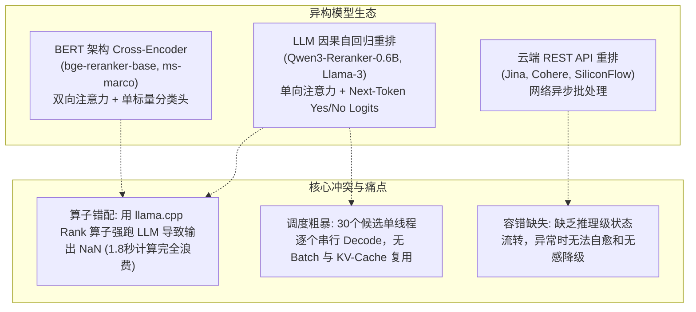
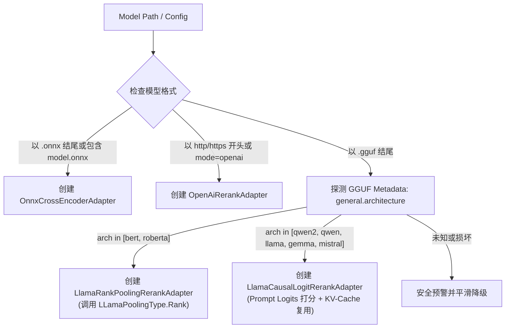
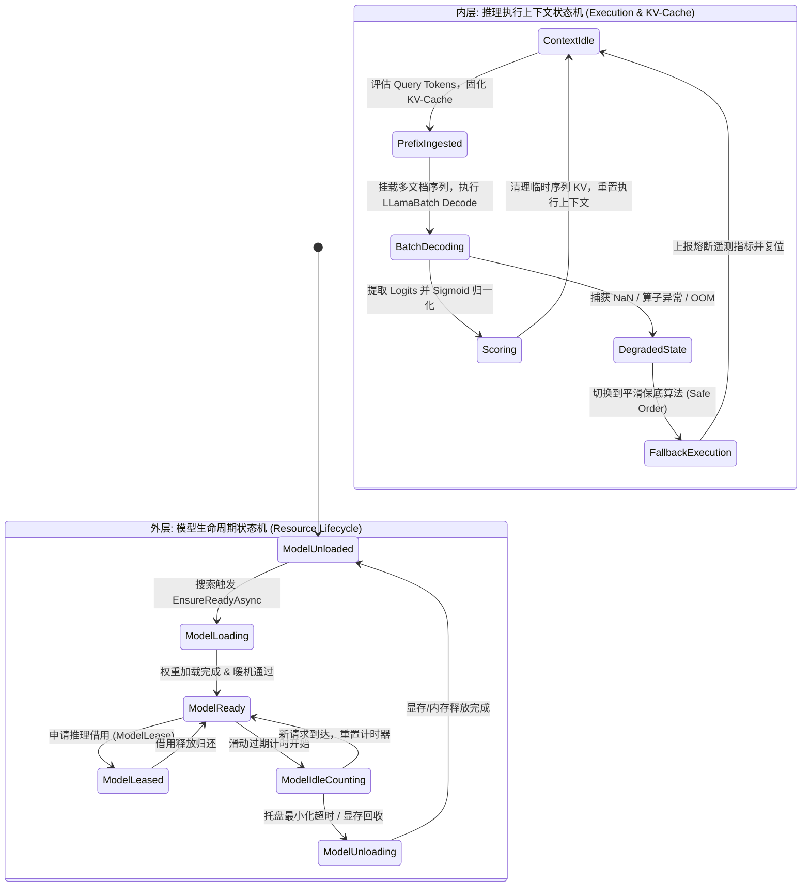

# 重排适配器策略与双层状态机架构设计方案
(Rerank Adapter Strategy & Two-Tier State Machine Architecture Design)

---

## 1. 架构背景与演进动机

在 ReferenceRAG 的混合检索工作流中，两阶段检索（Recall + Rerank）是决定搜索精度的核心环节。
传统检索通过 BM25（词法匹配）与 Embedding 向量检索（粗排召回）获取 Top 30 候选结果，随后由重排服务（`IRerankService`）执行精准语义交叉编码重排。

然而，在重排模型的工程落地中，系统面临着**极端的底层引擎异构性**与**复杂的推理执行生命周期**：



为彻底解决上述问题，本方案引入 **“适配器策略模式 (Adapter Strategy Pattern)”** 与 **“双层状态机 (Two-Tier State Machine)”**，重构重排引擎的使用逻辑。

---

## 2. 总体架构拓扑 (Overall Architecture Topology)

系统将重排逻辑解耦为 **业务接入层**、**策略解析与路由层**、**统一适配器层** 与 **双层状态机驱动引擎**：

```mermaid
flowchart TD
    subgraph 业务接入层
        Search["SearchService / HybridSearchService"]
        Lazy["LazyRerankService (门面)"]
    end

    subgraph 双层状态机驱动引擎
        OuterSM["外层: 模型生命周期状态机<br/>(ModelLifecycleStateMachine)<br/>- 显存/内存驻留<br/>- 常驻 vs 滑动过期<br/>- 托盘最小化联动"]
        InnerSM["内层: 推理执行上下文状态机<br/>(RerankExecutionContextStateMachine)<br/>- PrefixIngested (KV前缀固化)<br/>- BatchDecoding (多序列并发)<br/>- Scoring (Logits归一化)<br/>- Degraded (熔断保底)"]
    end

    subgraph 策略解析与路由层
        Resolver["RerankBackendStrategyResolver<br/>读取 GGUF Metadata / ONNX IO / Mode"]
    end

    subgraph 统一适配器策略层 (IRerankBackendAdapter)
        A1["OnnxCrossEncoderAdapter<br/>DenseTensor 矩阵批处理 (30~50ms)"]
        A2["LlamaCausalLogitRerankAdapter<br/>Next-Token Logits 预测 + KV 复用 (150~250ms)"]
        A3["LlamaRankPoolingRerankAdapter<br/>BERT 专有 Rank 分类算子 (80~150ms)"]
        A4["OpenAiRerankAdapter<br/>REST API HTTP 批处理"]
        A5["SafeFallbackRerankAdapter<br/>平滑降级保底适配器 (<1ms)"]
    end

    Search --> Lazy
    Lazy --> OuterSM
    OuterSM --> InnerSM
    InnerSM --> Resolver
    Resolver --> A1
    Resolver --> A2
    Resolver --> A3
    Resolver --> A4
    Resolver --> A5
```

---

## 3. 适配器策略模式设计 (Adapter Strategy Pattern)

### 3.1 统一适配器契约：`IRerankBackendAdapter`

所有底层引擎必须实现统一接口，对上层屏蔽任何张量操作、分词细节与 HTTP 通信：

```csharp
public interface IRerankBackendAdapter : IDisposable, IAsyncDisposable
{
    string BackendType { get; }      // onnx, llama-causal, llama-rank, openai
    string ModelPath { get; }
    string ModelName { get; }
    bool IsLoaded { get; }

    Task InitializeAsync(CancellationToken cancellationToken = default);
    Task<double> RerankAsync(string query, string document, CancellationToken cancellationToken = default);
    Task<RerankResult> RerankBatchAsync(string query, IEnumerable<string> documents, CancellationToken cancellationToken = default);
}
```

### 3.2 策略自动解析与路由：`RerankBackendStrategyResolver`

工厂在加载模型时，不再粗暴地依靠后缀一刀切，而是通过读取模型元数据（Metadata Sniffing）自动派发适配器：



### 3.3 因果重排适配器核心算法实现 (`LlamaCausalLogitRerankAdapter`)

针对 Qwen3-Reranker、Llama-3-Reranker 等大模型重排模型，核心算法流程：

1. **Prompt 模板封装**：
   ```text
   <|im_start|>system
   Judge whether the following document is relevant to the query.<|im_end|>
   <|im_start|>user
   Query: {query}
   Document: {truncatedDocument}
   Relevant (Yes/No):<|im_end|>
   <|im_start|>assistant
   ```
2. **Next-Token Logits 概率提取**：
   定位词表中代表正负倾向的 Token ID（例如 `"Yes"` / `"No"` 或 `"true"` / `"false"`）。
   单次前向推理得到输出 Logits 向量后，计算概率比值：
   $$\text{Score} = \frac{e^{\text{Logit}(\text{"Yes"})}}{e^{\text{Logit}(\text{"Yes"})} + e^{\text{Logit}(\text{"No"})}} = \text{Sigmoid}(\text{Logit}(\text{"Yes"}) - \text{Logit}(\text{"No"}))$$
3. **彻底根治 NaN**：
   由于该计算走的是标准 LM Head 投影矩阵，不再依赖分类池化头，100% 能够输出有效的真实相关度分数。

---

## 4. 双层状态机体系设计 (Two-Tier State Machine)

重排模块的运行时稳定性由 **外层模型生命周期状态机** 与 **内层推理执行上下文状态机** 共同保障：



### 4.1 外层：模型生命周期状态机 (`ModelLifecycleStateMachine`)
- **管辖范围**：物理层资源（GPU VRAM、Host RAM、Native Handle）；
- **策略联动**：
  - **Permanent（常驻）**：模型常驻内存，`ModelReady` 状态下永不超时卸载；
  - **SlidingExpiration（滑动过期）**：结合窗口状态服务（`IWindowStateService`），当且仅当应用最小化至系统托盘且超过空闲窗口（如 300 秒）后，状态机安全排空活跃借用后转为 `ModelUnloaded`。

### 4.2 内层：推理执行上下文状态机 (`RerankExecutionContextStateMachine`)
- **管辖范围**：单次重排任务内 Context、KV-Cache 与 Batch 的状态流转；
- **状态定义**：
  1. `Idle`：上下文处于闲置状态，KV-Cache 为空；
  2. `PrefixIngested`：系统指令与 Query 前缀已评估入 KV-Cache 并锁定位置，为所有候选文档共享基础上下文（**提速 2~3 倍的关键**）；
  3. `BatchDecoding`：候选文档分批打包为 `LLamaBatch` 并挂载对应的 `seq_id`，交由 GPU Kernel 单步并发前向推理；
  4. `Scoring`：提取打分输出，校验是否为有效数值（非 NaN、非全零），完成概率归一化；
  5. `Degraded`：自适应降级态。若模型在 `BatchDecoding` 或 `Scoring` 连续返回异常，状态机自动熔断并切换为保底分生成，杜绝级联故障。

---

## 5. 预期性能指标与对比 (Performance Matrix)

| 场景 / 维度 | 改造前 (Qwen3 GGUF 现状) | 改造后 (GGUF 状态机+因果适配器) | 改造后 (ONNX Cross-Encoder 适配器) |
| :--- | :--- | :--- | :--- |
| **重排耗时 (30候选)** | **1811 ms** 🔴 | **150 ~ 250 ms** 🟢 | **30 ~ 50 ms** 🚀 |
| **打分有效性** | **输出全为 NaN** (假分降级) | **真实 Next-Token 语义概率** | **真实分类头 Logit 概率** |
| **GPU 并发性** | 30 次单线程串行循环调用 | 2~3 次 Batch 多序列并发 Decode | 1 次 DenseTensor 矩阵推理 |
| **Query 重复计算** | 每次重复分词与推理 (30次) | **Prefix KV 缓存复用 (只算1次)** | 输入序列打包矩阵 |
| **异常容错能力** | 循环内简单早停止损 | **内层状态机自适应熔断+平滑降级** | 异常捕获+保底 |

---

## 6. 分步落地实施计划 (Implementation Roadmap)

1. **第一步（策略探测与工厂抽象）**：
   - 实现 `GgufArchitectureDetector`，支持从 GGUF 文件头读取 `general.architecture`；
   - 扩充 `ModelBackendStrategyFactory`，重构 `GgufBackendStrategy` 实现模型家族路由。
2. **第二步（构建 `LlamaCausalLogitRerankAdapter`）**：
   - 实现适用于 Qwen2/Qwen3/Llama 的生成式重排适配器；
   - 实现基于 Next-Token Logits（Yes/No）的概率打分与 Sigmoid 映射；
   - 包含前缀截断与安全校验。
3. **第三步（内层执行状态机 `RerankExecutionContextStateMachine`）**：
   - 封装上下文前缀缓存（Prefix KV-Cache）与批处理解码生命周期；
   - 提供熔断降级与保底处理。
4. **第四步（综合单元测试与端对端验证）**：
   - 编写针对适配器策略路由、Logits 打分精度、状态机流转与早停降级的测试；
   - 运行全量冒烟测试（`smoke-test.bat`），确保 16 项 SLA 指标 100% 保持绿色通过。
