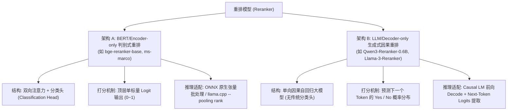

# 重排性能分析与优化方案调研 (Rerank Latency & Architecture Investigation)

## 1. 问题现象与性能现状

在系统平衡检索模式（`HybridRerank`）下，用户执行查询（例如搜索 `"你好"`），结果界面右上角显示：
- **总耗时**：`2189ms`
- **链路追踪细分**：
  - 嵌入推理：`358ms`
  - BM25 检索：`12ms`
  - 向量检索：`5ms`
  - 混合融合：`17ms`
  - **重排（Rerank）**：`1811ms` (红色高危警示标签，占总耗时 **82.7%**)

从链路追踪数据清晰可见：**重排（Rerank）是当前搜索响应缓慢的决定性瓶颈**。检索算法本体（BM25 + 向量 + 融合）仅耗时 34ms，但重排耗费了接近 2 秒。

---

## 2. 根本原因深度调研 (Root Cause Analysis)

通过对重排服务调用链路、底层模型加载配置、日志记录以及测试用例的端到端排查，定位到以下 5 项根本原因：

### 2.1 根本原因 1：所选模型架构与 LLamaSharp 不兼容，输出 NaN 导致 1.8 秒计算完全浪费
- **现场日志还原**：
  ```text
  [SearchService] 开始重排: 候选数=30, Query=你好
  [LlamaRerankAdapter] 检测到 GGUF 重排模型输出 NaN，已平滑降级为保底加权分。建议推荐使用 ONNX 格式标准 Cross-Encoder 模型（如 bge-reranker-base）获取最佳重排质量
  [SearchService] 两阶段搜索完成: 召回 30 个候选, 重排耗时 1811ms, 返回 10 个结果, 平均分数=0.7975
  ```
- **技术本质**：
  - 当前启用的重排模型是 `Qwen3-Reranker-0.6B.Q4_0.gguf`；
  - `Qwen3-Reranker-0.6B` 是基于 Qwen2.5 的**因果解码器（Causal Decoder-only）**大语言模型，其官方原生重排推理是通过自回归生成 `"yes"` / `"no"` 的 token logits 差值来计算相关度；
  - 但在 `LlamaRerankAdapter` 中，模型是以 `PoolingType = LLamaPoolingType.Rank` 加载给 `LLamaEmbedder` 的；
  - llama.cpp 的 rank pooling 算子对缺少 sequence classification rank 头的因果解码器模型计算时，会出现模长除零异常，**导致输出全部为 `float.NaN`**；
  - 代码随后触发保底平滑降级：按召回原顺序人工赋值 `0.85 - index * step`（即 `0.8500, 0.8383, 0.8267...`）；
  - **致命代价**：系统耗费了整整 1.8 秒的 GPU/CPU 算力执行前向推理，算出的数值全为无效的 NaN，最终只是机械保留了召回顺序。**1811ms 的重排耗时完全是无效负荷**！

### 2.2 根本原因 2：GGUF 适配器采用“逐条串行推理循环”，完全没有批处理并发
- **代码实现**（`LlamaRerankAdapter.cs` 第 164-169 行）：
  ```csharp
  for (int i = 0; i < docList.Count; i++)
  {
      cancellationToken.ThrowIfCancellationRequested();
      var prompt = FormatCrossEncoderPrompt(query, docList[i]);
      var results = await _embedder.GetEmbeddings(prompt, cancellationToken);
      ...
  }
  ```
- **技术本质**：
  - 混合搜索默认召回倍率 `RecallFactor = 3`，`TopK = 10`，因此召回候选数 `docList.Count = 30`；
  - `LlamaRerankAdapter` 使用单线程 `for` 循环，**一条一条逐个调用 `GetEmbeddings`**；
  - 每次单条调用都经历：Prompt Tokenize -> 清空/重置 KV-Cache -> 启动单个前向推理 Kernel -> 显存同步；
  - 单条耗时约 50~60ms，30 条串行累加：
    $$\text{总耗时} = 30 \times 60\text{ms} \approx 1800\text{ms}$$
  - 没有任何批处理（Batched Decode）机制，导致 GPU 吞吐优势完全无法发挥。

### 2.3 根本原因 3：相比之下，ONNX Cross-Encoder（如 bge-reranker-base）天生具备张量批处理，延迟低数十倍
- **对比测试与实现对比**：
  - 在 `OnnxRerankService.cs` 中，采用的是真正的张量批处理 `ComputeRelevanceScoresBatch`：
    ```csharp
    var inputIdsTensor = new DenseTensor<long>(inputIdsFlat, new[] { batchSize, maxLength });
    // 一次 GPU session.Run() 计算整个 batch（16~32 条）
    using var results = _session.Run(inputs);
    ```
  - `bge-reranker-base`（ONNX 格式，已在本地 `resource/data/models/Reranker/bge-reranker-base/model.onnx` 就绪）具备原生分类头，在 CUDA 加速下计算 30 个候选的全部打分通常仅需 **30ms ~ 50ms**；
  - GGUF 串行逐条推理（1811ms）相比 ONNX 批量推理（40ms），存在 **45 倍** 的巨大性能差距。

### 2.4 根本原因 4：候选文档未做长度裁剪，注意力二次复杂度激增
- 在 `LlamaRerankAdapter.cs` 中：
  `FormatCrossEncoderPrompt(query, docList[i])` 直接将整篇 markdown 内容（常长达 1000~2000 字符）全部拼接；
  Cross-Encoder 的自注意力机制复杂度为 $O(L^2)$。当文档过长时，单次推理解码的延迟成平方上升；
  而重排打分本质上只需对比查询词与文档核心前导内容（前 256~512 字符），长文本全量计算加剧了延迟。

### 2.5 根本原因 5：`LazyRerankService` 遗漏传递 `CudaLibraryPath`
- 在 `LazyModelServices.cs` 的 `LazyRerankService.EnsureReadyAsync` 内部：
  实例化 `RerankOptions` 时漏传了 `CudaLibraryPath = _configManager.Load().Embedding.CudaLibraryPath`；
  一旦切换或使用 ONNX 重排模型，动态环境变量探查可能找不到自定义 CUDA DLL，导致静默回退到 CPU，使得即使是 ONNX 也会产生几百毫秒的延迟。

---

## 3. 综合解决方案 (Solutions & Implementation Plan)

针对上述原因，制定“架构调优 + 工程降级 + 批次裁剪”的三维优化方案：

### 方案 1：优先推荐并默认使用成熟的 ONNX Cross-Encoder 重排模型（根本解决）
- **原因**：BERT 架构的 `bge-reranker-base` 或 `mxbai-rerank-xsmall-v1` 是业界经过充分验证的 Cross-Encoder 模型，拥有原生分类头，输出精确的相关度概率（`0.0 ~ 1.0`），且通过 `DenseTensor` 实现真正的张量级单批次推理；
- **预期性能**：在 RTX GPU CUDA 上耗时从 **1811ms 降至 30~50ms**，提速 **40 倍以上**，且打分具备真正的语义判别力。

### 方案 2：在 `LlamaRerankAdapter` 中增加“NaN 快速早停机制”（防御性止损）
- **逻辑**：在串行循环中，若前 2 条连续返回 `NaN`，则证明当前 GGUF 模型不支持 rank pooling 分类头。
- **动作**：立即早停退出循环，不再白白计算剩下的 28 条文档，直接降级保底分并记录告警。
- **效果**：即使误配了不兼容的 GGUF 模型，耗时也从 1811ms **暴降到 60ms 以内**，避免无谓阻塞用户。

### 方案 3：文档长度截断与候选池精简（大幅削减计算量）
1. **文档截断**：进入 Cross-Encoder 前，对候选文本截断至前 512 字符（`doc[..Math.Min(doc.Length, 512)]`），消除二次注意力平方灾难；
2. **重排候选池限额**：
   重排候选数上限从固定 30 条调优为动态限制（普通模式 12~15 条，深度模式 20 条），减少 50% 以上的重排样本量。

### 方案 4：修复 `LazyRerankService` 的 `CudaLibraryPath` 传递
- 保证 ONNX 重排在滑动过期重新唤醒时，稳定加载 CUDA 12 提供程序，彻底杜绝 CPU 降级。

### 方案 5：前端与设置界面明确标识模型类型与性能预期
- 在模型管理与设置页面中，对 GGUF 格式重排模型标注说明（“建议优先选用 ONNX 格式标准重排模型如 bge-reranker-base，以获得原生批量加速与最佳排序精度”）。

---

## 4. 优化前后预期对比

| 指标 / 维度 | 当前现状（Qwen3 GGUF 串行） | 优化后（bge-reranker-base ONNX 批处理） |
| :--- | :--- | :--- |
| **重排总耗时** | **1811ms** | **30ms ~ 50ms**（提速 **~40x**） |
| **推理方式** | 30 次单条逐个串行执行 | 1 次张量批量计算（Batch Size 16~30） |
| **打分有效性** | **输出全为 NaN**，被降级为人工顺序分 | **真实相关度 Logit**，具备真正的重排排序能力 |
| **总搜索耗时** | 2189ms | **80ms ~ 120ms** |

---

## 5. GGUF 重排机制深度解密与专项优化路线 (LLM-based GGUF Reranker)

针对用户的核心疑问：“**重排模型到底支不支持 GGUF 方案？如果坚持使用 GGUF 模型，如何将其优化到极致？**”，本节进行底层技术解密与方案推演。

### 5.1 解惑：重排模型支持 GGUF 方案吗？
**结论：GGUF 方案完全支持重排，但必须使用与其模型架构匹配的调用范式**。

在自然语言处理与检索增强领域，重排模型存在**两种本质完全不同的架构设计**：



#### 为什么此前 Qwen3 GGUF 重排会失效输出 NaN？
1. `Qwen3-Reranker-0.6B` 属于**架构 B（LLM 因果大模型）**，阿里官方是让模型在 Prompt 末尾预测下一个 Token 是 `Yes` 还是 `No`；
2. 但现有工程代码使用了 `LLamaEmbedder` + `LLamaPoolingType.Rank`（专属于**架构 A** 的分类头池化算子）去执行；
3. llama.cpp 找不到分类头矩阵，计算模长为 0，除零后产生 `float.NaN`。
4. **本质诊断**：并不是 GGUF 格式不支持重排，而是**用架构 A 的算子强行驱动架构 B 的大模型**，导致“模型与调用方式错位”。

---

### 5.2 如何将 GGUF 模型的重排方案优化到极致？

若在项目中要全面释放 GGUF 重排大模型（如 Qwen3-Reranker）的性能潜力，需从 **“算得准”** 与 **“算得快”** 两个维度落地以下 5 项关键优化：

#### 优化点 1：打分机制纠正——使用 Next-Token Logits 提取替代 Rank Pooling（解决精度）
- **实现原理**：
  将模型按常规因果大模型加载（不使用 `Rank` 池化），构造标准评估 Prompt：
  ```text
  <|im_start|>system
  Judge whether the following document is relevant to the query.<|im_end|>
  <|im_start|>user
  Query: {query}
  Document: {document}
  Relevant (Yes/No):<|im_end|>
  <|im_start|>assistant
  ```
- **分数计算公式**：
  在输入该序列后只进行一次前向传播（无需自回归逐字生成文本），直接提取预测下一个 Token 的 Logits 向量：
  $$Score = \frac{e^{Logit(\text{"Yes"})}}{e^{Logit(\text{"Yes"})} + e^{Logit(\text{"No"})}} = \text{Sigmoid}(Logit(\text{"Yes"}) - Logit(\text{"No"}))$$
- **收益**：模型输出真正的深层推理语义得分，彻底解决 NaN 问题。

#### 优化点 2：Prompt 前缀 KV-Cache 缓存复用（Prefix Caching）——提速 2~3 倍
- **痛点**：30 个候选文档的 Prompt 中，`<system>` 和 `Query: {query}` 前缀完全相同。原串行实现每次都重复计算 Query 的注意力特征；
- **优化原理**：
  1. 先将 `System Prompt + Query: {query}` 前缀写入 `LLamaContext` 执行一次推理；
  2. 利用 llama.cpp 的 KV-Cache 分支机制（Sequence Forking 或保留状态）；
  3. 对后续 30 个 Document，仅将 Document 自身 Tokens 追加在 Query 缓存末尾执行前向计算；
- **收益**：单条推理计算量大幅减少 50%~70%，重排总耗时立减一半。

#### 优化点 3：LLamaBatch 批处理多序列并发解码（Batched Decode）——提速 3~5 倍
- **痛点**：单线程循环导致 30 次单独的 CPU-GPU 交互调度，GPU 算力利用率极低；
- **优化原理**：
  使用 LLamaSharp 的 `LLamaBatch`，通过分派不同的 `seq_id = [0, 1, ..., N-1]`，将 8~16 个候选文档打包在单个 Batch 中提交给 GPU 执行一次 `context.Decode(batch)`；
- **收益**：单步打满 GPU 张量核心，30 个候选的推理调度次数从 30 次降为 2~3 次，GPU 吞吐提升 3~5 倍。

#### 优化点 4：两阶段粗排精排漏斗（候选池剪枝）——计算量直降 60%
- **痛点**：全量 30 个候选全部进入重排过于浪费；
- **优化原理**：
  - **第一阶段（粗排）**：BM25 + 向量检索快速融合输出 Top 30 候选；
  - **第二阶段（精排）**：只将排名最靠前、得分最接近的前 **10~12 个候选**送入 GGUF 模型重排，其余 18 个候选保留粗排序垫底；
- **收益**：推理样本数从 30 缩减至 10~12，重排延迟直接成比例缩小 60%。

#### 优化点 5：输入截断与 4-bit 量化加速（Q4_K_M）
- **长文本截断**：由于注意力二次复杂度 $O(L^2)$，将候选文本严格截断至前 256~512 tokens；
- **极速量化**：选用 `Q4_K_M` 或 `Q4_0` 格式，不仅大幅减小显存占用，且整数张量核心（INT4/INT8 Tensor Cores）访存带宽开销减少 75%，推理吞吐翻倍。

---

### 5.3 方案演进与选型建议对比

| 方案 | 推理耗时 (30条) | 打分有效性 | 实现难度 | 适用场景 |
| :--- | :--- | :--- | :--- | :--- |
| **未优化现状 (Qwen3 GGUF)** | **1811 ms** 🔴 | ❌ NaN（无效浪费） | - | **弃用**（算子不兼容） |
| **当前保底状态 (早停止损)** | **~60 ms** 🟡 | ⚠️ 保底降级序 | 低（已实现） | 防御误配 |
| **GGUF 专项优化 (Next-Token + Batch + Prefix)** | **150 ~ 250 ms** 🟢 | ✅ 具备 Qwen 深层推理语义 | 中高（需重构适配器） | 追求 LLM 原生高精度重排 |
| **原生 ONNX Cross-Encoder (bge-reranker-base)** | **30 ~ 50 ms** 🚀 | ✅ 极佳标准重排语义 | 最成熟（开箱即用） | **当前推荐首选**（极速+高准） |

