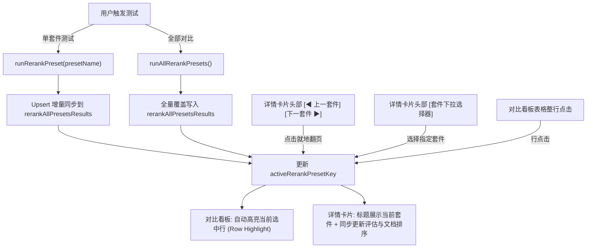

# 预设套件横向对比看板与重排测试结果联动优化方案

## 1. 背景与现状问题分析

在 ReferenceRAG 的性能测试中心（`Performance.js`）的「重排模型 (Reranker)」模块中，系统提供了两大核心评测工具：
1. **预设套件横向对比看板 (`rerankAllPresetsResults`)**：运行全部预设测试（如技术文档、FAQ、反义词与极性相反、跨语言等），汇总输出各套件的 NDCG、MRR、MAP、排序准确度、MAE、推理耗时指标对比总览；
2. **重排测试结果与质量评估 (`rerankResult`)**：展示单次测试的 S/A/B 级综合质量评估、参数解读指南、指标看板、以及每一篇文档的重排前后位次（首位命中、前移、顺位保持、后移）与预测分/期望分偏差明细。

### 当前交互痛点 (Pain Points)

1. **信息孤岛与割裂（Disconnected State）**：
   - 顶部单套件运行按钮（如点击「运行: 反义词与硬负例」）仅更新单次详情 `rerankResult`，不与下方的「预设套件横向对比看板」同步，看板无法增量感知该套件的最新重排效果；
   - 运行全部横向对比后，对比表格与下方的详情卡片之间没有统一的双向激活状态绑定。
2. **切换查看详情极度繁琐（Cumbersome Context Switching）**：
   - 对比看板仅在每行末尾提供一个微小的「查看详情」幽灵按钮，且**没有整行点击响应**；
   - 表格中**没有当前激活行高亮**（无 active row 背景或标记），用户无法辨识当前下方详情属于哪一行；
   - 用户在表格点击「查看详情」后，需要手动向下滚动大量篇幅查看文档位次；看完了当前套件想看下一个时，必须**向上滚动回到表格 -> 寻找下一行 -> 点击小按钮 -> 再向下滚动**，反复滚屏体验极差。
3. **详情卡片缺少上下文与就地切换（Lack of In-situ Navigation）**：
   - 详情卡片的标题固定为「重排测试结果与质量评估」，未醒目标识当前正在检视哪个测试套件（如「技术文档与代码」还是「反义词与硬负例」）；
   - 详情卡片内部没有「上一套件 / 下一套件」翻页器或下拉切换器，完全依赖外部表格重新点选。

---

## 2. 方案权衡与头脑风暴 (Brainstorming & Evaluation)

| 方案 | 交互形式 | 优点 | 缺点 | 结论 |
| :--- | :--- | :--- | :--- | :--- |
| **方案 1：一体化联动面板 + 就地导航栏** | 保留垂直流，表格整行点击高亮 + 详情卡片头部内置快速翻页器与下拉直达 + 增量 upsert | 屏幕空间利用充分，阅读长文档不受限；在详情处可无需滚屏极速比对下一个套件；双向同步无断层 | 需改造表格行样式与卡片头部组件 | ⭐ **最佳方案（采纳）** |
| **方案 2：左右分栏视图 (Master-Detail Split)** | 左侧 35% 表格，右侧 65% 详情 | 左右对照直观，无需垂直滚动 | 重排文档文本偏长（数百字），且指标矩阵庞大，左右分栏会导致横向严重挤压，需频繁横向滚屏 | 否决 |
| **方案 3：表格内联展开 (Expandable Rows)** | 表格每一行支持下钻展开详情 | 视觉完全内嵌 | 详情卡片包含诊断等级、指标网格与 10~20 篇文档，高度超过 1000px，破坏表格本身的横向对比可读性 | 否决 |
| **方案 4：抽屉侧滑预览 (Drawer Modal)** | 点击行弹出右侧全屏/宽抽屉 | 聚焦沉浸感强 | 抽屉遮挡对比表格，无法一边看对比基线一边看详情，且增加弹窗开启关闭交互成本 | 否决 |

---

## 3. 最优解：一体化联动面板交互设计 (Detailed Architecture)

### 3.1 核心状态流与统一模型
- 引入 `activeRerankPresetKey` 响应式状态，作为全局唯一的「当前激活套件唯一标识」；
- 维护 `currentRerankSuiteIndex` 与 `currentRerankSuiteTotal` 计算属性；
- 当 `activeRerankPresetKey` 发生变化时，自动定位并切换 `rerankResult` 为对应套件的完整结果。

### 3.2 对比看板增强 (Master Board Enhancements)
1. **整行点击即切换**：
   - `n-data-table` 绑定 `row-props`，添加 `cursor: pointer`；
   - 点击表格任意单元格即可激活该套件，无需费力瞄准微小按钮；
2. **当前查看行动态高亮**：
   - 命中 `row.name === activeRerankPresetKey` 时，该行呈现柔和主题色背景（如 `rgba(99, 226, 183, 0.16)`）与加粗文本；
3. **第一列激活状态勋章**：
   - 当前激活的套件前置展示高亮 Tag：`⭐ 正在查看`；其他行展示未选中的序列序号；
4. **操作列清晰化**：
   - 保留「查看详情」快速定位按钮，并新增「单独重测」快捷操作，支持随时对特定套件重新推理。

### 3.3 详情卡片头部就地导航器 (In-situ Suite Navigator)
1. **动态上下文标题**：
   - 标题格式：`重排质量评估详情: 【${suite.description}】`，并显示进度 Badge：`第 ${index + 1} / ${total} 组套件`；
2. **无感连续切换控制组 (Seamless Stepper)**：
   - 在卡片顶部操作区放置：
     - `[◀ 上一套件]`（首个时禁用）；
     - `[选择套件 ▾]` 下拉直达选择器；
     - `[下一套件 ▶]`（末尾时禁用）；
     - `[定位至看板 ⬆]` 快速回跳按钮；
   - 用户在浏览完该套件文档命中与排序分析后，无需滑回上方，直接点击「下一套件 ▶」即可连贯对比下一组，下方文档排序无缝更新，上方看板高亮行同步切换！
3. **平滑滚动定位 (Smooth Scroll)**：
   - 点击看板「查看详情」时，平滑滚动至详情面板；
   - 点击「定位至看板 ⬆」时，平滑滚回对比看板。

### 3.4 单预设运行结果增量合流 (Incremental Upsert)
- 改进 `runRerankPreset(presetName)`：
  - 测试完成后，检查 `rerankAllPresetsResults` 中是否已存在该套件记录；
  - 若已存在，就地更新该套件的指标与排序文档；
  - 若不存在，追加插入；
  - 自动将 `activeRerankPresetKey` 设为当前运行套件。
  - 无论用户是单测还是全测，对比看板和详情卡片始终保持 100% 数据一致。

---

## 4. 交付与验证计划

1. **实现前端组件逻辑与模板更新**（`Performance.js`）：
   - 添加状态变量、就地切换函数、整行点击高亮 `rowProps`、锚点滚动方法；
   - 导出所有新增符号至 `__returned__` 并更新模板。
2. **前端质量门禁与单元测试验证**：
   - `node Business/ReferenceRAG.Business/wwwroot/check.mjs`：确保 AST 作用域与模板绑定 100% 严密；
   - `node --test Business/ReferenceRAG.Business/wwwroot/tests/*.test.mjs`：编写单元测试覆盖套件切换、增量 upsert 与高亮行生成；
3. **后端集成与整机验证**：
   - `dotnet test tests/ReferenceRAG.Host.Tests`；
   - `dotnet build Host/ReferenceRAG.DesktopHost/ReferenceRAG.DesktopHost.csproj`。
