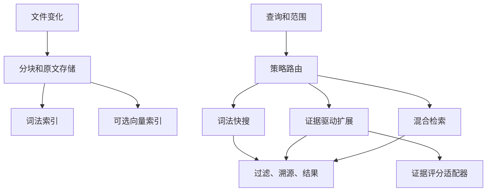

# ReferenceRAG：SAG2 借鉴与无向量检索可行性

调研日期：2026-11-08。性质：方案研究，尚未实现、测试或验证性能。结合本仓库源码、本地 SAG2 笔记及 SAG-Wiki 源码；外部资料见文末。

前端交互、Jev 配置及通用证据评估器的详细设计见 [SAG2 前端与证据评估器设计](sag2-evidence-evaluation-and-ui-design.md)。该文档细化本方案并明确本地重排的适配边界。

## 1. 决策建议

建议增加 **免 Embedding 建库与检索的能力**，但不要把所有无向量搜索统称为 SAG2，也不要替换现有混合检索。以同一份文件、分块与词法索引为基础，提供三种可观察的策略：

| 策略 | 建库 | 查询 | 建议用途 |
|---|---|---|---|
| Lexical | 无 embedding；本地分块和 FTS | BM25 + 标题/路径命中；不加载模型 | N100、离线快搜、初始部署 |
| Evidence | 同上 | BM25 → 证据评分 → 受限多轮词项扩展；评分可由 Jev 或本地重排器承担 | 复杂问题、多跳检索；本地替代评分不等同原版 Jev |
| Hybrid | 可增量补齐向量 | 原有 BM25 + Dense + 可选重排；评测后可叠加扩展 | 同义、跨语言和高召回任务 |

这三种是检索策略，**索引能力与查询策略需分别配置**：同一个索引允许 lexical/evidence 查询，即使向量已存在；禁止 embedding 的环境要保证索引及查询均不调用 embedding。已有配置保持原行为，轻量模式显式选择，不自动删除向量。

SAG2 的核心是免向量建库、查询时语义证据判断与多跳关联，而不是无需任何模型。SAG-Wiki 本地快搜无需 Jev，深度检索需要配置 Jev，回答还需要生成模型；替换为普通 reranker 是受其启发的变体，不能宣称复现官方质量。Jev 远程请求会传问题和相关文本，有延迟、费用与隐私影响；本地部署仍需要计算资源。

## 2. 参考资料和实现核对

- `D:\D\Notes\Note\1 工作\笔记\知识库\SAG2 知识库` 中的原理、部署和 README 笔记已查阅，其结论与上述区分一致。
- `E:\WorkProject\Rust\【参考项目】\SAG-Wiki-main\README-CN.md`：Rust 内核、SQLite，快搜和 Jev 深搜有不同依赖；仓库 LICENSE 为 MIT。
- `core/src/retrieval.rs`：`expansion_terms` 结合词频、IDF、上下文和种子分数；`interleave` 交错及去重；`retrieve_inner` 按轮召回、评分和更新 frontier，限制最多两轮；包括 scope、取消及冻结行为的测试。`core/src/indexer.rs` 包含文件更新相关测试。值得借鉴算法和测试边界，不能把其结果直接推断为本系统效果。
- 官方 SAG2 benchmark 描述：初始最多 100 候选、最多 10 个扩展种子、最多 20 个词项、默认两轮；这些是研究配置，不适合直接成为 N100 默认值。论文和基准来自作者，MuSiQue 被用于方法开发，测试结果不能外推中文笔记或本项目。

## 3. 本项目基础与缺口

以下为静态源码观察，不代表运行时全路径已经验证。

| 能力 | 已有位置 | 可复用/缺口 |
|---|---|---|
| 词法索引 | `Infrastructure/ReferenceRAG.Infrastructure/Features/Database/Fts5BM25Store.cs`、`IBM25Store.cs` | SQLite FTS5、jieba.NET 预分词、unicode61、词汇统计；当前按 chunk id 和正文索引，标题/路径权重需另设计 |
| 原文和元数据 | `SqliteVectorStore.cs`、`IVectorStore.cs` | chunk/file 虽放在向量存储抽象内，但 BM25 结果需取这些数据。抽出或适配文档存储接口；不能只关闭向量就假设 chunk 可完整落盘 |
| 文件流水线 | `Business/ReferenceRAG.Business/Features/Indexing/Services/FileIndexPipeline.cs`、`IndexingPipeline.cs` | 分块、文件 hash、BM25/图谱收尾已存在；依赖 `IEmbeddingService`、模型 profile 和 embedding 输入限制，需审查并分离无模型路径；已有 VectorOnly 可供补齐流程参考，不等于已实现免向量建库 |
| 查询入口 | `Search/Services/SearchService.cs`、`Search/Strategies/SearchExecutionStrategies.cs` | 当前 `SearchService` 先启动查询 embedding；Quick 和 Standard 也使用向量。只新增策略而不修改入口会继续调用模型。须核实各 API/MCP/Chat 路径统一经过能力路由 |
| 搜索抽象 | `ISearchExecutionStrategy`、`SearchStrategyFactory`、`ISearchRetrievalAdapter` | 现有策略和适配器可扩展，不必重新造总框架；先收敛入口的重复职责 |
| 图谱 | `GraphIndexingService`、`SqliteGraphStore`、`IGraphStore` | 文件、标题、标签、链接可作受限候选扩展；并非 SAG2 的词项多跳，也不是语义实体事件图 |
| 融合及重排 | `Search/Fusion/ISearchFusionStrategy.cs`、现有 ONNX/GGUF 重排适配器 | 可实验 RRF 和本地 rerank；相关性评分与 Jev 带上下文的证据必要性评分语义不同 |
| 生命周期 | `SearchPipelineStateMachine`、`IndexJobStateMachine`、JobCenter | 优先扩充现有追踪；确认其允许循环和取消，不要把每一跳变成庞大状态枚举 |
| 三方依赖 | `Directory.Packages.props` | 已有 Microsoft.Data.Sqlite 10.0.12、jieba.NET 0.42.2、Markdig 1.3.2；先复用，不新增数据库或重量框架 |

### 需要优先验证的细节

1. `Fts5BM25Store.SearchAsync` 调用 `bm25(table, k1, b)`；SQLite FTS5 这里的参数是**列权重**，不是 BM25 的 k1、b，FTS5 内部常量为 1.2/0.75。现有命名可能误导配置与评测，需针对实际表列次序验证并另行修正，避免误认为参数已调优。
2. `FileIndexPipeline.Finalize...` 分步写 BM25、图谱、删除旧 chunk 并标记完成；尽管局部有事务或清理逻辑，不能仅凭注释认定跨 chunk/FTS/graph 的整个文件更新是同一事务。应检查共享连接和事务边界并做中断注入测试。
3. BM25 搜索结果中的正文是预分词文本；`HybridSearchService` 对 BM25 单路候选按 chunk id 读取原始 chunk/file。轻量实现应批量读取原文，避免 N+1 查询及错误引用分词文本。
4. 在 `SearchService` 的模式分支以前已看到 embedding 调用，因此服务健康检查、DI 初始化、对话/MCP 及启动索引等都要用无模型环境端到端确认，不能只看策略类。

## 4. 方案架构

### 4.1 索引：先确保无模型可用

将文件记录/原文 chunk 与向量写入的职责从 `IVectorStore` 中逻辑分离；初期可用兼容适配器包住现有 SQLite 实现，避免大范围迁移。明确 `DocumentIndexReady`、`LexicalReady`、`VectorPending/Ready/Failed`，文件内容版本和索引版本分离；无 embedding 模式不调用编码、tokenizer 模型探测或远程 embedding，也不创建虚假零向量。分块应有与模型无关的字符/文本预算，保留原始文本和行号；不要默认切成与现有不同粒度，先测比较。

保持已有文件级对外可见语义：采用单一 SQLite 连接事务原子提交文档、chunk、FTS、图谱及 active version；若现存接口不能参与同一事务，采用 staging/version + 原子切换，读取始终限定 active version，并设计启动恢复与旧代清理。先验证实际 schema/连接，再选方案；SQLite 单库才可直接使用同一事务，不能假设独立连接自动原子。原有向量保留但标记与对应内容版本绑定，更新后的旧向量不得混入新文本。首次接入使用备份、schema 版本与可恢复迁移，不覆盖用户数据。

从 lexical 切回 hybrid：仅对缺失或过期版本执行向量补齐；补齐期间继续 lexical 可用，hybrid 明确显示覆盖率与降级原因。利用现有 VectorOnly 的思路，但先审查其删除旧向量、标记 pending 与失败恢复语义，避免误报原子性。删除文件、重命名、源停用、重分块、进程崩溃要覆盖所有派生索引。

### 4.2 查询：轻量到多跳

1. 路由先检查模式和能力，再决定是否启动 embedding；Lexical/Evidence 的 embedding 调用次数必须为零。查询范围、禁用源、路径过滤在初召回、每轮扩展、图谱扩展和返回前统一执行；不要依赖全局 TopK 截断后的过滤，范围过滤应尽可能下推，否则在小范围丢召回。
2. Lexical 对问题使用现有一致的 jieba 分词及 FTS5，候选按 chunk id 去重，批量加载原文、标题、路径、行号。精确标识符可建立专门索引或规则实验；保留 C#、.NET、版本号、路径及错误码，避免停用词和标点切分破坏。FTS 查询构造必须对词项转义并限制长度，避免表达式注入和极端 OR。
3. Evidence 首轮将范围内候选和问题交评分器，保留多样化种子；依据稀有度、词频、与查询同句关系及评分选择新词，从同一授权范围多路召回，轮询交错、按 chunk id 去重，保留先前证据，再评分。设置每轮新候选/词数/批数/总时长上限；没有新证据、无扩展词、预算耗尽或取消立即停止。禁止只凭 BM25 分数判断答案已完整。
4. 建议试验默认：初召回 30–50、最多 3–5 种子、5–10 词、1 轮、总候选 60、超时 5 秒；均为**待测起点**，非性能承诺。纯本地、深度、离线及 N100 按实测调整。图谱扩展作为独立开关，先与词项扩展分开消融。
5. 评分失败按显式策略返回已过滤的 BM25 结果，响应包含 `effectiveMode`、`degradedReason`、`hopsCompleted`，不可静默声称完成 SAG2。失败是否允许降级由调用方控制；取消应返回取消而非成功降级。

### 4.3 适配器、策略和状态机

沿用现有 `ISearchExecutionStrategy` 及工厂，增设 Lexical 和 Evidence 策略，别平行建立第二套入口。新增最少边界：`ILexicalRetriever`（批量召回 + scope）、`IEvidenceScorer`（问题、候选、已有证据 → 分数及评分语义/版本）、`IExpansionTermSelector`（有预算的词项），基于现有接口适配；确实出现第二实现后再提取泛化接口。

`JevEvidenceScorer` 应实现其 `state/questions/answers.*.noul` 协议、批量对应、超时与取消，不把 OpenAI 兼容聊天接口假设为兼容 Jev。`RerankerEvidenceScorer` 可复用现有重排适配器，但需标记为 relevance，校准和阈值与 Jev 分开；无模型评分只可作为词法启发式，不标记 Jev。数据传出前应用范围过滤，禁用源和敏感字段不得进入远程评分。

扩展现有状态追踪：`Preparing → Retrieving → Scoring → Expanding → Retrieving ... → Assembling → Completed`，并支持 `Cancelled/Faulted/Degraded`；循环由 `hop` 计数及预算控制。先核实现有状态转移约束与客户端序列化兼容，必要时保留外部既有 phase，增加内部 progress event，不把状态机当作持久任务引擎。记录候选数、各轮耗时、评分批次、实际模型、fallback，不记录敏感原文或密钥。

## 5. 性能、风险和边界

| 方面 | 判断和对策 |
|---|---|
| 索引资源 | 免 embedding 大概率降低计算和模型驻留，但实际耗时还取决于读取、jieba、事务、图谱和磁盘；冷/热缓存实测。不能套用 SAG-Wiki 的安装体积或百万字速度 |
| 查询资源 | 多跳引入多次 FTS 和模型评分；轻量建库不等于低延迟深搜。本地 rerank 在 N100 上也可能很慢，远程有网络和计费 |
| 中英文 | 中文词边界、同义词、跨语言、短英文、代码标识符、数字日期和否定词都是薄弱点。SQLite trigram 对不足三个 Unicode 字符的全文查询有限制，不能单独替代中文分词 |
| 语义漂移 | 错误种子会放大错误；保留初始结果、限制种子/轮数、词项去重、按来源多样化和实验评估 |
| 全库聚合 | 多跳找证据不等于全库统计或全局主题总结；需要独立聚合/摘要策略 |
| 分数 | FTS、跨轮结果及 reranker 分数不可直接当同一概率。跨路可试 RRF；跨轮重排与校准需评测，避免加权平均的尺度问题 |
| 隐私 | 远程 scorer 会收到查询及候选文本；按源/路径配置允许外发并在界面明确显示。应避免日志记录文本及凭据 |
| 资源隔离 | 超时、最大候选和最大并发；查询缓存按索引版本、权限范围、模型版本隔离，内容更新后失效 |

## 6. 业界方案与可用库

| 方案 | 主要特点 | 与本项目关系 |
|---|---|---|
| SAG2 / SAG-Wiki | FTS5 + Jev 证据评分 + 查询时多跳；索引无 embedding | 最直接的算法参考；Rust CLI/服务可做对照实验，但跨进程部署、架构及索引同步有成本，暂不作为生产依赖 |
| Haystack | BM25、向量 retriever 与 DocumentJoiner 等组合 | 学习独立组件与融合，Python 技术栈不宜只为检索引入服务 |
| LlamaIndex | 文档索引、检索与数据连接组件 | 借鉴组合与评测，Python 集成增加部署成本 |
| Microsoft GraphRAG | 结构化图、社区及总结，适合较复杂关联和全局问题 | 离线构建及模型成本通常更高；不等同现有文档链接图，不能作为轻量默认 |
| SQLite FTS5 + jieba.NET | 本仓库已有，进程内，无独立服务 | 首选复用；评测标题/路径、中文和标识符，注意 FTS5 列权重 |
| Lucene.NET | .NET 全文搜索引擎，Apache-2.0，分析器与索引能力丰富 | 仅当 FTS5 的中文分析、过滤或规模实测不足时做独立 PoC；有索引迁移、额外依赖和一致性成本，先核验版本及平台兼容 |
| Jev / 本地 reranker | 前者证据判断，后者通用相关度 | 使用适配器对比，不能互换质量结论；不同模型许可证需逐个审查 |

SAG-Wiki 的 MIT 许可允许按条款复用代码；若移植，保留版权及许可声明并单独核对第三方依赖。SAG-Benchmark 与模型许可必须分别查验，不能套用 SAG-Wiki 的 MIT；纯思想借鉴也要保持来源记录。

## 7. 分阶段落地与回退

**P0：基线与依赖剥离。** 用真实索引梳理各查询入口及文件状态，复现实测 FTS 列权重；建立纯词法索引、调用零 embedding 的端到端测试。按当前数据库做复制备份，在无模型、无网络环境验证冷启动、增量更新、删除和引用。改造共享文档/索引写入边界和过滤；保留原模式默认值。

**P1：Lexical 查询。** 接入策略、批量取文档、源过滤、元数据、取消及观测。比较现有混合模式；不能因为新增开关改变已有 API 默认行为。

**P2：Evidence 实验。** 首先接入现有本地 reranker，再按真实协议加 Jev；分开记录评分语义。实现 0/1/2 轮有界扩展与说明，先灰度为实验选项，不依赖任何新服务完成 lexical 快搜。

**P3：Hybrid 协同。** 如消融实验显示收益，加入可选词项/图谱扩展、RRF，增量补向量。仅质量、延迟和资源满足门槛后推荐给更广用户。

回退：新策略置于默认关闭的开关后；保留旧模式和旧配置。数据库迁移应可由备份恢复，发布前在数据库副本上演练；回退二进制时确认新 schema 与旧版本兼容，否则恢复备份，不应让新旧进程同时写同一数据目录。

## 8. 验证计划及验收

测试集基于用户授权的真实中文技术笔记与少量公开样本，按文档/主题分离调参集和冻结测试集，标注问题、证据 chunk/file、支持证据集合及范围；避免问答或评测标签泄漏入索引和查询。覆盖精确标识符、中文同义、英中跨语言、否定、版本号、来源过滤、链接多跳、没有答案、旧文件更新及隐私。指标分开报告 Recall@K、所有证据覆盖率 AE@K、MRR/nDCG、引用行号准确率以及有答案/无答案错误，报告逐题结果、样本数与置信区间。

同一分块、同一测试集、候选上限和 TopK 下比较 A BM25，B BM25+本地 rerank，C B+1 跳，D BM25+Jev+0/1/2 跳，E 当前 hybrid，F hybrid+扩展；评估不同模型分别报告，不将研究基准当项目成绩。记录 N100 和 5825U 的机器配置、内存、线程、索引规模、冷/热缓存，测索引吞吐、索引体积、启动及峰值 RSS、CPU、耗电测量方法、p50/p95/p99 延迟、远程请求数/费用和失败率。

建议试运行验收门槛（产品目标而非既有测量）：

- Lexical 全流程在无 embedding 文件、无网络时可用；建库和查询的 embedding 调用数均为 0；已禁用或范围外来源在所有候选、评分请求和结果中均为 0。
- 正确性：更新/重命名/删除/重启/中断后无旧版本混入；并发查询不会看到半提交代；每个结果可打开原始文件并定位范围。
- Evidence 相对 A 的测试集 AE@10 改善且无明显单跳倒退；给出置信区间及每类结果，不能仅凭整体均值。若无显著收益则不上线或保留实验模式。
- 轻量路径的设备性能门槛在采集基线后制定；分别公布无模型快搜和本地/远程评分深搜，不把推理转移到外部后比较成完全本地的速度优势。
- 故障注入：评分超时、限流、返回不完整/乱序、取消、停用源、索引更新并发、库损坏恢复、向量补齐失败及模式切换。确认结果中降级和模式标识准确。

## 9. 资料链接

- [SAG2 论文](https://arxiv.org/abs/2610.22588)；[官方复现与配置](https://github.com/Zleap-AI/SAG-Benchmark/blob/main/sag2/README.md)；[本地评分实验](https://github.com/Zleap-AI/SAG-Benchmark/blob/main/sag2/docs/local-rerank.md)
- [SAG-Wiki](https://github.com/Zleap-AI/SAG-Wiki)；[原 SAG](https://github.com/Zleap-AI/SAG)
- [SQLite FTS5：tokenizer 和 bm25 参数](https://www.sqlite.org/fts5.html)
- [Haystack DocumentJoiner](https://docs.haystack.deepset.ai/docs/documentjoiner)；[LlamaIndex](https://github.com/run-llama/llama_index)；[Microsoft GraphRAG](https://github.com/microsoft/graphrag)；[Lucene.NET](https://github.com/apache/lucenenet)
