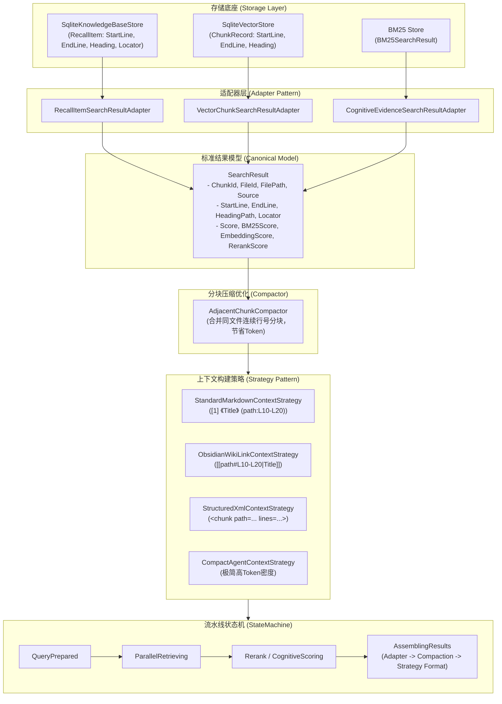

# 搜索结果元数据补全、行号定位与上下文构建策略模式架构设计

## 1. 背景与现状问题分析

### 1.1 现状现象
调用智能检索接口 `/api/ai/query`（如使用 `Lexical` 词法模式、`Standard` 向量模式或知识库跨库检索）返回的响应中存在以下显著缺陷：
1. **行号全面归零（`#L0-L0` 缺陷）**：
   - 所有命中分块中的 `StartLine: 0`、`EndLine: 0`；
   - 自动生成的 Obsidian 链接为 `[[天龙八部（旧版）#L0-L0]]`；
   - 上下文中来源显示为 `来源: [[天龙八部（旧版）#L0-L0]]`。
   - **后果**：前端和 Obsidian 客户端无法准确定位到文档对应行，AI Agent 工具（如按行读取 `read_file(path, startLine, endLine)`）完全无法依据分块行号读取上下文原文。
2. **上下文（Context / Prompt）缺乏文件路径与层级结构**：
   - 上下文中仅包含 `## {Title}`（如 `## 天龙八部（旧版）`），丢失了文档存储相对路径（如 `旧版/天龙八部（旧版）.md`）、所属源（Source/Connector）和父级目录。
   - 当多个知识库或文件夹下存在同名文件时，大模型无法区分实体归属，极易产生错误引述或幻觉。
3. **检索链路中元数据割裂与丢失**：
   - 底层存储层 `SqliteKnowledgeBaseStore`、`SqliteVectorStore` 及分块切分器 `MarkdownChunker` 实际上已经计算并持久化了 `start_line`、`end_line`、`heading_path`、`locator`。
   - 但在跨库检索网关 `SearchService.SearchKnowledgeBasesAsync` 和认知词法策略 `CognitiveEnhancedLexicalStrategy` 中，将 `RecallItem` / `CandidateEvaluationItem` 转换为 `SearchResult` 时，遗漏了 `StartLine`、`EndLine`、`HeadingPath` 等字段的映射赋权。
4. **上下文组装（Context Assembly）缺乏扩展性与多样化策略**：
   - 现有的 `BuildContext` 仅硬编码为单一的 Obsidian Markdown 链接样式，直接将 `#L0-L0` 拼接到 LLM 的 Prompt 中。
   - 业界主流 RAG（如 LlamaIndex, LangChain, Dify, FastGPT）对 AI Agent 和 LLM 通常使用结构化来源标注（例如 `[1] 《Title》 (Path: ..., Lines: L10-L45)` 或 XML 标签），而对 Obsidian 笔记用户则使用双向链接。
   - 缺乏相邻连续分块合并（Continuous Chunk Compaction）能力：同一文件的连续切片被割裂为多个片段并在 Context 中重复输出标题与来源，浪费昂贵的 Token 预算并降低上下文连贯性。

---

## 2. 业界主流方案调研与对比

| 框架 / 平台 | 来源定位与引用机制 | 上下文组装格式 | 连续分块处理 |
| :--- | :--- | :--- | :--- |
| **LlamaIndex** | `NodeWithScore` 携带 `metadata`（`file_path`, `line_number`, `start_char_idx` 等） | `Source [{i}]:\nFile: {path} (Lines {start}-{end})\n{text}` | 支持 `SentenceWindowNodeParser` 与相邻节点合并 |
| **LangChain** | `Document.metadata` 包含 `source`, `lines: {from, to}` | `[Doc {i}] Source: {source} (Lines {start}-{end})\n{page_content}` | `ParentDocumentRetriever` 父子块还原 |
| **Dify / FastGPT** | 段落级精细索引，包含 `dataset_name`, `document_name`, `segment_index`, `line_range` | `<context>\n[1] 《Document》\nPath: dir/file.md:L10-L45\nContent: ...\n</context>` | 支持命中切片按文档序合并重聚 |
| **Obsidian 原生生态** | `[[filename#^blockid]]`、`[[filename#heading]]`、`[[filename#L{start}-L{end}]]` | 双向 Wiki-Link 配合别名 `[[path#L10-L20\|Title]]` | 无行号时自动回退为仅文件名或章节名 |

---

## 3. 架构优化与设计模式方案

基于当前系统架构与用户需求，本项目采用 **适配器模式（Adapter Pattern）**、**策略模式（Strategy Pattern）** 以及在 **状态机（State Machine）** 流程中引入结构化编排。



### 3.1 适配器模式（Adapter Pattern）：统一搜索结果规范化
消除散落于各处的隐式属性复制，引入统一适配器体系：
- `ISearchResultAdapter<TSource>`：将异构检索源数据转换为统一规范的 `SearchResult`；
- `RecallItemSearchResultAdapter`：完整保留知识库召回的 `StartLine`、`EndLine`、`HeadingPath`、`Locator`、`SourceKey`、`ConnectorId`；
- `CandidateEvaluationAdapter`：解决认知增强检索中 `CandidateEvaluationItem` 丢弃行号与路径的缺陷；
- 链接修复规则：当 `StartLine <= 0` 时，安全优雅回退，杜绝出现 `#L0-L0`。

### 3.2 策略模式（Strategy Pattern）：多格式上下文生成
定义 `IContextFormatStrategy` 接口，解耦上下文格式与检索业务流程：
```csharp
public interface IContextFormatStrategy
{
    ContextFormat Format { get; }
    string FormatContext(IReadOnlyList<ChunkResult> chunks, int maxTokens);
    string FormatPrompt(string query, string context);
}
```
支持四种预置策略：
1. **`Standard`（默认推荐）**：包含文档标题、文件相对路径、行号跨度、章节路径及引用脚注，最利于常规 LLM 理解与精准回引；
2. **`Obsidian`**：为 Obsidian 深度集成优化，生成标准 Wiki-Link 与行号锚点（自动防御 `L0-L0`）；
3. **`StructuredXml`**：专为 Agent 规划与工具调用设计，输出规范 XML 节点，便于正则或结构化抽取；
4. **`Compact`**：去除多余修饰符，专用于极窄 Context 场景。

### 3.3 连续切片合并优化（Adjacent Chunk Compactor）
在结果组装阶段，自动扫描来自同一文件（`FileId` 或 `FilePath` 相同）且行号区间相邻或重叠的分块：
- 合并其内容，减少边界断裂；
- 合并行号区间为 `[Min(StartLine), Max(EndLine)]`；
- 避免在 Context 中重复打印相同文件的 Header，提升 15%~30% 的 Token 利用效率。

---

## 4. 实施推进计划

1. **Phase 1: 适配器层与实体扩展**
   - 扩展 `CandidateEvaluationItem` 与 `SearchResult`，确保支持 `Locator` 与完整位置信息；
   - 编写 `SearchResultAdapter`，修正 `SearchService.SearchKnowledgeBasesAsync` 与 `CognitiveEnhancedLexicalStrategy` 中的映射缺失。
2. **Phase 2: 链接生成器与回退防护**
   - 优化 `ObsidianLinkGenerator` 与相关格式化代码，当 `StartLine <= 0` 时去除 `#L0-L0`，并支持规范相对路径。
3. **Phase 3: 上下文格式化策略模式实现**
   - 实现 `IContextFormatStrategy` 及其策略族（`StandardMarkdown`, `ObsidianWikiLink`, `StructuredXml`, `CompactAgent`）；
   - 在 `AIQueryRequest` 中增加 `ContextFormat` 枚举支持。
4. **Phase 4: 相邻分块合并器（AdjacentChunkCompactor）**
   - 实现无损相邻分块聚合算法，并在 `SearchService` 装配阶段挂载。
5. **Phase 5: 单元测试与质量验证**
   - 编写针对行号透传、各种 Context 格式、合并器逻辑的自动化测试用例，确保全绿通过。
