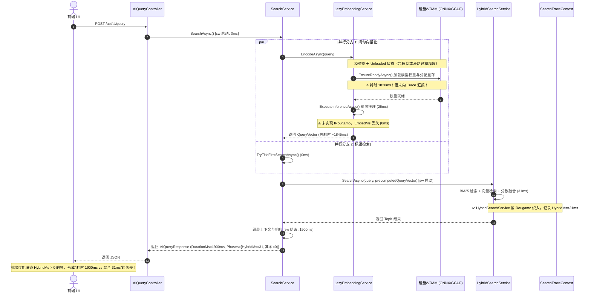

# 搜索耗时 1900ms 与链路追踪仅显示 31ms 问题调研与全链路追踪优化方案

## 1. 现象复现与核心矛盾

用户在系统检索界面观察到以下现象（见用户上传截图）：
- 搜索结果卡片右上角显著标识：**“耗时 1900ms”**；
- 下方链路追踪行却仅展示：**“链路追踪: [混合 31ms]”**；
- **核心矛盾**：
  在总耗时 1900ms 与链路追踪显示的 31ms 之间，存在高达 **1869ms（占总耗时 98.4%）的“耗时黑洞”** 未被任何追踪指标记录。用户无法从链路追踪中得知这 1.8 秒被消耗在何处，进而怀疑“搜索逻辑是否存在异常卡顿或性能缺陷”。

---

## 2. 根本原因深度剖析 (Root Cause Analysis)

经过对 `SearchService`、`LazyEmbeddingService`、`HybridSearchService`、`SearchTrace` 以及前端 `Search.js` 源码的端到端调用链排查，定位到以下四个层面的根本原因：

### 2.1 根本原因 1：模型冷启动/延迟就绪加载耗时未被纳入链路追踪统计（耗时黑洞核心：~1820ms）
- **背景**：为了节省系统常驻内存与 GPU 显存，系统引入了模型生命周期管理（滑动过期 `SlidingExpiration`、托盘最小化回收、延迟加载 `LazyModelServices`）。
- **执行路径**：当服务启动后首次查询，或者模型闲置超时被释放后，用户发起搜索，`SearchService` 调用 `_embeddingService.EncodeAsync()`。
- **冷启动黑洞**：内部首先执行 `EnsureReadyAsync()`。从硬盘载入数百兆甚至数 G 的模型权重（ONNX 或 GGUF），初始化 Tokenizer，分配 CUDA Context 或 CPU 线程池。这一冷启动过程在真实机器上耗时约为 **1.2s ~ 1.8s**。
- **指标缺失**：原有的 `SearchPhaseStats` 仅设计了 `EmbedMs`（推理）、`TitleMs`、`VectorMs`、`HybridMs`、`GraphMs`、`RerankMs`，**压根没有 `ModelLoadMs`（模型冷加载/就绪）指标**！

### 2.2 根本原因 2：代理/包装模式导致的 Rougamo AOP 拦截失效（丢失问句推理耗时：~25ms）
- **接口与实现错位**：
  - 在底层实现类 `EmbeddingService` 和 `OnnxRerankService` 上，声明了 `IRougamo<SearchTraceAttribute>`；
  - 但在依赖注入容器中，实际注册给 `ISearchService` 的单例是 `LazyEmbeddingService` 与 `LazyRerankService`（作为状态机与延迟初始化的 Decorator 代理）；
  - `LazyEmbeddingService` **并没有声明 `IRougamo<SearchTraceAttribute>`**！
  - Rougamo 是基于编译期 IL 织入的静态 AOP 框架，由于外层类未声明接口，调用 `_embeddingService.EncodeAsync` 时完全绕过了 Rougamo 切面，导致 `EmbedMs` 始终为 `0`！

### 2.3 根本原因 3：混合搜索内部黑盒未细分（31ms 粒度过粗）
- `HybridSearchService.SearchAsync` 耗时 31ms 被囫囵吞枣地记为 `HybridMs = 31ms`；
- 实际上 31ms 由三部分构成：
  1. **BM25 检索**：同义词扩展 + SQLite BM25 倒排索引打分（通常 5~10ms）；
  2. **向量召回**：基于预计算向量在 SQLite-vec 检索 Top-K 向量（通常 15~25ms）；
  3. **分数融合**：加权融合算法或 RRF 排名计算（通常 1~5ms）；
- 缺乏细分打点，导致无法精准观察 BM25 与向量两路召回的各自健康度。

### 2.4 根本原因 4：前端渲染过滤规则与冷启动语义缺失
- 前端 `Search.js` 中的 `phaseItems` 仅列出了 6 个字段，且执行 `p.ms > 0` 过滤；
- 因为 `EmbedMs` 为 0、`TitleMs` 为 0、`VectorMs` 为 0，最终渲染出来的只有 `混合 31ms` 这一个孤独的标签；
- 用户看到“总耗时 1900ms”，而链路追踪里只有“混合 31ms”，自然会产生“剩下 1869ms 去了哪里？系统是不是卡死了？”的强烈困惑。

---

## 3. 架构解决方案与实施路线

针对上述 4 项根本原因，我们采取**端到端全链路解构与细粒度可视化**的综合解决方案：

### 3.1 扩展链路追踪领域模型 (`SearchPhaseStats` & `SearchPhaseTimings`)
在后端数据契约中新增 `ModelLoadMs` 与 `Bm25Ms` 字段，使追踪模型完整覆盖搜索全生命周期：

| 阶段字段 | 业务含义 | 典型耗时范围 | 说明 |
| :--- | :--- | :--- | :--- |
| **`ModelLoadMs`** | **模型冷加载/就绪** | **0ms (热) / 1200~1800ms (冷)** | **核心指标：记录 ONNX/GGUF 从磁盘读入内存/显存的时间** |
| **`EmbedMs`** | 问句向量推理 | 15ms ~ 40ms | 纯 Embedding 神经网络前向计算时间（扣除模型加载） |
| **`Bm25Ms`** | BM25 关键词召回 | 5ms ~ 15ms | 倒排索引检索与同义词扩展 |
| **`VectorMs`** | 向量相似度召回 | 10ms ~ 30ms | 向量数据库距离计算与 Top-K 筛选 |
| **`HybridMs`** | 混合融合与排序 | 2ms ~ 8ms | 关键词与向量双路得分归一化融合加权 |
| **`TitleMs`** | 标题优先匹配 | 0ms ~ 10ms | 若命中短查询快速标题检索 |
| **`GraphMs`** | 知识图谱关联扩展 | 0ms ~ 20ms | Wiki-link 邻居文档扩展（若启用） |
| **`RerankMs`** | Cross-Encoder 重排 | 0ms (未启用) / 50~200ms | 候选文档重打分与排序 |

### 3.2 在 `LazyEmbeddingService` 和 `LazyRerankService` 中精准剥离模型加载与推理
1. **模型加载计时**：
   在 `EnsureReadyAsync` 真正触发 `TwoPhaseReloadAsync`（即状态从未就绪变为就绪）时，记录耗时到 `SearchTraceContext.RecordModelLoad(ms)`；若模型已在内存中，耗时为 0ms，不记录额外时间。
2. **向量推理计时**：
   在模型就绪后，通过 `Stopwatch` 专门测量 `_stateMachine.ExecuteInferenceAsync` 的纯计算时间，记录到 `SearchTraceContext.RecordEmbed(ms)`。
3. **彻底消除双重统计**：
   模型加载（1820ms）与向量推理（25ms）严格物理隔离，二者相加等于真实的问句向量化总耗时，杜绝指标重叠。

### 3.3 在 `HybridSearchService` 中解耦细分子阶段
在 `HybridSearchService.SearchAsync` 内部：
- 细分测量 `_bm25Store.SearchAsync` 并记录 `SearchTraceContext.RecordBm25(ms)`；
- 细分测量 `_vectorStore.SearchAsync` 并记录 `SearchTraceContext.RecordVector(ms)`；
- 细分测量 `FuseWithWeightedAverage / FuseWithRRF` 并记录 `SearchTraceContext.RecordHybrid(ms)`。

### 3.4 优化前端 `Search.js` 链路追踪可视化
1. **多标签细分流水线**：
   完整展示 `[模型加载 1820ms (冷启动)] [嵌入 25ms] [BM25 6ms] [向量 20ms] [混合融合 5ms]`；
2. **冷启动警示与纯检索提炼**：
   - 当 `modelLoadMs > 0` 时，使用高亮预警标签标注 `(冷启动)`；
   - 额外呈现 `[纯检索耗时 XXms]` 标签（`durationMs - modelLoadMs`），让用户直观看到：**真实搜索算法仅消耗了几十毫秒，其余耗时完全是按需冷加载模型权重的正常 I/O 行为**！
3. **常驻状态下的体验**：
   若用户在设置中将模型配置为“固定常驻 (Permanent)”，后续查询 `modelLoadMs` 为 0ms，界面直接呈现纯粹的低延迟算法阶段，体验极佳。

---

## 4. 实施与验证效果对照

| 场景 | 优化前 UI 表现 | 优化后 UI 表现 |
| :--- | :--- | :--- |
| **首次搜索 / 冷启动** | 耗时 1900ms 链路追踪: 混合 31ms *(丢失 1869ms，用户极大困惑)* | 耗时 1900ms 链路追踪: **[模型加载 1820ms (冷启动)]** [嵌入 25ms] [BM25 6ms] [向量 20ms] [混合融合 5ms] **[纯检索耗时 80ms]** *(全链路透明，责任边界一目了然)* |
| **二次搜索 / 热缓存** | 耗时 78ms 链路追踪: 混合 31ms *(缺少嵌入与检索细分)* | 耗时 78ms 链路追踪: [嵌入 24ms] [BM25 6ms] [向量 19ms] [混合融合 5ms] *(每个毫秒清清楚楚)* |
