# 搜索结果空行分块根因分析与搜索链路遥测架构设计文档
*(Search Empty Chunks Root Cause Analysis, Pipeline Telemetry & Adapter-Strategy-StateMachine Design)*

## 1. 背景与问题定义

在系统的搜索页面实际使用过程中，出现了两类核心问题与用户体验诉求：

1. **搜索结果中出现“空行/空卡片”（如 `=== (43-48) ===`）**：
   - 用户在搜索特定关键词时，结果列表中赫然出现形如 `=== (43-48) ===`，行号为 `行 8270-8270`（仅占用 1 行）的检索结果；
   - 在前端渲染时，由于该分块除了一行分隔符标记外几乎没有实质正文，卡片内容区极扁平，视觉上呈现出刺眼的“空行”或“空白卡片”，严重挤占了宝贵的 Top-K 召回与精排席位。
2. **搜索页面模型信息与链路执行缺乏精细化透明度**：
   - 顶部状态栏仅能显示粗糙的 `本地 ONNX` 或 `未启用`，无法反映系统当前真正生效的量化变体（如 `Q4_K_M`、`Q8_0`、`FP16`）、GPU加速模式（如 `CUDA (GPU offload 33/33 layers)`、`DirectML` 或 `CPU`）与实时生命周期状态（`Ready/Idle/Busy`）；
   - 检索完成后的链路追踪仅是一行简单的毫秒数打点标签，缺乏阶段状态机（State Machine）流转的直观展示（包括查询重写、BM25与向量并行双路召回、候选池融合淘汰、Cross-Encoder 重排与阈值过滤），没有反映各阶段候选数量的收敛与过滤过程。
3. **架构规范化诉求**：
   - 引入**适配器模式（Adapter Pattern）**对各检索引擎与重排引擎进行接口统一；
   - 引入**策略模式（Strategy Pattern）**对 `Quick` / `Standard` / `Deep` / `Hybrid` / `HybridRerank` 搜索流水线进行解耦；
   - 引入**状态机模式（State Machine Pattern）**全程监控、收集与编排搜索执行流水线，驱动端到端遥测（Telemetry）上报。

---

## 2. 根因深度剖析：为什么会出现“空行分块”？

### 2.1 文本切块器（MarkdownChunker）的机制盲区
通过对 `MarkdownChunker.cs` 的源码审查，发现了以下几处关键机制缺陷：

1. **非标准段落分隔符被孤立成段（Paragraph）**：
   - 小说、剧本、技术导出文档或长文本中，经常使用装饰性或结构性章节分隔符，例如：
     ```text
     ...上一节正文结束...

     === (43-48) ===

     下一节正文开始...
     ```
   - `MarkdownChunker.ExtractParagraphs` 按照空行（`string.IsNullOrWhiteSpace(line)`）来切分段落。
   - `=== (43-48) ===` 前后均有空行，因此被切分为一个独立的 `Paragraph`（`StartLine = 8270, EndLine = 8270`）。
2. **缓冲队列（Buffer）截断与孤立输出**：
   - `ChunkSection` 在遍历段落时，维护了一个 `buffer` 与 `bufferTokens`：
     - 若前一段落正好填满了 `buffer`（达到 `options.MaxTokens` 阈值），触发 `Flush`；
     - 此时 `buffer` 被清空，接下来的 `=== (43-48) ===` 被压入空的 `buffer`；
     - 紧接着的下一段落若是一个大段落（`paraTokens > options.MaxTokens`）或跨到了章节尾部，`buffer` 会再次被强制 Flush 输出为独立的 `ChunkRecord`；
     - 此时该分块的全部内容就仅仅是 `=== (43-48) ===` 一行字！
3. **`MergeShortSections` 的作用域局限**：
   - 系统虽然实现了 `MergeShortSections`，但该合并逻辑**仅针对 Markdown 的一级至六级标题（`#` 标题）切分的 Section**；
   - 如果整个长文档只有最顶层一个 `#` 标题，或者根本没有标准 Markdown 标题，整篇文档只有一个 `Section`。在 `Section` 内部由段落切分产生的短分块完全不受 `MergeShortSections` 的保护！

### 2.2 检索打分与向量空间的病态高分
为什么这样一个无意义的单行分隔符会被高分召回？
1. **BM25 词频与稀疏度失真**：
   - 分隔符中包含数字 `43-48`，若用户查询中刚好含有数字、范围符号或分隔符号，该分块的有效词数极少（分母极小），BM25 的词频饱和度与逆文档频率（IDF）会被异常放大。
2. **Dense Vector（密集向量）聚类中心偏移**：
   - 当文本长度极短（只有几个标点和数字）时，BGE/BERT 嵌入模型对其编码后，向量范数极易收缩到均值中心，或因标点符号与大量泛化 query 的余弦相似度达到 0.55~0.65 的“虚高区间”。
3. **缺失搜索后置清洗防御**：
   - 搜索层（`SearchService` / `HybridSearchService`）直接对检索出来的 Chunk 照单全收，没有对分块内容的实质有效性（是否为空白、纯标点、纯分隔线）进行过滤。

### 2.3 前端展示崩塌
在前端 `Search.js` 中：
```html
<n-thing>
  <template #description>
    <n-text depth="3" style="white-space: pre-wrap; line-height: 1.6; font-size: 13px">
      {{ truncateContent(chunk.content || '') }}
    </n-text>
    <n-text v-if="chunk.startLine > 0" depth="3" style="display: block; margin-top: 4px; font-size: 12px">
      行 {{ chunk.startLine }}-{{ chunk.endLine }}
    </n-text>
```
当 `chunk.content` 仅有 `=== (43-48) ===` 时，文本只有半行，下方直接是 `行 8270-8270`，整个卡片内空空如也，视觉上就像系统输出了“空白行”。

---

## 3. 解决方案设计：双重防御机制

为了彻底杜绝此类无意义分块，采取**切块器源头净化**与**搜索层运行时熔断过滤**的双重保障：

### 3.1 切块端源头净化（MarkdownChunker）
1. **定义无意义噪声/分隔符模式识别（Noise & Separator Rule）**：
   - 正则表达式匹配常见的卷/章/节纯符号分隔符：
     ```csharp
     // 匹配如 === (43-48) ===, ---, ***, ===, ___ 等纯分隔行或纯数字序号行
     private static readonly Regex SeparatorPattern = new(
         @"^(\s*[=\-_*#~·\u2500-\u257F]{3,}\s*(\(?\d+[\-~至到]\d+\)?|\d+)?\s*[=\-_*#~·\u2500-\u257F]{0,}\s*)$",
         RegexOptions.Compiled);
     ```
   - 有效语义字符密度校验：分块剔除标点、空白和特殊字符后，有效字母/汉字/数字字符数如果 `< 10`，且非独立代码块或 LaTeX 数学块，判定为无有效语义。
2. **前后向吸收与孤立抛弃策略**：
   - 在 `ExtractParagraphs` 中，若遇到纯分隔行，自动向上一个段落追加，或者合并到后一个段落，绝不让分隔符独立成段；
   - 在 `ChunkSection` 最终生成 Chunk 时，若某个 Chunk 的有效文本长度低于阈值且为纯分隔符，自动与相邻 Chunk 合并，或直接丢弃。

### 3.2 搜索端运行时熔断（Search Defensive Hygiene）
- 考虑到用户数据库中可能已经存在历史建立的分块索引（用户不一定立即重建索引）：
- 在 `SearchService` 与 `HybridSearchService` 中，结果返回前增加 `IsSemanticNoise(content)` 熔断过滤：
  - 过滤 `string.IsNullOrWhiteSpace(content)`；
  - 过滤纯符号/纯分隔符分块；
  - 若候选因此被过滤，自动从后续候选中补齐，保证满足 `TopK`。

---

## 4. 搜索流水线架构重构：适配器、策略模式与状态机

```mermaid
flowchart TD
    Client["前端 Search.js"] -->|"POST /api/ai/query"| Controller["AIQueryController"]
    Controller -->|"调度"| SearchService["SearchService"]
    
    subgraph StateMachine["SearchPipelineStateMachine (搜索状态机)"]
        S0["Created (已创建)"] --> S1["QueryPrepared (查询分析与改写)"]
        S1 --> S2["ParallelRetrieving (并行双路召回)"]
        S2 --> S3["HybridFusing (混合加权/RRF融合)"]
        S3 --> S4["Reranking (Cross-Encoder 精排)"]
        S4 --> S5["AssemblingResults (清洗组装与上下文构建)"]
        S5 --> S6["Completed (已完成)"]
    end
    
    subgraph StrategyPattern["Search Execution Strategy (策略模式)"]
        Strategy["ISearchExecutionStrategy"]
        Strategy --> StratQuick["QuickSearchStrategy (BM25快速)"]
        Strategy --> StratStd["StandardSearchStrategy (向量直搜)"]
        Strategy --> StratDeep["DeepSearchStrategy (深度高召回+图扩展)"]
        Strategy --> StratHybrid["HybridSearchStrategy (BM25+向量融合)"]
        Strategy --> StratHybridRerank["HybridRerankStrategy (召回+重排双阶段)"]
    end
    
    subgraph AdapterPattern["Search Retrieval Adapters (适配器模式)"]
        AdapterBM25["IBM25RetrievalAdapter (Lucene BM25)"]
        AdapterVector["IDenseVectorRetrievalAdapter (Embedding + VectorStore)"]
        AdapterRerank["IRerankExecutionAdapter (ONNX / GGUF Reranker)"]
    end
    
    SearchService --> Strategy
    Strategy --> StateMachine
    Strategy --> AdapterBM25
    Strategy --> AdapterVector
    Strategy --> AdapterRerank
    SearchService -->|"返回 AIQueryResponse (含 PipelineTelemetry)"| Controller
    Controller -->|"响应"| Client
```



### 4.1 适配器模式（Adapter Pattern）
统一抽象底层异构的召回与精排引擎，对外屏蔽 ONNX / GGUF / Lucene 的实现细节：

1. **`IBM25RetrievalAdapter`**：
   - 包装 `IBM25Store` 与 `SynonymService`；
   - 暴露标准异步检索方法与耗时/命中统计。
2. **`IDenseVectorRetrievalAdapter`**：
   - 包装 `IEmbeddingService` 与 `IVectorStore`；
   - 自动获取当前嵌入模型名称、量化变体（如 `Q4_K_M`）及执行设备（如 `GPU CUDA 0`）。
3. **`IRerankExecutionAdapter`**：
   - 包装 `IRerankService`（支持 ONNX 与 GGUF LlamaSharp 后端）；
   - 负责批量重排推理、NaN/Infinity 兜底、按分数阈值初筛及统计采集。

### 4.2 策略模式（Strategy Pattern）
通过策略模式将不同查询模式的流水线调度逻辑彻底拆分解耦：
- `ISearchExecutionStrategy`:
  ```csharp
  public interface ISearchExecutionStrategy
  {
      QueryMode Mode { get; }
      Task<SearchStrategyResult> ExecuteAsync(
          AIQueryRequest request,
          SearchExecutionContext context,
          CancellationToken cancellationToken);
  }
  ```
- `SearchStrategyFactory` 根据 `request.Mode` 返回对应的策略实例。

### 4.3 状态机模式（SearchPipelineStateMachine）
在单次搜索执行周期内，状态机记录端到端各阶段的流转：
```csharp
public enum SearchPipelinePhase
{
    Created = 0,
    QueryPrepared = 1,
    ParallelRetrieving = 2,
    HybridFusing = 3,
    GraphExpanding = 4,
    Reranking = 5,
    AssemblingResults = 6,
    Completed = 7,
    Faulted = 8
}
```
每次状态转移时，自动记录：
- `PhaseName`（阶段名称，如“双路召回”、“重排精排”）
- `DurationMs`（精确耗时）
- `InputCandidates`（进入该阶段候选数量）
- `OutputCandidates`（该阶段输出数量，展示收敛效果）
- `Details`（阶段附带信息，如使用的模型变体、设备、阈值过滤数）

---

## 5. 前端（Search.js）精细化可视化设计

### 5.1 顶部状态栏：完整反映模型版本与硬件加速
将原先简陋的硬编码字符串替换为动态响应式标签：
1. **嵌入模型**：
   - 模型名（如 `bge-small-zh-v1.5`）
   - 量化变体（如 `Q4_K_M` 或 `FP16`）
   - 格式与后端（如 `GGUF (LlamaSharp)` 或 `ONNX`）
   - 加速设备徽章：`GPU (CUDA)` 亮绿标签 / `CPU` 蓝灰标签
   - 维度与状态：`512d`，`就绪` / `空闲`
2. **重排模型**：
   - 模型名（如 `bge-reranker-large`）
   - 量化变体与格式
   - 加速设备与就绪状态

### 5.2 搜索结果卡片：直观呈现流水线状态机流转
在搜索结果的头部下方，渲染**“搜索链路状态机看板”**：
- 节点式时间线或流转步骤胶囊：
  - `准备 (1ms)` ➔ `并行召回 (35ms, 40候选)` ➔ `加权融合 (2ms, 20候选)` ➔ `Cross-Encoder重排 (68ms, 10条)` ➔ `清洗组装 (1ms)`
- 点击可展开查看详细遥测：包括当前执行策略名、各适配器执行细节、被过滤的噪声分块数量等。
- 彻底避免在结果列表中出现仅有一行分隔符的空卡片。

---

## 6. 实施路线图

1. **Step 1: 切块器与清洗机制升级**
   - 在 `MarkdownChunker.cs` 增加分隔符与噪声检测，防止独立生成单行空分块；
   - 在 `SearchService.cs` 和 `HybridSearchService.cs` 增加分块语义噪声过滤，拦截历史脏数据。
2. **Step 2: 搜索适配器、策略模式与状态机落地**
   - 新增 `Business/ReferenceRAG.Business/Features/Search/StateMachine/` 与 `Strategies/`、`Adapters/`；
   - 将 `SearchService` 与 `HybridSearchService` 的内部执行收敛到策略与状态机中；
   - 扩展 `AIQueryResponse`，包含 `SearchPipelineTelemetry`。
3. **Step 3: 搜索状态 API 与前端 Search.js 联动**
   - 丰富 `AIQueryController.GetSearchStatus()`，透出详细的变体名称、后端、GPU模式与状态；
   - 更新 `Search.js`，呈现丰富的模型信息徽章与状态机执行时序图。
4. **Step 4: 测试与回归验证**
   - 编写针对空行/分隔符切块的单元测试与搜索链路状态机单元测试；
   - 运行 `dotnet test` 与 `smoke-test.bat` 确保 100% 绿灯。
