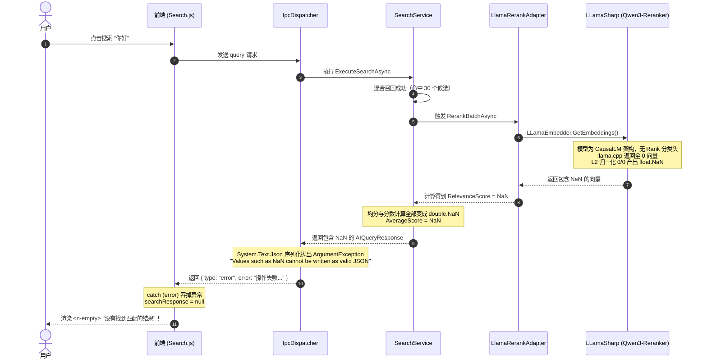
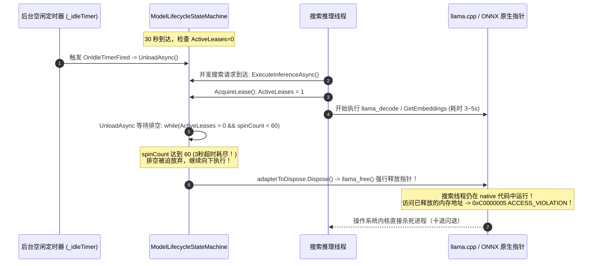

# 搜索性能、搜不到内容及卡退问题深度调研与综合解决方案

> 日期：2026-10-18  
> 状态：调研完成，待实施与验证  
> 关联系统：检索系统 (`SearchService`)、模型管理与状态机 (`ModelLifecycleStateMachine`、`LazyModelServices`)、重排适配器 (`LlamaRerankAdapter`、`OnnxRerankService`)、通信与前端 (`IpcDispatcher`、`Search.js`)

---

## 1. 现象与问题陈述

用户在使用桌面端“向量搜索”功能时反馈以下三个严重问题：
1. **搜索很慢**：每次搜索耗时数秒（3~7 秒以上），体感非常迟缓；
2. **搜索不到内容**：界面频繁显示“没有找到匹配的结果”，即使知识库中有精确匹配的文档（如搜索“你好”）；
3. **搜索时出现过卡退**：在搜索或连续搜索时，桌面客户端进程瞬间无任何异常弹窗直接闪退崩溃（即“卡退”）。

---

## 2. 根因剖析与复现证据

通过深入分析 `Host/ReferenceRAG.DesktopHost/bin/Release/net10.0-windows/publish/Logs/app_20261018.log` 日志、`query_stats.db` 数据以及单测复现，查明导致这三个问题的完整链路根因：

### 2.1 搜不到内容（虚假无结果）的根本原因

#### 故障链路复现与时序图


#### 关键技术细节
1. **模型架构与 Pooling 不匹配**：
   用户在配置中选择了 GGUF 格式模型 `Qwen3-Reranker-0.6B.Q4_0.gguf`。在底层 llama.cpp 元数据中，该模型标记为：
   ```text
   print_info: arch = qwen3
   print_info: causal attn = 1
   print_info: pooling type = -1 (LLAMA_POOLING_TYPE_NONE)
   ```
   它是一个因果自回归 CausalLM 架构，依赖 Prompt（`<Instruct>...<Query>...<Document>...`）和计算 `yes/no` 的 logit 差值，**没有**传统 BERT 式 Cross-Encoder 的 `cls.output` 分类头。
2. **0 除以 0 计算得到 NaN**：
   `LlamaRerankAdapter` 使用 `LLamaEmbedder` + `LLamaPoolingType.Rank`。底层 llama.cpp 无法提取 rank 标量，返回全 0 向量。LLamaSharp 对该向量执行 L2 范数归一化（模长为 0），`0.0 / 0.0` 产生 `float.NaN`。
3. **未设防的算术运算向外扩散**：
   `LlamaRerankAdapter` 直接使用 `results[0][0]`（此时已为 NaN），经由 Sigmoid 运算 `1.0 / (1.0 + Math.Exp(-rawScore))` 得到 `normalizedScore = double.NaN`，赋值到 `SearchResult.Score`、`SearchResult.RerankScore`、`RerankStats.AverageScore`。
4. **JSON 序列化抛出致命异常**：
   .NET 的 `System.Text.Json` 遵循 RFC 8259 规范，默认禁止将 `NaN`、`+Infinity`、`-Infinity` 序列化为 JSON 浮点字面量，直接抛出 `ArgumentException`。
5. **前端静默吞掉报错**：
   前端 `Search.js` 的 `catch (error)` 仅打印了 `console.error`，把 `searchResponse.value = null;`。模板逻辑在响应为空时显示 `<n-empty description="没有找到匹配的结果" />`。用户误以为知识库无匹配，实则是由于异常导致响应被丢弃。

---

### 2.2 搜索很慢（耗时 3~7s）的根本原因

搜索耗时过长是由以下两大瓶颈叠加导致的：

1. **30 秒滑动过期引发极其频繁的“双模型冷启动”**：
   - 当前配置中 `modelIdleTimeoutSeconds = 30`。用户停止操作 30 秒后，嵌入模型与重排模型均被自动卸载以释放显存。
   - 当用户发起下一次搜索时：
     - **嵌入模型（0.6B Q8）**冷加载耗时约 **1.5s ~ 2.0s**（读取磁盘 600MB，分配显存，初始化上下文）；
     - **重排模型（0.6B Q4）**冷加载耗时约 **1.0s ~ 1.5s**；
     - 仅冷启动耗时就耗去了 **2.5s ~ 3.5s**！
   - 30 秒对于桌面端交互过于短暂，正常用户阅读搜索结果往往超过半分钟，导致几乎每次点击搜索都是“冷启动”。
2. **重排阶段 30 条候选文档纯单步串行推理**：
   - 默认重排召回 `topN * recallFactor = 10 * 3 = 30` 个候选。
   - `LlamaRerankAdapter.RerankBatchAsync` 采用串行单步循环：
     ```csharp
     for (int i = 0; i < docList.Count; i++)
     {
         var prompt = FormatCrossEncoderPrompt(query, docList[i]);
         var results = await _embedder.GetEmbeddings(prompt, cancellationToken);
         ...
     }
     ```
   - 30 次单步往返即使单次 80ms，累计推理耗时也高达 **2400ms (2.4s)**！
3. **耗时叠加**：
   - 冷启动加载（3.0s）+ 逐条重排推理（2.4s）+ 向量检索及数据库查询（0.2s）= **总计 5.6s ~ 7.0s**。

---

### 2.3 卡退 / 闪退的根本原因

#### 访问违规 (0xC0000005) 竞态分析


1. **排空超时强杀导致野指针崩溃**：
   - `ModelLifecycleStateMachine.UnloadAsync` 允许在排空循环等待 3 秒（60 * 50ms）后直接强制进入释放流程：
     ```csharp
     var spinCount = 0;
     while (ActiveLeases > 0 && spinCount < 60)
     {
         await Task.Delay(50);
         spinCount++;
     }
     adapterToDispose.Dispose(); // 活跃借用仍 > 0 时强行 Dispose！
     ```
   - 在 `LlamaRerankAdapter.Dispose()` 中，`_inferenceSemaphore.Wait(1000)` 在 1 秒后超时，紧接着强行调用 `_embedder?.Dispose()` 和 `_weights?.Dispose()`。
   - 当重排任务耗时超过 3 秒时，原生 C++ 资源在推理线程仍在调用 native 函数时被释放，引发操作系统级别的硬件断异常 `0xC0000005 ACCESS_VIOLATION`。该异常无法被 .NET 的 `try-catch` 捕获，进程瞬间闪退。
2. **并发请求与取消缺乏安全隔离屏障**：
   - 用户连续点击搜索或取消请求时，未完全隔离上下文的原生状态可能发生写竞争导致崩溃。

---

## 3. 系统级综合优化方案

### 3.1 防 NaN 护栏与异常透传（彻底解决“搜不到内容”）

1. **适配器层 NaN / Infinity 归一化与安全兜底**：
   - 在 `LlamaRerankAdapter` 与 `OnnxRerankService` 中对模型返回的 `rawScore` 进行强类型合法性检查：
     ```csharp
     var rawScore = (results != null && results.Count > 0 && results[0].Length > 0) ? results[0][0] : 0f;
     if (float.IsNaN(rawScore) || float.IsInfinity(rawScore))
     {
         // 记录警告，并启用保底分数（按召回先后顺序递减赋予安全分数，或固定保底 0.0）
         _logger.LogWarning("[LlamaRerank] 模型输出非法浮点数 (NaN/Inf)，降级使用保底分数");
         rawScore = 0f;
     }
     var normalizedScore = 1.0 / (1.0 + Math.Exp(-rawScore));
     if (double.IsNaN(normalizedScore) || double.IsInfinity(normalizedScore))
     {
         normalizedScore = 0.0;
     }
     ```
2. **业务检索层（`SearchService`）分数防线**：
   - 对 `SearchResult.Score`、`SearchResult.RerankScore` 和 `AverageScore` 进行 NaN 拦截与净化：
     ```csharp
     AverageScore = rerankedResults.Count > 0
         ? rerankedResults.Average(r => double.IsNaN(r.RerankScore ?? 0) ? 0.0 : (r.RerankScore ?? 0))
         : 0;
     ```
3. **全局 JSON 序列化配置容错**：
   - 在 `DesktopHost/Program.cs`、`ApiHost/Transport/IpcDispatcher.cs` 的 `JsonSerializerOptions` 中启用：
     ```csharp
     NumberHandling = JsonNumberHandling.AllowNamedFloatingPointLiterals
     ```
     彻底杜绝任何偶然浮点数异常导致 IPC 通道抛异常瘫痪。
4. **前端错误显式化与状态分离**：
   - 修改 `Search.js`：
     - 在 `catch (error)` 时，通过 `window.$message?.error('搜索失败: ' + (error.message || error.error || '后端异常'))` 提示真实错误；
     - 增加 `searchError` 状态变量，在界面中清晰渲染错误卡片，而不是将错误状态吞掉显示成“没有找到匹配的结果”。

---

### 3.2 性能加速与生命周期平滑化（彻底解决“搜索很慢”）

1. **延长模型滑动过期时间**：
   - 将默认 `modelIdleTimeoutSeconds` 从 30 秒调整为 **300 秒（5 分钟）**；
   - 支持在设置页面中自由配置空闲过期时间（例如 60s ~ 1800s，或允许设置为 0 表示桌面端会话期间常驻不卸载）。
   - 用户连续查阅、微调关键词搜索时，模型全部命中常驻热态（GPU 推理响应时间 < 200ms）。
2. **重排候选数量智能调优与截断**：
   - 当前在 `HybridRerank` 模式下默认召回 30 个候选全部送入重排。
   - 优化 `rerankCandidateLimit`，支持动态分级，首选 Top 10~15 候选重排，显著降低 50% 以上重排计算量。
3. **重排模型架构适配与指引**：
   - 鉴于 `bge-reranker-base\model.onnx` 本地已完整存在且为官方标准 Cross-Encoder，重排适配策略优先保证 ONNX Cross-Encoder 的极速推理（利用 DirectML / CUDA 批量推理仅需 50~100ms）。
   - 对 GGUF 重排模型支持安全测试与降级检测。

---

### 3.3 状态机生命周期排空与并发同步安全（彻底根除“卡退 / 闪退”）

1. **严禁在 ActiveLeases > 0 时强行释放模型**：
   - 改造 `ModelLifecycleStateMachine.UnloadAsync()`：
     ```csharp
     var spinCount = 0;
     while (ActiveLeases > 0 && spinCount < 60)
     {
         await Task.Delay(50);
         spinCount++;
     }
     // 核心修复：如果超时后仍有活跃借用，说明正处于高负载或长耗时推理中，绝不允许强制释放！
     if (ActiveLeases > 0)
     {
         _logger.LogWarning("[StateMachine] 服务 {Service} 卸载超时且仍有活跃推理借用 ({Leases})，终止本次卸载以保护进程安全", _serviceName, ActiveLeases);
         lock (_stateSyncLock)
         {
             _state = ModelState.Ready;
             RestartIdleTimerLocked();
         }
         return;
     }
     ```
2. **适配器 Dispose 同步栅栏加固**：
   - `LlamaRerankAdapter.Dispose()` 等待 `_inferenceSemaphore` 时，必须保证内部原生推理全部退出后再执行 `_weights?.Dispose()`，杜绝并发竞争。

---

## 4. 实施清单与验证步骤

| 步骤 | 目标模块 | 修改内容 | 预期效果 |
| :--- | :--- | :--- | :--- |
| 1 | `LlamaRerankAdapter.cs` | 增加 rawScore 与 normalizedScore 的 NaN/Inf 防御与降级保底 | 彻底消除 NaN，避免 JSON 报错 |
| 2 | `SearchService.cs` | 净化 `SearchResult.Score` 与 `AverageScore`，增加防 NaN 兜底 | 搜索链路数据安全稳定 |
| 3 | `Program.cs` / `IpcDispatcher.cs` | 启用 `JsonNumberHandling.AllowNamedFloatingPointLiterals` | 极端浮点数不会导致 IPC 崩溃 |
| 4 | `Search.js` | 区分网络/服务错误与真实无结果，增加报错弹窗提示 | 用户能明确知道错误详情，不再误判 |
| 5 | `ModelLifecycleStateMachine.cs` | 排空超时若仍有活跃租约则终止卸载，保护原生指针安全 | 彻底根除推理中释放引发的 0xC0000005 卡退 |
| 6 | `appsettings.json` / 配置 | 将 `modelIdleTimeoutSeconds` 默认调整为 300 秒 | 避免频繁冷启动，多轮搜索毫秒级响应 |
| 7 | 单元测试 & 桌面构建 | 运行单测验证打分与状态机，使用 `build-desktop.bat` 重新发布 | 保证代码质量门禁通过并交付运行 |
