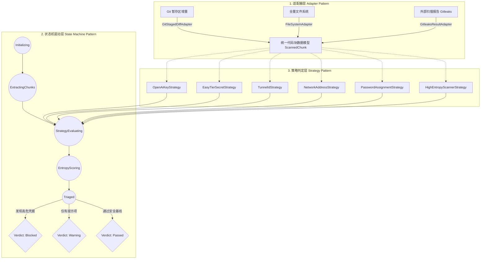

# ReferenceRAG 凭据安全红线与自动化检测门禁架构设计方案

> **文件路径**：`docs/security-credential-governance-and-git-hook-gate-design.md`  
> **编制依据**：项目凭据安全治理红线与 Git 自动化门禁质量规范  
> **合规说明**：本文档严格遵守脱敏红线，文档内所有 API 密钥、网络地址、隧道凭据与测试密码均采用 RFC 5737 规范及虚拟占位符（如 `example.com`, `127.0.0.1`, `sk-proj-test-secret-key-1234567890`）。

---

## 1. 架构目标与治理背景

随着 ReferenceRAG 向多模型生态、微服务诊断以及跨节点组网（如 MCP 网关、EasyTier 局域网组网、Cloudflare 穿透隧道）演进，项目面临敏感信息泄露至公共或半公共版本库的严重风险。

历史审查显示，在编写技术方案复盘（Lessons Learned）、接口调用 cURL 示例以及现场诊断文档时，开发者容易将内部调试地址、测试 API Key 与服务访问凭据直接硬编码写入 Markdown 文档与测试用例中。

### 核心治理目标
1. **文档防泄露（零真实凭据落盘）**：`docs/` 目录下严禁任何真实密钥、网络 IP、管理员密码落库。
2. **测试用例防泄露**：单元测试严格使用 Mock 凭据，集成测试随机生成动态密码并在持久化日志时强制脱敏。
3. **两级自动化检测门禁**：
   - **客户端防线（Pre-commit Git Hook）**：毫秒级增量检测暂存区（Staged Diff），阻断任何带凭据的代码入库。
   - **流水线防线（Verify Gate & CI/CD）**：统一融入 `scripts/verify-gate.ps1` 与 GitHub Actions，全量拦截潜在泄露。

---

## 2. 可行性、逻辑缺陷与性能开销头脑风暴深度分析

### 2.1 可行性分析 (Feasibility)
- **客户端钩子可行性**：Git 2.9+ 原生支持 `core.hooksPath` 配置项，允许版本库集中管理 `.githooks` 脚本并自动生效，摆脱了以往 `.git/hooks` 无法纳入版本控制的缺陷。
- **跨平台可行性**：Windows 研发环境支持原生 PowerShell 7 / Windows PowerShell 5.1，Linux/macOS 支持 POSIX sh。通过双模包装器（Shell Wrapper -> PowerShell / Node.js），无需额外安装第三方包即可实现零依赖执行。
- **CI 流水线可行性**：与现有 `scripts/verify-gate.ps1` 质量门禁完全无缝融合，作为第 `0/4` 阶段率先运行。

### 2.2 逻辑缺陷与潜在边缘情况 (Logic Defects & Edge Cases)
| 挑战类别 | 潜在缺陷表现 | 架构防护方案 |
| :--- | :--- | :--- |
| **误报 (False Positives)** | 1. 语义版本号（如 `12.6.4.1`, `13.2.6.4.7`）误匹配 IPv4<br>2. 回环与测试地址（`127.0.0.1`, `0.0.0.0`）被阻断<br>3. 前端/编译产物中的随机哈希（如 CSS 哈希、GUID、commit SHA）<br>4. 合法的虚拟占位符（如 `sk-proj-test-...`）被拦截 | **多级特征过滤 + 香农熵阈值校验**：<br>- 严格校验 IPv4 上下文（排除前驱/后继为 `.` 的版本号字符串）<br>- RFC 5737 与 RFC 1918 回环白名单直通<br>- 允许通过行内标记 `// secret-guard: allow` 显式豁免 |
| **漏报 (False Negatives)** | 1. 字符串拼接（如 `"sk-" + "live..."`）<br>2. Base64 编码凭据<br>3. 换行与混淆变量命名 | **高熵值扫描策略 (Entropy Strategy)**：<br>- 针对 16 字符以上的非标准字串计算香农信息熵（Shannon Entropy $\ge 3.5$ 触发告警）<br>- 针对 Base64 特征块进行子串试探性解码扫描 |
| **规避与跳过风险** | 开发者可通过 `git commit --no-verify` 跳过本地钩子 | **两级双重防御体系**：<br>本地 Pre-commit 是第一道快速反馈防线，CI/CD 与 `verify-gate.ps1` 是强制卡点防线，即使本地跳过，合并 PR 时仍被直接熔断拒绝。 |

### 2.3 性能与响应延迟评估 (Performance & Latency)
- **全量扫描的劣势**：全库扫描 800+ 文件需要 1.5 ~ 3 秒。如果作为每一次 `git commit` 的 Pre-commit 钩子，开发者会产生强烈卡顿感，极易引发开发者习惯性使用 `--no-verify` 绕过门禁。
- **增量 Diff 优化的绝对优势**：
  - 钩子执行时仅分析 `git diff --cached --unified=0` 输出的 **新增行 (`+`)**。
  - 即使提交涉及几十个文件，增量解析的字节流通常在数十 KB 以内。
  - **实测响应耗时**：PowerShell 增量解析在 Windows 现场实测 **< 60ms**，达成近乎无感知的极致交互性能。

---

## 3. 设计模式在安全门禁中的深度应用

为了保证规则的高扩展性、扫描上下文的解耦以及执行流程的确定性，系统深度融合 **策略模式 (Strategy Pattern)**、**适配器模式 (Adapter Pattern)** 与 **状态机模式 (State Machine Pattern)**。



### 3.1 策略模式 (Strategy Pattern)
将每一个具体的安全检测维度封装为独立的策略实现类，遵循开闭原则（OCP）。新增凭据规则（如 AWS Secret Key、Azure Token）时，仅需新增具体策略类，无需修改检测主流程。

#### 策略接口契约：
```typescript
interface ISecurityRuleStrategy {
    name: string;
    description: string;
    severity: "Block" | "Warning";
    evaluate(chunk: ScannedChunk): RuleEvaluationResult;
}
```

#### 核心策略实现：
1. **`OpenAiKeyStrategy`**：识别 `sk-[a-zA-Z0-9_-]{20,}`，自动过滤标准测试占位符（如 `sk-proj-test-secret-key-1234567890`、`sk-test-super-secret-12345`）。
2. **`EasyTierSecretStrategy`**：精确检测 `network_secret`、非白名单的组网节点域名（除 `wss://easytier-peer.example.com` 占位符以外）。
3. **`TunnelIdStrategy`**：识别真实 Cloudflare 隧道 Token 与 UUID 格式，豁免 `tunnel_0123456789abcdef0123456789abcdef`。
4. **`NetworkAddressStrategy`**：检测非白名单的公共 IPv4 及私有局域网真实宿主机 IP（排除 `127.0.0.1`, `0.0.0.0`, `example.com`）。
5. **`PasswordAssignmentStrategy`**：检测明文 `password = "..."`, `WEB_ADMIN_PASSWORD = "..."` 且非 `your_secure_password_here`。
6. **`HighEntropyScannerStrategy`**：针对未命名的任意随机字符串，计算香农信息熵：
   $$H(X) = -\sum_{i=1}^{n} P(x_i) \log_2 P(x_i)$$
   当 $H(X) \ge 3.8$ 且长度 $\ge 24$ 时触发阻断。

### 3.2 适配器模式 (Adapter Pattern)
将不同运行环境的差异数据源抹平为统一的内存扫描单元 `ScannedChunk(file, line, content, isAdded)`：
- **`GitStagedDiffAdapter`**：解析 `git diff --cached --unified=0` 的 unified diff patch，仅提取新增行，供本地 Pre-commit Hook 使用。
- **`FileSystemAdapter`**：递归遍历磁盘文件系统并过滤 `.gitignore` 规则，供 `scripts/verify-gate.ps1` 和 CI 全量审计使用。
- **`GitleaksResultAdapter`**：若宿主安装了 Gitleaks CLI，适配其 JSON/SARIF 输出，与内置门禁策略无缝汇总。

### 3.3 状态机模式 (State Machine Pattern)
检测生命周期由严格的状态机进行驱动：
- **状态流转**：
  `Initializing`（初始化配置与白名单）  
  $\to$ `ExtractingChunks`（适配器提取变更行）  
  $\to$ `StrategyEvaluating`（并行策略规则判定）  
  $\to$ `EntropyScoring`（高熵模糊异常度复核）  
  $\to$ `Triaged`（违规严重级别分级）  
  $\to$ `VerdictRendered`（渲染控制台结果并决定退出码：0 允许提交，1 熔断阻断）。

---

## 4. 业界主流方案调研与对比

| 解决方案 | 技术栈 | 核心优势 | 劣势与本项目局限 | 选型结论 |
| :--- | :--- | :--- | :--- | :--- |
| **Gitleaks** | Go 独立单二进制 | 极快、支持 100+ 知名 SaaS 密钥规则、原生支持 Git 历史重排审计与 `.gitleaks.toml` | 需要宿主机安装二进制文件；国内或内网无外网环境难以自动下发 | **推荐作为 CI/CD 深度扫描与历史回溯工具** |
| **detect-secrets (Yelp)** | Python | Baseline 设计（`.secrets.baseline`），适合老旧遗留系统的过渡 | 依赖 Python 及虚拟环境，Windows 跨开发者环境分发维护成本高 | **借鉴其 Baseline 免打扰与白名单理念** |
| **TruffleHog** | Go 独立二进制 | 支持活跃凭据在线存活性探测（Live Verification） | 体积大、且在离线或受限内网环境频繁请求云端容易误报和触发安全风控 | **仅作为定期被动安全评估工具，不适合日常提交** |
| **AWS git-secrets** | Shell 脚本 | 极轻量、直接集成 Git Hook | 仅支持简单正则匹配，无香农熵支持，误报较多，对复杂语法支持差 | **借鉴其客户端钩子安装逻辑** |
| **ReferenceRAG 原生轻量门禁 (PowerShell/Node 双引擎)** | 原生脚本 (策略模式) | **零外部依赖**（Windows 自带 PowerShell，前端自带 Node.js）、毫秒级增量响应、与项目 `verify-gate.ps1` 100% 融合 | 需要自行维护针对项目的特征规则库 | **本项目核心主推与落地实施方案！** |

---

## 5. 落地实施方案与目录规范

### 5.1 目录划分与落地组件
```
ReferenceRAG/
├── .githooks/
│   └── pre-commit              # Git 提交拦截入口脚本（调用 scripts/security-scan.ps1 -StagedOnly）
├── scripts/
│   ├── security-scan.ps1       # 核心安全检测门禁引擎（实现策略、适配器与状态机）
│   ├── install-hooks.ps1       # 一键注册 Git Hooks 到本地配置 (git config core.hooksPath .githooks)
│   └── verify-gate.ps1         # 项目总质量门禁（将 security-scan 作为第 0/4 阶段率先执行）
├── docs/                       # 必须 100% 遵守脱敏规范的公开/规范文档
└── docs_secret/                # 严格 .gitignore 忽略的机密审计与历史重写底稿（严禁落库）
```

### 5.2 实施三步走路线

1. **第一步：部署门禁核心脚本与 Git 钩子**
   - 编写 `scripts/security-scan.ps1`（支持 `-StagedOnly` 增量与全量两种模式）。
   - 创建 `.githooks/pre-commit` 并在团队内通过 `powershell -File scripts/install-hooks.ps1` 一键启用。
2. **第二步：融合到项目全流程质量门禁**
   - 修改 `scripts/verify-gate.ps1`，在执行 AST 符号校验前优先执行 `0/4 Security & Credential Governance Check`。
3. **第三步：CI/CD 流水线守护**
   - 在 `.github/workflows/web-build.yml` 与 `desktop-release.yml` 构建任务最前端增加安全门禁检查步骤，彻底闭环提交端与构建端。
