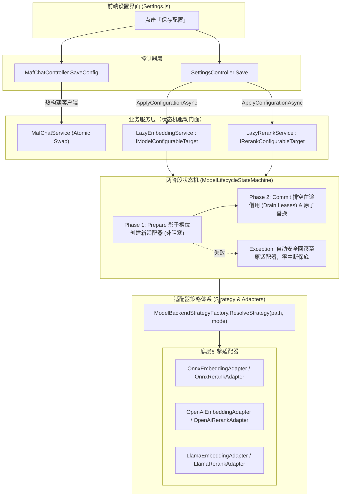

# 项目设置保存后即时生效调研与架构优化方案（适配器 + 策略 + 状态机）

> 关联模块：项目设置 (`SettingsController.cs`、`Settings.js`)、AI 对话服务 (`MafChatService.cs`、`MafChatController.cs`)、模型生命周期状态机 (`ModelLifecycleStateMachine.cs`)、后端推理适配器 (`Adapters/`、`Strategies/`)、依赖注入拓扑 (`ModelManagementExtensions.cs`)

---

## 1. 调研背景与问题定义

用户在使用 ReferenceRAG 的「项目设置」页面时提出核心诉求：
1. **项目设置中，各项配置保存后能否即时生效？**
2. **能否借助「适配器策略模式（Adapter & Strategy Pattern）」与「状态机模式（State Machine Pattern）」对现有的配置刷新机制进行深度重构优化？**

本调研报告对系统中包含的所有设置模块进行技术穿透，分析其在保存后的生命周期状态与数据流，并制定基于状态机与适配器策略模式的无缝热更新落地工程方案。

---

## 2. 现存设置体系即时生效现状全景剖析

经对源码中所有配置消费方的深度审查，ReferenceRAG 目前在各配置项保存后的生命周期状态如下：

| 配置模块 | 核心配置项 | 保存后是否即时生效 | 现存底层机制与阻碍根因 |
| :--- | :--- | :---: | :--- |
| **AI 对话模型 (Chat)** | `Endpoint`, `ApiKey`, `Model`, `SystemPrompt` | ❌ **无法即时生效** | `MafChatService` 单例持有固化的 `IChatClient`，`MafChatController.SaveConfig` 仅将配置写入 `appsettings.json`，日志硬编码输出 `重启服务后生效`，未向 Service 发送重构通知。 |
| **重排模型 (Rerank)** | `Mode` (onnx/openai), `ModelName`, `ModelPath`, `UseCuda`, `ApiBaseUrl`, `ApiKey`, `Enabled`, `TopN` | ❌ **人为阻断需重启** | 基础设施已有状态机与多后端适配器，但 DI 注册层在 `openai` 模式下直接旁路了状态机；`SettingsController.Save` 只要检测到模型变化即断言 `requiresRestart = true`。实际上**重排模型与向量库维度毫无耦合**，完全可 100% 热重载。 |
| **嵌入模型 (Embedding)** | `Mode`, `ModelPath`, `ModelName`, `UseCuda`, `ApiBaseUrl`, `ApiKey`, `BatchSize`, `MaxSequenceLength` | ⚠️ **部分生效，受维度约束** | DI 层在 `openai` 模式下绕过了状态机；`SettingsController.Save` 仅更新了空闲超时策略，未调用模型热重载并提示需要重启。<br>注：若向量维度/模型名称变更，虽可热切换模型，但已建向量索引需重建；若仅是 API 地址、Key、CUDA 等参数调整，完全不需要重建索引更不需要重启。 |
| **显存与驻留 (Retention)** | `ModelRetentionStrategy`, `ModelIdleTimeoutSeconds`, `UnloadOnlyWhenMinimizedToTray` |  **已即时热生效** | `SettingsController.Save` 会调用 `UpdateRetentionPolicy(config)`，即刻热更新状态机计时器与托盘感知策略。 |
| **分段切分 (Chunking)** | `Mode` (Adaptive/Fixed), `AdaptiveLevel`, `AdaptiveStrategyType`, `MaxTokens`, `OverlapTokens`, etc. |  **已即时热生效** | `FileIndexPipeline.PrepareAsync` 在每一次处理文件分块时实时读取 `_configManager.Load().Chunking`，保存后下一次切分立即生效。 |
| **搜索与召回 (Search)** | `DefaultTopK`, `ContextWindow`, `SimilarityThreshold`, `EnableMmr`, `MmrLambda`, `EnableGraphExpansion` |  **已即时热生效** | `SearchService.SearchAsync` 在每一次用户发起检索时动态调用 `_configManager.Load()`，保存后下一次检索即刻按新参数计算。 |
| **API Key 鉴权 (Service)** | `Service.ApiKey` |  **已即时热生效** | `ApiKeyMiddleware` 针对每一次 HTTP 请求都会从 `ConfigManager.Load()` 中读取比对，前端也在保存时同步更新了本地凭证。 |
| **模型仓库 (ModelHub)** | `HfToken`, `HfEndpoint`, `TimeoutSeconds` |  **已即时热生效** | 保存进配置文件后，模型下载器按需加载最新配置。 |
| **网络端口与绑定** | `Service.Port`, `AllowNetworkAccess`, `EnableHttpService` | ❌ **必须重启** | Kestrel 与操作系统 TCP Socket 端口在服务启动时完成底层系统调用（`bind`/`listen`）。桌面端平时走内存 IPC，网络端口仅供外部调试，端口变更是**唯一真正必须重启进程**的配置。 |

---

## 3. 架构优化可行性与模式设计

系统现存基建中已经具备 `ModelLifecycleStateMachine<T>`、`IEmbeddingBackendAdapter`、`IRerankBackendAdapter` 以及 `ModelBackendStrategyFactory`，具备极佳的重构基础。此前未能实现即时生效的本质在于：
1. **依赖注入拓扑割裂**：在 `openai` 模式下直接创建裸类，跳过了状态机与适配器门面；
2. **缺乏统一热配置契约**：服务层缺少统一的 `ApplyConfigurationAsync` 契约，保存接口无法通知运行中的服务；
3. **Chat 服务缺乏热插拔机制**：Chat 客户端缺少双缓冲/原子替换逻辑。

### 3.1 核心设计模式



### 3.2 模式 1：适配器模式（Adapter Pattern）
- **职责**：将差异巨大的底层推理后端（本地 DirectML/CUDA ONNX Runtime、GGUF llama.cpp 原生库、远程 OpenAI 兼容 REST API）抹平为统一的接口 `IEmbeddingBackendAdapter` 和 `IRerankBackendAdapter`。
- **价值**：调用方（SearchService、FileIndexPipeline）不需要关心底层运行的是本地 ONNX 还是远程 Ollama，只需面向统一接口调用。

### 3.3 模式 2：策略模式（Strategy Pattern）
- **职责**：`ModelBackendStrategyFactory` 根据目标模型的路径扩展名（`.onnx`、`.gguf`）以及显式配置的 `Mode`（`onnx`、`llama`、`openai`），自适应动态解析并产生匹配的后端生成策略：
  - `OnnxBackendStrategy`
  - `GgufBackendStrategy`
  - `OpenAiBackendStrategy`
- **价值**：配置发生变化时，策略工厂动态决策装配路线，无需在代码中写死分支判断。

### 3.4 模式 3：两阶段模型生命周期状态机（Two-Phase State Machine）
- **职责**：由 `ModelLifecycleStateMachine<TAdapter>` 统一接管适配器的生命周期（`Unloaded` -> `Loading` -> `Ready` -> `Inferring` -> `Unloading`）。
- **两阶段热重载保障（Two-Phase Reload）**：
  1. **Phase 1 (Prepare 准备阶段)**：在独立的影子槽位（Shadow Slot）异步初始化新适配器与加载模型权重。期间**旧模型继续对外提供推理服务，检索完全不中断**；
  2. **Phase 2 (Commit 提交阶段)**：新适配器就绪后，状态机置为 `Unloading` 并等待在途借用计数 `ActiveLeases == 0`（自旋排空）；排空完成后，原子替换内部适配器引用，释放旧适配器非托管显存/内存；
  3. **故障安全回滚（Rollback）**：若新配置错误（如远程 API 连不上、ONNX 模型文件损坏），在 Phase 1 捕获异常，安全回滚至原适配器并抛出告警，杜绝服务崩溃。

---

## 4. 各模块具体改造落地计划

### 4.1 AI 对话服务 (`MafChatService` & `MafChatController`)
1. 在 `MafChatService` 中将 `IChatClient` 与 `SystemPrompt` 设计为线程安全的动态引用；
2. 暴露 `UpdateConfiguration(string? endpoint, string? apiKey, string? model, string? systemPrompt)` 方法；
3. 配置更新时，若包含有效 API Key 则热装配包含 `OpenAiToolCallSanitizingHandler` 的全新 `IChatClient` 管道，并通过原子引用平滑替换；若 API Key 为空则置为 null；
4. `MafChatController.SaveConfig` 在写入 `appsettings.json` 后，同步调用 `_chatService.UpdateConfiguration(...)`，返回 `"配置已保存并即时生效"`。

### 4.2 向量嵌入与重排服务 (`LazyEmbeddingService` & `LazyRerankService`)
1. 声明 `IModelConfigurableTarget` 与 `IRerankConfigurableTarget` 契约接口：
   ```csharp
   public interface IModelConfigurableTarget
   {
       Task<bool> ApplyConfigurationAsync(EmbeddingConfig config, CancellationToken cancellationToken = default);
   }

   public interface IRerankConfigurableTarget
   {
       Task<bool> ApplyConfigurationAsync(RerankConfig config, CancellationToken cancellationToken = default);
   }
   ```
2. 在 `LazyEmbeddingService` 中实现 `ApplyConfigurationAsync`：
   - 更新内部模型元数据与推理参数；
   - 若模型当前处于已加载活跃状态（`_stateMachine.IsReady`），调用 `_stateMachine.TwoPhaseReloadAsync` 触发两阶段平滑热替换；
   - 若处于未加载状态（`Unloaded`），仅更新元数据，下一次查询进入 `EnsureReadyAsync` 时自动以最新策略拉起；
3. 在 `LazyRerankService` 中实现 `ApplyConfigurationAsync`：
   - 若 `!config.Enabled`，直接调用 `_stateMachine.UnloadAsync()` 立即卸载模型、释放显存；
   - 若已加载，调用 `_stateMachine.TwoPhaseReloadAsync` 执行热重载；
4. 在 `ModelManagementExtensions.cs` 中：
   - 彻底废除 `if (mode == "openai") return new OpenAIEmbeddingService(...)` 的旁路分支，全部统一注入 `LazyEmbeddingService` 与 `LazyRerankService`；
   - 注册 `DynamicEmbeddingTokenCounter`，实现动态 Token 计算。

### 4.3 核心配置控制器 (`SettingsController.cs`)
1. 将 `Save` 接口改造为异步方法 `public async Task<ActionResult> Save([FromBody] ObsidianRagConfig config)`；
2. 剥离真假重启要求：
   - **`networkBindingChanged`**（`Port`, `AllowNetworkAccess`, `EnableHttpService`）：唯一需要重启服务的项；
   - **`embeddingIdentityChanged`**（模型名称变更或维度变化）：提示用户「配置已即时生效。嵌入模型已切换，检索前建议重建向量索引」，无需重启服务；
   - **`modelRuntimeChanged`**（其他参数、API 端点、CUDA、重排模型）：直接调用 `ApplyConfigurationAsync` 触发热更新，`requiresRestart = false`；
3. 返回明确的业务提示信息与布尔状态。

### 4.4 前端设置视图 (`Settings.js`)
1. 更新保存提示处理逻辑，精准区分端口需重启、索引需重建与普通热生效；
2. 更新页面下方与「聊天模型」选项卡内的提示文案，明确告知用户 AI 对话与模型参数均已支持保存后即时生效。

---

## 5. 验证与回归防护

1. **静态质量门禁**：通过 `check.mjs` AST 扫描，保证所有 Vue 模板与 JS 模块符号合法；
2. **前端单元测试**：`transport.test.mjs` 与 `frontend-logic.test.mjs` 验证通过；
3. **后端单测与集成测试**：
   - 编写 `SettingsController` 异步热更新测试；
   - 编写 `MafChatService` 动态重载与即时生效测试；
   - 运行 `ReferenceRAG.Host.Tests` 与 `ReferenceRAG.Tests` 全量回归，确保全部通过。
