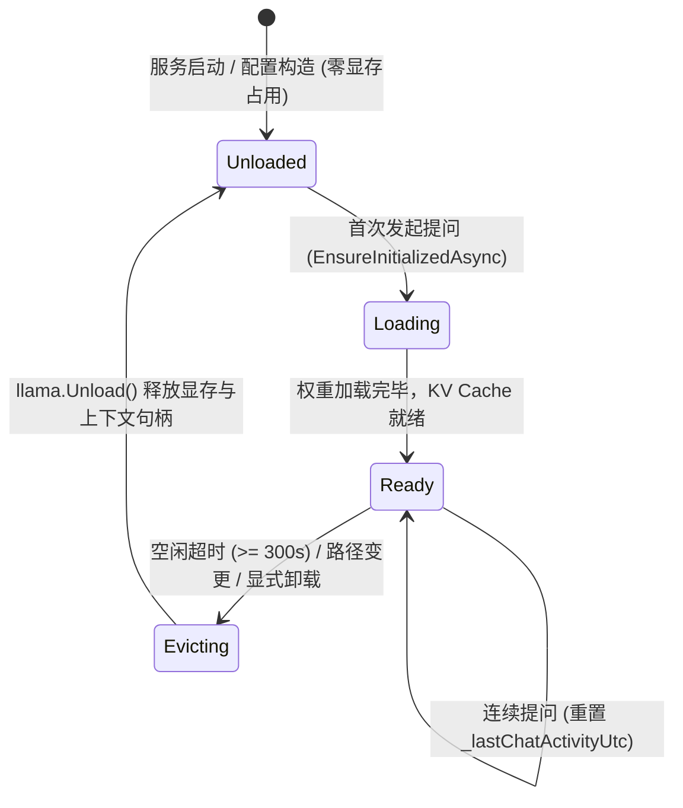
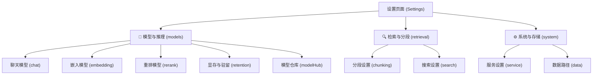

# 设置页面二级分类重构与聊天模型延迟加载/统一命名架构设计

> 文档版本：v1.0.0  
> 状态：已落地并纳入自动化质量门禁  
> 涉及模块：`Business/wwwroot/app/views/Settings.js`、`Business/.../MafChatService.cs`、`Business/.../LocalLlamaChatClient.cs`、`Host/.../ModelsController.cs`、`Host/.../SettingsController.cs`、`tests/.../ChatPerformanceModeAndSettingsQualityGateTests.cs`

---

## 1. 架构背景与核心痛点

随着 ReferenceRAG 功能演进，系统设置界面与大模型生命周期管理暴露出三个关键痛点：

### 痛点 1：本地对话模型启动常驻导致显存/内存开销过早

- **历史行为**：Embedding 与 Reranker 模型早已实现 **延迟按需加载（Lazy Loading）** 与 **滑动超时显存自动卸载（Sliding Idle Eviction）**。但 Chat 模型此前在服务启动初始化或配置重载时，可能过早分配底层上下文与权重句柄，或者在模型监控面板中常驻标记为 `Ready (已就绪)`。
- **潜在风险**：如果用户仅使用向量检索或文档导入，而不进行 AI 对话，启动时即抢占显存（尤其是 7B/14B 大模型需要 4GB~12GB VRAM），极易导致集成显卡或中低端独立显卡 OOM（显存溢出）。

### 痛点 2：设置界面表单命名与交互逻辑不统一

- **历史行为**：
  - 嵌入模型与重排模型配置项：字段名称为 `推理模式`，选项为 `本地 ONNX` 与 `OpenAI 兼容 API`，本地模型选择字段标签为 `模型名称`；
  - 聊天模型配置项：字段名称却为 `后端方案`，选项带有冗余括号 `本地 GGUF 大模型 (Local GGUF)` 与 `OpenAI 兼容 API (Online/API)`，本地模型选择字段标签为 `选择本地模型`。
- **用户心智负担**：用户在不同 Tab 之间切换配置时，视觉语言和概念名词不一致，增加了认知成本。

### 痛点 3：设置页面 9+ 个横向一级 Tab 扁平堆叠，层次混乱

- **历史行为**：设置页面直接在一行中平铺了 `嵌入模型`、`分段设置`、`搜索设置`、`服务设置`、`重排模型`、`显存与驻留`、`模型仓库`、`聊天模型`、`数据路径` 共 9 个 Tab。
- **屏幕适配与检索效率差**：在常见的分辨率或窄窗口模式下，Tab 标签横向挤压严重，用户难以在杂乱的一级菜单中快速定位目标设置项。

---

## 2. 业界主流方案对比调研

我们对主流开源与商业本地知识库/AI 平台（LM Studio、Ollama、Dify、AnythingLLM、OpenWebUI）进行了深度调研：

| 平台 / 工具 | 标签栏/导航组织架构 | 启动加载策略 | 命名规范一致性 |
| :--- | :--- | :--- | :--- |
| **LM Studio** | **左侧二级折叠分组**（Models / Chat / Developer / Settings） | **Strict Lazy Loading**（首次提问才加载权重，支持空闲 TTL 自动 Unload） | 高度统一（统一区分 Local GGUF 与 Remote API） |
| **Ollama** | 命令行 / 极简 REST API（外部 WebUI 承载） | **Lazy & Keep-Alive**（默认 5 分钟无调用自动卸载出显存） | 统一的 Modelfile 概念 |
| **OpenWebUI** | **顶部/侧边分级抽屉**（General, Connections, Models, Audio, Documents, System） | 依赖 Ollama / vLLM 后端自动按需唤醒 | 统一为 "Provider / Connection Mode" |
| **Dify** | **二级树状设置模态框**（模型供应商、系统设置、数据源、监控） | 远端 API 为主，本地部署通过统一适配器按需拉起 | 统一抽象为 Provider -> Model Type -> Credential |
| **ReferenceRAG 本次设计** | **顶部 Segmented 胶囊大类 + 下方 Line Tab 二级联动**（模型与推理、检索与分段、系统与存储） | **全系一致延迟按需加载 + 300s 滑动超时自动卸载**（Embedding / Rerank / Chat 彻底同构） | **完全统一为「推理模式」+「本地 GGUF / ONNX」与「OpenAI 兼容 API」** |

---

## 3. 设计模式与技术实现方案

### 3.1 代理模式（Proxy / Virtual Proxy）与状态机（State Pattern）

在 `LocalLlamaChatClient` 与 `LocalOnnxChatClient` 中采用 **虚拟代理（Virtual Proxy）** 模式，将轻量级客户端外壳与笨重的权重加载解耦：



#### 关键实现细节：
1. **构造函数零负载**：
   ```csharp
   public LocalLlamaChatClient(...)
   {
       // 仅保存元数据，不触碰任何模型文件与底层 LlamaNative 显存句柄
       _weights = null;
       _executor = null;
       _initialized = false;
   }
   ```
2. **首次请求按需初始化（Double-Check Locking）**：
   ```csharp
   private async Task EnsureInitializedAsync(CancellationToken ct)
   {
       if (_initialized) return;
       await _semaphore.WaitAsync(ct);
       try
       {
           if (_initialized) return;
           // 执行 LLamaWeights.LoadFromFile(parameters) 并支持自动 GPU/CPU 降级
           _initialized = true;
       }
       finally { _semaphore.Release(); }
   }
   ```
3. **空闲自动卸载（Idle Eviction Timer）**：
   在 `MafChatService` 中运行 30 秒间隔的后台定时器，比对 `DateTime.UtcNow - _lastChatActivityUtc >= _chatModelIdleTimeoutSeconds`。一旦超时，自动调用 `UnloadModel()` 并安全释放 `_weights` 与 KV 缓存。
4. **遥测状态真实反馈（Telemetry Accurate Status）**：
   在 `ModelsController.GetRuntimeStatus` 中：
   ```csharp
   var isChatLoaded = _chatService?.IsModelLoaded ?? false;
   chatStatus = new SingleModelStatusResponse
   {
       State = isChatLoaded ? 2 : 0,
       StateName = isChatLoaded ? "Ready" : "Unloaded",
       StateDescription = isChatLoaded ? "已就绪" : "未加载 (首次提问时按需加载)",
       IsReady = isChatLoaded,
       ...
   };
   ```

---

### 3.2 统一命名与表单字段对齐规范

将 `chat` 模块与 `embedding`、`rerank` 的视觉与交互表单彻底统一：

| 设置项 | 统一前（聊天模型） | 统一后（全系统完全对齐） |
| :--- | :--- | :--- |
| **模式选择字段** | `后端方案` | **`推理模式`** |
| **本地推理单选按钮** | `本地 GGUF 大模型 (Local GGUF)` | **`本地 GGUF`**（嵌入/重排为 `本地 ONNX`） |
| **远程推理单选按钮** | `OpenAI 兼容 API (Online/API)` | **`OpenAI 兼容 API`** |
| **本地模型选择字段** | `选择本地模型` | **`模型名称`**（带下拉变体提示） |
| **API 端点字段** | `API 地址` | **`API 地址`** |
| **API 密钥字段** | `API Key` (带脱敏清除) | **`API Key`** (带脱敏清除) |

---

### 3.3 二级分类标签栏（2-Tier Segmented Navigation）

为彻底解决 9+ 个平铺 Tab 的混乱，采用“分而治之”的二级层次架构：



#### 前端交互与状态联动设计：
1. **一级分类 Segmented 胶囊选择器**：
   - 使用 Naive UI 原生 `<n-tabs v-model:value="activeGroup" type="segment" size="medium" @update:value="onGroupChange">`；
   - 包含：`🤖 模型与推理`、`🔍 检索与分段`、`⚙️ 系统与存储`。
2. **二级子标签 Animated Line 导航**：
   - 各分组分别承载专属子 Tab 视图；使用 `v-show` 保护表单 DOM 实例与输入状态，避免频繁销毁/重建。
3. **自适应路由与 URL 双向同步（Bidirectional URL Sync）**：
   - **进入页面**：`initTabFromUrl()` 读取 `?tab=xxx` 或 `#...&tab=xxx`。若用户访问 `tab=embedding`，自动推导所属分组为 `models`，同时激活一级胶囊与二级子项；
   - **切换分组**：若当前选中的子 Tab 不属于新分组，自动高亮该分组的默认第一个子 Tab（例如切换到 `system` 自动高亮 `service`）；
   - **切换子项**：调用 `syncTabToUrl(tab)` 保持浏览器地址栏与会话历史无感知平滑同步。

---

## 4. 自动化质量门禁验证

在 `tests/ReferenceRAG.Host.Tests/ChatPerformanceModeAndSettingsQualityGateTests.cs` 中新增三项专项质量门禁：

1. **`ChatModel_StartupDefaultNotLoaded_RuntimeStatusReflectsUnloaded`**：
   - 验证刚构建的客户端 `IsInitialized == false` 且 `IsModelLoaded == false`；
   - 验证 `ModelsController.GetRuntimeStatus` 初始精确反映 `State = 0`，`StateName = "Unloaded"`，`IsReady = false`，状态描述为“未加载 (首次提问时按需加载)”。
2. **`ChatModel_Unload_ReleasesResources_And_ResetsState`**：
   - 验证显式调用 `Unload()` 能够安全幂等释放底层资源，并重置模型加载状态。
3. **`Settings_Frontend_TwoTierTabs_And_UnifiedNaming_Integrity`**：
   - 静态分析 `Settings.js` 源码：
   - 校验包含 `activeGroup`、`activeTab`、`groupTabsMap`、`onGroupChange`、`onTabChange`；
   - 校验包含一级三大分类（`模型与推理`、`检索与分段`、`系统与存储`）；
   - 校验聊天模块使用统一名词 `推理模式`、`本地 GGUF`、`OpenAI 兼容 API`；
   - 校验彻底清除旧字段文案（`后端方案`、`本地 GGUF 大模型 (Local GGUF)`、`OpenAI 兼容 API (Online/API)`）。

---

## 5. 测试通过报告

- **Host 质量门禁套件**：135/135 通过（0 失败）
- **核心算法与存储套件**：468/468 通过（0 失败，47 远程依赖跳过）
- **代码规范检查**：C# 与 JS 语法检查均 0 警告 0 错误。
