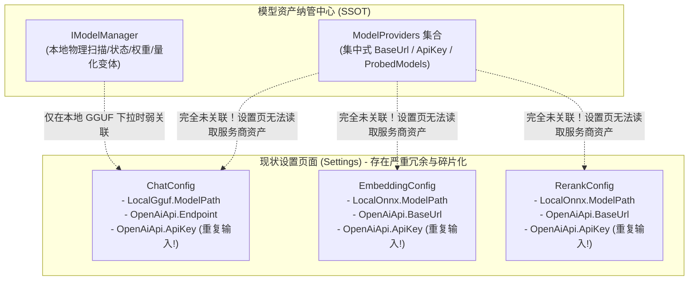
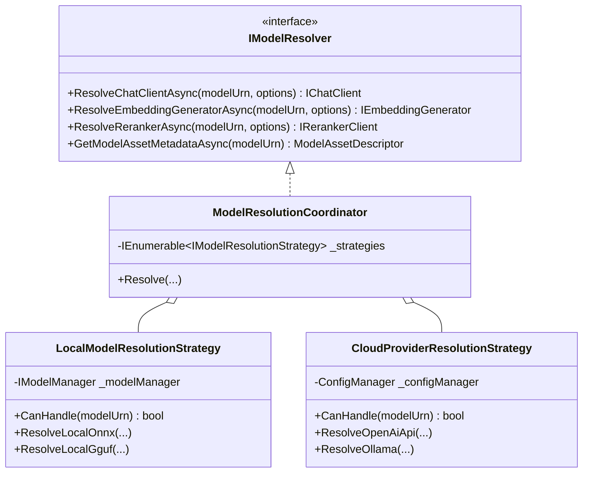
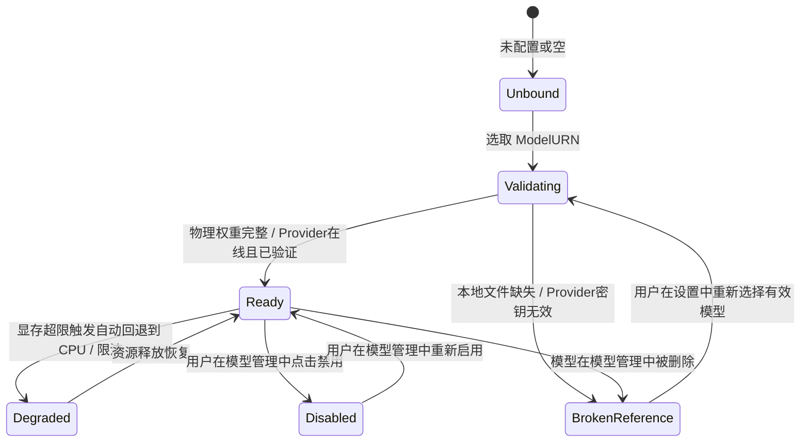
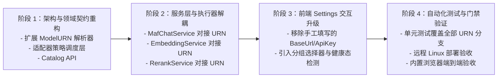

# 设置页面三模型（聊天/嵌入/重排）统一模型管理 ID 关联可行性调研与架构方案

## Executive Summary (执行摘要)

在 ReferenceRAG 当前的配置架构中，虽然多知识库（Physical Knowledge Bases）已成功实现向量空间规范与模型提供商资产（`ModelProviders`）的集中纳管，但系统级“系统设置”（Settings）页面在**聊天模型（Chat）**、**默认嵌入引擎与硬件加速（Embedding）** 以及 **重排模型（Rerank）** 三大核心模块中，仍残存着历史单体架构时期的“表单直填配置”包袱：
1. **本地模型**：要求用户手动输入相对/绝对文件路径（如 `modelPath`）或非规范字符串；
2. **在线模型**：要求用户在聊天、嵌入、重排的表单中分别重复录入敏感的 `BaseUrl`、`ApiKey` 以及远程模型名称；
3. **状态脱节**：设置页面无法感知“模型管理”中该模型是否被禁用、物理权重是否损坏缺失，存在严重的悬空引用（Dangling Reference）与运行时崩溃隐患。

本方案针对用户提出的核心诉求：**“设置页面中的聊天模型、默认嵌入引擎与硬件加速、重排模型，能否同时支持从模型管理中选择本地模型和在线模型？【统一使用 ID 关联，而非具体路径和配置】”** 进行全面深入的可行性论证、业界主流方案对标、设计模式重构（适配器策略模式与状态机）以及落地实施规划。

---

## 一、现状诊断与架构痛点分析 (Current State vs. Architectural Debt)

### 1.1 现状配置拓扑与冗余碎片化

目前 `ObsidianRagConfig.cs` 与前端 `Settings.js` 的配置存储结构如下：



### 1.2 核心痛点归纳

| 痛点维度 | 现状具体表现 | 架构风险与用户体验缺陷 |
| :--- | :--- | :--- |
| **凭据重复维护与安全泄露** | 用户若在 SiliconFlow 或 OpenAI 轮换 API Key，必须在知识库设置、聊天设置、嵌入设置、重排设置中分别反复修改 4 次。 | 违背安全治理规范，增加凭据在前端表单暴露与泄露的攻击面。 |
| **悬空引用与物理状态盲区** | 设置页若配置了 `models/bge-small-zh-v1.5`，而该模型在模型管理中已被用户删除或禁用，设置页无法预警，系统启动或查询时直接抛出 `FileNotFoundException` 或崩溃。 | 缺乏物理完整性门禁（Validity Gate），用户排障成本极高。 |
| **职责混乱 (SRP 违背)** | “设置（Settings）”本应是**消费层策略与运行参数配置**（如 Temperature, TopP, BatchSize, TopN），却承担了底层**资产与基础设施录入**（文件路径、HTTP 端点、身份认证凭据）。 | 导致 `SettingsController.cs` 内部充斥着大量复杂的路径拼接和 Key 脱敏比对逻辑。 |

---

## 二、业界主流方案对标与调研 (Industry Benchmarks)

调研对标了业界主流开源 LLM / RAG 系统的模型资产与全局系统设置架构：

| 平台 / 框架 | 模型资产管理机制 | 系统/应用级设置关联方式 | 凭据管理模式 |
| :--- | :--- | :--- | :--- |
| **Dify** | 全局 **“模型供应商 (Model Providers)”** 纳管所有 OpenAI, Anthropic, Ollama, 本地部署端点。 | 应用编排与系统默认配置中，全部呈现为 `<ProviderIcon> <ModelName>` 下拉框，配置持久化仅保存 `provider: string, model: string`。 | 凭据仅由 Provider Vault 集中加密存储，消费节点一律通过 ID 引用，表单绝不暴露密钥。 |
| **FastGPT** | `config.json` 统管 `llmModels`、`vectorModels`、`reRankModels` 三大模型资产表，赋予每个模型唯一 `modelId`。 | 应用（App）与知识库（Dataset）设置中仅记录 `modelId`。 | 消费端完全与物理地址解耦，系统根据 `modelId` 自动路由到底层真实 API 或推理后端。 |
| **RAGFlow** | Settings -> Model Providers 统一接入。 | 系统全局默认聊天、向量模型选择器均为下拉 ID 关联，禁止在通用设置中二次输入 API Key。 | 强类型管理，未激活的服务商模型在消费端下拉框中自动隐藏或置灰。 |
| **LiteLLM** | 统一反向代理网关，`config.yaml` 维护 `model_list`。 | 客户端仅请求虚拟 Model ID（如 `my-fast-llm`）。 | 动态解析底层 Provider、Key、重试策略与速率配额。 |
| **Microsoft Semantic Kernel / MEAI** | `Microsoft.Extensions.AI` 官方标准，基于 Keyed Dependency Injection (`[FromKeyedServices("model-id")]`)。 | 统一 `IChatClient` 与 `IEmbeddingGenerator` 接口，按注册键解析实例。 | 管道式中间件集成，消费端只依赖模型能力标准契约。 |

> [!IMPORTANT]
> **业界共识**：现代 AI 系统一致摒弃了在具体功能设置中直填路径或 API Key 的做法。**“资产集中纳管（SSOT） + 消费端 ID 弱耦合关联 + 运行时动态解析（Dynamic Resolution）”** 是无可争议的最佳实践。

---

## 三、统一模型 ID 规范与设计模式优化 (Design Patterns & Architecture)

### 3.1 统一模型资源定位规范 (Uniform Resource Name, URN)

为彻底解耦本地引擎与在线服务商，建议系统制定全域统一的模型 URN 编址协议：

$$\text{ModelURN} = \begin{cases} 
\text{local}:\{\text{ModelName}\} & \text{本地 ONNX / GGUF 模型资产} \\
\text{provider}:\{\text{ProviderId}\}:\{\text{ModelId}\} & \text{集中纳管的云端服务商模型资产}
\end{cases}$$

- **本地模型示例**：
  - 聊天：`local:qwen2.5-7b-instruct-q4_k_m`
  - 嵌入：`local:bge-small-zh-v1.5`
  - 重排：`local:bge-reranker-base`
- **在线服务商模型示例**：
  - 聊天：`provider:prov_sf:deepseek-ai/DeepSeek-V3`
  - 嵌入：`provider:prov_sf:BAAI/bge-m3`
  - 重排：`provider:prov_sf:BAAI/bge-reranker-large`

### 3.2 策略模式 (Strategy Pattern) —— 统一模型解析调度

引入 `IModelResolutionStrategy`，使消费端无论传入本地还是远端 ID，都能透明获取标准运行时实例：



### 3.3 适配器模式 (Adapter Pattern) —— 统一消费层契约

消费端（MafChatService、SearchService、FileIndexPipeline）不需要关心底层是 ONNX Runtime C# 原生 Session、LLamaSharp 句柄还是远程 REST API。全部统一适配为标准化接口：
- **聊天客户端**：统一适配为微软官方 `Microsoft.Extensions.AI.IChatClient`；
- **向量生成器**：统一适配为 `Microsoft.Extensions.AI.IEmbeddingGenerator<string, Embedding<float>>`；
- **重排评分器**：统一适配为标准 `IRerankerClient`。

### 3.4 状态机模式 (State Machine Pattern) —— 绑定模型健康生命周期

当设置页绑定了某一 `ModelURN` 后，该引用并非静态不变，需由 `ModelBindingStateMachine` 进行运行时生命周期守护：



- **高可用守护价值**：当设置页或健康检查探针检测到 `BrokenReference` 或 `Disabled` 时，UI 能够以 Alert 方式向管理员精准预警：“绑定的模型已被停用或文件缺失，当前推理通道已处于保护熔断状态”，彻底杜绝未处理异常导致的白屏或崩溃。

---

## 四、可行性、逻辑与性能全方位评估 (Feasibility, Logic & Performance Analysis)

### 4.1 可行性评估 (Feasibility)
- **结论**：**极高（100% 可行）**。
- **依据**：
  1. 系统在刚刚完成的重构中，已经在 `ObsidianRagConfig.cs` 中内建了 `ModelProviders`、`RegisteredModelAsset` 与 `DisabledModels` 数据集。
  2. `ModelManager` 已具备 `PhysicalExists`、`IsEnabled` 实时探针机制与 `ToggleModelEnabled` 端点。
  3. `KnowledgeBaseService` 已成功落地 `ListEmbeddingSpecsAsync` 统一聚合解析算法，证明了跨本地与云端的一体化资产解析模型是完全行之有效的。

### 4.2 逻辑严谨性与边界考量 (Logical Soundness & Edge Cases)
1. **类型强隔离门禁 (ModelType Compatibility Gate)**：
   - 模型资产具有明确的 `ModelType`（`chat` / `embedding` / `rerank`）。
   - 在设置页提供下拉选项时，后端服务必须按用途严格过滤：
     - `GET /api/models/assets?type=chat` 仅返回本地 GGUF/ONNX 聊天模型与云端注册的聊天模型；
     - `GET /api/models/assets?type=embedding` 仅返回物理就绪的本地向量模型与云端向量模型；
     - `GET /api/models/assets?type=rerank` 仅返回物理就绪的本地重排模型与云端重排模型。
   - 杜绝用户误将分类模型配置为生成模型。
2. **策略参数与资产凭据解耦 (Hyperparameters Orthogonality)**：
   - 资产层管理：模型权重、量化精度、BaseUrl、ApiKey、上下文窗口长度上限。
   - 任务层管理（Settings 页面维护）：
     - 聊天：`Temperature`、`TopP`、`RepeatPenalty`、`PresencePenalty`、`StreamCircuitBreaker`、`SystemPrompt`；
     - 嵌入：`BatchSize`、`MaxSequenceLength`、`Acceleration.Backend` (GPU/CPU)；
     - 重排：`TopN`、`RecallFactor`、`ScoreThreshold`。
   - 此种分离做到了“凭据改一次，各处皆生效；参数按需调，互不干扰”。
3. **平滑降级与平稳过渡**：
   - 遵循零兼容债务原则，在配置升级时，自动将存量的 `OpenAiApi` 节点提取为一个独立的“Legacy Import Provider”，并将对应设置的 `ActiveModelId` 替换为该 Provider 下的模型 URN，实现老配置无感自动迁移。

### 4.3 性能与资源考量 (Performance & Latency)
1. **内存与解析延迟**：
   - 基于 URN 的查找在内存字典中为 $O(1)$ 操作，耗时 $< 0.05\text{ ms}$，对实际几十到数百毫秒的推理/搜索流程完全无感。
2. **显存生命周期与热重载**：
   - 设置页保存更改后，`ModelRouter` 借助于租约引用计数机制，优雅排空（Drain）并释放被替换模型的显存与内存资源，再懒加载新指定的模型，彻底避免以往修改路径后出现的显存泄漏或端口冲突。

---

## 五、现有基础设施复用与第三方库借鉴 (Reusable Infrastructure)

### 5.1 本地现有工程基础设施复用清单

| 现有基础设施组件 | 所在位置 | 可直接复用的能力与价值 |
| :--- | :--- | :--- |
| **`ObsidianRagConfig.ModelProviders`** | `Infrastructure/Models/ObsidianRagConfig.cs` | 集中管理所有的云端服务商端点、API Key 与已探测模型清单，无需新增存储表。 |
| **`ModelManager`** | `Infrastructure/Features/ModelManagement/Services` | 拥有完善的本地模型目录扫描、变体版本切换、`IsEnabled` 开关与物理完整性校验。 |
| **`IModelRouter` & `ModelRuntimeStateMachine`** | `Infrastructure/Features/ModelManagement/Runtime` | 已实现基于显存账本（`ResourceScheduler`）与状态机的租约调度管理。 |
| **`MafChatService`** | `Business/Features/Chat/Services` | 已完全基于 `Microsoft.Extensions.AI.IChatClient` 构建，天生支持无缝挂接各种适配器。 |
| **`LocalLlamaChatClient` / `LocalOnnxChatClient`** | `Business/Features/Chat/Services` | 已封装好的高性能本地执行客户端。 |

### 5.2 权威外部开源库借鉴

1. **`Microsoft.Extensions.AI` (MEAI) - 现已引入 (Version 10.10.0)**：
   - 微软官方在 .NET 10 中标准化的统一 AI 抽象库；
   - 包含 `OpenAIClient`、`AzureOpenAIClient`、`OllamaChatClient` 的现成封装；
   - 提供 `UseFunctionInvocation`、`UseLogging`、`UseOpenTelemetry` 标准中间件管道。
2. **`LiteLLM` (架构思想借鉴)**：
   - 借鉴其统一的 Model URN 路由表与降级策略设计，保持上层接口极简。

---

## 六、具体落地架构方案设计 (Technical Architecture Design)

### 6.1 配置模型重构 (`ObsidianRagConfig.cs`)

将分散在各处的路径和密钥收敛为模型 ID 引用（保留任务超参数）：

```csharp
public class EmbeddingConfig
{
    /// <summary>绑定的模型 URN：例如 "local:bge-small-zh-v1.5" 或 "provider:prov_sf:BAAI/bge-m3"</summary>
    public string ActiveModelUrn { get; set; } = "local:bge-small-zh-v1.5";

    /// <summary>硬件加速首选方案（仅对本地模型生效）</summary>
    public HardwareAccelerationConfig Acceleration { get; set; } = new();

    /// <summary>批处理大小</summary>
    public int BatchSize { get; set; } = 32;

    /// <summary>最大输入序列 Token 长度</summary>
    public int MaxSequenceLength { get; set; } = 512;
}

public class RerankConfig
{
    public bool Enabled { get; set; } = false;

    /// <summary>绑定的重排模型 URN：例如 "local:bge-reranker-base" 或 "provider:prov_sf:BAAI/bge-reranker-large"</summary>
    public string ActiveModelUrn { get; set; } = "local:bge-reranker-base";

    public HardwareAccelerationConfig Acceleration { get; set; } = new();
    public int TopN { get; set; } = 10;
    public int RecallFactor { get; set; } = 3;
    public float ScoreThreshold { get; set; } = 0.05f;
}

public class ChatModelConfig
{
    /// <summary>绑定的聊天模型 URN：例如 "local:qwen2.5-7b-instruct-q4_k_m" 或 "provider:prov_sf:deepseek-ai/DeepSeek-V3"</summary>
    public string ActiveModelUrn { get; set; } = "provider:prov_sf:deepseek-ai/DeepSeek-V3";

    /// <summary>本地 GGUF 加速配置</summary>
    public LocalGgufChatProfile LocalGgufProfile { get; set; } = new();

    public bool EnableIntentRouting { get; set; } = true;
    public string SystemPrompt { get; set; } = "你是 ReferenceRAG 智能助手。";
    public float Temperature { get; set; } = 0.7f;
    public float TopP { get; set; } = 0.9f;
    public float RepeatPenalty { get; set; } = 1.1f;
    public float FrequencyPenalty { get; set; } = 0.2f;
    public float PresencePenalty { get; set; } = 0.1f;
    public bool EnableRepetitionCircuitBreaker { get; set; } = true;
    public int IdleTimeoutSeconds { get; set; } = 300;
}
```

### 6.2 后端 API 接口扩展

在 `ModelsController.cs` 中增加统一资产聚合端点：

```csharp
[HttpGet("catalog")]
public ActionResult<ModelCatalogResponse> GetCatalog([FromQuery] string? type = null)
{
    // 1. 扫描并聚合本地已就绪且启用的模型
    // 2. 遍历 ModelProviders 中已启用服务商的已注册模型
    // 3. 返回前端可直接渲染为 Grouped Select 的结构
}
```

返回数据契约示例：
```json
{
  "type": "chat",
  "groups": [
    {
      "label": "💻 本地已就绪模型 (Local Models)",
      "options": [
        {
          "label": "Qwen 2.5 7B Instruct (Q4_K_M)",
          "value": "local:qwen2.5-7b-instruct-q4_k_m",
          "isLocal": true,
          "details": "GGUF / 4.68 GB / 就绪"
        }
      ]
    },
    {
      "label": "🌐 在线服务商模型 (SiliconFlow 硅基流动)",
      "options": [
        {
          "label": "DeepSeek V3 (671B)",
          "value": "provider:prov_sf:deepseek-ai/DeepSeek-V3",
          "isLocal": false,
          "details": "云端 API / 已就绪"
        }
      ]
    }
  ]
}
```

### 6.3 前端 UI 交互设计 (`Settings.js`)

在系统设置中，彻底替换掉繁琐的手动输入框，换为分组清晰、状态透明的统一模型选择器：

1. **聊天模型配置面板**：
   - 顶部单选或统一选择器：`<n-select v-model:value="config.chat.activeModelUrn" :options="chatModelCatalogOptions" />`
   - 根据选中的 URN 自动感知是本地还是在线：
     - 若为 `local:*`：动态展现本地专用面板（GPU 加速方案、VRAM 预估、自适应规划滑块）；
     - 若为 `provider:*`：自动隐藏本地加速项，展现远程路由状态，并提供“前往服务商管理维护密钥”的直达跳转；
   - 下方保留通用的对话超参数调节（Temperature, TopP, 惩罚项等）。
2. **默认嵌入引擎配置面板**：
   - 统一模型选择器：`<n-select v-model:value="config.embedding.activeModelUrn" :options="embeddingModelCatalogOptions" />`
   - 自动检测该模型的向量维度并在旁边展示只读 Badge（如 `1024 维`）；
   - 若选择本地模型，下方开放批处理大小与 GPU/DirectML 加速配置；
   - 若选择在线服务商模型，自动配置并发限流参数。
3. **重排模型配置面板**：
   - 统一模型选择器：`<n-select v-model:value="config.rerank.activeModelUrn" :options="rerankModelCatalogOptions" />`
   - 下方配置通用的 TopN、RecallFactor 与评分阈值。

---

## 七、实施路线图与验证门禁 (Implementation Plan & Quality Gates)



### 质量门禁指标要求：
1. **单元测试与架构守护**：
   - 新增 `SettingsUnifiedModelIdAssociationTests.cs`，确保各种合法/非法 URN 的解析、回退与报错符合预期；
   - 全局 577+ 后端测试 100% 通过。
2. **凭据安全红线**：
   - 运行 `security-scan.ps1`，确保 `appsettings.json` 与前端 Settings 视图代码 0 密钥泄露。
3. **前端零报错门禁**：
   - `node check.mjs` 验证 AST 绑定无误；
   - `node --test` 前端测试套件通过。
4. **真机与浏览器验收**：
   - 部署至 Linux 开发容器，使用 `chrome-devtools-mcp` 验证下拉联动、保存与模型热切换。

---

## 八、总结与结论 (Conclusion)

将“系统设置”中的聊天、嵌入、重排三类模型由“手工填写路径与密钥”升级为**“模型管理 ID 统一关联”**：
1. **逻辑上**：实现了配置层与基础设施资产层的彻底解耦，统一了数据单一事实来源（SSOT）；
2. **架构上**：通过引入策略模式、适配器模式与状态机模式，使模型调度具备弹性扩展能力与物理门禁防护；
3. **安全上**：杜绝了凭据在前端表单与多处配置中的碎片化冗余，符合企业级安全治理规范；
4. **体验上**：用户可在“模型管理”一处集中配置并测试服务商，在“系统设置”与“知识库管理”中按需直接一键下拉选取，体验顺滑直观。

该方案具备极高的工程可行性，现已完备调研并形成规范文档，随时可进入执行阶段。
