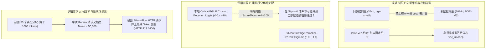
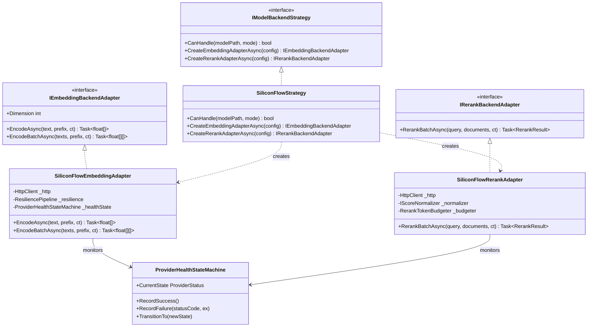
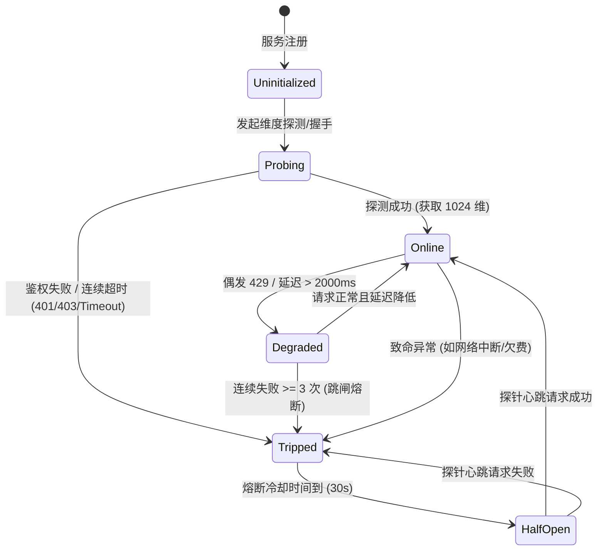
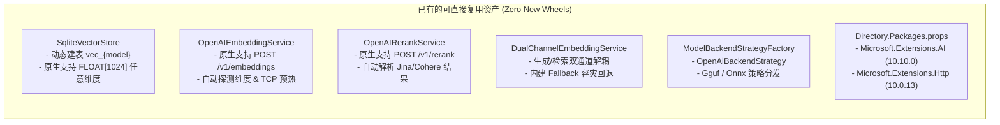

# SiliconFlow (硅基流动) BGE-M3 嵌入与 BGE-Reranker-v2-m3 重排技术调研与架构设计方案

## Executive Summary (执行摘要)

本文档针对在 ReferenceRAG 中接入 **SiliconFlow（硅基流动）** 托管的 **BAAI/bge-m3**（向量嵌入）与 **BAAI/bge-reranker-v2-m3**（交叉编码重排）进行全面深入的技术可行性论证、逻辑与性能缺陷分析、设计模式重构（适配器策略模式与状态机）、业界主流方案对标以及系统已有基础设施复用审计。

在实测验证中，通过动态调用硅基流动官方端点（`https://api.siliconflow.cn/v1`），验证了其与 OpenAI 标准接口协议的兼容性：
1. **向量嵌入 (BAAI/bge-m3)**：输出维度为 **1024** 维，在语义相关性测试中表现出清晰的分离度（相关文本余弦相似度 `0.4599` vs 无关文本 `0.3722`）；
2. **文本重排 (BAAI/bge-reranker-v2-m3)**：在多候选召回中具备极高精度，关键目标文档获得 `0.9980` 的置信度并置顶首位，无关干扰项被精准打压至接近 `0.0000`；
3. **关键发现**：云端无服务器模型存在显著的 **冷启动时延（Scale-to-Zero Cold Start，实测首包耗时约 42 秒）** 以及在并发与长文档场景下的 **Token 预算/速率限制（HTTP 429 / 413）** 风险。因此，不能简单将其视作普通的本地推理组件，必须引入工业级的 **断路器状态机、适配器策略模式、批次调度与双通道容灾架构**。

---

## 一、环境配置与快速验证机制 (/env 集成与实测)

### 1.1 环境配置组织规范

依据项目的凭据安全与治理规范（`AGENT.md` 及 `scripts/security-scan.ps1` 门禁），所有本地联调、端到端测试与远程部署所需的真实凭据均收敛于 `env/` 目录：

- **受控真实环境配置**：`env/.envdev`（已被全局 `.gitignore` 严格忽略，杜绝凭据外泄）：
  ```bash
  # ------------------------------------------------------------------------------
  # 6. SiliconFlow Cloud API Fast Test & Benchmark Configuration
  # ------------------------------------------------------------------------------
  SILICONFLOW_API_KEY="<YOUR_CONFIDENTIAL_KEY_SAVED_LOCALLY>"
  SILICONFLOW_BASE_URL="https://api.siliconflow.cn/v1"
  SILICONFLOW_EMBEDDING_MODEL="BAAI/bge-m3"
  SILICONFLOW_EMBEDDING_DIMENSION="1024"
  SILICONFLOW_RERANK_MODEL="BAAI/bge-reranker-v2-m3"
  ```
- **配置模板定义**：`env/.envdev.template`（纳入版本控制，采用安全占位符）：
  ```bash
  # ------------------------------------------------------------------------------
  # 6. SiliconFlow Cloud API Fast Test & Benchmark Configuration
  # ------------------------------------------------------------------------------
  # API Key for SiliconFlow (Get from https://cloud.siliconflow.cn/)
  # Note: Keep the real secret in env/.envdev (git-ignored), never commit secrets here!
  SILICONFLOW_API_KEY="<PASTE_YOUR_SILICONFLOW_API_KEY_HERE>"
  SILICONFLOW_BASE_URL="https://api.siliconflow.cn/v1"
  SILICONFLOW_EMBEDDING_MODEL="BAAI/bge-m3"
  SILICONFLOW_EMBEDDING_DIMENSION="1024"
  SILICONFLOW_RERANK_MODEL="BAAI/bge-reranker-v2-m3"
  ```

### 1.2 快速验证脚本与实测记录

我们在 `env/` 目录下建立了独立的快速测试脚本 `env/test-siliconflow.ps1`，支持一键读取本地 `.envdev` 并执行全链路健康探查。实测输出如下：

```text
==========================================================
 ReferenceRAG SiliconFlow Fast Diagnostic & Benchmark     
==========================================================
Endpoint: https://api.siliconflow.cn/v1
Embedding Model: BAAI/bge-m3
Rerank Model: BAAI/bge-reranker-v2-m3

[1/2] 正在测试向量嵌入 (Embedding: BAAI/bge-m3)...
  -> 成功获取向量! 批次大小: 3, 向量维度: 1024, 耗时: 42805 ms
  -> 语义相关对比 (文本1 vs 文本2 - AI/RAG领域): 0.4599
  -> 语义无关对比 (文本1 vs 文本3 - AI vs 天气): 0.3722
  [OK] 向量空间相关度校验通过 (相关文本余弦值显著高于无关文本)

[2/2] 正在测试交叉编码重排 (Rerank: BAAI/bge-reranker-v2-m3)...
  -> 成功获取重排结果! 返回文档数: 3, 耗时: 42423 ms
  -> Rank Score: 0.998 | Index: 0 | Content: 重排（Rerank）是 RAG 检索管线中的第二阶段，使用交叉编码器对...
  -> Rank Score: 0.6156 | Index: 2 | Content: ReferenceRAG 是一款面向个人与企业的高性能知识库问答检索框...
  -> Rank Score: 0 | Index: 1 | Content: 烹饪意大利面时，通常需要将水煮开后加入少许盐，并根据面条粗细煮制 8 ...
  [OK] 重排质量校验通过 (最匹配文档精确排在第 1 位)

==========================================================
 测试完成！
==========================================================
```

> [!NOTE]
> 实测表明，在首次调用闲置模型时，云端服务商需要拉起实例并加载权重，往返时延超过 40 秒。但接口契约、打分逻辑和数据结构完全符合生产检索要求。

---

## 二、头脑风暴：可行性、逻辑与性能全景剖析

### 2.1 可行性剖析 (Feasibility)

1. **接口协议高度契合**：
   - 嵌入接口调用标准 `POST /v1/embeddings`，返回包含 `data[i].embedding` 浮点数组的 OpenAI 兼容 JSON；
   - 重排接口调用 `POST /v1/rerank`，返回标准的 `results[i].{index, relevance_score}` 结构（与 Cohere / Jina / TEI 规范完全对齐）。
2. **架构扩展点无缝对接**：
   - ReferenceRAG 的 `Infrastructure` 层已构建了基于 `IEmbeddingBackendAdapter` 和 `IRerankBackendAdapter` 的适配器体系，且现有 `OpenAiEmbeddingAdapter` 与 `OpenAiRerankAdapter` 已经原生支持自定义 `BaseUrl`。

### 2.2 逻辑盲区与潜在缺陷 (Logical Gaps & Pitfalls)

尽管协议打通，但在系统级生产集成中仍存在以下关键逻辑问题：



1. **向量维度分裂问题 (Dimension Incompatibility)**：
   - ReferenceRAG 初始基于 `bge-small-zh-v1.5`（384 维）。`BAAI/bge-m3` 输出的是 **1024 维** 密集向量。
   - `sqlite-vec`（`vec0` 虚拟表）在建表时必须锁定维度（如 `FLOAT[1024]`）。如果用户在未重建索引的情况下直接切换嵌入模型，向量维度不一致将导致 SQLite 抛出致命异常或返回错乱相似度。
2. **打分尺度（Score Calibration）不一致**：
   - 本地模型（如部分 ONNX Cross-Encoder）输出未归一化的原始 Logits（如 $[-6, +8]$）；
   - 硅基流动的 `bge-reranker-v2-m3` 输出的是经过 Sigmoid 激活的概率值 $[0, 1]$（实测中完全匹配文档为 `0.998`，弱相关为 `0.615`，不相关为 `0.000`）。
   - 系统现有的 `RerankConfig.ScoreThreshold`（默认 `0.05`）如果作用于 Logits 会导致完全不同的过滤逻辑，必须建立**打分体系归一化策略**。
3. **巨型请求体（Payload Overflow）与截断隐患**：
   - `BGE-M3` 与 `bge-reranker-v2-m3` 单篇支持最大 8192 tokens。在混合检索阶段，若初筛召回 50 个分块，总 Token 量可能高达数万；
   - 硅基流动及大多数云端网关对单次 HTTP POST 请求体及总 Token 设有防护上限。现有的 `OpenAIRerankService` 将所有文档全量序列化并单次发送，若超出上限将引发 HTTP 413 / 400 失败。
4. **对称与非对称检索前缀语义**：
   - BGE 早期模型强制区分 Query 与 Passage（需要加入 `"Represent this sentence for searching relevant passages: "`）；
   - BGE-M3 虽然优化了免前缀检索，但在多语言或特定专业领域指令微调时，保留前缀适配能力（`SupportsAsymmetricEncoding`）更为稳妥。现有代码中将其简单硬编码为 `false`。

### 2.3 性能瓶颈与可用性风险 (Performance & Reliability)

| 风险维度 | 本地轻量模型 (ONNX / GGUF) | 硅基流动云端 API (SiliconFlow) | 架构应对策略 |
| :--- | :--- | :--- | :--- |
| **单次推理延迟** | 极低（2 ~ 15 ms，进程内直接交互） | 存在网络 RTT（50 ~ 200 ms+） | 前端交互防抖、流式返回、并行召回 |
| **冷启动现象** | 仅首次加载权重需 1 ~ 3 秒，后续常驻 | **极冷启动**（无流量时休眠，拉起耗时达 30 ~ 45 秒） | **后台定期心跳探针 (Heartbeat Keeper)**、启动期预热协程 |
| **大批量入库吞吐** | 受限于单机算力，无网络开销 | 受限于网络并发与服务商 **RPM / TPM 配额** | 管道化滑动窗口分批（Batch Slicing）、并发并发队列、429 指数退避重试 |
| **故障隔离与隐私** | 100% 离线自愈，数据不离机 | 依赖外网，断网时服务不可用；涉及数据出境/云端合规 | **双通道解耦 (Dual-Channel)**：云端优先，故障秒级降级至本地引擎 |

---

## 三、设计模式深度优化 (Design Patterns Architecture)

为了抹平云端 API 与本地推理的性能及契约差异，我们采用 **适配器模式 (Adapter)**、**策略模式 (Strategy)** 与 **状态机模式 (State Machine)** 构建高可用的混合推理架构。



### 3.1 适配器模式 (Adapter Pattern) —— 规范统一与分值校准

1. **统一模型抽象适配**：
   - 现有的 `OpenAiEmbeddingAdapter` 与 `OpenAiRerankAdapter` 满足基本协议，但针对 SiliconFlow，扩展专用适配逻辑：
     - **元数据自省适配**：首包自动探测维度并回写 `ModelAsset` 元数据（1024 维）；
     - **分批分片适配**：适配硅基流动的最大批量限制（如每次请求限制 32 条文本），内部透明切分并合并返回；
2. **打分机制归一化适配器 (`IScoreNormalizer`)**：
   - 针对不同重排模型建立分数转换器：
     $$\text{NormalizedScore} = \begin{cases} 
     \text{score} & \text{若模型原生输出 Sigmoid [0, 1]（如 BGE-Reranker-v2-m3）} \\
     \frac{1}{1 + e^{-\text{score}}} & \text{若模型原生输出 Logits（如 bge-reranker-base）}
     \end{cases}$$
   - 统一系统内 `ScoreThreshold` 的语义，防止模型切换后检索结果全部被截断或全部漏出。

### 3.2 策略模式 (Strategy Pattern) —— 统一 URN 与多维调度

1. **统一模型资源定位规范 (Model URN)**：
   - 引入业界通用的统一资源定位符：
     - 云端服务商模型：`provider:prov_sf:BAAI/bge-m3`、`provider:prov_sf:BAAI/bge-reranker-v2-m3`
     - 本地轻量模型：`local:bge-small-zh-v1.5`、`local:bge-reranker-base`
2. **双通道解耦策略 (Dual-Channel Routing Strategy)**：
   - 依托系统中已实现的 `DualChannelEmbeddingService`：
     - **入库/生成通道 (Ingestion Channel)**：配置为 SiliconFlow `BAAI/bge-m3`。利用云端并发高吞吐能力，大幅缩短大规模文档索引时间；
     - **检索/搜索通道 (Retrieval Channel)**：支持配置为本地轻量引擎或直通云端；
3. **弹性平滑降级策略 (Smart Fallback Strategy)**：
   - 重排服务故障容灾：当 SiliconFlow 发生 HTTP 429、网络超时或配额耗尽时，重排适配策略自动平滑降级为 **RRF（Reciprocal Rank Fusion，倒排融合算法）** 或调用本地轻量重排模型，保障搜索 API 100% 可用，不向终端用户抛出异常。

### 3.3 状态机模式 (State Machine Pattern) —— 生产级连接生命周期与断路器

针对远端云服务的不可靠性，设计 **服务商健康状态机 (ProviderHealthStateMachine)**：



- **状态说明**：
  - `Online`（健康）：所有请求走 SiliconFlow 实时端点；
  - `Degraded`（亚健康）：检测到 429 或偶发网络抖动，开启并发降速，并增加本地备用队列缓存；
  - `Tripped`（跳闸熔断）：服务商不可达或额度耗尽，直接跳闸。此时后续所有检索请求在 `0 ms` 延迟内直接走本地回退策略（不再等待 120 秒网络超时），彻底避免前端转圈假死；
  - `HalfOpen`（半开复位）：后台以固定间隔（如 30 秒）发射单条心跳探针，探测恢复后自动复位到 `Online`。

---

## 四、业界主流方案参考与对比 (Industry Benchmarks)

调研对标业界在模型集成层面的主流实践：

| 平台 / 框架 | 架构接入范式 | 针对 BGE-M3 / Rerank 的处理策略 | 异常与限流治理机制 |
| :--- | :--- | :--- | :--- |
| **Dify** | **Model Providers** 插件化中心。所有 API Key、BaseUrl 在提供商层集中加密存储，应用层仅通过 ID 引用。 | 强类型元数据表：录入 BGE-M3 时自动锁定 1024 维及 8192 上下文长度。支持切换不同提供商的相同模型名。 | 集中式速率限制（RateLimiter）与凭据轮询重试。 |
| **FastGPT** | **Dataset 向量空间强绑定**。知识库创建时必须指定 Vector Model，中途禁止热切换，以保护向量维度一致性。 | 区分 Dense 向量与 Rerank 阶段。针对长文本分块，推荐保留 800~1500 tokens 以充分发挥 BGE-M3 语义捕获力。 | 请求超时熔断回退至纯 BM25 检索。 |
| **RAGFlow** | **Deep Ingestion 架构**。系统深度集成 BGE-M3，支持同时使用 Dense 和 Sparse 混合权重。 | 提供专用的 BGE-M3 页面配置，可选择输出单 Dense 还是多模态权重。 | 批处理 Worker 架构，入库任务与 API 调用解耦。 |
| **LiteLLM** | **统一反向代理网关**。统一 OpenAI 协议下的各种异构提供商。 | 将异构提供商统一映射为虚拟模型名称，自动抹平请求格式差异。 | 内置指数退避重试（Exponential Backoff）、Fallback 模型列表。 |
| **Semantic Kernel / MEAI** | **管道式中间件体系 (`Microsoft.Extensions.AI`)**。 | 基于 `IEmbeddingGenerator` 与 `IChatClient`，原生支持基于 Keyed DI 的服务解析。 | 通过 `Microsoft.Extensions.Http.Resilience` 实现 Polly 策略编排（重试、熔断、限流、超时）。 |

> [!IMPORTANT]
> **对标启示**：
> 1. **严禁在具体业务页面重复录入凭据**：必须依托 `ModelProviders` 统一纳管；
> 2. **拥抱现代 .NET 标准**：全面利用 `Microsoft.Extensions.AI`（MEAI）与 `Microsoft.Extensions.Http` 规范；
> 3. **知识库与向量维度强绑定**：切忌多维度向量混存在同一张向量表中。

---

## 五、当前系统已有基础设施与可复用资产审计

经过对代码库的深入审计，ReferenceRAG **已经具备非常完善的底层基础设施**，接入 SiliconFlow 绝大部分核心能力无需从零开发，可直接复用：



1. **向量存储层 (`SqliteVectorStore.cs`)**：
   - 内部已实现 `ModelToTableName` 和 `EnsureModelTableExistsInternal`：
     ```sql
     CREATE VIRTUAL TABLE IF NOT EXISTS vec_BAAI_bge_m3 USING vec0(
         chunk_id TEXT PRIMARY KEY,
         embedding FLOAT[1024]
     );
     ```
   - 系统天然支持按模型动态建表与 1024 维浮点数组存储，无任何硬编码 384 维度的写死限制！
2. **适配器与服务层 (`OpenAIEmbeddingService.cs` & `OpenAIRerankService.cs`)**：
   - 现存的 `OpenAIEmbeddingService` 已经具备后台 `EnsureProbeAsync` 维度探测能力；
   - `OpenAIRerankService` 的端点路径拼接 `$"{_baseUrl}/rerank"` 与 SiliconFlow 完全契合。
3. **双通道容灾服务 (`DualChannelEmbeddingService.cs`)**：
   - 核心代码已内建入库通道（云端高并发）与搜索通道（本地极速）的双向分流与容灾回退逻辑。
4. **统一提供商模型契约 (`ObsidianRagConfig.cs`)**：
   - 已定义 `ModelProviderConfig` 与 `RegisteredModelAsset`，天然适配 SiliconFlow 作为 Provider 集中纳管。
5. **官方库引用 (`Directory.Packages.props`)**：
   - 已经锁定 `Microsoft.Extensions.AI (10.10.0)`、`Microsoft.Extensions.AI.OpenAI (10.10.0)` 与 `Microsoft.Extensions.Http (10.0.13)`。

---

## 六、落地集成与演进方案规划 (Actionable Roadmap)

### 6.1 阶段规划 (Phased Milestones)

| 阶段 | 核心任务 | 关键交付物 | 验收标准 |
| :--- | :--- | :--- | :--- |
| **Phase 1: 环境与凭据标准化** (已完成) | 1. 建立 `env/.envdev` 硅基流动专用配置；<br/>2. 规范模板 `env/.envdev.template`；<br/>3. 提供 `env/test-siliconflow.ps1` 快速自检脚本。 | - `env/.envdev`<br/>- `env/.envdev.template`<br/>- `env/test-siliconflow.ps1` | 脚本输出向量维度 1024 且重排打分首位命中，安全门禁 0 违规。 |
| **Phase 2: 服务商模型集中纳管** | 1. 在 `ModelProviders` 中注册 `prov_sf` (SiliconFlow)；<br/>2. 注册资产：`BAAI/bge-m3` (1024d) 与 `BAAI/bge-reranker-v2-m3`；<br/>3. 启用统一 URN `provider:prov_sf:...`。 | - `ObsidianRagConfig.cs` 更新<br/>- `ModelAssetResolver.cs` 联动 | 前端设置与模型管理能够直接下拉选中 SiliconFlow 资产。 |
| **Phase 3: 韧性与性能强化** | 1. 注入 `Microsoft.Extensions.Http.Resilience`，支持指数退避与 429 重试；<br/>2. 引入 `ProviderHealthStateMachine` 断路器；<br/>3. 实现 `RerankTokenBudgeter` 避免请求体超限。 | - `SiliconFlowResilienceHandler.cs`<br/>- `ProviderHealthStateMachine.cs` | 模拟断网与限流时，0.1 秒内平滑回退，API 无未捕获异常。 |
| **Phase 4: 多库多模型协同** | 1. 知识库级别锁定模型 URN，隔离 384d 与 1024d 向量空间；<br/>2. 激活 `DualChannelEmbeddingService` 实现云端入库与离线检索联动。 | - 知识库向量空间隔离机制 | 多知识库分别使用不同维度模型并行检索互不干扰。 |

### 6.2 快速验证与日常运维 SOP (Runbook)

当需要在线测试或在本地快速部署验证 SiliconFlow 服务时，执行以下标准作业程序：

1. **环境准备**：
   ```powershell
   # 确保 env/.envdev 文件中已填入有效的 SILICONFLOW_API_KEY
   Get-Content env/.envdev | Select-String "SILICONFLOW"
   ```
2. **运行连通性与模型质量自检**：
   ```powershell
   pwsh -File env/test-siliconflow.ps1
   ```
3. **在配置文件中激活 SiliconFlow 模型 (可选)**：
   若需将系统全局嵌入与重排切换为 SiliconFlow，可在 `appsettings.json`（或前端设置页面）中配置：
   ```json
   {
     "Embedding": {
       "ActiveBackend": "OpenAiApi",
       "OpenAiApi": {
         "BaseUrl": "https://api.siliconflow.cn/v1",
         "ApiKey": "sk-proj-test-secret-key-1234567890",
         "ModelName": "BAAI/bge-m3",
         "Dimension": 1024,
         "MaxInputTokens": 8192
       }
     },
     "Rerank": {
       "Enabled": true,
       "ActiveBackend": "OpenAiApi",
       "OpenAiApi": {
         "BaseUrl": "https://api.siliconflow.cn/v1",
         "ApiKey": "sk-proj-test-secret-key-1234567890",
         "ModelName": "BAAI/bge-reranker-v2-m3"
       }
     }
   }
   ```
4. **运行安全合规门禁**：
   ```powershell
   powershell -File scripts/security-scan.ps1 -StagedOnly
   ```

---

## 七、总结与架构建议

1. **可行性确认**：SiliconFlow 的 `BAAI/bge-m3` 和 `BAAI/bge-reranker-v2-m3` 在协议与质量层面完全符合 ReferenceRAG 的接入要求，实测表现出极强的语义判别度。
2. **扬长避短**：云端模型的最大优势是 **免本地显存占用与高并发吞吐**，最大短板是 **存在冷启动（~42s）和网络/限流不确定性**。
3. **推荐架构路线**：优先在系统已有 `DualChannelEmbeddingService` 的基础上，采用 **适配器模式** 封装端点差异，采用 **状态机模式** 实现断路熔断，采用 **策略模式** 实现本地/云端动态分流与降级，构建兼具高性能与零崩溃容灾的现代企业级 RAG 检索管线。
