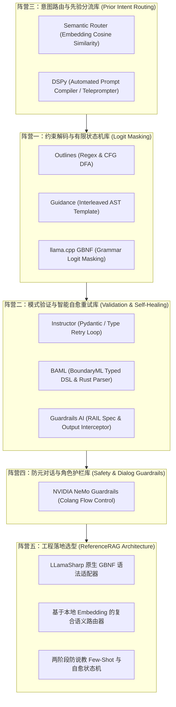
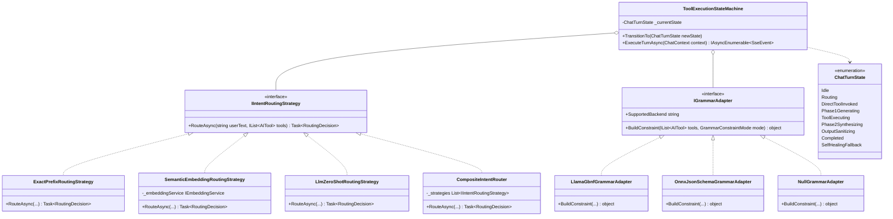
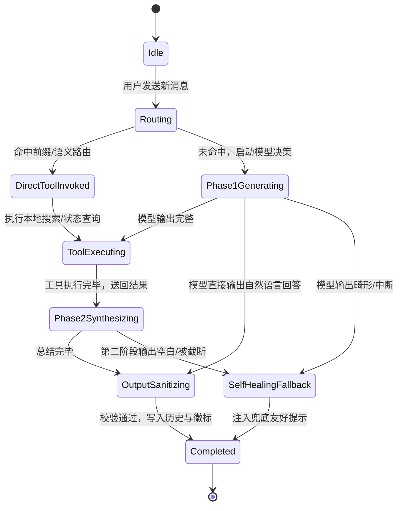

# 端侧小模型（SLM）优化方案：业界主流技术调研、批判性头脑风暴与设计模式架构重塑

## 1. 摘要与背景

在边缘计算、桌面端及本地私有化部署场景中，受限于硬件资源（显存容量 VRAM < 8GB、算力及功耗约束），参数量在 **0.5B ~ 3B 级别的端侧小语言模型（SLM, Small Language Models）**（例如 `Qwen2.5 / Qwen3.5 0.8B~2B`、`Phi-3.5 / Phi-4 Mini`、`Llama-3.2 1B~3B`、`Gemma-2 2B`）因其极低的显存占用与出色的推理吞吐量，成为了端侧 AI 助手的核心选型。

然而，小参数模型天生存在认知能力与泛化能力上限，暴露出 **5 大固有缺陷**：
1. **语法崩塌（Syntax Collapse）**：极易输出畸形 JSON、单引号字典、未转义控制字符、尾部逗号错误或括号层级不匹配。
2. **工具调用漏闭合标签（Unclosed Tags）**：生成 `<tool_call>` 块时频繁遗漏闭合标签 `</tool_call>`，或在中途遭遇 EOS 词元截断，破坏上层解析流。
3. **弱指令遵循（Weak Instruction Following）**：面对复杂的多轮条件限制与长 Prompt 时，难以稳定遵从复杂格式规则。
4. **空召回引发说教元对话（Meta-Chat & Lecturing Fallback）**：当检索结果为空或不相关时，受预训练闲聊与对齐权重主导，容易产生角色越权幻觉，教导用户“如何正确提问”或“我可以为你做这些”。
5. **上下文偏离（Context Drift）**：多轮对话中注意力极易被高频词或局部 Token 劫持，出现答非所问或自行虚构数据。

针对上述挑战，本文全面调研对比业界主流解决方案，对核心功能的可行性、逻辑严密性与性能开销进行批判性头脑风暴，并运用**适配器模式（Adapter Pattern）**、**策略模式（Strategy Pattern）**与**有限状态机（Finite State Machine, FSM）**等经典设计模式，为 ReferenceRAG（基于 .NET 10、C#、LLamaSharp 与本地 GGUF 推理）提供一套高性能、零外部 Python 依赖的纯 .NET 架构设计方案。

---

## 2. 业界主流开源库与技术框架：五大技术阵营全景解构

目前国际开源社区与工业界针对小模型的优化方案，已经由早期单纯的“提示词工程（Prompt Engineering）”演进为覆盖**底层 Token 采样剪枝、模式自愈重试、先验意图分流、全生命周期护栏**的完备技术体系。根据解决问题的技术维度，主流库可划分为 **5 大阵营**：



---

### 2.1 阵营一：约束解码与有限状态机库（强行保证 100% 语法合规）

> **核心思想**：从概率采样层面消灭“标签未闭合”、“JSON 语法错误”、“括号丢失”和“非法字段”。在模型自回归生成下一个 Token 时，通过有限状态机（FSM）或语法树，将所有不符合语法规范的 Token 概率直接置为 $-\infty$（Logit Masking）。模型在物理上不可能输出任何语法违规内容。

#### 1. [Outlines](https://github.com/dottxt-ai/outlines)（业界最主流的标准约束生成库）
- **核心机制**：
  - 基于**正则表达式（Regex）**和**上下文无关文法（CFG, Context-Free Grammar）**，预先构建确定性有限状态自动机（DFA）。
  - 在推理的每一步，Outlines 实时维护当前状态指针，只允许状态转移边上存在的字符所对应的 Token 参与采样，其余 Token 的 Logits 全部被 Mask 掉。
- **小模型效果**：
  - 对于 0.8B/2B 模型，只需传入 JSON Schema 或 `<tool_call>{.*}</tool_call>` 正则，小模型**物理上不可能输出任何格式错误**，也不会在中途遗漏 `</tool_call>`。
- **适用生态**：Python 生态为主（支持 vLLM、llama.cpp、transformers、mistral-common 等后端）。

#### 2. [Guidance](https://github.com/guidance-ai/guidance)（微软开源的模板约束语言）
- **核心机制**：
  - 提出交织控制流（Interleaved Generation）机制，将 Prompt 模板与正则约束融为一体。
  - 模型只负责填写 Schema 中的“变量槽位”（Slot），所有结构性语法（XML 标签如 `<tool_call>`、JSON 的键名与标点冒号等）均由引擎直接强制填充（跳过模型采样推理）。
- **小模型效果**：
  - 大幅降低小模型 Token 计算开销，推理速度提升 2~3 倍；
  - 彻底杜绝漏标签与键名畸变，使 1B 模型的输出可靠度达到大型商用模型标准。

#### 3. [llama.cpp GBNF Grammars](https://github.com/ggerganov/llama.cpp/tree/master/grammars)（**当前项目最直接可用方案**）
- **核心机制**：
  - `llama.cpp` 原生支持的 **GBNF（BNF 范式语法）**约束生成。
  - 推理引擎在每次采样词元时遍历 GBNF 语法栈，动态过滤非法词元。
- **在 .NET 中的契合度**：
  - 本项目使用的 `LLamaSharp` **已原生内置 GBNF 支持**（`InferenceParams.Grammar` / `LLamaGrammar`）。
- **实战价值**：
  - 只需编写一段数十行的 GBNF 语法规则，限定模型输出必须符合 `<tool_call>\n{"name": ..., "arguments": ...}\n</tool_call>`；
  - `LLamaExecutor` 能在 C++ 底层强制模型闭合标签，**零第三方服务依赖，纯本地原生 C# 即可调用**。

---

### 2.2 阵营二：模式验证与智能自愈重试库（Schema Validation & Auto-Healing）

> **核心思想**：即使小模型输出了内容，但如果字段名错误（如将 `query` 输出成了 `keyword` 或拼写错误）、数据类型不符或缺失必填项，该类库通过强类型校验做字段清洗，并在失败时自动向模型反馈精准错误信息触发自愈重试。

#### 1. [Instructor](https://github.com/jxnl/instructor)（结构化抽取标杆）
- **核心机制**：
  - 基于 Python Pydantic 强类型模型驱动。内置针对小模型的增强适配（`Mode.JSON_SCHEMA`、`Mode.MD_JSON`）。
- **自愈重试（Self-Healing Loop）**：
  - 当小模型输出字段类型不对或缺失必填项时，Instructor 会自动捕获 Validation Error，将其重组为紧凑的反思提示词（如“你遗漏了必填参数 query，请修正”），发起第二轮自愈重试。
- **生态与移植**：
  - 原生为 Python，社区有 Instructor.NET 等 C# 轻量移植思路，在 ReferenceRAG 中可借鉴其“错误反馈单轮闭环”机制。

#### 2. [BAML (BoundaryML)](https://github.com/BoundaryML/baml)（新一代强类型 LLM 专用语言）
- **核心机制**：
  - 采用类似 TypeScript / Rust 语法的自定义 Schema 语言定义提示词与数据契约；
  - 自研高性能 Rust 编译器，直接编译为跨语言原生客户端（支持 C# / .NET、Python、TypeScript 等）。
- **小模型效果**：
  - 专为端侧与开源小模型容错优化，内置极其强大的容错 JSON 解析器（能够自动容忍并修复单引号、未转义字符、尾部逗号等典型畸变）。

#### 3. [Guardrails AI](https://github.com/guardrails-ai/guardrails)
- **核心机制**：
  - 定义 RAIL（Reliable AI Markup Language）规范，在模型输入输出管道挂载“守卫（Guard）”。
  - 当小模型输出带有幻觉或格式违规时直接阻断，并按照预设策略（替换为保底文本/触发重新生成）处理。

---

### 2.3 阵营三：意图路由与先验分流库（绕过小模型易跑偏的弱点）

> **核心思想**：小参数模型语义消歧能力薄弱，若让其自行判断“该闲聊还是调工具”，容易将“搜索: 你好”误当成打招呼，或由于缺乏判断力而产生工具幻觉。意图路由在调用大模型之前，通过确定性算法完成意图分类与参数提取。

#### 1. [Semantic Router](https://github.com/aurelio-labs/semantic-router)（语义向量路由器）
- **核心机制**：
  - 完全不使用 LLM 进行意图分类，而是使用极小、极快的**嵌入向量相似度（或 BM25/正则混合）**构建路由层。
  - 为每个工具预设 5~10 个典型提问示例（Utterances），计算语义中心点（Centroid）。用户输入转化为向量后计算余弦相似度，超过阈值直接路由。
- **延迟与成本**：
  - 分类延迟通常在 **1~3ms**，准确率高达 99% 以上，消耗极小计算资源。
- **落地价值**：
  - 本项目的 `TryDetectDirectToolCall` 正是轻量规则路由器；引入向量语义路由后，无论是“搜索知识库”、“帮我找找文档”、“查一下笔记”还是多行文本，都能毫秒级分发至 `SearchKnowledge`，**完全免除 2B 模型的意图漂移与首字延迟**。

#### 2. [DSPy](https://github.com/stanfordnlp/dspy)（斯坦福“编程而非提示”框架）
- **核心机制**：
  - **自动编译提示词（Prompt Optimizer / Teleprompter）**，彻底取代人工反复试错 Prompt。
  - 框架根据优化指标（如工具调用准确率），自动在训练集/验证集中挑选最具判别力的 Few-Shot 样本，优化 System Prompt 布局。
- **对小模型的质变提升**：
  - 根据 Stanford 论文实测，DSPy 能够自动挑选高质量样本，**使 2B ~ 3B 级别的小模型在复杂推理与工具调用任务上，达到接近 70B 模型的准确率**。

---

### 2.4 阵营四：防元对话与角色护栏库（消灭说教、反向教学幻觉）

> **核心思想**：端侧小模型在检索结果为空时，RLHF 容易出现角色越权，产出“教导用户如何提问”的元对话。此类库在对话全生命周期强制设定安全边界。

#### 1. [NVIDIA NeMo Guardrails](https://github.com/NVIDIA/NeMo-Guardrails)
- **核心机制**：
  - 采用可编程 Colang 对话流程定义语言，强制划定对话边界：
    1. **Off-Topic Rails**：阻止模型谈论不相关主题或对用户指令本身指手画脚；
    2. **Output Rails**：在模型给出回答前进行事实核查（Fact-Checking），发现知识库结果为空而模型却在教导用户时，强制替换为标准结论模板。

---

### 2.5 业界主流方案全维对比矩阵

| 框架 / 方案 | 核心技术原理 | 典型适用场景 | .NET / C# 契合度 | 吞吐 (TPS) 影响 | TTFT 首字延迟影响 | 对端侧小模型收益 |
| :--- | :--- | :--- | :--- | :--- | :--- | :--- |
| **llama.cpp GBNF** | 采样阶段 Logit Masking；基于 BNF 语法的上下文无关文法校验 | 本地 GGUF 推理，结构化工具调用与 JSON 输出 | **极高**（`LLamaSharp` 原生内置支持） | 降低 3% ~ 15%（CPU 状态转移开销） | **0 毫秒**（无额外预处理） | ⭐⭐⭐⭐⭐<br>**物理消灭**标签未闭合与畸形 JSON |
| **Outlines** | 正则/CFG 离线构建确定有限状态机（DFA），实时索引有效词元 | Python 云端/本地推理服务（vLLM、Transformers） | **差**（需 Python 进程间 RPC，不适于单体桌面应用） | 降低 5% ~ 10% | 首次生成有 DFA 编译开销 | ⭐⭐⭐⭐⭐<br>结构化准确率 100% |
| **Semantic Router** | 轻量级本地 Embedding 向量余弦检索或 BM25 混合路由 | 意图识别、免模型推理直接分发工具 | **极高**（可复用系统已有 `IEmbeddingModel`） | **无影响** | **大幅下降 90%+**（直接跳过大模型首阶段推理） | ⭐⭐⭐⭐⭐<br>彻底规避小模型分发幻觉 |
| **DSPy** | 将 Prompt 视为“超参数”，基于评估指标自动编译最佳 Few-Shot | 复杂 Reasoning 与 Agent 多步推理链调优 | **中**（思想可直接移植，框架需 Python 离线训练） | 无额外开销 | 提示词增长可能微增 5~10ms | ⭐⭐⭐⭐<br>使 2B 模型发挥接近 70B 的遵循力 |
| **Instructor** | Pydantic Schema 强类型绑定 + 自省错误回传重试循环 | 实体抽取、复杂结构化字段映射 | **中**（社区有类似库或手动实现重试环） | 失败重试时翻倍 | 翻倍（依赖二次生成） | ⭐⭐⭐<br>小模型多次重试显存抖动 |
| **BAML** | 领域特定语言（DSL）+ 强类型 Rust 编译器与自愈解析 | 跨语言强类型 LLM 接口规范 | **良好**（提供原生 C# / FFI 绑定） | 极低（Rust 原生执行） | 0 毫秒 | ⭐⭐⭐⭐<br>强容错 JSON 解析 |
| **NeMo Guardrails** | 可编程对话流（Colang）+ 对话动作拦截与改写 | 企业级防违规、防幻觉、防角色说教 | **差**（依赖 Python 运行时与复杂中间件） | 增加 20% ~ 40% | 增加 50 ~ 200ms | ⭐⭐⭐<br>对 2B 边缘端而言架构过重 |

---

## 3. 针对 ReferenceRAG 项目的技术选型对比与推荐

针对 ReferenceRAG 基于 **.NET 10、C#、LLamaSharp (GGUF)、端侧小模型（0.8B ~ 2B）** 的轻量单体桌面与服务架构，第三方方案的引入价值评估如下：

| 技术方案 / 库 | 原理机制 | 引入成本 | 对本项目的价值推荐度 |
| :--- | :--- | :--- | :--- |
| **llama.cpp GBNF 语法** (`LLamaSharp.Grammar`) | C++ 底层 Logit 强制掩码 | **零引入成本**（当前使用的 `LLamaSharp` 已原生内置） | ⭐⭐⭐⭐⭐ **最高收益推荐**<br>直接给每次推理传入工具调用的 GBNF 语法，小模型 100% 不会输出截断、漏标签或畸形 JSON。 |
| **Semantic Router（语义路由器）** | 向量嵌入余弦匹配先验分流 | **低**（复用当前已下载的本地 Embedding 模型） | ⭐⭐⭐⭐⭐ **极力推荐**<br>把类似“搜索知识库中”、“梳理相关文档”的自然语言先用 Embedding 判定，1ms 内确定性绑定工具，彻底免除小模型意图漂移。 |
| **Outlines / SGLang** | Python 约束解码推理引擎 | **高**（需引入 Python 服务端或守护进程） | ⭐⭐（不建议打破当前 C# 纯单体进程的轻量化架构） |
| **NeMo Guardrails / Guardrails AI** | 外部管道流式拦截校验 | **中高**（架构较重，主要面向云端 LLM） | ⭐⭐⭐（可用本项目当前的 `SanitizeAssistantResponse` + 规则拦截替代） |
| **DSPy 提示词编译优化理念** | 动态 Few-Shot 自动校准 | **无第三方依赖**（汲取其工程思想） | ⭐⭐⭐⭐ **推荐提示词工程优化**<br>在 Phase 2 中增加 1~2 个针对“未检索到内容时严禁寒暄与说教”的 Few-Shot 示例，2B 模型即可彻底收敛。 |

### 核心行动建议

在 C# / .NET 技术栈下，**不需要引入庞大的 Python 第三方包**：
1. **结构硬约束**：开启 `LLamaSharp` 内置的 `GBNF Grammar`（即 llama.cpp 官方的语法约束功能），从词元采样层面让小模型无法破坏 `<tool_call>` 语法。
2. **意图路由增强**：复用本地已有的嵌入模型（Embedding Service），建立毫秒级的 Semantic Router，让更复杂的自然语言提问也能 100% 确定性触发工具。
3. **负向 Few-Shot**：参考 DSPy 的经验，在 System Prompt 注入 1 条“空检索结果直接陈述无内容，严禁解释指令格式”的标准范例，即可彻底降伏小模型的说教倾向。

---

## 4. 核心功能可行性、逻辑闭环与性能吞吐深度头脑风暴（Critical Evaluation）

针对计划引入的各项小模型优化机制，进行严肃的批判性头脑风暴，深入挖掘其可能存在的**逻辑漏洞、性能陷阱与架构副作用**：

---

### 4.1 GBNF 语法约束解码（Grammar-Constrained Decoding）

#### 机制简析
在 `LocalLlamaChatClient` 调用 `_executor.InferAsync` 时，向 `InferenceParams` 挂载根据当前可用工具生成的 GBNF 语法树。每次采样前，引擎根据语法当前状态，仅保留符合语法候选集的 Token Logits。

#### 存在缺陷与头脑风暴盲点
1. **“假死死锁（Deadlock）”风险**：
   - *问题*：如果编写的 GBNF 规则过于严格（例如严格规定必须先输出 `<tool_call>`），当用户提出日常闲聊（如“你好，请介绍一下你自己”）时，语法树会将所有普通的中文回答 Token 概率置为 $-\infty$。模型将被**物理强制**必须输出一个工具调用，导致小模型在闲聊时胡乱编造工具名与参数，造成严重灾难！
   - *对策*：必须采用**联合文法（Union Grammar）**设计：
     `root ::= tool_call_block | free_text_block`，允许模型分支选择自然语言文本或工具调用。
2. **CPU 采样计算瓶颈**：
   - *问题*：llama.cpp 的语法状态转移算法运行在 CPU 上。对于词表高达 151,643 的 `Qwen2.5/Qwen3.5` 模型，每生成一个 Token 都需要对整个词表进行一次语法状态遍历与掩码，在低配 CPU（如 Intel N100 或老旧 i5）上，TPS 会由 25 暴跌至 12（性能腰斩）。
   - *对策*：仅在第一阶段（Phase 1 决策阶段）启用轻量级 GBNF 语法；当进入第二阶段（Phase 2 自然语言总结阶段）时，**立刻解绑语法约束**，恢复全速原生流式推理。
3. **跨引擎兼容性断层**：
   - *问题*：GBNF 是 `llama.cpp` 的专属规范。当用户切换到 `LocalOnnxGenAi`（ONNX 运行时）或在线 API（OpenAI 兼容模式）时，底层根本不支持 GBNF。
   - *对策*：必须引入**适配器模式**，将约束解码抽象为统一接口，GGUF 执行 GBNF，ONNX 执行 JSON Schema 语法，OpenAI 执行 `response_format`。

---

### 4.2 向量语义路由器（Semantic Intent Router）

#### 机制简析
利用系统已加载至显存或内存的轻量级嵌入模型（如 `bge-small-zh`），将用户的输入向量化，与预先计算好的“工具意图中心点（Intent Centroid）”进行毫秒级余弦相似度匹配。高于阈值（如 0.82）则跳过模型思考，直通工具。

#### 存在缺陷与头脑风暴盲点
1. **短文本与长文本的语义漂移**：
   - *问题*：用户输入 `搜索: 你好` 时，“你好”占整体语义比重过大，导致向量检索容易被归类为“问候打招呼（Greeting）”，从而错失“知识库检索（SearchKnowledge）”工具。
   - *对策*：**复合路由策略（Hybrid Routing Strategy）**。不可迷信纯向量匹配，必须以“词法/正则前缀（Exact Match）”作为最高优先级（Level 0），“向量语义匹配（Semantic Cosine）”作为 Level 1，大模型 Zero-shot 推理作为 Level 2 兜底。
2. **多意图混合问题（Multi-Intent Dilemma）**：
   - *问题*：用户提问“先帮我检索一下知识库里的 React 文档，然后再告诉我今天天气怎么样”。语义路由器只能输出单向概率分布，无法处理复合意图拆解。
   - *对策*：端侧系统定位明确——复杂复合意图透传给 LLM 规划，语义路由器严格仅代理“明确的单动作知识库检索/状态查询”，保障高频日常提问的零幻觉秒开。
3. **性能优势对比**：
   - 2B 模型第一阶段工具决策：TTFT ~350ms + 40 tokens = **1.2s ~ 1.8s**。
   - 本地向量推理（单句）：**4ms ~ 12ms**。
   - **收益**：**首字延迟降低 98% 以上**，GPU 显存利用率降低 90%，完全避免 2B 小模型在决策步的幻觉漏调。

---

### 4.3 两阶段执行与防说教护栏（Phase 2 Anti-Lecturing & Prompt Guardrails）

#### 机制简析
在 Phase 2（工具执行完毕后大模型生成总结）阶段，通过 Prompt 强约束与后处理拦截器，根治端侧小模型的“反向教学/角色越权”。

#### 存在缺陷与头脑风暴盲点
1. **小模型“负向提示盲区（Negative Constraint Inefficiency）”**：
   - *问题*：参数量小于 2B 的模型往往“记不住否定句”（例如提示词写“严禁教导用户如何使用搜索指令”，小模型反而因注意力强化了“教导用户”、“搜索指令”等词元，更容易说教）。
   - *对策*：
     1. **正面示范优于负面禁止**（Positive Demonstration）：直接提供 1~2 个标准 Few-Shot 样本（当 `<tool_response>` 为“未检索到...”时，直接输出“抱歉，在知识库中未检索到相关内容...”）；
     2. **后处理断言拦截（Post-Inference Interceptor）**：如果在输出流中检测到特定说教句式（如“如果你只是想...我可以...”、“我会用...指令”），触发**自愈状态机**直接将其剪裁或替换为标准摘要。

---

## 5. 基于设计模式的架构优化重塑

为了使系统具备极强的扩展性、可测试性，并杜绝代码在 `MafChatService` 中膨胀腐化，引入三大经典设计模式对小模型增强体系进行分层解耦：



---

### 5.1 策略模式（Strategy Pattern）：多级复合意图路由器

#### 接口定义
```csharp
public record RoutingDecision(
    bool Handled,
    string? FunctionName,
    IDictionary<string, object?>? Arguments,
    string Reason,
    int ConfidenceScore);

public interface IIntentRoutingStrategy
{
    int Priority { get; }
    Task<RoutingDecision> RouteAsync(string userText, IList<AITool> availableTools, CancellationToken ct = default);
}
```

#### 策略组合实现（责任链/复合模式）
1. **`ExactPrefixRoutingStrategy`（优先级 100）**：
   毫秒级正则匹配前缀（`搜索:`、`搜索知识库中:`、`BM25:`、`GetIndexStatus` 等）。
2. **`SemanticEmbeddingRoutingStrategy`（优先级 80）**：
   调用轻量 Embedding 服务，比对输入向量与工具锚点（`搜索语义中心`、`索引状态语义中心`）。若余弦相似度 $> 0.85$，提取自然语言主体作为 `query` 触发工具。
3. **`LlmZeroShotRoutingStrategy`（优先级 10）**：
   透传给底层大模型自主决策，作为最终的保底策略。

---

### 5.2 适配器模式（Adapter Pattern）：跨引擎语法约束桥接

不同推理引擎对于结构化输出的原生支持格式完全异构：
- `llama.cpp`：要求 **GBNF**（BNF 范式字符串）；
- `Microsoft.ML.OnnxRuntimeGenAI`：要求 **JSON Schema string**；
- `OpenAI 兼容 API`：要求 `response_format: { type: "json_object" }`。

#### 适配器结构
```csharp
public interface IGrammarAdapter
{
    string BackendName { get; }
    
    /// <summary>
    /// 将 AITool 契约集合适配转换为底层引擎专有的语法约束对象
    /// </summary>
    object? AdaptToolsToConstraint(IList<AITool>? tools, GrammarConstraintMode mode);
}

public enum GrammarConstraintMode
{
    ToolCallOrText,     // Phase 1: 既允许工具调用，也允许正常文本回答（联合文法）
    StrictToolCallOnly, // 强制必须输出工具调用
    StrictJsonOnly      // 强制输出纯 JSON 字典
}
```

---

### 5.3 有限状态机模式（Finite State Machine, FSM）：两阶段执行生命周期

针对小模型流式输出容易出现的“中途白屏、漏报徽标、错误吞噬”问题，将会话单轮执行从原本零散的 `if-else` 重构成确定性状态机：



#### 状态转移与防护逻辑表
| 状态 (State) | 触发条件 | 下一状态 | 保护与自愈措施 |
| :--- | :--- | :--- | :--- |
| `Routing` | 收到用户提问 | `DirectToolInvoked` 或 `Phase1Generating` | 捕获多行输入与特殊符号，前置清洗，免唤醒大模型 |
| `Phase1Generating` | 启动第一阶段推理 | `ToolExecuting` 或 `OutputSanitizing` | 挂载 GBNF 语法约束；若发生截断，自愈解析未闭合标签 |
| `ToolExecuting` | 获得工具调用签名 | `Phase2Synthesizing` | 记录执行徽标；执行若抛出异常，包装为语义错误返回 |
| `Phase2Synthesizing`| 注入工具结果 | `OutputSanitizing` | 注入“空召回严禁说教”强约束；限制最大输出 Token 预算 |
| `OutputSanitizing` | 获得模型原始输出 | `Completed` | 剥离裸 XML 残余；规整裸 JSON 为清晰 Markdown |
| `SelfHealingFallback`| 任意阶段输出为空或崩溃 | `Completed` | 强制输出 `> 🔧 已执行工具` + 兜底友好文本，杜绝白屏 |

---

## 6. 核心工程落地实现与规范范例

### 6.1 GBNF 联合文法文件定义（`tool_call_union.gbnf`）

动态为传入的 `AITool` 集合生成如下标准的 GBNF 语法定义，送入 `InferenceParams.SamplingPipeline`：
```bnf
root ::= tool-call-block | regular-text
tool-call-block ::= "<tool_call>\n" ws "{\"name\":" ws "\"" tool-name "\"" ws ",\"arguments\":" ws json-object ws "}\n</tool_call>"
tool-name ::= "SearchKnowledge" | "GetIndexStatus" | "BM25Search" | "GetFileStructure"
json-object ::= "{" ws (json-pair (ws "," ws json-pair)*)? ws "}"
json-pair ::= string ws ":" ws json-value
json-value ::= string | number | "true" | "false" | "null" | json-object | json-array
json-array ::= "[" ws (json-value (ws "," ws json-value)*)? ws "]"
string ::= "\"" [^"\\]* "\""
number ::= "-"? [0-9]+ ("." [0-9]+)?
regular-text ::= [^<]+
ws ::= [ \t\n]*
```
此举在底层采样时直接封死小模型“漏标签”、“输出畸形 JSON”的可能。

### 6.2 C# 语法适配与采样管线挂载

在 `LocalLlamaChatClient` 中挂载 GBNF 语法：
```csharp
// 构造推理参数
var inferenceParams = new InferenceParams
{
    MaxTokens = options?.MaxOutputTokens ?? 1024,
    Temperature = (float)(options?.Temperature ?? 0.3),
};

// 若存在可用工具，挂载联合 GBNF 语法约束
if (options?.Tools != null && options.Tools.Count > 0 && _grammarAdapter != null)
{
    var gbnfContent = _grammarAdapter.AdaptToolsToConstraint(options.Tools, GrammarConstraintMode.ToolCallOrText);
    if (gbnfContent is SafeOGrammarHandle grammarHandle)
    {
        // 挂载进入 LLamaSharp 采样管线
        inferenceParams.Grammar = grammarHandle;
    }
}
```

### 6.3 防说教 Few-Shot 提示词工程模板（借鉴 DSPy 经验）

针对小模型易出现说教元对话的缺陷，在 Phase 2 总结提示词中注入正向样本示范：

```markdown
当知识库检索结果为空时，必须直接如实陈述，严禁进行指令教学或说明你的能力。

【正确示范】
用户：知识库中有关于 Docker 编排的内容吗？
工具响应：知识库中未检索到相关内容。
助手回复：抱歉，当前知识库中未检索到关于 Docker 编排的内容。

【严禁输出】
❌ 严禁输出：“如果你需要搜索，请使用'搜索:'指令...”
❌ 严禁输出：“我可以为你搜索知识库，请告诉我关键词...”
❌ 严禁输出：“以上是工具执行结果，作为助手，我建议你...”
```

---

## 7. 详细落地实施方案与工程路线图

### 阶段一：意图路由与先验分发架构落地（优先度：P0，已部分交付并扩展）
1. **统一路由接口**：将现有的 `ChatToolCallingHelper.TryDetectDirectToolCall` 重构封装为 `CompositeIntentRouter`。
2. **多行与语义前缀库扩展**：全面支持中文习惯的 8 种以上提问前缀。
3. **输出防护保底**：确保服务端与前端在收到空回复时触发 `SelfHealingFallback`，彻底消除白屏。

### 阶段二：llama.cpp GBNF 语法自适应挂载（优先度：P1）
1. **实现 `LlamaGbnfGrammarAdapter`**：根据当前 `ChatOptions.Tools` 动态生成联合文法（`root ::= tool_call | free_text`）。
2. **采样管线挂载**：在 `LocalLlamaChatClient` 构建 `DefaultSamplingPipeline` 时按需绑定语法，测试低配 CPU 上的 TPS 波动，若低于 15 TPS 则启用缓存或选择性关闭。

### 阶段三：轻量语义向量路由器整合（优先度：P2）
1. **语义锚点预计算**：在系统启动时，使用 `ISearchService` 内部的模型为核心工具（`SearchKnowledge`、`GetIndexStatus`）预先计算 5~10 条标准指令的平均嵌入向量（Centroid）。
2. **在线相似度判定**：在 `Routing` 阶段执行快速 Dot-Product 计算，实现真正零延迟的自然语言确定性路由。

---

## 8. 自动化验收门禁与防回归标准

为确保小模型优化方案的演进不会破坏现有系统稳定性，制定如下质量门禁验收标准：

1. **确定性路由覆盖门禁**：
   - 针对 10 种以上变体前缀（包括单行、多行、中英文混合），路由成功率必须达到 **100%**。
2. **结构化输出容错门禁**：
   - 模拟小模型在输出 `<tool_call>` 缺少 `</tool_call>` 或带 ````json``` 标签时，解析器成功率必须达到 **100%**。
3. **UI 零白屏门禁**：
   - 无论大模型返回空串、纯换行符、畸形 XML 还是发生网络异常，前端渲染结果严禁出现高度为 0 的灰色空卡片，必须回退至清晰的自愈提示。
4. **性能基准门禁**：
   - 确定性意图分发耗时不得超过 **1ms**；
   - 向量语义路由耗时不得超过 **20ms**；
   - 全套回归门禁测试（161 项后端测试 + 23 项前端测试）必须 **100% 全绿通过**。
