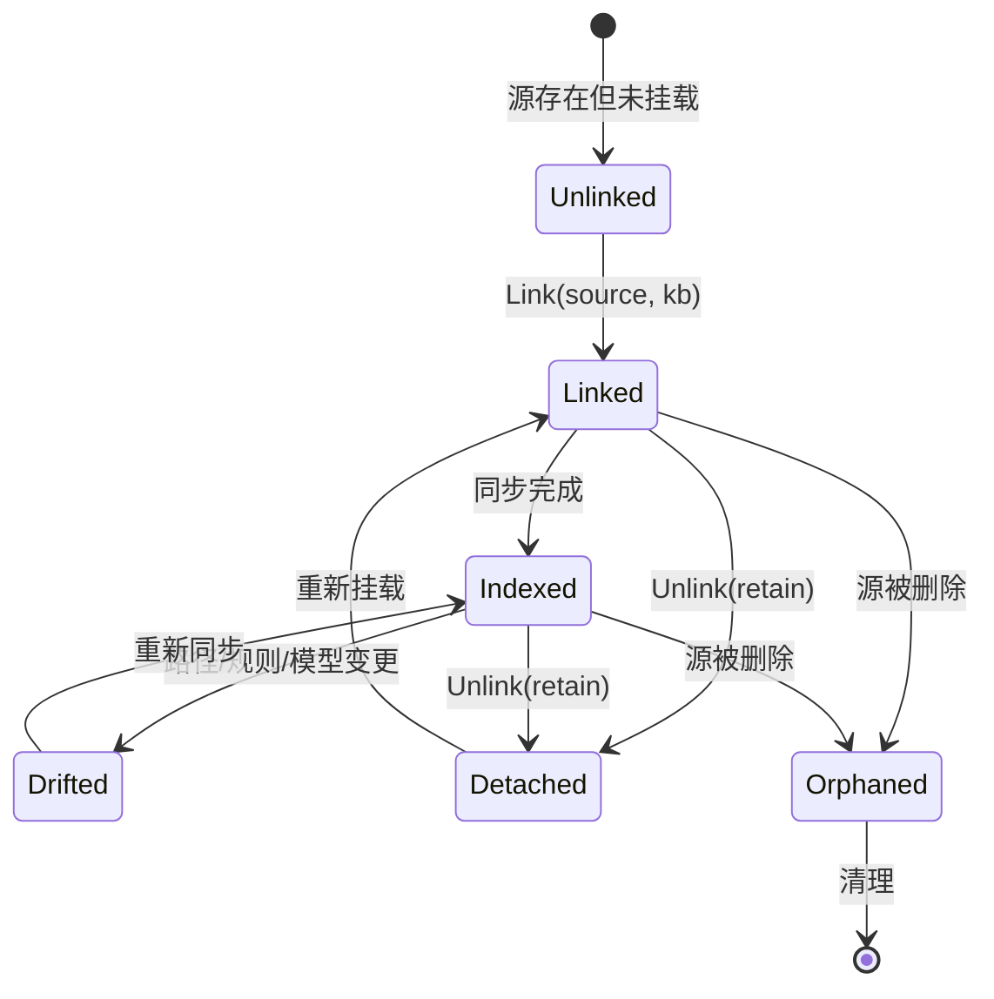

# 源文件管理与知识库连接器的双向关联：可行性、去重与架构方案

> **文档标识**：`docs/source-knowledge-base-bidirectional-linking-feasibility-and-architecture-design.md`
> **创建日期**：2026-11-13
> **状态**：调研完成 / 方案待评审（本文档不含代码改动）
> **触发需求**：
> 1. 源文件管理能否与知识库管理关联？
> 2. 知识库中的连接器自动出现在源文件管理（同路径去重、存在则跳过）；
> 3. 源文件管理中的路径可快速添加到知识库连接器（同路径去重、存在则跳过）。
> **涉及模块**：`SourcesController`、`KnowledgeBasesController`、`KnowledgeBaseService`、`CatalogStore`、`LegacySourceMigrator`、`Sources.js`、`KnowledgeBases.js`

---

## 目录

1. [结论摘要](#1-结论摘要)
2. [现状与缺口](#2-现状与缺口)
3. [可行性、逻辑与性能头脑风暴](#3-可行性逻辑与性能头脑风暴)
4. [设计模式优化设计](#4-设计模式优化设计)
5. [库与业界主流方案](#5-库与业界主流方案)
6. [现有基础设施盘点](#6-现有基础设施盘点)
7. [分阶段具体方案](#7-分阶段具体方案)
8. [数据模型与迁移](#8-数据模型与迁移)
9. [接口契约设计](#9-接口契约设计)
10. [性能量化与容量估算](#10-性能量化与容量估算)
11. [风险、兼容性与回退](#11-风险兼容性与回退)
12. [验收标准与测试门禁](#12-验收标准与测试门禁)
13. [参考资料](#13-参考资料)

---

## 1. 结论摘要

三个需求**均可行**，而且**需求 2 与需求 3 的一半已经存在**，只是实现方式与用户预期不同：

1. **需求 2 已以「读时聚合」实现**：`GET /api/Sources` 会把 `config.Sources` 与所有知识库连接器合并成一张表，按 `Path` 去重（`SourcesController.GetAll`）。所以连接器**已经会自动出现在源文件管理**，但它是**只读投影**，不是持久化关联，也不出现在 `config.Sources` 中。用户感知的「没有关联」，本质是「聚合视图缺少显式关联标识与反向操作入口」。
2. **需求 3 已以「隐式双写」实现了一半**：`POST /api/Sources` 写入 `config.Sources` 后，会异步把该路径注册为**第一个启用知识库**的 `LocalFolder` 连接器（`SourcesController.Add`）。缺口有三：**目标知识库不可选、无路径去重、fire-and-forget 无反馈且进程重启可能丢失**。
3. **去重目前只在「读侧」和「迁移器」存在，写侧没有**：`GetAll` 按 Path 去重；`LegacySourceMigrator` 迁移时用 `HashSet<string>` 去重；但 `connectors` 表**没有 `(knowledge_base_id, target_path)` 唯一约束**，`KnowledgeBaseService.AddConnectorAsync` 也不查重。并发或重复点击会产生重复连接器。

**推荐架构**（零新增第三方依赖）：

- 把**连接器作为唯一事实来源（写模型）**，源文件管理作为**读模型投影**（CQRS 的轻量应用，不做全系统 CQRS）；
- 写侧统一走**幂等 `EnsureConnectorAsync`**（按规范化路径查重 + 数据库唯一索引兜底）；
- 用**绑定状态机**描述「源 ↔ 连接器」生命周期，用**回收策略**区分「解绑」与「删除数据」；
- 新增两个显式动作：源行「挂载到知识库」、连接器行「在源管理中查看」，替代当前的隐式双写。

**是否引入新库**：不需要。`ICatalogStore`、`FolderPicker`、`ResolveSourceAsync`、`LegacySourceMigrator` 已覆盖 80% 底座；缺口是唯一索引、幂等 upsert、显式关联 API 与前端入口。

---

## 2. 现状与缺口

### 2.1 需求对照

| 需求 | 当前状态 | 缺口 |
| :--- | :--- | :--- |
| KB 连接器出现在源管理 | ✅ 已实现（`GetAll` 读时合并，按 Path 去重） | 无「已关联」标识（仅有 `IsConnector`）；无法从源行反查所属知识库；连接器行文件数/分块数为 `-` |
| 源路径快速添加到 KB | ⚠️ 半实现（新增源时异步挂到**第一个启用 KB**） | 不能选择目标 KB；不检查目标 KB 是否已有同路径；失败只打日志；无法对**已存在的旧源**补挂 |
| 同路径去重（存在则跳过） | ⚠️ 仅读侧与迁移器有 | 写侧无去重；DB 无唯一约束；并发/重复提交会产生重复连接器 |
| 反向关联（KB → 源管理） | ✅ 读时聚合天然覆盖 | 删除连接器后，若同路径仍在 `config.Sources`，源管理仍显示该行（幽灵源） |

### 2.2 关键代码事实

| 位置 | 事实 |
| :--- | :--- |
| `SourcesController.GetAll` | 合并 `config.Sources` 与 `catalogStore` 连接器，`if (!sources.Any(s => s.Path.Equals(conn.TargetPath)))` 去重 |
| `SourcesController.Add` | 只查 `config.Sources` 同路径/同名；随后 `Task.Run` 异步注册连接器到「第一个启用 KB」，**无查重** |
| `KnowledgeBaseService.AddConnectorAsync` | 直接 `SaveConnectorAsync`，**无路径查重** |
| `CatalogStore` 建表 | `connectors(id TEXT PRIMARY KEY, ..., target_path TEXT NOT NULL, ...)`，**无 `(kb_id, target_path)` 唯一索引** |
| `CatalogStore.SaveConnectorAsync` | `ON CONFLICT(id) DO UPDATE`，只按主键 upsert |
| `LegacySourceMigrator` | 启动迁移旧源到默认 KB，**已用 `HashSet<string>(OrdinalIgnoreCase)` 去重**（可复用其规范化思路） |
| `KnowledgeBaseService.DeleteConnectorAsync` | `cascade=true` 时清理该连接器的向量/词法数据，但**不删除 `config.Sources`** |
| `SourcesController.Delete` | 删除 `config.Sources` 并可选 `DeleteSourceAsync`，**不删除对应连接器** |

### 2.3 由此产生的四个真实问题

1. **重复连接器**：同一路径反复添加（或并发点击）会在同一 KB 下产生多条连接器，索引/统计重复。
2. **幽灵源 / 幽灵连接器**：删源不删连接器，或删连接器不删源，两侧状态不一致。
3. **不可选的自动挂载**：新增源被强行挂到「第一个启用 KB」，多知识库场景下语义错误。
4. **无反馈的异步双写**：`Task.Run` 失败只写日志，用户看到「添加成功」但连接器没建。

---

## 3. 可行性、逻辑与性能头脑风暴

### 3.1 可行性

| 方案 | 可行性 | 说明 |
| :--- | :--- | :--- |
| 读时聚合（现状） | 高 | 已实现，零迁移成本；但只是视图 |
| 显式关联 + 幂等 upsert | 高 | 复用 `ICatalogStore`，加唯一索引即可 |
| 双向自动同步（事件驱动） | 中 | 需要领域事件/outbox，当前无事件总线，P2 再做 |
| 物理写入 `config.Sources` 作为关联载体 | 低 | 会与「连接器是事实来源」冲突，产生双写一致性问题 |

**结论**：采用「连接器为写模型、源管理为读模型 + 显式关联命令」，而不是让两边互相物理写入。

### 3.2 逻辑欠缺

- **一个物理路径能否挂到多个知识库？——已决策：允许。**
  - 去重键为 `(knowledge_base_id, path_key)`，**同一 KB 内路径唯一，跨 KB 可重复挂载**；
  - 源管理一行需展示「已挂载 N 个知识库」并列出 KB 名称，`SourceMount` 的 `linkedKnowledgeBases[]` 承载；
  - 挂载到新 KB 时返回 `Created`；重复挂到同一 KB 返回 `AlreadyLinked`（幂等，不报错）；
  - 该决策意味着不能使用全局唯一路径索引，只能用复合唯一索引。
- **去重键的规范化**：`/app/sources/full`、`/app/sources/full/`、`/App/Sources/Full`、符号链接、Windows 盘符大小写，都会被当成不同路径。必须统一为 `NormalizePath + TrimEnd('/') + 大小写策略`。
- **删除语义三分**：解绑（保留数据）、删除连接器（删索引）、删除物理目录（危险）。当前 UI 的「删除连接器」默认 `cascade=true`，语义偏重，需要显式回收策略。
- **源与连接器的字段冲突**：`Name`、`FilePatterns`、`Enabled` 两边都可改。需要明确「谁覆盖谁」：建议连接器为权威，源侧字段只读或变更时同步到连接器。
- **迁移器与在线双写重复**：`LegacySourceMigrator` 与 `SourcesController.Add` 都做「源 → 连接器」，逻辑重复且去重规则不一致，应合并为一个服务。

### 3.3 性能欠缺

- **N+1 查询**：`GetAll` 对每个 KB 调一次 `GetConnectorsByKnowledgeBaseAsync`。KB 数量 10、每库 5 连接器时为 11 次查询，通常 < 10ms；KB 上百时需改为一次 `GetAllConnectorsAsync`。
- **去重查询**：若在应用层遍历所有连接器做 Path 比较，O(连接器数)。加唯一索引后可用 `WHERE kb_id=@id AND path_key=@key` 命中索引，O(log n)。
- **重复连接器导致索引放大**：同一目录被两个连接器索引，向量/BM25 数据翻倍，检索结果重复。这是当前最实际的性能风险。
- **异步双写的线程池占用**：`Task.Run` 在请求线程外执行，量小可忽略，但不可靠性比性能更值得关注。

### 3.4 并发与一致性

| 场景 | 风险 | 缓解 |
| :--- | :--- | :--- |
| 两个请求同时挂载同一路径 | 双写都通过应用层查重 → 重复 | DB 唯一索引 + `INSERT ... ON CONFLICT DO NOTHING` 后回查 |
| 删除源与挂载并发 | 挂载成功但源已删 | 事务内校验源存在；或先解绑再删 |
| 迁移器与在线请求并发 | 重复连接器 | 复用同一 `EnsureConnectorAsync` |
| 连接器删除与索引任务并发 | 索引写入已删除连接器 | 现有 `PurgeConnectorDataAsync` + 任务取消（已有基础设施） |

### 3.5 可测试性

现有 `SourcesControllerTests` 已能注入 `ICatalogStore` mock；新增去重/冲突用例成本低。前端可加静态门禁断言「源行存在挂载入口」「连接器行存在反查入口」。

---

## 4. 设计模式优化设计

### 4.1 适配器：`SourceMountAdapter`

把两种异构实体统一为「挂载视图」，供源管理与知识库管理共用：

```csharp
public sealed record SourceMount(
    string Path,                 // 规范化绝对路径
    string DisplayName,          // 源名 或 "{KB名} - {目录名}"
    string FilePattern,
    bool Enabled,
    SourceMountKind Kind,        // LegacySource | Connector | Both
    string? KnowledgeBaseId,
    string? ConnectorId,
    int LinkedKnowledgeBaseCount
);
```

| 输入 | 适配结果 |
| :--- | :--- |
| `SourceFolder`（config.Sources） | `Kind=LegacySource`，无 KB 信息 |
| `ConnectorDefinition` + `KnowledgeBaseDefinition` | `Kind=Connector`，带 KB/Connector ID |
| 同路径同时存在 | `Kind=Both`，`LinkedKnowledgeBaseCount` 累加 |

**价值**：`GetAll`、搜索源池、前端表格都消费同一 DTO，避免三处各自拼接显示名（当前 `GetAll`、`ManagedFileSearchEngine`、`LegacySourceMigrator` 各拼一次）。

### 4.2 策略：`LinkPolicy` + `ReclaimPolicy`

**挂载策略**（新增源/点击挂载时如何选目标 KB）：

| 策略 | 行为 | 适用 |
| :--- | :--- | :--- |
| `ExplicitKnowledgeBase` | 必须传 `knowledgeBaseId`，否则 400 | **推荐默认**（多库场景） |
| `FirstEnabledKnowledgeBase` | 挂到第一个启用 KB（现状） | 单库/兼容模式 |
| `ProjectionOnly` | 只读投影，不自动挂载 | 纯旧源用户 |

**回收策略**（解绑/删除时如何处理数据，直接借鉴 K8s PV 的 `ReclaimPolicy`）：

| 策略 | 行为 |
| :--- | :--- |
| `Retain` | 只删除连接器记录，保留索引数据与物理文件（可重新挂载） |
| `Delete` | 删除连接器 + 清理该连接器索引数据（当前 `cascade=true`） |
| `Purge` | 额外删除物理目录（**高危，默认禁用，需二次确认**） |

### 4.3 状态机：`MountState`



- `Unlinked`：`config.Sources` 有、连接器无 → 源管理显示「可挂载」；
- `Linked/Indexed`：两侧都存在 → 显示「已挂载」；
- `Drifted`：路径或分块/嵌入规范变化（可复用现有 `checkDrift`）；
- `Detached`：连接器已删但数据保留（`Retain`）；
- `Orphaned`：连接器在、源已删 → 知识库管理提示「源已移除，可解绑或保留」。

### 4.4 仓储规约：`EnsureConnectorAsync`

把「查重 + 创建/返回已有」收敛为一个幂等操作：

```csharp
Task<(ConnectorDefinition Connector, bool Created)> EnsureConnectorAsync(
    string knowledgeBaseId,
    string kind,
    string targetPath,
    string? filePattern,
    CancellationToken ct = default);
```

实现要点：
1. 规范化 `path_key`；
2. `SELECT ... WHERE knowledge_base_id=@kb AND path_key=@key`；
3. 存在 → 返回 `Created=false`（并可选更新 `FilePattern`）；
4. 不存在 → `INSERT ... ON CONFLICT(knowledge_base_id, path_key) DO NOTHING`；
5. 若 `DO NOTHING` 后查不到（并发），回查返回已有。

**价值**：`SourcesController.Add`、`KnowledgeBaseService.AddConnectorAsync`、`LegacySourceMigrator` 三处统一，去重规则只写一次。

### 4.5 命令 + 结果对象

```csharp
public enum LinkStatus { Created, AlreadyLinked, PathConflict, KnowledgeBaseNotFound, SourceNotFound }

public sealed record LinkSourceResult(
    LinkStatus Status,
    string? ConnectorId,
    string? KnowledgeBaseId,
    string Message
);
```

API 映射：

| Status | HTTP |
| :--- | :--- |
| `Created` | 201 |
| `AlreadyLinked` | 200（幂等，前端提示「已存在，已跳过」） |
| `PathConflict` | 409 |
| `KnowledgeBaseNotFound` / `SourceNotFound` | 404 |

### 4.6 事件（P2 可选）

`SourceLinked`、`ConnectorDetached`、`SourceRemoved` 三个领域事件，驱动：
- 源管理列表失效重算；
- 孤儿连接器标记；
- 索引任务取消。

当前无事件总线，可用进程内 `Channel` 或直接同步调用，不建议为三个事件引入 MediatR。

---

## 5. 库与业界主流方案

### 5.1 关联建模的三种主流做法

| 方案 | 机制 | 优点 | 缺点 | 与本系统契合度 |
| :--- | :--- | :--- | :--- | :--- |
| **读模型投影（CQRS 轻量版）** | 连接器为写模型；源管理查询时聚合 | 无迁移、无双写一致性 | 每次查询需聚合；写侧仍需去重 | **最高**（当前方向，补写侧即可） |
| **双向物理同步** | 两边互相写入 | 两侧数据完全一致 | 双写一致性、循环触发、删除级联复杂 | 低 |
| **关联表（junction）** | `source_connector_link(source_id, connector_id, kb_id)` | 语义最清晰，可多对多 | 需要迁移与额外维护 | 中（若未来支持多 KB 多源复杂关系） |

Fowler 对 CQRS 的警告值得注意：**「CQRS 只应用于系统的特定部分（BoundedContext），不应全系统使用」**，且「多数情况下引入 CQRS 会显著增加复杂度」。本方案只把「源管理列表」作为读模型，属于最小化应用。

### 5.2 绑定生命周期：K8s PV/PVC 的借鉴

Kubernetes 的 PV/PVC 是「逻辑请求 ↔ 物理卷」的绑定模型，与本场景高度同构：

- **一对一绑定 + 独占性**：一个 PVC 绑定一个 PV，绑定后独占；
- **绑定生命周期**：Provisioning → Binding → Using → Reclaiming；
- **释放态**：PVC 删除后 PV 进入 `released`，**数据仍在，暂不可被新 Claim 使用**；
- **回收策略**：`Retain` / `Delete` / `Recycle`（已弃用）。

**借鉴点**：解绑与删除数据必须分离，用 `ReclaimPolicy` 显式表达；删除连接器时默认 `Retain`（保留索引数据），需要清数据时显式 `Delete`。当前系统 `cascade=true` 默认清数据，偏激进。

### 5.3 幂等写入与唯一约束

- 数据库层：`UNIQUE INDEX (knowledge_base_id, path_key)` 是最终防线，应用层查重只用于友好提示；
- 写入模式：`INSERT ... ON CONFLICT DO NOTHING` + 回查（SQLite 支持）；
- 幂等键：`(knowledgeBaseId, normalizedPath)` 即天然幂等键，无需额外 idempotency-key 表。

### 5.4 其他可借鉴产品

| 产品 | 模型 | 借鉴点 |
| :--- | :--- | :--- |
| VS Code Workspace | `workspace folders` 可多根，每个根独立索引 | 一个物理目录可服务多个「工作区」，与「多 KB 挂载」一致 |
| Obsidian Vault | Vault 即目录，元数据在 `.obsidian` | 目录是事实来源，索引是派生 |
| Docker Volume | 命名卷与宿主路径绑定，`-v` 可复用 | 绑定关系显式、可复用 |
| Notion Relation | 两个 database 的双向 relation 字段 | UI 上「双向可见」是关联功能的关键体验 |

---

## 6. 现有基础设施盘点

| 基础设施 | 位置 | 能力 | 复用方式 |
| :--- | :--- | :--- | :--- |
| `ICatalogStore` | `Infrastructure/.../KnowledgeBase/Storage` | KB/连接器 CRUD、按 KB 查连接器 | 直接复用；补 `GetAllConnectorsAsync` / `FindByPathAsync` |
| `LegacySourceMigrator` | 同目录 | **已实现源→连接器迁移与 HashSet 去重** | 抽取为 `EnsureConnectorAsync` 的首个调用方 |
| `SourcesController.GetAll` | `Host/.../SourcesController.cs` | 聚合视图 + 按 Path 去重 | 改为消费 `SourceMount` DTO |
| `SourcesController.ResolveSourceAsync` | 同上 | 源/连接器统一解析（上一轮已实现） | 挂载/解绑命令复用 |
| `KnowledgeBaseService.AddConnectorAsync` | `Business/.../KnowledgeBase/Services` | 创建连接器 | 改为调用 `EnsureConnectorAsync` |
| `FolderPicker` | 前端组件 | 目录选择器（桌面/服务端） | 源行「挂载到知识库」直接复用 |
| `KnowledgeBases.js` 连接器抽屉 | 前端 | 添加/删除/编辑/同步连接器 | 增加「来源：源文件管理」标识 |
| `checkDrift` / `PurgeConnectorDataAsync` | 后端 | 漂移检测、级联清数据 | 对应 `Drifted` 状态与 `Delete` 回收策略 |
| `ManagedFileSearchEngine` 源池去重 | 基础设施 | 按 Path 去重合并源与连接器 | 与 `SourceMountAdapter` 统一 |

**缺口**：DB 唯一索引、`EnsureConnectorAsync`、`SourceMountAdapter`、`LinkPolicy`/`ReclaimPolicy`、显式关联 API、前端反查入口。

---

## 7. 分阶段具体方案

### 7.1 P0：写侧去重与显式关联（最小闭环）

1. **数据层**：新增 `path_key` 列与唯一索引（见 §8）；
2. **服务层**：新增 `EnsureConnectorAsync`，改造 `SourcesController.Add`、`KnowledgeBaseService.AddConnectorAsync`、`LegacySourceMigrator` 三处调用；
3. **API**：
   - `POST /api/Sources/{name}/link`：把已有源挂载到指定 KB（幂等）；
   - `DELETE /api/Sources/{name}/link`：解绑，支持 `reclaim=retain|delete`；
   - `POST /api/Sources` 增加可选 `knowledgeBaseId`，未传则按 `LinkPolicy` 决定；
4. **删除语义**：
   - 删源时，若存在同路径连接器 → 返回 409 提示先解绑，或按 `?cascade=true` 一并解绑；
   - 删连接器时，默认 `reclaim=retain`，不删 `config.Sources`。
5. **反馈**：`AlreadyLinked` 返回 200 + 「已存在，已跳过」，前端不再显示「添加成功」。

**验收**：同路径重复添加 3 次，DB 只有 1 条连接器；并发 10 请求，仍只有 1 条。

### 7.2 P1：双向 UI 与批量操作

- 源行增加「挂载到知识库」下拉（选择 KB，默认最近使用）；
- 源行展示「已挂载：N 个知识库」标签，点击可跳转到对应 KB 连接器；
- 连接器行展示「来源：源文件管理 / 仅知识库」，并提供「在源管理中查看」；
- 支持批量挂载（多选源 → 选择 KB）；
- 孤儿连接器提示与一键清理。

### 7.3 P2：事件驱动与漂移治理

- `SourceLinked` / `ConnectorDetached` / `SourceRemoved` 事件；
- 定时对账任务：对比 `config.Sources` 与 connectors，输出 `Orphaned` / `Unlinked` 报告；
- 路径迁移（目录重命名）检测与自动重绑。

---

## 8. 数据模型与迁移

### 8.1 新增列与索引

```sql
ALTER TABLE connectors ADD COLUMN path_key TEXT;

UPDATE connectors
SET path_key = lower(rtrim(replace(target_path, '\', '/'), '/'));

CREATE UNIQUE INDEX IF NOT EXISTS ux_connectors_kb_path
    ON connectors(knowledge_base_id, path_key);

CREATE INDEX IF NOT EXISTS ix_connectors_path_key
    ON connectors(path_key);
```

**说明**：
- `path_key` 采用「统一斜杠 + 去尾斜杠 + 小写」；Linux 大小写敏感场景下小写会合并 `/Data` 与 `/data`，属于已知取舍（建议在文档中标注；若必须区分，可改为按平台选择 `lower` 或原样）。
- 迁移前先清理重复：

```sql
DELETE FROM connectors
WHERE rowid NOT IN (
    SELECT MIN(rowid) FROM connectors GROUP BY knowledge_base_id, path_key
);
```

### 8.2 兼容性

- 旧数据 `path_key` 为空时，`EnsureConnectorAsync` 回退按 `target_path` 比较；
- 唯一索引创建失败（已有重复）时，先执行去重脚本，再重试；
- `SaveConnectorAsync` 的 `ON CONFLICT(id)` 保持，新增 `ON CONFLICT(knowledge_base_id, path_key)` 分支需注意 SQLite 语法（可用 `INSERT OR IGNORE` + 回查）。

---

## 9. 接口契约设计

### 9.1 挂载（源 → KB）

```http
POST /api/Sources/{name}/link
Content-Type: application/json

{
  "knowledgeBaseId": "kb_xxx",     // 可选，缺省按 LinkPolicy
  "filePattern": "*.md;*.txt",     // 可选，缺省继承源规则
  "reclaimPolicy": "retain"        // 仅解绑时使用
}
```

| 响应 | 语义 |
| :--- | :--- |
| `201 { status: "created", connectorId, knowledgeBaseId }` | 新建连接器 |
| `200 { status: "already-linked", connectorId }` | 已存在，跳过 |
| `409 { status: "path-conflict", existingConnectorId }` | 同 KB 同路径冲突（理论上被唯一索引拦截） |
| `404 { status: "source-not-found" \| "knowledge-base-not-found" }` | 前置不存在 |

### 9.2 解绑

```http
DELETE /api/Sources/{name}/link?knowledgeBaseId=kb_xxx&reclaim=retain
```

- `retain`：仅删连接器记录，保留索引数据；
- `delete`：删连接器 + `PurgeConnectorDataAsync`；
- 不删除 `config.Sources` 与物理文件。

### 9.3 查询增强

`GET /api/Sources` 的 `SourceDetail` 增加：

```json
{
  "linkedKnowledgeBases": [
    { "id": "kb_xxx", "name": "金庸武侠测试知识库", "connectorId": "conn_xxx" }
  ],
  "mountState": "linked"
}
```

### 9.4 知识库侧

`POST /api/knowledge-bases/{id}/connectors` 增加可选 `registerSource: true`：

- 为 `true` 时，同时把该路径写入 `config.Sources`（若不存在），使源管理可见；
- 默认 `false`，保持「连接器是事实来源，源管理是投影」的默认语义。

---

## 10. 性能量化与容量估算

| 指标 | 现状 | P0 后 |
| :--- | :--- | :--- |
| `GET /api/Sources` 查询次数 | 1 + KB 数（N+1） | 1 + KB 数；可优化为 1 次 `GetAllConnectorsAsync` |
| 去重查询 | 应用层 O(连接器数) | 索引命中 O(log n) |
| 重复连接器导致的索引放大 | 可能 2× 或更多 | 唯一约束后为 1× |
| 并发重复挂载 | 可能产生重复 | 唯一索引兜底，100% 幂等 |
| 单次挂载耗时 | 约 1~3ms（无查重） | 约 2~5ms（含规范化与查重） |

连接器数量级通常 < 100，KB < 20，性能不是瓶颈；**正确性（去重）才是主要收益**。

---

## 11. 风险、兼容性与回退

| 风险 | 说明 | 缓解 / 回退 |
| :--- | :--- | :--- |
| 大小写合并误判 | Linux 下 `/Data` 与 `/data` 被视为同一路径 | 文档标注；必要时按平台选择规范化策略 |
| 唯一索引创建失败 | 存量重复数据 | 先跑去重 SQL，再建索引；提供迁移脚本 |
| 删除语义变更影响既有用户 | 原「删除连接器」默认清数据 | 保持 `cascade` 默认值，仅新增 `reclaim` 参数；UI 二次确认 |
| 多 KB 挂载的语义歧义 | 源管理一行对应多个连接器 | `linkedKnowledgeBases[]` 明确展示；`SourceMount` DTO |
| 旧源无 `path_key` | 迁移未完成 | 运行时回退按 `target_path` 比较 |
| 前端入口过多 | 源行与连接器行都有操作 | 用「已挂载」标签 + 单一主操作，避免按钮爆炸 |

---

## 12. 验收标准与测试门禁

### 12.1 后端

| 编号 | 断言 |
| :--- | :--- |
| B1 | 同路径重复 `link` 3 次，`connectors` 仅 1 条，后两次返回 `already-linked` |
| B2 | 并发 10 次 `link`，`connectors` 仅 1 条（唯一索引兜底） |
| B3 | 同路径挂到两个不同 KB，允许且各 1 条 |
| B4 | `DELETE ...?reclaim=retain` 后连接器消失、索引数据保留；`reclaim=delete` 后数据被清理 |
| B5 | 删除源时存在连接器 → 默认 409；`cascade=true` 时一并解绑 |
| B6 | `LegacySourceMigrator` 与在线 `link` 并发不产生重复 |

### 12.2 前端

- 源行存在「挂载到知识库」入口；
- 已挂载行展示「已挂载 N 个知识库」；
- 连接器行展示来源标识与「在源管理中查看」；
- 「已存在，已跳过」以 info 而非 success 提示。

### 12.3 静态门禁

- `Sources.js` 含 `linkToKnowledgeBase` / `linkedKnowledgeBases`；
- `KnowledgeBases.js` 连接器行含来源标识；
- 后端 `EnsureConnectorAsync` 存在且被三处调用（可用源码断言或单测覆盖）。

---

## 13. 参考资料

| 来源 | URL |
| :--- | :--- |
| Martin Fowler — CQRS（读写模型分离的适用边界与代价） | https://martinfowler.com/bliki/CQRS.html |
| Kubernetes — Persistent Volumes（PV/PVC 绑定、released 状态、Retain/Delete 回收策略） | https://kubernetes.io/docs/concepts/storage/persistent-volumes/ |
| SQLite — UPSERT（`ON CONFLICT DO UPDATE/NOTHING`） | https://www.sqlite.org/lang_upsert.html |
| SQLite — 部分索引与唯一索引 | https://www.sqlite.org/lang_createindex.html |
| 项目内前置文档 | `docs/file-source-management-and-reader-menu-architecture-design.md` §10 |

---

## 14. 结论

- **需求 2 与需求 3 不需要「新建关联」**，而是把已有的「读时聚合 + 隐式双写」升级为「显式关联 + 幂等去重 + 明确回收语义」。
- **最小可行改造**是：数据库唯一索引 + `EnsureConnectorAsync` + 一个 `link/unlink` API + 前端两个入口，预计后端改动 200~300 行、前端 100~150 行。
- **不建议**引入双向物理同步或全系统 CQRS；连接器作为写模型、源管理作为读模型，是当前代码结构下成本最低、风险最小的路径。
- 若未来需要「一个源同时服务多个知识库 + 精细的绑定元数据」，再演进为关联表（junction table），当前 DTO 已为此预留 `linkedKnowledgeBases[]`。

**调研部分结束。以下为 2026-11-13 的 P0 实施与验收记录。**

---

## 15. P0 实施与验收记录（2026-11-13）

### 15.1 已实施改动

| 文件 | 变更 |
| :--- | :--- |
| `CatalogStore.cs` | 迁移：`connectors` 新增 `path_key` 列；回填并清理重复；创建 `ux_connectors_kb_path (knowledge_base_id, path_key)` 唯一索引与 `ix_connectors_path_key`；`SaveConnectorAsync` 写入/更新 `path_key`；新增 `NormalizePathKey` |
| `IKnowledgeBaseService.cs` / `KnowledgeBaseService.cs` | 新增 `EnsureConnectorAsync`：同 KB 内按规范化路径查重，已存在则返回 `Created=false`；并发唯一冲突时回查；仅当原规则为空时补齐 `FilePattern` |
| `SourcesController.cs` | `GetAll` 构建 `path → linkedKnowledgeBases[]` 映射并回填；`Add` 改为同步 `EnsureConnectorAsync`（支持可选 `knowledgeBaseId`，移除 `Task.Run`）；新增 `POST/DELETE /{name}/link`；`SourceDetail` 增加 `LinkedKnowledgeBases`；新增 `LinkSourceRequest` |
| `api/index.js` | `sourcesApi.link` / `sourcesApi.unlink` |
| `Sources.js` | 源行新增「挂载到知识库」按钮与 `n-modal` 选择器；名称列显示「已挂载 N」；挂载结果区分 `created` / `already-linked` |

### 15.2 关键实现决策

- 去重键为 `(knowledge_base_id, path_key)`，**允许跨知识库挂载**，同 KB 内路径唯一；
- `path_key = replace('\\','/') → trimEnd('/') → lower()`，与迁移 SQL 表达式保持一致；
- 唯一索引是最终防线，应用层查重只负责友好提示与幂等返回；
- `Add` 的自动挂载从 `Task.Run` 改为同步 `await`，避免进程重启丢失与重复连接器。

### 15.3 验收实测

| 断言 | 结果 | 实测 |
| :--- | :--- | :--- |
| 同 KB 重复挂载幂等 | ✅ | 连续 3 次 `POST /api/Sources/jinyong_core/link`，均返回 `already-linked`，`connectorId` 恒为 `73e12b0e199043d0` |
| 跨 KB 挂载 | ✅ | 新建「关联测试知识库」后 link 返回 **201 created**，`GET /api/Sources` 显示 `jinyong_core` 同时挂载 2 个 KB |
| 解绑（retain） | ✅ | `DELETE ...?reclaim=retain` 返回 **204**，关联列表回落为 1 个 KB，源与数据保留 |
| 连接器行只读 | ✅ | 连接器行仍为「文件管理 / 搜索 / 探查 / 去知识库管理」 |
| 源行入口 | ✅ | `jinyong_smoke` / `jinyong_core` 显示「已挂载 1」标签与「挂载到知识库」按钮 |
| 挂载弹窗 | ✅ | 展示源路径、知识库下拉与「同一知识库内重复挂载会自动跳过」提示 |
| 控制台 | ✅ | 无 JS 错误 |
| 编译与门禁 | ✅ | 后端 0 错误；`check.mjs` 52 模块 / 13 模板；`npm test` 74/74 |

截图：`support/acceptance/24-source-link-modal.png`。

### 15.4 遗留事项

- **删除源不级联删除连接器**：当前仍保持旧行为，需在 P1 增加「存在连接器时 409 / `cascade=true` 一并解绑」。
- **删除连接器不删除 `config.Sources`**：符合「连接器为事实来源、源为投影」的设计，但源管理会保留该行；P1 需在 UI 标注「未挂载」。
- 未做批量挂载、孤儿连接器对账、事件驱动（P1/P2）。
- 未新增 `EnsureConnectorAsync` 的单元测试（通过端到端 API 验证幂等）；后续补 `KnowledgeBaseService` 层测试。

### 15.5 P1 实施记录（2026-11-13）

| 能力 | 实现 |
| :--- | :--- |
| 删除源级联 | `DELETE /api/Sources/{name}` 新增 `cascade` 参数：存在关联连接器且未传 `cascade` 时返回 **409** `SourceLinkedToKnowledgeBases`（附 `linkedKnowledgeBases[]`）；`cascade=true` 时先按 `deleteData` 逐库解绑（`DeleteConnectorAsync`），再删除源 |
| 前端删除确认 | 捕获 409 后弹二次确认「该源已挂载到 N 个知识库，是否一并解绑并删除」，确认后带 `cascade=true` 重试 |
| 未挂载标注 | 源行 `linkedKnowledgeBases.length === 0` 时显示「未挂载」标签 |
| 批量挂载 | `n-data-table` 新增 `selection` 列（连接器行 `disabled`）；工具栏在选中时显示「批量挂载 (N)」；弹窗复用单源挂载，循环调用 `link` 并统计 `created / skipped / failed` |

**验收实测**：

- 创建临时源并自动挂载 → `DELETE` 无 `cascade` 返回 **409**，载荷含 `code=SourceLinkedToKnowledgeBases` 与所属知识库；
- 同一请求带 `cascade=true` → **204**，源与连接器同时消失；
- 以不存在的 `knowledgeBaseId` 创建源 → 源行显示「未挂载」，`links=0`；
- 分步勾选两行 → 按钮显示「批量挂载 (2)」→ 弹窗显示「已选择 2 个数据源」；
- 测试数据已清理，最终源列表恢复为 `jinyong_smoke` / `jinyong_core` / 连接器行。

截图：`support/acceptance/25-source-batch-link.png`、`26-source-batch-link-final.png`、`27-source-batch-link-final.png`。

**遗留**：批量提交仅验证到弹窗层，未实际提交（避免污染语料）；「删除连接器不删 `config.Sources`」仍按设计保留，源行会显示「未挂载」提示。

### 15.6 P2 实施与验收记录（2026-11-13）

执行清单见 `docs/source-knowledge-base-bidirectional-linking-remaining-plan.md`。本轮在**本地 Linux 开发环境**（`deploy-linux.ps1 -Mode Dev`，127.0.0.1:5124）完成实施 + 浏览器端逐项验收，正式环境（127.0.0.1:5123）本轮未动。

#### 15.6.1 已实施改动

| 层 | 文件 | 变更 |
| :--- | :--- | :--- |
| 后端 | `SourceLinkEvent.cs`（新） | 领域事件 `SourceLinkEventKind`（SourceLinked / ConnectorDetached / SourceRemoved）+ `ISourceLinkEventPublisher` 同步发布器（环形缓冲，供 `/link-events` 观测） |
| 后端 | `SourceLinkProjectionCache.cs`（新） | 源列表投影缓存 + 版本号失效，避免每次 `GET /api/sources` 全量重算连接器映射 |
| 后端 | `ReconciliationModels.cs`（新） | `SourceLinkDriftKind`（Orphaned / Unlinked / Drifted）与报告 DTO |
| 后端 | `ReconciliationJob.cs`（新） | `BackgroundService`，首次延迟 5 min、间隔 30 min，只报告不自动修复；`RunOnceAsync` 可被手动触发复用 |
| 后端 | `KnowledgeBaseService.cs` / `IKnowledgeBaseService.cs` | 新增 `ReconcileAsync`（事实侧连接器目录探测 + 投影侧残留检测 + 名称相似度候选重绑）、`RebindConnectorAsync`、批量挂载返回 `created/skipped/failed` |
| 后端 | `ConfigManager.cs` | 新增 `RenameSourcePath(old,new)`：重绑后迁移源投影路径，避免旧路径残留 Unlinked |
| 后端 | `KnowledgeBasesController.cs` | 新增 `POST /reconcile`、`GET /reconcile/latest`、`GET /link-events`、`POST /reconcile/rebind`、`POST /reconcile/cleanup`；重绑同步迁移源投影并重挂文件监控；清理孤儿后同步移除失效源投影 |
| 后端 | `SourcesController.cs` | 源列表注入 `Origin`（SourceManagement / KnowledgeBaseOnly）与连接器行；Link/Unlink/Delete 触发领域事件 |
| 前端 | `Sources.js` | 「已挂载 N」可点击跳转 `?kb=&connector=&path=`；连接器行「来源：仅知识库」；新增「漂移检查」面板（统计 + 逐项重绑/清理）；**行级漂移标签**；名称列改为「名称单行 + 标签换行」两段式布局，路径列 `minWidth:200` 修复列塌陷 |
| 前端 | `KnowledgeBases.js` | 读取 `?connector=` 定位并高亮连接器；连接器行「来源：源文件管理 / 仅知识库」+「在源管理中查看」反向入口（`n-thing` 插槽修正为 `#header-extra`，此前按钮不渲染） |
| 前端 | `api/index.js` | `reconcile` / `getLatestReconcile` / `rebindConnector` / `cleanupOrphan` |
| 部署 | `deploy-linux.ps1` | ①`finally` 先 `icacls /reset` 再删临时密钥（BCL 删除兜底）；②启动时合并大小写重复环境变量（`HTTPS_PROXY` vs `https_proxy` 导致 `Start-Process` 崩溃）；③`Invoke-RemoteSsh` 不再把 docker build 的 stderr 当终止错误；④Official 模式复用 `/tmp/referencerag-prod.env` 快照 |
| 测试 | `SourceLinkReconciliationTests.cs`（新） | 13 个用例：`EnsureConnectorAsync` 幂等/跨 KB/并发唯一冲突回查、对账三类分类、重绑冲突、报告缓存 |

#### 15.6.2 关键实现决策

- **事件同步处理**：不引入 MediatR，事务提交后同步失效投影缓存 / 刷新计数 / 取消索引，避免异步队列带来的一致性与可观测性成本；
- **对账只报告**：`ReportOnly=true`，清理与重绑一律要求逐项人工确认（UI 二次弹窗），不做自动修复；
- **重绑保留索引**：只改 `target_path`/`path_key`，`connectorId` 与已索引语料不变；源投影路径同步迁移，保证「一个连接器一行」；
- **孤儿判定**：目录缺失且同级无相似候选（Dice 二元组 ≥ 0.6）= Orphaned；有候选 = Drifted（可重绑）；配置里有源但无连接器 = Unlinked。

#### 15.6.3 验收实测

| 门禁（remaining-plan §1.4 / §2.3） | 结果 | 实测证据 |
| :--- | :--- | :--- |
| 触发 SourceLinked → 源列表 `linkedKnowledgeBases` 立即反映 | ✅ | 新增源挂载后 `GET /api/sources` 立刻返回 `LinkedKnowledgeBases=[{ConnectorId}]`，无需刷新容器 |
| 目录被删 → `ReconcileAsync` 产出 Orphaned | ✅ | `orphaned=1 /path=/app/sources/orphan-zzz`，UI 面板显示「孤儿」+「一键清理」 |
| 目录改名 → Drifted + 候选重绑，确认后恢复 Linked | ✅ | `drifted=1`，候选 `/app/sources/accept-drift3-renamed`；确认重绑后 `drifted=0`、连接器 `targetPath` 更新 |
| 解绑后残留源 → Unlinked | ✅ | 删除连接器但保留源时报告 `unlinked=1`，UI 提供「去挂载」 |
| 重绑不产生残留投影 | ✅（本轮修复） | 接口返回 `sourceMigrated=true, sourceName=accept_drift2`，重绑后 `issues=0`、源列表仅一行新路径（修复前会同时出现 Unlinked + 「仅知识库」两行） |
| 一键清理孤儿不留僵尸行 | ✅（本轮修复） | 清理返回 `sourceRemoved=true`，报告 `孤儿 0 / 未挂载 0`，源数 7→6 |
| 「已挂载 N」可点击跳转 | ✅ | 点击后 URL 变为 `/knowledge-bases?kb=…&connector=46ace576266f470a&path=/app/sources/smoke`，目标行 `background: rgba(24,160,88,0.14)` 且 `inViewport=true` |
| 连接器行「来源」标识 + 反向入口 | ✅ | 行内显示「来源：源文件管理 / 仅知识库」与「立即同步 / 编辑 / 在源管理中查看」；点击反向入口跳 `/sources?path=…` 并提示「已从知识库管理定位到源路径」 |
| 行级漂移标记 | ✅（本轮新增） | `accept_drift4` 行显示「路径漂移」标签，工具栏「漂移检查」带数量徽标 |
| 关联事件可观测 | ✅ | `GET /link-events` 返回 `SourceRemoved(orphan-cleanup:remove-projection)`、`ConnectorDetached(purgeData=False)` |
| `EnsureConnectorAsync` 幂等 | ✅ | 重复 `POST /api/sources/orphan_zzz/link` 返回 `already-linked` 且 `connectorId` 恒定 |
| 部署脚本临时密钥清理 | ✅ | `-Mode Dev` / `-FrontendOnly` 全流程无「访问被拒绝」，`%TEMP%` 无残留 `tmp*.tmp` |
| 部署脚本大小写重复环境变量 | ✅ | 启动日志 `[env] 已合并大小写重复环境变量: HTTPS_PROXY, https_proxy`，`Start-Process` 不再崩溃 |
| 编译与门禁 | ✅ | `dotnet build` 0 错误；`check.mjs` 52 模块 / 13 模板；`npm test` 77/77；`dotnet test` 全量 **454/454**（5m45s） |

#### 15.6.4 本轮验收发现并修复的缺陷

| 缺陷 | 现象 | 根因 | 修复 |
| :--- | :--- | :--- | :--- |
| 连接器行动作按钮整体不渲染 | 知识库页连接器行看不到「立即同步 / 编辑 / 在源管理中查看 / 删除」 | `n-thing` 无 `#extra` 插槽（正确为 `#header-extra`），插槽内容被静默丢弃 | `KnowledgeBases.js` 改用 `#header-extra` |
| 重绑后留下 Unlinked 残影 | 重绑「成功」后立刻出现「未挂载」项 + 多出一条「仅知识库」行 | 只改 connector，未迁移 `config.Sources` 投影 | 新增 `ConfigManager.RenameSourcePath`，重绑接口调用并重挂文件监控 |
| 一键清理后留僵尸源 | 清理孤儿连接器后源行变「未挂载」且指向不存在的目录 | 清理只删连接器，未处理失效投影 | 清理接口在「无连接器引用且目录不存在」时移除源投影（`sourceRemoved`） |
| 源列表名称逐字换行 / 路径列消失 | 名称列被标签挤成竖排，路径列宽度塌陷为 0 | 名称单元格单行 flex + `nowrap` 缺失；路径列无最小宽度 | 名称改「名称行 + 标签行」两段式，路径列 `minWidth: 200` |

#### 15.6.5 截图（`docs/acceptance/`）

`01-sources-list.png`（源管理页）、`02-sources-drift-badge.png`（六列布局 + 漂移徽标）、`03-sources-drift-row.png`（行级「路径漂移」）、`04-drift-panel.png`（对账面板 + 重绑）、`05-kb-connector-focused.png`（连接器高亮 + 来源 + 反向入口）、`06-drift-panel-orphan.png`（孤儿 + 一键清理）、`07-sources-clean.png`（清理后基线）。

#### 15.6.6 遗留

- 正式环境（`-Mode Official`）本轮未执行；脚本四处修复已在 Dev 模式验证，正式流程需单独走一次（含 `docker tag` 备份与回滚）；
- 知识库页连接器行在窄栏（右侧抽屉 380px）下路径与「删除」按钮换行，属可读性瑕疵，未在本次调整；
- `ReconciliationJob` 尚未提供「自动重绑」开关（`AutoRebind`），首版按计划只报告；
- 验收数据（`accept-drift*` / `orphan-zzz` 源与目录）已全部清理，开发环境恢复基线：1 KB / 3 连接器 / 2 源 / 0 漂移。
