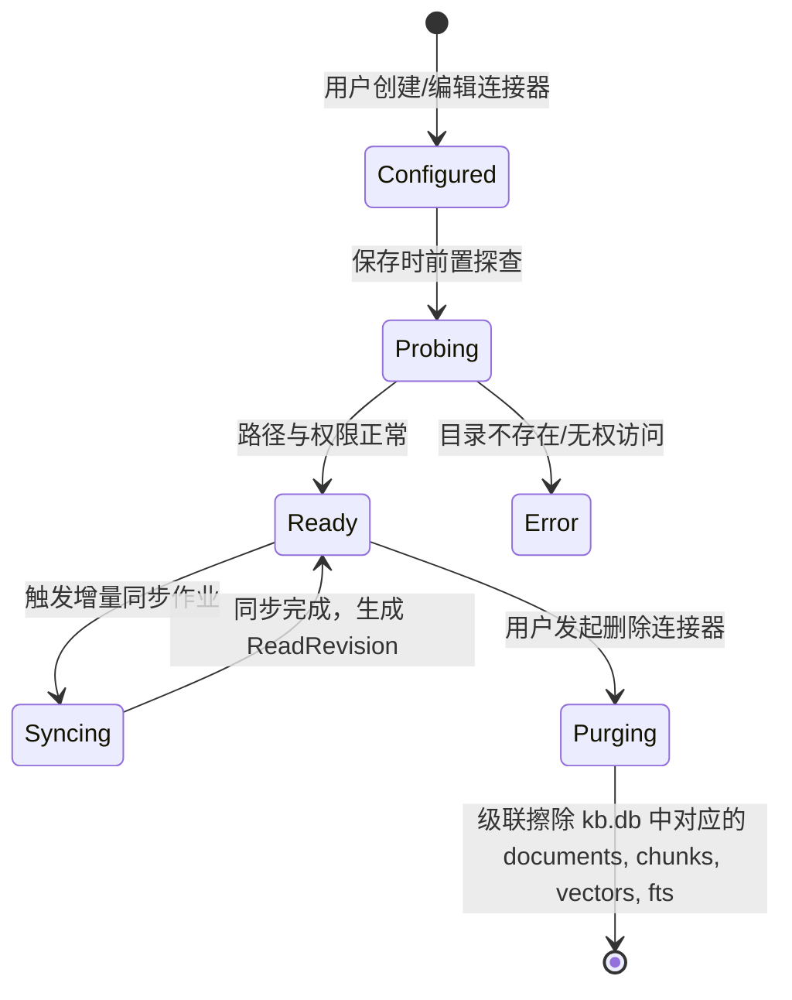
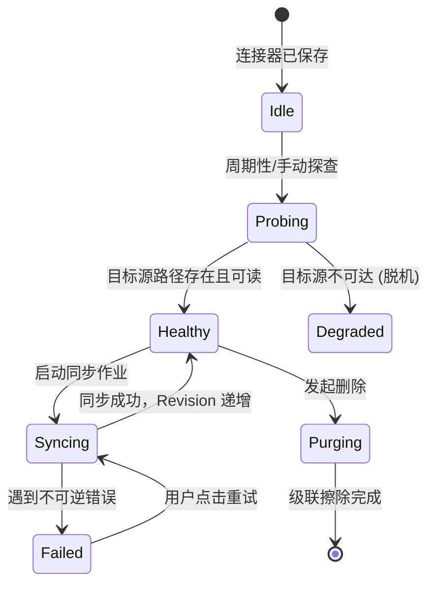

# ReferenceRAG 系统能力全景审计、Jev 认知配置、连接器完整 CRUD 与悬空能力闭环可行性调研与架构设计

> **报告版本**：v1.0.0  
> **制定日期**：2026-11-10  
> **调研主题**：Jev 在线认知服务落地状态、知识库连接器 CRUD 完整闭环、全系统“后端孤岛/悬空功能”审计、全系统“CRUD 半成品”梳理与基于设计模式的架构演进方案。  
> **归档位置**：`docs/system-capability-audit-and-crud-closure-feasibility-study.md`

---

## 目录
- [一、 调研背景与问题陈述](#一-调研背景与问题陈述)
- [二、 议题一：TypeSafe AI System One (Jev) 在线认知服务审计与前端配置方案](#二-议题一typesafe-ai-system-one-jev-在线认知服务审计与前端配置方案)
- [三、 议题二：知识库连接器（Connectors）CRUD 现状与级联生命周期闭环](#三-议题二知识库连接器connectors-crud-现状与级联生命周期闭环)
- [四、 议题三：全系统“后端具备逻辑、前端缺少配置”悬空功能清单](#四-议题三全系统后端具备逻辑前端缺少配置悬空功能清单)
- [五、 议题四：全系统“仅有新增、缺少删改查”功能闭环清单](#五-议题四全系统仅有新增缺少删改查功能闭环清单)
- [六、 架构设计模式优化方案（适配器、策略与状态机）](#六-架构设计模式优化方案适配器策略与状态机)
- [七、 业界主流方案对比与借鉴（Dify、FastGPT、Ragflow、Langfuse）](#七-业界主流方案对比与借鉴difyfastgptragflowlangfuse)
- [八、 分阶段落地实施路径与质量门禁设计](#八-分阶段落地实施路径与质量门禁设计)

---

## 一、 调研背景与问题陈述

随着 ReferenceRAG 演进至第二代物理多知识库与复合检索架构，系统后端沉淀了大量具备行业领先水准的工程与算法能力（如基于认知科学的 System One/Two 双系统分流、长句阶梯词法重排、DPP 行列式点过程多样性采样、自适应弹性熔断器、RRF 跨库融合等）。

然而，在近期的集成与全链路走查中，暴露出了两类显著的“架构错位与体验割裂”问题：
1. **控制面与数据面脱节（功能孤岛 / Orphan Features）**：后端已具备完整服务甚至单元测试，但前端配置界面（UI）完全缺失，导致核心特性无法通过可视化界面启用或调节，用户只能靠手动编辑磁盘上的 `appsettings.json`，极易因格式错误或字段丢失导致服务崩溃。
2. **数据实体生命周期未闭环（半成品 CRUD / Half-Baked Lifecycle）**：部分模块“重写轻管”，仅实现了 `Create`（新增），在 `Delete`（缺少级联清理产生僵尸数据）、`Update`（修改元数据不刷新底层存储状态）、`Read`（缺少健康度探查与聚合统计）方面严重缺失。

针对用户提出的四大核心问题，本调研进行深度代码审计、业界主流方案对标，并提出系统性的架构演进与落地执行规划。

---

## 二、 议题一：TypeSafe AI System One (Jev) 在线认知服务审计与前端配置方案

### 2.1 Jev 在线服务当前是否已在使用？

**审计结论：后端已完全具备接入与调度能力，但默认运行时因缺乏有效配置而处于“休眠挂起”状态。**

#### 1. 后端实现现状代码走查
- **基础设施客户端**：
  在 [`Infrastructure/ReferenceRAG.Infrastructure/Features/Cognitive/JevSystemOneClient.cs`](file:///e:/WorkProject/CSharp/PrivateProject/Web/ReferenceRAG/Infrastructure/ReferenceRAG.Infrastructure/Features/Cognitive/JevSystemOneClient.cs) 中，实现了与 `https://api.typesafe.ai/v1/systemone` 端点的异步 REST 交互，包含：
  - `POST /v1/systemone/classify`：毫秒级意图分类（Intent: `ChitChat`, `DirectKnowledge`, `ComplexRetrieval`）与检索置信度判定。
  - `POST /v1/systemone/assess`：回答忠实度检测与幻觉风险评估。
- **高层认知决策引擎**：
  在 [`Infrastructure/ReferenceRAG.Infrastructure/Features/Cognitive/JevDecisionEngine.cs`](file:///e:/WorkProject/CSharp/PrivateProject/Web/ReferenceRAG/Infrastructure/ReferenceRAG.Infrastructure/Features/Cognitive/JevDecisionEngine.cs) 中，实现了 [`IJevDecisionEngine`](file:///e:/WorkProject/CSharp/PrivateProject/Web/ReferenceRAG/Infrastructure/ReferenceRAG.Infrastructure/Features/Cognitive/IJevDecisionEngine.cs)，支持决策缓存、置信度阈值过滤与异常自动降级。
- **意图路由策略链注入**：
  在 [`Business/ReferenceRAG.Business/Features/Chat/Services/JevSystemOneRoutingStrategy.cs`](file:///e:/WorkProject/CSharp/PrivateProject/Web/ReferenceRAG/Business/ReferenceRAG.Business/Features/Chat/Services/JevSystemOneRoutingStrategy.cs) 中，被注册为意图路由策略链中的高优先级策略（Priority 80）。当判定为 `ChitChat` 时，可在 **80ms 内极速短路跳过知识库检索**，避免无意义的向量计算与切片召回。
- **对话服务依赖装配**：
  在 [`Business/ReferenceRAG.Business/Features/Chat/Services/MafChatService.cs#L211-L235`](file:///e:/WorkProject/CSharp/PrivateProject/Web/ReferenceRAG/Business/ReferenceRAG.Business/Features/Chat/Services/MafChatService.cs#L211-L235) 中：
  ```csharp
  var ragCfg = _configManager.Load();
  if (ragCfg.SystemOne != null && ragCfg.SystemOne.Enabled &&
      !string.IsNullOrWhiteSpace(ragCfg.SystemOne.ApiKey) &&
      !ragCfg.SystemOne.ApiKey.StartsWith("<", StringComparison.Ordinal))
  {
      var client = new JevSystemOneClient(ragCfg.SystemOne.ApiKey, ragCfg.SystemOne.BaseUrl, ragCfg.SystemOne.Model, ...);
      _jevDecisionEngine = new JevDecisionEngine(client, enabled: true, retrievalThreshold: ragCfg.SystemOne.RetrievalConfidenceThreshold);
  }
  ```

#### 2. 未能真实生效的原因分析
1. **缺少前端凭据输入与引导**：`appsettings.json` 中 `SystemOne.ApiKey` 为空。
2. **静默降级策略**：若 `ApiKey` 为空，`_jevDecisionEngine` 直接置 `null`，路由策略返回 `RoutingDecision.Unhandled("Jev 决策引擎未就绪或未启用")`，系统静默回退至传统的全量大模型慢路由或默认检索，用户无感知。

### 2.2 前端目前如何配置？为什么无法配置？

**审计结论：目前前端完全没有提供 Jev/SystemOne 的任何配置入口。**

- **前端视图排查**：检查 [`Business/ReferenceRAG.Business/wwwroot/app/views/Settings.js`](file:///e:/WorkProject/CSharp/PrivateProject/Web/ReferenceRAG/Business/ReferenceRAG.Business/wwwroot/app/views/Settings.js) 和 `Chat.js`，全局搜索 `SystemOne`、`Jev`、`jev`，匹配结果为 **0**。
- **控制器层排查**：在 [`Host/ReferenceRAG.ApiHost/Controllers/SettingsController.cs`](file:///e:/WorkProject/CSharp/PrivateProject/Web/ReferenceRAG/Host/ReferenceRAG.ApiHost/Controllers/SettingsController.cs) 中：
  - `Get()` 仅对 `Chat.OpenAiApi.ApiKey`、`Service.ApiKey`、`Embedding.ApiKey`、`Rerank.ApiKey` 进行了掩码脱敏，**漏掉了 `SystemOne.ApiKey`**。如果用户手动写入了 Key，前端调接口时会直接拿到明文，或者在保存时因掩码处理缺失被置空。
  - `Update()` 中没有对 `SystemOne.ApiKey` 编写保留回退保护（Masked fallback protection）。
  - 保存后没有调用 `_chatService.ReloadJevDecisionEngine()` 进行热重载。

### 2.3 Jev 前端配置化与动态激活完整方案

#### 1. 前端交互设计 (`Settings.js` -> 模型与推理 / 认知路由)
在 `Settings.js` 的 `models` 大类下，扩展专门的「认知与意图路由」二级 Tab 或卡片：
- **功能开关**：`启用 TypeSafe AI System One 极速认知路由` (Switch)
- **服务地址**：`端点 URL` (Input，默认 `https://api.typesafe.ai/v1/systemone`)
- **认证密钥**：`API Key` (Password Input，带“已配置”状态感知与清除按钮)
- **模型规格**：`模型标识` (Select/Input，默认 `jev-latest`，可选 `jev-flash`, `jev-pro`)
- **决策阈值**：`检索触发置信度阈值` (Slider 0.0 ~ 1.0，默认 0.65)
- **超时保护**：`单次决策超时` (InputNumber，默认 5000ms)
- **连通性测试按钮**：`测试 Jev 服务连通性` (点击调用后台 `/api/settings/test-systemone`，实时验证 Token 有效性与 RTT 延迟)

#### 2. 后端控制器适配 (`SettingsController.cs` & `MafChatService.cs`)
- 在 `SettingsController.Get()` 增加脱敏：
  ```csharp
  if (config.SystemOne != null)
  {
      config.SystemOne.ApiKeyConfigured = !string.IsNullOrWhiteSpace(config.SystemOne.ApiKey);
      config.SystemOne.ApiKey = MaskKey(config.SystemOne.ApiKey);
  }
  ```
- 在 `SettingsController.Update()` 增加掩码保持与热重载：
  ```csharp
  if (config.SystemOne != null && current.SystemOne != null && config.SystemOne.ApiKey?.Contains("****") == true)
  {
      config.SystemOne.ApiKey = current.SystemOne.ApiKey;
  }
  _chatService?.ReloadSystemOneEngine(config.SystemOne);
  ```

---

## 三、 议题二：知识库连接器（Connectors）CRUD 现状与级联生命周期闭环

### 3.1 知识库连接器 CRUD 现状

| 操作维 | 后端仓储 (`CatalogStore`) | 控制器 API (`KnowledgeBasesController`) | 前端界面 (`KnowledgeBases.js`) | 当前工作状态 |
| :--- | :--- | :--- | :--- | :--- |
| **增 (Create)** | `SaveConnectorAsync` | `POST /{id}/connectors` | 抽屉内表单添加（路径/正则） | 可用 |
| **查 (Read)** | `GetConnectorsByKnowledgeBaseAsync` | `GET /{id}/connectors` | 抽屉内连接器列表卡片渲染 | 可用（但缺统计） |
| **改 (Update)** | `SaveConnectorAsync` | `PUT /{id}/connectors/{connectorId}` | 编辑模态框（改路径/正则/启用） | 逻辑有缺陷 |
| **删 (Delete)** | `DeleteConnectorAsync` | `DELETE /{id}/connectors/{connectorId}` | 气泡确认框删除按钮 | **重大缺陷：非级联** |
| **操作 (Action)**| `SaveJobAsync` (作业表) | `POST /{id}/jobs/sync` | 点击同步按钮触发后台作业 | 可用 |

### 3.2 现有连接器机制的四大致命缺陷

#### 缺陷 1：删（Delete）缺少物理级联清理（Zombie Data Leak）
- **现象**：当在前端或 API 中删除一个连接器时，底层仅执行了 `DELETE FROM connectors WHERE id = @id`。
- **后果**：该连接器以往同步到 `kb.db` 中的所有 `documents`（关联字段 `connector_id`）、`chunks`、`fts_chunks`、`chunk_vectors` 全都残留在 SQLite 物理数据库中！这些切片不仅继续占用磁盘，而且在后续的词法检索、向量检索和混合检索中**依然会被召回**。用户明明在界面删除了数据源，系统却依然回答该数据源的内容，造成严重的数据安全与业务一致性事故。

#### 缺陷 2：改（Update）未重置同步状态与失效过期文档
- **现象**：当用户将连接器的 `TargetPath` 从 `/data/docs_v1` 修改为 `/data/docs_v2` 时，系统仅递增了 `ConfigRevision` 并更新了连接器表。
- **后果**：`/data/docs_v1` 的历史旧文档依然驻留在 `kb.db` 中；后续触发同步只会拉取 `/data/docs_v2`，导致两个完全不同目录的文件混在一个知识库中，且无法通过连接器去重。

#### 缺陷 3：查（Read）缺少健康状态探查与切片指标
- **现象**：前端连接器卡片仅展示静态的 `TargetPath` 和 `FilePattern`。
- **缺失**：无法获知该连接器对应的本地目录是否存在、是否脱机（例如挂载的网络共享盘断开）、该连接器当前贡献了多少文件、多少切片，缺少连通性“探查（Probe）”功能。

#### 缺陷 4：数据源类型单一（缺少多源适配器扩展）
- **现状**：代码中仅简单做了 `switch` 匹配 `SingleFileConnector` 与 `LocalFolderConnector`，缺乏业界通用的标准抽象。

### 3.3 连接器全生命周期重构方案



#### 实施核心措施：
1. **在 `IKnowledgeBaseStorage` 与 `SqliteKnowledgeBaseStore` 引入级联清除方法**：
   ```csharp
   Task<int> PurgeConnectorDataAsync(string connectorId, CancellationToken ct = default);
   ```
   执行原子事务：
   ```sql
   DELETE FROM fts_chunks WHERE document_id IN (SELECT id FROM documents WHERE connector_id = @c_id);
   DELETE FROM fts_chunks_lexical WHERE document_id IN (SELECT id FROM documents WHERE connector_id = @c_id);
   DELETE FROM chunk_vectors WHERE document_id IN (SELECT id FROM documents WHERE connector_id = @c_id);
   DELETE FROM chunks WHERE document_id IN (SELECT id FROM documents WHERE connector_id = @c_id);
   DELETE FROM documents WHERE connector_id = @c_id;
   ```
2. **在 `DeleteConnectorAsync` 接入清理策略**：
   删除连接器时默认物理级联清理对应 `kb.db` 的文档和切片，彻底消除“僵尸文档”。
3. **在连接器列表 API 聚合真实指标**：
   返回 `ActiveFileCount`、`ActiveChunkCount` 与 `IsPathAccessible`。

---

## 四、 议题三：全系统“后端具备逻辑、前端缺少配置”悬空功能清单

经过对全部 Controller、Core 算法库及配置类的全量反向审计，梳理出系统目前存在的 **5 大类悬空/孤岛功能**：

### 4.1 检索算法流水线鲁棒性参数 (Search Resilience & Diversity)
后端在 `ReferenceRAG.Business` 与 `ReferenceRAG.Core` 中实现了诸多高精尖算法，但在前端 `Settings.js` 的 `retrieval` 标签页中完全没有配置入口：

| 后端模块 / 类名 | 配置项路径 (`SearchConfig`) | 功能说明 | 前端现状 | 优化必要性 |
| :--- | :--- | :--- | :--- | :--- |
| [`ResilienceCircuitBreaker`](file:///e:/WorkProject/CSharp/PrivateProject/Web/ReferenceRAG/Infrastructure/ReferenceRAG.Infrastructure/Features/Search/Resilience/ResilienceCircuitBreaker.cs) | `Search.CircuitBreaker` (FailureThreshold, RecoverySeconds, DegradeToLexical) | 向量/重排模型连续失败时自动熔断并安全降级到纯词法检索 | **完全无配置** | 高：生产高可用关键开关 |
| [`DppKernelDiversitySelector`](file:///e:/WorkProject/CSharp/PrivateProject/Web/ReferenceRAG/Business/ReferenceRAG.Business/Features/Search/Diversity/DppKernelDiversitySelector.cs) | `Search.DppDiversity` (Enabled, LambdaPenalty) | 行列式点过程采样，抑制语义高重复切片，增强结果多样性 | **完全无配置** | 中：长文本问答防信息冗余 |
| [`StatisticalPrfOperator`](file:///e:/WorkProject/CSharp/PrivateProject/Web/ReferenceRAG/Business/ReferenceRAG.Business/Features/Search/Lexical/StatisticalPrfOperator.cs) | `Search.Prf` (Enabled, MaxExpansionTerms, FeedbackWeight) | 统计伪相关反馈，基于首轮 BM25 词频动态扩展近义检索词 | **完全无配置** | 中：提高中文词法查全率 |
| [`TokenizationCacheProxy`](file:///e:/WorkProject/CSharp/PrivateProject/Web/ReferenceRAG/Infrastructure/ReferenceRAG.Infrastructure/Features/Search/Lexical/TokenizationCacheProxy.cs) | `Search.TokenCache` (Capacity, TtlSeconds) | jieba 中文断词 LRU 内存缓存，避免高频热词重复切词 | **完全无配置** | 低：默认参数表现稳定 |
| [`LongQueryRefiner`](file:///e:/WorkProject/CSharp/PrivateProject/Web/ReferenceRAG/Infrastructure/ReferenceRAG.Infrastructure/Features/Search/Lexical/LongQueryRefiner.cs) | `Search.LongQuery` (Tier1StrictNear, Tier2Weighted, Tier3Fallback) | 中长句多层阶梯分级检索阈值 | **完全无配置** | 中：调优中长自然语言检索 |

### 4.2 跨知识库联合检索融合策略与权重分配 (Cross-KB Fusion)
- **后端能力**：`CrossKnowledgeBaseSearchRequest` 支持多库联合召回，底层具备 [`RrfSearchFusionStrategy`](file:///e:/WorkProject/CSharp/PrivateProject/Web/ReferenceRAG/Infrastructure/ReferenceRAG.Infrastructure/Features/KnowledgeBase/Storage/RrfSearchFusionStrategy.cs)（倒数排名融合，参数 $k=60$）、`WeightedSumFusionStrategy`、`ScoreKind` 归一化。
- **前端现状**：在 `/search` 页面中，仅有一个简单的“选择知识库”多选下拉列表，**完全无法配置融合策略、RRF 常数 $k$、各知识库自定义权重分配**。

### 4.3 模型生命周期与显存/内存驻留策略 (Model Retention & Eviction)
- **后端能力**：在 `ModelRetentionPolicyConfig` 中支持滑动过期卸载（`SlidingExpirationMinutes`）、闲置超时自动释放（`UnloadAfterIdleMinutes`）以及淘汰策略（`EvictionStrategy: LRU / LFU / Manual`）。
- **前端现状**：“模型管理”和“系统设置”中只有模型的下载、切换与删除，**完全没有显存超时释放时间、自动休眠策略的可视化调节控件**，导致显卡显存或大模型内存长时间无法被释放。

### 4.4 知识图谱聚类与时效衰减参数 (Graph Advanced Extraction)
- **后端能力**：`GraphConfig` 中定义了实体链接开关（`EnableEntityLinking`）、社区发现算法（`CommunityDetectionAlgorithm: Louvain / LabelPropagation`）、最小共现频次（`MinCooccurrence`）、时间衰减衰减因子（`WeightDecay`）。
- **前端现状**：`Settings.js` 中只有一个简单的最小权重滑块，聚类算法与实体抽取过滤条件均无法调整。

---

## 五、 议题四：全系统“仅有新增、缺少删改查”功能闭环清单

经过对业务实体数据生命周期的排查，发现以下模块属于“Half-Baked CRUD”：

### 5.1 知识库切片（Chunks）与文档（Documents）HITL 治理
- **现状**：
  - 查：支持按知识库/连接器分页查看 Documents 和 Chunks。
  - 改：支持在线更新 Chunk 正文（`UpdateChunk`），支持切片和文档的启用/停用（`Toggle`）。
  - 删：支持删除单篇文档与单个切片。
- **缺失点（缺新增）**：
  - **缺少“手动新增切片/追加单篇文档（Add Document/Chunk）”**：用户在运维知识库时，常需临时录入一条 FAQ、紧急通知或纠错补丁。目前必须在操作系统建一个本地文件并全量同步连接器，无法在 Web 界面直接创建一篇文档或直接向现有文档追加切片。

### 5.2 知识库索引与同步作业历史管理（Index Jobs）
- **现状**：
  - 增：`POST /api/knowledgebases/{id}/jobs`（触发同步/全量索引）。
  - 查：`GET /api/knowledgebases/{id}/jobs`（查询作业列表及状态）。
  - 改：`POST /api/knowledgebases/jobs/{id}/cancel`（取消运行中作业）。
- **缺失点（缺删改）**：
  - **缺少删除/清理作业记录（Delete / Prune Jobs）**：运行历史已成功的作业或失败的作业记录在 `catalog.db` 的 `kb_jobs` 表中**永久保留、无法删除**，造成历史日志无限膨胀。
  - **缺少失败重试（Retry Failed Job）**：对于网络波动失败的作业，无一键重试按钮。

### 5.3 在线模型服务商配置（Model Providers）
- **现状**：在 [`ModelsController.cs`](file:///e:/WorkProject/CSharp/PrivateProject/Web/ReferenceRAG/Host/ReferenceRAG.ApiHost/Controllers/ModelsController.cs) 中支持 `GetModelProviders`、`SaveModelProvider`、`DeleteModelProvider`、`ToggleProviderEnabled`。
- **缺失点（缺编辑细节）**：
  - 在前端 [`Models.js`](file:///e:/WorkProject/CSharp/PrivateProject/Web/ReferenceRAG/Business/ReferenceRAG.Business/wwwroot/app/views/Models.js) 中，用户一旦添加了某个提供商（例如 SiliconFlow），若填写了错误的 BaseUrl 或想要更新 API Key，界面上**没有“编辑提供商（Edit Provider）”模态框**，用户必须先删除已有提供商，再重新录入全部信息，导致模型关联丢失。

### 5.4 BM25 词法索引局部清理
- **现状**：`BM25IndexController.cs` 提供了 `ClearIndex([FromQuery] string? kbId = null)`。
- **缺失点（缺局部操作）**：
  - 只能整库全部清空，**缺少按连接器或按指定文件局部清理/重新索引**的能力。

---

## 六、 架构设计模式优化方案（适配器、策略与状态机）

为从根本上解决上述孤岛与生命周期割裂问题，本方案引入三大设计模式对系统关键层进行重构抽象：

### 6.1 适配器模式 (Adapter Pattern)：统一多源连接器与认知决策抽象

#### 1. 多源数据连接器适配器 (`IDataConnectorAdapter`)
消除将连接器硬编码绑定为本地文件夹的弊端：
```csharp
public interface IDataConnectorAdapter
{
    string Kind { get; }
    Task<ConnectorProbeResult> ProbeAsync(ConnectorDefinition def, CancellationToken ct);
    IAsyncEnumerable<RawDocumentItem> FetchDocumentsAsync(ConnectorDefinition def, CancellationToken ct);
    Task<int> PurgeConnectorDataAsync(string connectorId, IKnowledgeBaseStorage storage, CancellationToken ct);
}
```
通过注册驱动表（`LocalFolderAdapter`, `SingleFileAdapter`, `S3BucketAdapter`, `GitRepoAdapter`），后续新增数据源只需编写一个适配器实现，前端通过元数据动态渲染对应表单字段。

#### 2. 认知决策引擎适配器 (`ICognitiveDecisionAdapter`)
将 `SystemOne (Jev)`、本地小型模型（如 ONNX 意图分类模型）以及通用 OpenAI 兼容小模型统一抽象为决策适配器，为上层 `CompositeIntentRouter` 提供一致的响应结构。

---

### 6.2 策略模式 (Strategy Pattern)：连接器清理与多库召回融合策略

#### 1. 连接器删除清理策略 (`ConnectorDeletionStrategy`)
- **`CascadePurgeStrategy` (默认硬删除)**：原子事务级联删除 `documents`、`chunks`、`chunk_vectors`、`fts_chunks`，保证零脏数据。
- **`SoftArchiveStrategy` (软下线策略)**：保留切片物理存储，仅将 `documents.enabled = 0` 和 `chunks.enabled = 0`，支持未来重新恢复连接器时秒级上线。

#### 2. 检索结果融合策略 (`ISearchFusionStrategy`)
- **`RrfFusionStrategy`**：基于倒数排名的无参数或单参数（$k$）稳定融合。
- **`WeightedSumFusionStrategy`**：允许用户在前端为每个知识库指定重要性权重（例如“核心官方文档”权重 1.0，“社区问答库”权重 0.5）。

---

### 6.3 状态机模式 (State Machine Pattern)：连接器同步生命周期与 Jev 健康熔断

#### 1. 连接器生命周期状态机 (`ConnectorSyncStateMachine`)


#### 2. Jev 在线服务健康度探查状态机 (`CognitiveServiceStateMachine`)
- **`Healthy`**：连续正常调用，RTT < 200ms。
- **`Degraded`**：调用超时或报错 1 次，进入保护观察，降低重试频率。
- **`CircuitBroken`**：连续失败 3 次，熔断器打开（60s 冷却），自动降级为规则路由器，绝不拖慢用户主对话流。

---

## 七、 业界主流方案对比与借鉴（Dify、FastGPT、Ragflow、Langfuse）

| 维度 / 产品 | **Dify** | **FastGPT** | **Ragflow** | **ReferenceRAG (演进后)** |
| :--- | :--- | :--- | :--- | :--- |
| **数据源连接器架构** | 抽象为 Providers (Folder, Notion, Web, S3) | 树形分组 + 外部 API 导入 | 深度解析器插件化 | **统一 `IDataConnectorAdapter` + 知识库独立挂载** |
| **连接器删除行为** | 弹窗提供 Checkbox 询问是否级联清理已切片文档 | 级联删除知识库数据 | 级联物理删除 | **`CascadePurgeStrategy` 原子事务级联清理** |
| **意图与快思考分流 (System 1)** | 支持前置 Agent/Function Calling 分流 | 专门的意图识别节点（LLM/关键词） | 依赖后置 Rerank | **Jev 在线极速分类 (80ms) + 本地规则复合路由** |
| **高级检索算法可见度** | 高级设置中暴露 TopK、Rerank 阈值、Score 过滤 | 暴露混合检索比例滑块 (BM25 vs 向量) | 暴露完整加权公式与分词器精调 | **暴露完整 Resilience 熔断、DPP 多样性、PRF 伪相关反馈** |
| **HITL 手动增补数据** | 支持手动添加单篇文本、QA 对、在线编辑切片 | 支持单条文本录入与切片拆分 | 强可视化切片调整与手动新增 | **HITL 抽屉新增“手动追加单篇文档与切片”** |
| **作业历史管理** | 保留并支持清除历史同步任务 | 队列化管理，自动滚动覆盖 | 后台任务日志持久化 | **支持单作业删除、批量清理与失败重试** |

---

## 八、 分阶段落地实施路径与质量门禁设计

为快速将上述方案闭环落地，建议按以下三阶段依次推进：

### 阶段一：Jev 认知服务前端闭环与安全热重载 (P0)
1. **SettingsController 改造**：在 `Get()` 对 `SystemOne.ApiKey` 增加脱敏掩码，在 `Update()` 增加保留保护。
2. **Settings.js 前端界面呈现**：在 `models` 下新增「意图路由与认知引擎」表单卡片，包含开关、端点、Key、模型、阈值滑块与连通性测试按钮。
3. **MafChatService 热重载接口**：实现 `ReloadSystemOneEngine(SystemOneConfig config)`，配置保存后无需重启即可热生效。

### 阶段二：连接器级联删除清理与状态探查 (P0)
1. **底层级联清除**：在 `SqliteKnowledgeBaseStore` 实现 `PurgeConnectorDataAsync(connectorId)`，原子清除关联的 chunks, vectors, fts, documents。
2. **连接器删除接口完善**：在 `KnowledgeBaseService.DeleteConnectorAsync` 增加物理级联清理调用。
3. **连接器状态探查与指标**：增加 `GET /{id}/connectors/status`，返回文件数、切片数、目录是否存在。
4. **前端抽屉优化**：连接器卡片展示实际文件切片数、探查状态徽标，删除时提示“是否同时清理该数据源已入库的全部切片”。

### 阶段三：全系统悬空功能与 CRUD 缺漏补齐 (P1)
1. **检索设置增强**：在 `Settings.js` 的 `retrieval` 标签页，增加“高级检索流水线”折叠卡片，暴露弹性熔断器（Circuit Breaker）、DPP 多样性采样、统计伪相关反馈（PRF）调节项。
2. **作业历史管理闭环**：在 `JobsController` 增加 `DELETE /api/knowledgebases/jobs/{id}` 与 `POST /api/knowledgebases/jobs/prune`，前端提供清理历史任务按钮。
3. **HITL 手动数据追加**：在知识库文档治理抽屉中，提供“直接录入单篇文本/切片”表单。

### 阶段四：防回归质量门禁设计
- **门禁 1：Jev 配置脱敏与热生效测试**（断言 ApiKey 掩码正确且热重载后路由策略激活）。
- **门禁 2：连接器级联删除测试**（断言删除连接器后，`chunks` 与 `documents` 表中对应 `connector_id` 计数绝对为 0，检索无法命中）。
- **门禁 3：高级检索算法配置回写与生效测试**（断言熔断器与 DPP 配置项能正常持久化至 SQLite/Config）。

---

> [!TIP]
> 详细设计方案已正式归档于 [system-capability-audit-and-crud-closure-feasibility-study.md](file:///e:/WorkProject/CSharp/PrivateProject/Web/ReferenceRAG/docs/system-capability-audit-and-crud-closure-feasibility-study.md)，可直接作为下一步版本落地迭代的设计标准与实施依据。
